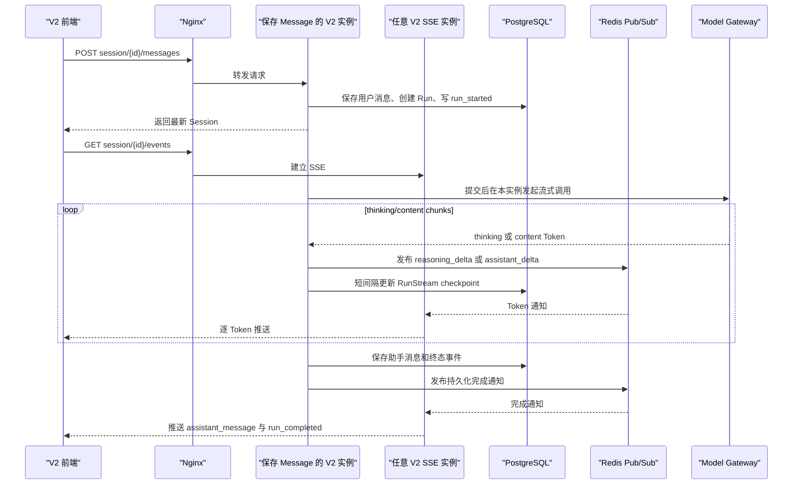

# Data Agent V2 重建实施规划

状态：草案 1.1
日期：2026-08-01  
范围：`data-agent-v2` 独立产品仓库、前后端、公开契约以及最终切换；前端视觉与交互不重做

## 1. 结论与已确定决策

`data-agent-v2` 的目标不是做一个缩小版 Demo，也不是把 V1 代码复制后改包名，而是在保持现有产品能力和前端体验的前提下，重新建立一个更容易理解、修改和验证的产品仓库。

以下决策已经确定：

1. 不让 V1、V2 同时承接流量，不做灰度、影子流量、A/B 或双写对比。
2. V1 在建设期间只作为功能、接口、数据规则和异常行为的参考实现。
3. 前端页面、视觉层级和交互流程参照 V1，不安排 UI 重设计；代码按阶段从 V1 当前快照迁移，阶段 1 只迁移认证与最小对话切片。
4. V2 优先兼容 V1 前端正在消费的 REST、SSE、Cookie 和错误响应契约。
5. V2 内部不沿用 V1 的 `core/dao/connectors/capabilities/scheduler/api` 横向模块拆分。
6. V2 服务端采用模块化单体：一个可部署服务，按业务能力分包；评测 CLI 独立，因为它只通过公开 HTTP/SSE 契约访问服务。
7. V2 使用独立数据库 schema；每一阶段直接建立该阶段表的目标结构，不复制 V1 的历史迁移过程，也不提前创建未来阶段的表。
8. 最终采用停机切换。若需要保留 V1 历史数据，使用一次性离线迁移，不做在线双写。
9. V2 以多实例方式运行，通过同一 PostgreSQL 和单机 Redis 协作；不引入服务发现，前端统一连接 Nginx。
10. 普通交互式对话由保存用户 Message 的实例执行，不建立 Message/Run 消费队列，也不允许其他实例接管模型调用。

## 2. 目标与非目标

### 2.1 建设目标

- 完整覆盖现有 Data Agent 的用户可见能力和必要的运营能力。
- 按阶段迁移 V1 前端代码并保持已迁移页面的视觉与交互；不要求未迁移页面在早期阶段可用。
- 把会话、运行、模型循环、工具执行和人工交互拆成清晰状态机。
- 让 Metric Platform 保持唯一的语义与数据治理边界，V2 只通过公开 HTTP API 集成。
- 保留租户隔离、认证、密钥保护、审计、调度 fencing、产物加密等安全约束。
- 让新增一个 Tool、Skill、交互类型或运行状态时，只修改所属业务模块及确有数据结构变化时的 `agent-persistence`，不波及无关模块。
- 使故障可以通过 `sessionId`、`runId`、`toolCallId` 和 `requestId` 串联定位。

### 2.2 非目标

- 不重新设计前端组件、文案、布局和交互。
- 不重新实现 Metric Platform 已拥有的数据源、数据集、字段、维度、指标和关系领域。
- 不为了“未来可能微服务化”提前拆服务。
- 不复刻 V1 已被后续迁移废弃的数据源本地所有权模型。
- 不引入消息队列、服务发现、工作流引擎或完整事件溯源框架。
- 不在未明确要求时迁移历史会话数据；是否保留历史数据在切换阶段单独决策。

## 3. V1 基线盘点

当前 V1 后端由 7 个 Maven 模块组成：

| V1 模块 | 当前职责 | V2 处理方式 |
| --- | --- | --- |
| `agent-core` | 会话、Run、上下文、证据、模型和工具抽象 | 拆入 `conversation`、`runtime`、`context`、`evidence` 能力包 |
| `agent-dao` | MyBatis 实体、Mapper、持久化服务 | 收敛到独立 `agent-persistence`，并按业务能力建立子包 |
| `agent-connectors` | Metric Platform HTTP 客户端 | 收敛为 `metric.infrastructure` 下的网关实现 |
| `agent-capabilities` | Skill 资源、Tool 描述与风险 | 收敛为 `capability` 能力包 |
| `agent-scheduler` | 分布式调度、租约、执行 | 收敛为 `scheduler` 能力包，保持独立状态机 |
| `agent-api` | Spring Boot、HTTP、安全、运行时组合、迁移 | `agent-server` 作为唯一组合根 |
| `agent-evals` | 组件评测、会话评测、评分和报告 | 保留为独立 `agent-evals` 模块，只依赖公开契约 |

V1 当前有约 38 个 Controller 方法、16 个 API 迁移加 1 个调度迁移。核心复杂度集中在：

- `AgentSessionService` 同时承担会话命令、Run 生命周期和较多编排职责。
- Metric Platform 客户端与管理 Tool 类体积较大。
- DTO、持久化行模型、领域模型和前端投影之间转换链较长。
- 交互、审批、Secret、Mutation、Tool Invocation 分散在多个包中。
- 调度执行复用了 Agent Run，但拥有另一套执行、事件和恢复生命周期。

V2 的重建对象是 V1 的最终行为，不是 V1 历史代码结构。

## 4. 必须保持的前端兼容契约

### 4.1 REST 资源

V2 应保持以下现有资源路径及语义。实现阶段必须从 V1 Controller 和前端 Client 冻结请求、响应和错误样例。

| 资源组 | 必须覆盖的路径 |
| --- | --- |
| 认证 | `POST /api/v1/auth/login`、`GET /api/v1/auth/session`、`POST /api/v1/auth/logout` |
| 会话 | `GET/POST /api/v1/agent-sessions`、`GET /api/v1/agent-sessions/{sessionId}` |
| 消息与事件 | `POST .../{sessionId}/messages`、`GET .../{sessionId}/events` |
| Metric Identity 绑定 | `PUT .../{sessionId}/metric-identity` |
| 确认 | `POST .../{sessionId}/confirmations/{confirmationId}` |
| 普通交互 | `POST .../{sessionId}/interactions/{interactionId}:resolve` |
| Secret 交互 | `POST .../{sessionId}/interactions/{interactionId}:submit-secret` |
| 审计 | `GET .../{sessionId}/audit-log` |
| Metric Identity | `GET/POST /api/v1/metric-identities`、`GET /{id}`、`POST /{id}:verify`、`POST /{id}:replace-password`、`POST /{id}:deactivate`、`POST :rotate-secrets` |
| 租户控制面 | `POST /api/v1/tenants`、`GET/POST /api/v1/tenants/{tenantId}/members` |
| 产物 | metadata、preview、create-download、download 四类现有路径 |
| 定时任务 | `GET/POST /api/v1/scheduled-tasks`、`GET/PUT/DELETE /{taskId}`、手动触发和执行历史 |
| 任务执行 | 详情、取消和 SSE 事件流 |
| 评测保护 | `GET /api/v1/evaluation/mutation-guard` |

### 4.2 会话 SSE 原始契约与前端投影

V1 后端发送下划线命名的原始事件，`backendAgentClient.ts` 再把它们投影为前端领域事件。V2 必须兼容后端原始事件，不能把前端的点号事件直接当作服务端 wire value。

| V1 后端原始事件 | V1 前端投影/用途 |
| --- | --- |
| `run_started` | `run.started` |
| `user_message`、`assistant_message` | `message.created` |
| `reasoning_delta` | `reasoning.delta` |
| `assistant_delta` | 阶段 1 起作为回答内容的正式逐 Token 事件 |
| `run_phase_changed` | 展示接收、准备上下文、连接模型、思考、回答、保存和终态阶段 |
| `skill_activated` | 保存在 Run 事件历史中；当前 UI 不单独展示 |
| `context_compaction_started`、`context_compaction_completed`、`context_compaction_failed` | `reasoning.delta` |
| `tool_call_started` | `tool.call.started` |
| `tool_call_completed`、`tool_call_result` | `tool.call.completed` |
| `tool_call_failed`、`error` | `tool.call.failed` |
| `interaction_requested`、`interaction_resolved` | 配合 Session 快照中的 `pendingInteraction` 恢复交互卡片 |
| `user_confirmation_requested` | `approval.requested` |
| `user_confirmation_resolved` | `approval.resolved` |
| `run_completed` | `run.completed` |
| `run_failed` | `run.failed` |
| `run_cancelled` | `run.cancelled` |

V1 前端仍监听旧兼容事件 `assistant_delta`，但当前后端生产枚举不生成它。V2 从阶段 1 起将它升级为正式生产事件，与 `reasoning_delta` 分别承载 Ollama `content` 和 `thinking` 的逐 Token 增量；阶段 0 的契约必须明确这一项是 V2 的有意扩展，而不是误抄 V1 行为。

SSE 必须满足：

1. 生命周期事件、最终消息和终态先持久化，后发布；逐 Token delta 允许先通过 Redis 低延迟发布，并按短间隔把累计内容 checkpoint 到数据库。
2. 同一 Run 内 `sequence` 严格递增且唯一，前端按 `(runId, sequence)` 去重。
3. 服务端先订阅 live 通知，再读取当前 Run 快照，避免 replay/live 间隙；两者重叠由前端去重。
4. 断线重连时重放当前 Run 已持久化事件，并从 `agent_run_stream` 恢复累计 thinking、answer 和最新 stream sequence；不要求 Redis 保存历史。
5. 服务端 SSE 是 session-wide 流，Run 终态后不主动关闭；V1 前端收到 `run_completed`、`run_failed` 或 `run_cancelled` 后自行关闭。
6. 多节点部署时，执行实例通过 Redis Pub/Sub 发布 Token 和阶段通知；任一 SSE 实例都能订阅，并用数据库 checkpoint 校正漏失或乱序。
7. SSE 异步 dispatch 必须恢复认证与 Tenant Context，并在完成、超时和错误时释放订阅。

### 4.3 错误与认证

- 保持 `application/problem+json`。
- 保持稳定的 `code`、`requestId`、`errors` 和 HTTP 状态码语义。
- 保持同源 HttpOnly Session Cookie，开发环境继续允许非 Secure Cookie，正式环境必须 Secure。
- 前端不感知 V2 内部异常类型、数据库结构或模型供应商异常。

## 5. V2 目标代码结构

建议仓库结构：

```text
data-agent-v2/
  backend/
    pom.xml
    mvnw.cmd
    .mvn/
    agent-contracts/     # REST/SSE 公开契约模型
    agent-platform/      # 时钟、ID、租户和操作者上下文等无存储基础能力
    agent-persistence/   # 全部 Entity、Mapper、ServiceImpl、MyBatis-Plus 配置和 Flyway 迁移
    agent-auth/          # 认证 API、安全过滤器和认证用例编排
    agent-conversation/  # 会话、消息、Run、SSE 与 Ollama 用例编排
    agent-server/
      src/main/java/com/datagent/agentv2/
        AgentV2Application.java
      src/main/resources/
        application.yml
        agent-skills/
    agent-evals/
  frontend/
    # 按阶段从 V1 当前快照迁移；阶段 1 仅保留认证和最小对话切片
  contracts/
    openapi.yaml
    schemas/
    examples/
    inventories/
  docs/
  AGENTS.md
  README.md
```

业务模块内部按需要使用以下层次，不强制为空包占位：

```text
<capability>/
  api/             # Controller、公开 DTO、错误映射
  application/     # 用例、事务边界、跨领域编排
  domain/          # 状态机、实体、值对象、领域规则
  infrastructure/  # HTTP、Redis、模型供应商等非数据库适配器
```

依赖规则：

1. `api` 只调用 `application`。
2. `application` 编排领域对象和 `agent-persistence` 提供的持久化服务，不直接依赖 Mapper、拼 SQL 或 HTTP。
3. `domain` 不依赖 Spring、MyBatis、HTTP DTO 或模型供应商类型。
4. `agent-persistence` 按业务能力建立 `persistence.auth`、`persistence.conversation` 等子包，集中持有 Entity、Mapper 和基于 MyBatis-Plus `ServiceImpl` 的持久化服务；业务模块不得声明 Mapper 或直接使用 MyBatis API。
5. 业务能力包之间只通过 application facade 或明确事件交互。
6. `agent-server` 是唯一可部署组合根，只有 `AgentV2Application` 和配置类负责最终依赖装配。

## 6. 核心运行模型

### 6.1 关键聚合与标识

| 对象 | 责任 |
| --- | --- |
| Session | 会话元数据、所属租户、类型、绑定身份、当前 Run 指针和版本 |
| Message | 用户/助手可见消息；不混放 Secret、完整 Tool 参数或模型内部消息 |
| Run | 一次用户消息或调度触发产生的一次执行 |
| RunEvent | 面向前端和审计的顺序事件 |
| RunStream | 当前执行轮次的 phase、stream sequence、累计 thinking 和累计 answer |
| ModelMessage | 供应商无关的 system/user/assistant/tool 模型上下文 |
| ToolInvocation | Tool 输入摘要、状态、输出摘要、错误和幂等标识 |
| PendingInteraction | 身份选择、歧义消解、审批、Secret 等等待用户状态 |
| SkillSnapshot | Run 启动时使用的 Skill 内容及版本快照 |
| IdentitySnapshot | Run 启动时使用的 Metric Identity 权限与认证版本快照 |
| AnalysisState | 可恢复的 Skill、语义对象、指标/维度、过滤、成员、关系、时间范围和查询校验状态 |
| Artifact/Citation | 大结果产物、加密载荷和最终回答引用 |

所有运行对象必须同时带 `tenantId`。任何只按 `id` 查询、更新或删除租户数据的实现都不允许进入完成状态。

### 6.2 Run 状态机

对前端和持久化层保持 V1 状态值：

```text
IDLE -> RUNNING -> DONE
          |  |
          |  +-> WAITING_FOR_USER -> RUNNING
          |  +-> WAITING_CONFIRMATION -> RUNNING
          |  +-> FAILED
          +----> CANCELLED
```

内部可以另设 `phase` 表达 `PREPARING`、`ROUTING_SKILL`、`CALLING_MODEL`、`EXECUTING_TOOL` 等细粒度阶段，但不能直接改变 V1 对外的 Run 状态值。Session 类型保持 `CHAT` 和 `TASK`；`TASK` 会话仅从任务执行历史进入，不出现在普通聊天会话列表中。

状态约束：

- 同一 Session 同时最多一个活动 Run。
- 状态转换和对应 RunEvent 在同一数据库事务提交。
- 普通 `CHAT` Run 由保存用户 Message 的实例在事务提交后立即执行；不允许其他实例领取或自动重试模型调用。
- `reasoning_delta`、`assistant_delta` 使用独立 stream sequence；最终 Message 和生命周期 RunEvent 仍使用持久化事件 sequence。
- 恢复等待状态时必须校验 `runId`、interaction/confirmation ID、租户和当前状态。
- Run 进入终态后不能再追加非诊断业务事件。
- 调度 Run 使用同一 Agent 运行引擎，但通过 `UNATTENDED` 执行策略禁止请求交互式输入。
- `AnalysisState` 只能保存无凭据的规范化语义状态，并随 Run 持久化，以支持澄清、审批或进程恢复后继续执行。

### 6.3 一次消息的执行顺序



阶段 1 只执行无 Tool、无 Metric Platform 的文本对话。后续 Tool 循环仍在同一交互式 Run 的执行实例内完成；Scheduler 的无人值守执行在阶段 11 单独设计领取、租约和 fencing。

## 7. 数据库重建原则

### 7.1 新基线而非历史重放

V2 不复制 V1 的 V1-V17 后再执行大量 `ALTER/DROP/RENAME`。每个阶段为当期能力创建新迁移，并让每张表首次出现时直接表达当时已确认的目标结构；未来能力不提前建空表。

规划中的表仍按所有权分组，但只在所属阶段落地：

| 分组 | 主要表 |
| --- | --- |
| 租户与认证 | tenant、user_account、tenant_membership、login_session；更完整的 role/control-plane 表在阶段 2 决定 |
| 会话 | agent_session、agent_message、agent_run、agent_run_event、agent_run_stream、agent_audit_record |
| 模型运行 | agent_model_message、tool_invocation、run_skill_snapshot、run_identity_snapshot |
| 交互 | pending_interaction、confirmation、secret_input、pending_metric_mutation |
| 上下文 | context_checkpoint |
| 身份 | metric_identity、metric_identity_secret |
| 证据 | artifact、artifact_payload、citation、query_validation_record |
| 调度 | scheduler_node、scheduled_task、task_assignment、task_runtime、task_fire、task_execution、task_execution_event |

V2 不应新建 V1 早期的 Agent 自有数据源、数据源版本或数据源策略表；这些能力已经属于 Metric Platform。

### 7.2 一致性规则

- 租户数据表必须有 `tenant_id`，唯一键和外键应包含租户维度或明确验证同租户。
- 领域业务表统一包含 `created_at`、`updated_at`、`deleted_at`、`is_deleted`；逻辑删除必须保证删除标记与删除时间一致。追加历史表保留这些字段但禁止业务删除，Outbox 按基础设施保留期硬清理。
- Session 使用版本号做乐观锁，避免重复提交和并发覆盖。
- RunEvent、AuditRecord 采用追加写；业务代码不能更新历史事件内容。
- ToolInvocation 使用 `(run_id, tool_call_id)` 唯一约束。
- 等待交互只允许一个 Pending 状态被原子解析一次。
- 密文、nonce、key version 分列；主密钥不写数据库和源码。
- Artifact 元数据与加密 payload 分表，下载令牌短时有效且不可复用。
- 调度租约更新必须包含 owner、lease version/fencing token 条件。

持久化层强制使用 MyBatis-Plus。普通业务持久化服务继承 `ServiceImpl<Mapper, Entity>`，业务代码不直接注入 Mapper；使用 `MetaObjectHandler`、`@TableLogic`、`@Version`、`TenantLineInnerInterceptor`、`OptimisticLockerInnerInterceptor`、Chain Wrapper 和 `ServiceImpl` CRUD。Mapper 只继承 `BaseMapper`，仅当 MyBatis-Plus 无法表达且经过正确性验证时增加定制方法。Outbox 发布和超时 Run 清理等跨租户系统扫描必须使用 `InterceptorIgnoreHelper.execute(...)` 在线程作用域内仅跳过该次 tenant-line 处理并自动恢复，不允许全局绕过租户拦截器。

## 8. 分阶段实施顺序

每一阶段都必须形成一个可独立检查的服务端增量。阶段出口未满足时不进入下一阶段。

### 阶段 0：冻结 V1 行为基线

目标：把“完整实现”变成可核对清单，避免根据记忆重写。

工作项：

1. 以 V1 `fb9621ae` 为产品行为来源，从前端 Client、Controller 和 DTO 三方提取 REST 请求、响应和错误样例；发生冲突时必须在决策清单中明确裁决。
2. 在 `contracts/openapi.yaml` 建立 OpenAPI 3.1，作为 REST 契约唯一权威来源；固化路径、方法、参数、Cookie、分页、时间、空值、状态码和 Problem Detail。
3. 在 `contracts/schemas/` 固化会话 SSE、任务 SSE 和非 REST JSON Schema；记录后端下划线事件与前端点号事件的投影。
4. 在 `contracts/examples/` 保存每个 operation 的成功样例，以及适用的等待、失败和安全边界样例。样例不额外打码；当前工程只使用本地或无价值数据，但不得意外提交真实生产密钥。
5. 在 `contracts/inventories/features.yaml` 建立入口、正常结果、等待状态、失败结果、安全规则和迁移阶段矩阵。
6. 在 `contracts/inventories/tools.yaml` 记录 56 个生产 Tool 的描述、输入 Schema、风险、幂等性、scope、允许 Skill、交互方式、结果码和唯一迁移阶段。
7. 在 `contracts/inventories/skills.yaml` 记录 8 份 Skill/治理资源的名称、职责、版本或内容 Hash 和迁移阶段。
8. 在 `contracts/inventories/legacy-decisions.yaml` 区分最终能力、兼容分支和废弃项；`QUERY_SCOPE` 必须明确裁决。
9. 冻结 `CHAT/TASK`、V1 对外 Run 状态、Session/Message/Run/Event/PendingInteraction DTO，并把 `assistant_delta`、`run_phase_changed` 标为 V2 阶段 1 的有意扩展。
10. 建立契约校验，验证 OpenAPI、JSON Schema、所有样例和 inventory 交叉引用；V2 后续独立构建时不得依赖兄弟 V1 仓库。

出口：每个前端 Client 调用和 V1 Controller 方法都有契约条目；每个 Tool 和 Skill 都有唯一迁移归属；契约与样例自动校验通过。

### 阶段 1：最小流式对话纵向切片

目标：从空仓建立可独立构建、可多实例运行的 V2 产品；用户经 Nginx 登录、创建会话、发送消息，并在页面实时看到 Ollama 的思考、回答 Token 和执行阶段。

工作项：

1. 使用远程仓库 `https://github.com/823338779/data-agent-v2.git` 创建根工作区第三个 submodule，默认分支为 `develop`；建立后端七模块、`frontend` 和 `contracts`。
2. 后端配置 Java 21、Spring Boot 4.1.0、Maven Wrapper、Spotless、配置分层和独立构建命令；`agent-server` 是唯一可部署服务，`agent-evals` 只建立独立可编译骨架，`agent-persistence` 独占全部数据库持久化实现。
3. 从 V1 当前 `develop` 文件快照迁移前端的登录、退出、认证恢复、会话列表、创建会话、聊天消息、运行状态和 SSE 投影；暂不迁移 Metric Identity、Metric 管理、Artifact、审批交互和定时任务页面。
4. 接入 PostgreSQL、Flyway、MyBatis-Plus、Actuator 和必需的单机 Redis。服务按多实例设计，前端和 API 统一通过 Nginx；不引入服务发现或粘性会话。
5. 实现最小认证：tenant、user account、tenant membership、login session、BCrypt、HttpOnly Cookie，以及本地 `admin/admin` 初始化；更完整的租户控制面和授权在阶段 2 扩展。
6. 实现 Session 创建、列表、详情，用户 Message 提交，单 Session 活动 Run 约束，以及 Run/RunEvent 状态投影。
7. 用户 Message 和 Run 在同一事务保存。事务提交后，由保存 Message 的实例立即启动本地 Ollama 流式调用；不扫描 Message，不建立 Run 消费队列，不允许其他实例领取或自动重试该模型调用。
8. 使用 Spring AI `StreamingChatModel` 接入真实 Ollama，默认模型为 `qwen3.5:9b`，启用 thinking；阶段 1 不注册 Tool，不接入 Metric Platform，不做长上下文摘要。
9. 生产 `run_phase_changed`、`reasoning_delta`、`assistant_delta`、`assistant_message`、`run_completed` 和 `run_failed`。页面展示接收问题、准备上下文、连接 Ollama、模型思考、生成回答、保存和终态。
10. Token 通过 Redis Pub/Sub 低延迟通知所有实例；每个 Token 带 `runId`、执行轮次和单调递增 stream sequence。累计 thinking、answer 和 sequence 按短间隔写入 `agent_run_stream`，供刷新、断线、漏通知和跨节点 SSE 校正。
11. 生命周期事件、最终助手 Message 和终态先持久化，再通过 `notification_outbox` 发布。Redis 中断时 Token 展示退化到数据库 checkpoint，最终结果不丢失。
12. 建立 `Clock`、带资源前缀的 ID 生成、UTC JSON、事务后回调、request/tenant context、统一 Problem Detail 和 `requestId` 关联日志。
13. 本阶段建立 10 张表：`tenant`、`user_account`、`tenant_membership`、`login_session`、`agent_session`、`agent_message`、`agent_run`、`agent_run_event`、`agent_run_stream`、`notification_outbox`。
14. 领域业务表统一包含 `created_at`、`updated_at`、`deleted_at`、`is_deleted`；普通持久化服务继承 MyBatis-Plus `ServiceImpl`，使用自动填充、逻辑删除、乐观锁、租户拦截器和 Chain Wrapper，业务代码不直接调用 Mapper。
15. 为上下文设置阶段 1 的可配置硬上限，按完整消息从最近向前截取；不在本阶段实现摘要。保存 Message 的实例异常退出时，不接管模型调用，Run 超过硬超时后失败，由用户重新发送。

阶段 1 数据库基线：

| 表 | 最小职责与关键约束 |
| --- | --- |
| `tenant` | 租户名称、状态和版本；未删除名称唯一 |
| `user_account` | 用户名、BCrypt 密码 Hash、账号状态和认证版本；未删除用户名唯一 |
| `tenant_membership` | 用户、租户和角色代码；使用独立 ID，并对未删除的 `(tenant_id, user_id, role_code)` 唯一 |
| `login_session` | Session Token Hash、用户、当前租户、过期、撤销和最后访问时间；不保存 Cookie 明文 |
| `agent_session` | `CHAT` 会话、标题、标签、创建者和乐观锁版本 |
| `agent_message` | Session 内顺序、关联 Run、role、author 和可见 content；`(tenant_id, session_id, sequence)` 唯一 |
| `agent_run` | 用户消息、对外 status、内部 phase、进度、执行实例、执行轮次、硬超时、事件序号和乐观锁版本；部分唯一索引限制每个 Session 最多一个活动 Run |
| `agent_run_event` | 面向前端的追加事件；`(tenant_id, run_id, sequence)` 唯一，业务禁止更新或删除 |
| `agent_run_stream` | 每个 Run 当前执行轮次的 phase、stream sequence、累计 thinking、累计 answer 和乐观锁版本 |
| `notification_outbox` | 生命周期与最终结果通知的类型、聚合 ID、版本、发布状态、重试次数和时间；由跨租户内部发布器处理，按保留期硬清理 |

除 Outbox 外，所有表使用带资源前缀的字符串单列主键，以兼容 MyBatis-Plus `@TableId` 并避免复合主键模板代码。所有租户内外键同时包含 `tenant_id`；软删除自然键使用仅覆盖 `is_deleted = false` 的部分唯一索引。

逐 Token 事件信封至少包含 `sessionId`、`runId`、`executionAttempt`、`streamSequence`、`delta` 和 `occurredAt`。`run_phase_changed` 使用固定 phase：`RECEIVED`、`PREPARING_CONTEXT`、`CONNECTING_MODEL`、`THINKING`、`ANSWERING`、`PERSISTING`、`COMPLETED`、`FAILED`。RunStream 默认每 100ms 或累计 32 个模型 chunk（先到者）checkpoint 一次；配置可以调优，但不得改动 sequence 和恢复语义。

出口：前后端从干净克隆可独立构建；空库迁移一次完成；两个 V2 实例共享 PostgreSQL 和单机 Redis，经 Nginx 完成登录、创建会话和真实 Ollama 多轮对话；即使 POST、SSE 落在不同实例，页面仍逐 Token 展示 thinking、answer 和阶段，刷新后可从 checkpoint 恢复。

### 阶段 2：租户、认证与安全上下文

目标：在阶段 1 最小认证之上补齐后续能力依赖的安全边界和控制面。

工作项：

1. 扩展 tenant、account、membership、role 模型和授权规则。
2. 强化阶段 1 的登录、查询会话、退出和 Session Cookie 生命周期。
3. 实现 `TenantPrincipal` 与每个请求的 Tenant Context。
4. 实现租户和成员管理接口。
5. 将 repository 查询约束为必须显式传入 tenant ID。
6. 实现追加式安全审计入口，禁止记录密码、Cookie、Token 和 Secret。
7. 正式环境在未配置正式认证时拒绝启动；请求 Header 认证仅允许显式开启的 `test` profile。
8. 保留本地开发单账号初始化能力，但本地账号和密码配置不得进入正式 profile。
9. 确保普通请求、异步 Run 和 SSE async dispatch 建立并始终清理 Security Context 与 Tenant Context。

出口：V1 登录和租户相关前端流程可直接工作；跨租户 ID 访问统一返回不可枚举的拒绝结果。

### 阶段 3：会话、Run 与 SSE 完整化

目标：在阶段 1 最小流式对话之上补齐可靠的交互外壳和兼容行为。

工作项：

1. 扩展 Session 版本控制、兼容字段和 Identity binding 占位语义。
2. 强化消息幂等、并发冲突和“一次提交创建一个 Run”。
3. 补齐 Run 状态机、RunEvent 追加约束、取消和审计事件投影。
4. 完善 SSE replay/live、stream checkpoint、Redis 漏通知和前端去重。
5. 补齐 V1 兼容事件与错误投影，但不改变阶段 1 已确定的同节点模型执行规则。

出口：迁移后的前端可稳定创建会话、发消息、展示思考流，并正确处理并发、刷新、取消和 SSE 重连。

### 阶段 4：Metric Identity 与密钥边界

目标：在任何 Metric Tool 上线前完成身份选择、授权快照和 Secret 保护。

工作项：

1. 实现 Identity CRUD、可见性、状态和 Session 绑定版本。
2. 实现凭据加密、替换、校验、停用和密钥轮换。
3. 实现 RunIdentitySnapshot，确保运行期间身份不漂移。
4. 实现 Metric Platform Token 获取、缓存、刷新偏移和失效处理。
5. 实现身份选择 PendingInteraction。
6. 实现 SecretInput 的请求、短 TTL、单次消费、内存清零和无人值守禁止规则。
7. 建立通用 PendingInteraction 过期扫描：逐租户处理，单租户失败不能阻断其他租户，过期后必须使等待 Run 得到确定结果而不是永久悬挂。

出口：Metric Identity 前端功能完整；日志、事件、消息、Tool 参数和数据库明文字段中不存在 Secret。

### 阶段 5：模型网关与 Agent 核心循环

目标：把阶段 1 的纯文本 Ollama 流扩展为清晰、供应商无关的 Agent Tool 循环。

工作项：

1. 定义供应商无关的 ModelRequest、ModelMessage、ToolCall、ModelResult。
2. 把阶段 1 的 Spring AI/Ollama 流式适配器收敛到供应商无关模型网关。
3. 实现一次 Run 内的模型调用、Tool Calls、Tool Observations 和最终回答循环。
4. 设置最大轮数、超时、取消检查和错误分类。
5. 持久化完整 ModelMessage 顺序，但只把安全摘要投影到公共事件。
6. 交互式 Run 继续由保存 Message 的实例执行；用单活动 Run、执行轮次和条件终态更新防止迟到结果覆盖。
7. 模型暂时只接无副作用的内建 Tool，以验证循环本身。

出口：普通对话可以稳定完成；进程故障不会把同一 Run 重复标记为两个不同终态。

### 阶段 6：上下文管理与长会话

目标：恢复 V1 的长上下文能力，同时把摘要视为可重建缓存。

工作项：

1. 实现模型上下文窗口配置和保守 Token 估算。
2. 保留最近五组完整问答和未回答用户消息。
3. 在 75% 触发压缩，目标降到 45%，保留输出和安全余量。
4. 持久化 ContextCheckpoint、覆盖边界、源内容 Hash、Schema/Prompt 版本。
5. 摘要失败重试一次；失败不得污染后续上下文。
6. 实现供应商 Context Overflow 后的一次强制安全压缩重试。

出口：长对话压缩后仍保留目标、约束、事实、决策、已完成与待办；Checkpoint 失效时可从原始消息重建。

### 阶段 7：Skill、Tool 注册与策略层

目标：让“模型能看到什么”和“运行时允许执行什么”成为同一份可检查配置。

工作项：

1. 迁移现有 Skill：分析、探索、数据源管理、数据集管理、语义定义管理、关系管理、定时任务管理和治理规则。
2. 实现 SkillRegistry、路由、优先级、风险级别和 RunSkillSnapshot。
3. 实现 Skill 不能唯一确定时的 `SKILL_SELECTION` PendingInteraction，并在恢复时复用原 Run 的 Skill/Identity 快照。
4. 实现 ToolDefinition、严格 JSON Schema、Tool Registry 和可选 Tool Search；保留 `enabled`、`max-results` 和显式 enabled/disabled Tool 配置。
5. 实现 EffectiveToolResolver：对 Skill allowlist、调用者 scope、Metric Identity scope、Metric Platform capabilities、本地开关、Session 类型和交互模式取交集。
6. 实现共享 Tool 执行模板：严格拒绝未知参数，按 `runId + toolName + normalizedArgumentHash` 查重，只复用成功结果，失败或中断允许重新进入治理流程。
7. 为外部调用生成稳定 correlation headers，贯通 trace、session、run 和 invocation。
8. 在执行前统一校验 Tool 名称、参数、权限、风险和 Run 上下文。
9. Tool 返回统一 ToolObservation，业务 Tool 不直接拼 Agent 消息或 SSE。

出口：每个现有 Skill/Tool 都可发现、可禁用、可追踪版本；模型不可调用未暴露或无权限的 Tool。

### 阶段 8：Metric Platform 只读能力

目标：先完整恢复无副作用的数据探索和指标分析。

按以下顺序实现 Tool：

1. 语义目录查询和语义对象详情。
2. 数据集模型读取。
3. 上下文解析、维度成员查询和关系路径消歧。
4. 查询校验并持久化同一 Run、同一身份下的规范化请求、Hash、有效期和 `validationRef`。
5. 查询执行只接受 `validationRef`，不得让模型重新提交 Query Spec；必须校验 tenant、run、identity snapshot 和有效期，防止“校验 A、执行 B”。
6. 查询执行发生超时或 5xx 时返回执行结果不确定，不自动重放外部请求。
7. 数据源、数据集、指标、维度和关系的 list/get/deletion-impact 等只读能力。
8. 数据集源目录、schema、object、field、preview 和字段变化检测能力。

同时实现：

- Metric Platform 错误到稳定 Agent 错误的净化映射。
- 超时、认证失效、权限不足、找不到对象和校验失败分类。
- `SEMANTIC_AMBIGUITY`、`MEMBER_SELECTION`、`RELATIONSHIP_PATH` 等 PendingInteraction 的创建、原子解析、过期和 Run 恢复。
- 持久化无凭据的 AnalysisState：Skill/version、发现的语义对象、指标/维度选择、规范化过滤、成员选择、关系、时间范围、最新 validationRef/hash 和完成标记。
- QueryValidationRecord、ToolInvocation 和执行证据。

`QUERY_SCOPE` 在 V1 中有枚举声明，但当前审计未发现完整的生产创建和解析链路。阶段 0 将其标记为待确认遗留项；确认没有真实调用后不迁移，避免把死设计重新实现。

出口：现有只读 Metric 对话场景全部可由 V1 前端完成；回答中不出现未经验证的查询结论。

### 阶段 9：Artifact、Citation 与最终回答校验

目标：恢复大结果、下载和回答证据链。

工作项：

1. 根据行数和字节阈值把查询结果分成模型摘要、UI preview 和完整 Artifact。
2. 实现 Artifact payload 加密、保留期和清理。
3. 实现 metadata、preview、短时签名下载和格式转换。
4. 实现 Citation token、message 绑定和 artifact/query 关联。
5. 最终回答发布前验证引用，仅允许引用当前 Run 的有效证据。
6. 对无效引用进行安全清理并记录违反代码，不泄露原始敏感内容。

出口：V1 前端可以展示引用、预览和下载；大查询结果不会整体进入模型上下文或公共事件。

### 阶段 10：审批与 Metric Platform 写能力

目标：在统一安全流水线下恢复全部管理类 Tool。

按领域迁移：

1. 数据源 validate/create/update/test/activate/deactivate/delete。
2. 数据集 create/update/sync-fields/delete。
3. 指标和维度 create/update/delete。
4. 关系 create/update/revalidate/delete。

所有写操作统一经过：

```text
解析意图 -> 读取当前状态 -> 计算影响 -> 生成 PendingMutation
-> 请求 Approval -> 原子解析 Approval -> 重新校验前置条件
-> 调用 Metric Platform -> 保存结果与审计 -> 继续 Agent Run
```

必须保留：

- 写 Tool 风险级别和确认模式。
- PendingMetricMutation 的过期、一次执行和状态转换。
- 拒绝确认后不调用外部写接口。
- 评测 Mutation Guard，默认关闭且不能绕过正常权限和确认。
- 运行事件只记录净化参数与结果，不记录密码、Token、连接串、原始 SQL 或私有推理。

出口：所有 V1 管理能力可用；重试、重复点击和 SSE 重放都不会导致重复写入。

### 阶段 11：分布式定时任务

目标：最后接入复杂度最高、且依赖完整 Agent Runtime 的无人值守执行。

工作项：

1. 实现 ScheduledTask CRUD、Cron 最小间隔和任务快照。
2. 实现 SchedulerNode 心跳、状态和实例地址。
3. 实现 Weighted Rendezvous 分配。
4. 实现 Assignment lease、fencing token、续租和失主接管。
5. 实现 fire 去重、dispatch、execution 监督、取消和超时。
6. 通过 TaskAgentRuntimeGateway 创建 `TASK` Session/Run，并从普通聊天列表中排除。
7. 强制 `UNATTENDED` 策略：禁止 Secret、歧义选择和临时人工确认。
8. 实现任务执行事件持久化、SSE、多节点通知和指标。
9. 迁移 Agent 可调用的 8 个调度 Tool：任务 list/create/update/delete/execute 和执行 list/get/cancel。

出口：同一触发在节点抖动和重复 reconcile 下最多产生一次有效执行；旧 owner 携带过期 fencing token 不能提交结果。

### 阶段 12：评测、观测与运维闭环

目标：恢复 V1 的验证和排障能力，但保持评测与生产服务解耦。

工作项：

1. 迁移单 Tool、单 Skill 的组件发现与本地模型评分，以及 Tool Contract Linter。
2. 迁移完整 CLI：`components`、`lint`、`run`、`rerun`、`watch`、`compare`、`gate`。
3. 迁移单轮和多轮会话 suite、确定性断言、Judge 和 bad-case dossier。
4. 迁移失败分类、稳定 fingerprint、失败会话最小化和精确复现命令。
5. 迁移 Ollama Snapshot、Metric Truth Snapshot 和报告比较/门禁。
6. 评测只通过登录、REST、SSE 和 Metric Platform 公共 API 驱动。
7. 恢复安全 Mutation 场景、资源 lease、精确资源登记和精确 UUID 清理。
8. 报告禁止输出凭据、Cookie、授权头、Secret、原始 SQL 和私有推理。
9. 建立请求、Run、Tool、外部调用和 Scheduler 指标及关联日志。
10. 补充启动、数据库迁移、密钥轮换、Artifact 清理和调度排障文档。

出口：现有评测 suite 可以指向 V2；一次失败可以由 scenario -> session -> run -> tool invocation -> 外部请求完整定位。

### 阶段 13：前端兼容验收与一次性切换

目标：不重做视觉与交互，以按阶段迁移到 V2 仓库的前端完成最终验收和替换。

工作项：

1. 补齐尚未迁移的 V1 前端能力，并将 V2 前端统一指向 Nginx 服务入口。
2. 按功能矩阵人工走查所有页面、等待状态、失败状态和刷新恢复。
3. 构建前后端发布物并执行空库安装演练。
4. 决定历史数据策略：新库启动，或停机后执行一次性离线迁移。
5. 若迁移历史数据，先备份，再校验租户数、会话数、消息数、Run 终态、Artifact 可解密性和调度任务状态。
6. 停止 V1，切换数据库与服务入口，启动 V2，执行 smoke check。
7. 保留可恢复的 V1 数据库备份和发布物；回退是整体服务回退，不做 V1/V2 双写。

出口：生产入口只指向 V2；V1 不再运行；前端交互与切换前一致。

## 9. 完整能力覆盖矩阵

| 能力 | V2 阶段 | 完成判据 |
| --- | --- | --- |
| 最小登录、Cookie、退出 | 1 | 前端认证流程可用，多实例共享登录态 |
| Tenant、Member、Role | 2 | 租户内授权和跨租户拒绝正确 |
| 最小 Session/Message/Run | 1 | 前端可创建会话并与真实 Ollama 多轮对话 |
| Session 完整兼容/Identity binding | 3、4 | 前端会话列表、详情、绑定正常 |
| Event、Audit 与取消 | 1、3 | 状态、顺序、刷新和失败可恢复 |
| SSE 逐 Token/多节点 | 1、3 | thinking、answer、阶段、checkpoint 和跨节点可见 |
| Metric Identity/Secret crypto | 4 | 无明文泄漏，支持轮换 |
| Spring AI/Ollama 文本流 | 1 | 真实模型逐 Token 输出 thinking 与 answer |
| 供应商无关 Agent 模型网关 | 5 | 供应商类型不进入领域层 |
| Agent Tool loop | 5 | 多轮 Tool call 与终态稳定 |
| AnalysisState 持久化/恢复 | 7、8 | 交互或进程恢复后语义分析不丢失 |
| 长上下文压缩 | 6 | 最近五组问答保护且可重建 |
| Skill route/snapshot | 7 | Run 内版本固定 |
| Tool registry/policy/search | 7 | 暴露面与执行面一致 |
| Metric 只读 Tool | 8 | 探索、分析、校验、查询完整 |
| PendingInteraction/Expiry | 4、7、8、10 | 所有现有类型可原子解析、过期并恢复 Run |
| Artifact/Citation/Download | 9 | 大结果和证据链完整 |
| Approval/Mutation | 10 | 拒绝无副作用，重复操作幂等 |
| Metric 管理 Tool | 10 | 数据源、数据集、语义、关系完整 |
| Scheduler/Lease/Fencing | 11 | 多节点不重复有效执行 |
| Task execution/SSE/cancel | 11 | 前端任务页完整可用 |
| Eval CLI/components/suites | 12 | 七类 CLI 命令、公开契约驱动和报告安全 |
| Actuator/metrics/logging | 1、12 | 可健康检查并按 Run 与执行实例定位 |
| V1 前端完整兼容 | 13 | 无 UI/交互重设计即可切换 |

## 10. 每一阶段的统一工作方式

每个阶段按相同顺序执行：

1. **列契约**：明确输入、输出、状态、错误、安全边界。
2. **画状态**：涉及生命周期时先列合法状态和转换条件。
3. **定数据**：只建立本阶段必须的表、索引和约束。
4. **写领域**：把状态规则放进领域对象或应用用例，不散落在 Controller/Mapper。
5. **接设施**：最后接 Spring、MyBatis、Redis、Ollama 和 HTTP 客户端。
6. **做窄验证**：先验证能力包，再验证服务构建，再用 V1 前端走查。
7. **更新矩阵**：记录已完成、偏差、遗留风险和下一阶段依赖。

本规划已明确授权为 V2 新增自动化测试。每阶段先运行最小相关测试，再扩大到后端 reactor、前端测试与构建；阶段 1 必须覆盖契约校验、空库迁移、MyBatis-Plus 审计与租户行为、确定性 Ollama 协议假服务、两个实例经 Redis 的跨节点 SSE，以及真实 Ollama 的显式 smoke test。

## 11. 关键风险与控制

| 风险 | 控制方式 |
| --- | --- |
| “参考 V1”变成复制 V1 | 只冻结行为契约，按 V2 能力包重新建模 |
| 前端表面兼容但刷新后状态不同 | REST 快照与 SSE 投影都纳入阶段 3 验收 |
| 交互式 Run 重复执行 | 保存 Message 的实例独占执行、单活动 Run、执行轮次和条件终态更新；节点失败不自动重试模型 |
| 写操作重复 | PendingMutation + Approval + 前置条件重校验 |
| Secret 泄漏 | 独立密文表、短 TTL、单次消费、日志净化 |
| 跨租户访问 | repository 强制 tenant ID、复合约束、负向检查 |
| Redis 丢消息导致前端缺事件 | 生命周期与最终结果以 DB 为事实来源；Token 使用累计 checkpoint 和 stream sequence 校正 |
| 长对话摘要污染 | Hash/边界/版本校验，失败摘要不落库 |
| 调度脑裂 | lease + fencing token，旧 owner 无法提交 |
| Metric Platform 契约漂移 | 以其 OpenAPI 为唯一边界，Connector 不复制领域 |
| 大结果拖垮模型和 SSE | Artifact 分层、模型/UI 字节与行数上限 |
| 一次性切换失败 | 停机窗口、备份、迁移校验、整体回退预案 |

## 12. 建议的首批实际交付

正式编码时，第一批只执行阶段 0-1：

1. `data-agent-v2` 独立仓库和根工作区第三个 submodule。
2. V1 API/SSE 契约清单与样例。
3. 围绕最小认证、会话、Run、流和跨实例通知的 10 表数据库基线。
4. 最小认证、会话、消息、Run、Event、RunStream 和 SSE。
5. 真实 Ollama thinking/content 逐 Token 流，以及最小迁移前端的阶段展示。
6. PostgreSQL、单机 Redis、两个 V2 实例和 Nginx 的本地验证拓扑。

这批完成后，仓库骨架、最小安全边界、对话状态机、流式协议和前端迁移方法已经稳定。之后可逐项补齐控制面、Metric Identity、Tool、Metric、写操作和调度。

## 13. 开始实施前仅需确认的事项

阶段 0-1 的仓库、测试、模型和运行拓扑已经确认。后续只保留以下未决事项：

1. 最终切换时是否需要保留 V1 历史会话、Artifact 和定时任务；默认按全新数据库处理。
2. 阶段 5 以后是否增加 Ollama 之外的兼容模型供应商；领域接口不因该选择变化。

## 14. V1 生产 Tool 完整迁移清单

以下 56 个名称来自 V1 生产代码中的 Tool 常量。阶段 0 还必须为每个 Tool 补充 description、输入 JSON Schema、风险级别、幂等属性、所需 scope、允许的 Skill、交互模式和结果代码；名称清单全部勾选前，不能宣称 Tool 迁移完成。

### 14.1 Metric 分析与目录：7 个

- [ ] `metric_semantic_catalog_query`
- [ ] `metric_semantic_object_get`
- [ ] `metric_dataset_model_get`
- [ ] `metric_context_resolve`
- [ ] `metric_dimension_members_query`
- [ ] `metric_query_validate`
- [ ] `metric_query_execute`

### 14.2 数据源：10 个

- [ ] `metric_data_source_list`
- [ ] `metric_data_source_get`
- [ ] `metric_data_source_validate`
- [ ] `metric_data_source_deletion_impact`
- [ ] `metric_data_source_create`
- [ ] `metric_data_source_update`
- [ ] `metric_data_source_test`
- [ ] `metric_data_source_activate`
- [ ] `metric_data_source_deactivate`
- [ ] `metric_data_source_delete`

### 14.3 数据集：13 个

- [ ] `metric_dataset_list`
- [ ] `metric_dataset_get`
- [ ] `metric_dataset_source_catalogs`
- [ ] `metric_dataset_source_schemas`
- [ ] `metric_dataset_source_objects`
- [ ] `metric_dataset_source_fields`
- [ ] `metric_dataset_source_preview`
- [ ] `metric_dataset_detect_field_changes`
- [ ] `metric_dataset_deletion_impact`
- [ ] `metric_dataset_create`
- [ ] `metric_dataset_update`
- [ ] `metric_dataset_sync_fields`
- [ ] `metric_dataset_delete`

### 14.4 指标与维度定义：11 个

- [ ] `metric_definition_metric_list`
- [ ] `metric_definition_metric_get`
- [ ] `metric_definition_dimension_list`
- [ ] `metric_definition_dimension_get`
- [ ] `metric_definition_deletion_impact`
- [ ] `metric_definition_metric_create`
- [ ] `metric_definition_metric_update`
- [ ] `metric_definition_metric_delete`
- [ ] `metric_definition_dimension_create`
- [ ] `metric_definition_dimension_update`
- [ ] `metric_definition_dimension_delete`

### 14.5 关系：7 个

- [ ] `metric_relationship_list`
- [ ] `metric_relationship_get`
- [ ] `metric_relationship_deletion_impact`
- [ ] `metric_relationship_create`
- [ ] `metric_relationship_update`
- [ ] `metric_relationship_revalidate`
- [ ] `metric_relationship_delete`

### 14.6 调度与任务执行：8 个

- [ ] `scheduled_task_list`
- [ ] `scheduled_task_create`
- [ ] `scheduled_task_update`
- [ ] `scheduled_task_delete`
- [ ] `scheduled_task_execute`
- [ ] `task_execution_list`
- [ ] `task_execution_get`
- [ ] `task_execution_cancel`

## 15. V1 等待交互与恢复矩阵

V1 同时存在 `pendingConfirmation` 和通用 `pendingInteraction` 两种前端 DTO。V2 可以在内部统一等待机制，但对外必须继续正确填充两个字段及其现有解析端点。

| 类型 | 创建原因 | 解析入口/恢复行为 | 迁移结论 |
| --- | --- | --- | --- |
| `IDENTITY_SELECTION` | Session 没有可唯一确定的 Metric Identity | 普通 interaction resolve；绑定所选身份后恢复原 Run | 必须迁移 |
| `SKILL_SELECTION` | Skill 路由有多个候选 | 普通 interaction resolve；固定 Skill snapshot 后恢复原 Run | 必须迁移 |
| `SEMANTIC_AMBIGUITY` | 名称或意图对应多个语义对象 | 普通 interaction resolve；写入 AnalysisState 后恢复 | 必须迁移 |
| `MEMBER_SELECTION` | 维度成员无法唯一确定 | 普通 interaction resolve；写入成员选择后恢复 | 必须迁移 |
| `RELATIONSHIP_PATH` | 存在多条合法关系路径 | 普通 interaction resolve；写入关系选择后恢复 | 必须迁移 |
| `APPROVAL` | 管理类 Tool 等待副作用确认 | confirmation/approval 流；解析 PendingMutation 并恢复 | 必须迁移并兼容旧 confirmation DTO |
| `SECRET_INPUT` | 数据源等操作需要临时 Secret | 独立 submit-secret；加密、短 TTL、单次消费后恢复 | 必须迁移，禁止走普通 option DTO |
| `QUERY_SCOPE` | 枚举声明的查询范围选择 | 未发现完整生产创建/解析链 | 阶段 0 确认；默认不迁移死代码 |

通用恢复约束：

1. 解析必须同时校验 tenant、session、run、interaction ID、类型、Pending 状态和有效期。
2. 同一交互只能成功解析一次；重复点击返回稳定结果且不得重复执行 Tool。
3. 解析时先持久化选择和 `interaction_resolved`，再恢复 Run。
4. Run 恢复后继续使用原 Run 的 IdentitySnapshot、SkillSnapshot、ExecutionPolicy 和 AnalysisState。
5. 过期扫描必须逐租户运行；某一租户失败不影响其他租户。
6. `UNATTENDED` Run 不能创建需要临时人工输入的交互，必须以稳定错误终止。

## 16. V1 公开 DTO 与状态兼容清单

### 16.1 Session 快照

必须保持或由兼容层提供以下字段：

- `id`、`title`、`tag`、`sessionType`
- `createdAt`、`updatedAt`、`version`
- `metricIdentityBindingVersion`、`metricIdentity`
- `messages`
- `run`

`sessionType` 对外值为 `CHAT` 或 `TASK`。普通会话列表只返回 `CHAT`，任务详情通过任务执行历史访问关联的 `TASK` 会话。

### 16.2 Message 与 Citation

- Message：`id`、`role`、`author`、`content`、`createdAt`、`citations`
- Citation：`token`、`label`、`artifactId`、`queryId`

### 16.3 Run 快照

- `id`、`status`、`progress`、`objective`
- `events`
- `stream`：`executionAttempt`、`phase`、`sequence`、`thinking`、`answer`
- `pendingConfirmation`
- `pendingInteraction`

对外 `status` 只能是 `idle`、`running`、`waiting_for_user`、`waiting_confirmation`、`done`、`cancelled`、`failed`。V2 内部新增状态或 phase 必须在 API 边界映射为这些值。

### 16.4 RunEvent

必须保持或兼容映射：

- 标识与顺序：`id`、`sequence`、`occurredAt`、`runId`、`messageId`
- 展示：`type`、`title`、`summary`、`status`
- Tool：`toolName`、`input`、`output`
- 确认：`confirmationId`、`approved`

V1 前端会同时从 REST Session 快照和 SSE 收到同一事件，因此 `(runId, sequence)` 是权威去重键，Event ID 只作为事件标识。

逐 Token 流使用 `(runId, executionAttempt, streamSequence)` 去重。前端收到更高执行轮次时必须丢弃旧轮次迟到的 Token；发现 sequence 跳号时以 RunStream 累计快照覆盖本地草稿，再继续追加。

### 16.5 PendingInteraction

- `id`、`type`、`prompt`、`options`、`expiresAt`
- option：`id`、`label`、`description`

Secret 值不允许出现在该 DTO、Session 快照、RunEvent、审计记录或模型消息中。

## 17. V1 评测与运维命令清单

| 命令 | 能力 | V2 完成判据 |
| --- | --- | --- |
| `components` | 发现并逐个评估生产 Tool/Skill | 可按 kind/name 窄跑，输出 JSON/Markdown |
| `lint` | 检查 Tool 契约 | 能发现空描述、重名、Schema/风险声明问题 |
| `run` | 执行 suite | 支持单轮、多轮、mutation guard 和精确清理 |
| `rerun` | 重跑既有失败或报告条目 | 使用原 scenario/repetition 复现 |
| `watch` | 持续观察或重复评测工作流 | 保持安全退出和报告更新语义 |
| `compare` | 比较两份评测报告 | 输出稳定差异而不是只看 Judge 均分 |
| `gate` | 根据阈值和硬失败做门禁 | 任一硬失败或低于阈值时返回非零状态 |

同时保留：

- 当前 Ollama 模型快照和 Metric Truth Snapshot。
- 确定性业务断言优先于 Judge 分数。
- Bad Case 分类、稳定 fingerprint、Failure Dossier 和会话最小化。
- 精确 replay 命令以及按已登记 UUID 清理资源。
- 报告级敏感信息净化。
