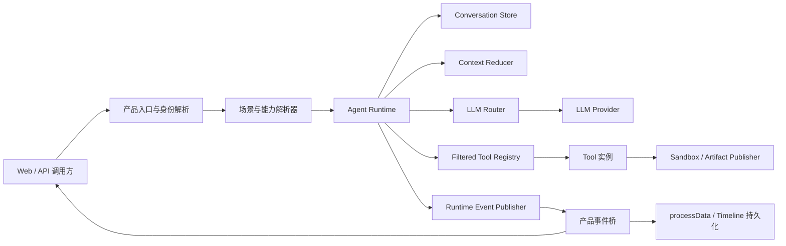
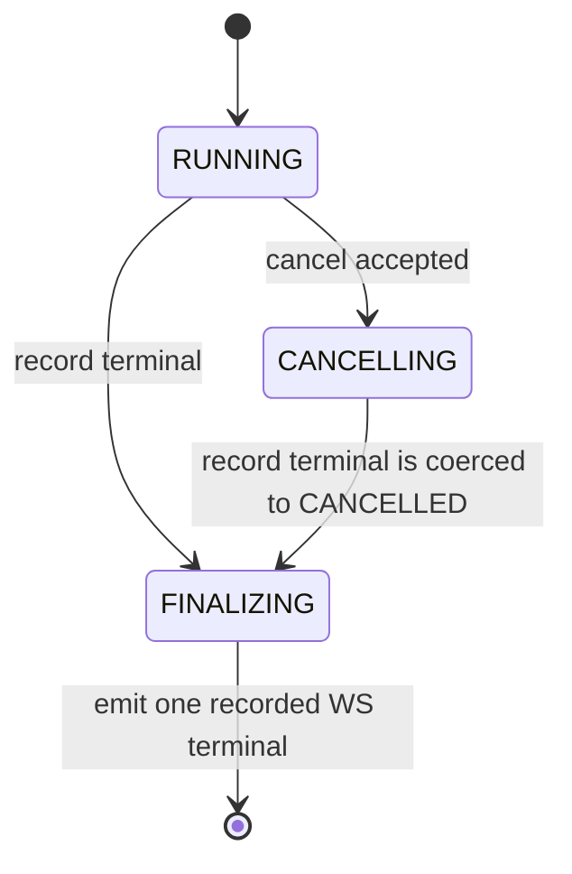
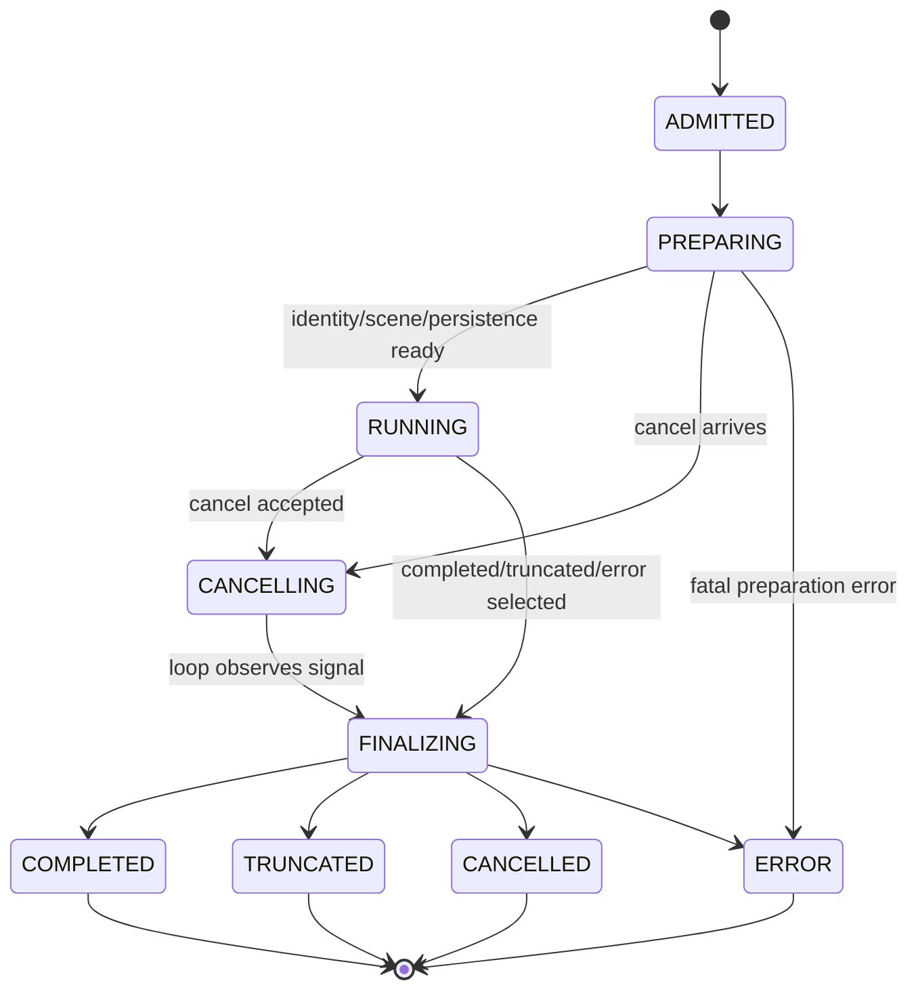

```
# Agent Runtime、LLM/Tool Loop 与执行控制复刻设计

## 1. 结论与边界

本模块把一次用户输入转换为一个可持久化、可流式观察、可取消且有明确终态的 Agent Run。Run 是概念执行实例；当前三套入口分别使用 plugin runId、conversationId 或内部 messageId，并没有统一运行 ID。它解决的核心问题不是“调用一次大模型”，而是保证以下闭环成立：

1. 入口层先绑定租户、用户、会话和场景，再冻结本次运行能看到的模型、工具、技能和上下文。
2. Runtime 反复执行“压缩上下文 → 调用 LLM → 校验结构化响应 → 执行工具 → 把工具结果反馈给 LLM”，直到得到最终回答或受控终止。
3. 每次 LLM、工具、压缩和运行终态都产生内部事件；产品层把它们投影成 WebSocket 流和持久化 `processData`。
4. 用户消息先持久化，Assistant 终态消息后持久化；完成事件必须携带最终持久化后的消息标识。
5. 取消采用共享的协作式信号，在入口准备、LLM、工具和循环边界共同检查；当前 WebSocket 传输层只仲裁本连接可见的唯一终态，不能据此推导数据库终态必然一致。

### 1.1 目标调用方

- 对话产品：需要流式回答、停止生成、刷新后恢复执行记录。
- 定时任务或系统插件：需要无 UI 的同步 Agent Run。
- 后台 LLM Job：需要复用 Tool Loop，但不加载普通会话历史和上下文注入器。
- Tool、LLM Provider、Context Reducer、Hook、Skill、Sandbox 等扩展实现者。

### 1.2 输入、输出和可见效果

输入至少包括：运行标识、身份、用户内容；对话运行通常还包括会话标识、附件、场景上下文、工具策略和循环上限。输出是四类终态之一：`COMPLETED`、`TRUNCATED`、`CANCELLED`、`ERROR`，以及最终文本、Assistant 消息标识、Artifact、运行时间线和可选的产品 `processData`。

用户可见效果包括：逐段文本、思考过程、工具执行卡片、上下文压缩提示、最终回答、取消或错误提示；刷新后应从持久化消息恢复最终回答及主要执行证据。

### 1.3 包含范围

- 身份和场景进入 Runtime 的边界。
- LLM 路由、请求构造、重试和流式重置。
- Tool 可见性、调用、并行执行、结果回填和保留策略。
- Context Reducer 的预防性压缩与溢出恢复。
- 循环守卫、协议异常、空回答、输出截断、取消和错误传播。
- 事件、WebSocket、`processData` 和会话消息的可观察契约。
- 后台 LLM Job 与多代理的边界。

### 1.4 明确不包含

- 具体 OpenAI、Anthropic HTTP 报文实现。
- 某一个业务 Tool 的内部业务逻辑。
- 多代理如何选子 Agent、合并多个子 Agent 结果的完整编排。
- Context Reducer 内部摘要算法、知识召回算法和 Artifact/Citation 业务细节。
- Web 前端的完整组件实现。

### 1.5 结论的证据状态

- `I`：本文描述的 Runtime、SPI、产品桥接和持久化分支均来自静态源码。
- `A`：API/WS/UI 行为来自 `active` 自动化用例，本次没有运行，属于当前验收契约而非运行通过证明。
- `P`：错误分类、部分保留策略和部分流式诊断场景只有 `planned` 用例时，明确放在规划项。
- `F`：涉及多节点部署、Provider 中断能力等源码无法完全证明的结论标为强推断。
- `D`：生产级复刻方案是建议，不代表当前系统全部实现。
- 本次没有执行应用、测试或抓取运行流量，因此没有 `R` 结论。

### 1.6 三套入口必须分开理解

当前工程没有一个贯穿产品、WebSocket 和 Runtime 的统一 `runId`。以下三套入口共享部分执行内核，但准入键、取消键和并发边界不同：

| 入口 | 调用对象 | 准入/查重键 | 取消键 | 会话互斥 | 对外暴露性质 |
| --- | --- | --- | --- | --- | --- |
| 可信系统插件入口 | `AgentRunner.run(AgentRunRequest)` | 调用方提供的 `runId`，仅检查同一进程正在运行的 runId | `AgentRunner.cancel(runId)` | **没有**按 conversationId 互斥；不同 runId 可同时写同一会话 | 稳定的进程内可信 SPI，不是 HTTP DTO |
| 产品 Chat Service | 直接创建内部 `Agent` 并调用 run/runStreaming | 同步 Chat 用 conversationId 锁；Service 自有 active map 也以 conversationId 处理部分入口 | `cancelConversation(conversationId)` 或调用方持有的 `CancellationSignal` | 同步 Chat 有本地锁；流式行为取决于宿主入口 | 产品内部 Java 调用 |
| WebSocket Chat | `conversationId → RunningTask` 的进程内表 | conversationId；实际 ID 解析前还有 PendingChat | WS `cancel` 的 conversationId，或“当前 Session 全部” | 本节点上拒绝同 conversationId 第二个 WS Task | `/ws/chat` 产品协议 |

Runtime 自己还会生成 Assistant 候选 `messageId`，它既不是可信插件 `runId`，也不是 WebSocket `conversationId`。复刻实现不得把三者互换，也不能假设使用其中一个键就能取消另外两个入口创建的运行。

> **安全警告：** `AgentRunRequest` 携带调用方构造的 `Identity`、`allowedToolIds` 和可信 `PromptSegment`，只能由同进程受信任代码或受信任系统插件创建。不得把该 record 直接作为 REST/WebSocket 反序列化 DTO；外部输入必须先经过认证、对象级授权和场景策略解析，再由服务端构造它。

## 2. 术语与参与方

| 术语 | 定义 |
| --- | --- |
| Run | 一次从用户输入到终态的概念性执行实例。当前三个入口分别以插件 `runId`、产品会话/消息上下文、WebSocket `conversationId` 管理执行，并不存在跨入口统一的运行标识；生产级复刻可另行引入服务端 `serverRunId`。 |
| Round | Tool Loop 中的一次 LLM 调用及其后续工具阶段。 |
| Working History | 本次 LLM 调用使用的消息工作集，不等于全部持久化历史。 |
| Content Block | 消息中的结构化内容：文本、思考、工具调用、工具结果或图片。 |
| Tool Policy | 本次 Run 的工具初始集合、最大权限集合、禁用集合和来源快照。 |
| Runtime Extension | 由可信场景解析器在系统工具组之外追加、但不能突破最大权限集合的工具。 |
| Timeline | Runtime 记录的思考、工具、耗时和汇总数据，用于持久化和产品投影。 |
| processData | 产品前端消费的执行过程 JSON，是 Timeline 与产品监听事件的投影。 |
| Cooperative Cancellation | 通过共享布尔信号在安全边界退出，而非任意中断持久化线程。 |

### 2.1 参与方



各参与方职责必须分离：入口层证明身份；场景解析器冻结能力；Runtime 只在冻结能力内运行；Provider 只实现模型协议；Tool 只消费执行上下文；产品事件桥负责兼容前端协议，不应反向决定 Runtime 的安全边界。

## 3. 业务规则

### 3.1 请求与身份

1. 只有可信系统插件 `AgentRunner` 请求具有调用方提供的 `runId`；它必须非空且只保证在该 Runner 当前进程的运行中集合内唯一。产品 Chat 和 WS 不产生或共享这个 runId。
2. `identity` 必须包含可用于租户/用户隔离的稳定键；身份不能从普通 `runtimeContext` 中猜测。
3. 用户文本不能为空；多模态请求即使携带图片，也应提供可持久化的用户语义文本或由入口生成明确附件说明。
4. `agentName` 为空时使用 `main`；Provider 覆盖为空时走正常路由。
5. `maxToolLoopRounds` 若显式传入必须大于零；缺省使用宿主装配值。裸 NovaCore Builder 的 fallback 是 50 轮、全局累计工具调用 fallback 是 30 次；Nova 产品启动时用 `nova.agent.max-rounds`（默认 40）和 `nova.agent.max-tool-calls`（默认 120）覆盖这两个 fallback。复刻时必须区分“框架无配置兜底”与“产品有效默认”，不能把 50/30 写成 Nova 产品运行默认。
6. 对话 ID 为空时可以执行无状态 Run，但不能声称消息已持久化。
7. 显式传入历史表示调用方拥有历史装配责任，Runtime 跳过普通对话持久化路径。

### 3.2 消息结构

消息角色为 `SYSTEM`、`USER`、`ASSISTANT`、`TOOL`。模型请求中最多只能有一个 `SYSTEM`，且必须位于索引 0。内容块最小契约如下：

```typescript
type ContentBlock =
  | { type: "text"; text: string }
  | { type: "thinking"; text: string; signature: string }
  | { type: "tool_use"; toolCallId: string; toolName: string; arguments: object }
  | {
      type: "tool_result";
      toolCallId: string;
      toolName: string;
      output: string;
      isError: boolean;
      retention: "EPHEMERAL" | "CONDENSABLE" | "DURABLE";
    }
  | { type: "image"; mediaType: string; relativePath: string };
```

`thinking.signature` 是不透明值，若 Provider 要求在后续轮次回传，就必须原样保存。图片只保存 Sandbox 相对路径，不能把大段 Base64 直接塞进 SPI 和持久化消息。

### 3.3 工具可见性

工具进入 LLM 请求和实际执行必须经过同一个正式链路：

```text
全局工具注册表
  → 身份/租户/用户/MCP 可见性过滤
  → 场景可安装能力集合
  → Agent 允许集合（hard ceiling）
  → 系统工具组展开
  → disabled + excluded 删除
  → 可信 Runtime Extension 校验并追加
  → 本次 Run 的 Filtered Registry
  → LLM tools schema 与 ToolExecutor 共用
```

关键规则：

- Runtime Extension 中的名称必须在全局身份可见集合和 Agent 最大集合内，否则整次 Run 在执行前失败。
- 业务资源存在不等于相关 Tool 自动可见；不得因项目挂载知识库就在 Runtime 旁路开放知识工具。
- Skill 激活只能在本次最大工具权限内改变惰性可用集合，不能扩大权限上限。
- LLM 看不到的 Tool 也不能被执行器旁路执行。
- 动态 Tool 必须提供无密钥、来源稳定的绑定指纹，用于同名冲突检测和策略审计。

### 3.4 Tool 错误与结果

- 工具业务零结果可以是 `success=true`，但调用失败必须是 `success=false`。
- 错误结果文本使用 `Error: <可定位原因>`；应保留 HTTP 状态、截断响应或异常类型。
- 非取消工具阶段中，一个 `tool_use` 必须得到恰好一个对应的 `tool_result`，即使工具不存在或抛异常。若取消在工具阶段发生，Runtime 会直接形成 CANCELLED，不保证把补造的取消 ToolResult 追加回 LLM 工作消息；Timeline Recorder 会把已 start 未 end 的调用记为失败孤儿事件。
- Tool 实例可能被多个 Run 并发调用，必须线程安全。
- 长任务必须轮询 `isCancelled()` 或使用可中断 I/O。
- Tool 主动产生的非文本副产物不直接塞回 LLM 文本；它通过 `ToolResult.artifacts` 聚合到 Agent 终态。超大文本结果走另一条链路：`ResultOffloader` 把原文写入会话 Sandbox，并在 Timeline 中留下 Sandbox recall handle；这不是已发布 Artifact。

### 3.5 终态

| 终态 | 含义 | 持久化消息状态 | WS 终态 |
| --- | --- | --- | --- |
| `COMPLETED` | 模型返回非空最终回答 | `COMPLETED` | `complete` |
| `TRUNCATED` | 达到最大轮数、循环检测或输出上限 | `COMPLETED`，正文带可识别标记并由产品友好化 | `complete` |
| `CANCELLED` | 用户取消或线程中断被归一为取消 | `CANCELLED` | `cancelled` |
| `ERROR` | 模型、协议、持久化或不可恢复错误 | `ERROR` | `error` |

一条 WS Task 的产品层目标是只发一个终态，但当前代码不能证明数据库消息终态与 WS 终态总是一致：取消先把 WS phase 改为 `CANCELLING`，而 Runtime 仍可能抢先持久化 COMPLETED；随后 WS 的终态仲裁会把 COMPLETE 改发为 CANCELLED。这里应记录为 `I` 级竞态风险，而不是现状保证。`D` 级生产设计必须以持久化终态 CAS 为权威，见 8.1。

## 4. 完整执行链路

### 4.1 主链路时序

```mermaid
sequenceDiagram
    participant C as Client
    participant E as Product Entry
    participant S as Scene Resolver
    participant A as Agent Runtime
    participant DB as Conversation Store
    participant R as Context Reducer
    participant L as LLM Router/Provider
    participant T as Tool Executor
    participant B as Event Bridge

    C->>E: chat(identity, conversationId, content, options)
    E->>E: authenticate + validate tenant/user ownership
    E->>S: resolve scene and effective capabilities
    S-->>E: frozen prompt/tool/skill/runtime context snapshot
    E->>A: runStreaming(request, listener, cancellation)
    A->>A: reject concurrent reuse; acquire sandbox
    A->>DB: ensure conversation + append USER
    A->>A: assemble SYSTEM + injectors + history + current USER
    loop until terminal
        A->>R: reduce working history if needed
        A->>L: route identity + tier; call/stream(messages, visible tools)
        L-->>B: text/thinking/tool-call deltas
        L-->>A: structured response + stop reason + usage
        alt final non-empty text
            A->>A: build COMPLETED response
        else valid tool_use
            A->>T: execute one or more tool calls
            T-->>B: tool start/end events
            T-->>A: ordered ToolResults or cancellation outcome
            A->>A: if not cancelled, append ASSISTANT tool_use + TOOL results
        else recoverable context failure
            A->>R: compact and retry within budget
        else cancellation/error/guard
            A->>A: build CANCELLED/ERROR/TRUNCATED response
        end
    end
    A->>A: build Timeline + post-process citation/artifact
    A->>DB: append ASSISTANT terminal row
    A-->>B: run completed/cancelled/failed
    B-->>C: exactly one terminal WS frame
```

### 4.2 入口准备

产品入口完成以下步骤后才进入 Runtime：

1. 从已认证会话生成租户/用户身份；项目选择经过场景解析。源码存在一个校验客户端 `dataThemeId` 是否属于当前租户的 WS helper，但静态调用搜索只找到定义、未找到调用，不能声称 WS payload 中的数据主题已接线。
2. 解析或创建 `conversationId`，构造文本、图片块和已经放入 Sandbox 的附件描述。
3. 生成运行上下文，例如 Provider 覆盖、项目、服务端 SandboxContext 中已有的数据主题、语言、时区、财务日历、文件提示和 Trace ID。客户端 WS `dataThemeId` 是否写回该 Context 是当前缺口。
4. 场景解析器根据普通聊天、项目或嵌入应用生成冻结的 Prompt Segment、工具最大集合、系统工具组快照和 Runtime Extension。
5. 为 WebSocket Run 创建共享取消信号并尽早登记运行中任务，避免“取消先到、Runtime 后绑定”的窗口。
6. WS 入口在本节点拒绝同一个 conversationId 的第二个 RunningTask；同步产品 Chat 使用本地会话锁。可信插件 AgentRunner 只按 runId 查重，并不提供 conversationId 互斥。

### 4.3 Runtime 初始化与持久化

Runtime 使用原子标记防止同一 Agent 实例并发复用。每次 Run 创建独立作用域：身份、会话、Sandbox、过滤后的 Tool Registry、过滤后的 Skill Lookup 和 Tool Policy Snapshot。

持久化顺序：

1. 必要时创建会话元数据。
2. 分配下一个 `turnIndex = max(existing turnIndex) + 1`。
3. 按该 `turnIndex` 写入 USER 消息。
4. 从 Store 加载历史并组装本轮消息；这样当前 USER 已包含在完整按序历史中。
5. 执行 Tool Loop。
6. 构建 Timeline、执行产品后处理、写入同一 `turnIndex` 的 ASSISTANT 消息。
7. 使用存储层返回的真实 Assistant `messageId` 重建 Runtime 终态响应，再发内部 `runCompleted`。产品 WS 的 `complete` 和工具事件并不携带该 messageId；只有错误终态会 best-effort 查询最新持久化 ERROR Assistant ID 并附在 WS envelope。

创建会话失败当前实现会降级为本次不持久化后继续执行；USER 消息写入失败则属于致命错误，不能继续生成一个无法配对的 Assistant。普通 LLM/Tool 失败通常被转换为 `AgentResponse.ERROR` 或 ToolResult，而不是抛出；未捕获的 Runtime/Error 会尝试补写一条 ERROR 或 CANCELLED Assistant 后再向外抛。

### 4.4 上下文组装

上下文组装器负责合并：唯一 SYSTEM Prompt、可信 Prompt Segment、Context Injector、持久化 Working History、本轮用户内容和技能激活所需信息。历史轮数可按请求覆盖；非正数表示不限制历史轮数。

图片在进入 Provider 前经过视觉代理处理：如果主模型不能直接理解图片，可以由专门视觉模型转换；具体策略不属于本模块，但处理后的消息仍须满足唯一 SYSTEM 约束。

### 4.5 LLM 路由与调用

Runtime 使用 `identity + LLM tier + 可选 provider override` 路由到已经绑定具体模型的 Provider。模型 ID 不直接作为普通请求字段绕过路由。路由返回：Provider、默认采样配置和展示名；请求级配置覆盖绑定配置，Vendor Options 按 key 合并。

提供给 Provider 的请求包含：消息、当前可见 Tool 定义、身份、采样参数、Vendor Options、Runtime Context 和 Sandbox。调用前后执行 Hook；使用量缺失时通过 TokenEstimator 归一化。

重试只针对 RetryPolicy 判定的瞬态异常，并受最大尝试数和指数退避控制。默认策略是“初始调用 + 最多 3 次重试”，所以最多发生 4 次 provider 调用；408、429、5xx 和无法解析出 HTTP 状态的 `LlmCallException` 可重试，其他 4xx 不重试。退避参数为 base 200ms、factor 2、单次基础延迟上限 10s，并在基础延迟后增加 `[0, 25%]` jitter；默认前三次等待分别约为 200–250ms、400–500ms、800–1000ms。`maxAttempts` 表示不含初始调用的重试数，每次 provider 调用消耗一次尝试；退避期间被中断或取消不再消费下一次 provider 调用。

流式链路有一个容易误判的现状：provider 可以先调用 listener `onError(error)`，随后把同一异常抛给 caller；若 caller 判定可重试，之后还会调用 `onRetryReset(nextAttempt, cause)` 并继续。因此当前 `onError` 不是可靠终态。第一次 reset 的参数实际为 `1`，表示“retry index 1”，虽然下一次 provider 调用按人类从 1 计数是第 2 次；接口注释把参数称为 next attempt，存在编号语义偏差。产品 bridge 必须以 reset 清空已经展示的失败前缀，并只以 Agent 的最终 `error/complete/cancelled` 判终态。**D**：推荐将事件改为 `attempt_failed(callOrdinal, willRetry)` 和 `stream_reset(nextCallOrdinal=2)`，或至少统一为 1-based provider call ordinal。

### 4.6 Tool Loop 算法

```text
state = {
  messages, round=0, llmCalls=0, cumulativeUsage=0,
  recoverAttempts=0, emptyFinalRetries=0,
  maxTokenContinuations=0, protocolRetries=0,
  auditToolCalls=[], artifacts=[], nextToolOrdinal=0
}

while true:
  if cancelled: return CANCELLED
  if round >= maxRounds: return TRUNCATED(MaxRoundsReached)

  messages = reducer.reduceIfNeeded(messages)
  snapshot = copy(messages, round)
  response = callLLM(messages, visibleTools)
  accumulateUsage(response)
  publishRoundStarted(response)

  toolUses = response.blocks.filter(tool_use)
  switch response.stopReason:
    ERROR          -> return ERROR
    STOP_SEQUENCE  -> return ERROR
    MAX_TOKENS     -> continue exact text at most twice, else TRUNCATED
    TOOL_USE       -> require toolUses not empty
    END_TURN       -> require toolUses empty

  if stopReason/content mismatch:
    resample once; then ERROR(PROTOCOL_ERROR)

  if no toolUses:
    if visible answer non-empty: return COMPLETED
    resample identical context at most twice; then ERROR(EMPTY_FINAL)

  audit all tool calls before execution
  outcomes = execute tools; record completed calls and stable tool ordinals
  collect ToolResult.artifacts from completed outcomes
  if cancelled:
    cancel unfinished futures
    recorder drains started-without-end calls as orphan failure evidence
    return CANCELLED                       // no later LLM call; no TOOL feedback guarantee
  append ASSISTANT response blocks, including thinking and tool_use
  append exactly one TOOL result per tool_use in declaration order
  run loop detectors
  if STOP: return TRUNCATED
  if STAGNATED and rollback available:
    rollback working history; append USER strategy-change hint
  else if STAGNATED: return TRUNCATED
  round++
```

### 4.7 StopReason 处理

| StopReason | 结构要求 | 处理 |
| --- | --- | --- |
| `END_TURN` | 不得含 `tool_use` | 非空可见文本完成；空文本最多原上下文重采样两次。 |
| `TOOL_USE` | 至少一个完整 `tool_use` | 进入工具阶段。 |
| `MAX_TOKENS` | 可以是文本或未完成工具结构 | 文本追加“从断点继续”提示，最多继续两次；结构化调用则重置尝试。 |
| `STOP_SEQUENCE` | 任意 | 终止为协议级错误，不把半截内容当成功。 |
| `ERROR` | 任意 | 映射内容过滤或未知错误码。 |

Provider 的结束原因与内容不匹配时最多安全重采样一次。这样可以容忍一次供应商协议抖动，又不会无限重复计费。

### 4.8 工具执行

单工具在 Agent 调用线程串行执行；同轮两个及以上工具会先全部 submit 到共享有界线程池，然后才按声明顺序 await Future。当前线程池设计为：核心线程 `CPU × 2`、最大线程 `CPU × 8`、队列 500、空闲 60 秒回收，饱和时由 Agent 调用线程执行，保证背压时不丢任务。当前实现没有 start barrier，因此只保证“提交机会并发”，不保证所有 `tool_exec_start` 都先于第一个 `tool_exec_end`；在线程不足、CallerRunsPolicy、极短工具或调度抖动下，任务可部分或完全串行。

并行语义：

- 工具开始/结束事件按真实时间发出，结束顺序可能与模型声明顺序不同。
- 未取消的工具阶段，回填给 LLM 的 ToolResult 按原始 `tool_use` 顺序排列。取消阶段可以在形成 TOOL 消息前直接退出。
- 每个调用分配单调 `toolOrdinal`，持久化后仍能恢复声明顺序。
- 一个工具失败不取消兄弟工具；异常转成该位置的错误结果。
- Agent 取消时每 100ms 轮询等待状态，对未完成 Future 执行 `cancel(true)`，并在内部 outcome 缓冲区为未产生结果的位置补取消错误。由于工具阶段随后直接返回 CANCELLED，这些补位结果用于完整结束本轮内部等待，并不保证成为后续 LLM 可见的 TOOL 消息。
- 若要验收并行，不应只断言“两个 start 先于首个 end”。使用两个可控延迟工具，检查执行时间区间确有重叠、墙钟耗时显著小于串行总和，同时 ToolResult 回填和 `toolOrdinal` 仍按模型声明顺序。严格同时起跑只能由 **D** 级测试 barrier/生产调度器提供，不是当前保证。

执行器再次从已经过滤的 Registry 查找工具。查找不到仍发成对 start/end 事件，并返回 `Error: Tool not found: <name>`。调用前 Hook 可以重写参数，重写后的参数才用于执行、字节统计和审计。执行上下文必须包含身份、Sandbox、取消状态、配置解析器、会话/消息/Agent/Provider 标识、子代理深度、技能访问、Artifact Publisher 和调用方的最大工具集合。

### 4.9 结果保留与超大结果

每个工具结果携带保留策略：

- `EPHEMERAL`：后续上下文可丢弃，只保留执行证据。
- `CONDENSABLE`：默认值，可在上下文压力下摘要。
- `DURABLE`：最高保留优先级，例如文件路径、UUID 或后续操作句柄；普通 L3 trim 不删除，但只剩受保护核心仍超预算时，L4 可整组丢弃，不能理解成绝对永不删除。

默认值应用是非对称的：`ToolResult` 的 CONDENSABLE 既代表“工厂默认”也可能是工具显式选择，执行器无法区分；只有结果仍为 CONDENSABLE 且 Tool 的默认不是 CONDENSABLE 时，才用 Tool 默认覆盖。结果显式为 EPHEMERAL 或 DURABLE 时永远优先。完整真值表如下：

| Tool.defaultRetention | result=EPHEMERAL | result=CONDENSABLE | result=DURABLE |
|---|---|---|---|
| EPHEMERAL | EPHEMERAL | **EPHEMERAL** | DURABLE |
| CONDENSABLE | EPHEMERAL | CONDENSABLE | DURABLE |
| DURABLE | EPHEMERAL | **DURABLE** | DURABLE |

因此“工具在结果中显式返回 CONDENSABLE”无法对抗工具级 EPHEMERAL/DURABLE 默认，这是当前契约限制。**D**：生产复刻可把结果 retention 改成 nullable/`INHERIT`，再明确区分继承和显式 CONDENSABLE。Timeline 是最终保留策略的持久化载体；内存 ToolResultBlock 供本轮 Reducer 使用。

先区分两种容易混淆的数据：

- `ToolResult.artifacts`：Tool 显式返回的图片、文件、图表等非文本副产物，聚合进 `AgentResponse.artifacts`，由产品 Artifact bridge 决定发布、持久化和展示。
- `ResultOffloader.artifactRefs`：Runtime 因 Tool 文本过大而写入当前会话 Sandbox 后得到的 **Sandbox recall handle**。它记录在 `ToolExecEvent.artifactRefs`，用途是让有权访问同一 Sandbox 的后续 `read_file` 找回原文；它不是 `ToolResult.artifacts`，也不自动进入 `AgentResponse.artifacts` 或产品 Artifact 存储。

当前系统存在三层不同的结果裁剪，任何一层都不能笼统称为“权威原始结果”：

| 载体 | 当前限制 | 保留内容 |
| --- | --- | --- |
| 实时 WS `tool_exec_end` | 展示结果最多 8000 **字符**；参数最多 4000 字符 | `outputBytes` 是裁剪前 UTF-8 字节数，正文是展示摘要 |
| 实时 `ProcessDataCollector` | args/result 各最多 4000 字符 | 运行快照、事件字段和裁剪前 input/outputBytes |
| Runtime Timeline | Tool output 超过 8192 **UTF-8 字节**时卸载 | Timeline 保存有限头部、`[offloaded ... to <sandbox-recall-handle>]` 提示、`artifactRefs` 和原始 outputBytes；若 Sandbox 写入失败只剩有限预览且没有 recall handle |

当前 `processData` 映射器没有把 `ToolExecEvent.artifactRefs` 结构化输出；大结果只会在 `tool_exec.result` 的预览文本中看到诸如 `[offloaded ... to <sandbox-recall-handle>; read full via read_file]` 的提示。因此当前协议不存在可依赖的 `contentState` 或独立 `handle` 字段，也不能靠 `AgentResponse.artifacts` 找到这份 offload 原文。`D` 级复刻应显式输出 `outputBytes + contentState(full|truncated|offloaded|lost) + sandboxRecallHandle`，并在读取时重新执行租户、用户、会话授权。

Sandbox recall handle 的生命周期属于会话 workspace，而不是永久 Artifact：同一 `(identity, agentName, conversationId)` 在多次 acquire/release 间应看到同一批文件；显式删除会话时，产品先软删除会话，再 best-effort 删除产品 Artifact 和 conversation workspace。删除后必须把旧 recall handle 视为无效，即使物理清理失败留下孤立文件也不得再授权读取。无 conversationId 的无状态 Run 不应承诺该 handle 可跨 Run 长期召回。

### 4.10 Context Reducer

每次 LLM 调用前都委托 Reducer 判断是否需要压缩。Runtime 提供：身份、会话、当前消息、Round、估算 token、上轮真实 prompt token、目标预算、上下文窗口、上次失败和压缩事件 Reporter。

两条路径：

1. 预防性压缩：预算等于上下文窗口，由插件决定何时折叠 Tool Result 和历史。
2. 恢复性压缩：LLM 异常经检测器判定可恢复时，目标预算取失败前估算 token 的一半；连续恢复最多两次，且每次计入 Round 上限。

如果恢复压缩没有让 token 数下降，立即 ERROR，避免空转。Reducer 若保持 Assistant 消息数量不变却意外删除 Thinking Block，Runtime 会保守恢复这些块；若 Reducer 合并或拆分了 Assistant 消息，则不猜测映射。

Context Reducer 可以使用内部后台 LLM Job 生成摘要，但后台 Job 不是普通对话：它只组装 SYSTEM + USER，不加载普通历史、不运行 Context Injector、不写 Conversation Store；只暴露显式 allowlist 中的工具和显式白名单 Runtime Context key。

### 4.11 循环守卫

Loop Controller 累积工具调用和结果，顺序运行检测器：重复调用、连续错误、无进展、上下文溢出和全局熔断。裸 NovaCore fallback 为累计工具调用 30 次、Tool Loop 50 轮；Nova 产品装配的有效默认分别是 `nova.agent.max-tool-calls=120` 与 `nova.agent.max-rounds=40`。二者是不同上限，并且产品配置会覆盖框架 fallback。

无进展通过最近 200 个结果文本哈希判断。停滞时可回滚到检查点，清空短期工具历史并向 LLM 添加“换一种策略”的 USER 提示；累计工具调用数不回退，确保反复回滚仍会触发全局熔断。

### 4.12 完成与持久化

Runtime Recorder 与外部 Listener 通过组合监听器同时接收事件。Recorder 生成完整 Timeline，包含从 Run 开始到完成的总耗时和累计 LLM/Tool/Token 汇总。产品后处理可在最终持久化前补充 Citation 和 Artifact URL。

Assistant 行保存：结构化 Content Block、消息状态、`turnIndex`、Timeline、错误原因和 `processData`。产品桥可在首次写入后根据 Citation、Artifact 或监听器独有事件更新正文和 `processData`，但必须避免重复追加第二条 Assistant。

## 5. 对外契约

### 5.1 Runtime 启动契约

以下是可信系统插件使用的稳定**进程内 SPI**。这里的“稳定”表示插件兼容契约，不表示可以公开给不可信网络调用者。流式监听器可以是宿主私有扩展，不必强塞进插件 SPI：

```java
interface AgentRunner {
  AgentRunResponse run(AgentRunRequest request);
  boolean cancel(String runId);
}

record AgentRunRequest(
  String runId,                 // 必填、非空、运行中唯一
  Identity identity,           // 必填
  String agentName,             // 默认 main
  String providerName,          // 可空，正常路由
  String conversationId,        // 可空，无状态运行
  String userInput,             // 必填、非空
  Map<String,Object> runtimeContext,
  Set<String> allowedToolIds,    // 空=不增加额外 allowlist；不是“禁止全部”
  Set<String> excludedToolIds,
  ConversationCreateOptions conversationCreateOptions,
  Integer maxHistoryRounds,      // null=Agent 默认，<=0=不限制
  Integer maxToolLoopRounds,     // null=Agent 默认，显式值必须 >0
  List<PromptSegment> promptSegments,
  List<ContentBlock> contentBlocks,
  List<AgentAttachment> attachments
) {}
```

禁止把上面的类型直接注册为 JSON Controller 入参。网络层必须忽略客户端伪造的 identity、allowed/excluded tools、Prompt Segment、Provider 和 Runtime Context 特权键；认证后由服务端场景解析器重新构造可信请求。

示例：

```json
{
  "runId": "run_01JXYZ",
  "identity": {"tenantId": "tenant-a", "userId": "user-7"},
  "agentName": "main",
  "providerName": null,
  "conversationId": "conv-42",
  "userInput": "比较本月与上月销售额，并解释变化",
  "runtimeContext": {"locale": "zh-CN", "timeZone": "Asia/Shanghai"},
  "allowedToolIds": ["metric_query", "read_file"],
  "excludedToolIds": [],
  "maxHistoryRounds": 20,
  "maxToolLoopRounds": 30,
  "promptSegments": [],
  "contentBlocks": [{"type": "text", "text": "比较本月与上月销售额，并解释变化"}],
  "attachments": []
}
```

终态响应：

```json
{
  "status": "COMPLETED",
  "conversationId": "conv-42",
  "messageId": "msg-109",
  "content": "本月销售额……",
  "errorMessage": null,
  "processData": "{\"events\":[...],\"tokenStats\":{...}}",
  "artifacts": [],
  "timeline": {
    "events": [],
    "totalDurationMs": 4270,
    "summary": {
      "llmCalls": 2,
      "toolCalls": 1,
      "totalTokens": {"inputTokens": 3100, "outputTokens": 420, "totalTokens": 3520, "cachedTokens": 900}
    }
  }
}
```

重复的正在运行 `runId` 返回 ERROR；Runtime 内部创建 Agent 或策略解析失败也返回 ERROR。产品对话流则通常把 ERROR 投影为 WS 错误和持久化错误消息。

### 5.2 LLM Provider 契约

```java
interface LlmProvider {
  String type();                         // 厂商类型，如 openai/anthropic
  String name();                         // 配置实例名/路由键，如 kimi/claude-prod
  Optional<String> configuredModelId();  // 该实例绑定的请求模型 ID
  LlmResponse call(LlmRequest request);
  LlmResponse streamCall(LlmRequest request, LlmStreamListener listener);
  LlmCapabilities capabilities();
  TokenEstimator tokenEstimator();
}

record LlmResponse(
  List<ContentBlock> blocks,
  StopReason finishReason,
  Usage usage,
  Map<String,Object> vendorExtras
) {}
```

三个 Provider 标识不能混用：`type` 用于厂商能力和错误归属，`name` 是注册表中的唯一实例/路由名，`configuredModelId` 是真正请求的模型；上游响应还可能报告另一个版本化模型 ID。路由返回 `LlmBinding(provider, options, displayName, visionProxyName)`，Provider 已经绑定模型与配置。

完整 LLM 请求：

```typescript
interface LlmRequest {
  messages: ChatMessage[];
  tools: Tool[];                   // 本 Run 的 Filtered Registry 快照
  identity: Identity;
  temperature?: number;
  maxTokens?: number;
  topP?: number;
  stopSequences: string[];
  vendorOptions: Record<string, unknown>;
  runtimeContext: Record<string, unknown>;
  sandbox?: Sandbox;
}

interface ToolDefinition {
  name: string;
  description: string;
  parametersSchema: JsonSchema;   // LLM 每次调用生成的参数
  configParams: ConfigParam[];    // 操作员配置，不发送给 LLM
  category: string;               // 管理 UI 展示信息，不发送给 Provider
}

interface LlmStreamListener {
  onTextDelta(delta: string): void;
  onThinkingDelta(delta: string): void;
  onToolCallStart(toolCallId: string, toolName: string): void;
  onToolCallArgsDelta(toolCallId: string, partialJson: string): void;
  onToolCallEnd(toolCallId: string, args: object): void;
  onComplete(response: LlmResponse): void;
  onError(error: Throwable): void;
  onRetryReset(nextAttempt: number, cause: Throwable): void;
}
```

Runtime 对外错误对象至少要归一成 `{errorCode, message, cause}`；`errorCode` 需要区分认证、限流、超时、网络、服务端、上下文溢出、内容过滤、停止序列和协议错误。`cause` 只进受控日志/Trace，不直接序列化给 UI。

Provider 必须把供应商原始响应归一为结构化 Content Block，并保证 ToolUse 的 `arguments` 已解析为 Map。Provider 不负责判断某工具是否授权；Runtime 只把 Filtered Registry 中的定义发给它。

### 5.3 Tool 契约

```java
interface Tool {
  ToolDefinition definition();
  String bindingFingerprint();
  ToolResult execute(Map<String,Object> arguments, ToolExecutionContext context);
  ResultRetention defaultRetention();
}

record ToolResult(
  boolean success,
  String output,
  ResultRetention retention,
  List<Artifact> artifacts
) {}
```

Tool Definition 至少包含唯一名称、英文描述和 JSON Schema 参数。配置密钥属于操作员配置 Schema，只能经执行上下文解析，不能出现在 LLM 参数 Schema。

这里的 `ToolResult.artifacts` 只表示 Tool 主动声明的非文本副产物。Runtime 大文本 offload 生成的 `ToolExecEvent.artifactRefs` 是 Sandbox recall handle，不应复制进这个字段；当前 `AgentRunResponse.artifacts` 只聚合前者。

### 5.4 WebSocket 请求与控制契约

通道：`/ws/chat`。需要已认证会话；服务端在每条消息处理前可以重新校验会话有效性。最小客户端请求：

```json
{
  "type": "chat",
  "conversationId": "conv-42",
  "message": "请查询数据",
  "lang": "zh-CN",
  "projectId": "project-9"
}
```

`I`：处理器虽定义了 `dataThemeId` 的租户校验 helper，但当前静态调用链没有调用它；不要把该字段写入兼容请求示例并宣称生效。要修复时，应在认证取得 SandboxContext 后调用校验器，再将验证后的 theme 放入服务端上下文。

执行控制消息：

```json
{"type":"cancel","conversationId":"conv-42"}
{"type":"resume","conversationId":"conv-42"}
{"type":"subscribe","conversationId":"conv-42"}
{"type":"unsubscribe","conversationId":"conv-42"}
{"type":"query_running"}
{"type":"ping"}
```

当前 WS 并没有一个所有事件共用的 envelope。由 RunningTask 向 subscribers 广播的运行事件使用带 `seq` 的形状：

```json
{
  "type": "tool_exec_end",
  "content": "call-1|metric_query|1382|true|731|{...truncated...}",
  "conversationId": "conv-42",
  "seq": 18
}
```

运行中的 Run 真正进入取消终态时，`cancelled` 通过 subscribers 广播并带 Collector 生成的 `seq`。但找不到运行任务时，cancel handler 也会直接发送一个 type 同为 `cancelled` 的控制 ACK；它没有 `seq`，并不证明任何 Run 从 RUNNING 迁移到了 CANCELLED。`complete`、运行终态 `cancelled`、`token`、`thinking`、`tool_exec_start/end` 等广播事件带 `seq`，但 `complete` 和工具事件当前不带 `messageId`。只有 ERROR 终态 best-effort 查询最新错误 Assistant 后可能带 `messageId`。

控制响应使用直接 `sendMessage`，没有 `seq`：`pong`、`conversation_id`、`cancel_accepted`、`cancel_ignored`、找不到运行时返回的 `cancelled`、`streaming_active`、`running_conversations`、`completed_conversations`、`token_stats` 和授权错误。`running_conversations_v2` 通过 object-content 发送，也没有 `seq`。其中 token_stats 只直接发到当前主 Session，不走 subscribers 广播。由此可见 `seq` 只是 RunningTask Collector 的事件水位，不是整个 WebSocket 连接的全事件序列。

重连/订阅的精确语义：

- `resume(conversationId)`：拥有且仍运行时换绑当前 Session、加入 subscribers，返回 `streaming_active`，并重发尚未回答的 user interaction；找不到任务时不返回 ACK。
- `subscribe(conversationId)`：拥有且仍运行时静默加入 subscribers，并重发 pending interaction；**没有成功 ACK**。不存在时静默；跨账号时返回 `error: Not authorized to subscribe`。
- `unsubscribe(conversationId)`：静默移除，没有 ACK。
- `query_running`：始终返回 legacy `running_conversations`（逗号分隔 ID 字符串）和 v2 `running_conversations_v2`（`[{id,status:"RUNNING"}]`）；只有最近完成集合非空时额外返回 legacy `completed_conversations` 逗号字符串。
- `cancel`：找到并接收信号返回 `cancel_accepted`；传入当前 Session 已被替换掉的陈旧会话 ID 返回 `cancel_ignored`；没有运行则直接返回无 `seq` 的 `cancelled` 控制 ACK。只有随后由 RunningTask 广播、带 `seq` 的 `cancelled` 才表示一个运行进入取消终态。

WS `resume` 不重放历史帧。客户端必须调用 `GET /api/conversations/{conversationId}/snapshot`：运行中且本节点有 Collector 时返回 `{conversationId,status:"RUNNING",processData,lastSeq}`；已完成时从最新 Assistant 读取持久化 processData，`lastSeq=null`。快照先校验会话属于当前租户/用户；fresh RUNNING lease 但本节点无 Collector 时 processData/lastSeq 可以为 null。

### 5.5 关键 WS 事件

| type | content 语义 |
| --- | --- |
| `conversation_id` | 服务端确认的会话 ID。 |
| `token` | 可见文本 delta。 |
| `thinking` | 一整个工具轮次的思考文本。 |
| `answer_start` | 首个最终回答轮开始。 |
| `round_boundary` | `tool` 或 `final`。 |
| `stream_reset` | 前一次流式尝试作废，客户端清空其可见前缀。 |
| `tool_call` | 检测到的工具名。 |
| `tool_exec_start` | `callId|toolName|truncatedArgs|inputBytes`。 |
| `tool_exec_end` | `callId|toolName|outputBytes|success|durationMs|truncatedResult`。 |
| `tool_call_result` | `toolName|success|resultBytes`，用于统计。 |
| `context_compression_start/end/failed` | JSON 字符串，含原因、token 和耗时。 |
| `token_stats` | 累计输入、缓存、输出 token 与工具调用数。 |
| `complete` | 最终正文；唯一成功终态。 |
| `cancel_accepted` | 已接收协作式取消，不是终态。 |
| `cancelled` | 有 `seq` 时是运行取消终态；无 `seq` 时也可能只是“当前没有可取消任务”的直接控制 ACK，二者当前复用同一 type。 |
| `error` | 本地化错误文本；可带持久化错误消息 ID。 |
| `running_conversations_v2` | 当前身份拥有的运行中会话对象数组；直接控制响应，无 seq。 |
| `running_conversations` | legacy 逗号分隔运行中 ID；每次 query_running 都返回。 |
| `completed_conversations` | legacy 逗号分隔最近完成 ID；非空时才返回。 |
| `streaming_active` | resume 成功；没有历史重放。 |
| `cancel_ignored` | 当前 Session 使用了被替换的陈旧 conversationId。 |

WebSocket 和持久化 processData 都可能裁剪；UI E2E 通过 REST 读取 processData 是对“服务端持久化投影”的验证，不等于验证无限长原始响应。当前只能结合 `outputBytes` 和 `result` 预览文本判断可能发生裁剪/卸载，并从文本中提取 Sandbox recall handle；结构化状态和 handle 属于 D 级协议补强。

### 5.6 processData 契约

```json
{
  "events": [
    {
      "type": "thinking",
      "content": "需要先查询……",
      "timestamp": 1786000000000
    },
    {
      "type": "tool_exec",
      "tool": "metric_query",
      "toolCallId": "call-1",
      "toolOrdinal": 1,
      "args": "{\"metric\":\"sales\"}",
      "inputBytes": 18,
      "outputBytes": 1382,
      "result": "{\"rows\":[...]}",
      "success": true,
      "durationMs": 731,
      "timestamp": 1786000000731
    }
  ],
  "tokenStats": {
    "inputTokens": 3100,
    "totalTokens": 3100,
    "cachedTokens": 900,
    "cacheHitRatio": 0.2903,
    "outputTokens": 420,
    "toolCallCount": 1
  },
  "totalDurationMs": 4270,
  "model": "configured-display-name"
}
```

当前兼容投影中的 `totalTokens` 实际表达输入 token 基数，用于缓存命中率；它与 SPI Usage 中的 `totalTokens=input+output` 语义不同。复刻时应修正命名为 `promptTokens`，或同时提供明确的 `allTokens`，避免统计误读。

## 6. 数据模型与生命周期

### 6.1 逻辑模型

```sql
CREATE TABLE conversations (
  id              VARCHAR(128) PRIMARY KEY,
  tenant_id       VARCHAR(128) NOT NULL,
  user_id         VARCHAR(128) NOT NULL,
  status          VARCHAR(32) NOT NULL DEFAULT 'IDLE',
  heartbeat_at    TIMESTAMP NULL,
  created_at      TIMESTAMP NOT NULL,
  updated_at      TIMESTAMP NOT NULL,
  UNIQUE (tenant_id, user_id, id)
);

CREATE TABLE messages (
  id               VARCHAR(128) PRIMARY KEY,
  conversation_id  VARCHAR(128) NOT NULL,
  tenant_id        VARCHAR(128) NOT NULL,
  user_id          VARCHAR(128) NOT NULL,
  role              VARCHAR(16) NOT NULL,
  turn_index        INTEGER NOT NULL,
  state             VARCHAR(16) NOT NULL,
  content_blocks    TEXT NOT NULL,
  timeline_json     TEXT NULL,
  process_data_json TEXT NULL,
  error_message     TEXT NULL,
  created_at        TIMESTAMP NOT NULL,
  FOREIGN KEY (conversation_id) REFERENCES conversations(id),
  UNIQUE (conversation_id, id)
);

CREATE INDEX idx_message_turn
  ON messages(tenant_id, user_id, conversation_id, turn_index, created_at);
```

这是一份等价复刻的最小 DDL，不声称与当前工程物理表名和所有列完全一致。对象访问必须同时带租户和用户身份，不能只凭客户端传入的 `conversationId`。

### 6.2 消息配对

同一个 Run 的 USER 与 ASSISTANT 使用相同 `turnIndex`。软删除消息仍参与最大索引计算。`I`：当前分配方式是读取 `maxTurnIndex + 1`，不是数据库原子序列；可信 AgentRunner 使用不同 runId 并发写同一 conversationId 时可能取得相同值，产品本节点的会话互斥只降低部分入口风险。

`D`：生产版必须在事务中原子分配 turn（会话行 `SELECT ... FOR UPDATE`、数据库 sequence 或 `UPDATE ... RETURNING`），并增加 `(tenant_id,user_id,conversation_id,turn_index,role)` 唯一约束以及 `run_id + role` 幂等键。重试 USER/ASSISTANT 写入时应更新或返回已有行，不得再追加。

### 6.3 运行中状态

当前 WS 产品桥在进程内保存：`conversationId → RunningTask`、共享取消信号、订阅 Session、身份、递增 seq、实时 ProcessData Collector 和终态仲裁状态。该结构不包含可信插件 AgentRunner 的 runId。会话断开不取消 Run；明确 `cancel` 才取消。最近完成 ID 在短时间窗口保存，供重连客户端清理生成态并回源 REST。

`F`：因为活跃运行表是进程内结构，多节点部署若没有会话粘滞或共享 Run Registry，另一个节点无法可靠 cancel/resume。生产复刻必须补分布式控制面，见第 7 节。

### 6.4 敏感数据

- `I`：Tool 参数 Schema 与身份作用域配置分离，因此 API Key 等操作员配置不应作为 LLM 可生成参数发送；`processData` 读取存在会话所有权校验；部分 WS/Collector/Timeline 字段有限长和安全格式化。
- 风险：Tool 输出、Provider 原始 body、异常 cause 和任意 runtimeContext 仍可能携带 API Key、Token、Cookie 或业务敏感数据，静态代码不能证明它们在所有 Runtime Event、Timeline、Trace、日志和 processData 出口均已脱敏。
- `D`：持久化或外发前按字段与 secret pattern 统一脱敏，并用跨账号读取、恶意 Tool 输出、Provider body 和 runtimeContext 注入用例验证；不能以长度截断代替脱敏。

## 7. 核心实现设计

### 7.1 模块划分

建议复刻为以下独立模块：

| 模块 | 核心职责 |
| --- | --- |
| `RunAdmissionService` | 分入口验证 plugin runId 或 product conversationId；生产版另生成统一 serverRunId 做审计和幂等。 |
| `ExecutionSceneResolver` | 冻结 Prompt、能力、工具策略和 Runtime Context。 |
| `AgentRunCoordinator` | Sandbox、消息持久化、Context Assembly、终态后处理。 |
| `ToolLoopEngine` | Round 状态机、StopReason 校验、工具反馈和终止判断。 |
| `LlmGateway` | 统一路由、重试、Usage 归一化、流式重置。 |
| `ToolPolicyEngine` | 正式工具可见性链路和审计快照。 |
| `ToolDispatcher` | 单工具/并行工具执行、取消和顺序回填。 |
| `ContextManager` | 预防压缩、溢出恢复和 Working History。 |
| `RuntimeEventBus` | 类型化事件、Hook 隔离和 Timeline Recorder。 |
| `ProductEventProjector` | WS、SSE、processData 与 UI 兼容协议。 |
| `DistributedRunRegistry` | 生产环境跨节点 cancel/resume/subscribe。 |

### 7.2 最小可用版

最小版可以只实现：

1. 单 Provider 路由接口，但所有调用仍经过路由。
2. 文本消息和结构化 ToolUse/ToolResult。
3. 单线程工具执行。
4. 每会话进程内互斥。
5. `COMPLETED/ERROR/CANCELLED/TRUNCATED` 四终态。
6. 用户与 Assistant 消息配对持久化。
7. `token/tool_exec/complete/error/cancelled` WS 事件。
8. 最大 Round 和重复 Tool Call 守卫。

不得为了最小版省略：身份隔离、统一工具过滤、结构化错误、唯一终态、取消信号和终态消息持久化。

### 7.3 生产级版

在最小版上增加：

- 多 Provider 与租户/用户模型设置。
- 有界并行工具池、队列指标和隔离舱。
- Context Reducer、摘要 Job 和恢复性压缩。
- Timeline、Artifact Offload、Citation 和完整 processData。
- 分布式 Run Registry：数据库租约或 Redis Streams/PubSub。
- 可重放事件日志和 `lastSeq` 断点续传。
- Tool Policy Snapshot、来源指纹和审计。
- Provider 调用的主动 HTTP 取消，而非仅边界检查。
- 并发轮次预算、租户级限流、成本预算和熔断。

### 7.4 推荐的分布式控制面

```text
run:{serverRunId} = {
  sourceKind, sourceRunKey,
  nodeId, tenantId, userId, conversationId,
  phase, lastSeq, heartbeatAt, terminalOutcome
}
TTL = heartbeat interval × 3

cancel channel: run-control:{nodeId}
event stream: run-events:{serverRunId}
```

这是 `D` 级设计，不是当前实现。入口先生成不可猜测的 `serverRunId`，并保留来源键：可信插件的 `sourceRunKey=runId`，产品流的 `sourceRunKey=conversationId`。启动时以数据库唯一键或带租约 `SET NX` 同时认领 serverRunId 和活动 conversation；执行节点续租；任意节点的 cancel 先做对象级授权，再写控制消息。重连客户端先读取快照和 `lastSeq`，再从事件流续订。终态和 Assistant 消息写入必须处于同一事务/CAS 协议。

## 8. 并发与非正常路径

### 8.1 状态机

下面先描述当前 WS 进程内仲裁事实（`I`），它只有 `RUNNING/CANCELLING/FINALIZING` 三个 phase；终态另存在 `terminalOutcome` 字段。phase 进入 CANCELLING 后，`recordTerminal(COMPLETE)` 会被改写成 WS CANCELLED，但 Runtime 可能已经把 COMPLETED 写入数据库：



下面是应当复刻的 `D` 级生产状态机，不是当前现状：



生产状态机的关键是 `finalize(expectedVersion, outcome, assistantMessage)` 单事务 CAS：只有 CAS 胜者能写终态 Assistant 和发送 outbox 事件。取消若 CAS 先胜，Runtime 后续完成不得覆盖；完成若 CAS 先胜，迟到取消只返回已经完成。WS 从 outbox 发终态，避免数据库 COMPLETED、WS CANCELLED 的分裂。

### 8.2 同会话并发

- 同一个 Agent 对象使用原子锁拒绝并发 Run。
- 可信插件 AgentRunner 用运行中 `runId` Map 防重复，但不同 runId 指向同一 conversationId 不互斥。
- 同步 Chat 对同一 `conversationId` 加锁。
- WebSocket Chat 预登记 `conversationId → RunningTask` 并拒绝第二个任务。
- 不同会话可以并发；Tool 实例和 Listener 必须线程安全。

产品同步 Chat 与 WS 的本地互斥并不覆盖可信 AgentRunner，也不跨节点。生产版应使用数据库/Redis 活动会话唯一租约、原子 turn 分配和 run 幂等键。仅靠 JVM Map 在负载均衡或多入口并发下会产生同一会话双写和相同 `turnIndex` 竞争。

### 8.3 取消边界

| 取消发生点 | 处理 |
| --- | --- |
| Runtime 进入前 | 立即抛取消；产品补写 USER + CANCELLED Assistant。 |
| 场景/模型配置准备 | 每个昂贵阶段后检查信号。 |
| LLM 调用前/退避中 | 不再发请求或终止退避。 |
| LLM 流中 | delta Listener 检查信号并终止。 |
| LLM 阻塞请求中 | 当前正确性依赖 Provider 返回或可中断 I/O；生产版应传递主动 abort handle。 |
| 单工具执行中 | 工具必须主动检查；不配合的工具返回前无法立刻退出。 |
| 并行工具中 | cancel Future 并中断工作线程，为未完成位置补错误结果。 |
| Assistant 已持久化 | 当前实现仍可能因 WebSocket 任务已进入 `CANCELLING`，把随后收到的完成回调对客户端仲裁成 `CANCELLED`，从而与已经持久化的 `COMPLETED` 分离；D 级复刻应由带版本 CAS 的统一终态提交返回最终结果。 |

`I`：当前 WS cancel 先按 conversationId 查 RunningTask；若存在但身份不同，返回 `Not authorized to cancel this conversation`，若不存在则返回 `cancelled`。因此它满足 Active 用例对“正在运行的他人会话必须 unauthorized”的要求，但也允许攻击者区分“该 ID 当前是否运行”，存在对象可枚举侧信道。

`D`：生产版对不存在、已完成和无权对象返回相同的泛化接受响应（例如 202/cancel_accepted），服务端内部审计真实结果；只有已证明拥有对象的调用方才可获得精确状态。

### 8.4 错误传播矩阵

| 故障 | Runtime 行为 | LLM 可见 | UI 可见 | 持久化 |
| --- | --- | --- | --- | --- |
| Tool 不存在 | 错误 ToolResult | `Error: Tool not found` | 失败工具事件 | Timeline + processData |
| Tool 抛异常 | 捕获并转错误 ToolResult | 异常类和原因 | 失败工具事件 | 同上 |
| 单个并行 Tool 失败 | 兄弟继续 | 每个位置独立结果 | 每个工具独立状态 | 同上 |
| 工具阶段取消 | 取消 Future/协作退出 | 不保证收到补位 ToolResult；不会再发下一轮 LLM | cancelled | Timeline 为 completed 或 orphan 工具事件 |
| LLM 瞬态失败 | 策略内重试 | 无 | 流式时先 reset | 最终结果 |
| Context Overflow | Reducer 压缩，最多两次恢复 | 压缩后上下文 | 压缩事件 | Timeline/processData |
| LLM 空最终回答 | 原上下文重采样两次 | 无空 Assistant 回填 | 最终错误 | ERROR Assistant |
| StopReason/块不一致 | 重采样一次 | 无错误结构回填 | 最终协议错误 | ERROR Assistant |
| 达到最大 Round | TRUNCATED | 无更多调用 | 友好截断提示 | COMPLETED 状态正文 |
| USER 持久化失败 | 致命退出 | 不调用模型 | 错误 | 不补 Assistant，避免孤立配对 |
| Assistant 持久化失败 | 致命路径尝试补写 | 已生成 | 错误 | 可能仅 USER，需告警补偿 |

### 8.5 当前实现与 Active 契约冲突

`I`：Runtime 的 ToolResult 有独立 `success` 布尔值；但产品 WS 兼容桥的一段逻辑通过结果文本是否以 `Error: ` 开头再次推断成功状态。`A`：Active 用例要求“正常成功内容即使以 Error 开头也不能被误判”。这两者存在静态冲突风险。本次未运行，不能判断实际环境是否通过其他层规避。复刻时必须始终传递结构化 `success`，禁止从文案前缀反推。

### 8.6 进程重启

当前对话最终消息和 Timeline 可恢复，但进程内运行任务、取消信号和订阅者不能在重启后继续。`D`：生产版要么把 Run 定义为重启后失败并写明确终态，要么持久化 Round Checkpoint、Provider 幂等键和工具副作用账本后支持恢复；不能让会话永久停在 RUNNING。

## 9. 安全、权限和审计

### 9.1 当前静态可确认的边界（`I`）

1. 身份由产品认证层构造，`runtimeContext.userId/tenantId` 不作为授权身份；可信插件 `AgentRunRequest` 仍必须只由受信任进程内调用方创建。
2. cancel、resume、subscribe、query-running、snapshot/消息读取存在租户/用户判断；但 cancel 的差异响应会泄露“是否正在运行”。
3. Tool 可见性经过身份过滤和最大集合约束；Prompt Segment 与 Runtime Extension 只应来自可信产品入口或系统插件。
4. Tool 参数 Schema 与配置 Schema 分离，配置通过身份作用域 Config Resolver 获取，不应把密钥放进发送给 LLM 的参数 Schema。
5. WS、ProcessDataCollector 和 Timeline 对部分参数/结果做不同阈值的限长或 offload；部分错误经过安全文案格式化。这些是局部措施，不等于统一 secret redaction。
6. Sandbox 路径解析具备 workspace 边界约束；Sandbox recall handle 只能在对应身份和会话 workspace 中解析。

静态代码不能证明所有 Tool 输出、Provider 原始响应 body、异常 cause、Hook 数据和任意 `runtimeContext` 值在进入日志、WS、Timeline、processData 前都经过统一脱敏。尤其是远端 Provider 错误 body、Tool 返回的凭据片段和调用方塞入 runtimeContext 的敏感值，仍有泄密风险。当前也未确认一份覆盖每次 Run、每个 Tool、取消发起者和策略版本的完整、不可篡改审计账本。

### 9.2 生产级复刻要求（`D`）

1. 在 Provider、Tool、Hook、日志、Trace、WS、Timeline 和 processData 的共同出口实施统一 secret redaction；规则至少覆盖认证 Header、API Key、token、password、连接串、Cookie、私钥及租户自定义 secret，并在截断前后都执行。
2. 面向客户端只返回稳定 `errorCode` 与安全文案；完整 Throwable 和上游 body 进入访问受控、留存受限的内部诊断通道。
3. 建立结构化审计账本：`serverRunId`、身份键、conversationId、policy version、provider/model、Tool 指纹、终态、错误码、token、耗时、取消发起者和 CAS 版本；不记录明文 secret，并对写入失败告警。
4. cancel 等对象操作返回不可枚举的统一响应；SubAgent 只能继承并缩小工具集合；Hook/Listener 异常隔离，不能阻断其他监听器或串漏其他 Run。
5. Sandbox 和产品 Artifact 均在读取、发布、下载、删除时重新校验租户/用户/会话归属；会话删除后拒绝旧 recall handle。

## 10. 外部依赖对端设计

### 10.1 LLM Provider 必须维持的语义

- 输入输出都使用结构化 Content Block。
- `toolCallId` 在 ToolUse 与后续 ToolResult 间稳定。
- StopReason 必须与内容一致。
- 流式结束后返回一份完整 LlmResponse。
- Usage 尽可能提供输入、输出、总量和缓存 token；缺失时允许估算。
- 支持取消时暴露 abort handle；不支持时明确最大连接/读取超时。
- 错误转换为带分类信息的异常，例如 auth、rate-limit、timeout、context-overflow、content-filter、server/network。

### 10.2 最小兼容 Provider Stub

```pseudo
call(request):
  last = request.messages.last
  if last.role == TOOL:
    return Response([Text("工具结果已收到")], END_TURN, Usage(...))
  if last.text contains "USE_TOOL":
    return Response([
      ToolUse("call-1", "echo", {"text":"hello"})
    ], TOOL_USE, Usage(...))
  return Response([Text("ok")], END_TURN, Usage(...))

streamCall(request, listener):
  response = call(request)
  emit each Text as deltas
  emit structured tool call start/args/end
  return response
```

这个 Stub 必须能脚本化返回：瞬态失败、永久失败、空回答、MAX_TOKENS、协议不匹配、多个并行 ToolUse 和延迟响应，用于验证 Runtime，而不是只返回固定文本。

### 10.3 Tool 对端

远程 Tool 的最小适配层应设置连接、请求和总体超时；把非 2xx、反序列化失败和取消分别转换为结构化 ToolResult。生产版先为所有入口生成统一 `serverRunId`，再使用 `serverRunId/toolCallId` 作为请求幂等键，尤其对发送消息、创建任务、写数据库等副作用工具，避免 LLM 重试导致重复副作用。

Nova 无法证明所有外部 Tool 服务的内部实现、幂等性和取消能力；复刻时不能假定“Runtime 最多调用一次”等价于对端没有重复请求。

## 11. 可观察性

### 11.1 日志字段

`D` 级日志规范：每条日志统一携带可信插件入口的 `pluginRunId`（若有）、产品 `conversationId`、生产版 `serverRunId`（若已引入）、`tenantHash`、`userHash`、`agentName`、`provider`、`round`、`toolCallId`、`toolOrdinal`、`policyVersion`。Tool 参数和结果默认只记大小、哈希和经统一脱敏的安全摘要。当前代码不能证明所有日志点都满足这份统一规范。

### 11.2 指标

- `agent_run_total{status,agent,scene}`
- `agent_run_duration_ms{status}`
- `agent_rounds_total`
- `llm_call_total{provider,outcome,error_code}`
- `llm_latency_ms{provider}` 与首 token 延迟
- `llm_tokens{kind=input,output,cached}`
- `tool_call_total{tool,success}`
- `tool_duration_ms{tool}`
- `tool_pool_queue_depth`、拒绝/CallerRuns 次数
- `context_compression_total{reason,outcome}`
- `agent_cancel_latency_ms{phase}`
- `run_registry_stale_lease_total`

### 11.3 Trace

Span 顺序：入口组装 → USER 持久化 → Context Assembly → 每轮 Reducer → LLM → 每个 Tool → Agent 后处理 → Assistant 持久化 → WS Complete Emit。并行工具应是同一 Round Span 的兄弟 Span，而非互相嵌套。

### 11.4 用户可定位错误

`D` 级错误契约应同时包含稳定 `errorCode` 和本地化安全文案；内部诊断通道使用同一个 Trace ID 保存经访问控制的 Throwable。必须通过自动化脱敏测试保证客户端收不到 JDBC URL、堆栈、API Key、Provider 原始认证 Header、上游 body 中的 secret、runtimeContext 敏感值或文件绝对路径；这不是当前静态分析已证明的全链路保证。

## 12. 复刻实施顺序

1. 定义稳定 SPI：Identity、ContentBlock、LlmRequest/Response、Tool、AgentRunRequest/Response。
   - 静态验收：结构化 success、StopReason、ToolCallId 和四终态不可用字符串代替。
2. 实现 Tool Registry、身份过滤和 Tool Policy Snapshot。
   - 静态验收：LLM 可见集合与执行器查找使用同一 Filtered Registry。
3. 实现单 Provider LlmGateway 和脚本化 Stub。
   - 静态验收：唯一 SYSTEM、Usage 归一化、瞬态重试和流式 reset。
4. 实现单线程 Tool Loop、最大 Round、空回答和协议校验。
   - 静态验收：仅在**非取消工具轮**中，每个 ToolUse 才必须有一一对应、按声明顺序追加给 LLM 的 ToolResult；取消工具轮停止后续 LLM 调用，并在 Timeline 中保留已完成调用与 started-without-end 的 orphan 失败审计证据。
5. 加入 Conversation Store 和 USER/ASSISTANT 配对持久化。
   - 静态验收：用户消息与助手消息使用相同 turnIndex；内部 `runCompleted`/`AgentResponse` 使用存储返回的 messageId。当前 WebSocket `complete` 事件不暴露 messageId，不应把内部事件字段误写成线协议保证。
6. 加入类型化事件、Timeline Recorder 和 WS 投影。
   - 静态验收：实时、Collector、Timeline 三层截断不改变原始 outputBytes；当前兼容 processData 只在 result 预览文本暴露 Sandbox recall handle，生产协议再增加结构化 contentState/sandboxRecallHandle。不得把 offloader artifactRefs 与 ToolResult.artifacts 混为一谈。
7. 加入共享 Cancellation Signal 和唯一终态仲裁。
   - 静态验收：cancel-accepted 与 cancelled 分离，完成竞争不双发终态。
8. 加入并行 Tool Dispatcher 和循环检测器。
   - 静态验收：并行执行、顺序回填、稳定 toolOrdinal、有界线程池。
9. 加入 Context Reducer 和后台摘要 Job。
   - 静态验收：后台 Job 不加载普通历史，恢复压缩必须真的缩小上下文。
10. 生产化分布式 Run Registry、配额、审计、主动 Provider Cancel。
    - 静态验收：跨节点 cancel/resume 有租户授权和 lease 过期处理。

## 13. 验收标准

1. 纯文本请求只调用 LLM，不产生 Tool 事件，以单一 `complete` 结束并持久化 Assistant。
2. 非取消工具轮中的两个独立 ToolUse 必须在任一结束前都发出 start，最终按声明顺序回填两个结果。
3. Tool 内部异常产生 `success=false` 和可定位错误；Agent 可以基于错误继续生成最终回答。
4. 正常成功内容即使以 `Error:` 开头，也必须保持 `success=true`。
5. 禁用、越权或身份不可见工具不进入模型 Schema，强行生成该名称时执行器仍拒绝。
6. 产品同步 Chat 和本节点 WS 对同一会话的第二个 Run 被拒绝；另测可信 AgentRunner 两个不同 runId 同会话的竞争，并以生产唯一租约消除它。两个不同会话并发时消息和事件不串线。
7. LLM 流式重试前发 reset，客户端最终只保留成功尝试内容。
8. 空最终回答最多重采样两次，仍为空则 ERROR，不能保存空 COMPLETED。
9. MAX_TOKENS 文本最多继续两次，仍未完成则 TRUNCATED 并保留已有正文。
10. Context Overflow 触发压缩事件；压缩无效后受控 ERROR，不无限循环。
11. 工具执行期间取消最终只发 `cancelled`，不发 `error` 或 `complete`；不再发起下一轮 LLM，Timeline 保留已完成调用及 orphan 失败证据，输入框可恢复。
12. 完成与取消竞争仍只有一个 WS 终态；当前实现要增加回归检测 DB/WS 是否分裂，生产复刻必须通过终态 CAS + Outbox 保证一致。
13. WebSocket 断开不自动取消 Run；重连后可查询运行态、订阅或从 REST 加载最终持久化消息。
14. 当前兼容验收：跨用户运行中 cancel/subscribe/resume 和 processData 读取被拒绝；生产安全验收再要求存在性不可枚举。
15. Runtime 重启后不存在永久 RUNNING 会话；通过租约过期写 ERROR/CANCELLED 或恢复执行。

## 14. 测试矩阵

| 场景 | 通道 | 前置条件 | 操作 | 预期结果 | 当前证据等级 |
| --- | --- | --- | --- | --- | --- |
| 纯文本流式回答 | WS | 模型可用 | 发送无需工具的问题 | token 后单一 complete，无工具事件 | `A` |
| 工具生命周期 | WS | 数据工具可用 | 发送指标分析问题 | 至少一组成对 tool start/end，最终 complete/cancelled，无 error | `A` |
| 实时与持久化投影一致 | WS + REST | Tool Run 完成 | 比较 WS 与 Assistant processData | 名称、success、outputBytes 和未裁剪短结果一致；大结果验证各层裁剪，当前 processData 仅在 result 文本含 Sandbox recall handle | `A/I` |
| 同轮并行工具 | WS | 两个带可控延迟的测试 Tool | 要求一次 Round 发两个调用 | 执行区间重叠且墙钟耗时小于串行总和；完成事件可乱序，但回填结果与 toolOrdinal 保持声明顺序。不得把“两个 start 必须先于首个 end”当现状保证 | `A/I` |
| Tool 抛异常 | WS + REST | 可执行失败脚本 | 抛唯一标记异常 | success=false，结果含 Traceback/标记，Agent 单一 complete | `A` |
| 业务零结果 | Tool | 对端返回合法空集合 | 调用查询 | success=true，与调用失败区分 | `A` |
| Tool 名不存在 | Runtime 单测 | 无该工具 | Provider 返回未知 ToolUse | 成对事件 + Error ToolResult，不崩溃 | `I/P` |
| 最大轮数 | WS | 模型持续调用工具 | 运行到上限 | 收敛并返回截断终态 | `A` |
| 工具期间取消 | WS + REST | 长工具运行 | 发 cancel 后检查 Provider 调用数和 Timeline | cancel_accepted 后 cancelled，无 error；无后续 LLM；已完成调用与 orphan 审计证据仍可恢复 | `A/I` |
| 完成/取消竞争 | WS | 接近完成 | 延迟发 cancel | 单个 WebSocket 任务只广播一个终态；另行比对数据库消息终态，允许观测到当前实现的分离风险 | `A` |
| 完成/取消 DB-WS 竞态 | WS + REST | cancel 与持久化完成同时发生 | 比较 WS 终态和最新 Assistant state | 当前风险应被检测；生产版要求 CAS 后绝对一致 | `I/D` |
| 双重取消 | WS | 正在运行 | 连续取消两次 | 幂等，无双终态 | `A` |
| 跨账号取消 | WS | 另一账号会话运行 | 猜测 ID 发 cancel | 显式拒绝，目标 Run 不受影响 | `A` |
| 思考分离 | WS + REST | Thinking 模型 | 发推理/工具问题 | thinking 不混入最终正文，processData 可恢复 | `A` |
| Token 汇总 | REST | Run 完成 | 读取快照 | 非负累计 token、工具数和总耗时 | `A` |
| 跨账号 processData | REST/WS | 另一账号已有 Run | 查询快照 | 不返回执行详情 | `A` |
| 网络断开恢复 | Browser | 回答流进行中 | 断开并重新进入 | 不永久卡生成，可继续发送 | `A` |
| 上游 502/超时恢复 | Browser | 可注入错误 | 模拟上游错误 | 展示错误、输入框恢复、后续可发送 | `A` |
| Token 上限错误恢复 | Browser | 可注入错误 | 模拟 token limit | 不永久卡住，可继续对话 | `A` |
| 工具结果保留策略 | Runtime/长会话 | 三种 retention Tool | 触发压缩 | 按策略丢弃/摘要/保留 | `I/P` |
| Provider 认证/限流分类 | API/WS | 错误 Stub | 返回 401/429 | 稳定错误码、无 secret | `P` |
| 跨节点取消 | 集成 | 两个应用节点 | A 启动、B 取消 | 授权后执行节点终止且单一终态 | `D` |
| QWGK-329 刷新回归 | Browser | 五类业务会话完成 | 刷新并重读历史/快照 | 页面不空白、Assistant/processData 可恢复、输入框可用 | `K/A` |

## 15. 当前能力与建议汇总

### `I` 已实现事实

- 结构化 Content Block、统一 LLM Router、Tool SPI、四终态和 Tool Loop 已存在。
- 工具可见性经过身份过滤、Agent 最大集合、工具组、禁用/排除和 Runtime Extension 校验。
- 同轮多工具并行执行，结果按声明顺序回填，并记录稳定 ordinal。
- LLM 重试、流式 reset、空回答重采样、MAX_TOKENS 继续、协议不匹配保护和循环检测存在。
- 预防/恢复 Context Reducer、Thinking 保留、Timeline、processData 和消息持久化存在。
- 用户取消采用共享协作信号；产品层有 RUNNING/CANCELLING/FINALIZING 仲裁，但不能静态证明 DB/WS 终态一致。
- 后台 LLM Job 复用 Tool Loop，但不使用普通会话上下文和持久化。
- WS `dataThemeId` 校验 helper 当前静态可确认“定义存在且零调用”；因此应把“客户端字段未证明进入 Agent Runtime Context”记录为实现接线缺口，而不是强推断。
- 大文本 offload 写入会话 Sandbox，Timeline 保存 recall handle；当前 processData 只映射含 handle 的 result 预览文本，不映射结构化 artifactRefs。

### `A` Active 测试契约

- 纯文本和工具对话的 WS 生命周期、并行工具、错误透传、取消、单一终态、快照一致性和跨账号隔离均有标记为 active 的用例定义；本次只做静态分析，未运行这些用例，不能据此声称环境已通过。
- UI 用例要求停止后输入框恢复、失败不误报成功、真实工具同时存在实时与持久化证据、并发会话不串线，以及网络/上游错误后可恢复。
- 本次没有运行这些用例，不能写成“已验证通过”。

### `K` Known Failure

- QWGK-329：历史缺陷为“提问后中断、刷新后空白”。五条 active Browser 回归用例覆盖不同业务会话的 `refresh_not_blank`。当前源码已有终态持久化、snapshot 和重连补强，但本次未运行，不能宣布缺陷关闭；它直接约束 Runtime 的“先持久化再完成通知”和刷新恢复能力。

### `P` 规划能力

- 更完整的 Provider 错误分类与 Secret 清洗、Tool 超时细节、所有 Retention 长会话行为、工具循环 warning 和大结果 digest 部分仍以 planned 用例为主。

### `F` 强推断

- 进程内 RunningTask Map 需要会话粘滞才能在多节点正确 cancel/resume；源码未显示共享 Run Registry。
- 不主动支持 Abort 的 Provider 或不检查取消的 Tool 可能延迟停止，Runtime 边界检查不能强制立刻终止任意阻塞 I/O。

### `D` 复刻建议

- 使用分布式租约与事件流实现跨节点运行控制和断点续传。
- 把 ToolResult.success 原样贯穿到 WS，禁止通过 `Error:` 文本推断。
- 为所有入口生成 serverRunId，并用 `serverRunId/toolCallId` 作为副作用 Tool 幂等键。
- 使用活动会话租约、原子 turn 分配、消息幂等唯一键和终态 CAS + Outbox。
- 明确区分 `promptTokens` 与 `allTokens`，修复兼容 processData 的命名歧义。
- Provider 暴露主动 Abort，Tool 使用隔离舱、超时和租户配额。
- 为 Provider/Tool/Hook/runtimeContext 的日志、WS、Timeline 和 processData 出口增加统一 secret redaction 与自动化泄密回归；建立完整审计账本。
- 在 processData 中新增结构化 `contentState` 与 `sandboxRecallHandle`，读取时重新授权，并随会话删除使 handle 失效。

## 16. 证据附录

以下路径和符号只用于追溯，删除本附录不影响正文的实现完整性。

### 16.1 NovaCore SPI 与 Runtime

- `nova-core/nova-core-spi/src/main/java/com/aloudata/nova/core/spi/agent/AgentRunRequest.java`
- `nova-core/nova-core-spi/src/main/java/com/aloudata/nova/core/spi/agent/AgentRunResponse.java`
- `nova-core/nova-core-spi/src/main/java/com/aloudata/nova/core/spi/agent/AgentRunStatus.java`
- `nova-core/nova-core-spi/src/main/java/com/aloudata/nova/core/spi/llm/LlmRequest.java`
- `nova-core/nova-core-spi/src/main/java/com/aloudata/nova/core/spi/llm/LlmResponse.java`
- `nova-core/nova-core-spi/src/main/java/com/aloudata/nova/core/spi/llm/LlmProvider.java`
- `nova-core/nova-core-spi/src/main/java/com/aloudata/nova/core/spi/llm/LlmBinding.java`
- `nova-core/nova-core-spi/src/main/java/com/aloudata/nova/core/spi/llm/LlmStreamListener.java`
- `nova-core/nova-core-spi/src/main/java/com/aloudata/nova/core/spi/llm/StopReason.java`
- `nova-core/nova-core-spi/src/main/java/com/aloudata/nova/core/spi/tool/ContentBlock.java`
- `nova-core/nova-core-spi/src/main/java/com/aloudata/nova/core/spi/tool/Tool.java`
- `nova-core/nova-core-spi/src/main/java/com/aloudata/nova/core/spi/tool/ToolResult.java`
- `nova-core/nova-core-spi/src/main/java/com/aloudata/nova/core/spi/runtime/timeline/RunTimeline.java`
- `nova-core/nova-core-spi/src/main/java/com/aloudata/nova/core/spi/runtime/timeline/ToolExecEvent.java`
- `nova-core/nova-core-runtime/src/main/java/com/aloudata/nova/core/runtime/agent/Agent.java`
- `nova-core/nova-core-runtime/src/main/java/com/aloudata/nova/core/runtime/agent/DefaultAgentRunner.java`
- `nova-core/nova-core-runtime/src/main/java/com/aloudata/nova/core/runtime/agent/ToolLoopRunner.java`
- `nova-core/nova-core-runtime/src/main/java/com/aloudata/nova/core/runtime/agent/LlmCaller.java`
- `nova-core/nova-core-runtime/src/main/java/com/aloudata/nova/core/runtime/agent/ToolExecutor.java`
- `nova-core/nova-core-runtime/src/main/java/com/aloudata/nova/core/runtime/agent/LoopController.java`
- `nova-core/nova-core-runtime/src/main/java/com/aloudata/nova/core/runtime/agent/TimelineRecorder.java`
- `nova-core/nova-core-runtime/src/main/java/com/aloudata/nova/core/runtime/agent/ResultOffloader.java`
- `nova-core/nova-core-runtime/src/main/java/com/aloudata/nova/core/runtime/tool/ToolPolicyResolver.java`
- `nova-core/nova-core-runtime/src/main/java/com/aloudata/nova/core/runtime/job/DefaultBackgroundLlmJobRunner.java`

### 16.2 产品桥接

- `nova-app/src/main/java/com/aloudata/nova/service/ChatService.java`
- `nova-app/src/main/java/com/aloudata/nova/controller/ChatWebSocketHandler.java`
- `nova-app/src/main/java/com/aloudata/nova/controller/ChatController.java`
- `nova-app/src/main/java/com/aloudata/nova/service/StreamEventListener.java`
- `nova-app/src/main/java/com/aloudata/nova/agent/ProcessDataCollector.java`
- `nova-app/src/main/java/com/aloudata/nova/core/bridge/mapping/RunTimelineProcessDataMapper.java`
- `nova-app/src/main/java/com/aloudata/nova/capability/EffectiveToolCapabilityResolver.java`

### 16.3 API/WS 黑盒契约

- `nova_auto_test/cases/01-chat-streaming/streaming/CHAT-STREAM-001.yaml`
- `nova_auto_test/cases/01-chat-streaming/streaming/CHAT-STREAM-002.yaml`
- `nova_auto_test/cases/01-chat-streaming/streaming/CHAT-STREAM-003.yaml`
- `nova_auto_test/cases/01-chat-streaming/process-stats/CHAT-STATS-001.yaml`
- `nova_auto_test/cases/01-chat-streaming/process-stats/CHAT-STATS-003.yaml`
- `nova_auto_test/cases/01-chat-streaming/process-stats/CHAT-STATS-018.yaml`
- `nova_auto_test/cases/01-chat-streaming/process-stats/CHAT-STATS-021.yaml`
- `nova_auto_test/cases/01-chat-streaming/cancel/CHAT-CANCEL-001.yaml` 至 `CHAT-CANCEL-008.yaml`
- `nova_auto_test/cases/01-chat-streaming/conversation-lifecycle/CHAT-CONV-REFRESH-001.yaml` 至 `CHAT-CONV-REFRESH-005.yaml`
- `nova_auto_test/cases/02-tool-execution/routing/TOOL-ROUTE-003.yaml`
- `nova_auto_test/cases/02-tool-execution/routing/TOOL-ROUTE-009.yaml`
- `nova_auto_test/cases/02-tool-execution/error-passthrough/TOOL-ERR-001.yaml`
- `nova_auto_test/cases/02-tool-execution/error-passthrough/TOOL-ERR-009.yaml`
- `nova_auto_test/src/core/wsClient.ts`
- `nova_auto_test/src/core/wsCaseRunner.ts`
- `nova_auto_test/src/core/wsToolEvents.ts`

### 16.4 UI 验收契约

- `nova_ui_e2e/src/agent-runtime-events.ts`
- `nova_ui_e2e/tests/agent-tool-runtime.spec.ts`
- `nova_ui_e2e/tests/agent-stop-generation.spec.ts`
- `nova_ui_e2e/tests/agent-chat-stability.spec.ts`

### 16.5 未执行验证声明

本次工作只做静态读取并创建本文，没有运行 Maven、Playwright、应用进程、数据库或外部 Provider。因此所有自动化用例均以 `A/P` 记录，不构成 `R`。

```
