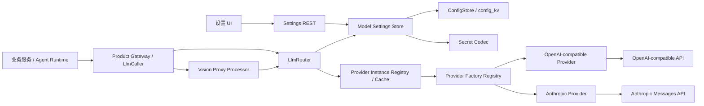
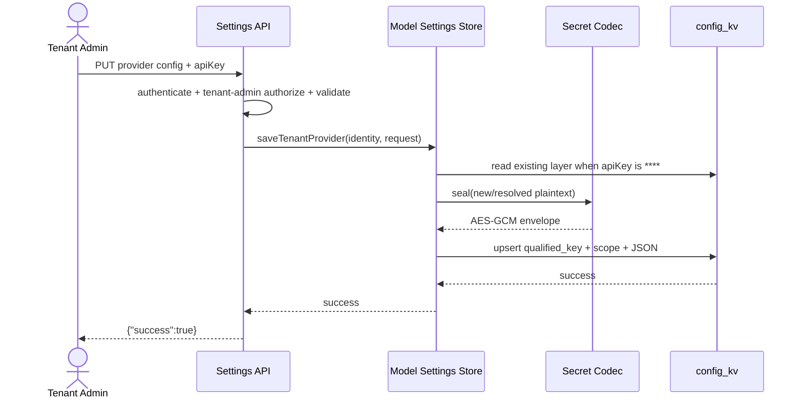
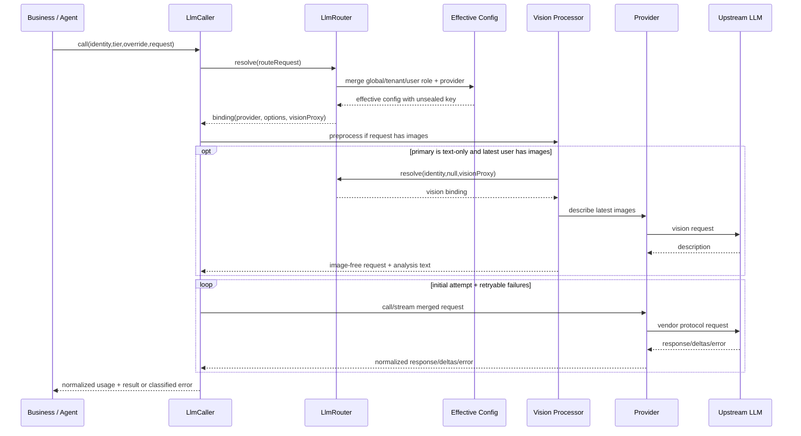
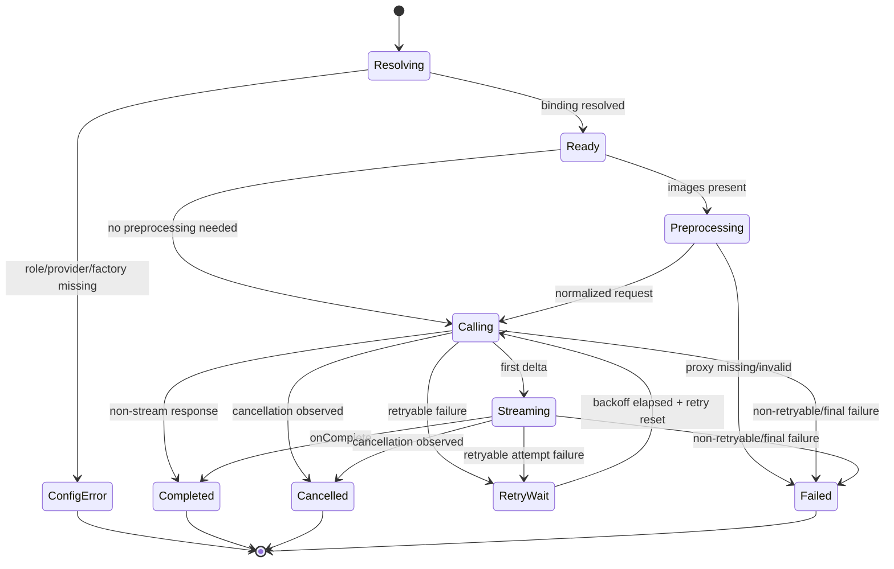
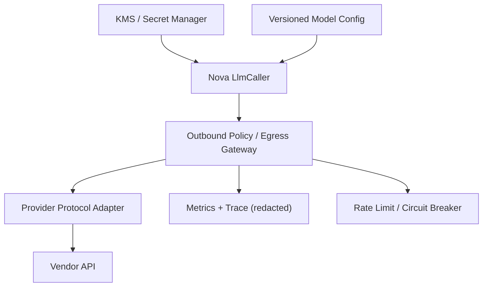

```
# LLM 路由、模型角色与 Provider 装配复刻文档

> 本文是自包含复刻说明。读者不需要访问 Nova 源码，也能实现等价的模型角色选择、租户/用户覆盖、Provider 装配、调用治理与设置管理能力。文末路径仅用于证据追溯。

## 1. 结论与边界

### 1.1 一句话结论

Nova 将“业务需要什么等级的模型”与“实际调用哪个厂商、哪个模型实例”分离：业务调用方提交身份、角色/层级和可选的显式 Provider 覆盖，路由器按全局、租户、用户三层配置解析出一个绑定；绑定包含可调用 Provider、请求默认参数和视觉代理信息。OpenAI-compatible 与 Anthropic 通过 Provider Factory 适配为统一 LLM SPI。

### 1.2 解决的问题与可见效果

| 问题 | 解决方式 | 最终效果 |
|---|---|---|
| 业务代码不应绑定厂商 SDK | 统一 `LlmProvider`、`LlmRouter`、`LlmCaller` 契约 | 业务只选择角色或明确实例名 |
| 不同任务需要不同成本/能力模型 | `SIMPLE`、`COMPLEX`、`DOCUMENT`、`VISION` 四类角色 | 简单任务、复杂推理、文档处理、视觉任务可独立配置 |
| 租户和用户需要覆盖平台默认值 | 运行时按字段做 `GLOBAL → TENANT → USER` 合并 | 用户配置优先，缺失字段继续继承；设置列表视图另有整层选择语义 |
| API Key 不能明文存储或返回 | AES-256-GCM 信封加密、响应统一掩码 | 数据库和设置页面不暴露明文密钥 |
| 多 Provider 的协议、工具 schema、流式事件不同 | 厂商插件负责序列化与反序列化 | 上层收到统一消息、工具调用、用量和停止原因 |
| 上游限流或暂时故障 | 统一调用器负责重试、取消、失败分类与用量归一化 | 主 Agent 调用具备一致的韧性与诊断语义 |

### 1.3 目标调用方、输入与输出

调用方包括 Agent Runtime、文档解析、洞察/引用处理、评测器、模型设置页和管理员连接测试。

核心输入：

- `identity`：稳定 SPI 的构造顺序是 `TenantIdentity(userId, tenantId)`；`userId` 不可为 `null`，普通用户身份必须非空，`tenantId` 可为 `null`；租户级配置必须用 `TenantIdentity.tenantScope(tenantId)`，不能交换两个字符串；
- `tier`：`SIMPLE | COMPLEX | DOCUMENT | VISION`，可为空；
- `providerOverride`：可选实例名；
- 标准化消息、工具定义、温度、最大输出 token、`topP`、停止词及厂商扩展参数；
- 可选沙箱，用于读取图片等本地内容。

核心输出：

- 路由阶段输出 `LlmBinding(provider, options, visionProxy)`；
- 调用阶段输出完整响应或流式 delta；
- 响应包含文本/思考/工具调用块、统一停止原因和 token 用量；
- 设置 API 返回角色/Provider 列表视图；tenant 存储视图仅当 API Key 实际非空时返回 `****`，缺失或已清除时返回空字符串。全局 YAML 回退 helper 当前会把空 key 也掩成 `****`，见 5.4 的已知偏差。

### 1.4 范围

本文包含：

- 产品侧 `ProductLlmGateway` 与 NovaCore `LlmRouter/LlmCaller` 的职责边界；
- 模型角色、Provider 显式覆盖、租户/用户继承；
- Provider Factory、注册表、装配器、懒加载和产品侧实例缓存；
- OpenAI-compatible、Anthropic 的消息、工具、视觉与流式适配；
- 配置持久化、密钥加密、设置 REST；
- retry、failure classification、usage normalization、取消、观测；
- 主仓、`nova_ui_e2e`、`nova_auto_test` 三仓的验证设计。

本文不包含 Agent tool loop、MCP 工具发现、完整聊天 WebSocket 事件字典、模型厂商内部实现或真实凭据。聊天层只说明其如何消费本能力。

### 1.5 当前实现、缺陷与推荐设计

- **[I] 已实现**：Agent 主链通过统一路由器解析角色；运行时路由做全局/租户/用户字段级继承；OpenAI 与 Anthropic 插件实现统一 Provider SPI。
- **[K] 已知偏差**：设置页 REST 的角色和 Provider “effective”列表并不是运行时字段级有效配置。角色列表选中最近的一整层，Provider 列表选租户整层或全局整层；缺失字段不会在响应中继续向父层补齐，Provider 列表也没有用户层。它们可用于编辑/展示，不能直接当成路由输入。
- **[I] 已实现**：产品侧业务网关始终先调用 `LlmRouter`，不存在按厂商直接查配置的旁路。
- **[K] 已知偏差**：产品侧部分后台业务经路由得到 Provider 后直接调用 `provider.call()`，没有经过 `LlmCaller`，因此不自动获得统一 retry、hook、取消、用量归一化和视觉预处理。这是“绕过调用治理”，不是“绕过路由”。
- **[K] 已知偏差**：产品路由器手工维护 OpenAI/Anthropic Factory 映射，而不是消费插件工厂注册表；厂商插件新增能力时，两处配置可能漂移。
- **[K] 已知偏差**：流式 Provider 在单次尝试失败时先发 `onError` 并抛异常；调用器仍可能重试并发 `onRetryReset`，从而使 `onError` 不是整次调用的最终事件。
- **[K] 已知偏差**：产品 Provider 缓存无界且无关闭/淘汰；配置反复编辑会留下旧实例。
- **[REQ] 推荐设计**：业务只依赖一个带治理能力的 `LlmExecutionGateway`；路由器只解析，统一调用器唯一负责实际 I/O；所有 Factory 仅从插件注册表获得；缓存有界、可按配置版本淘汰并释放资源。

## 2. 术语与参与方

### 2.1 术语

| 术语 | 定义 |
|---|---|
| Model Role / Tier | 业务意图等级，不等同于厂商模型名。本文统一称“角色”，SPI 中称 `LlmTier` |
| Provider Type | 协议/厂商适配类型，例如 `openai`、`anthropic` |
| Provider Instance | 一份具体连接配置，例如 `openai-main`，绑定模型、地址和密钥 |
| Binding | 路由结果：Provider 实例、请求默认参数、可选视觉代理实例名 |
| Override | 调用方明确指定 Provider 实例；Core 完全绕过角色，产品在 tier 非空时仍保留角色调优参数 |
| Factory | 将 `type + vendorConfig` 变成 Provider 的工厂 |
| Assembler | 读取配置，查找 Factory，建立实例注册表和角色映射的组件 |
| Vision Proxy | 主 Provider 不支持视觉时，先由另一个视觉 Provider 将图片转成文本描述 |
| Effective Config | 多层配置字段合并后的运行时视图 |
| Wire API | OpenAI-compatible 传输端点形态；当前产品配置允许声明但主要实现仍按 chat-completions 行为工作 |

### 2.2 参与方与职责



- 设置 UI：展示继承结果，管理员编辑租户角色和 Provider，用户编辑个人角色。
- Settings REST：认证、授权、字段校验、屏蔽密钥并调用 Store。
- Model Settings Store：读取 YAML/全局、租户、用户层并进行字段级合并。
- Router：纯解析组件，不应发起网络请求。
- Factory/Assembler：把配置变成 Provider 实例；核心装配路径支持懒实例化。
- LlmCaller：管理调用生命周期、重试、取消、hook、流式和用量。
- Provider：只做厂商协议转换和单次网络尝试。

## 3. 业务规则

### 3.1 角色规则

1. `SIMPLE` 用于低成本、低延迟的基础任务。
2. `COMPLEX` 是默认聊天角色；未知的产品 role key 和空 role key 在产品网关中分别映射为 `COMPLEX` 和“交给路由默认”。
3. `DOCUMENT` 用于文档抽取、摘要等长文本任务。
4. `VISION` 用于直接处理图片。
5. 历史 `THINKING` 配置读写时规范化为 `COMPLEX`；启动配置同时声明 `thinking` 和 `complex` 应拒绝，避免歧义。
6. 当前设置 UI 主要开放 `simple`、`complex`；`document`、`vision` 由平台配置管理。

### 3.2 路由优先级：Core 与产品 Router 不同

NovaCore 默认 Router 与产品 Router 对“同时给 tier 和 override”的语义不同，复刻当前行为时不能合并成一条规则：

| 输入 | NovaCore 默认 Router（YAML/注册表） | 产品 Router（数据库设置） |
|---|---|---|
| `tier=null, override=非空` | 直接按 override 找实例，完全绕过 tier | 直接按 override 找有效 Provider；绑定参数全部来自该 Provider |
| `tier=非空, override=非空` | 直接按 override 找实例，完全绕过 tier；绑定 options 为空 | 仍解析该 tier 的有效 role；只把 `role.use` 替换成 override，role 的 `maxTokens/topP` 继续覆盖被指定 Provider 的同名值 |
| `tier=非空, override=空` | `tier → YAML models.<tier>.use → registry instance` | `tier → 字段级有效 role → role.use → 字段级有效 Provider`，并叠加 role 调优参数 |
| `tier=null, override=空` | `LlmRouteRequest` 构造即失败 | 同样构造失败；产品内部兼容路径若要默认聊天，必须在构造请求前传 `DEFAULT_CHAT/COMPLEX` |

产品 Router 的等价伪码：

```text
override = trimToNull(request.providerOverride)
if request.tier == null and override != null:
    provider = effectiveProvider(identity, override)
    return binding(provider, provider.temperature/maxTokens/topP, provider.visionProxy)

role = effectiveRole(identity, request.tier)  // tier 必须非空
providerName = override != null ? override : role.use
provider = effectiveProvider(identity, providerName)
binding.maxTokens = role.maxTokens if present else provider.maxTokens
binding.topP = role.topP if present else provider.topP
binding.temperature = provider.temperature
```

显式 Provider 覆盖只替代实例选择，不授权调用方越过租户可见性或读取其他租户配置。产品路径必须在当前身份的运行时有效视图中查找实例；Core 路径只在进程级实例注册表中查找，没有租户配置层。

### 3.3 运行时字段继承与设置列表视图

有效配置按字段合并，而不是整对象替换：

```text
effective = merge(GLOBAL_OR_YAML, TENANT, USER)
```

- 子层未出现字段：继承父层；
- 子层显式给出非空值：覆盖父层；
- 子层显式给出 `null`：清除父层字段；
- 用户角色优先于租户角色，租户优先于全局；
- Provider 运行时也支持用户层覆盖，但当前产品 REST 只开放租户 Provider 写入；
- 角色 `use` 最终必须指向当前身份可解析的 Provider。

这里的字段合并只描述运行时 `findRole/findProviderForUse`：先装载 YAML/全局 map，再按 tenant、user 对“明确出现的字段”（包括显式 `null`）逐字段 overlay。

设置 REST 的两个视图必须另行实现：

- `/models/effective`：管理员按 tenant 整行→global 整行选最近一层；普通用户按 user 整行→tenant 整行→global 整行选最近一层。选中某层后，缺失的 `maxTokens/topP` 保持空，不从父层补齐。
- `/models/mine/effective`：所有人都按 user 整行→tenant 整行→global 整行选最近一层，同样不做字段补齐。
- `/providers/effective`：名称集合是 YAML 全局 Provider 与 tenant Provider 的并集；有 tenant 行就直接展示该 tenant 整行，否则展示 YAML 全局整行。没有用户 Provider 层，也不把 tenant 缺失字段从全局补齐。

**[K]** 因此列表响应中的“effective”表示“当前编辑器选择到的最近配置层”，不是“运行时每个字段的最终值”。复刻时应保留差异以获得当前兼容效果，或新增独立的 `runtimeResolved` 端点，不能悄悄改变现有响应。

### 3.4 参数覆盖

路由绑定默认值与单次请求值合并规则：

| 参数 | 优先级 |
|---|---|
| `temperature`、`maxTokens`、`topP` | 单次请求 > 角色/Provider 绑定 > Provider 默认 |
| `stopSequences` | 单次请求未提供时使用绑定值 |
| vendor options | 请求 map 覆盖绑定 map 的同名键 |
| `visionProxy` | Provider 配置元数据；不放入模型请求体 |

产品存储的角色目前覆盖 `maxTokens`、`topP`，温度来自 Provider。若复刻时希望角色也覆盖温度，应明确升级数据契约，不能静默改变优先级。

### 3.5 能力与默认值

- Provider 类型为空时默认 `openai`。
- 产品有效视图中 `contextLengthTokens` 未配置或非正数时默认 `128000`。
- 产品路由包装层中 `supportsVision` 未配置时默认 `true`；这是当前兼容行为，不代表厂商适配器的原生声明。
- OpenAI-compatible 原生能力声明为流式、工具调用；原生视觉默认较保守。
- Anthropic 原生能力声明为流式、工具调用、视觉和 thinking。
- **[F] 风险**：包装层“视觉默认 true”可能把实际不支持图片的兼容端点当作视觉模型。推荐默认继承 Factory 能力，只有显式配置才覆盖。

### 3.6 不绕路由原则

所有产品 LLM 调用必须先提交 `identity + tier/role + optional override` 给统一 `LlmRouter`。不得：

- 在业务服务中直接读取 API Key 或 base URL；
- 根据厂商名直接 `new` SDK；
- 在 system prompt 塞一个“使用某模型”的旁路开关；
- 因某个功能需要视觉就自动放开未授权 Provider。

生产级实现还应规定：路由后只能交给统一 `LlmCaller` 执行，不允许业务直接调用 Provider。

## 4. 完整执行链路

### 4.1 设置保存链路

1. 用户登录；请求上下文解析 `tenantId/userId/role`。
2. 普通用户只能写个人 `simple/complex` 角色；租户管理员可写租户角色和 Provider。
3. REST 校验 role key、Provider 名和 model 名。
4. Provider 请求中的 API Key 分三种：
   - 新明文：AES-256-GCM 加密后存储；
   - `****`：保留已有密钥；
   - 空字符串：明确清除。
5. Store 将 JSON 写入当前 scope 的唯一行。
6. 下一次路由按层读取并合并；不需要重启。
7. 设置查询只返回掩码与 `inheritedFrom/canReset/canDelete` 等展示元数据。



### 4.2 角色调用链路

1. 调用方建立标准 `LlmRequest`。
2. 产品网关从显式参数或沙箱上下文获取身份；无上下文的系统任务使用系统身份。
3. role key 映射成 tier；路由器读取有效角色和有效 Provider。
4. 路由器根据有效 Provider 配置得到缓存实例，并把角色调优参数覆盖到绑定 options。
5. 推荐交给 `LlmCaller`：执行视觉预处理、before hook、单次调用、retry、after hook、用量归一化。
6. Provider 把标准消息/工具 schema 转为厂商请求。
7. 厂商响应转成统一 content blocks、finish reason、usage。
8. 流式时 delta 逐步上送，最终生成 complete 或最终 error。



### 4.3 视觉代理链路

- 主 Provider 支持视觉：原请求直接发送。
- 主 Provider 不支持视觉且本轮最新用户消息无图片：剥离历史图片后继续。
- 主 Provider 不支持视觉、最新用户消息有图片、未配置代理：失败。
- 已配置代理：以同一身份按显式实例解析，代理必须支持视觉；仅分析最新用户图片，得到非空描述，注入 `[Image Analysis Result]` 文本并移除所有图片，再交给主 Provider。

视觉代理本身也必须走路由解析。当前其网络调用仍是直接 Provider 调用，生产复刻应让代理调用也经过受控 `LlmCaller` 子调用，设置独立超时与递归保护。

### 4.4 连接测试链路

- 已保存 Provider：请求只传 `providerName`，Store 在当前租户有效视图解析真实密钥。
- 草稿 Provider：请求提交表单字段；若密钥是 `****` 或空白，可回退到同名已保存/全局有效密钥；没有可用密钥则返回失败。
- 草稿不会写数据库，但当前实现可能进入 Provider 实例缓存。
- REST 业务失败通常返回 HTTP 200 与 `{success:false,message}`；前端据 `success` 显示提示。

### 4.5 状态机



## 5. 对外契约

### 5.1 核心 SPI

以下声明逐字段对应当前稳定 SPI；为便于集中阅读省略 package/import，并把多个应分别保存为同名 `.java` 文件的 public 类型放在一个代码块中。按类型拆文件、补标准 import 后可编译，方法名、返回值和空值语义不可改写成旧版形态：

```java
public enum LlmTier {
  SIMPLE, COMPLEX, DOCUMENT, VISION;
  public static final LlmTier DEFAULT_CHAT = COMPLEX;
}

public record TenantIdentity(String userId, String tenantId) implements Identity {
  public TenantIdentity {
    Objects.requireNonNull(userId, "userId");
    boolean hasTenant = tenantId != null && !tenantId.isBlank();
    if (userId.isBlank()) {
      if (!hasTenant) throw new IllegalArgumentException("tenant scope needs tenantId");
      userId = "";
    }
  }
  public static TenantIdentity tenantScope(String tenantId) {
    Objects.requireNonNull(tenantId, "tenantId");
    if (tenantId.isBlank()) throw new IllegalArgumentException("tenantId");
    return new TenantIdentity("", tenantId);
  }
  public boolean isTenantScope() { return userId.isEmpty(); }
  public String key() {
    if (isTenantScope()) return "t/" + tenantId;
    return tenantId == null || tenantId.isBlank()
        ? "u/" + userId : "t/" + tenantId + "/u/" + userId;
  }
}

public record LlmRouteRequest(
    Identity identity,
    LlmTier tier,                 // nullable only when override is nonblank
    String providerNameOverride) {
  public LlmRouteRequest {
    Objects.requireNonNull(identity, "identity");
    if (tier == null && (providerNameOverride == null || providerNameOverride.isBlank())) {
      throw new IllegalArgumentException("tier required without override");
    }
  }
}

public record LlmOptions(
    Double temperature,
    Integer maxTokens,
    Double topP,
    List<String> stopSequences,
    Map<String,Object> vendorOptions) {
  public LlmOptions {
    stopSequences = stopSequences == null ? List.of() : List.copyOf(stopSequences);
    vendorOptions = vendorOptions == null ? Map.of() : Map.copyOf(vendorOptions);
  }
  public static LlmOptions empty() {
    return new LlmOptions(null, null, null, List.of(), Map.of());
  }
}

public record LlmBinding(
    LlmProvider provider,
    LlmOptions options,
    String displayName,
    String visionProxyName) {
  public LlmBinding {
    Objects.requireNonNull(provider, "provider");
    options = options == null ? LlmOptions.empty() : options;
    visionProxyName = visionProxyName == null || visionProxyName.isBlank()
        ? null : visionProxyName.trim();
  }
  public LlmBinding(LlmProvider provider, LlmOptions options, String displayName) {
    this(provider, options, displayName, null);
  }
}

public interface LlmRouter {
  default LlmBinding resolve(LlmRouteRequest request) {
    LlmRequest stub = LlmRequest.builder().messages(List.of()).identity(request.identity()).build();
    LlmProvider provider = resolve(stub, request.tier(), request.providerNameOverride());
    return new LlmBinding(provider, LlmOptions.empty(), provider.name(), null);
  }
  LlmProvider resolve(LlmRequest request, LlmTier tier, String providerNameOverride);
}

public interface LlmProviderFactory {
  String type();
  List<ConfigParam> configParams();
  LlmProvider create(String instanceName, Map<String,Object> vendorConfig);
}

public interface LlmProvider {
  String type();
  String name();
  default Optional<String> configuredModelId() { return Optional.empty(); }
  LlmResponse call(LlmRequest request);
  default LlmResponse streamCall(LlmRequest request, LlmStreamListener listener) {
    throw new UnsupportedOperationException("streaming unsupported");
  }
  default TokenEstimator tokenEstimator() { return DefaultTokenEstimator.INSTANCE; }
  default LlmCapabilities capabilities() { return LlmCapabilities.textAndTools(); }
}
```

约束：Router 只解析，不发网络；Factory 类型在注册表中唯一；Provider `type()` 必须等于 Factory type，`name()` 必须等于配置实例名；`configuredModelId()` 是 `Optional`；`streamCall()` 返回组装后的完整响应；token 估算以 `TokenEstimator` 对象暴露；`providerOverride` 非空时 tier 才可为空。

身份 ABI 是隔离边界，以下三种构造必须全工程统一：

```java
new TenantIdentity("user-7", "tenant-a"); // tenant + user
new TenantIdentity("user-7", null);       // user-only
TenantIdentity.tenantScope("tenant-a");   // tenant-wide config，等价 userId=""
```

禁止写 `new TenantIdentity(tenantId, userId)`；两个参数都是字符串，编译器无法发现交换，结果会把租户和用户写入错误隔离键。

### 5.2 标准请求与响应 JSON

```json
{
  "identity": {"userId": "user-7", "tenantId": "tenant-a"},
  "tier": "COMPLEX",
  "providerOverride": null,
  "request": {
    "model": null,
    "messages": [
      {"role": "system", "content": [{"type": "text", "text": "You are an assistant."}]},
      {"role": "user", "content": [{"type": "text", "text": "Summarize the incident."}]}
    ],
    "tools": [
      {
        "name": "lookup_incident",
        "description": "Look up an incident by id.",
        "inputSchema": {
          "type": "object",
          "properties": {"id": {"type": "string"}},
          "required": ["id"],
          "additionalProperties": false
        }
      }
    ],
    "temperature": 0.2,
    "maxTokens": 2048,
    "topP": 0.9,
    "stopSequences": [],
    "vendorOptions": {}
  }
}
```

```json
{
  "content": [
    {"type": "text", "text": "Incident summary..."},
    {"type": "tool_use", "id": "call_01", "name": "lookup_incident", "input": {"id": "INC-7"}}
  ],
  "finishReason": "TOOL_USE",
  "usage": {"inputTokens": 621, "outputTokens": 74, "totalTokens": 695, "cachedTokens": 0},
  "provider": "openai-main",
  "model": "model-x"
}
```

工具 schema 必须稳定规范化后再序列化，以避免 map 顺序变化破坏 prompt cache。工具调用 ID 必须原样保留；参数 JSON 无法解析时返回 `protocol_error`，不得猜测修复后执行工具。

### 5.3 流式监听契约

```java
public interface LlmStreamListener {
  default void onTextDelta(String delta) {}
  default void onThinkingDelta(String delta) {}
  default void onToolCallStart(String toolCallId, String toolName) {}
  default void onToolCallArgsDelta(String toolCallId, String partialJson) {}
  default void onToolCallEnd(String toolCallId, Map<String,Object> args) {}
  default void onComplete(LlmResponse response) {}
  default void onError(Throwable error) {}
  default void onRetryReset(int nextAttempt, Throwable cause) {}
}
```

理想契约是 `delta* → exactly one(onComplete | onError)`。当前实现的可观察偏差可能是：

```text
delta(attempt 1)* → onError(attempt 1) → onRetryReset(1, cause)
                  → delta(attempt 2)* → onComplete
```

`nextAttempt` 的 Javadoc 说“一基的下一次尝试号”，语义上第一次 retry 应传 `2`；但当前 `LlmCaller` 的计数器从 `attempt=0` 开始，并在递增前调用 `onRetryReset(attempt + 1, cause)`，所以第一次实际传 `1`。默认 `maxAttempts=3` 表示“初次调用之外最多重试 3 次”，总尝试上限是 4；后续 reset 实参依次是 `1,2,3`。这是 **[K] 已知 off-by-one 契约偏差**，消费者应把该整数只当 attempt 标识而不要据它决定是否丢弃前缀。

当前 UI/消费者必须把 `onRetryReset` 解释为“回滚失败尝试产生的所有增量并恢复等待态”，不能在第一次 `onError` 就永久关闭流。**[REQ]** 更好的 Provider 契约是把 attempt error 只抛给调用器，调用器在重试耗尽后才向外发唯一 `onError`，并修正 reset 首值为 2。

### 5.4 设置 REST

所有端点要求已认证。`tenant admin` 表示还需租户管理员权限。

| 方法 | 路径 | 权限 | 作用 |
|---|---|---|---|
| GET | `/api/settings/models/effective` | authenticated | 设置编辑视角；管理员看租户→全局，普通用户看用户→租户→全局 |
| GET | `/api/settings/models/mine/effective` | authenticated | 聊天栏的来源选择视角；所有人均按用户整层→租户整层→全局整层（不是运行时字段 overlay） |
| PUT | `/api/settings/models/mine` | authenticated | 保存个人 simple/complex 角色 |
| DELETE | `/api/settings/models/mine/{roleKey}` | authenticated | 删除个人覆盖，恢复继承 |
| PUT | `/api/settings/models/tenant` | tenant admin | 保存租户角色 |
| DELETE | `/api/settings/models/tenant/{roleKey}` | tenant admin | 删除租户覆盖 |
| POST | `/api/settings/models/test` | tenant admin | 按 simple/complex 角色发最小真实请求 |
| GET | `/api/settings/providers/effective` | authenticated | 返回全局与租户有效 Provider，密钥掩码 |
| PUT | `/api/settings/providers/tenant` | tenant admin | 保存租户 Provider |
| DELETE | `/api/settings/providers/tenant/{providerName}` | tenant admin | 删除租户 Provider |
| POST | `/api/settings/providers/test` | tenant admin | 测试已保存配置或表单草稿 |

角色保存请求：

```json
{
  "roleKey": "complex",
  "use": "openai-main",
  "maxTokens": 8192,
  "topP": 0.9
}
```

Provider 保存/草稿测试请求：

```json
{
  "providerName": "openai-main",
  "providerType": "openai",
  "modelName": "model-x",
  "apiKey": "****",
  "baseUrl": "https://llm.example/v1",
  "wireApi": "chat",
  "authStyle": "bearer",
  "proxy": null,
  "parseInlineThink": false,
  "supportsVision": true,
  "visionProxy": null,
  "maxTokens": 8192,
  "contextLengthTokens": 128000,
  "temperature": 0.7,
  "topP": 1.0
}
```

有效 Provider 响应：

```json
{
  "providers": {
    "openai-main": {
      "providerName": "openai-main",
      "providerType": "openai",
      "modelName": "model-x",
      "apiKey": "****",
      "baseUrl": "https://llm.example/v1",
      "supportsVision": true,
      "contextLengthTokens": 128000,
      "inheritedFrom": "TENANT",
      "canReset": true,
      "canDelete": false
    }
  },
  "isAdmin": true
}
```

`canReset` 与 `canDelete` 对 tenant 行互斥：若同名 YAML/global Provider 存在，管理员得到 `canReset=true, canDelete=false`（删除 tenant 覆盖以恢复 global）；若是 tenant 新建且无 global，得到 `canReset=false, canDelete=true`。非管理员两者都为 false。全局回退视图也不可重置/删除。tenant 存储行的 `apiKey` 只有在该整层实际含非空 key 时为 `****`；缺失、空值或明确清除时是 `""`。

**[K] 全局空 key 展示偏差与当前 wire 契约**：全局 YAML 回退走通用 `ApiKeyMasker`，其当前三个分支必须完整理解：输入为 `null`、空字符串或长度不超过 8 时一律返回 `****`；只有长度大于 8 时才返回 `first4 + "****" + last4`。因此全局 key 缺失/空值会假阳性地显示成“已配置”，短 key 也无法区分。这个通用 masker 的现状不能与 tenant 存储行的安全展示规则混为一谈。

**[D] 推荐生产语义**：对所有来源先判定字段 presence 和非空性；缺失、空值或明确清除统一返回 `""`，任何非空 secret 不论长度统一返回 `****`，绝不回显首尾字符。若目标是逐字兼容当前 wire，则需保留上述 `null/空/<=8/>8` 四类断言并把假阳性登记为兼容风险；若目标是安全等价复刻，应采用本段 D 语义并同步更新前端“已配置”判断。

连接测试成功/失败：

```json
{"success": true, "message": "Hi! How can I help?"}
```

```json
{"success": false, "message": "Provider configuration not found: missing-name"}
```

成功 `message` 不是固定文案：服务真实发送一条 `"hi"` 用户消息，然后拼接响应中的所有文本 block；没有文本时可为空。当前失败路径遍历到最深 cause，并返回 `topLevelMessage + " (" + deepestCauseMessage + ")"`，因此异常类内部文案、端点信息或供应商原始详情可能直达 UI，属于 **[K] 信息泄露风险**。

当前业务校验和连接失败多以 HTTP 200 表达，网络级/未认证/未授权仍应使用 4xx/5xx。生产复刻应在 controller 边界把异常映射为安全 envelope；只返回稳定 code、面向用户的脱敏 message、retryable 和 requestId，完整 cause 只进入受控日志。这里是需要补齐的 **[D] 生产设计**，不是当前已经实现的保证：

```json
{
  "success": false,
  "error": {
    "code": "PROVIDER_CONFIG_MISSING",
    "message": "Provider configuration not found: missing-name",
    "retryable": false,
    "requestId": "req-..."
  }
}
```

PUT 以 scope 内业务键覆盖，具有幂等性；DELETE 对不存在的覆盖应做幂等成功。列表不分页，顺序不应作为契约。Provider 真实测试应有独立短超时；当前请求超时最终取决于 Factory/HTTP 配置。

### 5.5 YAML 配置

最小启动配置：

```yaml
nova:
  providers:
    openai-main:
      type: openai
      api-key: ${OPENAI_API_KEY}
      base-url: https://api.openai.com/v1
      model: model-x
      auth-style: bearer
      request-timeout-seconds: 300
      stream-include-usage: true
      context-length-tokens: 128000
      supports-vision: true
    claude-main:
      type: anthropic
      api-key: ${ANTHROPIC_API_KEY}
      base-url: https://api.anthropic.com
      model: claude-model
      timeout-seconds: 120
      anthropic-version: "2023-06-01"
      context-length-tokens: 200000
  models:
    simple:
      use: openai-main
    complex:
      use: claude-main
    document:
      use: claude-main
    vision:
      use: openai-main
  security:
    credential-master-key: ${NOVA_SECURITY_CREDENTIAL_MASTER_KEY}
```

`NOVA_SECURITY_CREDENTIAL_MASTER_KEY` 必须是 Base64 编码的 32 字节随机值，只能通过 Secret 管理系统注入。配置中的 `${...}` 应在进入 Provider Factory 前完成解析。

## 6. 数据模型与生命周期

### 6.1 配置表

H2/PostgreSQL 可使用等价 DDL：

```sql
CREATE TABLE config_kv (
  qualified_key VARCHAR(255) NOT NULL,
  scope_tenant  VARCHAR(255) NOT NULL DEFAULT '',
  scope_user    VARCHAR(255) NOT NULL DEFAULT '',
  value_json    TEXT NOT NULL,
  updated_at    TIMESTAMP(6) NOT NULL,
  updated_by    VARCHAR(255),
  PRIMARY KEY (qualified_key, scope_tenant, scope_user)
);

CREATE INDEX idx_config_kv_tenant_user
  ON config_kv(scope_tenant, scope_user);
```

业务键：

- 角色：`llm-role:<canonicalRoleKey>`；
- Provider：`llm-provider:<providerName>`；
- 全局层：`scope_tenant='' AND scope_user=''`；
- 租户层：`scope_tenant=<tenant> AND scope_user=''`；
- 用户层：两者都有值。

### 6.2 存储 JSON

```json
{
  "qualified_key": "llm-role:complex",
  "scope_tenant": "tenant-a",
  "scope_user": "user-7",
  "value_json": {
    "use": "openai-main",
    "maxTokens": 8192,
    "topP": 0.9
  }
}
```

```json
{
  "qualified_key": "llm-provider:openai-main",
  "scope_tenant": "tenant-a",
  "scope_user": "",
  "value_json": {
    "providerType": "openai",
    "modelName": "model-x",
    "apiKey": {
      "__secret": true,
      "alg": "AES-256-GCM",
      "keyVersion": 1,
      "ciphertextBase64": "<12-byte-IV + ciphertext + 16-byte-tag, base64>"
    },
    "baseUrl": "https://llm.example/v1",
    "supportsVision": true,
    "contextLengthTokens": 128000
  }
}
```

### 6.3 生命周期

- 创建/更新：scope 内对 `(qualified_key, tenant, user)` upsert。
- 重置：物理删除当前层行，重新暴露父层；无软删除和 TTL。
- YAML 层：进程配置，不写 `config_kv`。
- 读取：逐层读取 JSON，字段级合并，最后才解密 API Key。
- 缓存：当前产品路由器按配置内容创建 Provider 缓存项；修改配置形成新 key，旧项不删除。
- 进程重启：实例缓存丢失，配置仍在；首次解析重新创建 Provider。
- 密钥轮转：信封有 `keyVersion=1`，但当前没有多版本密钥环和自动迁移。直接更换主密钥会使既有密文不可读。

### 6.4 缓存键与敏感信息

当前产品缓存键应至少含实例名、类型、模型、base URL、协议、鉴权方式、代理、thinking 解析、视觉能力、上下文长度和温度。API Key 只放 SHA-256 指纹，不放明文。`maxTokens/topP/visionProxy` 可留在绑定层，不要求重建网络客户端。

**[REQ]** 生产设计应使用 `(tenantId, providerName, configVersion)` 作为逻辑键，值为引用计数或可关闭客户端；配置更新后原子切换，新调用用新版本，旧调用结束后关闭旧实例。不要只凭 secret hash 做跨租户共享，避免审计和限流归属混淆。

## 7. 核心实现设计

### 7.1 推荐模块划分

| 模块 | 唯一职责 |
|---|---|
| `model-config-domain` | 角色、Provider DTO、规范化与字段级合并 |
| `model-config-store` | scope 化持久化、密钥 seal/unseal、有效视图 |
| `llm-spi` | Router、Provider、Factory、消息、工具、流式契约 |
| `llm-provider-registry` | Factory 注册冲突检查、Provider 实例生命周期 |
| `llm-routing` | 身份与 tier/override 解析，产出 Binding |
| `llm-execution` | retry、cancel、hook、usage、vision、stream terminal contract |
| `provider-openai` | OpenAI-compatible wire adapter |
| `provider-anthropic` | Anthropic Messages wire adapter |
| `model-settings-api` | REST 权限、验证、掩码和连接测试 |

### 7.2 有效配置合并伪码

```text
function findEffective(identity, qualifiedKey):
    result = copy(yamlOrGlobal[qualifiedKey] or {})
    if identity.tenantId not blank:
        overlayFieldByField(result, row(qualifiedKey, tenant, ""))
    if identity.userId not blank:
        overlayFieldByField(result, row(qualifiedKey, tenant, user))
    return result

function overlayFieldByField(target, child):
    if child absent: return target
    for each field explicitly present in child:
        target[field] = child[field]  // including explicit null
```

实现必须区分“字段不存在”和“字段存在且为 null”，普通 Java bean 反序列化往往丢失这个差异；可使用原始 JSON map、presence bit 或 patch DTO。

### 7.3 路由伪码

```text
function resolveCore(routeRequest):
    require routeRequest.identity
    override = trimToNull(routeRequest.providerOverride)
    if override != null:
        return Binding(registry.require(override), emptyOptions, registry.visionProxy(override))

    require routeRequest.tier
    providerName = tierToInstance[routeRequest.tier]
    return Binding(registry.require(providerName), emptyOptions, registry.visionProxy(providerName))

function resolveProduct(routeRequest):
    require routeRequest.identity
    override = trimToNull(routeRequest.providerOverride)
    if routeRequest.tier == null and override != null:
        providerConfig = store.findProviderForUse(routeRequest.identity, override)
        return Binding(instance(override, providerConfig), providerDefaults(providerConfig),
                       override, providerConfig.visionProxy)

    require routeRequest.tier
    roleKey = canonicalRoleKey(routeRequest.tier)
    role = store.findRole(routeRequest.identity, roleKey)
    require role and trimToNull(role.use)
    providerName = override != null ? override : role.use
    providerConfig = store.findProviderForUse(routeRequest.identity, providerName)
    require providerConfig
    provider = instanceManager.getOrCreate(providerName, providerConfig)
    options = overlay(providerDefaults(providerConfig), role.maxTokens, role.topP)
    return Binding(provider, options, providerName, providerConfig.visionProxy)
```

错误必须带 `tenantId` 的不可逆/非敏感标识、role key、Provider 名和错误码，但不得带 API Key、完整请求体或密文。

### 7.4 核心 YAML 装配路径

1. 系统插件在 `registerSystemServices` 阶段向 Factory Registry 注册 `openai`、`anthropic`。
2. Assembler 遍历 `nova.providers`：抽取 `type/supports-vision/vision-proxy`，其余字段作为 vendor config。
3. 查 Factory；未知类型报可定位错误。
4. 注册 `LazyLlmProvider`，此时不建立网络客户端。
5. 遍历 `nova.models`，规范化 role key，校验 `use` 指向已注册实例，再建立 tier map。
6. Provider 首次调用 `configuredModelId/capabilities/call/streamCall/tokenEstimator` 时用双重检查锁创建一次真实实例。
7. Factory 返回的 `provider.name()` 必须等于实例名，否则立即失败。

当前产品应用安装自定义 Router 后，核心不会再执行默认 YAML Provider 装配；产品 Router 自己读取 Model Settings Store 并在首次解析时创建实例。这两条路径不应在同一进程同时成为事实来源。

两条装配路径实际交给 Factory 的字段不同：

| 字段 | Core YAML Assembler | Product DB Router | 影响 |
|---|---|---|---|
| `type` | Core 消费，不传 Factory | 用于选择手工 Factory，不传 Factory | 一致 |
| `supports-vision` / `vision-proxy` | Core 消费，不传 Factory | Product wrapper/Binding 消费，不传 Factory | 一致 |
| `api-key/base-url/model/temperature/proxy/parse-inline-think/context-length-tokens/wire-api/auth-style` | 原样传 Factory | 显式组 map 后传 | OpenAI 公共字段基本可达；`wire-api` 当前仍为 no-op |
| `max-tokens/top-p/vision-proxy` | 除 vision proxy 外会作为未知 vendor 字段转发，但当前 Factory 不消费 | 不传 Factory；只放 Binding options/metadata | 属于绑定层，不应依赖 Factory 接收 |
| OpenAI `stream-include-usage` | 原样传，Factory 消费 | **不传** | Product 路径只能使用插件默认值 |
| OpenAI `request-timeout-seconds` | 原样传，Factory 消费 | **不传** | Product 路径只能使用插件默认超时 |
| Anthropic `timeout-seconds/anthropic-version/anthropic-beta/default-thinking-budget/default-cache-control` | 原样传，Factory 消费 | **不传** | Product 设置无法复刻这些 YAML 能力 |
| 未识别 vendor 字段 | 除三个 Core 字段外均转发 | 丢弃 | 扩展能力在两路径间可能漂移 |

**[K] Core context length 丢失**：YAML vendor Factory 可返回带真实 `contextLengthTokens` 的能力，但 Core Assembler 无论是否显式配置视觉，都总用四参数 `new LlmCapabilities(streaming, vision, tools, thinking)` 包装，导致 context length 变成 `0`（unknown）；后续 `contextLengthTokensOrDefault()` 表现为 `256_000`。Product wrapper 使用五参数构造并保留其有效值（未配置时产品默认 `128_000`）。复刻当前结果时要覆盖此兼容测试；生产修复应在 Core wrapper 中透传 `original.contextLengthTokens()`。

### 7.5 最小 Provider Stub

下面内容可保存为单个 `StubProvider.java` 并与当前 SPI 一起编译；它覆盖 `type/configuredModelId/streamCall/TokenEstimator/configParams` 等真实形态，不依赖外部网络：

```java
import com.aloudata.nova.core.spi.config.ConfigParam;
import com.aloudata.nova.core.spi.config.ConfigParamType;
import com.aloudata.nova.core.spi.error.LlmCallException;
import com.aloudata.nova.core.spi.llm.ChatMessage;
import com.aloudata.nova.core.spi.llm.LlmCapabilities;
import com.aloudata.nova.core.spi.llm.LlmProvider;
import com.aloudata.nova.core.spi.llm.LlmProviderFactory;
import com.aloudata.nova.core.spi.llm.LlmRequest;
import com.aloudata.nova.core.spi.llm.LlmResponse;
import com.aloudata.nova.core.spi.llm.LlmStreamListener;
import com.aloudata.nova.core.spi.llm.StopReason;
import com.aloudata.nova.core.spi.llm.TokenEstimator;
import com.aloudata.nova.core.spi.tool.ContentBlock;
import com.aloudata.nova.core.spi.tool.Tool;
import com.aloudata.nova.core.spi.tool.ToolDefinition;
import java.util.List;
import java.util.Map;
import java.util.Optional;
import java.util.concurrent.atomic.AtomicInteger;

final class StubProvider implements LlmProvider {
  private final String name;
  private final boolean vision;
  private final AtomicInteger calls = new AtomicInteger();
  private final AtomicInteger failuresRemaining;

  StubProvider(String name, boolean vision, int failuresRemaining) {
    this.name = name;
    this.vision = vision;
    this.failuresRemaining = new AtomicInteger(Math.max(0, failuresRemaining));
  }

  @Override public String type() { return "stub"; }
  public String name() { return name; }
  @Override public Optional<String> configuredModelId() { return Optional.of("stub-model"); }
  public LlmCapabilities capabilities() {
    return new LlmCapabilities(true, vision, true, false, 128_000);
  }

  public LlmResponse call(LlmRequest request) {
    calls.incrementAndGet();
    int before = failuresRemaining.getAndUpdate(n -> Math.max(0, n - 1));
    if (before > 0) {
      throw new LlmCallException(name, "HTTP 503 stub unavailable", null);
    }
    Tool configuredTool = request.tools().isEmpty() ? null : request.tools().get(0);
    ToolDefinition tool = configuredTool == null ? null : configuredTool.definition();
    List<ContentBlock> blocks = tool == null
        ? List.of(new ContentBlock.Text("stub-ok"))
        : List.of(new ContentBlock.ToolUse(
            "stub-call-1", tool.name(), Map.of("id", "stub")));
    return new LlmResponse(
        blocks,
        tool == null ? StopReason.END_TURN : StopReason.TOOL_USE,
        new LlmResponse.Usage(10, 4, 14, 0),
        Map.of("provider", name, "model", "stub-model"));
  }

  public LlmResponse streamCall(LlmRequest request, LlmStreamListener listener) {
    try {
      LlmResponse response = call(request);
      if (response.finishReason() == StopReason.TOOL_USE) {
        ContentBlock.ToolUse tool = (ContentBlock.ToolUse) response.blocks().get(0);
        listener.onToolCallStart(tool.toolCallId(), tool.toolName());
        listener.onToolCallArgsDelta(tool.toolCallId(), "{\"id\":\"stub\"}");
        listener.onToolCallEnd(tool.toolCallId(), tool.arguments());
      } else {
        listener.onTextDelta("stub-");
        listener.onTextDelta("ok");
      }
      listener.onComplete(response);
      return response;
    } catch (RuntimeException error) {
      listener.onError(error);
      throw error;
    }
  }

  public TokenEstimator tokenEstimator() {
    return new TokenEstimator() {
      public int estimate(ChatMessage message) { return 7; }
    };
  }
  int calls() { return calls.get(); }
}

final class StubProviderFactory implements LlmProviderFactory {
  public String type() { return "stub"; }
  public List<ConfigParam> configParams() {
    return List.of(
        ConfigParam.builder("failures", ConfigParamType.INTEGER)
            .defaultValue(0).minimum(0).build(),
        ConfigParam.builder("vision", ConfigParamType.BOOLEAN)
            .defaultValue(false).build());
  }
  public LlmProvider create(String instanceName, Map<String,Object> cfg) {
    return new StubProvider(
        instanceName,
        Boolean.TRUE.equals(cfg.get("vision")),
        ((Number) cfg.getOrDefault("failures", 0)).intValue());
  }
}
```

### 7.6 OpenAI-compatible 适配

Factory 最小必填：`api-key`、`base-url`、`model`。支持 `temperature`、`proxy`、`parse-inline-think`、`context-length-tokens`、`stream-include-usage`、`auth-style`、`request-timeout-seconds`。鉴权至少支持 bearer、x-api-key、api-key。

转换要点：

- 工具转为 `type:function` 与稳定的 JSON Schema；
- 连续 user 消息合并以适配部分兼容端点；
- 图片从受控沙箱读取并编码，不能接受任意宿主路径；
- `stop → END_TURN`、`tool_calls → TOOL_USE`、`length → MAX_TOKENS`；内容过滤和未知原因映射为错误；
- 缺失 finish reason、损坏的工具参数均视为协议错误；
- vendor options 可映射 tool choice、seed、response format、penalties、`top_k/min_p`、thinking budget 和额外 body；必须白名单化或隔离命名空间；
- OpenAI-compatible 对端即使被配置为支持视觉，也可能在请求时拒绝 `image_url`。当前 Provider 仅在请求确实含 multipart 图片，且 `LlmCallException.message` 命中下列特征之一时做一次内部 text-only retry：`Unexpected item type in content`；同时含 `image/content/invalid`；同时含 `unknown variant/image_url`；或同时含 `image_url/expected/text`。其他错误不走此降级。
- 降级会逐条改写所有含图片的消息：删除所有 `image_url` part，保留非空 text part 并用两个换行连接，再追加固定“端点拒绝图片、请告知用户当前模型无法分析图片”的说明；若原消息没有文本，则只放说明。模型、工具、采样参数、vendor options 和 tool choice 保持不变。
- 非流式：首次图片拒绝不向外发 callback，直接做一次 text-only 调用；第二次失败正常抛出。流式：首次预流 HTTP 图片拒绝不触发 `onError`，使用全新 translator 做 text-only stream；降级重试失败才 `onError(retryError)` 一次并抛出。非图片错误、mid-stream/解析错误则直接 `onError` 并抛出。这个 Provider 内部一次降级独立于 `LlmCaller` 的外层 transient retry，验收时要分别计数。
- **[K]** 当前 `wire-api` 可配置非 chat 值，但主要传输仍按 chat 形态工作；复刻不得宣称完整 Responses API 兼容，除非另做 contract test。

### 7.7 Anthropic 适配

Factory 最小必填：`api-key`、`model`；base URL 默认 Anthropic API。支持 timeout、`anthropic-version`、beta、默认 thinking budget、prompt cache control 位置和 context length。

转换要点：

- system 内容与 messages 分离；
- 相邻同角色消息合并，维持严格 user/assistant 交替；
- tool result 放入 user 消息；工具 schema 使用 `input_schema`；
- thinking block 的 signature 必须在后续轮次原样回传；
- 图片使用受控沙箱读取并 Base64 编码；无沙箱时明确失败；
- 可在 system/tools/last user/last message 指定 ephemeral cache control；
- `end_turn → END_TURN`、`tool_use → TOOL_USE`、`max_tokens → MAX_TOKENS`，未知停止原因映射错误。

**[K]** 产品设置 Router 当前只向 Factory 传共同字段，未完整暴露 Anthropic version、beta、cache control、默认 thinking budget 等厂商参数；核心 YAML 装配路径可转发更多 vendor config。推荐让设置模型支持安全的类型化扩展字段。

### 7.8 最小版与生产版

| 维度 | 最小可用 | 生产级 |
|---|---|---|
| 路由 | 内存角色 map + 显式 override | scope 合并、版本化缓存、审计和可解释决策 |
| Provider | 一个 Stub + 一个 OpenAI-compatible | 插件 Factory Registry、多厂商 contract suite |
| 密钥 | 启动环境变量 | KMS/Vault envelope encryption、版本轮转、访问审计 |
| 重试 | 503/429 指数退避 | 结构化状态码、Retry-After、幂等预算、熔断 |
| 流式 | delta + terminal | attempt 隔离、retry reset、断线取消、背压 |
| 缓存 | ConcurrentMap | 有界、TTL/版本淘汰、close、指标 |
| 观测 | requestId + 日志 | route span、provider span、token/cost、SLO、脱敏诊断 |

## 8. 并发与非正常路径

### 8.1 并发

- Factory Registry 用 `putIfAbsent`；同一 type 重复注册立即冲突，不能后注册覆盖。
- Provider Registry 同样要求实例名唯一且与 `provider.name()` 一致。
- Lazy Provider 使用 volatile + synchronized 双重检查，Factory 至多调用一次。
- 产品缓存用 `ConcurrentHashMap.computeIfAbsent`，同一缓存键只创建一个实例。
- 设置 PUT 当前是最后写入者获胜；无 ETag/version。两个管理员同时编辑可能静默覆盖。
- 自动化修改角色必须单 worker、保存原值、写入唯一 marker、清理前确认 marker 仍属于自己，再 PUT 恢复或 DELETE；这是避免覆盖外部修改的最低措施。

**[REQ]** 设置 API 增加 `version` 或 `updatedAt` 条件写：`If-Match` 不匹配返回 409。缓存切换按配置版本原子完成。

### 8.2 超时、重试和退避

默认 retry 策略：初次尝试之后最多 3 次重试，基础 200 ms，倍数 2，上限 10 s，加入 0–25% jitter。

当前仅 `LlmCallException` 进入重试判断：

- HTTP 408、429：重试；
- 其他 4xx：不重试；
- 5xx：重试；
- 无可识别 HTTP 状态：通常重试；
- 取消、认证、内容过滤、协议错误不应重试。

**[K]** 状态码主要从异常消息正则提取，脆弱且依赖 Provider 文案。生产 SPI 应携带结构化 `statusCode/vendorCode/retryable/retryAfter`。

### 8.3 失败分类

统一错误码至少包括：

```text
context_overflow, rate_limited, auth, timeout, network, server,
cancelled, stream_incomplete, protocol_error, content_filter,
stop_sequence, unknown
```

分类用于 UI 文案、指标与是否重试，不应泄漏原始响应。因 SPI 缺少结构化字段，当前实现会检查有限深度的 cause chain 和消息；推荐在 Provider 边界完成结构化翻译。

### 8.4 用量归一化

- `Usage` 有四项：`inputTokens/outputTokens/totalTokens/cachedTokens`；Provider 返回任一项非零时保留报告值；
- 四项全为零时才估算输入消息、稳定工具 schema 和输出 blocks；
- 总量应等于输入加输出；
- **[K]** 上游真实用量恰好全零时也会被替换，无法区分“缺失”和“真实零”。生产模型用 nullable/`usageReported` 标志。

### 8.5 取消与断线

- 调用器在尝试前、重试等待中和流式处理中检查 cancellation token；
- 客户端断开应传播到上游 HTTP body/stream 关闭；
- 取消不重试，最终分类为 `cancelled`；
- Provider 必须释放 response body、socket 和解析器；插件 stop 也必须关闭共享客户端资源；
- 当前产品缓存没有显式关闭语义，属于资源生命周期风险。

### 8.6 配置和外部失败

| 异常 | 当前/目标行为 |
|---|---|
| role 缺失 | 路由失败，指出缺失 role key |
| role 指向不存在 Provider | 路由失败，不回退到任意 Provider |
| factory type 未注册 | 装配/首次解析失败，指出 type |
| API Key 信封损坏 | 若存在 YAML 父层 Provider，可警告并回退；否则失败且不泄密 |
| master key 缺失/长度错误 | 应用启动 fail-fast |
| 视觉代理缺失或非视觉 | 请求失败，不静默丢图 |
| tool arguments 非法 JSON | 协议错误，不执行工具 |
| 上游发部分 delta 后断开 | attempt 失败；若重试，消费者先 rollback/reset |
| 进程在更新后崩溃 | DB upsert 已提交则重启后生效；内存缓存重建 |

## 9. 安全、权限和审计

### 9.1 认证与授权

- 所有设置接口要求登录；
- 个人角色只允许当前用户在当前租户写；
- 租户角色和 Provider 写删、连接测试要求租户管理员；
- 读取有效 Provider 不返回明文密钥；
- Router 必须以调用上下文身份解析，不能接受客户端任意伪造 tenant/user；
- 后台无用户上下文任务使用明确的 system identity，并限制其能看到的全局配置。

### 9.2 密钥处理

- 主密钥：Base64 解码后必须恰好 32 字节；缺失或格式错误启动失败；
- 数据密钥算法：AES-256-GCM，随机 12 字节 IV，128-bit tag；
- 信封校验 `alg` 和 `keyVersion`，未知值 fail-closed；
- legacy 明文可读只用于滚动迁移，应配合后台扫描和重加密截止日期；
- API/UI 的目标契约是：已配置的非空 key 返回 `****`，缺失/清除返回空字符串；tenant 存储视图已满足，全局 YAML 空 key 尚有 5.4 所述假掩码偏差；日志、trace、异常、自动化附件不得出现 key、Authorization header 或密文；
- `****` 只表示“保留已有”，不能作为真实密钥送给上游；
- 密钥指纹只用于缓存判等，不用于认证，也不应暴露给客户端。

### 9.3 SSRF、代理与图片

- base URL 和 proxy 是管理员可写的高风险网络配置；生产环境应限制 scheme、端口、私网/CIDR、DNS rebinding，并走统一 outbound policy；
- 保持本地 API 的 no-proxy 规则，不能因 Provider 代理影响内部回环调用；
- 图片只能从当前会话授权沙箱读取，拒绝 `../`、绝对路径和跨租户文件；
- vendor `extra_body` 可能覆盖安全字段，应使用白名单和保留字段保护。

### 9.4 审计

建议记录：

- `MODEL_ROLE_UPDATED/RESET`：actor、tenant、scope、role、变更字段名，不记录密钥；
- `LLM_PROVIDER_UPDATED/DELETED/TESTED`：provider 名、类型、结果码、延迟；
- `LLM_ROUTE_RESOLVED`：identity 的安全标识、tier、是否 override、配置来源、实例名；
- `LLM_CALL_COMPLETED/FAILED/CANCELLED`：requestId、attempts、failure code、usage、模型；
- 主密钥轮转和 legacy 明文迁移事件。

## 10. 外部依赖对端设计

### 10.1 OpenAI-compatible 对端契约

Nova 可观察并依赖的最小语义：

- HTTPS JSON API，接受 bearer/x-api-key/api-key 之一；
- 接受 system/user/assistant/tool 消息和 function tool schema；
- 非流式返回 choices、message content/tool calls、finish reason、可选 usage；
- 流式返回有序 delta，连接终止前给出可判断完成的结束语义；
- 429/5xx 可通过 HTTP 状态识别，最好提供 `Retry-After`；
- 工具参数是 JSON object 字符串；工具调用 ID 在后续 tool result 中可关联。

最小 HTTP Stub 行为：

```http
POST /v1/chat/completions
Authorization: Bearer test-key
Content-Type: application/json

{"model":"stub","messages":[{"role":"user","content":"ping"}],"stream":false}
```

```json
{
  "id": "chatcmpl_stub",
  "choices": [{
    "index": 0,
    "message": {"role": "assistant", "content": "pong"},
    "finish_reason": "stop"
  }],
  "usage": {"prompt_tokens": 8, "completion_tokens": 2, "total_tokens": 10}
}
```

生产对端应具备 TLS、租户限流、幂等 request id、结构化错误、流式心跳、usage 结算、模型能力发现与版本策略。Nova 无法从客户端代码证明对端如何调度 GPU、保存提示词、计费或训练数据；这些必须由供应商合同和独立安全审计确认。

### 10.2 Anthropic 对端契约

最小语义：Messages API；请求头携带 API Key 和版本；system 独立；content 是 text/image/tool_use/tool_result/thinking block；停止原因和 usage 可解析；流式事件顺序允许重建最终消息。

```http
POST /v1/messages
x-api-key: test-key
anthropic-version: 2023-06-01
Content-Type: application/json

{"model":"stub","max_tokens":64,"messages":[{"role":"user","content":"ping"}]}
```

```json
{
  "id": "msg_stub",
  "type": "message",
  "role": "assistant",
  "content": [{"type":"text","text":"pong"}],
  "stop_reason": "end_turn",
  "usage": {"input_tokens":8,"output_tokens":2}
}
```

### 10.3 视觉代理对端

视觉 Provider 必须：接收当前沙箱产生的图片内容；返回非空文本描述；不得返回工具调用作为图片描述结果；遵守独立 token/timeout 限制。Nova 无法证明模型是否真正理解图片，只能验证协议接受、结果非空和后续主模型收到描述。

### 10.4 推荐 Provider Gateway 架构



## 11. 可观察性

### 11.1 日志

结构化字段：`requestId/traceId/tenantHash/userHash/tier/providerInstance/providerType/model/configSource/attempt/stream/latencyMs/failureCode/retryable/inputTokens/outputTokens`。

禁止记录：API Key、Authorization、完整 system prompt、原始图片、完整工具结果、密文。连接测试消息也要走同样脱敏策略。

### 11.2 指标

- `llm_route_total{tier,source,result}`、`llm_route_latency_ms`；
- `llm_call_total{provider,model,result,failure_code}`；
- `llm_call_latency_ms`、`llm_first_token_latency_ms`；
- `llm_retry_total{provider,reason,attempt}`；
- `llm_tokens_total{provider,model,direction,estimated}`；
- `llm_stream_reset_total`、`llm_cancel_total`；
- `llm_provider_cache_size`、`llm_provider_create_total`、`llm_provider_eviction_total`；
- `llm_secret_unseal_failure_total`、`llm_config_fallback_total`。

### 11.3 Trace

建议 span：`llm.route` → 可选 `llm.vision_proxy` → `llm.call.attempt.N` → `llm.stream.consume`。属性只记录实例名和模型名等非秘密元数据；请求/响应内容默认不采集。

### 11.4 告警

- 5 分钟 auth failure > 0：高优先级，通常是密钥失效；
- 429 或 5xx 比率超过基线；
- P95 首 token/总延迟超 SLO；
- stream reset 激增；
- Provider 缓存持续增长且无淘汰；
- secret unseal failure 或 global fallback 出现；
- 某 tier 无有效映射。

### 11.5 用户可定位错误

目标设计中，UI 展示短消息和 requestId；管理员可看到 role/provider 名和建议动作。内部异常类型、堆栈、base URL 查询参数和 credential-shaped 文本不得返回。**[K] 当前连接测试尚未满足该目标**：它拼接最深 cause message。复刻生产版本应使用 5.4 的安全 envelope，并增加自动化断言，显式拒绝 Java 异常名、Authorization 或疑似 key。

## 12. 复刻实施顺序

1. **定义 SPI 与错误模型**：完成消息 block、工具 schema、usage、finish reason、Router/Provider/Factory/Listener；静态验收是所有上层只依赖 SPI。
2. **实现 ConfigStore 与 scope 合并**：建 `config_kv`，实现字段 presence；静态验收是 global/tenant/user 和显式 null 测试表完整。
3. **实现密钥信封**：AES-GCM、启动 fail-fast、掩码、legacy 迁移；静态验收是明文不会进入数据库/API/日志。
4. **实现 Factory/Provider Registry 与懒装配**：冲突检查、名字一致性；静态验收是装配时不创建网络客户端。
5. **实现 Router**：tier/default/override、来源解释和缺失错误；静态验收是 Router 无 HTTP 依赖。
6. **实现统一 Caller**：参数合并、vision、retry、cancel、usage、hook；静态验收是业务代码无 `provider.call()`。
7. **实现 OpenAI Stub 和 contract suite**：先验证标准消息、工具、流式和错误，再接真实兼容端点。
8. **实现 Anthropic Adapter**：角色交替、thinking signature、cache control、图片。
9. **实现 Settings REST/UI**：权限、掩码、继承来源、草稿连接测试、并发版本。
10. **实现有界实例生命周期**：配置版本、原子切换、close/evict。
11. **接入三层验证**：Java 单元/契约，API 黑盒，Playwright UI；真实 Provider 测试只使用 Secret 注入。
12. **上线前观测与演练**：限流、5xx、流断开、密钥损坏、主密钥轮转、缓存压力。

## 13. 验收标准

### 13.1 正向

- `TenantIdentity("user-7", "tenant-a")` 生成 `t/tenant-a/u/user-7`，`tenantScope("tenant-a")` 生成 `t/tenant-a`，user-only 允许 `tenantId=null`；交换构造参数的反向测试必须失败验收。
- 用户未覆盖时继承租户 role；租户未覆盖时继承全局。
- 运行时用户层只出现 `topP` 时仍继承父层 `use/maxTokens`；设置列表选中用户整层后则保留 `use/maxTokens` 为空，明确体现两种 effective 语义。
- `SIMPLE/COMPLEX/DOCUMENT/VISION` 分别解析到配置实例；调用网关在无 role 提示时先选默认复杂 tier，Router 本身拒绝“空 tier 且无 override”。
- Core 显式 override 完全绕过 tier；产品 `tier=null + override` 直接选实例，而 `tier + override` 仍叠加该 tier 的 `maxTokens/topP`。
- OpenAI 和 Anthropic 均能完成文本、工具调用、流式、usage 转换。
- OpenAI 图片拒绝只在特征匹配时做一次 text-only 内部降级；保留文本并追加不可分析图片说明，流式首次拒绝不发 `onError`。
- 设置保存后刷新仍存在；tenant 非空 API Key 显示 `****`，缺失或清除显示空字符串；`canReset/canDelete` 互斥；全局空 key 假掩码作为已知偏差单独验收。

### 13.2 反向与权限

- 普通用户写租户 Provider 得到 403；跨租户查不到对象。
- role/provider/model 缺失返回可定位且不泄密的错误。
- `****` 在没有任何既有密钥时不能创建可用 Provider。
- 连接测试当前成功 message 等于真实模型文本、失败可能含最深 cause；生产安全 envelope 验收必须证明响应不含异常类名、端点凭据或供应商敏感详情。
- master key 缺失、长度错误时启动失败；密文篡改时解密失败。
- 非视觉主模型带最新图片且无代理时明确失败。
- malformed tool arguments 不执行工具。

### 13.3 并发与恢复

- 相同配置的并发首次解析只创建一个 Provider。
- 两个设置写入使用版本冲突保护；当前兼容模式至少由测试清理 marker 防止误覆盖。
- 503 前两次、第三次成功时只产生一份最终业务结果，attempt delta 能被 reset；当前 reset 首值是 1（已知偏差），默认 maxAttempts=3 时最多总调用 4 次。
- 取消后无新 retry，HTTP 流关闭。
- 配置更新后新调用使用新实例，旧实例在在途调用结束后释放。
- 重启后从数据库恢复配置并重建实例。

### 13.4 外部依赖与数据生命周期

- 429/408/5xx 按策略重试，401/403 不重试。
- `Retry-After` 存在时生产实现遵守其上限。
- Provider 删除后其租户覆盖消失并恢复父层或转为缺失；密钥不可从 API/诊断附件恢复。
- 主密钥轮转使用版本化密钥环重加密，旧密文在迁移窗口内可读。

### 13.5 UI/API 可观察结果

- 模型设置页展示基础/复杂模型的有效来源、测试结果、保存和重置。
- Provider 页支持创建、编辑、删除；500 时草稿保留且持久化值不被误改。
- 无效连接失败不会删除已保存配置。
- API 黑盒用例能验证用户优先、租户回退、跨账号隔离、掩码和真实 OpenAI-compatible 连接。

## 14. 测试矩阵

> `I` 表示仓库内存在静态实现或测试定义；本轮没有运行测试，因此没有将任何用例升级为 `A`。

| 场景 | 通道 | 前置条件 | 操作 | 预期结果 | 当前证据等级 |
|---|---|---|---|---|---|
| 身份参数顺序与 scope key | Java | user/tenant 字符串不同 | 构造 tenant+user、user-only、tenantScope | key 分别为 `t/T/u/U`、`u/U`、`t/T`；交换参数测试可发现隔离倒置 | I：稳定 SPI/主仓单测定义 |
| 运行时 role 字段级优先 | Java | 全局、租户、用户 map 均有层 | 用户 map 仅出现 topP 后路由 | `use/maxTokens` 继承且用户 topP 优先 | I：主仓 Store/Router 单测定义 |
| 设置 role 整层视图 | API | user 行缺少 maxTokens/topP、父层有值 | 读取 mine/effective | 返回 user 来源，缺失字段仍为空，不补父层 | I：controller 静态实现；K：与运行时字段 overlay 不同 |
| 租户回退 | API | 用户整行不存在 | 读取 mine/effective | 返回租户整行及来源 | I：auto_test 用例定义 |
| 跨账号隔离 | API | 第二账号 | 主账号写临时覆盖，第二账号读取 | 第二账号不可见 | I：auto_test 用例定义 |
| role 指向完整 Provider | API | 至少一组有效配置 | 读取角色和 Provider | 所有 `use` 均有对应 Provider | I：auto_test runner 定义 |
| 缺失 Provider | API | 使用唯一不存在名称 | POST provider test | 当前 `success=false` 且拼接最深 cause；生产 envelope 仅给稳定安全信息 | I：当前实现；D：安全 envelope 待实现 |
| 密钥掩码/空值 | API/UI | tenant 分别有非空 key 与无 key Provider | GET effective、刷新页面 | 非空只出现 `****`，无 key 为 `""`，均无明文；全局空 key 当前错误为 `****` | I：tenant 实现/三仓测试定义；K：global 假掩码 |
| Provider 行操作语义 | API | 一条 shadow global、一条 tenant-only | GET providers/effective | 前者 reset=true/delete=false；后者 reset=false/delete=true | I：主仓实现/单测定义 |
| Provider 新建/编辑/删除 | UI | 租户管理员 | 表单操作并刷新 | 状态持久化/删除，密钥掩码 | I：ui_e2e 定义 |
| Provider 保存 500 | UI | 注入路由 500 | 新建/编辑 | 草稿保留，持久化状态不变 | I：ui_e2e 定义 |
| Provider 删除 500 | UI | 注入路由 500 | 删除 | Provider 仍存在 | I：ui_e2e 定义 |
| 无效连接 | UI/API | RFC 保留无效域名 | 点击测试 | 明确失败，配置不删除 | I：ui_e2e 定义 |
| 真实 OpenAI-compatible 连接 | API | Secret 注入且已有有效 Provider | POST saved provider test | `connected=true`，响应不含 key | I：auto_test 用例定义；D：本轮无运行报告 |
| Core/Product override 分支 | Java | tier role 与 override Provider 调优值不同 | 分别解析 Core、产品的 `tier+override` 与 `null+override` | Core 完全绕 tier；产品前者保留 role maxTokens/topP，后者只用 Provider | I：主仓单测/静态实现 |
| Factory 冲突与懒加载 | Java | 两个同 type Factory | 注册并首次调用 | 冲突失败；Factory 只创建一次 | I：主仓单测定义 |
| OpenAI 工具 schema | Contract | Stub wire server | 带工具请求 | function schema 稳定，tool id/args 保留 | I：主仓 contract 测试定义 |
| OpenAI 图片拒绝降级 | Contract | 首次以特征消息拒绝 image_url，第二次成功 | 非流式/流式各调用 | 仅内部重试一次；图片去除、文本保留并追加说明；流式首次不 onError | I：Provider 实现/主仓测试定义 |
| Anthropic 角色交替与 thinking | Contract | Stub wire server | 多轮/工具/thinking 请求 | 严格交替，signature 回传 | I：主仓测试定义 |
| 视觉代理 | Java | 文本主模型 + 视觉代理 | 最新用户图片 | 先描述再文本调用；无代理失败 | I：主仓单测定义 |
| 503 重试成功 | Java | Stub 前两次 503 | 调用 | 指数退避，第三次成功，usage 一份 | I：主仓重试测试定义 |
| 流式 retry reset | Java/UI | attempt 1 已有 delta 后失败 | 允许重试 | reset 旧前缀，再展示下一 attempt；当前首个参数值为 1 | I：实现支持；K：onError 终态与 reset 编号偏差 |
| Core context length 包装 | Java | Factory 返回 context=128000 | YAML Assembler 后查询 capabilities | 原值被包装丢为 0，`orDefault=256000`；Product wrapper 保留/默认 128000 | K：当前差异；生产修复需反向测试 |
| Usage 四项判空 | Java | cachedTokens 单独非零，其余为零 | 归一化 usage | 保留 Provider usage，不触发估算 | I：归一化静态实现/测试定义 |
| 取消 | Java/WS | 长流式调用 | 客户端取消 | 无新 retry，资源释放，错误码 cancelled | I：调用器契约；D：本文未证明端到端资源释放 |
| 密钥篡改 | Java/API | 修改密文/tag | 读取有效 Provider | fail-closed；有 YAML 时按明确策略回退 | I：主仓单测定义 |
| 缓存有界与关闭 | Load | 连续保存大量不同草稿 | 路由/连接测试 | 大小受限，旧实例关闭 | K：当前无界；REQ：复刻验收项 |

## 15. 当前能力与建议汇总

### I — 已由静态实现或测试定义支持

- 统一 LLM SPI、角色路由、显式 Provider 覆盖。
- `SIMPLE/COMPLEX/DOCUMENT/VISION` 与默认 `COMPLEX`。
- 运行时全局/租户/用户字段级合并和 `thinking → complex` 兼容；设置列表使用整层选择。
- OpenAI-compatible、Anthropic Factory 与 Provider 适配。
- 核心 YAML 路径的 Factory 注册、懒实例化和冲突检查。
- AES-256-GCM 信封、`****` 掩码、启动主密钥校验。
- 视觉代理、retry、失败分类、用量归一化、取消接口。
- 三仓包含单元、contract、API 黑盒和 UI 回归定义。

### A — 已运行验证

- 本轮未运行构建或测试，工作区也未发现可明确归因到当前版本的结果报告，因此本文不声明 A 级结论。

### K — 已知限制/偏差

- 产品部分后台调用经 Router 后直接调用 Provider，绕过统一调用治理。
- 产品 Router 手工维护 Factory 集，可能与插件注册表漂移。
- 产品 Provider 缓存无界、无关闭和配置失效通知。
- 流式 attempt `onError` 后仍可能 retry，破坏“onError 是全调用终态”的直觉。
- `onRetryReset` 第一次实际传 1，与“一基下一次 attempt”应为 2 的 Javadoc 不一致；默认最多 3 次 retry 即总共 4 次尝试。
- retry/failure classification 依赖异常消息解析 HTTP 状态。
- Core YAML capability wrapper 丢失 Factory 的 context length（0 后按 256K fallback），Product wrapper 则保留并使用产品 128K 缺省。
- 设置连接测试成功 message 是动态模型文本；失败会拼接最深 cause，尚无安全错误 envelope。
- Product Router 不转发 OpenAI timeout/include-usage 及 Anthropic 专属 Factory 字段。
- `wire-api` 非 chat 声明不代表完整 Responses API 实现。
- 产品设置未暴露 Anthropic 全部厂商参数。
- `supportsVision` 缺省 true 可能高估兼容端点能力。
- keyVersion 已预留但没有完整主密钥轮转方案。

### P — 明确规划/代码注释指向

- 暴露并复用 NovaCore Factory Registry，消除产品手工 Factory 映射。
- 为产品 Provider cache 增加边界、淘汰和资源释放。

### REQ — 复刻推荐

- 建立唯一 `LlmExecutionGateway`，所有路由后的 I/O 都经过 `LlmCaller`。
- Provider 只报告 attempt failure；Caller 重试耗尽后再发最终 `onError`。
- 错误 SPI 增加结构化 HTTP/vendor/retry 字段。
- 配置 API 增加版本/ETag；实例缓存按租户和配置版本管理。
- KMS/Vault 密钥环、轮转和 legacy 明文迁移。
- Factory 能力是默认事实，设置只做显式覆盖；连接测试增加能力探测。
- 统一 egress policy，限制 base URL/proxy 的 SSRF 风险。

### F — 风险

- UI 认为连接测试成功，不等于 Agent 主链具备 retry/vision/tool 全能力。
- 默认视觉能力配置错误会导致图片泄漏到不兼容端点或运行时失败。
- 无界缓存可能持有旧密钥、HTTP 连接和代理配置。
- 直接更换 credential master key 会使旧密文不可恢复。
- `extra_body`、自定义 base URL 和代理扩大数据外发与 SSRF 面。

### D — 尚无法从当前证据证明

- 本轮三仓测试的实际通过率和真实 Provider 连接结果。
- 供应商内部数据保留、训练使用、GPU 调度和计费正确性。
- 客户端断线后所有具体 HTTP 实现都能立即释放 socket。
- 所有 OpenAI-compatible 服务对 vision、Responses API、thinking 扩展的真实兼容范围。

## 16. 证据附录

> 本节只用于追溯；实现者不应依赖这些路径理解正文。

### 16.1 主仓核心与产品实现

- `nova-core/nova-core-spi/src/main/java/com/aloudata/nova/core/spi/identity/TenantIdentity.java`
- `nova-core/nova-core-spi/src/main/java/com/aloudata/nova/core/spi/llm/`：Router、Provider、Factory、消息、流式与 tier SPI。
- `nova-core/nova-core-runtime/src/main/java/com/aloudata/nova/core/runtime/llm/DefaultLlmRouter.java`
- `nova-core/nova-core-runtime/src/main/java/com/aloudata/nova/core/runtime/llm/LlmProviderAssembler.java`
- `nova-core/nova-core-runtime/src/main/java/com/aloudata/nova/core/runtime/llm/LazyLlmProvider.java`
- `nova-core/nova-core-runtime/src/main/java/com/aloudata/nova/core/runtime/llm/DefaultLlmProviderFactoryRegistry.java`
- `nova-core/nova-core-runtime/src/main/java/com/aloudata/nova/core/runtime/llm/VisionProxyProcessor.java`
- `nova-core/nova-core-runtime/src/main/java/com/aloudata/nova/core/runtime/agent/LlmCaller.java`
- `nova-core/nova-core-runtime/src/main/java/com/aloudata/nova/core/runtime/agent/retry/ExponentialBackoffRetryPolicy.java`
- `nova-core/nova-core-runtime/src/main/java/com/aloudata/nova/core/runtime/agent/LlmFailureClassifier.java`
- `nova-core/nova-core-runtime/src/main/java/com/aloudata/nova/core/runtime/agent/LlmUsageNormalizer.java`
- `nova-app/src/main/java/com/aloudata/nova/service/ProductLlmGateway.java`
- `nova-app/src/main/java/com/aloudata/nova/config/ProductModelSettingsLlmRouter.java`
- `nova-app/src/main/java/com/aloudata/nova/config/ModelSettingsStore.java`
- `nova-app/src/main/java/com/aloudata/nova/config/ModelRoles.java`
- `nova-app/src/main/java/com/aloudata/nova/controller/SettingsController.java`
- `nova-app/src/main/java/com/aloudata/nova/security/ConfigSecretSealer.java`
- `nova-app/src/main/java/com/aloudata/nova/security/RuntimeSecretCodec.java`
- `nova-app/src/main/java/com/aloudata/nova/security/CredentialEncryptionService.java`
- `nova-app/src/main/resources/application.yml.example`
- `nova-bundled-plugins/nova-ext-storage/src/main/resources/com/aloudata/nova/ext/storage/db/migration-shared/h2/V2__add_config_kv.sql`
- `nova-bundled-plugins/nova-ext-storage/src/main/resources/com/aloudata/nova/ext/storage/db/migration-shared/postgresql/V2__add_config_kv.sql`
- `nova-bundled-plugins/nova-ext-llm-openai/`
- `nova-bundled-plugins/nova-ext-llm-anthropic/`

### 16.2 主仓测试证据类型

- Product Router 测试：用户/租户/全局优先级、空 tier + override、缺失角色/Provider、Anthropic、视觉默认、缓存键变化、草稿调用。
- Model Settings Store 测试：字段合并、scope、密钥 seal/mask、损坏密文、YAML 回退、草稿 key 解析。
- Core Router/Assembler/Lazy Provider 测试：tier/override、未知引用、Factory 冲突、懒创建、能力与 vision proxy 元数据。
- LlmCaller/Retry/Vision 测试：重试、取消、用量归一化、视觉代理分支。
- OpenAI/Anthropic contract、wire/live 测试：消息、工具、流式、停止原因、图片和厂商参数。

### 16.3 `nova_ui_e2e` 静态测试定义

- `nova_ui_e2e/tests/agent-model-settings.spec.ts`：`MODEL-PW-01/02`，基础/复杂角色的测试、保存、持久化和恢复。
- `nova_ui_e2e/tests/agent-model-providers.spec.ts`：`PROVIDER-PW-01` 至 `PROVIDER-PW-07`，覆盖 Provider 创建、编辑、删除、掩码、无效连接及 500 恢复行为。
- `nova_ui_e2e/src/model-settings-page.ts`
- `nova_ui_e2e/src/model-settings-state.ts`
- `nova_ui_e2e/src/model-provider-page.ts`
- `nova_ui_e2e/src/model-provider-state.ts`
- `nova_ui_e2e/flows/06-settings/model-role-config.yaml`

### 16.4 `nova_auto_test` 静态测试定义

- `nova_auto_test/src/features/modelAccess/client.ts`
- `nova_auto_test/src/features/modelAccess/runner.ts`
- `nova_auto_test/tests/unit/features/modelAccess/runner.spec.ts`
- `nova_auto_test/tests/unit/features/modelAccess/cases.spec.ts`
- `nova_auto_test/cases/17-model-access/model-resolve/LLM-RESOLVE-001.yaml`：用户覆盖优先与安全恢复。
- `nova_auto_test/cases/17-model-access/model-resolve/LLM-RESOLVE-002.yaml`：租户回退。
- `nova_auto_test/cases/17-model-access/model-resolve/LLM-RESOLVE-003.yaml`：有效映射完整性。
- `nova_auto_test/cases/17-model-access/model-resolve/LLM-RESOLVE-005.yaml`：跨账号隔离。
- `nova_auto_test/cases/17-model-access/provider/LLM-PROV-001.yaml`：真实 OpenAI-compatible 已保存 Provider 连接。
- `LLM-ERR-005`、`LLM-KEY-004`、`LLM-KEY-007`：缺失 Provider、有效 Provider 读取与密钥掩码。

### 16.5 证据等级说明

- `I`：静态源码或测试定义可证明实现意图和控制流。
- `A`：有可归因的实际运行结果。本轮没有生成或发现该等级证据。
- `K`：已知限制或当前实现偏差。
- `P`：明确规划或代码注释指向的后续工作。
- `REQ`：本文给出的生产复刻建议，不冒充现有能力。
- `F`：风险。
- `D`：现有证据无法确定。

```
