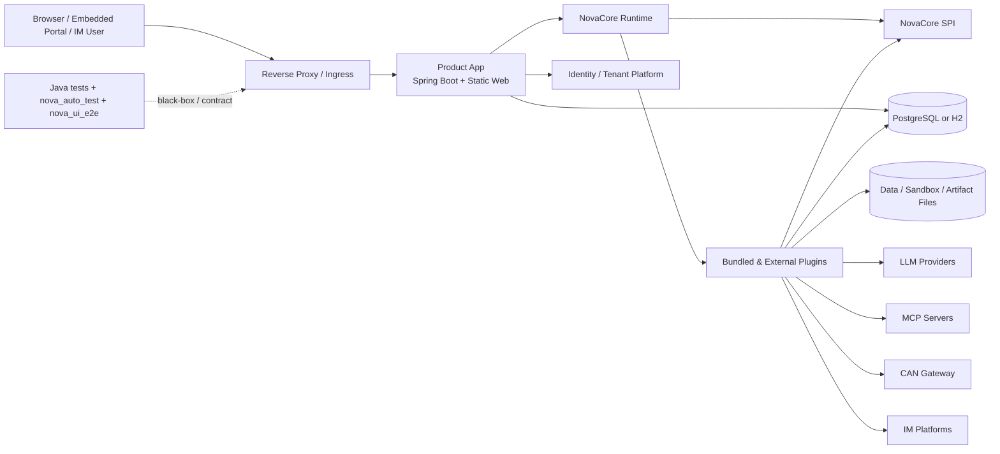
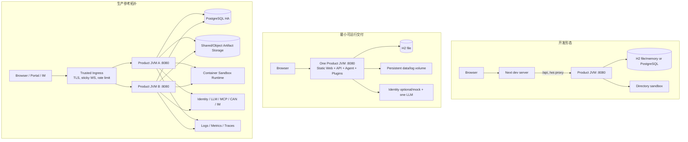
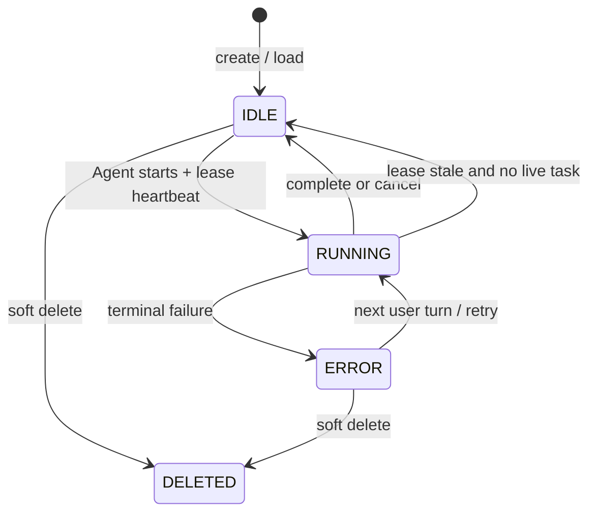

```
# Nova 总体架构、部署单元与请求链路

> 本文是一份可脱离 Nova 源码独立使用的复刻规格。证据标记遵循：`I` 已实现静态事实、`A` Active 黑盒验收契约、`K` 已知失败、`P` 规划、`R` 本次运行验证、`F` 强推断、`D` 复刻建议。本次只做三仓静态取证，没有启动服务或运行测试，因此全文没有 `R` 结论。

## 1. 结论与边界

### 1.1 一句话结论

Nova 是一个“单产品进程承载 Web/API/Agent 编排、内嵌独立 Agent Runtime，并通过 SPI 插件接入模型、工具、存储、沙箱和外部业务系统”的个人/企业 AI Agent 平台。生产默认交付物是一个 Java 21 Spring Boot 可执行 JAR 或包含该 JAR 的容器；Next.js 前端在构建期静态导出并复制进 JAR，由同一 HTTP 进程提供，而不是一个必须常驻的 Node 服务。`[I]`

### 1.2 解决的问题与最终效果

目标调用方包括浏览器用户、嵌入式门户、IM 用户、管理员、定时任务和黑盒测试客户端。平台接收带租户/用户身份的自然语言请求，建立或恢复会话，解析当次可用的模型、技能和工具，执行多轮 LLM→工具→LLM 循环，把 token、工具阶段、压缩、澄清、完成或错误事件实时发给客户端，并把最终消息、时间线、token 用量、工件和运行状态持久化。`[I]`

### 1.3 输入、输出与核心依赖

| 类别 | 输入 | 输出 | 关键依赖 |
|---|---|---|---|
| 交互聊天 | 文本、图片、文件、会话 ID、项目/数据主题、语言、可选模型覆盖 | REST 完整回答、SSE 简化流或 WebSocket 完整事件流 | 身份平台、LLM Provider、数据库、沙箱 |
| 工具调用 | 模型生成的工具名和 JSON 参数、当前身份/会话/运行上下文 | ToolResult、工件、引用、过程事件 | 内置插件、MCP、CAN Gateway、文件/网络/数据库 |
| 管理面 | 模型、工具、技能、MCP、主题、项目、知识和租户设置 | 配置持久化与运行时可见性变化 | ConfigStore、产品数据库、外部平台 |
| 后台任务 | cron、延迟 review、过期清理、项目补偿、运行 lease | 新会话/任务执行、状态修复、缓存或数据清理 | 本地调度器、db-scheduler、数据库 |

### 1.4 范围

本文包含：构建边界、运行时组件、插件装配、单机与生产部署、身份和租户上下文、REST/SSE/WS 聊天主链路、LLM/Tool/外部系统调用、持久化、后台任务、配置与密钥、故障域、扩展边界，以及三类测试工程在整体架构中的位置。

本文不展开某个具体产品模块的业务细节，也不把 CAN Gateway、身份平台、LLM 厂商、IM 平台或 MCP Server 的内部实现当作已知事实；这里只定义 Nova 对这些对端的总体依赖和必须满足的兼容语义。Agent 内部 tool loop 和 CAN 细粒度契约应由各自专题规格继续细化。

### 1.5 当前实现、缺陷与推荐设计的区分

- `[I]` 当前仓库是一个 Maven 聚合 reactor，包含核心、插件、产品应用和 Java 测试基础设施；这只是构建组织，不代表运行时有四个服务。
- `[I]` 当前默认运行拓扑是一个 Spring Boot 进程加数据库及若干外部依赖；插件多数以内嵌依赖装进产品 JAR，也允许从目录发现额外 fat JAR。
- `[I]` 前端生产形态是静态文件；开发形态才是独立 Next.js dev server 并反向代理 `/api/**`、`/ws/**` 到后端。
- `[K]` 自动化记录显示 release 环境曾出现 `/health` 返回 404，和源码/容器探针契约冲突；复刻时必须把探针注册作为发布门禁。
- `[K]` 自动化曾要求“非 JSON 原始 WS 文本降级成聊天”，但 release 失败，且当前服务端主入口按 JSON 对象解析；因此 raw-text 不是本文承诺的当前协议。
- `[D]` 生产复刻建议把数据库、对象/文件存储、密钥管理、入口网关和可观测系统独立部署，并将应用节点设计为可横向扩展；但实时 WebSocket 任务注册表当前是进程内状态，不能据此声称已具备任意节点无状态迁移。

## 2. 术语与参与方

| 术语/参与方 | 定义与职责 |
|---|---|
| Product App | Java 21 Spring Boot 产品层；承载认证、REST/WS、业务服务、静态前端、配置桥接和后台任务。 |
| NovaCore SPI | Java 17 的稳定扩展契约；定义 Agent、LLM、Tool、Sandbox、Store、Skill、Hook、Identity 等接口，不依赖 Spring。 |
| NovaCore Runtime | Java 17 的通用运行时；执行 Agent 生命周期、LLM 路由、tool loop、事件分发、上下文裁剪和插件生命周期。 |
| Bundled Plugin | 仅面向 SPI 编译的一方插件，例如模型 Provider、存储、沙箱、MCP、CAN、知识、任务、记忆。构建时是可独立 shade 的 fat JAR，产品也可把它作为普通依赖内嵌。 |
| External Plugin | 放入配置目录、通过 ServiceLoader 发现的第三方/额外插件 fat JAR。它不是一个独立网络服务。 |
| Agent Run | 一次用户消息触发的、带取消信号和事件监听器的完整执行。 |
| TenantIdentity | 产品聊天的规范身份对象，至少由 `tenantId + userId` 组成；对象访问不能只依赖客户端传入 ID。 |
| Runtime Context | 每次运行受信任的上下文，包括身份、会话、语言、项目、数据主题、工具策略、模型覆盖等。 |
| Conversation Lease | 数据库中的 RUNNING 心跳，用于进程退出后把遗留状态恢复为 IDLE；它不等价于可跨节点接管执行线程。 |
| Static Web | Next.js export 产物，路径前缀 `/web`，生产时由 Spring 静态资源处理器提供。 |
| Test Harnesses | Java reactor 内的 contract/fixture/integration/eval/e2e，以及两个独立 Node/Playwright 工程；它们是验证端，不是生产部署单元。 |



依赖方向的关键约束是：产品层可以依赖 Runtime 和插件；Runtime 依赖 SPI；插件依赖 SPI；SPI 不依赖 Runtime、Spring 或具体产品词表。`[I]` 新工程若破坏这条方向，会使插件无法独立加载、框架无法脱离产品复用。

## 3. 业务规则

1. 一个 Maven module 不等于一个运行服务；聚合 reactor 只统一版本、依赖和质量门禁。`[I]`
2. Core、插件和 Java 测试基础设施按 Java 17 编译；Product App 按 Java 21 编译并作为最终宿主。`[I]`
3. 生产前端必须先静态导出到 Product App 资源目录，再打包 JAR；仅启动后端而未生成静态资源不能视为完整产品构建。`[I]`
4. 每个受保护的 HTTP 请求必须先从 cookie 或受控 token 解析用户和租户，再构造服务端 `SandboxContext`；聊天 body 中的身份字段不能覆盖该上下文。`[I]`
5. WebSocket 握手必须绑定身份；启用认证时，每条入站消息还会重新校验会话。确认过期时发 `auth_expired` 并以 4401 关闭；非过期上游异常当前选择 fail-open。`[I]`
6. 产品聊天只接受租户身份；会话、运行任务、取消、订阅、澄清回复和持久化读取均需匹配 `tenantId + userId` 或经过显式对象级授权。`[I]`
7. 同一进程中，一个 conversation 同时只能有一个 WS 运行任务；重复运行应失败。同步 REST 路径也对同一 conversation 串行加锁。`[I]`
8. WebSocket 断开不会取消 Agent；显式 `cancel` 才发出协作式取消信号，结果仍以数据库和终态事件为准。`[I]`
9. 模型调用必须经统一 `LlmRouter`；解析优先级可按 user→tenant→global，并允许受控 provider override。`[I]`
10. 工具可用性由正式注册、场景策略、工具组、MCP 可见性和能力安装决定；业务资源存在不自动授予依赖工具。`[I]`
11. 仅注册一个沙箱后端。当前产品启动装配支持 directory 或 docker 二选一；配置其他值会启动失败。示例中出现 kubernetes 文案不等于已有装配分支。`[I]`
12. Product Flyway 必须先于 NovaCore 插件共享 schema migration；JPA 使用 `ddl-auto=validate`，不负责建表。`[I]`
13. Product 与 NovaCore Storage 可共用同一 H2/PostgreSQL datasource，但维护独立 migration history；当前桥接不支持 MySQL/openGauss。`[I]`
14. 插件阶段职责的规范目标是 `init` 只注册能力、`start` 激活资源、`stop` 释放资源；真实启动顺序是所有插件完成 `init` → 所有 `SystemPlugin` 完成 `registerSystemServices` → Runtime 解析 required Store、配置、运行期桥和模型实例 → 所有插件依注册顺序 `start`。当前有两个不得被隐藏的例外：Storage 在 system registration 阶段已经创建 Hikari/Flyway/加密校验等资源且 `start` 为空；Docker 在 `init` 创建 client/tracker，tracker 同时注册 JVM shutdown hook。重复插件 ID 仍必须在任何插件 `init` 前 fail-fast。`[I/K]`
15. 外部插件目录不存在可视为“没有额外插件”，但 jar 扫描/实例化/重复 ID/插件初始化失败会中止启动。`[I]`
16. 配置文件和真实 API Key、数据库密码、credential master key 不得打进镜像或提交仓库；生产通过挂载配置、环境变量或配置中心注入。`[D]`
17. 数据目录、日志目录、local-dir 工件和 directory/docker 沙箱若不放共享或持久卷，节点替换会丢失本地状态。`[I/D]`
18. 自动化仓库中的 `active` 是验收目标，不等价于本次已通过；`known_failure` 必须作为发布风险保留。`[A/K]`

## 4. 完整执行链路

### 4.1 构建与启动装配

#### 部署单元与拓扑

| 构建产物 | 是否独立常驻进程 | 生产去向 | 运行职责 |
|---|---:|---|---|
| `nova-core-spi` JAR | 否 | Product JAR、插件父 classloader | 只提供稳定契约 |
| `nova-core-runtime` JAR | 否 | Product JAR 内 | Agent、路由、tool loop、插件运行时 |
| bundled plugin fat JAR | 否 | Product JAR 内嵌依赖；也可独立分发 | 在同一 JVM 注册能力 |
| external plugin fat JAR | 否 | 挂载到 plugins 目录 | 启动时隔离加载到同一 JVM |
| Product Spring Boot JAR | **是** | JVM/容器 | 唯一产品服务进程 |
| Next static export | 否 | Product JAR 的 static resources | 浏览器页面与前端资源 |
| Java/Playwright 测试产物 | 否 | CI 或外部测试机 | 验证部署，不进入生产服务 |



`[I]` 开发拓扑和最小交付可以由当前构建/配置直接表达。`[D]` 生产图中的多节点、共享对象存储、sticky WebSocket 和完整可观测系统是参考设计；当前进程内 `RunningTask` 使 sticky routing 或明确的“断线后只从数据库恢复最终结果”策略成为必要条件，不能宣称任意节点可继续原流。

#### 构建期

1. Node 22 环境安装前端依赖并运行 Next.js production build。
2. Next.js 以 `/web` 为 base path 静态导出，产物复制到 Product App 的静态资源目录。
3. Maven 3.9/JDK 21 从 reactor 根以 `-pl nova-app -am` 构建 Product App 及其依赖链；Core 和插件仍按各自 Java 17 release 编译。
4. 插件模块用 shade 合并 `META-INF/services`，把第三方依赖装进插件 fat JAR，SPI 使用 provided；产品 JAR也将一方插件作为依赖带入。
5. Spring Boot repackage 生成单个可执行 JAR。容器运行层只需 JRE 21；当前镜像还安装 Python、Node、ripgrep、字体和文档生成依赖，以支持工具运行。`[I]`

Product App 的打包配置明确排除 `application.yml` 和示例配置。当前容器入口先检查 `config/application.yml`，缺失时只在镜像内存在 example 的情况下复制；随后总会执行配置获取脚本，但其行为由 `GET_NACOS_CONF` 分叉：值严格等于 `true` 时才经 TMS 拉取 Nacos 配置，缺少 `NACOS_ADDR/NACOS_NS/NACOS_GROUP/TMS_SERVER`、网络/HTTP/JSON/业务失败或写文件失败都会让入口立即非零退出；未启用时脚本成功返回且不补配置，入口仍执行 `java -jar --spring.config.location=file:config/application.yml`，若该文件最终不存在或内容不足，失败发生在后续 Spring 配置绑定/Bean 装配，而不是“配置获取失败”分支。因此“JAR 能构建”不代表“无需外部配置即可启动”，复刻部署清单必须分别验收远程拉取失败与未配置导致的 Spring 启动失败。`[I]`

> Dockerfile 注释把 `nova-test` 写进 `-am` 依赖链，但 Maven 的 `also-make` 只构建所选模块实际依赖的上游，并不会因为同属聚合器就天然构建所有测试兄弟模块。复刻时应以 Maven dependency graph 为准，不能以注释推导运行组件。`[I]`

#### 启动期

```mermaid
sequenceDiagram
    participant OS as Container / OS
    participant EP as Entrypoint
    participant SB as Spring Boot App
    participant FW as Product Flyway
    participant CFG as NovaCore Config Bridge
    participant NC as NovaCore Builder
    participant PS as Plugins
    participant DB as Database

    OS->>EP: start image
    EP->>EP: create data/ and logs/
    EP->>EP: inspect local config; evaluate GET_NACOS_CONF
    alt GET_NACOS_CONF=true and pull/write fails
        EP-->>OS: exit non-zero before JVM
    else pull disabled or successful
        EP->>SB: java -jar + explicit external application.yml location
        alt local/external configuration missing or insufficient
            SB-->>OS: Spring startup fails
        else configuration binds successfully
            SB->>FW: migrate product schema
            FW->>DB: validate/migrate H2 or PostgreSQL
            FW-->>CFG: migration complete
            CFG->>CFG: normalize nova.* and bridge datasource/artifact/CAN/skills
            CFG->>NC: register sandbox + bundled plugins + product bridges
            loop all plugins in registration/discovery order
                NC->>PS: init(scoped PluginContext)
            end
            Note over NC,PS: Docker currently creates client/tracker in init; tracker adds a JVM shutdown hook
            loop all SystemPlugin instances
                NC->>PS: registerSystemServices(shared SystemPluginContext)
            end
            PS->>DB: Storage creates Hikari, runs Flyway and validates encryption data
            Note over PS,DB: Storage registers required stores here; its start is empty
            NC->>NC: resolve required ConversationStore/config/runtime services/providers
            loop all initialized plugins in registration order
                NC->>PS: start()
            end
            NC-->>SB: expose NovaCore, AgentRunner and facades
            SB-->>OS: serve :8080
        end
    end
```

当前程序化插件装配顺序可抽象为：一个沙箱后端→默认上下文 reducer→核心工具→OpenAI/Anthropic Provider→存储→产品工件作用域→知识→任务→MCP→产品上下文/提示策略→记忆→多租户技能→数据库技能源→CAN→IM→产品数据工具与注册表桥。然后再从可选插件目录发现额外 jar。`[I]` 这套顺序体现“先提供基础 Store/Provider，再启动依赖它们的高级能力”，复刻时可改变具体插件集合，但必须保留依赖拓扑验证。

### 4.2 HTTP 认证与身份上下文

1. `?tn=<base64 cookie string>` 是门户跳转入口；非 API 请求解码后写 cookie 并重定向到干净 URL，`/chatAgent/**` 进入 `/web/chat`。API 也可用 query `tn` 或 `X-Agent-Tn` 完成本次受控认证。`[I]`
2. 普通请求从浏览器读取配置的 cookie 名（并兼容 `CIP_SESSION`），但当前用户认证和 `/env/variables` 上游请求会重命名为固定 `Cookie: CIP_SESSION=<value>`；GraphQL 租户操作则使用配置 cookie 名。身份接口取得 `tenantId/userId`，环境接口再判断当前租户管理员身份。`[I]`
3. 服务端创建 `SandboxContext{tenantId,userId,tenantAdmin,locale}`，同时放入 request attribute 和线程上下文；finally 中清除，防止线程复用造成身份串扰。`[I]`
4. `/health`、静态资源、登出和 token-gated 公共分享等少数路径绕过 cookie 认证；其他 API/页面默认受保护。`[I]`
5. 身份建立后可异步/懒连接该用户可见的 MCP Server，但连接结果不能改变对象级授权。`[I]`

### 4.3 REST/SSE 聊天链路

REST 和 SSE 都从服务端身份上下文构造 AgentRequest：缺少 conversationId 时生成 UUID；必须有文本或可转成提示的附件；图片先校验并写入该身份/会话的沙箱；项目、数据主题、语言、provider override 等进入受信任 runtime context。`[I]`

- `POST /api/chat`：同一会话进程内加公平锁，准备场景并同步执行 Agent，返回 `{conversationId, content}`。
- `POST /api/chat/stream`：创建 300 秒 SSE emitter，在虚拟线程执行；当前只映射 `token`、`tool_call`、`complete` 和传输级 error，能力明显少于 WS。

### 4.4 WebSocket 主链路

```mermaid
sequenceDiagram
    autonumber
    participant C as Browser Client
    participant A as Auth / WS Handler
    participant S as Chat Service
    participant DB as Conversation Store
    participant R as NovaCore Agent Runtime
    participant LR as LLM Router / Provider
    participant T as Tool Registry / Plugin
    participant X as External System

    C->>A: WS /ws/chat + CIP_SESSION
    A->>A: authenticate; bind tenantId/userId/locale
    C->>A: JSON chat request
    A->>A: per-message re-auth; create cancellation signal
    A->>A: register PendingChat(requested/initial id + cancellation)
    A->>S: build AgentRequest(server identity + body content)
    A->>A: create and provisionally register RunningTask by request conversationId
    S->>DB: prepareConversation: ensure conversation + validate project access
    A-->>C: conversation_id
    A->>S: validate vision support; persist pre-stream error if rejected
    S->>S: resolve execution scene, tools, prompts, data theme
    S->>R: runStreaming(request, listener, cancellation)
    R-->>A: onStart(actual conversationId); rekey RunningTask if id changed
    R->>DB: append user / assistant run state and load history
    R-->>C: start / phase / reasoning / token events
    loop LLM-tool rounds until final, cancel, error or limits
        R->>LR: route by tenant/user/tier/provider
        LR->>LR: stream model response
        LR-->>R: text delta or tool_use blocks + usage
        R-->>C: token / tool_call / tool_exec_start
        R->>T: execute tool with identity + conversation context
        opt external connector
            T->>X: MCP/CAN/HTTP/IM/DB/filesystem request
            X-->>T: result or error
        end
        T-->>R: ToolResult / artifacts / error text
        R->>DB: persist timeline/tool results as configured
        R-->>C: tool_exec_end / token_stats / compression events
    end
    R->>DB: persist terminal assistant row, timeline and token usage
    S->>S: finalize citations and bridge artifact references
    S->>DB: patch finalized content/process_data/skills if needed
    alt completed
        A->>DB: status IDLE, finish lease
        A-->>C: complete
    else cancelled
        A->>DB: status IDLE
        A-->>C: cancelled
    else failed
        A->>DB: status ERROR + error row
        A-->>C: error + optional messageId
    end
```

重要顺序约束如下：

1. WS handler 在虚拟线程中解析 JSON，服务端注入身份和当次语言；客户端不能提交 tenantId/userId。
2. 接收消息后先把 `PendingChat{requestedConversationId 或 initialConversationId, CancellationSignal}` 放入 session 级集合，覆盖虚拟线程尚未组装请求的取消窗口。请求组装得到服务端 conversationId 后，更新 PendingChat 的 ID，创建共享同一 CancellationSignal 的 `RunningTask`，并按该 request conversationId 原子预注册；预注册成功后才移除 PendingChat。这是“provisional RunningTask”，不是等到 Agent `onStart` 才登记。
3. 精确顺序是：`PendingChat → buildAgentRequest/解析服务端 conversationId → provisional RunningTask → prepareConversation → conversation_id 事件 → vision 校验 → chatStream`。视觉校验失败会写一个可重载的 pre-stream ERROR turn，并且不会进入 Agent tool loop。
4. Runtime 真正开始时通过 `onStart(actualConversationId)` 回调；若 actual ID 与 provisional ID 不同，先移除旧 map key、登记 stale-ID 映射，再以 actual ID `putIfAbsent` 重新登记并迁移 interaction/knowledge listener。相同则保留原 key。不能在 `prepareConversation` 前发 `conversation_id`，也不能把 rekey 写成运行前无条件步骤。
5. 场景装配器按会话/项目/主题解析本轮最大工具集合、运行期扩展工具、系统提示片段和约束；工具不是从前端直接传入。
6. Agent Runtime 负责历史加载、模型路由、tool loop、上下文预算、工具调用、取消检查和运行事件；产品层监听这些事件并转换成用户协议。
7. 最终内容先完成 citation 和 artifact 桥接，再补写最终消息；token 用量和 skill 使用信息采用 best-effort patch，失败不能反向吞掉已生成回答。
8. WS 断开只移除 subscriber，不取消运行；重连可按同一身份 `resume`/`subscribe`，但只在原进程内找到运行任务。

### 4.5 会话状态与恢复



进程内 `RunningTask` 保存线程引用、取消信号、subscriber、事件序号和过程数据；数据库 lease 保存跨实例可见的 RUNNING 心跳。节点崩溃后执行本身不会迁移，后台清理或列表读取在“无本地 live task 且 lease 过期”时把遗留 RUNNING 修正为 IDLE。`[I]`

### 4.6 后台执行链路

平台同时存在多种后台机制，不能把它们统称为一个调度器：

| 机制 | 当前用途 | 状态位置 | 多实例语义 |
|---|---|---|---|
| Spring `@Scheduled` | 分享计数/审计、临时表、主题资产、会话 lease、项目操作与任务权限对账 | JVM + DB | 各任务需自行确保幂等/锁；不能假设天然单实例 |
| db-scheduler starter | 应用依赖和配置中存在 starter、heartbeat/polling/worker 参数 | DB（starter 自身） | 当前仓未发现注册 Nova 业务 `Task`/handler 的静态证据，不能据依赖声明认定用户任务已由它分布式协调 |
| Tasks plugin scheduler | 用户 cron 任务和执行分发；实际装配为 `SingleNodeTaskScheduleManager + PollingCronTaskScheduler` | 每节点内存 schedule map + 共享任务表/执行表 | `nodeId` 只标识执行归属和重启恢复；多个应用实例会各自加载同一批 enabled cron 并可能重复触发，没有 leader/分布式 fire claim 保证 |
| Memory review scheduler | 延迟读取新消息并更新画像/工作上下文 | DB + plugin scheduler | 通过 review lock TTL/retry 控制 |
| WS heartbeat scheduler | ping 客户端、续约 RUNNING lease | JVM + DB | 每个应用节点维护自己的连接和运行表 |
| Context reducer executor | 预热/生成压缩 checkpoint | JVM + Store | 失败应 fail-soft，不中断主聊天 |

### 4.7 数据落点与目录

| 数据 | 默认或推荐落点 | 生命周期/注意事项 |
|---|---|---|
| 产品业务表 | PostgreSQL；开发可用 H2 file/memory | Product Flyway 管理，Hibernate validate |
| Conversation/Message/Config/Timeline/Artifact metadata | 同一 datasource 的 NovaCore Storage schema | 独立插件 migration history；按身份查询 |
| Artifact bytes | 默认 DB blob；可配置 local-dir `data/artifacts` | local-dir 需持久卷/共享存储；有单件上限 |
| 用户文件 | `data/files/{conversationId}/...` | 包含 uploads/python/artifacts；需对象级访问保护 |
| 临时文件 | `data/tmp/{conversationId}` | 可清理，不应作为唯一持久副本 |
| Directory/Docker sandbox | `data/sandboxes/{identityKey}/conversations/{conversationId}/workspace` | 强制身份和会话隔离；生产 Docker backend 更强 |
| NovaCore plugin workdir | `<workDirRoot>/data/plugins/<pluginId>` | 每插件独立；不得用 static 共享运行资源 |
| 外部插件 | `<workDirRoot>/plugins/*.jar` | 启动扫描；变更后重启 |
| Skill | `./skills` 和插件 classpath resources | 系统/租户/用户可见性由 registry/config 决定 |
| 日志 | `logs`，容器声明 `/opt/nova/logs` volume | 滚动保留，禁止明文密钥 |
| LLM 诊断 dump | OS temp 下的 tenant/user 定向目录 | 仅管理员显式捕获、限量、限时保留 |

## 5. 对外契约

### 5.1 网络端口和路径

| 契约 | 默认值 | 认证 | 说明 |
|---|---|---|---|
| Product HTTP | TCP 8080 | 按路径 | REST、静态 Web、Actuator 共端口 |
| Static Web | `/web/**`，入口 `/web/chat` | 通常 cookie；公开分享和静态 chunk 例外 | production 由 Spring 提供 |
| REST chat | `POST /api/chat` | tenant/user | 同步完整响应 |
| SSE chat | `POST /api/chat/stream` | tenant/user | 300 秒 emitter；简化事件 |
| WebSocket | `/ws/chat` | 握手 cookie + 每消息复验 | 完整交互协议 |
| Health | `GET /health` | public | Docker/负载均衡探针；release 曾有 404 `[K]` |
| Debug | 13200，仅 `DEBUG=true` | 运维隔离 | 当前容器启用 JDWP 时使用，不应公网暴露 |

当前 WebSocket 注册明确使用 `allowedOrigins("*")`。这意味着框架层不限制握手 `Origin`；当浏览器会自动携带可跨站 Cookie 时，恶意站点可能尝试建立跨站 WebSocket，安全性依赖 Cookie 属性、握手认证和每消息复验，仍属于不必要的暴露面。生产复刻应改为配置化精确 origin allowlist（scheme/host/port 全匹配），在受信 ingress 再校验 `Origin`，并为敏感会话增加一次性 WS ticket/nonce 与短 TTL、单次消费；不能只依赖 CORS，因为 CORS 不是 WebSocket 握手授权。`[I/D]`

### 5.2 REST 请求与响应

最小聊天请求 JSON：

```json
{
  "conversationId": "0e8a87a2-b154-4df2-bfa9-35295dcf76ea",
  "message": "比较本月与上月收入并解释变化",
  "projectId": "project-42",
  "dataThemeId": "sales-theme",
  "provider": "enterprise-openai",
  "lang": "zh",
  "images": [
    {"data": "<base64>", "mediaType": "image/png", "name": "chart.png"}
  ],
  "files": [
    {"id": "f-1", "name": "sales.csv", "path": "uploads/sales.csv", "size": 2048, "type": "text/csv"}
  ]
}
```

字段语义：

| 字段 | 类型 | 必填 | 默认/规则 |
|---|---|---:|---|
| conversationId | string | 否 | 缺失时服务端生成 UUID；已有 ID 必须属于当前身份或有显式访问权 |
| message | string | 条件必填 | 有可用附件时可为空；最终 userText 不能为空 |
| projectId | string | 否 | 创建/首次绑定时校验当前用户可使用该项目 |
| dataThemeId | string | 否 | 必须属于当前 tenant 可见主题；非法值丢弃，不透传给 Gateway |
| provider | string | 否 | 只作为统一路由的显式覆盖，不绕过模型权限 |
| lang | `zh`/`en` 兼容字符串 | 否 | HTTP 可由 `X-Nova-Lang` 建立；WS 每消息值优先 |
| images | array | 否 | base64 解码、尺寸和模型视觉能力校验；当前普通历史 DTO 不保证重载图片 |
| files | array | 否 | path 必须由受控上传链路产生；不可相信浏览器任意绝对路径 |

同步响应：

```json
{
  "conversationId": "0e8a87a2-b154-4df2-bfa9-35295dcf76ea",
  "content": "本月收入……"
}
```

非法空消息应是 4xx；认证失败为 401；对象级无权访问应是 403/404；运行异常应返回经过翻译、无堆栈/密钥/内部 URL 的错误。当前不同控制器的错误体并未由本文证明完全统一，复刻时建议统一为：

```json
{
  "code": "INVALID_REQUEST",
  "message": "message is required",
  "traceId": "8d7b1c20",
  "retryable": false
}
```

该统一错误体是 `[D]`，不是 Nova 当前所有接口的静态保证。

### 5.3 SSE 事件

```text
event: token
data: 本月

event: tool_call
data: metric_query

event: complete
data: 本月收入……
```

当前 SSE 没有稳定暴露完整工具参数、过程数据、事件序号、conversationId 或 messageId，且 emitter 300 秒超时。`[I]` 复刻 MVP 可保留这一简化通道；生产建议让 SSE 与 WS 共用版本化 envelope，避免两套客户端语义漂移。`[D]`

### 5.4 WebSocket 入站协议

所有正式消息使用 JSON object。缺少 `type` 时按 `chat` 处理。`[I]`

```json
{
  "type": "chat",
  "conversationId": "0e8a87a2-b154-4df2-bfa9-35295dcf76ea",
  "message": "继续",
  "lang": "zh",
  "dataThemeId": "sales-theme"
}
```

| type | 必需字段 | 权限/语义 |
|---|---|---|
| chat 或省略 | 与 REST body 相同 | 建立新运行；同会话已有运行则拒绝 |
| ping | 无 | 返回 `pong` |
| cancel | conversationId 可选 | 有 ID 取消本人该会话；无 ID 取消本 session 的 pending/running tasks；协作式取消 |
| query_running | 无 | 仅列出本人运行中/最近完成的会话 |
| resume | conversationId | 同身份将新连接附着到原进程内运行任务 |
| subscribe/unsubscribe | conversationId | 同身份增删流事件订阅，不改变任务所有者 |
| clarification_response | conversationId,response；remember 可选 | 只能由运行所有者回答 pending interaction |
| plan_confirm/plan_revise | conversationId,response | 恢复等待用户确认的 Agent |

`cancel` 重复调用不应产生第二个冲突终态；如果任务已进入 FINALIZING，服务端保留数据库已记录终态并只完成传输。`[I/A]`

### 5.5 WebSocket 出站 envelope 与事件

标准流事件 envelope：

```json
{
  "type": "tool_exec_end",
  "content": "call-7|metric_query|2431|true|817|<truncated-result>",
  "seq": 18,
  "conversationId": "0e8a87a2-b154-4df2-bfa9-35295dcf76ea",
  "messageId": 9821
}
```

`messageId` 只在部分终态/错误事件出现；部分控制消息没有 `seq`。当前多个复杂事件把字段用 `|` 拼进 content，转义和版本演进能力弱。`[I]` 复刻生产版应改成结构化 `payload` 并保留兼容 decoder。`[D]`

关键事件族：

- 生命周期：`conversation_id`、`streaming_active`、`complete`、`cancelled`、`error`、`auth_expired`。
- 文本：`token`、`reasoning_token`、`thinking`、`answer_start`、`stream_reset`、`round_boundary`。
- LLM：`llm_call_start`、token stats。
- 工具：`tool_call`、`tool_exec_start`、`tool_exec_end`、`tool_call_result`、`tool_loop_warning`。
- 多代理/计划：`agent_phase`、`task_plan`、`step_start`、`step_complete`、`critic_verdict`。
- 用户交互：`user_interaction`。
- 知识/上下文：`knowledge_recall`、`context_compression_start/end/failed`、`digest_start/progress/end`。
- 恢复：`running_conversations`、`running_conversations_v2`、`completed_conversations`、`cancel_accepted`、`cancel_ignored`。

终态规则：一次运行对客户端的逻辑终态采用 first-wins，只能裁决为一个 `complete`、`cancelled` 或 `error`。`complete` 主路径通常先写入基础 Assistant 消息，再发送终态；但 token usage、citation、process data、Skill/Artifact 使用和会话状态等产品投影由后续 best-effort patch 完成，不与终态帧构成同一事务，失败时客户端仍可能收到终态，重载也可能读到较旧或不完整的投影。`error` 路径的 `messageId` 还允许为空。`[I/K]`

### 5.6 插件内部契约

可复刻的最小 SPI：

```java
public interface NovaPlugin {
  PluginInfo info();
  void init(PluginContext context);  // normative target: register only
  void start();                      // normative target: activate resources
  void stop();                       // reverse-order, best effort
}

public interface Tool {
  ToolDefinition definition();       // metadata/config only; no result-retention field
  default String bindingFingerprint() {
    return getClass().getName();      // opaque source identity; never a secret
  }
  ToolResult execute(Map<String, Object> arguments, ToolExecutionContext ctx);
  default ToolResult.ResultRetention defaultRetention() {
    return ToolResult.ResultRetention.CONDENSABLE;
  }
}

public record ToolDefinition(
    String name,
    String description,
    Map<String, Object> parametersSchema,
    List<ConfigParam> configParams,
    String category) {
  private static final String DEFAULT_CATEGORY = "Other";

  public ToolDefinition {
    requireNonBlank(name, "name");
    requireNonBlank(description, "description");
    requireNonBlank(category, "category");
    parametersSchema = Map.copyOf(Objects.requireNonNull(parametersSchema, "parametersSchema"));
    configParams = configParams == null ? List.of() : List.copyOf(configParams);
  }

  public ToolDefinition(String name, String description, Map<String, Object> parametersSchema) {
    this(name, description, parametersSchema, List.of(), DEFAULT_CATEGORY);
  }

  public ToolDefinition(
      String name,
      String description,
      Map<String, Object> parametersSchema,
      List<ConfigParam> configParams) {
    this(name, description, parametersSchema, configParams, DEFAULT_CATEGORY);
  }

  private static void requireNonBlank(String value, String field) {
    Objects.requireNonNull(value, field);
    if (value.isBlank()) throw new IllegalArgumentException(field + " must be non-blank");
  }
}

public record ToolResult(
    boolean success,
    String output,
    ResultRetention retention,
    List<Artifact> artifacts) {
  public ToolResult {
    Objects.requireNonNull(output, "output");
    Objects.requireNonNull(retention, "retention");
    artifacts = artifacts == null ? List.of() : List.copyOf(artifacts);
  }
  public static ToolResult ok(String output) {
    return new ToolResult(true, output, ResultRetention.CONDENSABLE, List.of());
  }
  public static ToolResult error(String reason) {
    return new ToolResult(false, "Error: " + reason, ResultRetention.CONDENSABLE, List.of());
  }
  public enum ResultRetention { EPHEMERAL, CONDENSABLE, DURABLE }
}

public interface LlmRouter {
  LlmBinding resolve(LlmRouteRequest request); // identity, tier, optional override
}

public interface ToolExecutionContext {
  Identity identity();
  Sandbox sandbox();
  boolean isCancelled();
  <T> Optional<T> resolveConfig(String qualifiedKey, Class<T> type);
  Optional<String> conversationId();
  Optional<String> messageId();
  default Optional<String> agentName() { return Optional.empty(); }
  default Optional<String> providerName() { return Optional.empty(); }
  default Map<String,Object> runtimeContext() { return Map.of(); }
  default int callerSubAgentDepth() { return 0; }
  default Set<String> callerAllowedToolNames() { return Set.of(); }
  default Optional<SkillLookup> skills() { return Optional.empty(); }
  default Optional<ArtifactPublisher> artifactPublisher() { return Optional.empty(); }
}
```

`ToolDefinition` 的 canonical record 字段必须严格保持以下顺序和语义；结果保留策略不属于 definition，而由 `Tool.defaultRetention()` 和每次调用返回的 `ToolResult.retention` 经 Runtime 的非对称合并规则共同决定：

| 字段 | Java 类型 | 必填/默认 | 语义与约束 |
|---|---|---|---|
| `name` | `String` | 必填、非 blank | LLM 工具调用使用的全局唯一名称 |
| `description` | `String` | 必填、非 blank | 面向 LLM 的简短英文能力描述 |
| `parametersSchema` | `Map<String,Object>` | 必填、非 null；构造时 `Map.copyOf` | LLM 每次调用可生成的 JSON Schema 参数；不得包含密钥或管理员配置 |
| `configParams` | `List<ConfigParam>` | null → 空 immutable list；构造时 `List.copyOf` | 用户/管理员配置，经 `ToolExecutionContext.resolveConfig` 获取，不进入 LLM 参数 schema |
| `category` | `String` | canonical 构造必填、非 blank；便捷构造默认 `Other` | 管理 UI 使用的展示分类，不发送给 LLM provider |

`ToolResult` 的 `output` 和 `retention` 必须非 null，`artifacts` 为 null 时归一为空 immutable list。`ToolResult.ok(...)` 与 `ToolResult.error(...)` 先产生 `CONDENSABLE`；error helper 把输出规范化为 `Error: <reason>`。Runtime 随后调用等价的 `applyDefaultRetention`：

```java
ToolResult applyDefaultRetention(Tool tool, ToolResult result) {
  ToolResult.ResultRetention fallback = tool.defaultRetention();
  if (fallback == ToolResult.ResultRetention.CONDENSABLE
      || result.retention() != ToolResult.ResultRetention.CONDENSABLE) {
    return result;
  }
  return new ToolResult(result.success(), result.output(), fallback, result.artifacts());
}
```

这不是普通的“result 总覆盖 default”或“default 总覆盖 result”，而是把 `ToolResult.CONDENSABLE` 同时作为便利 helper 的中性值：

| `tool.defaultRetention()` | `ToolResult.retention` | 最终 retention | 原因 |
|---|---|---|---|
| `CONDENSABLE` | `EPHEMERAL` / `CONDENSABLE` / `DURABLE` | 保留 result | 默认值本身为中性，不改写逐调用选择 |
| `EPHEMERAL` | `CONDENSABLE` | `EPHEMERAL` | 便利 helper 未显式选择非中性值，应用工具默认 |
| `DURABLE` | `CONDENSABLE` | `DURABLE` | 同上，应用工具默认 |
| `EPHEMERAL` / `DURABLE` | `EPHEMERAL` / `DURABLE` | 保留 result | 逐调用显式非中性选择优先，可覆盖工具默认，包括二者互相覆盖 |

例如：默认 `EPHEMERAL` 的写文件工具返回 `ToolResult.ok("written")` 时最终为 `EPHEMERAL`；默认 `DURABLE` 的执行器返回普通 `ok` 时最终为 `DURABLE`；默认 `EPHEMERAL` 的工具若某次显式返回 `DURABLE`，该次仍为 `DURABLE`；默认 `DURABLE` 的工具若某次显式返回 `EPHEMERAL`，该次仍为 `EPHEMERAL`。`EPHEMERAL` 可在后续轮次丢弃，`CONDENSABLE` 可压缩，`DURABLE` 必须保留原文。`[I]`

插件阶段顺序不是逐插件执行 `init → registerSystemServices → start`，而是四道全局屏障：**all init → all SystemPlugin registration → required Store/runtime/provider resolution → all start**。`init` 只注册、`start` 激活是 SPI 规范目标，不是当前所有一方插件都遵守的事实：Storage 在 `registerSystemServices` 中 force-load JDBC driver、创建 HikariDataSource、按配置执行 Flyway、构建并注册 Store、校验受保护会话列及加密 key，随后 `start()` 为空；Docker 在 `init` 中连接 daemon、创建 Docker client 与 ContainerTracker，而 tracker 构造时注册 JVM shutdown hook，正常 `stop` 才尝试 cleanup、detach 和关闭 client。前者使 system-registration 失败可能涉及连接池/migration 资源，后者违反“init 无 IO、插件不拥有 JVM 全局 hook”的目标，并在 init/start 失败路径带来 client、hook 或容器跟踪资源泄漏风险。`[I/K]`

上面是当前 Tool/ToolExecutionContext 的完整方法面；注释体和具体 DTO 字段另见各 SPI 对象。`arguments` 必须在 `ctx` 之前，Tool 实例会被并发调用；身份、沙箱、配置、取消、会话/消息路由、Agent/Provider、runtime extras、父代理工具上限、技能读取和工件发布都属于 host 注入，不能伪装成 LLM 参数。若只为 MVP 实现 `identity/sandbox/isCancelled/resolveConfig/conversationId/messageId`，必须标为 `[D]` 简化并明确不兼容依赖其余 default 方法的工具，不能冒充当前 SPI 等价复刻。

真实外部插件 classloader 规则精确为：`com.aloudata.nova.core.spi.*` 与 `org.slf4j.*` **parent-first**；`com.aloudata.nova.core.runtime.*` 在任何查找前直接 hidden/抛 `ClassNotFoundException`；`java.*`、`javax.*` 强制 parent；其余类先 `findClass` 从插件自身 URL 加载，miss 后回退 parent。`META-INF/services/**` 资源只从该插件 jar 枚举，其他资源沿普通委派。每个 jar 独立 URLClassLoader、SPI 使用 provided 和插件不依赖其他插件是构建/兼容边界，但不等于进程、权限、内存、线程、文件或网络的强安全隔离；不可信插件仍应使用签名/白名单或移出进程。`[I/D]`

### 5.7 配置契约

最小外部配置示例：

```yaml
server:
  port: 8080
  forward-headers-strategy: framework

management:
  endpoints:
    web:
      base-path: /
      exposure:
        include: health
  endpoint:
    health:
      show-details: never
  health:
    defaults:
      enabled: true

spring:
  datasource:
    url: jdbc:postgresql://postgres:5432/nova
    username: ${NOVA_DB_USER}
    password: ${NOVA_DB_PASSWORD}
  jpa.hibernate.ddl-auto: validate
  flyway:
    enabled: true
    locations: classpath:db/product-migration/{vendor}
    out-of-order: true

nova:
  work-dir-root: /opt/nova
  skills-dir: /opt/nova/skills
  plugins-dir: /opt/nova/plugins
  auth:
    enabled: true
    api-url: https://identity.internal.example
    login-url: https://identity.example
    cookie-name: CIP_SESSION
  sandbox:
    backend: docker
    docker:
      image: nova-sandbox:release
      base-dir: /opt/nova/data/sandboxes
  storage:
    artifact:
      default-storage-type: local-dir
      local-dir.base-path: /opt/nova/data/artifacts
  can.gateway-url: https://can-gateway.internal.example
  security.credential-master-key: ${NOVA_SECURITY_CREDENTIAL_MASTER_KEY}
```

必须外部注入的敏感项包括数据库密码、LLM API keys、CAN admin key、MCP headers/env、IM credentials、对话加密 key 和产品 credential master key。两把 master key/对话加密 key用途不同，不能复用，也不能在日志、API、前端 bundle 或测试报告中输出。`[I/D]`

## 6. 数据模型与生命周期

### 6.1 架构级核心实体

下面是复刻所需的最小关系模型，不是当前全部列的逐字拷贝：

```sql
create table conversation (
  id varchar(64) primary key,
  tenant_id varchar(255) not null,
  user_id varchar(255) not null,
  project_id varchar(64),
  title varchar(255),
  status varchar(32) not null default 'IDLE',
  last_error_message text,
  running_node_id varchar(255),
  running_heartbeat_at timestamp,
  pinned_at timestamp,
  deleted_at timestamp,
  created_at timestamp not null,
  updated_at timestamp not null
);
create index idx_conversation_owner_updated
  on conversation(tenant_id, user_id, updated_at desc);

create table message (
  id bigint generated by default as identity primary key,
  conversation_id varchar(64) not null,
  tenant_id varchar(255) not null,
  user_id varchar(255) not null,
  turn_index integer not null,
  role varchar(32) not null,
  state varchar(32) not null,
  content text,
  error_message text,
  process_data text,
  timeline text,
  input_tokens integer,
  output_tokens integer,
  cached_tokens integer,
  created_at timestamp not null,
  constraint fk_message_conversation foreign key(conversation_id) references conversation(id),
  constraint uq_message_turn_role unique(conversation_id, turn_index, role)
);
create index idx_message_owner_conversation
  on message(tenant_id, user_id, conversation_id, turn_index, id);

create table config_kv (
  scope_type varchar(32) not null,
  tenant_id varchar(255) not null default '',
  user_id varchar(255) not null default '',
  config_key varchar(512) not null,
  config_value text,
  updated_at timestamp not null,
  primary key(scope_type, tenant_id, user_id, config_key)
);

create table chat_artifact (
  artifact_id varchar(64) primary key,
  tenant_id varchar(255) not null,
  owner_user_id varchar(255) not null,
  conversation_id varchar(64),
  scope_type varchar(32) not null,
  scope_id varchar(255),
  visibility varchar(32) not null,
  storage_type varchar(32) not null,
  storage_ref varchar(1024) not null,
  media_type varchar(255),
  size_bytes bigint not null,
  created_at timestamp not null,
  deleted_at timestamp
);
```

`[D]` 上述 DDL 用于表达必须的唯一性、身份列和查询索引；实际 Nova migration 对列、索引和表的定义更完整。复刻者必须用 migration 管理所有 schema，并让 H2/PostgreSQL 方言版本保持语义一致。

### 6.2 身份与归属

- 会话和消息的根作用域是 tenant + owner user；项目共享、公开分享、管理员查看等必须在这一根作用域之上增加显式 access resolver，不能移除根身份过滤。
- ToolExecutionContext、LLM route、Sandbox、Skill/Knowledge/Memory、MCP 可见性和 Artifact scope都携带同一 Identity。
- tenant-scope 是管理员/批处理查询的显式类型，不应通过空 userId 冒充普通用户。

### 6.3 创建、更新和终止

1. 新聊天请求先 `ensureConversation`，再写 USER 和本轮 ASSISTANT 状态。
2. 流式执行过程中更新 timeline/process data/lease；最终先写 terminal row，再发终态。
3. citation、artifact URL、skill names 和 token usage可在最终回答后以身份限定的 patch 更新。
4. 删除会话以软删除为主；工件、文件、分享和项目绑定需要单独级联/异步清理策略。
5. 本地临时文件按 TTL 清理；记忆 review、分享审计、过期 lease 等有独立保留周期。

### 6.4 敏感数据

当前支持对新写入 message 敏感列做 AES-256-GCM 可逆加密，使用 `ENC1:` 之类版本前缀识别；conversation title/last error 仍保持明文以支持搜索。旧明文与新密文可共存，当前配置注释明确没有 key rotation。`[I]` 生产复刻必须增加 key version、双读、分批重加密和回滚方案。`[D]`

## 7. 核心实现设计

### 7.1 推荐模块划分

```text
agent-platform/
├── core-spi/                 # Java 17, stable public contracts, no Spring
├── core-runtime/             # Java 17, agent/tool loop/router/context/plugin loader
├── plugins/
│   ├── llm-openai/
│   ├── llm-anthropic/
│   ├── storage/
│   ├── sandbox-directory/
│   ├── sandbox-container/
│   ├── mcp/
│   ├── memory/
│   └── domain-connectors/
├── product-app/              # Java 21 Spring Boot, auth/API/WS/business bridges
├── web/                      # Next.js static export
├── tests-java/               # contract/fixture/integration/eval
├── tests-api-ws-browser/     # deterministic black-box Playwright
└── tests-ui/                 # UI + optional visual/natural-language regression
```

### 7.2 启动器伪代码

```java
@Bean(destroyMethod = "shutdown")
@DependsOn("flywayInitializer")
NovaCore novaCore(Environment env, DataSource ds, ProductBridges bridges) {
  CoreConfig cfg = normalizeAndValidate(env);
  NovaCoreBuilder b = NovaCore.builder()
      .workDir(cfg.workDir())
      .pluginsDir(cfg.pluginsDir())
      .register(selectExactlyOneSandbox(cfg))
      .register(new ContextReducerPlugin())
      .register(new CoreToolsPlugin())
      .register(new OpenAiPlugin())
      .register(new AnthropicPlugin())
      .register(new StoragePlugin(sharedDatasourceConfig(ds)))
      .register(new ProductScopePlugin(bridges.scopeResolver()))
      .register(new KnowledgePlugin())
      .register(new TaskPlugin())
      .register(new McpPlugin())
      .register(new MemoryPlugin())
      .register(new DomainConnectorPlugin());
  return b.build(); // all init -> all system registration -> required runtime -> all start
}
```

启动必须在接受流量前完成：配置校验、Product migrations、插件 migrations、mandatory service校验、provider/tool/skill registry 冻结或进入允许的动态阶段。健康探针应拆成 liveness 和 readiness；只有后者依赖上述装配完成。`[D]`

### 7.3 请求编排器伪代码

```java
AgentResponse handle(ChatInput body, ServerIdentity serverIdentity, StreamSink sink) {
  TenantIdentity id = requireTenantIdentity(serverIdentity);
  String conv = body.conversationId() != null ? body.conversationId() : uuid();
  requireObjectAccess(id, conv, body.projectId());
  try (RunPermit permit = runRegistry.acquire(id, conv)) {
    Conversation c = conversations.ensure(id, conv, initialTitle(body));
    ExecutionScene scene = sceneResolver.resolve(id, c, body.dataThemeId());
    AgentRequest req = requestFactory.create(id, c, body, scene);
    CancellationSignal cancel = permit.signal();
    return runtime.newAgent(scene.spec(), scene.toolPolicy())
        .runStreaming(req, sink, cancel);
  }
}
```

### 7.4 MVP 与生产级差异

| 主题 | MVP | 生产级 |
|---|---|---|
| 部署 | 单应用 + H2 file + directory sandbox | 多应用 + PostgreSQL + container sandbox + shared/object storage |
| 身份 | mock tenant/user，仅本地 | 外部 session 校验、管理员角色、对象级访问和审计 |
| 插件 | classpath 程序化注册 | 签名/白名单、隔离 classloader、兼容性检查、灰度与回滚 |
| 实时 | 单节点 WS registry | sticky routing 或分布式 run directory/event log；明确不可迁移任务 |
| 配置 | 外部 YAML | YAML defaults + tenant/user DB overlay + secret manager |
| 可观测 | 结构化日志、health | metrics/traces/audit、redaction、SLO 与诊断包 |
| 数据 | DB blob | 大工件对象存储、校验和、生命周期、病毒扫描 |

## 8. 并发与非正常路径

### 8.1 并发与顺序

- 同会话同步 REST 通过公平锁串行；WS 通过 `putIfAbsent` 拒绝第二个运行。两套注册机制并非一个全局分布式锁，多实例和跨通道同时调用仍需数据库 lease/唯一约束或分布式锁补强。`[I/D]`
- WS 事件带单任务 `seq`，subscriber 发送对 session 加同步锁；重连时只保证后续事件，当前没有证明会重放所有漏掉的历史 token。`[I]`
- `complete` 主路径通常先持久化基础 Assistant 行，再发送终态，以降低客户端立即 reload 时读不到回答的概率；但产品后处理、引用/process data/token usage 和会话状态补写是 best-effort，终态发送与这些 patch 没有共同事务，不能表述为“完整数据库终态必然先于终态事件”。`[I/K]`
- 配置、技能和工具可动态变化时，本轮应使用不可变 scene snapshot；新配置只影响下一轮，避免 tool loop 中集合漂移。`[I/D]`
- Tasks plugin 当前是单节点 cron manager。多实例会分别把共享库中的 enabled 定义注册到本机内存 scheduler，在同一 fire time 可能各自调用 trigger；`nodeId` 不能去重。仅引入 `db-scheduler-spring-boot-starter` 也不能证明业务任务已被迁移给它。生产应选择并实际接线一种专用分布式 scheduler，或用 leader election；触发落库还必须以稳定 fire key（例如 `taskDefinitionId + scheduledFireTime`）建立唯一约束/claim，使 leader 抖动、重试和双节点竞争仍至多创建一次逻辑执行。`[I/D]`

### 8.2 取消、断线与重启

- cancel 设置 cooperative signal；LLM provider、tool、子代理和阻塞等待都应定期检查。若外部客户端不支持取消，只能停止后续处理并丢弃晚到结果。
- cancel 与 finalizing 竞态时，已持久化终态优先；不得把 complete row 再标 cancelled。
- 断线任务继续执行并落库；resume/subscribe 只允许相同 tenant/user。
- 应用重启会丢失进程内运行表和 subscriber；lease 过期后修正 UI 状态，但未完成工具的外部副作用不能自动撤回。

### 8.3 插件故障

- 缺少必需 ConversationStore/ConfigStore：启动失败。
- plugin jar 无 ServiceLoader entry：跳过并告警；扫描或实例化失败：启动失败。
- 重复插件 ID：启动失败。
- `init/start` 失败：当前 build 抛异常；静态实现注释表明部分 start 成功后没有完整 rollback 保证。`[I]` 生产复刻应在失败时逆序 stop 已启动插件并关闭 classloader。`[D]`
- shutdown：逆序 stop，单插件失败只记录并继续，避免一个坏插件阻止其他资源释放。`[I]`

### 8.4 外部依赖失败

| 依赖 | 当前/必要行为 | 复刻补强 |
|---|---|---|
| 身份平台 | 认证失败 401；WS 确认过期关闭，瞬态错误当前 fail-open | 管理操作建议 fail-closed；缓存 TTL、熔断与审计 |
| LLM | 统一路由；流式错误转 Agent ERROR | provider timeout、retry policy、幂等账单标识、fallback 不越权 |
| Tool/MCP/CAN | 工具结果以受控 error 反馈给 LLM/UI | 每工具超时、重试仅限幂等操作、输出上限、断路器 |
| DB | 启动 migration/validate 失败应拒绝就绪 | 事务边界、连接池告警、备份恢复演练 |
| local files | 写失败导致上传/工件失败 | 原子写、校验和、配额、共享存储 |
| WS client | 单 subscriber 发送失败不应终止 Agent | 慢消费者队列、backpressure、最大缓冲 |

### 8.5 已知冲突

- `[K]` release 黑盒记录 `/health` 404，而 Dockerfile 把它作为 healthcheck；发布流水线必须直接探测最终镜像，不接受“源码已配置”作为通过。
- `[K]` raw non-JSON WS payload 没有得到 conversationId；客户端必须发送 JSON，若要兼容旧协议需显式写 adapter 与回归测试。
- `[K]` 自动化还记录过工具越过工具组限制、跨会话上下文污染风险、租户间同关键字知识匹配异常等。这些不是总体拓扑缺陷，但说明身份/scene snapshot/tool policy 必须有跨层黑盒门禁。

## 9. 安全、权限和审计

### 9.1 认证与对象级授权

认证只回答“是谁”，对象级 guard 必须另行回答“能否访问这个 conversation/project/artifact/skill/MCP”。所有 cancel、resume、subscribe、interaction response和 snapshot查询都要复用同一 owner/access resolver。`[I/D]`

门户 token 会被解码为 cookie；HTTPS 下 session cookie需 `HttpOnly + Secure + SameSite=None`，嵌入式跨站场景还使用 Partitioned。只有在受信反向代理确实覆盖 `X-Forwarded-*` 时才能启用 forwarded headers，否则攻击者可伪造 scheme/host。`[I]`

### 9.2 租户隔离

- 数据访问：每个 repository query 要么显式带 tenant/user，要么接受不可伪造 Identity；禁止只按资源 ID 查再在 UI 过滤。
- 沙箱：路径由 identityKey + conversationId 派生；对路径做规范化、边界校验、命令黑名单/审计。
- LLM：provider/key/role解析按 user→tenant→global，不把别的租户配置注入 prompt。
- Tool：可见性、参数和外部 header 从 runtime context生成，不接受 LLM 提供 tenantId。
- DataTheme：客户端 ID 必须先验证属于当前 tenant；不合法就拒绝或丢弃，不能 fail-open 透传 Gateway。

### 9.3 密钥和敏感输出

生产应通过 Secret Manager/Kubernetes Secret注入，并建立如下规则：

1. config API返回 masked value，更新时空掩码代表“不变”。
2. 插件只在调用瞬间解密，禁止写入 prompt、timeline、tool result和诊断 dump。
3. LLM dump 仅租户管理员为指定用户限时开启，按会话记录数和保留期自动停止/删除。
4. 日志统一 redaction Authorization、Cookie、api-key、token、password、secret、MCP env。
5. 外部插件需来源白名单、hash/signature和权限清单；当前目录加载本身不提供这些生产保证。`[D]`

### 9.4 审计事件

至少记录：登录/失败、租户切换、管理员越权查看、配置与密钥变更、插件加载、MCP 连接、Tool 执行摘要、工件下载/分享、cancel/interaction response、定时任务增删改、权限拒绝。审计记录必须有 `traceId, tenantId, actorUserId, targetType, targetId, action, outcome, timestamp`，但不含明文消息/凭据。`[D]`

## 10. 外部依赖对端设计

### 10.1 身份/租户平台

观察到的契约是：Nova 向身份平台提交 session cookie，分别通过用户接口取得身份、环境接口取得当前租户权限，并通过 GraphQL 列举/切换租户。认证和环境请求的上游 Cookie 名在当前实现中固定为 `CIP_SESSION`；GraphQL 使用配置的 `nova.auth.cookie-name`。认证用户缓存与“session+当前 tenant”管理员缓存均为最多 10,000 条、写入后 10 秒过期；`/env/variables` 返回 `AM_01_0016` 时会主动清除同 session 的身份/管理员缓存，GraphQL 返回该码时当前只转换为认证过期异常，未在 GraphQL helper 内直接失效缓存；租户切换成功后则显式清缓存再回读环境。所有三类 HTTP 请求使用配置的秒级 connect/request timeout（默认 10 秒），禁止跟随重定向。复刻时若希望 GraphQL 过期也立即消除 10 秒陈旧窗口，应在统一认证异常边界显式调用同一 invalidate 操作，这是 `[D]` 补强。`[I/D]` 对端内部 session 存储、HA 和权限算法无法由 Nova 证明。

最小 Stub：

```http
GET /user/getUserInfoByCookie
Cookie: CIP_SESSION=test-session
Accept: application/json

200 OK
{
  "success": true,
  "data": {
    "user": {"userId":"u-1","username":"Ada","account":"ada"},
    "tenant": {"tenantId":"t-1"}
  }
}
```

管理员判定还需要真实的环境包络，而不是把 `tenantAdmin` 塞进用户响应：

```http
GET /env/variables
Cookie: CIP_SESSION=test-session

HTTP/1.1 200 OK
{
  "success": true,
  "data": {
    "tenantInfo": {"tenantId":"t-1"},
    "userInfo": {
      "allAuthorityResource": [
        {
          "resourceDTO":{"resourceType":"TENANT","resourceId":"t-1"},
          "canEdit":true
        }
      ]
    }
  }
}
```

只有 `resourceType=TENANT && resourceId=当前 tenantId && canEdit=true` 才是当前租户管理员。租户列表调用 `POST /graphql`，body 为 `operationName=queryTenantByCurrentUser`、空 variables 和查询 `queryTenantByCurrentUser { id displayName }`；切换调用 `operationName=switchTenant`、`variables.tenantId` 和 `switchTenant(tenantId:$tenantId)` mutation。GraphQL 业务错误位于 `extensions.success/errorCode/errorMsg`；切换成功后清缓存，并最多 20 次、每次间隔 100ms 回读 `/env/variables`，直到 `data.tenantInfo.tenantId` 等于目标。

Stub 必须支持：non-2xx、HTML/坏 JSON、`success=false`、嵌套 user/tenant 字段缺失、超时/中断、`AM_01_0016`、不同租户权限，以及“GraphQL 已成功但 env 延迟可见”。生产对端应提供签名/短期 session、审计、明确过期码和低延迟；Nova 的 10 秒缓存是客户端行为，不能要求 Stub 自行伪造 `tenantAdmin`。`[I/D]`

### 10.2 LLM Provider

Nova通过 Provider插件发送 OpenAI-compatible或 Anthropic协议，要求流式 text/tool-use、非流式后台调用、usage、finish/stop reason、图片能力声明和 timeout。`[I]` Provider内部模型实现不可知。

最小 Stub 应支持：固定 token流、固定 tool_use JSON、usage统计、429、5xx、超时、中途断流和“不支持图片”。生产应提供 request id、速率限制、账单维度和安全审计。

### 10.3 MCP Server

Nova需要 stdio、SSE或 streamable HTTP transport，连接后发现 server信息与工具清单，并把工具注册到当前身份可见范围。远程目标后端而不是 Playwright机器负责发起 MCP网络或 stdio进程。`[I/A]`

最小 Stub 应提供 initialize/listTools/callTool、可控超时和敏感 header校验；生产应做进程配额、网络 egress、命令白名单、secret隔离和断线重连。

### 10.4 CAN Gateway

Nova把 tenant/user、数据主题和工具参数转换为 Gateway请求；配置必须显式给出 gateway URL，管理端还可能使用 admin key。`[I]` Gateway内部语义引擎、缓存和存储不可由此总体文档证明。

最小 Stub 至少需要：指标搜索、维度解析、指标查询的成功/空结果/业务错误/HTTP错误，并验证 tenant/user/header不被请求 body伪造。生产对端要提供稳定分页、幂等查询、请求 trace、限流、schema版本和严格租户隔离。

### 10.5 数据库与文件/容器运行时

数据库最小支持 H2或 PostgreSQL、事务、索引、Flyway历史表和应用/插件共享表。生产建议 PostgreSQL HA、PITR和连接池代理。Docker sandbox依赖 daemon/socket、镜像、bind mount和网络；生产应限制 capabilities、PID/CPU/memory、只读 rootfs和 egress。Nova无法证明宿主 Docker/Kubernetes集群的内部安全配置。

## 11. 可观察性

### 11.1 日志与 Trace

每次 WS任务生成短 traceId并放入 MDC；建议统一贯穿 HTTP request、conversationId、Agent run、LLM request、tool call和外部 Gateway request。日志使用结构化字段：

```json
{
  "level":"INFO",
  "event":"agent_run_terminal",
  "traceId":"8d7b1c20",
  "tenantIdHash":"sha256:...",
  "conversationId":"0e8a...",
  "outcome":"COMPLETE",
  "durationMs":4812,
  "llmCalls":2,
  "toolCalls":1
}
```

不要记录用户全文、图片 base64、Tool完整结果、Authorization/Cookie或 API key。

### 11.2 指标

至少采集：

- `http_requests_total/latency` 按 route/status；`ws_connections`、握手失败、断线、慢发送。
- `agent_runs_total` 按 complete/cancel/error/truncated；运行时长、首 token、轮数、tool calls。
- `llm_requests_total/latency/tokens` 按 provider/tier/status，不用具体用户作 label。
- `tool_executions_total/latency/result_bytes` 按 tool/status；外部依赖熔断和 timeout。
- `conversation_running_leases`、stale cleanup、同会话冲突。
- plugin init/start/stop duration与失败；DB pool、migration、scheduler backlog。
- sandbox创建/销毁、磁盘/工件/日志容量。

### 11.3 健康与告警

建议：`/live` 只判断 JVM/event loop；`/ready` 判断 Spring启动、migrations、mandatory stores和最少一个默认模型路由；`/health` 可作为兼容聚合。告警覆盖错误率、首 token P95、运行卡死、DB连接池、任务 backlog、磁盘水位、plugin start失败和 `/health` 404回归。`[D]`

### 11.4 测试诊断附件

`nova_auto_test` 的 API/WS/browser三通道保留 Playwright report、trace、截图、console、network failures、HTTP errors和 `ws-frames.json`；`nova_ui_e2e` 还保留 failure video和 Midscene report。`[I]` 这些产物必须脱敏，且测试工程应从外部访问部署地址，避免把 classpath 内测误当端到端。

## 12. 复刻实施顺序

1. **建立多模块边界**：SPI、Runtime、插件、Product、Web、测试分开；静态验收为依赖图只沿允许方向，SPI无 Spring。
2. **实现身份与数据底座**：TenantIdentity、request context、PostgreSQL/H2 migrations、ConversationStore、ConfigStore；验收所有查询显式作用域。
3. **实现插件生命周期**：程序化注册、ServiceLoader、唯一 ID、workdir、逆序 shutdown；用 fake plugin验证 init/start/stop和失败路径。
4. **实现 LLM Router与至少一个 Provider**：global/tenant/user覆盖、流式 text/tool use、usage和错误翻译。
5. **实现 Agent Runtime**：消息持久化、历史、tool loop、限额、取消、timeline、上下文 reducer。
6. **实现 directory sandbox和核心工具**：路径隔离、文件读写、命令/输出限制；生产再加 container backend。
7. **实现 Product API**：AuthFilter、REST、SSE、WS、对象级 guard、运行注册表、终态顺序和 lease。
8. **实现静态 Web交付链**：Next export到 JAR，`/web` base path和开发代理；最终镜像验证静态资源。
9. **接入业务插件**：MCP、知识、任务、记忆、CAN、IM；每个都只依赖 SPI，并有最小对端 Stub。
10. **生产化存储与安全**：共享工件存储、secret manager、加密 key version、审计、反向代理和 sandbox hardening。
11. **建立三层自动化**：Java contract/integration；API/WS deterministic black box；UI/视觉业务回归。先清理数据与权限门禁，再允许远程写测试。
12. **发布门禁**：构建最终镜像，实际探测 `/health`、静态 `/web/chat`、REST、WS终态、重启恢复和插件失败；不能只验源码或局部 module。

## 13. 验收标准

1. 最终容器只启动一个 Product JVM 即能提供 `/web/**`、`/api/**`、`/ws/**`；运行时无需 Next server。
2. Product App运行在 Java 21；SPI/Runtime/插件产物可按 Java 17消费；插件不依赖 Spring或其他插件。
3. 使用 PostgreSQL启动时，Product Flyway和 Storage plugin migrations都完成，JPA validate通过；缺表时拒绝 ready。
4. 登录用户发送 WS JSON聊天后，事件顺序至少包含 conversation_id→零或多过程事件→唯一终态；reload能读到终态消息。
5. 同 tenant不同 user或不同 tenant不能 cancel/resume/subscribe/回答另一个用户的运行。
6. 同一 conversation并发发送两次，只允许一个 active run；拒绝者得到可定位错误，数据库不产生两组冲突 turn。
7. WS断开后任务继续，重新连接同一身份可订阅后续事件；任务结束后 REST历史可恢复完整回答。
8. cancel在 pre-run、tool执行、finalizing三个窗口都不产生双终态；外部已发生副作用有审计记录。
9. 模型不可用时返回无凭据/堆栈泄漏的 error终态；下次请求仍可运行。
10. 外部插件缺目录时可启动；重复 ID或 init失败时拒绝 ready；shutdown按逆序释放资源。
11. directory和 container sandbox都不能读写其他 tenant/user/conversation目录。
12. 配置和日志中找不到真实 API key、Cookie、数据库密码和 master key；前端 bundle也不包含它们。
13. `/health` 在最终镜像实际返回 2xx，修复已知 404冲突；负载均衡只向 ready节点送流量。
14. `nova_auto_test` API/WS/browser active核心集和 `nova_ui_e2e` 主聊天/停止/登录核心集在目标环境通过；known failure要么修复并移除标记，要么阻断发布并有接受记录。
15. Tool retention 合并满足非对称真值表：result 为 `EPHEMERAL/DURABLE` 时保留逐调用值；result 为 `CONDENSABLE` 且 tool default 为 `EPHEMERAL/DURABLE` 时应用 default；tool default 为 `CONDENSABLE` 时始终保留 result。该断言检查 Runtime 最终返回值和写入 ToolResultBlock/Timeline 的 retention，而不是只检查 Tool 自己构造的原始结果。

## 14. 测试矩阵

| 场景 | 通道 | 前置条件 | 操作 | 预期结果 | 当前证据等级 |
|---|---|---|---|---|---|
| 生产静态交付 | Browser | 已构建最终 JAR/镜像 | 打开 `/web/chat` 并加载 chunk | 页面可用，不依赖 Node进程 | `I/A`，本次未运行 |
| 健康探针 | API | 最终镜像启动 | GET `/health` | 2xx且不泄露详情 | `I` + `K` release曾404 |
| 同步聊天 | API | mock或真实身份、默认模型可用 | POST `/api/chat` | 返回 conversationId/content并落库 | `I/A` |
| SSE聊天 | SSE | 同上 | POST `/api/chat/stream` | token/tool_call/complete，超时受控 | `I` |
| WS正常流 | WS | 登录并握手 | 发送 JSON chat | conversation_id→过程→唯一 complete | `I/A` |
| raw WS文本 | WS | 已连接 | 发送非 JSON文本 | 当前不得作为正式契约；若声明兼容则必须返回完整终态 | `K` |
| 同会话并发 | WS/API | 已有运行 | 再发同 conversation | 第二次拒绝，无双写/双终态 | `I/A` |
| 取消幂等 | WS | 长任务运行 | 两次 cancel | cancel_accepted/唯一 cancelled或已记录终态 | `I/A` |
| 跨用户取消 | WS | 两账号 | B取消A任务 | 拒绝且A继续，无ID泄漏 | `I/A` |
| 断线恢复 | WS+API | 任务运行 | 断开、重连、resume/reload | 任务不被自动取消，最终消息可恢复 | `I/A` |
| 节点崩溃恢复 | DB+API | RUNNING lease | kill节点，等待 staleAfter | 状态修正IDLE，不声称继续执行 | `I/D` |
| 模型超时 | WS | Provider Stub超时 | 发聊天 | 唯一 error、错误脱敏、运行清理 | `I/D` |
| 工具失败 | WS | Tool Stub返回错误 | 触发工具 | tool_exec_end success=false，LLM/UI可定位 | `I/A` |
| 插件重复ID | Startup | 两个同ID plugin | 启动 | fail-fast，不进入ready | `I` |
| 插件部分start失败 | Startup | 中间plugin抛错 | 启动 | 当前拒绝启动；复刻生产版回滚已启动插件 | `I/D` |
| DB migration失败 | Startup | schema不兼容 | 启动 | 拒绝ready，无半可用API | `I/D` |
| 租户路径隔离 | Tool | 两身份沙箱 | 尝试../读取另一目录 | 被拒绝并审计 | `I/A` |
| dataTheme伪造 | WS | 另一tenant主题ID | 发 chat | 不透传Gateway | `I` |
| Secret脱敏 | API/UI/Log | 已配置真实secret | 查看设置、错误、报告 | 只见mask，无明文 | `A/K/D` |
| 远程MCP执行位置 | UI E2E | demo后端配置MCP | 创建并调用 | 网络/stdio发生在后端，不在测试机 | `A/F` |
| 最终镜像重启 | Deployment | DB/volume持久化 | 创建会话后重启 | 会话、消息、工件按后端策略保留 | `I/D` |

## 15. 当前能力与建议汇总

### `[I]` 已实现静态事实

- 单 Maven reactor包含 Java 17 SPI/Runtime/插件/测试和 Java 21 Product App。
- 14个一方插件模块采用 SPI边界和 shade/ServiceLoader；Product App也把它们内嵌为依赖。
- Next.js 16/React 19以 `/web` 静态导出，生产复制进 Spring资源；开发代理后端。
- Spring Boot提供 REST/SSE/WS、认证、租户上下文、Agent场景装配、事件转换和持久化桥。
- H2/PostgreSQL、Product Flyway + plugin migrations、DB/local-dir工件、directory/docker沙箱均有装配。
- WS具有取消、恢复、订阅、用户交互、运行 lease和丰富过程事件。
- 容器为 JRE21单应用镜像，暴露8080，声明 data/logs volumes和 `/health` 探针。

### `[A]` Active测试契约

- `nova_auto_test` 用 API/WS/browser三通道和 YAML case验证协议、错误、cancel、刷新、工件等；当前静态统计有292个 active case，但本次未执行。
- `nova_ui_e2e` 用 Playwright稳定动作 + 可选 Midscene/YAML流程验证登录、聊天、停止、设置、附件、数据预览、工件和定时任务；远程写有显式授权门禁。

### `[K]` Known Failure

- release `/health` 曾404，与容器探针冲突。
- raw-text WS兼容未返回 conversationId。
- 台账还记录工具边界、上下文隔离、知识租户隔离和UI安全等问题；总体架构复刻必须把这些加入跨层回归。

### `[P]` Planned Requirement

`nova_auto_test` 当前静态统计有182个 planned case；它们代表未来验收，不是当前运行保证。本文没有把这些用例提升为主链路事实。

### `[R]` Runtime Verified

无。本次按要求未启动应用、未构建、未运行测试，也未访问远端环境。

### `[F]` 强推断

- Maven模块、Docker build和Product依赖共同表明聚合仓在生产中收敛为单 JVM宿主，而非每模块独立微服务。
- UI E2E对MCP的说明及后端连接实现共同表明远程环境的MCP网络/stdio执行发生在目标后端。
- WS进程内任务表 + DB lease共同表明多节点只能恢复状态，当前不能证明执行线程跨节点迁移。

### `[D]` 复刻建议

- 使用 PostgreSQL、共享/对象存储、container sandbox、secret manager和受信 ingress。
- 增加 readiness/liveness、插件启动回滚、结构化版本化WS payload、分布式run coordination和event replay。
- 为消息加密加入 key version/rotation；为外部插件加入签名、权限清单和灰度回滚。
- 保留 Java contract、确定性 API/WS黑盒和UI业务回归三层测试，不让视觉判断替代数据契约。

## 16. 证据附录

### 16.1 主仓：构建与部署

- `pom.xml`：根 reactor、Java 17默认值、质量插件管理。
- `nova-core/pom.xml`、`nova-core/nova-core-spi/pom.xml`、`nova-core/nova-core-runtime/pom.xml`：SPI/Runtime边界。
- `nova-bundled-plugins/pom.xml`：14个插件模块、Shade、ServiceResource合并、relocation和 SPI provided约束。
- `nova-app/pom.xml`：Java 21、Spring Boot 3.4.2、Runtime/插件依赖、可执行 JAR和测试 profiles。
- `nova-test/pom.xml`：contract、fixtures、integration、eval、e2e聚合测试模块。
- `web/package.json`、`web/next.config.ts`：Next静态导出、`/web`、dev rewrites和复制链路。
- `Dockerfile`、`bin/docker-entrypoint.sh`、`bin/start.sh`：三阶段构建、运行依赖、JVM参数、配置获取、volumes、端口与探针。

### 16.2 主仓：运行时与请求链路

- `nova-app/src/main/java/com/aloudata/nova/config/NovaCoreConfig.java`：Product Flyway后装配、配置桥、插件顺序、沙箱二选一、共享 datasource和 migration history。
- `nova-core/nova-core-runtime/src/main/java/com/aloudata/nova/core/runtime/NovaCoreBuilder.java`、`nova-core/nova-core-runtime/src/main/java/com/aloudata/nova/core/runtime/NovaCore.java`：插件 discovery、生命周期、mandatory stores、shutdown。
- `nova-app/src/main/java/com/aloudata/nova/auth/AuthFilter.java`：tn/cookie认证、SandboxContext、公开路径和MCP懒连接。
- `nova-app/src/main/java/com/aloudata/nova/auth/WebSocketAuthInterceptor.java`：握手身份。
- `nova-app/src/main/java/com/aloudata/nova/config/WebSocketConfig.java`：`/ws/chat`、idle timeout和20 MiB buffer。
- `nova-app/src/main/java/com/aloudata/nova/controller/ChatController.java`：REST、SSE、conversation APIs。
- `nova-app/src/main/java/com/aloudata/nova/controller/ChatWebSocketHandler.java`：WS入站类型、运行表、事件、取消、恢复、租户/用户门禁和lease heartbeat。
- `nova-app/src/main/java/com/aloudata/nova/service/ChatService.java`：AgentRequest、scene、Agent、路由、citation/artifact、最终patch和同会话锁。
- `nova-app/src/main/java/com/aloudata/nova/core/bridge/NovaCoreConversationFacade.java`：身份桥、会话消息和lease访问。
- `nova-app/src/main/resources/application.yml.example`：数据库、端口、Actuator、auth、CAN、LLM、tools、storage、sandbox、MCP、memory和secret配置。
- `nova-app/src/main/resources/db/product-migration/h2/`、`nova-app/src/main/resources/db/product-migration/postgresql/`，以及 `nova-bundled-plugins/nova-ext-storage/src/main/resources/com/aloudata/nova/ext/storage/db/` 下的 `migration-greenfield/{h2,postgresql}/` 与 `migration-shared/{h2,postgresql}/`：产品/插件 schema 与双方言迁移。
- `nova-app/src/main/java/com/aloudata/nova/config/DataDirProperties.java`：data/files/tmp目录语义。
- `nova-app/src/main/java/com/aloudata/nova/NovaApplication.java`及各 `@Scheduled` 任务：Spring调度/异步背景执行。

### 16.3 黑盒自动化仓

- `nova_auto_test/README.md`、`package.json`、`playwright.config.ts`：API/WS/browser/unit四项目和报告策略。
- `nova_auto_test/tests/api.spec.ts`、`ws.spec.ts`、`browser.spec.ts`：YAML case加载、active/planned/known_failure执行语义。
- `nova_auto_test/config/config.yaml`：local/demo/release外部部署地址和超时。
- `nova_auto_test/TEST_FAILURES.md`：release已观察失败，包括 `/health`和 raw WS冲突。
- 静态 case状态统计（2026-08-13取证）：292 active、24 known_failure、182 planned；未执行。

### 16.4 UI E2E仓

- `nova_ui_e2e/README.md`、`package.json`、`playwright.config.ts`：Playwright + Midscene + YAML、登录 storageState、local/demo/release和远程写门禁。
- `nova_ui_e2e/global-setup.ts`、`src/agent-auth.ts`、`src/agent-page.ts`：登录与浏览器入口。
- `nova_ui_e2e/tests/agent-main-flow.spec.ts`、`agent-stop-generation.spec.ts`、`agent-chat-stability.spec.ts`：用户主链路。
- `nova_ui_e2e/docs/known-product-issues.md`：UI、权限、安全和上下文隔离已知缺陷台账。

### 16.5 证据限制

- 本次没有运行 Maven、npm、Playwright、Docker或远端探针；所有当前实现结论最高为 `I`，测试期望为 `A`，历史实际失败为 `K`。
- 仓内 README存在历史架构描述，本文以当前 POM、启动装配和请求代码为准，并保留注释与依赖图冲突。
- 未取得身份平台、LLM厂商、MCP Server、CAN Gateway、IM平台和数据库基础设施源码；对端章节只陈述 Nova观察到的边界和复刻设计。

```
