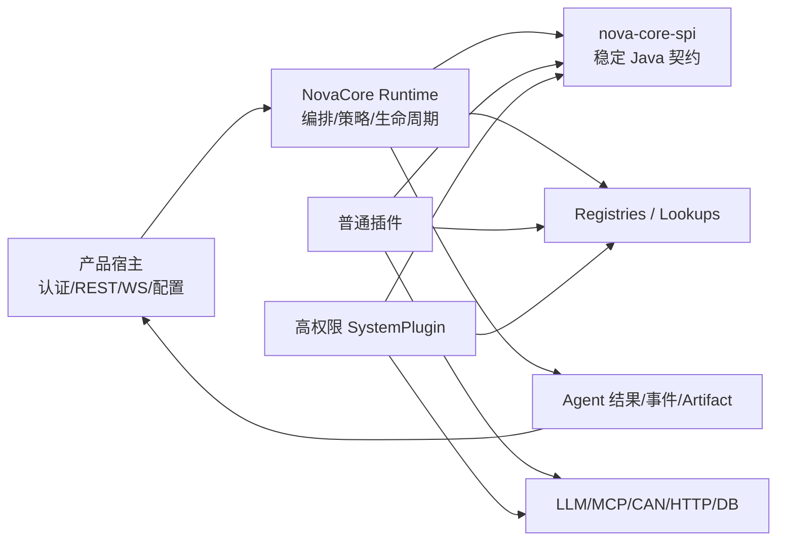
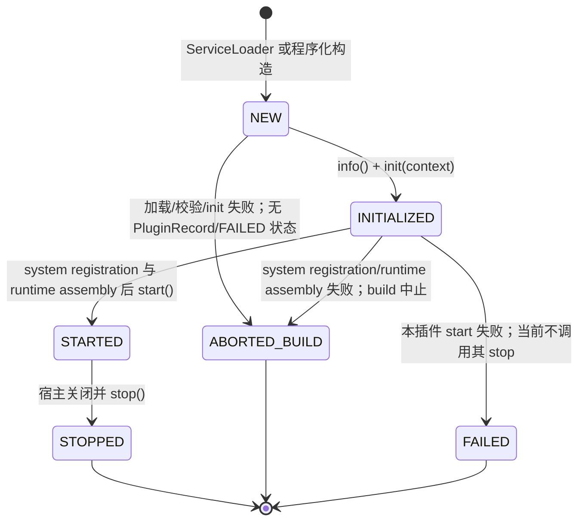
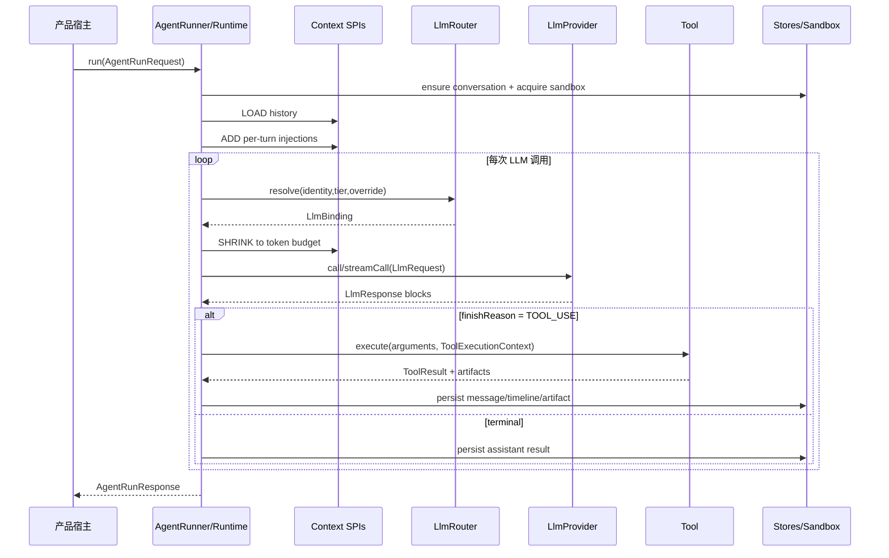
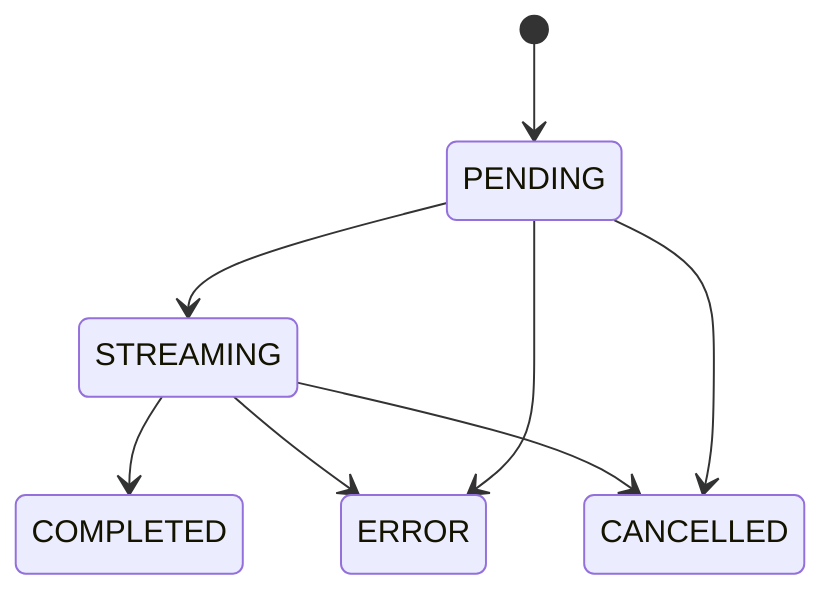

```
# NovaCore SPI 稳定契约复刻文档

> 文档类型：技术架构复刻文档
>
> 适用读者：Agent 框架实现者、插件作者、嵌入式宿主开发者、测试平台开发者
>
> 证据时间：2026-08-13
>
> 证据标记：`I` 静态源码已实现，`A` 自动化仓库间接验证，`K` 已知限制，`P` 规划，`REQ` 推荐复刻设计，`F` 风险，`D` 无法从现有材料证明

## 1. 结论与边界

### 1.1 一句话结论

NovaCore SPI 是一个面向插件的、Java 17 可编译的稳定契约包：运行时拥有调度、线程、类加载、生命周期和策略决策，插件只依赖 SPI，通过注册表贡献工具、技能、模型工厂、存储、沙箱、上下文处理器、Hook 和 HTTP 路由；同一主版本内，标记为稳定的公开契约不应发生不兼容变化。`I`

### 1.2 它解决什么问题

如果没有独立 SPI，插件会直接引用 Agent runtime、Spring、产品 DTO 或数据库实现。一旦运行时重构，所有插件必须同步重编译，并且插件有机会越过权限、租户、模型路由和生命周期边界。NovaCore 将共享契约单独发布，使以下角色可以独立演进：

- 运行时：执行 Agent loop、选择模型、创建沙箱、持久化会话、发布事件。
- 插件：声明并注册能力，不知道运行时具体实现。
- 产品宿主：把认证、配置、REST/WS、租户规则桥接到运行时。
- 第三方插件作者：只拿 SPI 与契约测试包即可开发和验证。

### 1.3 输入、输出和最终效果

| 方向 | 输入 | 输出/效果 |
|---|---|---|
| 宿主 → 插件 | `PluginContext`、`SystemPluginContext`、配置、身份、每次调用上下文 | 插件注册能力并在调用时执行 |
| 插件 → 运行时 | `Tool`、`SkillBundle`、`Hook`、`LlmProviderFactory`、Store、SandboxProvider 等 | 运行时动态获得新能力 |
| 运行时 → 外部系统 | LLM、HTTP、数据库、MCP、CAN Gateway 等协议请求 | 插件把外部能力转换为统一 SPI 结果 |
| 运行时 → 产品层 | Agent terminal response、timeline、artifact、结构化错误 | UI/API/WS 可以统一展示和追踪 |

### 1.4 包含范围

本文覆盖以下稳定契约族及其关系：

1. 插件发现、普通插件和系统插件生命周期。
2. Agent 顶层运行与 SubAgent 委派。
3. LLM provider 工厂、路由、请求响应、流式和 token 估算。
4. Tool 注册、执行、取消、错误、结果保留、artifact。
5. Skill bundle、资源、触发和所需工具。
6. 上下文 LOAD/ADD/SHRINK、Prompt Segment、Hook。
7. Identity、配置、Store、Conversation、Compaction、Artifact。
8. Sandbox、出站 HTTP、插件入站 HTTP、后台 LLM job、timeline。
9. 稳定性、兼容演进、线程安全、测试和发布门禁。

### 1.5 明确不包含

- 产品 REST、WebSocket 和前端 DTO 不是 SPI；它们由宿主把产品请求翻译成 SPI/runtime 调用。`I`
- Agent loop、注册表实现、插件类加载器、prompt assembler、重试器不是插件契约，属于 runtime 内部实现。`I`
- MCP 没有独立的 `mcp` SPI 包。MCP 插件将远端 MCP tool 映射为通用 `Tool`，并用 `ToolLookupFilter`、配置、HTTP 与身份契约完成可见性和调用。`I`
- CAN Gateway 的业务协议不属于 NovaCore SPI；CAN 插件是一个通用 SPI 消费者。`I`
- SPI 不规定产品数据库 DDL。Store 接口规定逻辑语义，具体 PostgreSQL/H2 表结构属于存储插件。`I`

### 1.6 当前实现与建议的差异

- 当前稳定标记是 `SOURCE` 保留，能表达开发承诺，但不能被运行时反射或仅凭已发布 class/jar 审计。`K`
- 当前存在源码级稳定性审计与 SPI-only 依赖门禁；未发现自动化二进制兼容比较工具的明确配置。`K`
- 当前有两个名称相同但用途不同的 Artifact 类型：Tool 层是一次执行携带的轻量 byproduct，Artifact Store 层是持久化元数据；适配层必须显式转换，不能混用 import。`K`
- 大多数集合和部分二进制 DTO 做 defensive copy，但轻量 Tool Artifact 与 ArtifactBlob 的 `byte[]` 当前按生产者所有权传递，没有统一复制保证。`K`
- 推荐增加 Revapi/japicmp 类门禁、SPI API baseline artifact 和兼容例外清单。`REQ`
- `SystemPluginContext` 的注释描述了“first-party prefix”治理，但当前 runtime 实际门禁只是 Java 类型判断：实现 `SystemPlugin` 的实例就会获得 system context，也能注册 PUBLIC 插件 HTTP route；没有签名、发布者、jar hash 或配置 allowlist 信任根。`I/K/F`
- 插件目录已实现逐 jar classloader 与 jar-local `META-INF/services` 发现；但未发现“provider 实现类必须由对应 jar classloader 加载”的显式校验，也未发现插件 jar hash、发现/装载时间审计元数据。后二者只能标为缺失/待设计，不能作为当前保证。`I/D`

## 2. 术语与参与方

| 术语 | 定义 |
|---|---|
| SPI | Service Provider Interface，插件与运行时共享的稳定 Java 类型集合 |
| Runtime | 负责实际编排、线程、策略、事件和资源生命周期的核心实现 |
| 普通插件 | `NovaPlugin`；可注册工具、技能、Hook，获得只读 Store lookup 等受限能力 |
| 系统插件 | `SystemPlugin`；高权限扩展，可注册模型工厂、Store、Sandbox、Reducer 等系统级服务；当前 marker 身份不证明制品可信 |
| Registry | 宿主持有的可变注册表；重复 key 通常 fail-fast，不允许静默覆盖 |
| Lookup | Registry 的只读视图，执行期调用者不能修改全局能力 |
| Binding | 运行时已把模型实例和选项绑定后的调用句柄 |
| Identity | 不透明租户/用户作用域 key；所有跨会话数据访问必须携带它 |
| runtimeContext | 宿主注入的每次运行路由元数据；不是授权证明，也不得代替 Identity |
| Artifact | 工具产生的非纯文本输出；可独立存储、授权和下载 |



责任分配的硬边界是：运行时决定“何时、给谁、在什么作用域执行”，插件决定“某项能力如何工作”。插件不得通过缓存 runtime 内部对象、读取产品 ThreadLocal、私建身份或直连产品模型配置来夺走前一类责任。`I/REQ`

## 3. 业务规则

### 3.1 稳定性和依赖规则

1. SPI artifact 以 Java 17 编写，插件唯一编译依赖是 SPI；SPI 主代码仅依赖 SLF4J API。`I`
2. SPI 不依赖 Spring、runtime、产品应用或其他插件。`I`
3. 插件只依赖 SPI，不得依赖 runtime 或另一插件；跨插件协作必须通过 SPI 注册表或外部协议。`I`
4. 所有公开顶层 SPI 类型应有稳定标记；稳定承诺是“同一 major 不做不兼容变化”。`I`
5. SPI DTO 不使用 Lombok，也不携带 Jackson 注解；序列化 mixin/codec 放在持久化或 provider 实现层。`I`
6. 输入集合普遍在 DTO 边界做 defensive copy，空集合优先于 `null`，必填值 fail-fast；但二进制数组是否复制以具体类型契约为准，不可假定全局一致。`I/K`

### 3.2 插件规则

1. `info()` 在 `init` 前读取，`id/name/version` 必须非空白。`I`
2. SPI 对插件作者的契约是 `init(ctx)` 只注册、不做网络、线程或业务 IO；这是接口约束，不代表所有内置插件现状都遵守。`I/K`
3. 当前启动顺序是“全部 `init` → 全部 SystemPlugin `registerSystemServices` → 解析必需 Store/组装 runtime 服务与 provider → 按注册顺序全部 `start`”。`I`
4. 当前只有 `start()` 抛异常时，已经存在于插件记录表中的该插件才会被标记 `FAILED`、停止其 HTTP route 并立即向上抛。`init()` 成功之后 runtime 才创建 `PluginRecord(INITIALIZED)`；因此 `init()` 失败的插件没有 record，也没有可观察的 `FAILED` 状态。任一 `init()` 或 `registerSystemServices()` 异常都会直接中止 build，后者发生时已有 INITIALIZED records 也不会被批量改为 FAILED。start 失败后 runtime **不会**调用失败插件的 `stop()`，也**不会**逆序回滚此前已经 STARTED 的插件。`I/K`
5. 正常 `shutdown()` 按注册逆序对记录中的每个插件调用 `stop()`，单个异常只记录日志并继续；错误不聚合，也不在 shutdown 结束时重新抛出。`I/K`
6. 插件通过 `META-INF/services/com.aloudata.nova.core.spi.plugin.NovaPlugin` 被 `ServiceLoader` 发现，发布物应是包含服务描述符的 fat jar，SPI 本身用 provided scope 排除。`I`
7. 普通 Registry 对重复名称/id/type 抛冲突异常，不允许“先 unregister 再 register”掩盖配置冲突。`I`

### 3.3 执行和隔离规则

1. 同一个 Tool、ContextInjector、Hook 等实例可能跨会话并发调用，必须线程安全。`I`
2. `Identity` 是权限/数据隔离主键；`runtimeContext` 只作可信路由元数据，不能作为授权授予。`I`
3. 长时间 Tool 必须轮询 `isCancelled()`；顶层 run 用 caller 提供的 `runId` 做重复检测和取消。`I`
4. Tool 失败必须转换为失败结果，文本以 `Error: ` 开头；禁止把网络/解析失败伪装成空成功。`I`
5. LLM provider/model 选择由 Router/Binding 完成；插件和产品业务不能绕过统一路由。`I`
6. 沙箱同一 `(identity, agentName, conversationId)` 在 acquire/release 周期之间必须保留写入内容，直至会话被显式销毁。`I`
7. 上下文职责分为 LOAD、ADD、SHRINK：history loader 物化历史，injector 每用户轮注入一次，reducer 每 LLM 调用前控制预算。不得把三者合并为一个无边界处理器。`I/REQ`

## 4. 完整执行链路

### 4.1 插件装载与生命周期



实现步骤：

1. 为每个插件 jar 建独立或受控 classloader，父加载器至少共享 SPI 类，避免同名 `Tool` 类型被重复加载。
2. 使用该 jar 的 `ServiceLoader` 读取服务描述符，实例化 `NovaPlugin`。
3. 合并目录插件与程序化插件后校验 plugin id 唯一；目录发现结果保存 `plugin + PluginInfo + PluginClassLoader`。当前没有一等的 jar path/hash/load-time evidence 对象。`I/D`
4. 依次调用 `init`，只提供普通 `PluginContext`；系统插件在 init 之后、start 之前再收到 `SystemPluginContext` 并执行 `registerSystemServices`。
5. 所有普通注册与系统服务注册成功后统一 `start`。任何注册冲突、`init` 或 system registration 异常都中止 build，但当前不会创建/更新一个 FAILED record；只有后续 `start` 异常会把对应现有 record 改成 FAILED。冲突始终不能静默覆盖。`I/K`
6. `start` 按注册顺序执行。若第 N 个失败，当前实现不调用第 N 个插件的 `stop`，也不回滚第 1..N-1 个已启动插件；这是静态源码可见的现状和风险，不是推荐设计。`I/K`
7. 正常关闭按注册逆序遍历所有插件，先停止其 HTTP route，再调用 `stop`；一个 `stop` 抛异常时记录日志并继续。当前实现不聚合异常，也不向调用方返回失败汇总。`I/K`

### 4.2 一次 Agent run 如何穿过 SPI



运行时需要完成的校验和顺序：

1. 校验 `runId`、`identity`、`userInput`，默认 Agent 名为 `main`。
2. 合并正式 Agent policy、每 run allow/deny、动态 skill required tools 和 lookup filter；deny 优先，不得因为业务资源存在就绕过正式能力安装。
3. 获取/创建会话和沙箱；附件应先物化到沙箱，image block 只保存相对路径。
4. 物化 working history，再调用所有 injector；injector 按 priority 升序，一次用户轮只调用一次，单个失败跳过。
5. 路由模型并用同一 provider 的 estimator 做 token 预算；reducer 返回最终消息。
6. 发布 BEFORE/AFTER LLM Hook；流式或非流式调用 provider。
7. 收到 `ToolUse` 后按 `toolCallId` 关联 ToolResult；执行前后发布 Hook，持久化 timeline。
8. 直到 END_TURN、MAX_TOKENS、取消、错误或工具轮数上限，返回 terminal status、内容、artifact 与 timeline。

### 4.3 SubAgent 与后台任务

- `SubAgentDispatcher.run` 是窄接口，不暴露 runtime Agent 类。Foreground 当前同步执行并返回 terminal 内容；Background profile 已进入 SPI ABI，但当前 runtime 在构建 child context 时直接抛 `UnsupportedOperationException("Background SubAgent profiles require a task store and are not enabled yet")`，尚不会创建 task id 或保存输出。`I/K`
- 当前 Foreground 的 `streamToParent` 与 `sidechainTranscript` 是一等字段，但源码说明当前运行时仍静默执行，只返回终态；不能把字段存在写成已经实现流式 sidechain。`K`
- Parent-fork 明确是未来独立 profile，不应通过 Foreground flag 偷渡。`P`
- `BackgroundLlmJobRunner` 面向受信任系统作业，例如记忆 review；它不等同于用户可见 SubAgent。`I`

## 5. 对外契约

### 5.1 发布坐标和发现契约

最小 Maven 依赖：

```xml
<dependency>
  <groupId>com.aloudata.nova</groupId>
  <artifactId>nova-core-spi</artifactId>
  <version>${nova.version}</version>
  <scope>provided</scope>
</dependency>
```

插件 jar 内必须包含：

```text
META-INF/services/com.aloudata.nova.core.spi.plugin.NovaPlugin
```

内容每行一个实现类，例如：

```text
com.example.nova.weather.WeatherPlugin
```

最小插件：

```java
public final class WeatherPlugin implements NovaPlugin {
  private Tool tool;

  public PluginInfo info() {
    return new PluginInfo("weather", "Weather", "1.0.0");
  }

  public void init(PluginContext ctx) {
    tool = new WeatherTool(ctx.outboundHttpClients(), ctx.config());
    ctx.tools().register(tool);
  }

  public void start() { /* activate resources; optional empty body */ }

  public void stop() { /* close resources and, if retained, unregister */ }
}
```

### 5.2 PluginContext 与 SystemPluginContext

普通插件可见面：

```java
interface PluginContext {
  ToolRegistry tools();
  SkillRegistry skills();
  HookRegistry hooks();
  default StoreLookup stores() { return StoreLookup.empty(); }
  default OutboundHttpClientFactory outboundHttpClients() {
    return OutboundHttpClientFactory.systemDefault();
  }
  default PluginHttpRouteRegistrar httpRoutes() {
    return PluginHttpRouteRegistrar.unsupported();
  }
  PluginConfig config();
  Path workDir();
  ClassLoader classLoader();
}
```

系统插件额外可见面：

```java
interface SystemPluginContext {
  LlmProviderFactoryRegistry llmProviderFactories();
  StoreRegistry storeRegistry();
  SandboxProviderRegistry sandboxProviders();
  ContextReducerRegistry contextReducers();
  ContextInjectorRegistry contextInjectors();
  PromptSegmentRegistry promptSegments();
  <T> Optional<T> resolveConfig(String key, Class<T> type);
  Optional<ConfigStore> configStore();
  default Optional<SubAgentDispatcher> subAgentDispatcher() { return Optional.empty(); }
  default Optional<BackgroundLlmJobRunner> backgroundLlmJobRunner() {
    return Optional.empty();
  }
  default Optional<AgentRunner> agentRunner() { return Optional.empty(); }
  default Optional<ExternalIdentityResolver> externalIdentityResolver() {
    return Optional.empty();
  }
  default WorkingHistoryLoaderRegistry workingHistoryLoaders() {
    throw new UnsupportedOperationException(
        "This SystemPluginContext does not provide a WorkingHistoryLoaderRegistry");
  }
}
```

分类必须原样保留：PluginContext 的 `tools/skills/hooks/config/workDir/classLoader` 是 abstract；`stores` default 返回空 lookup，`outboundHttpClients` 返回系统 JDK factory，`httpRoutes` 返回“注册时明确失败”的 unsupported registrar。SystemPluginContext 的 factories/store/sandbox/reducer/injector/prompt registry、`resolveConfig`、`configStore` 是 abstract；四个 runtime service lookup default 返回 empty，`workingHistoryLoaders` default 则抛 UOE。empty/noop 与 UOE 不是同义：前者允许功能缺省，后者表示调用了宿主没有实现的新扩展点。`I`

`NovaPlugin.info/init/start/stop` 全部 abstract，即使无工作也要显式空实现；`SystemPlugin` 只把 `init` 改成 default no-op，`registerSystemServices` 仍 abstract，`start/stop/info` 继续从 NovaPlugin 继承为 abstract。`I`

### 5.3 Agent 运行契约

等价数据结构：

```java
record AgentRunRequest(
  String runId, Identity identity, String agentName, String providerName,
  String conversationId, String userInput, Map<String,Object> runtimeContext,
  Set<String> allowedToolIds, Set<String> excludedToolIds,
  ConversationCreateOptions conversationCreateOptions,
  Integer maxHistoryRounds, Integer maxToolLoopRounds,
  List<PromptSegment> promptSegments,
  List<ContentBlock> contentBlocks,
  List<AgentAttachment> attachments) {}

record AgentRunResponse(
  AgentRunStatus status, String conversationId, String messageId,
  String content, String errorMessage, String processData,
  List<Artifact> artifacts, RunTimeline timeline) {}
```

关键默认和约束：

| 字段 | 规则 |
|---|---|
| runId | 必填非空；由调用方提供，供重复运行检测与取消 |
| agentName | null/blank → `main` |
| providerName | null/blank → 正常 tier 路由 |
| userInput | 必填非空 |
| runtimeContext | null → 空 immutable map |
| allowed/excluded | null → 空；保留输入迭代顺序 |
| maxHistoryRounds | null → Agent 默认；非正数表示无限历史 |
| maxToolLoopRounds | null → 默认；显式值必须大于 0 |
| contentBlocks | null/空 → 单个 Text(userInput) |
| status | `COMPLETED/TRUNCATED/CANCELLED/ERROR` |
| content/artifacts/timeline | 分别归一化为空串、空列表、empty timeline |

调用示例（概念 JSON；Java 传输仍是 record）：

```json
{
  "runId": "run-018f",
  "identity": {"userId": "u-7", "tenantId": "t-2"},
  "agentName": "main",
  "providerName": null,
  "conversationId": "conv-92",
  "userInput": "汇总本周指标",
  "runtimeContext": {"locale": "zh-CN", "timeZone": "Asia/Shanghai"},
  "allowedToolIds": [],
  "excludedToolIds": ["dangerous_shell"],
  "maxToolLoopRounds": 8,
  "promptSegments": [],
  "contentBlocks": [{"type": "text", "text": "汇总本周指标"}],
  "attachments": []
}
```

取消：`AgentRunner.cancel(runId)` 返回 boolean，表示是否找到并发出取消信号；调用方不能据此假设线程已经结束，必须继续等待 terminal response/event。`I/REQ`

#### SubAgent 完整 ABI

下面代码保留了当前 record component 顺序、两个 Request 兼容构造器、一个 Response 兼容构造器和 legacy allowlist accessor；复刻时不能只保留字段表，否则旧源码调用点会失去构造器兼容。`I`

```java
interface SubAgentDispatcher {
  SubAgentResponse run(SubAgentRequest request);

  record SubAgentRequest(
      Identity identity, String name, String userInput, String providerName,
      String systemPromptSuffix, SubAgentRunProfile profile,
      int parentSubAgentDepth, Map<String,Object> runtimeContext) {

    public SubAgentRequest(
        Identity identity, String name, String userInput, String providerName,
        String systemPromptSuffix, Set<String> allowedToolIds,
        Map<String,Object> runtimeContext) {
      this(identity, name, userInput, providerName, systemPromptSuffix,
          new SubAgentRunProfile.Foreground(
              0, allowedToolIds == null ? Set.of() : allowedToolIds,
              Set.of(), true, false),
          0, runtimeContext);
    }

    public SubAgentRequest(
        Identity identity, String name, String userInput, String providerName,
        String systemPromptSuffix, SubAgentRunProfile profile,
        Map<String,Object> runtimeContext) {
      this(identity, name, userInput, providerName, systemPromptSuffix,
          profile, 0, runtimeContext);
    }

    public SubAgentRequest {
      Objects.requireNonNull(identity, "identity");
      Objects.requireNonNull(name, "name");
      Objects.requireNonNull(userInput, "userInput");
      Objects.requireNonNull(profile, "profile");
      if (parentSubAgentDepth < 0) {
        throw new IllegalArgumentException("parentSubAgentDepth must be non-negative");
      }
      runtimeContext = runtimeContext == null ? Map.of() : Map.copyOf(runtimeContext);
    }

    public Set<String> allowedToolIds() {
      Set<String> ids = profile.allowedToolIds();
      return ids.isEmpty() ? null : ids;
    }
  }

  record SubAgentResponse(
      AgentRunStatus status, String content, String errorMessage,
      List<Artifact> artifacts, String taskId, SubAgentRunMetrics metrics) {
    public SubAgentResponse(
        AgentRunStatus status, String content, String errorMessage,
        List<Artifact> artifacts) {
      this(status, content, errorMessage, artifacts, "", SubAgentRunMetrics.empty());
    }

    public SubAgentResponse {
      Objects.requireNonNull(status, "status");
      Objects.requireNonNull(metrics, "metrics");
      content = content == null ? "" : content;
      taskId = taskId == null ? "" : taskId;
      artifacts = artifacts == null ? List.of() : List.copyOf(artifacts);
    }
  }
}

sealed interface SubAgentRunProfile permits
    SubAgentRunProfile.Foreground, SubAgentRunProfile.Background {
  int maxToolRounds();
  Set<String> allowedToolIds();
  Set<String> runtimeContextKeys();
  default boolean isParentFork() { return false; }

  record Foreground(
      int maxToolRounds, Set<String> allowedToolIds,
      Set<String> runtimeContextKeys, boolean streamToParent,
      boolean sidechainTranscript) implements SubAgentRunProfile {
    public Foreground {
      allowedToolIds = allowedToolIds == null ? Set.of() : Set.copyOf(allowedToolIds);
      runtimeContextKeys = runtimeContextKeys == null
          ? Set.of() : Set.copyOf(runtimeContextKeys);
    }
  }

  record Background(
      int maxToolRounds, Set<String> allowedToolIds,
      Set<String> runtimeContextKeys, Duration taskRetention)
      implements SubAgentRunProfile {
    public Background {
      allowedToolIds = allowedToolIds == null ? Set.of() : Set.copyOf(allowedToolIds);
      runtimeContextKeys = runtimeContextKeys == null
          ? Set.of() : Set.copyOf(runtimeContextKeys);
      Objects.requireNonNull(taskRetention, "taskRetention");
    }
  }
}

record SubAgentRunMetrics(
    int llmCalls, int toolCalls, long durationMs, LlmResponse.Usage totalTokens) {
  public SubAgentRunMetrics { Objects.requireNonNull(totalTokens, "totalTokens"); }
  public static SubAgentRunMetrics empty() {
    return new SubAgentRunMetrics(0, 0, 0L, new LlmResponse.Usage(0, 0));
  }
}
```

语义不能从字段名猜测：Request 仅强制 `identity/name/userInput/profile` 非 null（当前不额外拒绝 blank name/userInput），`providerName == null` 才表示正常 tier 路由，`systemPromptSuffix` 可 null。profile 的空 `allowedToolIds` 表示使用 definition 默认 allowlist，而 legacy `allowedToolIds()` accessor 会把空集合投影回 null，以保留旧 `AgentSpec` 的“无额外 per-run allowlist”语义。所有集合在 record 边界 defensive copy；runtimeContext null 变空 map。Response 强制 `status/metrics` 非 null，将 content/taskId null 归一化为空串、artifacts null 归一化并复制为空列表，但 `errorMessage` 保持 nullable。Foreground 同步等待并返回 terminal response；当前 `streamToParent/sidechainTranscript` 只是 ABI 字段，runtime 仍静默执行、只回终态。Background 的 `taskRetention` 必填，`taskId`/retention 表达的是目标契约；当前 runtime 明确拒绝 Background，因此不能声称后台入队、task store 或过期清理已经实现。Foreground 返回的 metrics 包含 LLM 次数、Tool 次数、耗时和累计 token，taskId 为空串。profile 构造器不校验 `maxToolRounds`；runtime 对所有 `<= 0`（包括负数）都回退到默认轮数，尽管接口注释只把 0 定义为兼容默认值。`I/K`

### 5.4 Tool 契约

```java
interface Tool {
  ToolDefinition definition();
  default String bindingFingerprint() { return getClass().getName(); }
  ToolResult execute(Map<String,Object> arguments, ToolExecutionContext ctx);
  default ResultRetention defaultRetention() { return CONDENSABLE; }
}

record ToolDefinition(
  String name, String description, Map<String,Object> parametersSchema,
  List<ConfigParam> configParams, String category) {}

record ToolResult(
  boolean success, String output, ResultRetention retention,
  List<Artifact> artifacts) {}

interface ToolExecutionContext {
  Identity identity();
  Sandbox sandbox();
  boolean isCancelled();
  <T> Optional<T> resolveConfig(String key, Class<T> type);
  Optional<String> conversationId();
  Optional<String> messageId();

  default Optional<String> agentName() { return Optional.empty(); }
  default Optional<String> providerName() { return Optional.empty(); }
  default Map<String,Object> runtimeContext() { return Map.of(); }
  default int callerSubAgentDepth() { return 0; }
  default Set<String> callerAllowedToolNames() { return Set.of(); }
  default Optional<SkillLookup> skills() { return Optional.empty(); }
  default Optional<ArtifactPublisher> artifactPublisher() { return Optional.empty(); }
}
```

上面是当前 `ToolExecutionContext` 的完整方法面。前六个方法是抽象方法，旧宿主必须实现；后七个是兼容性 default。安全语义如下：`identity()` 是授权与数据隔离主键；`runtimeContext()` 只是不可变路由附加信息，空 map 不代表拒绝或授权；`callerAllowedToolNames()` 的空集合按当前兼容契约表示“未报告/不施加额外收窄”，**不是零工具**；`callerSubAgentDepth()` 的 0 表示顶层；所有 Optional 空值表示宿主没有提供该能力或关联键，工具必须降级，不能自行猜测身份、会话或文件发布地址。`skills()` 只暴露只读 lookup；`artifactPublisher()` 空时，工具可返回本地 artifact metadata，但不得假定已有可下载 URL。`I`

参数 schema 与配置 schema 必须分离：

```json
{
  "name": "weather_query",
  "description": "Query weather for one city.",
  "parametersSchema": {
    "type": "object",
    "properties": {"city": {"type": "string"}},
    "required": ["city"],
    "additionalProperties": false
  },
  "configParams": [
    {"key": "api-key", "type": "PASSWORD", "required": true}
  ],
  "category": "External Data"
}
```

执行约束：

- `parametersSchema` 给 LLM；`configParams` 给管理员/用户设置，密钥绝不能进入 LLM schema。
- 模型可能把整数/布尔值发成字符串，Tool 必须容错转换并对不可转换值报可定位错误。
- 动态绑定（尤其 MCP）必须覆盖 `bindingFingerprint()`，返回稳定、无密钥、可区分 server/source 的值。
- `EPHEMERAL` 可在下一轮后丢弃；`CONDENSABLE` 可总结；`DURABLE` 必须原样保留。
- `ToolResult.error("timeout")` 的 output 必须是 `Error: timeout`。
- artifact 不自动进入 LLM message；宿主通过 Agent response、artifact store 或 UI 桥接消费。

`ContentBlock` 是 sealed 层次：`Text`、`Thinking(text,signature)`、`ToolUse(id,name,args)`、`ToolResultBlock(id,name,output,isError,retention)`、`Image(mediaType,relativePath)`。Thinking signature 需要在后续模型轮次原样回传；ToolUse 与 ToolResult 用 id 配对；Image 不允许 SPI 内联 base64。`I`

### 5.5 LLM 契约

```java
interface LlmProviderFactory {
  String type();
  List<ConfigParam> configParams();
  LlmProvider create(String instanceName, Map<String,Object> vendorConfig);
}

interface LlmProvider {
  String type();              // vendor: openai/anthropic
  String name();              // 配置实例名
  default Optional<String> configuredModelId() { return Optional.empty(); }
  LlmResponse call(LlmRequest request);
  default LlmResponse streamCall(LlmRequest request, LlmStreamListener listener) {
    throw new UnsupportedOperationException(
        "Provider " + name() + " (vendor type " + type() + ") does not support streaming");
  }
  default TokenEstimator tokenEstimator() { return DefaultTokenEstimator.INSTANCE; }
  default LlmCapabilities capabilities() { return LlmCapabilities.textAndTools(); }
}

interface LlmRouter {
  // 新 route-only 形态是 default，借旧抽象签名保持既有 Router 实现可链接。
  default LlmBinding resolve(LlmRouteRequest request) {
    LlmRequest stub = LlmRequest.builder()
        .messages(List.of()).identity(request.identity()).build();
    LlmProvider provider = resolve(stub, request.tier(), request.providerNameOverride());
    return new LlmBinding(provider, LlmOptions.empty(), provider.name());
  }

  // legacy 抽象方法仍是实现者必须提供的 SAM；override 可为 null。
  LlmProvider resolve(
      LlmRequest request, LlmTier tier, String providerNameOverride);
}

interface LlmStreamListener {
  default void onTextDelta(String delta) {}
  default void onThinkingDelta(String delta) {}
  default void onToolCallStart(String toolCallId, String toolName) {}
  default void onToolCallArgsDelta(String toolCallId, String partialJson) {}
  default void onToolCallEnd(String toolCallId, Map<String,Object> args) {}
  default void onComplete(LlmResponse response) {}
  default void onError(Throwable error) {}
  default void onRetryReset(int nextAttempt, Throwable cause) {}
}
```

`LlmRequest` 必填 `messages` 和 `identity`，还包含 tools、temperature、maxTokens、topP、stopSequences、vendorOptions、runtimeContext、sandbox。模型/实例选择不在 request 中，而由 `LlmRouter.resolve` 返回 binding。`I`

逐方法分类：LlmProviderFactory 的 `type/configParams/create` 全部 abstract；LlmProvider 的 `type/name/call` abstract，`configuredModelId` default empty，`streamCall` default UOE，`tokenEstimator` default heuristic，`capabilities` default text+tools。LlmRouter 保留旧三参数 `resolve` 为 abstract，新 `resolve(LlmRouteRequest)` 是兼容 default；LlmStreamListener 八个方法全部 default no-op。`I`

Vendor option 使用 `<provider>.<param>` 命名，例如 `anthropic.thinking`；不匹配当前 provider 前缀的 key 应忽略。runtime context 使用 `locale`、`timeZone` 等调用附加信息，不能放 userId/tenantId。`I`

`LlmResponse`：

```java
record LlmResponse(
  List<ContentBlock> blocks,
  StopReason finishReason,
  Usage usage,
  Map<String,Object> vendorExtras) {
  public LlmResponse {
    Objects.requireNonNull(blocks, "blocks");
    Objects.requireNonNull(finishReason, "finishReason");
    Objects.requireNonNull(usage, "usage");
    blocks = List.copyOf(blocks);
    vendorExtras = vendorExtras == null ? Map.of() : Map.copyOf(vendorExtras);
  }

  record Usage(int inputTokens, int outputTokens, int totalTokens, int cachedTokens) {
    // V1.0 source-compatible convenience shape: no cache accounting.
    public Usage(int inputTokens, int outputTokens) {
      this(inputTokens, outputTokens, inputTokens + outputTokens, 0);
    }
  }
}

```

`LlmResponse` 的 compact constructor 强制 blocks/finishReason/usage 非 null，复制 blocks；vendorExtras 是可选字段，null 归一化为空 map，否则复制。`Usage(input,output)` 是真实存在的二参数兼容构造器，默认 `total=input+output`、`cached=0`；四参数 canonical constructor 则保留 provider 给出的 total/cached 原值。StopReason 为 `END_TURN/TOOL_USE/MAX_TOKENS/STOP_SEQUENCE/ERROR`。Provider 声称 streaming capability 时必须覆盖 `streamCall`；否则默认抛 UnsupportedOperationException。token estimator 必须尽量使用真实计费 tokenizer，默认 heuristic 只作兜底。`I`

路由顺序：显式 `providerNameOverride` 优先，非 null 时绕过 tier；否则按 `SIMPLE/COMPLEX/DOCUMENT/VISION` 映射选择。注意旧抽象签名的 override 明确 nullable，而不是要求空字符串；route-only default 用空 messages 构造兼容 stub，只为调用旧 Router，不能把该 stub 发送给模型。Router 只选择，不拥有重试、Hook、stream wiring 或 vision preprocessing。`I`

流式监听器共有八个 default callback。SPI 注释声明的理想 whole-call 顺序是：零到多个 delta/tool 事件，最后恰好一个 `onComplete` 或 `onError`，terminal 后不再回调。`onRetryReset(nextAttempt,cause)` 表示丢弃失败尝试已经展示的前缀，它本身不是 terminal。`I`

但当前 provider 与 runtime retry 组合存在两个必须兼容的偏差。第一，OpenAI/Anthropic provider 在失败 attempt 中先 `listener.onError(e)` 再 rethrow，`LlmCaller` 判断可重试后又发 `onRetryReset`，随后下一 attempt 仍会发 delta 并最终 `onComplete/onError`，所以 attempt-level `onError` 不是 whole-call 终态。第二，runtime 的内部 `attempt` 从 0 开始，第一次失败时实际调用 `onRetryReset(attempt + 1, e)`，传入 **1**；但 SPI Javadoc 把参数定义成“下一次尝试的一基序号”，此处语义上应为 **2**，是 current off-by-one。当前序列实际可为 `delta*(attempt 1) → onError(attempt 1) → onRetryReset(1，按契约应为2) → delta*(attempt 2) → onComplete`。复刻当前 UI adapter 不得用这个数做不可逆 attempt 主键，只把 reset 当作撤销前一 attempt 的信号；修正 runtime 后才按 2、3…解释。若要严格实现 SPI 声明，还应在 retry 层拦截 attempt-level onError，仅在重试耗尽后向外发唯一 whole-call onError。重试策略的 `maxAttempts` 在当前循环中表示“初次调用之后允许的重试次数”：当失败计数达到该值时停止，因此总 Provider 尝试数上限是 `1 + maxAttempts`。`I/K`

### 5.6 Skill 契约

```java
interface SkillBundle {
  String id();
  String name();
  String description();
  String content();
  Map<String,Object> metadata();
  SkillResourceLoader resources();
  TriggerType triggerType();          // AUTO/COMMAND/MANUAL
  List<String> requiredTools();
  List<String> requiredSkills();
  default boolean autoImport() { return false; }
}
```

Skill 是 `SKILL.md + frontmatter + optional resources`。核心字段必须走 typed accessors，metadata 只存插件扩展（scope、tenantId、userId、tags 等）。重复 skill id 直接冲突；多租户可见性在 lookup filter/列表插件中完成，而不是靠 registry 多层覆盖。未知 required tool 在激活时跳过并告警，不应拖垮其他 skill。`I`

推荐最小 frontmatter：

```yaml
---
name: metric-analysis
description: Analyze business metrics.
trigger: auto
required_tools: [metric_query]
required_skills: []
auto_import: false
---
```

### 5.7 Context、Prompt 与 Hook 契约

| 阶段 | SPI | 实例数 | 时机 | 失败策略 |
|---|---|---:|---|---|
| LOAD | WorkingHistoryLoader | 0..1 | 用户轮开始，装载旧历史 | 空结果则只保留当前轮；不得改写 truth store |
| ADD | ContextInjector | 0..N | 第一轮 LLM 前一次 | 单个异常记录并跳过 |
| SHRINK | ContextReducer | 0..1 | 每次 LLM 前及 overflow recovery | 返回非 null 最终消息 |
| static prompt | PromptSegmentProvider | 0..N | system prompt 组装 | 按 section/placement 组合 |
| lifecycle observation | Hook | 0..N | LLM/tool 前后和错误 | 同类型链式改写；非法结果按 identity 处理 |

Injector 同一 insertion point 按 priority 从小到大运行。Hook 按注册顺序 left-to-right，后一个接收前一个输出；返回 null 或不同 sealed subtype 是契约违规，runtime 应记录 warning 并继续使用前一事件。Hook 不适合重 IO。`I`

可直接实现的接口面如下；未标 `default` 的方法均是实现者必需方法：

```java
interface ContextInjector {
  String id();
  Optional<ContextInjection> inject(InjectionContext ctx);
  default int priority() { return 0; }
}

interface InjectionContext {
  Identity identity();
  String conversationId();                 // nullable
  List<ChatMessage> messages();
  LlmProvider currentProvider();
  default Map<String,Object> runtimeContext() { return Map.of(); }
  default boolean activateSkill(String skillId) { return false; }
  default SkillActivationResult activateSkillDetailed(String skillId) {
    return SkillActivationResult.legacy(skillId, activateSkill(skillId));
  }
  default void declareMandatorySkills(Set<String> skillIds) {}
}

record ContextInjection(
    List<ChatMessage> messages, InsertionPoint insertionPoint,
    InjectionStats stats) {
  public ContextInjection {
    Objects.requireNonNull(messages, "messages");
    Objects.requireNonNull(insertionPoint, "insertionPoint");
    Objects.requireNonNull(stats, "stats");
    messages = List.copyOf(messages);
  }
}

interface ContextReducer {
  List<ChatMessage> reduce(ContextReductionContext ctx);
}

interface ContextReductionContext {
  Identity identity();
  default String conversationId() { return null; }
  default int promptTokens() { return 0; }
  default ContextCompressionReporter compressionReporter() {
    return ContextCompressionReporter.noop();
  }
  LlmProvider currentProvider();
  List<ChatMessage> messages();
  int loopRound();
  int currentTokens();
  int tokenBudget();
  Optional<ToolBatchInfo> latestToolBatch();
  Optional<LlmFailure> previousFailure();
  record ToolBatchInfo(int toolCallCount, int totalOutputTokens) {}
}

interface Hook {
  Set<HookPhase> phases();
  HookEvent onEvent(HookEvent event);
}

enum HookPhase {
  BEFORE_LLM_CALL, AFTER_LLM_CALL,
  BEFORE_TOOL_CALL, AFTER_TOOL_CALL, ON_ERROR
}

sealed interface HookEvent {
  HookPhase phase();

  record BeforeLlmCall(LlmRequest request, String conversationId)
      implements HookEvent {
    public BeforeLlmCall { Objects.requireNonNull(request, "request"); }
    public HookPhase phase() { return HookPhase.BEFORE_LLM_CALL; }
  }
  record AfterLlmCall(
      LlmRequest request, LlmResponse response, String conversationId)
      implements HookEvent {
    public AfterLlmCall {
      Objects.requireNonNull(request, "request");
      Objects.requireNonNull(response, "response");
    }
    public HookPhase phase() { return HookPhase.AFTER_LLM_CALL; }
  }
  record BeforeToolCall(
      Tool tool, Map<String,Object> arguments, String conversationId)
      implements HookEvent {
    public BeforeToolCall {
      Objects.requireNonNull(tool, "tool");
      Objects.requireNonNull(arguments, "arguments");
    }
    public HookPhase phase() { return HookPhase.BEFORE_TOOL_CALL; }
  }
  record AfterToolCall(
      Tool tool, Map<String,Object> arguments, ToolResult result,
      String conversationId) implements HookEvent {
    public AfterToolCall {
      Objects.requireNonNull(tool, "tool");
      Objects.requireNonNull(arguments, "arguments");
      Objects.requireNonNull(result, "result");
    }
    public HookPhase phase() { return HookPhase.AFTER_TOOL_CALL; }
  }
  record OnError(HookPhase whenPhase, Throwable cause) implements HookEvent {
    public OnError {
      Objects.requireNonNull(whenPhase, "whenPhase");
      Objects.requireNonNull(cause, "cause");
    }
    public HookPhase phase() { return HookPhase.ON_ERROR; }
  }
}
```

失败与空值语义：Injector 返回 `Optional.empty()` 是“本轮无内容”，runtime 跳过 splice 并记录 skipped；抛异常则隔离该 injector，继续其他 injector 与主 LLM 链。Reducer 必须返回非 null List；当前 reducer 的 RuntimeException 不做 fail-soft，会在 compression 场景先发布 compression-failed 事件再原样向上抛，终止/失败当前调用链；返回 null 也会在后续 thinking-block 恢复/使用时失败，不能视作 no-op。overflow recovery 通过 `previousFailure()` 的稳定错误码识别，`conversationId()==null` 时不能写 conversation checkpoint。Hook payload 的 `conversationId` 可 null，其余上面构造器校验的关键 payload 不可 null。Hook 抛 RuntimeException、返回 null、返回不同 sealed subtype 或非法 payload时，当前 publisher 都记录 warning，并把该 hook 当 identity：把进入它之前的 event 继续传给下一个 hook。**Hook 自身异常不会再发布 `ON_ERROR`**，避免递归错误风暴；`ON_ERROR` 只由 agent/LLM/tool 主执行阶段显式调用 error publisher 时产生。`I`

Prompt section 包括 IDENTITY、TOOL_USAGE、TOOL_CALL_STYLE、THINKING、SAFETY、REASONING、AGENT_INSTRUCTIONS、ENVIRONMENT；placement 决定段落在 section 内的前后位置。动态检索内容应使用 ContextInjector，不应不断膨胀静态 system prompt。`I/REQ`

### 5.8 Identity、Config 与 Store 契约

`Identity.key()` 是核心只理解的稳定 opaque key。标准 TenantIdentity 编码：

| 形态 | key |
|---|---|
| user-only | `u/<userId>` |
| tenant + user | `t/<tenantId>/u/<userId>` |
| tenant scope | `t/<tenantId>` |

配置接口支持 exact scope 的 get/put/delete/getAll；`null identity` 是 global 独立作用域。默认 `resolve` 顺序是传入 identity，再 fallback 到 `DefaultIdentity.GLOBAL`，并按请求类型过滤。更完整的 user→tenant→global cascade 由 runtime decorator 提供，底层 store 自身只做 exact match。`I`

StoreRegistry 以 SPI interface class 为唯一 key，例如 `ConversationStore.class`，而不是实现类；V1 是单实例。重复类型报冲突。`I`

ConversationStore 不是“所有方法都必须重写”。下面按当前 ABI 区分抽象方法与 default body，避免复刻实现意外得到空成功：`I`

| 方法 | 当前形态与 default 行为 |
|---|---|
| `append(Message)`、`update(Message)`、`get(String)` | mandatory abstract；基础 message lifecycle |
| `get(String,Identity)` | default 先调用不带身份的 `get`，再以内存 filter owner；兼容旧实现，但 DB store 必须覆盖为带 identity predicate 的查询，避免未授权行先被读取/解密 |
| `load(conversation,identity,limit)` | default 抛 UOE |
| `load(...,beforeCursor)` | cursor 非 null 时 default 抛 UOE；首屏委托三参数 overload |
| `count` | default 对 `stream` 计数未删除消息 |
| `stream` | default 用 1000 行分页 spliterator，调用方必须关闭 |
| `createConversation`、`getConversation`、`updateTitle`、`delete` | mandatory abstract；全部 owner-scoped（除 create 的 owner 输入） |
| `ensureConversation`、`listByIds` | default 抛 UOE |
| `listConversations(identity,limit)` | default 抛 UOE |
| `listConversations(...,beforeCursor)` | cursor 非 null时 default 抛 UOE；首屏委托二参数 overload |
| `setPinnedAt`、`touchUpdatedAt`、`updateStatus`、`updateLastError`、`updateLastViewed` | default 全部抛 UOE |
| `maxTurnIndex`、`findLatestAssistant`、`findAssistantByTurn`、`softDeleteByTurn` | default 全部抛 UOE |
| `updateContent` | default 抛 UOE |

`clampPageSize`、message cursor 和 conversation cursor 是 static helper，不是存储能力。生产实现要把 identity 放进同一次数据库查询/更新谓词及相关索引；不能依赖 Java 层 post-filter。所有 default-UOE 方法代表“可选扩展以保二进制兼容”，上层在使用功能前必须做 capability/异常处理，不能把 UOE 转成空列表或更新成功。`I`

Artifact Store 层的 Artifact 有 owner、conversation、source tool、内容类型、存储引用和时间等元数据；ScopedArtifactStore 额外支持 scope query 与 grant。artifact 内容可来自 bytes、local file 或 stream。游标应绑定 `(createdAt, artifactId)`，无效游标显式报错。Tool 层另有一个轻量 Artifact（kind/name/mimeType/content/uri），它是运行结果载体；宿主需发布/持久化后再转换为 Store Artifact。`I`

`ScopedArtifactStore` 的六个方法全部是 mandatory abstract：`createScoped`、`getByArtifactIdInTenant`、`listByScope`、`openContentInTenant`、`listGrantsInTenant`、`updateAccessInTenant`，没有 default 授权器。名称带 `InTenant` 的四个方法只是“tenant + artifact id 存储定位”，**不是授权判断**。调用方必须先从已认证 principal 得到 tenant，加载 scope/owner/grant，判断 requester 是否可读或可管理，再调用 open/list/update；不得接受客户端任意 tenantId 后直接透传。`listByScope(requester,query)` 才把 requester 明确传入查询，但具体 visibility/grant 语义仍由宿主定义并需契约测试。`I`

### 5.9 Sandbox 契约

```java
interface Sandbox {
  Path resolve(String relative);       // 必须拒绝越界
  Path root();
  ExecutionResult exec(String[] command, int timeoutSeconds);
  default String writeFile(String suggestedRelativePath, byte[] content) {
    try {
      Path target = resolve(suggestedRelativePath);
      Path parent = target.getParent();
      if (parent != null) Files.createDirectories(parent);
      Files.write(target, content);
      return suggestedRelativePath;
    } catch (IOException e) {
      throw new SandboxIoException(suggestedRelativePath, "writeFile failed", e);
    }
  }
  default byte[] readFile(String relativePath) {
    try {
      return Files.readAllBytes(resolve(relativePath));
    } catch (IOException e) {
      throw new SandboxIoException(relativePath, "readFile failed", e);
    }
  }
  default Path sharedRoot() {
    throw new UnsupportedOperationException(
        getClass().getName() + " does not support sharedRoot");
  }
}

interface SandboxProvider {
  String name();
  Sandbox acquire(Identity id, String agent, String conversation);
  void release(Sandbox sandbox);
  default void destroyConversation(
      Identity id, String agent, String conversation) {
    throw new UnsupportedOperationException(
        getClass().getName() + " does not support destroyConversation");
  }
}
```

`resolve/root/exec` 和 provider 的 `name/acquire/release` 是 abstract；两个 byte IO 方法是 path-backed default，`sharedRoot` 与 `destroyConversation` default 抛 UOE。实现必须规范化路径，在解析后验证仍位于 root 下；命令超时返回/抛出可识别失败；override write 可以重命名规避碰撞，调用者必须使用返回路径。Directory 与 Docker provider 均可实现，关键是同三元组重取时文件仍存在。`I`

### 5.10 插件 HTTP 与出站 HTTP

插件可注册框架无关 route：method、path、access、requiredAuthorities、maxBodyBytes、timeout、handler。PUBLIC route 不能声明 Nova authority；body limit 非负；timeout 必须为正。Request/Response 的 map、header list 与 byte[] 必须 defensive copy。`I`

当前 PUBLIC 注册门禁的真实数据流是：NovaCore 创建 registrar 时传入 `plugin instanceof SystemPlugin`；route registry 遇到 PUBLIC 且该 boolean 为 false 就拒绝。因此它只是“实现了 SystemPlugin marker interface”的类型门禁，不校验 jar 签名、发布者、插件 id 前缀、hash 或部署 allowlist，不能称为信任根。任意能进入 plugins 目录且实现 SystemPlugin 的 jar，在这一层会被视为允许 PUBLIC；复刻生产系统必须在装载前另加签名/allowlist/制品清单验证。`I/K`

```java
record PluginHttpRoute(
  PluginHttpMethod method, String path, PluginHttpAccess access,
  Set<String> requiredAuthorities, long maxBodyBytes,
  Duration timeout, PluginHttpHandler handler) {}
```

入站 handler 接收 method/path/query/headers/pathVariables/rawBody/principal/correlationId/remoteAddress。它是宿主 REST 框架的适配层，而不是允许插件依赖 Spring Controller。`I`

出站调用应使用 host-provided `OutboundHttpClientFactory`，让宿主统一代理、TLS、追踪和 host-scoped header。插件仍控制 JDK HttpClient builder 参数。不得把认证 header 打入日志。`I/REQ`

### 5.11 MCP 的 SPI 映射

MCP 对端在本设计中不是新的核心类型，其适配关系如下：

| MCP 概念 | NovaCore SPI 映射 |
|---|---|
| server connection | MCP 插件内部 client/session，生命周期由 start/stop 管理 |
| tools/list | 生成动态 ToolLookup 视图 |
| tool schema | ToolDefinition.parametersSchema |
| tools/call | Tool.execute → MCP call → ToolResult |
| server identity | bindingFingerprint 中的稳定 server/source 标识 |
| server/user visibility | ToolLookupFilter(identity, runtimeContext, base) |
| bearer/env/config | ConfigParam + ToolExecutionContext.resolveConfig |
| HTTP transport | OutboundHttpClientFactory |
| MCP failure | ToolResult.error，保留状态和可定位原因 |

最小兼容 MCP stub 只需支持 initialize、tools/list、tools/call，返回一个确定性 echo tool，并允许模拟超时、401、invalid JSON 和动态 tool list 改变。NovaCore 无法从 SPI 证明 MCP 插件内部 session pooling、协议版本协商或重连算法；这些必须作为插件设计单独验证。`D/REQ`

## 6. 数据模型与生命周期

### 6.1 不可变 DTO 规则

复刻时对所有公开 DTO 使用 record 或 final immutable class：

```java
public record ToolCall(String toolCallId, String toolName,
                       Map<String,Object> arguments) {
  public ToolCall {
    requireNonBlank(toolCallId);
    requireNonBlank(toolName);
    arguments = arguments == null ? Map.of() : Map.copyOf(arguments);
  }
}
```

生产级复刻建议所有不可变 DTO 的 byte[] 在构造和 accessor 两端 clone，嵌套 map/list 也复制，不暴露 mutable builder 内部集合。当前实现中 Plugin HTTP request/response 与 SkillResource 已这样做，但 Tool Artifact 和 ArtifactBlob 明确或事实上保留数组引用；这是复刻时应修正或至少原样文档化的所有权例外。新增字段时保留旧构造器并填默认值只能改善源码迁移，不能保证 record 的二进制 ABI。`I/K/REQ`

### 6.2 逻辑实体与归属

| 实体 | 业务唯一键 | 归属 | 生命周期 |
|---|---|---|---|
| Plugin | plugin id | host/runtime | 启动发现，进程关闭停止 |
| Tool | definition.name | registry/runtime view | init 注册，stop 后移除/失效 |
| Skill | bundle.id | registry + metadata scope | 注册、过滤、卸载 |
| Provider factory | vendor type | system registry | init 注册，runtime 物化实例 |
| Provider instance | configured instance name | runtime | 配置装配到关闭 |
| Conversation | conversation id + identity | tenant/user | 创建、更新、软删/物理删由 store 定义 |
| Message | message id + conversation + identity | tenant/user | pending→streaming→completed/cancelled/error |
| Sandbox workspace | identity+agent+conversation | tenant/user | acquire/release 保留，delete conversation 销毁 |
| Artifact | artifact id + tenant | owner/conversation/scope | 创建、授权、读取、删除/过期 |
| Compaction checkpoint | conversation + identity | tenant/user | 可重建派生物，latest 覆盖/追加由 store 实现 |

### 6.3 状态模型



SPI 给出了 MessageState 与 ConversationStatus，但不会自动强制每个数据库状态迁移。生产 Store 应用条件更新，例如仅允许 active 状态进入 terminal，并让 terminal 写入幂等。`I/REQ`

### 6.4 推荐存储约束

SPI 不规定 SQL；复刻时至少实现以下等价约束：

```sql
-- 伪 DDL，只表达跨实现必须保持的隔离/唯一性
UNIQUE (identity_key, conversation_id);
UNIQUE (identity_key, message_id);
INDEX  (identity_key, conversation_id, created_at, message_id);
UNIQUE (tenant_id, artifact_id);
INDEX  (tenant_id, owner_identity_key, created_at, artifact_id);
UNIQUE (config_key, identity_scope_key);
```

所有对象读取与变更必须把 identity/tenant 作为谓词，而不是先按全局 id 取出后再在 Java 判断。`REQ`

## 7. 核心实现设计

### 7.1 推荐模块划分

```text
agent-platform/
├── spi/                 # Java 17；零宿主框架依赖
│   ├── agent, llm, tool, skill, context, plugin
│   ├── identity, config, store, conversation, artifact
│   └── sandbox, http, hook, error, runtime/timeline
├── runtime/             # registry、loader、agent loop、policy、event
├── plugin-contract-test/# 第三方可继承的抽象契约测试
├── plugins/             # 每插件一个 fat jar，仅依赖 spi
└── app/                 # REST/WS/认证/产品桥接
```

### 7.2 Registry 通用算法

```java
register(key, value):
  require key/value
  if concurrentMap.putIfAbsent(key, value) != null:
      throw RegistryConflictException(key)

unregister(key):
  concurrentMap.remove(key)

lookup.all():
  return immutable snapshot
```

上面只描述 registry 共有的冲突与 snapshot 最小语义，不能把一个实现的排序外推到所有 registry。当前只有 `DefaultToolRegistry.all()` 明确定义确定顺序：按 registration phase（PROGRAMMATIC、PLUGIN_INIT、RUNTIME_DYNAMIC）再按 tool name 排序。`DefaultSkillRegistry` 由 `ConcurrentHashMap.values()` 复制，顺序未定义；其他 registry 也各自实现、彼此独立，没有跨 registry 的统一原子事务或全局排序保证。不要使用最后写入覆盖；否则同一 registry 内同 key 能力的实际执行源随竞争变化。动态 Tool 还应在每轮获得 lookup snapshot，以反映 server 列表变化。若复刻需要稳定 Skill 顺序，必须显式排序，而不能依赖 CHM 遍历。`I/REQ`

### 7.3 ServiceLoader 隔离算法

1. 枚举 plugins directory 直接子级的 `*.jar`；目录不存在或无 jar 时返回空。`I`
2. 每 jar 创建独立 child classloader；SPI 与 SLF4J parent-first，runtime 包在任何 lookup 前隐藏，`java/javax` 交给 parent，其余类 child-first。`I`
3. `META-INF/services/*` 的 resources 只用该 jar 的 `findResources`；对每 jar 单独执行 `ServiceLoader.load(NovaPlugin.class, jarClassLoader)`。`I`
4. provider 实例化失败转为 PluginLoadException；无 descriptor 的 jar 只记录 warning。`I`
5. 当前代码没有显式断言“provider 实现类的 `getClassLoader()` 必须等于该 jar loader”，也没有对 SPI classloader identity 做独立审计记录；虽然加载策略通常产生该结果，不能写成已实现校验。`D`
6. 当前 loader 没有计算/记录 jar hash、发现时间或装载时间。若需要来源审计，应新增不可变 `PluginLoadEvidence(jarPath,sha256,providerClass,loadedAt)` 并在 init 前持久化；这是推荐设计，不是现状。`D`
7. 程序化插件和目录插件最终按 plugin id 做冲突拒绝；它解决重复 id，不等于证明制品来源可信。`I`

### 7.4 兼容演进方法

| 变更 | 同 major 允许性 | 做法 |
|---|---|---|
| interface 新抽象方法 | 禁止 | 新增 default 方法 |
| record 新 component | 二进制不兼容 | 新版本类型或 major bump；若已发生，至少保留旧构造器只能缓解 source call site，不能恢复 record canonical ABI |
| enum 新常量 | source 通常兼容，穷举 switch 风险 | minor 版本谨慎加入并在文档声明 unknown 策略 |
| 删除/改名类型、方法、字段 | 禁止 | deprecate 至下一 major |
| 参数/返回泛型变化 | 高风险 | 新方法名或 major bump |
| default 行为变化 | 语义兼容风险 | 契约测试 + release note |
| sealed permits 增加 | 穷举 switch 风险 | 只在 minor 明确策略下增加，或改开放 extension point |
| checked exception 新增 | 禁止 | 统一 runtime exception/result error |

特别提醒：现有 SPI 使用很多 record 和 sealed hierarchy。旧构造器有利于源码兼容，但 JVM 方法描述符仍可能变化，因此复刻项目必须用真实旧版插件 jar 做 binary smoke，而不能只重编译当前源码。`REQ/F`

### 7.5 MVP 与生产级差异

| 方面 | MVP | 生产级 |
|---|---|---|
| 插件发现 | 单 classpath ServiceLoader | 每 jar 隔离、hash、来源审计、冲突诊断 |
| Registry | synchronized map | 并发 map、immutable snapshot、source fingerprint |
| 身份 | opaque key | tenant/user typed identity + object-level authorization |
| Store | memory | PostgreSQL/H2 + migration + scoped indexes |
| Sandbox | temp directory | 持久工作区、配额、容器隔离、删除审计 |
| LLM | 单 provider | factory assembly、tier routing、stream、usage、capabilities |
| 兼容 | 编译当前插件 | API diff、旧 jar smoke、契约测试 artifact |

## 8. 并发与非正常路径

| 风险 | 必须行为 |
|---|---|
| 同一 ToolRegistry/SkillRegistry 注册重复 name/id | 当前按 registry kind + key 原子 fail-fast、不覆盖；异常不保证报告两个来源。重复项是否确实来自两个不同插件，现有冲突对象无法证明，属于 D；生产增强可记录双方 source fingerprint |
| Tool 并发执行 | 实例无每调用 mutable 字段；连接池线程安全 |
| 同 runId 重复启动 | 一个成功，其余抛/返回 concurrent-run error |
| cancel 与完成竞态 | terminal 状态 compare-and-set；只发布一个 terminal |
| Hook 抛异常 | 当前 safe chain 记录 warning，并以输入 event 继续；不递归触发 ON_ERROR |
| Injector 抛异常 | 跳过该 injector，其他 injector 与 LLM 继续 |
| LLM context overflow | 带稳定 failure code 再过 reducer，受限重试 |
| Provider stream 中断 | 保留已接收 delta 供诊断，terminal 标 ERROR，不伪装 completed |
| Tool 超时/HTTP 非 2xx/解析失败 | ToolResult.error，保留状态码和截断 body，不泄露密钥 |
| Sandbox path traversal | resolve 前规范化、resolve 后 root containment 验证并拒绝 |
| 插件 init/system registration 失败 | 直接中止 build；init 失败发生在 record 创建前，system registration 失败不批量改状态，二者都没有 current FAILED state |
| 插件 start 部分失败 | 当前只把该已有 record 标记 FAILED 并抛出；不调用其 stop，也不回滚此前 STARTED 插件（已知资源风险） |
| stop 某插件失败 | 正常 shutdown 逆注册顺序继续 stop；逐个记 error，不聚合、不重新抛出 |
| 动态 MCP tool 消失 | 当前 snapshot 中查不到则向 LLM 返回明确 unavailable error |
| 进程重启 | Store/sandbox 恢复 durable truth；registry 由插件重新注册 |

超时与重试所有权必须唯一：Tool/plugin 管外部协议级超时；runtime 管 Agent loop 与 LLM 调用级重试；产品层不应在未知执行状态下自动重放非幂等 Agent run。`REQ`

## 9. 安全、权限和审计

1. Identity 必须由宿主认证层构造；插件不得相信 LLM 参数中的 userId/tenantId。`I/REQ`
2. Tool 可见性经 ToolLookupFilter 与正式 policy 解析；资源存在不等于能力已授权。`I`
3. Skill required tools 只在 skill 正式激活后进入 run-local 能力，不可提前全量暴露。`I`
4. `parametersSchema` 不放密钥；密钥由 ConfigStore/resolveConfig 按 identity 获取。`I`
5. runtimeContext 只接收宿主注入 key，并进行 allowlist；SubAgent profile 还显式声明可下传 key。`I`
6. 插件 HTTP PUBLIC route 禁止 requiredAuthorities；AUTHENTICATED route 由宿主验证 principal 和 authority。`I`
7. Artifact/Sandbox/Conversation 的所有操作必须做 tenant/user object scope；路径、URL 和 artifact id 都不能替代授权。`REQ`
8. 日志不得记录 API key、Authorization、password config、完整业务响应；错误 detail 有长度上限，仍需先脱敏。`I/REQ`
9. `bindingFingerprint` 禁止凭据，建议格式 `mcp:<scope>:<server-id>:<transport>`。
10. 系统插件能力极大。当前 system context 与 PUBLIC route 均以 `instanceof SystemPlugin` 为门禁；这不是来源信任。复刻时应以签名/allowlist/部署清单建立真正信任根。`I/K`

推荐审计事件：plugin discovered/init/start/stop/fail；registry register/conflict/unregister；provider resolve；tool visible/denied/start/end；config resolve scope（仅 key 不含 value）；artifact publish/access；sandbox exec；external identity resolution；HTTP route access。

## 10. 外部依赖对端设计

### 10.1 SPI 与对端的关系

SPI 自身主要是进程内契约；真正的对端是插件调用的 LLM、MCP、CAN Gateway、数据库或 HTTP service。核心只要求插件把对端语义转换成统一结果，并不假设对端内部实现。

### 10.2 最小 LLM stub

实现一个 `LlmProvider`：

- 固定 type/name/configuredModelId。
- 按脚本队列返回 Text、Thinking、ToolUse 或 terminal blocks。
- 支持模拟 stream delta、429、401、context overflow、断流。
- 统计 request，验证 identity、tools、vendorOptions 和 sandbox image read。
- token estimator 返回确定值，避免契约测试漂移。

### 10.3 最小存储 stub

内存实现必须仍按 identity key 分区，支持并发，defensive copy，重复注册冲突和 delete 幂等；否则测试会掩盖生产隔离缺陷。Conversation、Sandbox、Tool、LLM、Context、Skill、Hook 都应提供可继承的 contract test base。`I/REQ`

### 10.4 Nova 无法证明的细节

- 第三方 LLM 的限流、计费 tokenizer 和模型兼容性，只能由 provider 与线上验证证明。`D`
- MCP 服务内部权限、session、数据持久化与 SLA 不由 SPI 证明。`D`
- CAN Gateway 内部查询引擎和缓存不由 SPI 证明；Nova 只能证明请求/响应适配行为。`D`
- 宿主在所有部署形态下是否真正执行系统插件信任 gate，现有静态材料不足。`D/K`

## 11. 可观察性

### 11.1 结构化日志

统一字段：`correlationId/runId/conversationId/pluginId/toolName/providerName/identityHash/tenantHash/phase/durationMs/errorCode`。身份只记录不可逆 hash 或内部安全 id；不记录 user prompt、tool output 和 credential，除非进入受控诊断附件。

### 11.2 指标

- plugin_load_total、plugin_start_duration、plugin_failure_total。
- registry_conflict_total{kind,key_hash}。
- agent_run_total{status}、active_runs、cancel_latency。
- llm_calls、llm_latency、input/output/cached tokens、route failures。
- tool_calls{tool,success}、tool_duration、tool_cancelled。
- context_tokens_before/after、injector_skipped/error、compression_total。
- sandbox_exec_duration/timeout/path_rejection。
- artifact_publish_bytes/access_denied。

### 11.3 Trace 和 timeline

一次 run 建 root span；LLM、Tool、Context、Store、external HTTP 建 child span。RunTimeline 至少保存 ThinkingEvent、ToolExecEvent 和 RunSummary（LLM 次数、Tool 次数、token 汇总）。Tool retention 的 durable carrier 在 timeline event，而非仅依赖内存 ToolResultBlock。`I`

### 11.4 错误模型

SPI 根异常携带 `errorCode + immutable details + cause`；日志 message 格式包含 code/details，detail 单值截断到 200 字符。机器分支必须读 accessor，不得解析 message。Tool 面向 LLM/UI 则用 `Error: <reason>`，两种错误面不要混淆。`I`

## 12. 复刻实施顺序

1. 建 Java 17 `spi` artifact，只依赖 SLF4J；静态验收：无 Spring/runtime/Jackson/Lombok import。
2. 实现 `Stable`、Identity、error、immutable DTO 基础；验收：null/default/defensive copy 测试。
3. 实现 Registry/Lookup 通用语义和冲突异常；验收：并发重复注册只有一个成功。
4. 实现 NovaPlugin/SystemPlugin 与 ServiceLoader；验收：fat jar 可发现，SPI 类由父加载器共享。
5. 实现 Tool/Skill/Hook/Context/Prompt；验收：契约测试能仅依赖 SPI 运行。
6. 实现 LLM factory/provider/router contracts；验收：override 优先于 tier，stream capability 一致。
7. 实现 Store/Conversation/Artifact/Compaction；验收：跨身份读写均拒绝或不可见。
8. 实现 Sandbox 与 HTTP bridges；验收：路径越界、body limit、timeout、credential redaction。
9. 实现 AgentRunner/SubAgent/Background job bridge；验收：duplicate、cancel、terminal exactly-once。
10. 发布 contract-test artifact；验收：示例第三方插件不引入 runtime 也能编译并跑契约测试。
11. 建 API baseline 与 binary compatibility gate；验收：删除方法、加抽象方法、改 record component 会阻断发布。
12. 再做产品 REST/WS 适配和 MCP/CAN 插件；它们不能反向污染 SPI。

## 13. 验收标准

### 13.1 正向

- 一个仅依赖 SPI 的 fat jar 被发现，按 NEW→INITIALIZED→STARTED→STOPPED 运行。
- Tool schema 能发给 LLM，配置密钥不出现在 request/tool schema，调用结果和 artifact 可见。
- provider override 与 tier routing 行为确定，usage 和 finish reason 正确归一化。
- Skill 激活后只开放其声明且当前策略允许的 required tools。
- 同 identity+conversation 上传图片后释放并重取 sandbox，provider 仍能读取。

### 13.2 反向

- 重复 plugin/tool/skill/provider/store key fail-fast，旧值不被覆盖。
- public plugin route 携带 authorities 在构造时失败。
- Tool 外部 500/invalid JSON 返回 error，不是空成功。
- 跨租户 conversation/artifact/config 读取不可见。
- `../secret`、绝对路径、编码 traversal 被 sandbox 拒绝。
- 未声明 streaming capability 的 provider 调 stream 明确失败。

### 13.3 并发、恢复和生命周期

- 同一 Tool 并发 100 次无状态串扰。
- 相同 runId 竞争只存在一个 active run。
- cancel/complete 竞态只产生一个 terminal 状态。
- 插件 stop 失败不阻止其他插件释放。
- 进程重启后 durable store 和 conversation sandbox 可恢复，registry 由插件重建。

### 13.4 兼容性

- 使用上一个 minor 编译的插件 jar 在新 runtime 中直接装载，不重编译，完成最小 Tool 调用。
- API diff 工具确认同 major 无删除、改名、抽象方法新增和签名变化。
- 新增 default 方法时，旧 FakePluginContext/第三方实现仍可运行。

## 14. 测试矩阵

| 场景 | 通道 | 前置条件 | 操作 | 预期结果 | 当前证据等级 |
|---|---|---|---|---|---|
| 所有公开顶层 SPI 有稳定标记 | source audit | SPI 源码 | 扫描 public top-level type | 无遗漏 | I |
| SPI-only 编译 | Maven dependency | contract module | 禁止 runtime/app/plugin/Spring | 依赖门禁通过 | I |
| ServiceLoader 发现 fat jar | runtime integration/e2e | 带 descriptor jar | 放入 plugins dir 启动 | 插件实例被发现 | I |
| Tool 基本契约 | Java contract test | 自定义 Tool | 跑 AbstractToolContractTest | definition/result/error 合规 | I |
| LLM provider 契约 | Java contract test | scripted provider | call/stream/metadata | 结果与能力一致 | I |
| Sandbox provider 契约 | Java contract test | provider impl | acquire/write/release/reacquire | 内容持久且隔离 | I |
| Conversation store 契约 | Java contract test | store impl | append/page/update/delete | scope 与分页正确 | I |
| Context/Hook/Skill 契约 | Java contract test | 各实现 | 继承抽象测试 | 顺序、空值、失败行为合规 | I |
| WS cancel 终态 | product black box | 已部署 Nova | `/ws/chat` 发 cancel | 出现可识别 terminal | A |
| Tool 可见性与运行事件 | UI/WS black box | 工具设置 | 切换工具并对话 | tool start/end 与策略一致 | A |
| MCP 设置和动态工具 | UI/API black box | MCP test server | create/test/enable/call/delete | 动态 Tool 可见且可调用 | A |
| Artifact 发布和下载 | REST/WS black box | 产生文件工具 | 对话后下载 | public artifact URL/bytes 正确 | A |
| 旧 jar 二进制兼容 | jar smoke | 上一 minor 插件 | 新 runtime 直接加载 | 无 LinkageError/NoSuchMethodError | K/REQ |
| 系统插件 trust gate | integration/security | 非 allowlist 插件 | 请求 system context | 必须拒绝 | K/F |

`nova_ui_e2e` 与 `nova_auto_test` 是产品黑盒证据，只能间接证明 SPI 经过产品适配后产生了可观察效果，不能证明某个 Java ABI 或默认方法细节。`A`

## 15. 当前能力与建议汇总

### I：静态源码已实现

- 独立 Java 17 SPI artifact，插件唯一编译依赖；主代码依赖面极小。
- 逐 jar ServiceLoader、jar-local descriptor 与隔离 classloader；启动按 init/system registration/start，正常 shutdown 逆序 best-effort。
- 普通/系统插件 context 分权。
- Agent、SubAgent、LLM、Tool、Skill、Context、Hook、Store、Sandbox、HTTP、Artifact、Timeline 等稳定契约。
- DTO defensive copy、结构化错误、各 registry 在自身 key 空间内冲突 fail-fast；确定排序只由 DefaultToolRegistry 明确提供，Skill registry 当前无序。
- SPI-only contract-test artifact 和多类抽象契约测试。

### A：自动化间接证据

- UI/黑盒工程覆盖 `/ws/chat` cancel、工具运行事件、MCP 设置/动态工具、artifact 下载、技能设置与租户隔离等产品边界。
- 这些用例支持“SPI 能被产品链路消费”的结论，不等价于 ABI compatibility test。

### K：已知限制

- 稳定注解为 SOURCE retention。
- 未观察到完整的发布间二进制 API diff 门禁。
- Tool byproduct Artifact 与持久 Artifact 同名且不同包，存在误导入风险；部分 byte[] DTO 没有 defensive copy。
- Foreground SubAgent streaming/sidechain 字段目前不代表运行时已实现对应行为。
- Background SubAgent profile 虽已进入 SPI ABI，但当前 runtime 直接抛 `UnsupportedOperationException`，没有后台 task 入队、taskId、持久输出或 retention 清理；它与可用的受信任 `BackgroundLlmJobRunner` 不是同一能力。
- Provider 可在单次失败 attempt 先发 `onError`，runtime 随后又发 reset 并产生下一 attempt 的 delta/终态，违背 whole-call terminal 直觉；当前第一次 reset 还传 1，而一基“下一 attempt”契约应传 2。`maxAttempts` 当前是追加重试数，总 Provider 尝试上限为 `1 + maxAttempts`。
- `start` 失败不 stop 失败插件，也不回滚此前已启动插件；shutdown stop 错误不聚合。
- `init` 成功后才创建 INITIALIZED record；init/system registration 失败只中止 build，没有 current FAILED state。
- 系统插件/PUBLIC route 只有 `instanceof SystemPlugin` 类型门禁，不是 first-party 来源信任根。

### P：明确规划

- Parent-fork SubAgent 应作为新的独立 profile 设计，不能复用现有 flag。
- 部分上下文压缩/working-history 文档描述了未来阶段，应与当前能力分开。

### REQ：推荐复刻设计

- 引入 API baseline、旧 jar smoke、Revapi/japicmp 类门禁。
- 建系统插件签名/allowlist 信任根。
- 所有 Store 在数据库谓词层完成 identity/tenant 隔离。
- 建标准 MCP/LLM/HTTP 故障 stub 与契约测试套件。
- 让 Registry snapshot 和 source fingerprint 可审计、可确定复现。

### F：主要风险

- record component、sealed hierarchy、enum 演进容易产生隐性二进制/穷举兼容问题。
- runtimeContext 被误作授权，或业务资源存在即自动开放工具，会穿透能力边界。
- 插件持有 static runtime 资源、注册 shutdown hook 或不释放线程会造成重载泄漏。
- Tool 把失败伪装为成功会直接污染 LLM 推理。

### D：当前材料无法证明

- 外部 LLM/MCP/CAN 服务内部架构和 SLA。
- 所有部署环境都启用了同样的插件治理与权限 gate。
- Tool/Skill 重复 key 的冲突异常只有 registry kind 与 key，无法证明冲突双方来自两个不同插件，也不提供双方 source fingerprint。
- 当前所有已发布历史版本之间都满足二进制兼容。
- ServiceLoader provider classloader identity 的显式校验、插件 jar hash 与装载时间审计；当前 loader 未实现这些证据。

## 16. 证据附录

> 本节仅用于追溯；正文已经给出复刻所需契约，不要求读者访问这些路径。

### 16.1 Nova 主仓库

- SPI 发布与依赖：`nova-core/nova-core-spi/pom.xml`
- 稳定标记：`nova-core/nova-core-spi/src/main/java/com/aloudata/nova/core/spi/Stable.java`
- 插件：`nova-core/nova-core-spi/src/main/java/com/aloudata/nova/core/spi/plugin/NovaPlugin.java`、`nova-core/nova-core-spi/src/main/java/com/aloudata/nova/core/spi/plugin/SystemPlugin.java`、`nova-core/nova-core-spi/src/main/java/com/aloudata/nova/core/spi/plugin/PluginContext.java`、`nova-core/nova-core-spi/src/main/java/com/aloudata/nova/core/spi/plugin/SystemPluginContext.java`
- Agent：`nova-core/nova-core-spi/src/main/java/com/aloudata/nova/core/spi/agent/AgentRunRequest.java`、`nova-core/nova-core-spi/src/main/java/com/aloudata/nova/core/spi/agent/AgentRunResponse.java`、`nova-core/nova-core-spi/src/main/java/com/aloudata/nova/core/spi/agent/AgentRunner.java`、`nova-core/nova-core-spi/src/main/java/com/aloudata/nova/core/spi/agent/SubAgentDispatcher.java`、`nova-core/nova-core-spi/src/main/java/com/aloudata/nova/core/spi/agent/SubAgentRunProfile.java`
- LLM：`nova-core/nova-core-spi/src/main/java/com/aloudata/nova/core/spi/llm/LlmRequest.java`、`nova-core/nova-core-spi/src/main/java/com/aloudata/nova/core/spi/llm/LlmResponse.java`、`nova-core/nova-core-spi/src/main/java/com/aloudata/nova/core/spi/llm/LlmProvider.java`、`nova-core/nova-core-spi/src/main/java/com/aloudata/nova/core/spi/llm/LlmProviderFactory.java`、`nova-core/nova-core-spi/src/main/java/com/aloudata/nova/core/spi/llm/LlmRouter.java`
- Tool：`nova-core/nova-core-spi/src/main/java/com/aloudata/nova/core/spi/tool/Tool.java`、`nova-core/nova-core-spi/src/main/java/com/aloudata/nova/core/spi/tool/ToolDefinition.java`、`nova-core/nova-core-spi/src/main/java/com/aloudata/nova/core/spi/tool/ToolExecutionContext.java`、`nova-core/nova-core-spi/src/main/java/com/aloudata/nova/core/spi/tool/ToolResult.java`、`nova-core/nova-core-spi/src/main/java/com/aloudata/nova/core/spi/tool/ContentBlock.java`
- Skill：`nova-core/nova-core-spi/src/main/java/com/aloudata/nova/core/spi/skill/SkillBundle.java`、`nova-core/nova-core-spi/src/main/java/com/aloudata/nova/core/spi/skill/SkillRegistry.java`、`nova-core/nova-core-spi/src/main/java/com/aloudata/nova/core/spi/skill/SkillFrontmatter.java`
- Context/Hook：`nova-core/nova-core-spi/src/main/java/com/aloudata/nova/core/spi/context/`、`nova-core/nova-core-spi/src/main/java/com/aloudata/nova/core/spi/prompt/`、`nova-core/nova-core-spi/src/main/java/com/aloudata/nova/core/spi/hook/`
- Identity/Store：`nova-core/nova-core-spi/src/main/java/com/aloudata/nova/core/spi/identity/`、`nova-core/nova-core-spi/src/main/java/com/aloudata/nova/core/spi/config/`、`nova-core/nova-core-spi/src/main/java/com/aloudata/nova/core/spi/store/`、`nova-core/nova-core-spi/src/main/java/com/aloudata/nova/core/spi/conversation/`
- Sandbox/HTTP：`nova-core/nova-core-spi/src/main/java/com/aloudata/nova/core/spi/sandbox/`、`nova-core/nova-core-spi/src/main/java/com/aloudata/nova/core/spi/http/`、`nova-core/nova-core-spi/src/main/java/com/aloudata/nova/core/spi/net/OutboundHttpClientFactory.java`
- 错误：`nova-core/nova-core-spi/src/main/java/com/aloudata/nova/core/spi/error/NovaException.java` 及同目录 sealed subclasses
- runtime loader：`nova-core/nova-core-runtime/src/main/java/com/aloudata/nova/core/runtime/loader/PluginLoader.java`
- loader/隔离测试：`nova-core/nova-core-runtime/src/test/**/PluginLoaderTest.java`
- SPI 审计：`nova-core/nova-core-spi/src/test/**/SpiStabilityAuditTest.java`、`SpiCompilationTest.java`
- 契约测试包：`nova-test/nova-test-contract/pom.xml`、`nova-test/nova-test-contract/src/main/java/**/Abstract*ContractTest.java`
- fat jar E2E：`nova-test/nova-test-e2e/src/test/java/**/FatJarLoadingTest.java`
- classloader 场景：`nova-test/nova-test-e2e/src/test/resources/scenarios/classloader-isolation/classloader-isolation.yml`
- 系统插件 gate 已知缺口：`nova-test/nova-test-integration/src/test/java/**/PluginLoaderIntegrationTest.java`
- MCP 通用 Tool 适配：`nova-bundled-plugins/nova-ext-mcp/**`

### 16.2 nova_ui_e2e

- MCP 设置和工具策略：`nova_ui_e2e/src/system-settings-mcp.ts`
- Tool runtime：`nova_ui_e2e/tests/agent-tool-runtime.spec.ts`
- stop generation：`nova_ui_e2e/tests/agent-stop-generation.spec.ts`
- artifact：`nova_ui_e2e/tests/agent-artifacts.spec.ts`
- runtime event 捕获：`nova_ui_e2e/src/agent-runtime-events.ts`

### 16.3 nova_auto_test

- 黑盒分层说明：`nova_auto_test/README.md`、`nova_auto_test/docs/nova-test-automation-proposal.md`
- WS 契约：`nova_auto_test/tests/ws.spec.ts`
- Tool/文件/artifact：`nova_auto_test/src/features/files/**`
- Skill 行为：`nova_auto_test/docs/nova-test-cases/05-skills/**`
- MCP 动态场景的主仓测试佐证：`nova-test/nova-test-eval/src/test/resources/scenarios/mcp/dynamic.yml`

### 16.4 证据冲突处理

当 Javadoc 意图、runtime 实现、产品黑盒表现不一致时，本文按以下优先级判断“当前已实现”：可重复运行证据 > 当前 runtime 源码 > SPI/Javadoc 契约意图 > 设计/规划文档。稳定 SPI 的调用方要求仍以已发布签名和契约测试为准；发现实现违约时应修 runtime，而不是悄悄修改 SPI 语义。

```
