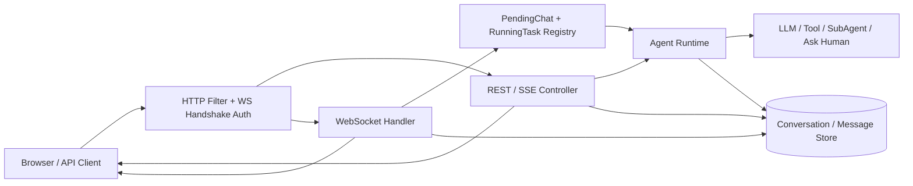
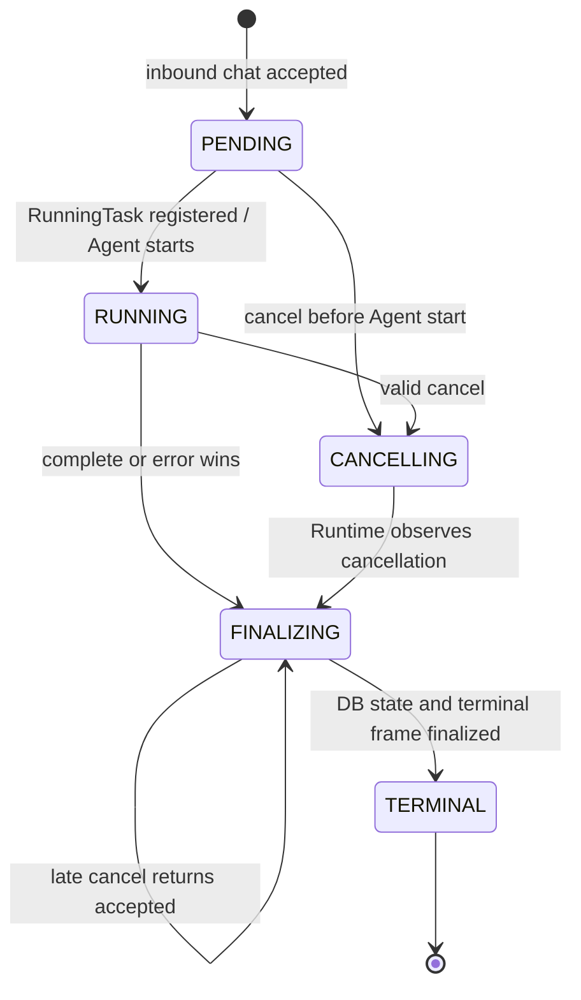

```
# REST、SSE 与 WebSocket 实时事件协议复刻规格

> 本文是一份可脱离 Nova 源码独立使用的协议与实现规格。证据标记为：`I` 当前源码可静态确认，`A` active 自动化明确要求，`K` 已观察到的 known failure，`P` planned 测试或规划，`R` 本次运行验证，`F` 多侧证据支持的强推断，`D` 面向复刻工程的建议。本次只做主工程、`nova_auto_test` 和 `nova_ui_e2e` 三仓静态取证，没有启动服务或运行测试，因此没有 `R` 结论。

## 1. 结论与边界

### 1.1 一句话结论

Nova 同时提供同步 REST、简化 SSE 和完整 WebSocket 三种聊天入口。浏览器主链路使用 `/ws/chat`：服务端以已认证的 `tenantId + userId` 建立连接，用 `conversationId` 关联一次会话当前的活动执行，通过 JSON 帧发送文本、思考、工具、多代理、人工确认、压缩、统计和唯一逻辑终态；最终权威消息、引用、工件和过程数据仍以数据库及 REST 重载结果为准。`[I]`

### 1.2 解决的问题与目标调用方

本协议解决四个问题：

1. 长时间 Agent 执行怎样持续向浏览器反馈，而不是等待一个阻塞 HTTP 响应。
2. LLM、工具、子代理和人工确认产生的不同阶段怎样归属到正确会话并有序展示。
3. 用户取消、页面刷新、连接中断、多 Tab 观察和短期重连时怎样不丢失最终业务结果。
4. 实时临时状态怎样与最终持久化消息、工件和引用收敛为同一结果。

调用方包括 Nova Web、嵌入式页面、自动化 WS 客户端、只需要完整答案的 REST 客户端，以及只需要轻量 token 流的 SSE 客户端。

### 1.3 输入、输出和最终效果

输入包括文本、图片、已上传文件、可选会话 ID、项目、语言和受控模型覆盖；控制输入包括 ping、取消、运行发现、恢复、订阅和人工回答。输出包括：

- REST `{conversationId, content}` 完整答案。
- SSE `token/tool_call/complete` 三类主要事件。
- WS JSON 帧：`type + content + conversationId? + seq? + messageId?`。
- REST 历史、运行 Snapshot、持久化 `processData`、引用和工件。

用户最终需要得到一条可恢复的 Assistant 消息。实时 token 只是暂态；当前 Web 在 `complete/cancelled` 后重新读取服务端消息并替换临时状态，`error` 则故意保留实时错误 notice、不会立即 reload。因 complete 前 patch 是 best-effort，前两条路径的 reload 也可能暴露 live/durable 差异。`[I/K]`

### 1.4 包含与不包含

本文包含握手、认证、Origin、三种聊天入口、请求和事件 envelope、ID 语义、顺序、终态、取消、恢复、多 Tab、背压、超时、兼容演进、Stub 和验收。

本文不展开模型供应商协议、Tool 内部业务、Artifact/Citation 的完整数据模型，也不重新描述 Agent tool loop；但会定义它们进入实时协议的边界。

### 1.5 当前事实、冲突和建议

| 结论 | 等级 | 含义 |
|---|---|---|
| 正式 Web 客户端发送 JSON；缺少 `type` 的 JSON object 按聊天处理 | `I` | 当前主路径 |
| active 黑盒用例要求非 JSON 原始文本也降级为聊天 | `A` | 当前验收期望 |
| release 已观察 raw-text 发送后 90 秒没有 `conversation_id` | `K` | 期望与实现/部署冲突，不能宣称兼容 |
| 当前 wire 协议没有独立 `runId` 或协议版本 | `I` | `conversationId` 同时承担运行索引和会话归属，但不是全局 Run ID |
| 复杂事件大量使用 `|` 拼接 `content` | `I` | 兼容成本和转义风险较高 |
| `artifact` 和 `citation` 没有独立 WS 事件 | `I/K` | complete 前会尝试计算并 best-effort patch 正文/`processData`；patch 失败可能仍发送 complete，实时正文与刷新后数据会偏离 |
| WS Origin 当前允许 `*` | `I` | 与跨站 Cookie 组合时属于生产安全风险 |
| 生产复刻应提供版本化结构 payload、服务端 runId、可持久事件游标和严格 Origin allowlist | `D` | 不代表 Nova 当前已有 |

## 2. 术语与参与方

| 术语 | 定义 |
|---|---|
| Conversation | 持久会话，也是消息、运行、Snapshot、工件和权限的业务归属边界。 |
| Run | 一条用户消息触发的一次执行。当前产品 wire 没有独立 Run ID；同一会话本节点同时最多一个 WS Run。 |
| `conversationId` | 服务端 UUID 或已有会话 ID；用于对象级权限、事件路由、运行表和持久化。 |
| `initialConversationId` | 客户端待创建期的临时关联 ID，仅用于关闭“已发送但真实 ID 未解析”时的取消窗口；不得当成最终会话 ID。 |
| `messageId` | 持久化消息主键。当前 WS 只在 error 终态 best-effort 携带 Assistant 数字 ID。 |
| `seq` | 单个活动 Run 的事件去重水位。严格递增但可跳号；不跨 Run 全局单调。 |
| Subscriber | 获准接收某个运行后续流事件的连接；可包含发起 Tab 和同一身份的其他 Tab。 |
| Snapshot | `processData + lastSeq + status` 的 REST 快照，用于重连时恢复过程卡片和建立去重水位。 |
| Logical Terminal | 一次真实 Run 的 `complete`、带 Run 序号的 `cancelled`、`error` 三者之一。 |
| Control Receipt | `cancel_accepted`、`cancel_ignored`，以及目标不存在时无序号的 `cancelled`；不一定表示一个真实 Run 刚终止。 |
| Persisted Truth | Conversation/Message 表中的状态、正文、`processData`、引用和工件；终态后客户端以它为权威。 |



## 3. 协议规则

### 3.1 身份和权限

1. HTTP 请求经 cookie 或受控 token 认证后，服务端构造 `tenantId + userId + locale`；请求 body 不接受身份覆盖。`[I]`
2. WS 握手从配置名称的 Session Cookie 认证，将身份、locale 和原始 session 放入连接属性。认证失败拒绝升级。`[I]`
3. 启用认证时，每一条 WS 入站消息再次验证 session。确认 session 过期时先发 `auth_expired`，再用应用关闭码 `4401` 关闭；其他认证上游异常当前 fail-open。`[I]`
4. cancel、resume、subscribe、人工回答、运行查询和 Snapshot 均以 `tenantId + userId` 做运行所有者或对象级检查；管理员只读权限不自动授予运行控制权。`[I]`
5. 当前 WS 注册为 `AllowedOrigins("*")`。Cookie 在 HTTPS 跨站嵌入时又可使用 `SameSite=None + Secure + Partitioned`，所以生产复刻必须校验 Origin 或要求一次性握手 token；仅验证 Cookie 不能防止跨站 WebSocket 劫持。`[I/D]`

### 3.2 ID、序号与关联

1. 新请求没有 `conversationId` 时，服务端生成 UUID；有 ID 时必须属于当前身份或拥有显式访问权。
2. `conversation_id` 可能在预流校验前发送，并可能在 Runtime `onStart` 再次发送相同值；客户端必须幂等处理。
3. 当前产品协议没有客户端 request ID 和服务端 run ID。重试发送相同聊天 body 不具有 HTTP 幂等语义；可能生成新会话或新 turn。`[I]`
4. 只有经 `sendToSubscribers` 广播的 Run 事件携带 `seq`。控制帧、`conversation_id`、`token_stats`、运行列表和恢复确认通常没有 `seq`。
5. `seq` 与 `processData` collector 共用一个原子计数器：记录过程数据和发送事件都会推进计数，因此客户端会看到合法跳号。
6. 新一轮 Run 开始时必须为该会话重置客户端上轮水位；不能把上轮高 `seq` 用来过滤新 Run。

### 3.3 顺序和终态

1. 正常最小序列为 `conversation_id → token* → complete`。工具链路在终态前出现成对工具事件。`[I/A]`
2. Agent 先持久化 USER，执行后先持久化 Assistant 行，再触发产品完成回调。回调会在记录 `COMPLETE` 前尝试 citation finalization、artifact marker 桥接和最终正文/`processData` patch；但数据库 patch 是 best-effort，异常只记 warning，内存中的最终正文仍可继续形成 `complete`。另外 `websocket_complete_emit` 等 listener-only process event 发生在 complete 发送之后，只会再尝试一次 post-complete patch。因此“收到 complete”不等于引用、工件、最终正文与完整 processData 已事务性落库。`[I/K]`
3. `complete`、真实 Run 的 `cancelled`、`error` 逻辑互斥。控制层对不存在任务也可能发无序号 `cancelled`，客户端必须结合本地 Run 状态和 `seq` 理解。
4. 工具并发时，`tool_exec_end` 可按真实完成顺序到达，不保证与模型声明顺序一致；`callId` 用于配对。
5. 断开连接不取消 Run。最终结果继续落库；重新连接后通过运行发现、Snapshot、订阅和最终 REST 重载恢复。
6. 当前协议不重放已丢失的 token。Snapshot 只恢复结构化过程和 `lastSeq`，最终正文依赖 Run 后的 REST 消息。

### 3.4 容量、心跳和超时

| 项目 | 当前值 | 行为 |
|---|---:|---|
| WS 文本/二进制消息上限 | 20 MiB | 容器和 Session 同时设置；超限由 WS 容器拒绝 |
| WS 容器空闲超时 | 10 分钟 | 允许长 LLM 执行 |
| 浏览器应用 ping | 25 秒 | 发 `{"type":"ping"}` |
| 服务端 RFC 6455 ping | 30 秒 | 对所有 active session 发送 Ping frame |
| Running lease heartbeat | 30 秒 | 更新数据库节点和心跳 |
| SSE emitter | 300 秒 | 超时后传输结束，不等价于取消 Agent |
| 最近完成通知窗口 | 30 秒 | `query_running` 才返回刚完成 ID |
| 最近完成内存 TTL | 60 秒 | 服务端清理 marker |
| 浏览器重连退避 | 1 秒指数增长至 30 秒 | 4401 不重连；其他 close 自动重连 |
| 工具参数/结果 WS 展示截断 | 4000 / 8000 字符 | byte count 仍表示截断前数据大小 |

当前发送在单个 `WebSocketSession` 上用同步锁串行化，但没有每 Subscriber 的有界发送队列、慢消费者淘汰或显式 backpressure。发送失败只 debug 记录，不中断 Agent。`[I]` 生产设计应使用有界 per-connection queue、最大滞后水位和慢连接关闭策略。`[D]`

## 4. 完整执行链路

### 4.1 WebSocket 正常链路

```mermaid
sequenceDiagram
    autonumber
    participant C as Client
    participant H as WS Handler
    participant R as Running Registry
    participant S as Chat Service
    participant A as Agent Runtime
    participant X as LLM / Tool
    participant D as Store

    C->>H: Upgrade /ws/chat?lang=zh + Cookie
    H->>H: handshake auth + bind identity
    C->>H: JSON chat payload
    H->>H: per-message re-auth
    H->>R: register PendingChat immediately
    H->>H: virtual thread parses request / resolves ID
    H->>R: putIfAbsent RunningTask by resolved conversationId
    H->>S: prepareConversation + project/access check
    S->>D: ensure Conversation
    H-->>C: conversation_id (unsequenced)
    H->>S: vision pre-check
    alt pre-stream validation fails
        S->>D: persist USER + ERROR Assistant best-effort
        H-->>C: error(messageId?, seq)
    else accepted
        H->>A: runStreaming(request, cancellation)
        A->>D: append USER
        A-->>H: onStart; mark RUNNING + lease
        H-->>C: conversation_id again, llm_call_start
        loop LLM / Tool rounds
            A->>X: stream / execute
            X-->>A: deltas and structured events
            A-->>H: runtime callbacks
            H-->>C: sequenced Run events
        end
        A->>D: append terminal Assistant + timeline
        A-->>S: runCompleted
        S->>D: attempt citation/artifact/content/processData patches (best-effort persistence)
        H->>D: mark IDLE or ERROR; finish lease
        H-->>C: complete / cancelled / error
    end
```

关键点：`PendingChat` 在异步线程启动前就可取消；`RunningTask` 在会话准备和 `conversation_id` 之前预注册。若把登记放到 Agent `onStart` 后，会重新产生取消和重复运行竞态。

### 4.2 持久化与实时投影

```text
Runtime event
  ├─ live projection: WS type/content/seq
  └─ durable projection: Timeline + ProcessDataCollector
       ├─ thinking / tool_exec / sub_tool_exec / agent_phase / steps
       ├─ knowledge_recall / context_compression / perf_span
       ├─ tokenStats / taskPlan / totalDurationMs
       └─ citation finalizer + artifact bridge

Terminal callback
  → durable Assistant row already exists
  → compute citation/artifact/final content/processData
  → attempt best-effort DB patches for content/processData/token usage/skills
  → mark conversation state
  → emit terminal WS frame
  → complete/cancelled: browser reloads REST messages
  → error: browser keeps live error notice and does not reload immediately
```

不是所有 live 帧都持久化，也不是所有持久字段都有对应 live 帧。例如 perf span 进入 `processData` 但不发 WS；`token` 不写入 Snapshot；citation 和 artifact 没有独立 WS type。当前 patch 与终态发送没有共同事务：patch 找不到数字 message id、更新失败或 post-complete merge 失败时只记录 warning/保留旧 processData，客户端仍可能收到 complete。此时实时页面先展示内存中带 marker/citation 的 complete 正文，随后的 REST reload 却可能回到较旧的持久化正文或缺少 processData；error 路径又因不 reload 而继续保留实时错误提示，直到硬刷新才暴露持久化差异。复刻时必须显式维护“live projection”和“durable projection”，不能简单保存所有帧作为消息正文。`[I/K]`

### 4.3 取消状态机



取消是协作式：`cancel_accepted` 只表示取消信号已设置；UI 继续保持 stopping，直到真实 `cancelled` 或竞争获胜的 `complete`。取消不存在的 ID 返回无序号 `cancelled`；临时旧 ID 返回 `cancel_ignored`；跨身份取消返回 `error` 且目标继续。

### 4.4 重连和多 Tab

```mermaid
sequenceDiagram
    participant T1 as Origin Tab
    participant T2 as Observer / Reconnected Tab
    participant W as WS Handler
    participant S as Snapshot REST
    participant R as RunningTask

    T1->>W: start chat
    W-->>T1: conversation_id + events
    T1--xW: connection closes
    Note over W,R: Run continues; only dead subscriber removed
    T2->>W: reconnect, query_running
    W-->>T2: running_conversations + running_conversations_v2
    T2->>S: GET snapshot
    S-->>T2: processData + lastSeq + RUNNING
    T2->>T2: hydrate process UI; set dedup watermark
    T2->>W: subscribe(conversationId)
    W-->>T2: future events only
    opt legacy resume path
        T2->>W: resume(conversationId)
        W-->>T2: streaming_active
    end
    R-->>T2: terminal event
    T2->>S: reload persisted messages
```

`resume` 会把 RunningTask 的主要 sessionRef 换成新连接并加入订阅；`subscribe` 只加入 fan-out。二者都严格校验运行创建者身份。`unsubscribe` 服务端支持但当前前端公开 TypeScript client union 未列入，属于类型声明与服务端能力漂移。`[I]`

## 5. 对外契约

### 5.1 REST 同步聊天

```http
POST /api/chat
Cookie: CIP_SESSION=<session>
Content-Type: application/json
X-Nova-Lang: zh
```

```json
{
  "conversationId": "可选 UUID",
  "message": "比较本月和上月收入",
  "projectId": "可选，仅首次创建/绑定",
  "dataThemeId": "可选，先按租户验证",
  "provider": "可选的受控 provider instance override",
  "images": [
    {"data": "<base64>", "mediaType": "image/png", "name": "chart.png"}
  ],
  "files": [
    {"id": "f-1", "name": "sales.csv", "path": "uploads/sales.csv", "size": 2048, "type": "text/csv"}
  ]
}
```

规则：REST 与 SSE 的请求 locale **只认 `X-Nova-Lang` header**，由认证 Filter 写入可信 SandboxContext；body 中即使出现 `lang` 也不会被 `buildAgentRequest` 读取，应视为被忽略的未知字段。文本或可生成文件提示的附件必须使最终用户文本非空；图片会写入当前身份/会话 Sandbox；客户端字段不能覆盖身份；已有会话做对象级授权。同步路径在单进程中按 `conversationId` 公平锁串行。`[I]`

`CHAT-SYNC-011` 当前把 `lang: en` 放在 REST body，并要求模型对一条本身已写明“用英文准确回复 OK”的提示返回 `OK`。该用例即使通过，也只能证明普通 REST 调用成功，不能证明 body lang 被消费，更不能证明 locale 切换；应改为设置 `X-Nova-Lang: en`，并使用不在用户文本中指定语言、但可稳定区分本地化结果的断言。`[I/D]`

成功响应：

```json
{"conversationId":"c-123","content":"本月收入……"}
```

该 POST 不是幂等接口。客户端超时后盲目重试可能新增一轮；生产复刻应增加 `Idempotency-Key` 或 `clientRequestId`。`[D]`

### 5.2 SSE 聊天

```http
POST /api/chat/stream
Accept: text/event-stream
Content-Type: application/json
X-Nova-Lang: zh
```

请求体与 REST 相同，语言同样只来自 `X-Nova-Lang`，body `lang` 被忽略。当前 300 秒 emitter 在虚拟线程执行，只映射：

```text
event: token
data: 本月

event: tool_call
data: metric_query

event: complete
data: 本月收入……
```

传输或执行异常使用 emitter error 结束，没有稳定 JSON error envelope；当前 SSE 不暴露 `conversationId`、`seq`、`messageId`、工具参数、取消、Ask Human、重连游标或完整过程事件。客户端断开/超时也没有定义为业务取消。`[I]`

因此 SSE 是轻量兼容入口，不是 WS 的同等替代。生产复刻若保留 SSE，应让它复用版本化事件 envelope，并提供 `id:`/`Last-Event-ID`、终态错误事件和取消 API。`[D]`

### 5.3 WebSocket 握手

```http
GET /ws/chat?lang=zh HTTP/1.1
Upgrade: websocket
Cookie: CIP_SESSION=<session>
Origin: https://portal.example
```

- 认证开启且 Cookie 缺失/无效：握手 HTTP 401。
- 认证关闭：使用配置的 mock tenant/user。
- 握手 query `?lang=` 被归一化为连接初始 locale；每条 chat body 的 `lang` 是本次请求权威覆盖，允许切换 UI 语言后无需重连。控制消息不使用 body lang。REST/SSE 与 WS 的语言入口不同，不能互相套用。
- 当前 Origin 允许 `*`；复刻生产版必须改为 allowlist。

### 5.4 WS 入站消息

正式入站是 JSON object。缺少 `type` 或未知 `type` 会落入聊天分支。`[I]`

```typescript
type WsInbound =
  | ({ type?: "chat" } & ChatBody & { initialConversationId?: string })
  | { type: "ping" }
  | { type: "cancel"; conversationId?: string }
  | { type: "query_running" }
  | { type: "resume" | "subscribe" | "unsubscribe"; conversationId: string }
  | { type: "clarification_response"; conversationId: string; response: string; remember?: boolean }
  | { type: "plan_confirm" | "plan_revise"; conversationId: string; response: string };
```

控制语义：

| type | 行为 | 空白/不存在 | 权限失败 |
|---|---|---|---|
| `ping` | 返回 `pong` | 不适用 | 不适用 |
| `cancel` | 指定 ID 取消一个；无 ID 取消当前 session 的 pending/running | 不存在返回幂等 `cancelled` | `error` |
| `query_running` | 返回本人运行和最近完成窗口 | 空集合仍返回两个 running 事件 | 不泄漏他人 ID |
| `resume` | 替换主要连接并订阅未来事件 | 空白/不存在静默 | `error` |
| `subscribe` | 加入 subscriber 集合 | 空白/不存在静默 | `error` |
| `unsubscribe` | 移除 subscriber | 幂等静默 | 当前不再查 owner，因为只移除当前 session |
| `clarification_response` | 完成本人 pending Ask Human，可表达 remember 意图 | 已回答/超时静默 | `error` |
| `plan_confirm/revise` | 把 response 交给相同 interaction bridge | 已结束静默 | `error` |

### 5.5 当前 WS 出站 envelope

```json
{
  "type": "tool_exec_end",
  "content": "call-7|metric_query|817|true|2431|<truncated result>",
  "conversationId": "c-123",
  "seq": 18
}
```

当前约束：

- `type` 必有，`content` 通常为 string；`running_conversations_v2.content` 是数组例外。
- `conversationId` 仅在可归属会话时出现。
- `seq` 仅在 Run 广播事件出现。
- `messageId` 当前只在 error 终态 best-effort 出现，普通文本、工具和成功终态不携带。
- 空 content 和未知错误的 fallback 在两个发送 helper 中不完全一致。

可表达现状的宽松 JSON Schema：

```json
{
  "$schema": "https://json-schema.org/draft/2020-12/schema",
  "type": "object",
  "required": ["type", "content"],
  "properties": {
    "type": {"type": "string", "minLength": 1},
    "content": {"oneOf": [{"type": "string"}, {"type": "array"}, {"type": "object"}]},
    "conversationId": {"type": "string", "minLength": 1},
    "seq": {"type": "integer", "minimum": 0},
    "messageId": {"type": "integer", "minimum": 1}
  },
  "additionalProperties": true
}
```

### 5.6 事件目录与 payload

#### 生命周期、文本和控制

| type | content | seq | 持久化/客户端动作 |
|---|---|---:|---|
| `conversation_id` | 最终 conversation ID | 否 | 建立 URL/本地流归属；可重复 |
| `llm_call_start` | 空串 | 是 | 标记 LLM 调用开始 |
| `token` | 文本 delta | 是 | 追加到当前 round buffer；不进入 Snapshot |
| `reasoning_token` | reasoning delta | 是 | Handler 保留发送回调，但当前 NovaCore V2 桥接抑制 thinking delta，主链路未发现调用；Web 类型 union/handler也未消费，不能视为当前可观测保证 |
| `thinking` | 完整思考片段 | 是 | live 展示并进入 `processData.events` |
| `answer_start` | 空串 | 是 | 切换最终回答阶段 |
| `round_boundary` | `tool` 或 `final` | 是 | 把本轮 token 分类为工具中间文本或最终回答 |
| `stream_reset` | 空串 | 是 | 清除失败流式尝试的临时文本 |
| `complete` | 内存中已完成引用/工件计算的最终正文；对应 DB patch 可能失败 | 是 | 先标 IDLE，再 REST reload；刷新结果可能缺少 patch |
| `cancelled` | 空串 | Run 终态有；控制回执无 | 真实 Run 终态或“不存在”幂等回执；有目标会话时 reload |
| `error` | 本地化、脱敏错误文本 | Run 错误有；权限错误无 | 可带 messageId；标 ERROR、追加实时错误消息，但不立即 reload |
| `auth_expired` | 登录过期提示 | 否 | 随后 close 4401，不重连 |
| `pong` | 空串 | 否 | 应用级心跳回执 |

协议中没有 `done` 事件；成功终态名是 `complete`。复刻兼容层可把外部 `done` 归一为 `complete`，但不能同时向同一客户端发送两个成功终态。

当前 Web 客户端对三类终态的动作不是对称的：

| 终态 | 清理 live stream | 会话状态 | 立即 REST reload | 刷新后可能差异 |
|---|---|---|---|---|
| `complete` | `completeStream`，先把内存 complete 正文落入 UI | `IDLE` | 是 | best-effort patch 失败时，reload 可把带 citation/artifact 的实时正文覆盖成旧持久化正文 |
| `cancelled` | `cancelStream`，保留取消态过程快照 | `IDLE` | 是（有可解析 conversationId 时） | 以服务端 CANCELLED 行和 processData 替换本地快照 |
| `error` | 不走 complete/cancel helper；追加本地 error notice | `ERROR` | **否** | 实时提示可含本地化错误和 best-effort messageId；硬刷新只呈现已持久 ERROR 行，可能为空正文、工具栏/文案不同 |

`error` 不 reload 是有意避免服务端空 `ERROR` 正文立即覆盖用户可读的实时错误提示，而不是证明实时错误与 durable row 完全一致。`[I/K]`

#### 工具与统计

| type | content 格式 | 说明 |
|---|---|---|
| `tool_call` | `toolName` | 检测到工具调用 |
| `tool_exec_start` | `callId|toolName|truncatedArgs|inputBytes` | args 可能含 `|`，解析应从首两个和最后一个分隔符切分 |
| `tool_exec_end` | `callId|toolName|outputBytes|success|durationMs|truncatedResult` | result 可能含 `|`，固定字段后拼回剩余部分 |
| `tool_call_result` | `toolName|success|resultBytes` | 统计信号，Web 当前忽略正文 |
| `tool_loop_warning` | `detectorName|reason` | guard 警告；active 主流用例未覆盖，planned |
| `token_stats` | `inputOrTotal|cached|output|toolCalls` | 无 seq、只发主要 session；Web 兼容旧三字段格式 |
| `digest_start` | `toolName|contentLength` | 大结果摘要开始 |
| `digest_progress` | `chunkIndex/totalChunks` | 进度 |
| `digest_end` | `toolName` | 摘要结束 |

`tool_exec_start/end` 的 `success` 由结果文本是否以 `Error: ` 开头推导。WS 展示结果可截断，但 `processData` 保存独立上限的参数、结果、字节数、耗时、tool ordinal 和工件摘要。`[I]`

#### 多代理、计划和 Ask Human

| type | content | 说明 |
|---|---|---|
| `agent_phase` | `agentRole|description` | role 含 `/` 时 Web 视为进入嵌套子代理 |
| `task_plan` | JSON string | `{id,goal,steps[],planDocument?,options?}` |
| `step_start` | `stepId|description` | 计划步骤开始 |
| `step_complete` | `stepId` | 步骤完成 |
| `critic_verdict` | JSON string | 当前 Web 不展示 |
| `user_interaction` | `interactionType|JSON payload` | `clarification_request` 或 `plan_review` |

当前服务端对子代理的 live 工具执行仍复用普通 `tool_exec_*`，用 `agent_phase` 维护栈并在持久化 `processData` 写 `sub_tool_exec + agentLabel`。Web 还保留 `sub_tool_exec_start/end` 的旧解析分支，但当前 WS handler 没有发送这两个类型。`[I]`

Ask Human 示例：

```json
{
  "type": "user_interaction",
  "content": "clarification_request|{\"question\":\"请选择口径\",\"options\":[\"含税\",\"不含税\"],\"allowFreeText\":false,\"multiSelect\":false,\"questionType\":\"single_select\",\"questions\":[{\"id\":\"tax\",\"header\":\"统计口径\",\"question\":\"请选择口径\",\"options\":[{\"label\":\"含税\",\"description\":\"按含税金额统计\",\"recommended\":true}],\"allowFreeText\":false,\"multiSelect\":false,\"questionType\":\"single_select\"}],\"canRemember\":true}",
  "conversationId": "c-123",
  "seq": 22
}
```

响应：

```json
{"type":"clarification_response","conversationId":"c-123","response":"含税","remember":true}
```

`remember` 只是用户意图；服务端用运行 owner、能力票据和记忆可用性再次校验。并发第二个 pending interaction 返回内部 BUSY/fallback，不建立两个等待。

#### 知识、上下文、恢复

| type | content | 行为 |
|---|---|---|
| `knowledge_recall` | JSON `{items:[...]}` | live 卡片并持久化 recall 摘要 |
| `context_compression_start/end/failed` | JSON `{reason,beforeTokens,afterTokens?,contextWindowTokens,durationMs?,idleRatio?,error?}` | 过程状态；成功进入 processData |
| `running_conversations` | 逗号分隔 ID | 旧发现协议；Web 对每个 ID 发 resume |
| `running_conversations_v2` | 数组 `[{id,status:"RUNNING"}]` | Snapshot hydration 后 subscribe |
| `completed_conversations` | 逗号分隔 ID | 30 秒窗口内提示 REST reload |
| `streaming_active` | conversation ID | resume 成功确认；subscribe 没有 ACK |
| `cancel_accepted` | 空串 | 信号已设置，非终态 |
| `cancel_ignored` | 空串 | 取消的是已被真实 ID 替换的临时 ID |

### 5.7 Snapshot 与消息 REST

```http
GET /api/conversations/{conversationId}/snapshot
```

```json
{
  "conversationId": "c-123",
  "status": "RUNNING",
  "processData": "{\"events\":[...],\"tokenStats\":{...},\"totalDurationMs\":1200}",
  "lastSeq": 27
}
```

运行在本节点时读取内存 collector；无本地任务但 lease 新鲜时返回 RUNNING 且 `processData/lastSeq=null`；运行结束后读取最新 Assistant 持久化 `processData`，`lastSeq=null`。不存在或不属于当前用户返回 404 语义，不泄漏内容。`[I]`

终态后客户端通过消息列表端点获取权威 `content/state/processData/server message id`。Artifact marker 位于最终正文，Citation 位于持久化 `processData.citations`；它们不是独立 WS 帧。

### 5.8 错误契约

当前错误并未完全统一：

- AuthFilter HTTP 401：`{success:false,error,errorCode}`。
- 业务异常：HTTP 400/403/404/409/500/502，通常 `{success:false,message,...details}`。
- Conversation 数据不可解密：503 + `errorCode=CONVERSATION_DECRYPTION_FAILED`。
- 普通未映射 `IllegalArgumentException` 可能落入 Spring 默认错误格式；不能承诺所有 REST error 同一 envelope。
- WS 执行错误：`error.content` 使用本地化 formatter，避免 API key、Bearer、堆栈泄漏；权限错误也使用 `error` 但通常没有 conversationId/seq/code。
- SSE error 使用连接错误结束，没有业务 JSON code。

错误分类、retryable 字段和统一 code 的多条自动化仍是 `P`。生产推荐 envelope：

```json
{
  "version": 2,
  "type": "run.error",
  "conversationId": "c-123",
  "runId": "r-456",
  "seq": 27,
  "payload": {
    "code": "LLM_RATE_LIMITED",
    "message": "模型服务繁忙，请稍后重试",
    "retryable": true,
    "traceId": "8d7b1c20",
    "messageId": 9821
  }
}
```

### 5.9 自动化消费者实际覆盖边界

`nova_auto_test` 的 WS/YAML runner 可以直接发送 JSON 或 `rawPayload`，从返回帧中归一化 `conversationId`、事件类型、Snapshot 水位和工具 `callId`。但两个常用 terminal assertion 的证明力必须收窄：

- `single_terminal` 只按目标 conversation 统计 `complete` 与 `cancelled`，要求至少一帧且出现的**类型集合**大小不超过 1；它完全不计 `error`，也没有要求同类帧次数恰好为 1。因此它不能证明 complete/cancelled/error 三类终态总数唯一。
- `terminal_one_of` 在全部入站帧中查找 `complete/cancelled/error`，只要求至少一个属于声明的 allowlist；它不按 conversation 过滤，也不拒绝额外终态或重复终态。

因此 active YAML 只能按具体 assertion 的真实逻辑解释，不能笼统写成“已经断言三类终态唯一”。raw-text 用例仍是“active 期望保留，但 release 已知失败”的例子。要证明协议要求，需新增按目标 conversation 过滤并断言 `count(complete)+count(cancelled)+count(error)==1` 的 assertion，且排除无 seq 的控制回执 cancelled。`[I/K/D]`

`nova_ui_e2e` 的 runtime event recorder 只保留可解析 JSON 且 `type`、`content` 都是 string 的帧，再针对 `tool_exec_end` 做 delimiter 解析，并与消息 REST 的持久化 `processData` 对照。这意味着它能证明真实工具事件与持久化收敛，但会忽略 `running_conversations_v2` 这类 array content，不能据此证明所有协议事件均被 UI E2E 覆盖。`[I]`

Playwright `routeWebSocket` 生成的 `conversation_id`、round、error、terminal 和工具帧只验证浏览器消费、状态恢复与渲染；它不会经过 Nova 握手认证、运行注册、Agent Runtime、数据库或真实背压路径。复刻验收必须把这类 mock UI 用例与真实后端 WS 用例分开标记。`[I/D]`

## 6. 数据模型与生命周期

### 6.1 推荐协议对象

```typescript
interface RunRecord {
  runId: string;                 // 推荐新增的服务端唯一 ID
  conversationId: string;
  tenantId: string;              // 永不发给其他用户
  ownerUserId: string;
  clientRequestId?: string;      // 幂等键
  status: "PENDING" | "RUNNING" | "CANCELLING" | "COMPLETED" | "CANCELLED" | "ERROR";
  lastSeq: number;
  nodeId: string;
  heartbeatAt: string;
  terminalMessageId?: number;
  createdAt: string;
  terminalAt?: string;
}

interface EventRecord {
  runId: string;
  seq: number;
  conversationId: string;
  type: string;
  payloadJson: object;
  createdAt: string;
  durable: boolean;
}
```

当前 Nova 没有单独 Run/Event 表；运行对象和 subscriber 主要在进程内，Conversation lease 和 Message/processData 提供跨重启恢复。上面对象是 `D` 级生产设计。

### 6.2 当前生命周期

- `PendingChat`：从入站到 RunningTask 登记；仅内存、按 session 管理。
- `RunningTask`：线程引用、取消信号、owner、subscriber、collector、终态仲裁和 phase；仅内存。
- Conversation：IDLE/RUNNING/ERROR、node/heartbeat；数据库。
- USER/ASSISTANT：同 turnIndex 配对；数据库。
- recentlyCompleted：完成后内存保存 owner + 时间，60 秒清理。
- processData：随 Assistant 持久化，终态后可 patch。

## 7. 核心实现设计

### 7.1 模块划分

```text
realtime-protocol/
├── auth/                 # HTTP/WS identity, Origin, close code
├── ingress-rest/         # sync REST + error translation
├── ingress-sse/          # SSE projection and disconnect policy
├── ingress-ws/           # parser, control commands, fan-out
├── run-registry/         # pending/running/terminal CAS
├── event-projector/      # runtime event -> live/durable projections
├── event-schema/         # versioned envelope and compatibility codecs
├── recovery/             # snapshot, cursor, replay, lease reconciliation
└── observability/        # trace, metrics, redaction
```

### 7.2 当前兼容伪代码

```java
onWsMessage(session, text) {
  requireOrRefreshIdentity(session);
  JsonNode node = parseJson(text);            // non-JSON currently does not become valid ChatBody
  switch (node.typeOr("chat")) {
    case "cancel" -> cancelOwnedRun(...);
    case "resume" -> resumeOwnedRun(...);
    case "subscribe" -> subscribeOwnedRun(...);
    case "clarification_response" -> answerOwnedInteraction(...);
    default -> {
      Pending pending = pendingRegistry.register(session, node.initialOrConversationId());
      virtualExecutor.submit(() -> {
        Request req = buildTrustedRequest(node, session.identity());
        Running run = running.putIfAbsent(req.conversationId(), pending.signal());
        prepareConversation(req);
        sendControl(session, "conversation_id", req.conversationId());
        validateVision(req);
        runtime.runStreaming(req, projectEvents(run), run.cancelSignal());
        emitRecordedTerminal(run);
      });
    }
  }
}
```

### 7.3 推荐 v2 envelope

```json
{
  "version": 2,
  "type": "tool.execution.completed",
  "conversationId": "c-123",
  "runId": "r-456",
  "seq": 18,
  "occurredAt": "2026-08-13T10:00:00Z",
  "payload": {
    "callId": "call-7",
    "toolName": "metric_query",
    "outputBytes": 817,
    "success": true,
    "durationMs": 2431,
    "resultPreview": "...",
    "truncated": true
  }
}
```

升级规则：

1. 服务端内部只生成结构化 event；v1 codec 再转换为 `type/content`。
2. 握手 query 或首帧协商 `protocolVersion`；未协商默认 v1。
3. v2 type 只增加，不复用旧 type 改语义；未知事件客户端忽略。
4. v1 `|` codec 必须从固定边界解析，不能对整个字符串简单 split。
5. 终态由 `(runId, terminalStatus)` CAS，event log 以 `(runId, seq)` 唯一。

### 7.4 MVP 与生产级

| 主题 | MVP | 生产级 |
|---|---|---|
| 运行注册 | 单节点 map | DB/Redis run directory + lease |
| 事件 | 内存 fan-out | durable event log + cursor replay |
| 协议 | v1 type/content | versioned structured payload |
| 身份 | Cookie + owner check | Origin allowlist + nonce + rate limit + audit |
| 背压 | synchronized send | bounded queue + slow consumer policy |
| 幂等 | conversation lock | clientRequestId + run uniqueness |
| 重连 | Snapshot + future events | snapshot + replay from seq |

### 7.5 客户端去重与终态伪代码

当前 v1 只能按 Conversation 保存水位，并在每次本地发起新 turn 时清除旧水位；Snapshot hydration 后把 `lastSeq` 作为新水位。无 `seq` 的控制事件不参与去重。`[I]`

```typescript
function onV1Event(event: WsEvent) {
  if (event.conversationId && event.seq !== undefined) {
    const last = lastSeqByConversation[event.conversationId] ?? 0;
    if (event.seq <= last) return;
    lastSeqByConversation[event.conversationId] = event.seq;
  }
  applyEvent(event);
}

function beforeSendingNextTurn(conversationId: string) {
  delete lastSeqByConversation[conversationId]; // 服务端新 collector 从低 seq 重新开始
}
```

生产 v2 应改为 `(runId, seq)` 去重，并单独记住每个 Run 的 terminal；同一个 `runId` 收到第二个终态时记录协议违规并忽略，不能靠正文或 `conversationId` 猜测是否重复。

### 7.6 最终消息与终态一致性设计

当前“先有 Assistant 行、再 best-effort patch、再发 complete”的方式允许 live/durable 分叉。生产复刻应在下面两种策略中明确选择，不能继续把 warning 当作一致性保证：

1. **事务 + Outbox（推荐）**：同一数据库事务写最终正文、citation、artifact references、processData、token usage、Message 状态和一条 terminal outbox；提交成功后 dispatcher 才广播 complete。广播失败可按 outbox 重试，客户端 reload 一定看到与 terminal 对应的 committed version。
2. **失败即错误终态**：如果无法让外部 Artifact Store 与消息库同事务，则先把 artifact/citation 物化成带幂等键的 durable record，再 patch 消息；任何被定义为 mandatory 的 patch 失败时不得发 complete，而应记录 `FINALIZATION_FAILED` 并发唯一 error。可选 enrichments 可以降级，但响应需带明确 `finalizationWarnings`/版本，后台 reconciliation 可补偿。

避免“事务提交后进程崩溃而永远无终态”的关键不是延长事务，而是把 terminal intent 写入 outbox。避免重复 artifact/citation 则要求 `(runId, artifactId/citationId)` 幂等唯一键。反向验收必须分别注入 citation finalizer 异常、artifact bridge 异常、message patch 0 rows、processData 序列化失败、DB commit 失败、outbox 发布失败，并验证：要么 committed durable truth 与唯一 complete 一致，要么唯一 error；绝不能出现 complete 后永久缺失 mandatory 数据。`[D]`

## 8. 并发与非正常路径

1. **同会话重复发送**：WS `putIfAbsent` 拒绝第二 Run；同步 REST 只在本进程按 conversationId 串行。REST 与 WS、不同节点之间没有共同分布式互斥。`[I/D]`
2. **取消竞态**：终态第一次记录获胜；进入 FINALIZING 后的取消只返回 accepted，不能把已持久化 complete 改 cancelled。
3. **重复取消**：协议目标是幂等；现有 active 用例中的 `single_terminal` 只约束 complete/cancelled 的类型集合，不统计 error 或同类重复次数，不能单独证明三类终态总数为 1。`[A/K]`
4. **断线**：移除 subscriber，不取消 Run；发送失败不影响 Agent。
5. **多 Tab**：同 owner 可 subscribe；unsubscribe 后该 Tab 不再收到目标会话 fan-out，源 Tab继续。
6. **进程重启**：内存 Run、subscriber、token 均丢失；lease 过期后只修正状态，不能继续执行线程。
7. **慢客户端**：当前同步 send 可能拖慢该发送线程，没有显式缓冲上限；生产应隔离。
8. **空白 control ID**：resume/subscribe/unsubscribe 静默；cancel 无 ID 解释为取消当前 session 全部任务。
9. **未知 type**：当前按 chat 处理，若没有 message 会形成可见错误。v2 推荐未知 control 返回 `UNSUPPORTED_EVENT_TYPE`，不要误当聊天。
10. **非 JSON**：源码解析失败后仍进入 chat worker，但再次把原文按 JSON 解析并失败，无法构造 message；release 已实际表现为无 conversation ID。`[I/K]`
11. **SSE 超时/断开**：当前只终止传输，未证明取消后台执行；复刻必须明确选择“断开即取消”或“后台继续并返回恢复句柄”。
12. **消息超限**：20 MiB 以上交给 WS 容器拒绝；不要在应用层先完整复制超大 body。

## 9. 安全、权限和审计

- WS Origin 必须 allowlist；跨站嵌入使用 nonce 或短期 audience-bound token。
- 每条控制消息必须重新从连接可信属性取 identity，不从 body 取 tenant/user。
- `conversationId` 只是定位键，不是授权凭证。
- Ask Human response 可继续驱动 Tool，必须严格限制为 Run owner；管理员读权限不足以回答。
- Tool 参数和结果可能含 SQL、业务数据或秘密；WS preview 和日志都要截断、脱敏，完整结果只进入受控持久化。
- 错误不得泄漏 API key、Bearer、Cookie、内部 URL、堆栈和数据库连接串。
- 最低审计事件：握手成功/失败、auth expired、run accepted/rejected、跨身份控制拒绝、cancel、interaction answer、订阅、终态、重连和协议解析失败。
- 当前 traceId 是每个 WS worker 的 8 位 UUID 前缀并放 MDC；生产建议完整 trace ID，不作为秘密或唯一业务键。

## 10. 外部依赖与最小兼容 Stub

### 10.1 最小 WS Stub

Stub 必须支持认证开关、JSON chat、conversation ID、token、工具事件、人工确认、取消、运行查询、订阅和唯一终态。最小行为：

```text
on connect:
  validate test cookie

on {message:"hello"}:
  id = supplied conversationId or uuid()
  send {type:"conversation_id",content:id,conversationId:id}
  send {type:"token",content:"hel",conversationId:id,seq:1}
  send {type:"token",content:"lo",conversationId:id,seq:2}
  persist assistant "hello"
  send {type:"complete",content:"hello",conversationId:id,seq:3}

on cancel(id):
  if running owner matches: send cancel_accepted; persist CANCELLED; send sequenced cancelled
  else if missing: send unsequenced cancelled

on query_running:
  send legacy string list and v2 object list, owner filtered
```

Stub 应能注入：握手 401、4401、LLM 延迟、工具延迟、错误、乱序工具完成、连接中断、重复终态尝试和超大 payload。它不得把 Playwright 本机执行误当成远端后端执行。

### 10.2 Nova 无法证明的边界

Nova 源码不能证明反向代理的 idle timeout、Origin 校验、sticky routing、Session Cookie 后端实现、LLM 是否真正可取消或跨节点消息代理是否存在。部署验收必须从最终入口实际观察这些行为。

## 11. 可观察性

建议日志字段：`traceId, protocolVersion, eventType, conversationId, runId, seq, tenantHash, userHash, connectionId, durationMs, outcome`。不记录 content 全文。

建议指标：

- WS 当前连接、握手 401、4401、重连、异常 close、Origin 拒绝。
- run accepted/rejected、首 token、终态耗时、各终态数、无终态超时。
- event queue depth、发送耗时、丢弃数、慢消费者关闭数。
- seq gap、duplicate drop、Snapshot hydration、replay lag。
- cancel accepted 到 terminal 延迟、Ask Human 等待数和超时。
- SSE active、300 秒超时、断开后后台 Run 数。
- REST/WS 持久化终态不一致告警。

诊断附件可保存脱敏后的 WS 帧元数据和方向，但 Tool args/result、Cookie、图片 base64、完整回答和用户问题默认不进入报告。

## 12. 复刻实施顺序

1. 定义身份、Conversation、Message、Run 终态和对象级授权。
2. 实现同步 REST，确保 USER/ASSISTANT 持久化和错误翻译。
3. 定义内部结构化 Runtime Event，不先绑定具体 wire 格式。
4. 实现 Running Registry、PendingChat、终态 CAS 和取消信号。
5. 实现 WS v2 envelope，再提供 v1 `type/content` codec。
6. 实现 Snapshot、lastSeq、订阅和重连；单节点先验收。
7. 实现 SSE 投影，明确断开和取消策略。
8. 接入 Tool/SubAgent/Ask Human、Citation/Artifact durable projection。
9. 加 Origin、限流、消息上限、背压、脱敏和审计。
10. 最后增加跨节点 run directory、event log 和 cursor replay。

## 13. 验收标准

1. 登录用户 JSON chat 得到 `conversation_id → token* → 唯一 complete`，REST 消息与 complete 正文一致。
2. 工具事件按 callId 成对，结果含 `|` 时仍可解析；超限 preview 截断但 byte count 正确。
3. 正向场景中 citation、artifact、最终正文和 processData 在 complete 前成功持久化，reload 后与实时 complete 一致；反向注入任一 mandatory finalization/patch 失败时，生产实现只能发送唯一 error 或通过已提交 outbox 最终发送一致 complete，不能把 best-effort warning 当成功。
4. 同会话第二个 Run 被拒绝，不覆盖第一个，不产生双 turn。
5. cancel 在 pending、LLM、tool 和 finalizing 窗口都只有一个逻辑终态。
6. 另一租户/用户不能 cancel、resume、subscribe、回答或读取 Snapshot。
7. 断线不取消；同身份重连可 Snapshot hydrate、subscribe 后续事件并最终 REST 恢复全文。
8. 多 Tab subscribe 后都收到未来事件；unsubscribe 的 Tab 停止接收，源 Tab 不受影响。
9. 4401 后浏览器不循环重连；普通网络 close 按 1s~30s 退避重连。
10. 20 MiB 限制、10 分钟 idle、25/30 秒心跳与网关配置一致。
11. SSE 返回 token/tool_call/complete；300 秒和客户端断开行为有明确测试。
12. raw-text 若选择兼容，必须转换为 `{message:raw}` 并完整终止；若不兼容，应立即发结构化 `INVALID_JSON`，不能静默悬挂。
13. 不可信 Origin 被拒绝，任何错误/报告都无 Cookie、Key、堆栈和完整 Tool 结果。
14. v1/v2 双栈期间，相同内部事件只产生一个业务终态，未知 v2 事件可安全忽略。
15. REST 与 SSE 仅用 `X-Nova-Lang` 决定 locale；REST body `lang` 对结果无影响。WS 握手 `?lang` 提供初始值，每条 chat body `lang` 可覆盖下一轮，控制帧不能改变 locale。
16. 客户端收到 complete/cancelled 会 reload；error 不立即 reload且保留实时错误提示。硬刷新后的 ERROR 行差异应有明确产品预期和测试。
17. 终态唯一性断言必须按目标 conversation/run 统计 `complete + cancelled + error` 的帧总数恰好为 1，并排除无 seq 控制回执；不能以现有 `single_terminal` 或 `terminal_one_of` 单独替代。

## 14. 测试矩阵

| 场景 | 通道 | 前置条件 | 操作 | 预期结果 | 当前证据等级 |
|---|---|---|---|---|---|
| WS 握手 | WS | 有效 Cookie | 打开 `/ws/chat` | 成功建立 | `I/A`，未运行 |
| 无认证握手/消息 | WS | 认证开启 | 缺 Cookie 或 session 过期 | 401 或 auth_expired+4401，不进聊天 | `I/A` |
| Origin 防护 | WS | 恶意 Origin | 携 Cookie 升级 | 当前允许；生产应拒绝 | `I/D` |
| REST locale header | REST | 可区分本地化结果 | `X-Nova-Lang: en`，body 无 lang | 使用英文 locale | `I/D`；当前 CHAT-SYNC-011 未证明 |
| REST body lang ignored | REST | header 固定 zh | body 分别传 en/zh | locale 均取 header，不取 body | `I/D` |
| SSE locale header | SSE | 可区分本地化结果 | POST 且带 `X-Nova-Lang` | locale 来自 header | `I/D` |
| WS locale 初值与逐消息覆盖 | WS | 建立连接 | `?lang=zh` 后 chat body `lang=en` | 本轮按 en；下轮可再次覆盖 | `I`，需黑盒反测 |
| 简单流 | WS | 模型可用 | 发送缺省 type 的 JSON | conversation_id→token→complete | `I/A` |
| raw text | WS | 已连接 | 发送非 JSON | active 期望降级；release 超时 | `A/K` |
| unknown type | WS | 已连接 | 带 message 的未知 type | 当前按 chat | `I/A` |
| 工具流 | WS | 可触发 Tool | 执行工具 | start/end 成对；目标是三类终态总数唯一 | `I/A` 工具配对；终态唯一现有 assertion 证明不足 |
| 思考与 round | WS | reasoning/tool 模型 | 多轮执行 | thinking独立；round_boundary后complete | `I/A` |
| plan/digest/reset/guard | WS | 可控 Provider/Tool Stub | 注入对应阶段 | 事件格式正确且收敛 | `I/P` |
| Ask Human | WS | ask_human 可用 | 回答/重复/跨账号/重连 | owner唯一回答；pending可重发 | `I/A` |
| 取消 pending | WS | worker尚未开始 | 立即 cancel | accepted 后 cancelled，无 USER 双写 | `I/A` |
| 取消工具 | WS | 长工具 | cancel | cancelled或竞争完成，无 error双终态 | `I/A` |
| 重复取消 | WS | 同 Run | 连续两次 cancel | 幂等；按 conversation 统计 complete/cancelled/error 总数=1 | `I`；现有 A assertion 证明不足 |
| query/resume | WS | 运行中断线 | 新连接查询并 resume | streaming_active + 后续事件 | `I/A` |
| subscribe/unsubscribe | WS | 同账号两个连接 | 观察 Tab订阅后退订 | fan-out 按订阅变化 | `I/A` |
| Snapshot 水位 | REST+WS | 运行中 | 取 snapshot 后订阅 | `seq<=lastSeq` 丢弃，后续接收 | `I/A` |
| 最近完成 | WS+REST | 刚完成 | 30秒内 query | completed_conversations并reload | `I/A` |
| 跨账号控制 | WS/REST | 两账号 | 访问他人 ID | 拒绝且不泄漏存在性/内容 | `I/A` |
| SSE | SSE | 模型可用 | POST stream | token/tool_call/complete并关闭 | `I/A` |
| 同步 REST | REST | 模型可用 | POST chat/follow-up | 完整响应、复用 ID | `I/A` |
| complete 前 patch 成功 | WS+REST | citation/artifact/processData 可生成 | 正常完成并 reload | live complete 与 durable message/processData 一致 | `I` 路径；现有证据不证明事务性 |
| message/processData patch 失败 | WS+REST | 注入 update 失败/0 rows | 完成 finalization | 当前可能 warning 后 complete 且 reload 回旧值；生产应唯一 error 或 outbox 一致 complete | `I/K/D` |
| citation/artifact finalizer 失败 | WS+REST | 注入 finalizer/bridge 异常 | 正常 Agent 结果进入 finalizing | 不得产生不一致 complete；生产记录 FINALIZATION_FAILED | `D` 反向验收 |
| 客户端 error 不 reload | WS+UI | 服务端发 error 并有空 ERROR row | 观察实时提示后硬刷新 | 实时不被空行覆盖；硬刷新差异符合约定 | `I/K` |
| 三类终态总数唯一 | WS | 可注入 complete/cancel/error 竞争 | 按 conversation/run 计数 | complete+cancelled+error=1，控制回执除外 | `D`；现有 assertions 不足 |
| 慢消费者 | WS | 可控网络 | 阻塞读 | 当前无明确保证；生产有界队列 | `D` |
| 进程重启 | WS+REST | RUNNING | kill/restart | 不续流；lease回收；持久结果按已提交部分恢复 | `I/D` |

## 15. 当前能力与建议汇总

### `I` 已实现静态事实

- REST、300 秒 SSE 和 `/ws/chat` 三入口共存。
- Cookie 握手、每消息复验、4401、owner 校验、20 MiB 和双心跳已实现。
- PendingChat、RunningTask、取消、resume、subscribe、Snapshot/lastSeq 和最近完成窗口已实现。
- WS 提供文本、思考、工具、多代理、Ask Human、知识、压缩、统计和终态事件。
- REST/SSE locale 只来自 `X-Nova-Lang`；WS 使用握手 `?lang` 初值并允许每条 chat body `lang` 覆盖。
- complete 前会尝试 citation/artifact/final content/processData 计算与 patch，但 patch 持久化是 best-effort；complete/cancelled 后浏览器 REST reload，error 则不立即 reload。
- 当前 Origin 为 `*`，复杂 content 是 delimiter string，产品 wire 无 runId/version。

### `A` Active 测试契约

- JSON 默认 chat、unknown type、ping、消息上限、idle、并发连接。
- conversation_id 归属、query/resume/subscribe/unsubscribe、临时 ID 清理。
- cancel by ID/session/tool/race/double/cross-account 和 UI stop；但 `single_terminal` 不计 error/同类重复，不能证明三类终态总数唯一。
- token/tool/thinking/round、Snapshot、seq 水位、REST/SSE 以及部分持久化收敛断言；不能外推为 finalization patch 的事务一致性。
- `terminal_one_of` 只证明 allowlist 中至少出现一类，不按 conversation 排除额外或重复终态。
- 本次未运行，不能声称目标环境通过。

### `K` Known Failure

- `CHAT-WS-005`：release 发送 raw non-JSON 文本后，在 90 秒内没有可识别 conversation ID；首次和 retry 都失败。旧客户端会停在无会话、无终态状态。
- `CHAT-SYNC-011` 把 lang 放在 REST body 且提示词已直接要求英文 `OK`；即便通过也不能证明 locale 生效。
- best-effort final message/processData patch 失败仍可能发送 complete，complete 后 reload 可覆盖实时 enrichments；error 路径不 reload，实时与硬刷新表现也可能不同。

### `P` Planned Requirement

- LLM auth/rate-limit/transport/context 错误分类与 secret redaction 注入。
- stream_reset、tool_loop_warning、digest、复杂 task plan、超长工具 payload 等确定性故障注入。
- 不应把这些写成当前运行保证。

### `R` Runtime Verified

无。本次没有运行服务、构建或自动化。

### `F` 强推断

- WS 进程内 registry、无 durable token log 和 Snapshot 结构共同表明：当前只能恢复过程摘要和最终消息，不能跨节点完整重放 token。
- complete/cancelled 后强制 reload 表明这两条路径把持久化 Message/processData 当 UI 权威来源；error 明确不 reload，因此不能把该结论外推到所有终态。

### `D` 复刻建议

- 增加 `protocolVersion + runId + clientRequestId + structured payload`。
- 用终态 CAS、durable event log、cursor replay 和跨节点 run directory。
- 将最终消息、citation/artifact references、processData 与 terminal outbox 事务提交；mandatory patch 失败则发唯一 error，或由 outbox 在提交后可靠发 complete。
- 新增按 conversation/run 统计 complete+cancelled+error 总帧数恰好为 1 的 assertion，并排除控制 cancelled。
- Origin allowlist、握手 nonce、有界发送队列、慢消费者策略和统一错误 envelope。
- raw-text 要么明确适配，要么立即结构化拒绝，禁止静默等待。

## 16. 证据附录

### 16.1 主工程

- `nova-app/src/main/java/com/aloudata/nova/controller/ChatController.java`：同步 REST、SSE、Snapshot 和 Conversation REST。
- `nova-app/src/main/java/com/aloudata/nova/controller/ChatWebSocketHandler.java`：入站控制、PendingChat/RunningTask、事件 payload、取消、恢复、订阅、终态和心跳。
- `nova-app/src/main/java/com/aloudata/nova/config/WebSocketConfig.java`：路径、Origin、10 分钟 idle 和 20 MiB。
- `nova-app/src/main/java/com/aloudata/nova/auth/WebSocketAuthInterceptor.java`、`CipSessionAuthService.java`：握手与每消息认证。
- `nova-app/src/main/java/com/aloudata/nova/service/ChatService.java`：请求构造、持久化、Runtime event adapter、citation/artifact finalization。
- `nova-app/src/main/java/com/aloudata/nova/agent/ProcessDataCollector.java`：durable projection、seq、Snapshot 和截断。
- `nova-app/src/main/java/com/aloudata/nova/agent/interaction/UserInteractionBridge.java`、`nova-app/src/main/java/com/aloudata/nova/config/NovaCoreHumanInputCallback.java`：Ask Human 请求/回答和 owner。
- `web/lib/websocket.ts`、`web/hooks/useWebSocket.ts`、`web/stores/chatStore.ts`、`web/types/index.ts`：重连、事件消费、去重和 UI 状态。

### 16.2 `nova_auto_test`

- `cases/01-chat-streaming/**`：WS connection、streaming、cancel、conversation lifecycle、process stats、REST/SSE active/planned 契约。
- `src/core/wsClient.ts`：多连接、resume/subscribe、临时 ID、终态和 conversation 关联 runner。
- `src/core/assertions.ts`：事件顺序、工具配对、Snapshot 和泄漏断言；`single_terminal`/`terminal_one_of` 的终态证明边界见正文，不能称三类终态唯一断言。
- `TEST_FAILURES.md`：`CHAT-WS-005` release raw-text 已观察失败。

### 16.3 `nova_ui_e2e`

- `src/agent-runtime-events.ts`：真实 WS 帧记录、tool_exec_end 解析和 persisted processData 对照。
- `tests/agent-chat-stability.spec.ts`：mock WS 的 conversation、round 和终态 UI 恢复。
- `tests/agent-tool-runtime.spec.ts`：工具 live event 与持久化过程数据。

### 16.4 证据限制

- UI E2E 中 routeWebSocket 产生的 mock 帧只证明前端消费行为，不证明真实后端会产生相同故障或时序。
- Active YAML 是当前验收目标，不代表本次或任一环境已通过。
- 本次未观察反向代理、负载均衡、Cookie 平台、LLM Provider 或跨节点基础设施运行状态。

```
