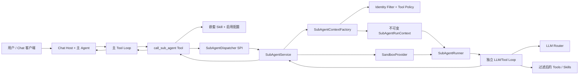
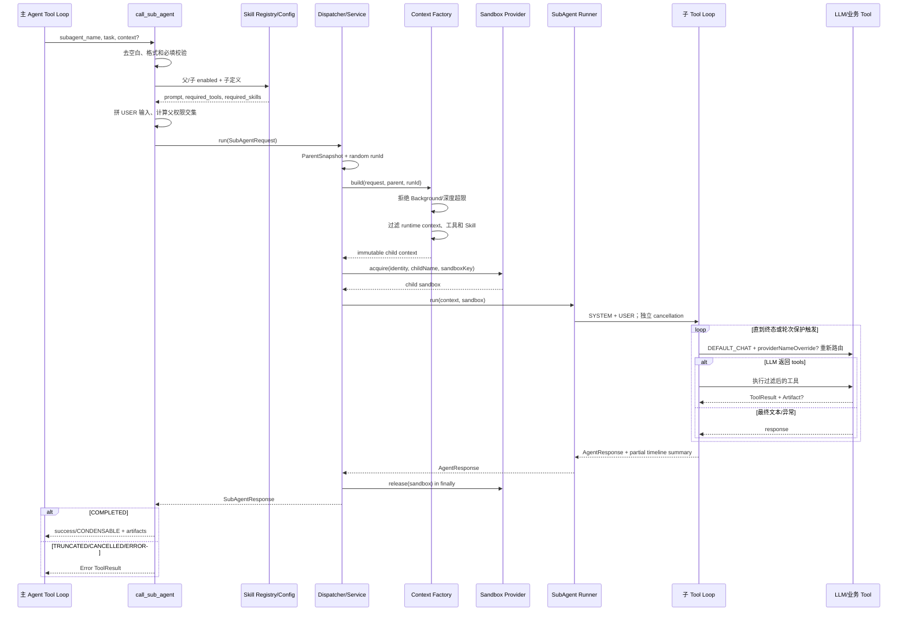
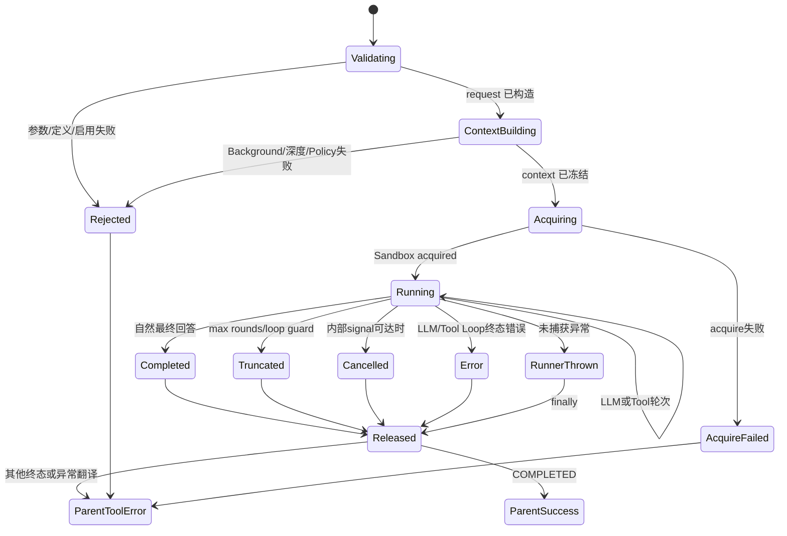

```
# 多代理调度、运行上下文派生与隔离边界

## 1. 结论与边界

### 1.1 技术问题与最终效果

本模块把“主 Agent 将一个聚焦任务交给另一个 Agent”实现为一次受限的嵌套 Tool Loop，而不是新建长期会话、操作系统进程或远程 Worker。主 Agent 调用 `call_sub_agent` Tool；Tool 从嵌套 Skill 读取子角色定义，构造可信的进程内请求；Runtime 为子运行派生工具、Skill、上下文和 Sandbox 边界；子运行终止后，终态文本和 Artifact 被包装成普通 Tool Result，交回主 Agent 继续推理和汇总。

目标调用方有两类：一是主 Agent 的 LLM Tool Loop，二是需要嵌套执行能力的可信系统插件。终端用户不直接提交 `SubAgentRequest`，也不直接管理子线程或子任务。

当前静态实现可以确认的主路径如下 `[I]`：

- 只有同步 Foreground 运行可用；一次调用阻塞到子 Agent 产生终态。
- 每次调用产生随机 `runId`，但该 ID 不持久化、不返回给父级，也不是幂等键。
- 子 Agent 继承父调用的同一 `Identity` 和显式放行的 runtime context；不继承父消息历史、附件列表、conversationId 或 messageId。
- 子 Agent 使用固定基线提示词、嵌套 Skill 正文、显式任务及可选紧凑背景，消息列表只有一条 SYSTEM 和一条 USER。
- 子工具集合经过“子定义请求、父有效工具、身份可见性、Agent Policy、禁用递归工具”多层收窄；但空集合兼具“未上报/不额外限制”和“交集为空”两种含义，存在权限回弹风险。
- 最大嵌套深度硬编码为 1，并且子工具集合显式排除 `call_sub_agent`。
- 每个子运行获得独立 Sandbox Key 和工作目录；Directory Sandbox 仍是宿主文件系统目录，Docker Sandbox 仍按 Identity 共享容器，因此这不是独立 OS 安全域。
- 一个 LLM 轮次只有一个 Tool Call 时在父调用线程串行执行；两个及以上 Tool Call 时进入 JVM 全局有界线程池并发执行，结果按模型声明顺序回填。
- 子运行内部使用独立 Tool Loop、Reducer、Retry、Loop Detector、Skill Activator 和 CancellationSignal；当前父取消令牌没有传给子运行，也没有 `cancel(runId)`。
- `COMPLETED` 映射为成功且 `CONDENSABLE` 的 Tool Result；`TRUNCATED/CANCELLED/ERROR` 映射为失败文本。失败映射不保留子运行的部分正文、Artifact 或 metrics。
- 子运行的 LLM/Tool/Token/耗时统计会计算到 `SubAgentResponse.metrics`，但外层委派 Tool 不把它们合并到父 Timeline、processData 或成本统计。
- 子 Runner 使用 `AgentListener.NOOP`；内部 LLM、Tool 和阶段事件不会流向父 WebSocket，也不形成 Sidechain Transcript。父级目前通常只能看到外层 `call_sub_agent` 的开始和结束。

### 1.2 明确缺失或仅声明的能力

以下不能写成当前保证：

- `Background` Profile 已进入 SPI，但 Context Factory 明确拒绝，理由是缺少 Task Store；直接调用 Dispatcher 会收到未捕获的 `UnsupportedOperationException`。默认 `call_sub_agent` 只会构造 Foreground，因此终端用户没有 Background 参数入口 `[I/P]`。
- Foreground 的 `streamToParent` 与 `sidechainTranscript` 字段已声明，当前 Runner 不消费其语义 `[P]`。
- Profile 注释预告了未来 Parent Fork，但 sealed hierarchy 尚无 Fork 类型，父提示词、消息前缀、思考配置和附件均不会被 fork `[P]`。
- 没有子运行数据库、队列、租约、恢复、重试幂等、独立 timeout、租户并发配额、Token/成本预算或结果过期清理 `[I]`。
- 前端、processData Collector 和 WebSocket Listener 已能表达 `agent_phase`、`sub_tool_exec` 和子 Agent 分组，但当前子 Runner 没有事件桥，属于兼容结构而非已接通主链 `[P]`。
- `nova.subagent.default-max-tokens/max-rounds/max-result-chars/model-role` 有配置 Bean 和示例值，但当前 Runtime 组装链没有读取这些字段；子轮次上限实际沿用通用 Agent 上限，`model-role` 没有接到路由。Provider 也不是继承父 Run 已解析的模型绑定：委派 Tool 只复制父 `ToolExecutionContext.providerName` 这个可空 **override**；非 null 时子 Run 锁定同名 Provider 实例，null 时子 Run 使用自己的 `DEFAULT_CHAT` 请求重新经过 Router，不继承父 Run 已解析的 model/options `[I]`。
- 产品内置文件 Tool 的子 Artifact 发布并不可靠：子 Runner 把 conversationId 传为 null，而强作用域 Artifact Publisher 需要 conversationId。SPI 层能携带 Artifact，不等于产品内置文件链已闭合 `[I]`。

### 1.3 范围

本文覆盖 Agent→委派 Tool→Dispatcher→Service→Context Factory→Runner 的完整技术链，Foreground/Background Profile、父快照、消息和附件、身份/租户/项目、工具/Skill/Sandbox 隔离、并发/取消/timeout、状态/保留策略/结果汇总、事件/UI/持久化、幂等和恢复，以及最小与生产级复刻设计。

本文不展开普通 Agent 的全部聊天 API、LLM Provider 私有协议、Skill 管理 UI、Artifact 内容服务和通用上下文压缩算法；但给出实现多代理所需的最小契约。

### 1.4 证据声明

- `[I]`：Nova 当前源码、配置或单元测试可静态确认；不表示本次运行通过。
- `[A]`：active 自动化测试要求；本次未运行。
- `[K]`：已登记 Known Failure。本主题未发现明确标为 Known Failure 的用例。
- `[P]`：planned、未登记测试或只声明未接线的能力。
- `[R]`：本次运行验证。本次按要求未运行构建或测试，因此无 `[R]`。
- `[F]`：由多处代码/测试共同支持的强推断，正文会给出不确定边界。
- `[D]`：复刻建议，不代表 Nova 当前实现。

## 2. 术语与参与方

| 术语 | 精确定义 |
|---|---|
| 主 Run | 当前面向用户回合的 Agent Tool Loop，子 Agent 深度为 0。 |
| 子 Run | 一次性、无历史、无持久化记录的嵌套 Tool Loop；当前直接子级深度为 1。 |
| Dispatcher | 暴露给可信插件的窄 SPI，只提供 `run(request)`，隐藏 Runtime 内部 Agent 类型。 |
| Service | Runtime 编排入口，创建父快照与 runId、构建上下文、获取 Sandbox、调用 Runner、映射指标并释放 Sandbox。 |
| Parent Snapshot | 用于派生子边界的父状态快照，结构含 Identity、父 conversationId、深度和父消息；当前兼容路径只填 Identity/深度。 |
| Run Profile | Foreground 或 Background 的命名执行形态，聚合轮次、工具 allowlist、runtime context 键以及事件/持久化语义。 |
| runtimeContext | Host 注入且不暴露为 LLM Tool 参数的只读 Map，例如项目 ID；不能代替 Identity。 |
| caller effective tools | 父 Agent 经过身份、动态可见性和 Tool Policy 后实际可用的工具名集合。 |
| Sidechain | 与父消息流分离、但可查询/回放的子运行过程记录；当前未实现。 |
| Sandbox Key | Runtime 生成的逻辑目录键，不等价于容器、进程、用户或网络隔离。 |



边界原则是：LLM 只能提供子定义 ID、task 和 context；Identity、父深度、Provider 名称 override、工具上限和 runtime context 必须由 ToolExecutionContext 注入，不能从模型参数中接受。这里的 Provider 字段不是父 Run 的 resolved binding 快照。

## 3. 当前不可变契约与业务规则

### 3.1 委派入口

1. 系统插件只有在 Runtime 提供 Dispatcher 时才注册 `call_sub_agent`；Dispatcher 缺失时只记录警告，Tool 不存在 `[I]`。
2. Tool 注册仍不代表父 Agent 可见；它还要通过正式 Tool Group、Agent Policy、身份和动态工具过滤链 `[I]`。
3. 子定义 ID 必须恰好是两段 `parent/child`：首尾不能是 `/`，不能含第二个 `/` `[I]`。
4. `subagent_name` 和 `task` 去除首尾空白后必须非空；执行层兼容旧字段 `agent_name`、`user_input`，JSON Schema 不暴露旧字段 `[I]`。
5. 当前先检查父/子 enabled 配置，再从全局 Skill Registry 读取子定义。父定义自身不读取、父子归属不验证、不可见和不存在错误不统一 `[I]`。

### 3.2 Profile 精确语义

| 字段 | Foreground | Background | 当前校验/消费 |
|---|---|---|---|
| `maxToolRounds:int` | 0 表示 Runtime 默认；正数覆盖 | 同左 | Context Factory 实际把所有 `<=0` 都当默认；Profile 构造器未拒绝负数。 |
| `allowedToolIds:Set<string>` | 空集合表示使用定义默认/不额外限制 | 同左 | defensive copy；空集合在 AgentSpec 转为 null。 |
| `runtimeContextKeys:Set<string>` | 允许传给子 Tool 的键 | 同左 | 空集合表示不传任何 context。 |
| `streamToParent:boolean` | 是否向父流式投影 | 无 | 字段存在，当前未消费。 |
| `sidechainTranscript:boolean` | 是否保存旁路记录 | 无 | 字段存在，当前未消费。 |
| `taskRetention:Duration` | 无 | Background 结果保留期 | 只校验非 null，不校验正数；Background 在更早处被拒绝。 |

Foreground 是当前唯一执行形态：`run()` 同步返回终态，`taskId=""`。Background 的目标语义应是立即返回 taskId、异步运行、按 retention 查询结果；当前需按调用层次精确理解 `[I/P]`：

1. `Dispatcher.run(BackgroundRequest)` 进入 Context Factory 后直接抛出 `UnsupportedOperationException("...require a task store...")`，Dispatcher/Service 本身不翻译它。
2. 内置 `call_sub_agent` 的参数 Schema 没有 mode/profile，且实现始终构造 `Foreground`，所以普通 LLM 调用该 Tool 不可能抵达 Background 分支。
3. 只有另一个可信自定义 Tool/插件自行构造 Background 请求时才可能触发；若该自定义 Tool 不捕获异常且它正由普通 `ToolExecutor` 执行，外层 Executor 才会把逸出的异常条件性翻译成失败 Tool Result。直接 Java/SPI 调用者仍然得到原始异常。

### 3.3 父快照与消息/附件规则

Parent Snapshot 的完整内部结构为：

```typescript
interface ParentRunSnapshot {
  identity: Identity;
  parentConversationId?: string;
  subAgentDepth: number;
  parentMessages: ChatMessage[];
}
```

当前 Dispatcher 兼容路径固定令 `parentConversationId=null`、`parentMessages=[]`，并从 Request 原样复制 Identity 和 `parentSubAgentDepth`。普通顶层委派的深度为 0：

```json
{
  "identity": "<same opaque identity object>",
  "parentConversationId": null,
  "subAgentDepth": "<request.parentSubAgentDepth；顶层为0>",
  "parentMessages": []
}
```

父消息字段虽然存在，却不进入子消息组装。子消息严格为：

```json
[
  {
    "role": "SYSTEM",
    "content": "You are a delegated worker...\n\n<child SKILL.md body>"
  },
  {
    "role": "USER",
    "content": "<required-skill metadata reminder>\n\nContext:\n<compact context>\n\nTask:\n<task>"
  }
]
```

子请求没有 `attachments` 字段，也不消费顶层 `AgentAttachment`；父附件既不会复制到子消息，也不会物化到子独立工作目录。若子任务需要附件，当前只能由父 Agent 在 `context` 中传安全引用，并确保子 Agent 获得一个能按身份重新授权读取该引用的 Tool。禁止把宿主绝对路径、临时签名 URL 或完整附件内容无选择塞进 context `[I/D]`。

### 3.4 Identity、租户和 runtime context

NovaCore 的 `Identity` 只有稳定 opaque `key()`；Host 可把 tenant+user 编码进 key，Core 不解析其内部结构。子 Request 复用父 ToolExecutionContext 的同一 Identity 对象 `[I]`。

runtime context 派生算法为：

```text
childContext = immutableCopy({
  key: parentRuntimeContext[key]
  for key in profile.runtimeContextKeys
  if parentRuntimeContext contains key
})
```

当前委派 Tool 把父 runtimeContext 的全部现有键名放入 Foreground Profile，因此实际效果是全量继承 `[I]`。这能让项目 ID 等上下文进入身份过滤器和子 Tool，但也会传播不必要的 secret reference、debug flag 或内部对象。生产复刻应由服务端固定 Schema 决定可传键，而不是使用 `parent.keySet()` `[D]`。

### 3.5 Provider override 与重新路由

父 Run 的“已经解析到哪个具体模型、哪些 model options”与 `ToolExecutionContext.providerName` 是两个不同对象。当前上下文只携带后者；它表示创建父 Agent 时显式指定的 Provider 名称 override，可以为空，不是一个 resolved binding `[I]`。

```text
parentToolCtx.providerNameOverride
  ├─ non-null "provider-A"
  │    → copy override into SubAgentRequest
  │    → every child LLM call resolves DEFAULT_CHAT with override="provider-A"
  │    → router bypasses普通tier选择并锁定同名Provider实例
  └─ null
       → copy null into SubAgentRequest
       → child independently resolves DEFAULT_CHAT with override=null
       → router重新读取子调用时有效的租户/用户路由
       → 不复制父调用已经选中的model、endpoint、options或resolved binding
```

因此，父 Run 即使因路由策略使用某个模型，若没有显式 Provider override，子 Run 也不保证落到同一模型；路由配置在父子两次解析之间变化时尤其如此。反之，非 null override 只锁定“同名 Provider 实例”，仍不能表述为继承父请求的完整模型参数快照。`nova.subagent.model-role` 当前没有消费点，不能声称子 Run 会按 `complex/simple/...` 角色选模 `[I]`。

生产复刻需要二选一并写成契约 `[D]`：

- **独立路由**：请求只传 `providerNameOverride?`，子 Run 用固定 tier/role 重新解析；审计记录父子各自 route decision。
- **快照继承**：父级传不可变、脱敏、权限校验后的 `ResolvedModelBinding`（provider/model/options/version），子级不得再次路由。

不要把可空 Provider 名称叫作 `parentResolvedProvider`，也不要一边宣称快照继承、一边实际重新 Router。

### 3.6 工具和 Skill 权限

当前委派 Tool 先取 `child.required_tools + read_file`，再在父有效集合非空时求交；Context Factory 随后应用身份 Tool Filter、子 Agent Policy，并排除 `call_sub_agent`：

```text
requested = child.requiredTools ∪ {read_file}
firstPass = parentEffective is empty ? requested : requested ∩ parentEffective
childTools = identityVisible(firstPass) ∩ agentPolicy(childName) − {call_sub_agent}
```

这里有一个必须显式保留的风险 `[F]`：父有效集合非空且交集为空时，结果是空 Set；下一层把空 Set 转为 null，解释为“不附加限制”。若 Agent Policy/定义默认重新引入工具，权限可能回弹。复刻必须使用三态：

```typescript
type ToolAllowance =
  | { mode: "DEFAULT" }
  | { mode: "NONE" }
  | { mode: "EXPLICIT"; toolIds: string[] };
```

空交集必须是 `NONE`，不能是空数组。

子定义正文直接成为 SYSTEM 后缀。`required_skills` 只转成 ID/name/description 提醒，经过运行时信封和角色标签转义，不自动把依赖正文注入 Prompt。Runner 中的 Skill Activator 使用相同 Identity 和过滤后的 runtime context 解析可见 Skill。当前委派 Tool 在此之前直接访问全局 Registry，因此知道 ID 的调用者可能通过错误或提醒探测不可见定义/依赖元数据 `[I/F]`。

### 3.7 深度和递归

- 顶层深度为 0；直接子级上下文深度为 `parentDepth + 1 = 1`。
- `parentDepth < 0` 在 Request 构造时拒绝。
- Context Factory 在 `parentDepth >= 1` 时拒绝创建下一层。
- 子 Tool Registry 无条件排除 `call_sub_agent`。

深度元数据通过 ToolExecutionContext 的专用字段传播，不放入 runtime context，不是 LLM 可伪造参数 `[I]`。

## 4. 完整执行链路

### 4.1 同步 Foreground 时序



### 4.2 Service/Factory/Runner 职责分割

| 组件 | 输入 | 责任 | 不负责 |
|---|---|---|---|
| Delegate Tool | LLM args + trusted ToolExecutionContext | 解析嵌套定义、组装任务、父工具收窄、响应适配 | Sandbox、Tool Loop、持久化 |
| Dispatcher SPI | immutable Request | 隐藏 Runtime 类型并同步调用 Service | 外部 REST 身份认证 |
| Service | Request | 建 runId、父快照、acquire/release、响应和 metrics 映射 | Tool Policy 细节、LLM Loop |
| Context Factory | Request + Snapshot + runId | 深度/Profile 检查，消息、context、工具、Sandbox Key 派生 | 执行和存储 |
| Runner | immutable context + Sandbox | 构造低层 LLM/Tool Loop并执行 | 父事件桥、父取消、会话持久化 |

### 4.3 Sandbox Key 和物理路径

逻辑 Key：

```text
subagent/{safe(identity.key)}/{safe(parentConversationId or ephemeral)}/{safe(childName)}/{safe(runId)}
```

`safe` 把非 `[A-Za-z0-9._-]` 字符替换为 `_`。当前父 conversationId 固定为空，因此总使用 `ephemeral`。Sandbox Provider 把整个 Key 当成 conversationId，物理目录为：

```text
<sandboxRoot>/<identityKey>/conversations/<sandboxKey>/workspace
```

Directory Provider 的 `release` 是 no-op，目录为缓存保留。Docker Provider 按 `identity.key()` 复用容器和 Identity 级 bind mount，`release` 也是 no-op；工作目录不同但容器、OS 用户、网络和挂载根仍共享。由于 runId 未持久化且父 conversationId 缺失，父会话删除无法精确枚举这些临时目录 `[I]`。

### 4.4 状态机



Sandbox `acquire` 发生在 `try` 之前；如果 acquire 自身抛异常，没有 Sandbox 可 release。Runner 抛异常时 `finally` 保证 release。Runtime Tool Executor 会捕获委派 Tool 抛出的 Throwable 并转成 `Error: <type>: <message>`，从而保持父 Tool start/end 成对 `[I]`。

### 4.5 终态、Retention 与结果汇总

子 Tool Loop 先形成 `AgentResponse(status, content, errorMessage, artifacts, toolCalls, timeline)`。Service 对四个终态做同名映射，并从 runner 生成的 Timeline Summary 读取 LLM次数、Tool次数、Token和总耗时。当前 Foreground taskId固定为空 `[I]`。

委派 Tool 的适配规则是非对称的：

| 子终态 | 父 Tool Result | 正文 | Artifact | metrics |
|---|---|---|---|---|
| `COMPLETED` | `success=true, retention=CONDENSABLE` | 原样保留终态文本 | 原样保留SPI Artifact列表 | 不进入父Result/Timeline |
| `TRUNCATED` | `success=false, retention=CONDENSABLE` | 丢弃子部分正文，改为安全错误 | 丢弃 | 丢弃 |
| `CANCELLED` | 同上 | 丢弃子取消标记/部分正文，改为安全错误 | 丢弃 | 丢弃 |
| `ERROR` | 同上 | 使用errorMessage；空时使用状态名 | 丢弃 | 丢弃 |

`CONDENSABLE` 表示父上下文压缩器以后可以折叠该结果，不表示子结果会立即摘要，也不是数据库保留期。Background `taskRetention` 是计划中的任务结果有效期，两者不能混用。

同一父轮有多个委派时，通用 Tool Loop 等待这一轮所有结果，并按模型声明的 Tool Use 顺序生成对应 ToolResultBlock。随后主 Agent再次调用 LLM，由模型自由合并、取舍或继续查询；当前没有结构化Reducer、冲突检测、证据去重或“部分成功”聚合状态。因此“所有子成功”不自动保证最终答案包含所有子结论，两个子结论冲突时也没有确定性裁决 `[I]`。生产复刻应定义结构化子结果Schema、逐项状态、引用集合和冲突规则，再允许主模型负责自然语言表达 `[D]`。

## 5. 对外和进程内契约

### 5.1 LLM Tool JSON Schema

```json
{
  "name": "call_sub_agent",
  "description": "Delegate a focused task to a named sub-agent declared by a nested skill.",
  "parameters": {
    "type": "object",
    "properties": {
      "subagent_name": {
        "type": "string",
        "description": "Nested sub-agent skill id, for example 'analysis/root-cause'."
      },
      "task": {
        "type": "string",
        "description": "Specific task for the sub-agent."
      },
      "context": {
        "type": "string",
        "description": "Optional compact background context the sub-agent needs."
      }
    },
    "required": ["subagent_name", "task"],
    "additionalProperties": false
  }
}
```

调用示例：

```json
{
  "subagent_name": "analysis/root-cause",
  "task": "验证收入下降的前三个原因，按证据强度排序。",
  "context": "比较期为 2026-07 与 2026-06；指标与维度 ID 已解析。"
}
```

成功 Tool Result 的等价结构：

```json
{
  "success": true,
  "output": "<child final text>",
  "retention": "CONDENSABLE",
  "artifacts": []
}
```

### 5.2 精确 Dispatcher SPI

语言无关的等价接口如下；`Identity` 在 Core 中只有 opaque `key`：

```typescript
interface Identity { key(): string }

interface SubAgentDispatcher {
  run(request: SubAgentRequest): SubAgentResponse;
}

interface SubAgentRequest {
  identity: Identity;                         // required
  name: string;                               // required, Runtime未再次判blank
  userInput: string;                          // required
  providerName?: string;                      // Provider名称override；null=子Run重新走DEFAULT_CHAT路由
  systemPromptSuffix?: string;
  profile: ForegroundProfile | BackgroundProfile; // required
  parentSubAgentDepth: number;                // >=0
  runtimeContext: Readonly<Record<string, unknown>>; // null归一为空
}

interface ForegroundProfile {
  type: "FOREGROUND";
  maxToolRounds: number;
  allowedToolIds: ReadonlySet<string>;
  runtimeContextKeys: ReadonlySet<string>;
  streamToParent: boolean;
  sidechainTranscript: boolean;
}

interface BackgroundProfile {
  type: "BACKGROUND";
  maxToolRounds: number;
  allowedToolIds: ReadonlySet<string>;
  runtimeContextKeys: ReadonlySet<string>;
  taskRetention: Duration;
}

type AgentRunStatus = "COMPLETED" | "TRUNCATED" | "CANCELLED" | "ERROR";

interface SubAgentResponse {
  status: AgentRunStatus;                     // required
  content: string;                            // null归一为空
  errorMessage?: string;
  artifacts: ReadonlyArray<Artifact>;         // null归一为空
  taskId: string;                             // null归一为空；当前Foreground为空
  metrics: {
    llmCalls: number;
    toolCalls: number;
    durationMs: number;
    totalTokens: LlmUsage;                    // required
  };
}
```

兼容构造器把 null `allowedToolIds` 转为空 Foreground allowlist，`maxToolRounds=0`、`runtimeContextKeys=[]`、`streamToParent=true`、`sidechainTranscript=false`、`parentDepth=0`。旧 Response 构造器生成空 taskId 和零 metrics `[I]`。

### 5.3 错误契约

| 条件 | 当前结果 |
|---|---|
| 空 `subagent_name` | `Error: subagent_name is required` |
| 非两段名称 | `Error: subagent_name must reference a nested skill like 'parent/child'` |
| 空 task | `Error: task is required` |
| 父或子 Skill disabled | `Error: Sub-agent skill is disabled: <id>` |
| 子 Skill 不存在 | `Error: Sub-agent skill not found: <id>` |
| 直接 Dispatcher + Background | Context Factory 抛出 `UnsupportedOperationException`；Service/Dispatcher 不捕获、不翻译 |
| 默认 `call_sub_agent` 请求 Background | 无此入口；Schema 不暴露 profile，内置 Tool 固定构造 Foreground |
| 自定义 Tool 调 Dispatcher + Background | 若自定义 Tool 不捕获且由普通 ToolExecutor 执行，外层 Executor 才翻译为 `Error: UnsupportedOperationException: ...`；直接 SPI 调用仍抛异常 |
| 深度超限 | Tool Executor 捕获含 `SubAgent recursion depth exceeded` 的异常 |
| 子终态非 COMPLETED | `Error: Sub-agent <id> failed: <errorMessage-or-status>` |

复刻时，不可见和不存在应统一为不泄露资源存在性的 `SUBAGENT_NOT_AVAILABLE`；内部日志再记录真实原因 `[D]`。

### 5.4 事件和 UI 兼容契约

父 Tool 当前可产生普通事件：

```text
tool_exec_start = callId|call_sub_agent|truncatedArgs|inputBytes
tool_exec_end   = callId|call_sub_agent|outputBytes|success|durationMs|truncatedResult
```

Host Collector/前端已支持但当前子 Runner 不会产出的结构：

```json
{
  "type": "agent_phase",
  "role": "analysis/root-cause",
  "description": "...",
  "timestamp": 1780000000000
}
```

```json
{
  "type": "sub_tool_exec",
  "agentLabel": "analysis/root-cause",
  "toolCallId": "call-child-1",
  "tool": "metric_query",
  "args": "{...}",
  "inputBytes": 120,
  "outputBytes": 512,
  "result": "...",
  "success": true,
  "durationMs": 430,
  "timestamp": 1780000000100,
  "toolOrdinal": 1,
  "artifacts": []
}
```

Collector 对 args/result 各截断到 4000 字符。前端用 `agent_phase.role` 含 `/` 打开分组，用外层 `call_sub_agent` 结束事件闭组；兼容历史“phase→children→close”和实时“outer start→phase→children”两种顺序。历史缺 close 时标记 interrupted；成功完成自动折叠，失败/中断保持可见 `[I/P]`。

该 UI 算法依赖栈和事件顺序，缺 childRunId/parentRunId，多个并行子事件真正接通后可能串组。生产事件必须改用结构化父子 ID 和单调 seq `[D]`。

## 6. 数据模型与生命周期

### 6.1 当前内存模型

当前无子 Run 表。一次调用的唯一状态存在于调用栈：

```text
Parent tool_use
  -> immutable SubAgentRequest
  -> random UUID runId
  -> immutable SubAgentRunContext
  -> Sandbox handle
  -> mutable ToolLoop state + private CancellationSignal
  -> terminal AgentResponse
  -> immutable SubAgentResponse
  -> parent ToolResult
  -> GC; Sandbox provider release(no-op for bundled providers)
```

父会话可能保存外层 `call_sub_agent` 的 Tool Event和截断结果，但不会保存 childRunId、子消息、子 Timeline、子 Policy Snapshot 或子 metrics。进程在子运行中退出后，没有恢复或把孤儿状态改为失败的机制 `[I]`。

### 6.2 推荐生产 DDL

```sql
CREATE TABLE agent_run (
  run_id               VARCHAR(64) PRIMARY KEY,
  tenant_id            VARCHAR(128) NOT NULL,
  user_id              VARCHAR(128) NOT NULL,
  conversation_id      VARCHAR(128),
  parent_run_id         VARCHAR(64),
  parent_tool_call_id   VARCHAR(128),
  agent_definition_id  VARCHAR(256) NOT NULL,
  definition_version   VARCHAR(64) NOT NULL,
  depth                 INTEGER NOT NULL CHECK (depth >= 0),
  mode                  VARCHAR(16) NOT NULL CHECK (mode IN ('FOREGROUND','BACKGROUND')),
  status                VARCHAR(32) NOT NULL,
  task_digest           VARCHAR(128) NOT NULL,
  task_content_ref      VARCHAR(512),
  provider_binding      VARCHAR(256),
  policy_snapshot_json  TEXT NOT NULL,
  runtime_scope_json    TEXT NOT NULL,
  deadline_at           TIMESTAMP,
  lease_owner           VARCHAR(128),
  lease_expires_at      TIMESTAMP,
  started_at            TIMESTAMP NOT NULL,
  finished_at           TIMESTAMP,
  result_expires_at     TIMESTAMP,
  error_code            VARCHAR(64),
  error_message_safe    TEXT,
  version               BIGINT NOT NULL DEFAULT 0,
  FOREIGN KEY (parent_run_id) REFERENCES agent_run(run_id)
);

CREATE UNIQUE INDEX uk_agent_run_parent_tool
  ON agent_run(parent_run_id, parent_tool_call_id);
CREATE INDEX idx_agent_run_owner_time
  ON agent_run(tenant_id, user_id, started_at);
CREATE INDEX idx_agent_run_lease
  ON agent_run(status, lease_expires_at);

CREATE TABLE agent_run_event (
  run_id       VARCHAR(64) NOT NULL,
  seq          BIGINT NOT NULL,
  event_type   VARCHAR(64) NOT NULL,
  event_json   TEXT NOT NULL,
  created_at   TIMESTAMP NOT NULL,
  PRIMARY KEY (run_id, seq),
  FOREIGN KEY (run_id) REFERENCES agent_run(run_id)
);

CREATE TABLE agent_run_result (
  run_id          VARCHAR(64) PRIMARY KEY,
  content_ref     VARCHAR(512),
  content_preview TEXT,
  artifacts_json  TEXT NOT NULL,
  llm_calls       INTEGER NOT NULL,
  tool_calls      INTEGER NOT NULL,
  input_tokens    BIGINT NOT NULL,
  output_tokens   BIGINT NOT NULL,
  cached_tokens   BIGINT NOT NULL,
  duration_ms     BIGINT NOT NULL,
  FOREIGN KEY (run_id) REFERENCES agent_run(run_id)
);
```

`parent_run_id + parent_tool_call_id` 是委派幂等键；状态更新用 `version` CAS。完整 task/result 放加密内容存储，表中只保留摘要、安全预览和引用。Foreground sidechain 可跟随父会话生命周期；Background 按 `result_expires_at` 清理。Artifact 有独立作用域和保留策略，不能仅随 Sandbox 删除 `[D]`。

## 7. 核心实现设计

### 7.1 当前算法等价伪码

```text
callSubAgent(args, parentToolCtx):
  childId = trim(args.subagent_name ?? args.agent_name)
  task = trim(args.task ?? args.user_input)
  validate childId is exactly parent/child and task nonblank
  require config.enabled(parent) and config.enabled(child)
  definition = globalSkillRegistry.get(childId) or error

  userInput = envelope(enabledRequiredSkillMetadata)
            + optional "Context:\n" + context
            + "Task:\n" + task
  requested = definition.requiredTools + read_file
  allowed = parentEffectiveTools empty
          ? requested
          : intersection(requested, parentEffectiveTools)
  profile = Foreground(0, allowed, parentRuntimeContext.keys, true, false)

  response = dispatcher.run(Request(
    identity = parentToolCtx.identity,
    name = childId,
    userInput = userInput,
    // override only: NOT the parent's already-resolved model/provider/options binding
    providerNameOverride = parentToolCtx.providerNameOverride,
    systemPromptSuffix = definition.body,
    profile = profile,
    parentDepth = parentToolCtx.depth,
    runtimeContext = parentToolCtx.runtimeContext))

  if response.status == COMPLETED:
    return ToolResult(true, response.content, CONDENSABLE, response.artifacts)
  return ToolResult.error("Sub-agent " + childId + " failed: " + safeReason)
```

```text
dispatch(request):
  parent = Snapshot(request.identity, null, request.parentDepth, [])
  runId = randomUUID()
  // build() rejects Background with UOE; dispatcher/service do not translate it
  context = factory.build(request, parent, runId)
  sandbox = provider.acquire(identity, childName, context.sandboxKey)
  try:
    response = runner.run(context, sandbox)
    return map(response, taskId="", metrics=response.timeline.summary)
  finally:
    provider.release(sandbox)
```

子 Runner 每次 LLM 调用的路由等价伪码如下；这一步证明 null override 不是“继承父已解析绑定” `[I]`：

```text
childLlmCall(request, identity, providerNameOverride):
  routeRequest = LlmRouteRequest(
      identity = identity,
      tier = DEFAULT_CHAT,
      providerNameOverride = providerNameOverride)
  childProvider = llmRouter.resolve(routeRequest)
  return childProvider.chat(request)
```

内置 Tool 不存在 Background 分支：

```text
defaultCallSubAgent(...):
  profile = Foreground(...)
  return dispatcher.run(request.with(profile))

customToolCallingBackground(...):
  // direct dispatcher call throws UnsupportedOperationException
  return dispatcher.run(request.with(Background(...)))
  // only when this custom Tool lets the exception escape AND an outer ToolExecutor owns the call,
  // that executor converts it to ToolResult.error(...)
```

### 7.2 最小兼容复刻

最小版只实现 Foreground、最大深度 1：

1. `ScopedNestedAgentRegistry`：按 Identity+项目原子解析父定义、子定义、版本、enabled 和 required Skills。
2. `DelegateTool`：只接受定义 ID、task、context；身份、Provider 名称 override、父深度全部取可信上下文。若要继承 resolved model binding，必须另设显式快照契约。
3. `CapabilityIntersection`：使用 DEFAULT/NONE/EXPLICIT 三态，执行严格权限交集。
4. `SubAgentContextFactory`：创建 SYSTEM+USER、固定 allowlisted runtime scope、独立 Sandbox Key。
5. `SubAgentRunner`：复用普通 Tool Loop，禁递归，返回状态、文本、Artifact 和 metrics。
6. `ParentResultAdapter`：保持逐子结果和错误，不做隐式重试。

最小版可以暂不持久化 Sidechain，但必须提供父派生取消令牌、绝对 deadline、每父 Run 扇出上限和 Artifact 的可信父 scope；否则只能用于受控开发环境 `[D]`。

### 7.3 生产级调度器

生产版在 Tool 和 Worker 之间加入 `DelegationCoordinator`：

```text
dispatch(command, parent):
  definition = scopedRegistry.resolve(command.definitionId, parent.identity, parent.project)
  allowance = strictIntersect(definition.tools, parent.policySnapshot.tools)
  budget = min(definitionBudget, parent.remainingBudget, tenantBudget)
  childRun = runStore.createOrGet(parent.runId, command.toolCallId,
                                  immutablePolicySnapshot, deadline)
  quota.acquire(parent, tenant, global, deadline)
  token = parent.cancelToken.child()
  enqueueOrRun(childRun, token)
  if FOREGROUND: waitTerminal(deadline); return terminal
  else: return Accepted(childRun.runId, resultExpiresAt)
```

必须具备：

- 父 Run、租户、全局三级并发信号量；同时限制子内部 Tool 扇出。
- Token、LLM calls、Tool calls、轮次、Artifact 字节和 wall-clock 的组合预算。
- 绝对 deadline；重试不得刷新 deadline。
- 树形取消令牌，传播到 Provider HTTP、Tool、进程和 Sandbox。
- Event Store、租约、Reaper 和唯一终态 CAS。
- child metrics 汇入父自身成本与“包含子树成本”两个口径。
- Background 只在 Task Store、对象级读取权限、过期清理和 Worker Lost 恢复完成后开放。

## 8. 并发、取消、timeout 与非正常路径

### 8.1 当前并发模型

普通 Tool Loop 的共享线程池参数为：

```text
coreThreads = CPU * 2
maxThreads  = CPU * 8
keepAlive   = 60s
queue       = bounded LinkedBlockingQueue(500)
rejection   = CallerRunsPolicy
workers     = daemon threads named nova-tool-N
```

一个轮次只有一个 Tool Call 时不入池。两个及以上时逐一 submit；Future 按提交顺序每 100ms 轮询，因此完成可乱序、回填保持声明顺序。一个 Tool 抛异常只产生该位置的 Error Result，不取消兄弟 Tool `[I]`。

如果同一父轮产生多个 `call_sub_agent`，它们会并发；每个子 Loop 又可在内部并发多个 Tool，形成二级扇出。当前没有 subagent 专属池或配额；CallerRuns 只提供 JVM 级背压，不能隔离 noisy tenant `[I]`。

### 8.2 当前取消边界

普通 Tool 并发层支持 Cooperative Cancellation：父 Tool Loop 的 signal 置位后取消未完成 Future，并以 interrupt 唤醒支持中断的 I/O；Tool 可轮询 `ctx.isCancelled()`。但每个 SubAgentRunner 自行 `new CancellationSignal()`，父 signal 未传入，Dispatcher 也没有 cancel 方法或 runId 查询入口 `[I]`。

因此：

- 父取消可能中断执行 `call_sub_agent` 的外层线程；若子内部阻塞调用不响应该 interrupt，子运行仍可能继续 `[F]`。
- `CANCELLED` 是子 Response 可表达的终态，但当前私有 signal 没有稳定外部触发路径 `[I/F]`。
- 没有取消确认、取消延迟指标或孤儿清理。

### 8.3 timeout、重试和失败传播

- Profile 没有 timeout/deadline 字段；Background 的 `taskRetention` 不是执行 timeout。
- 子 Run 沿用普通 Provider Retry Policy、Loop Detector和 max rounds，但没有独立 wall-clock 上限。
- `TRUNCATED` 只表示轮次/循环保护停止，不等价于 timeout。
- 子终态非 COMPLETED 时，父只获得 Error Tool Result；子部分文本、失败 Artifact、errorCode 和 metrics 被丢弃。
- Dispatcher/Service 不统一翻译自身异常：直接 SPI 调用者收到原异常。只有 Dispatcher 调用嵌在某个普通 Tool 中、异常又逸出该 Tool 时，外层父 `ToolExecutor` 才把它翻译为 Error Tool Result；主 Agent随后可选择降级、重试或报告。Runtime 没有自动重试整个委派。

生产版应区分 `TIMEOUT`、`BUDGET_EXCEEDED`、`WORKER_LOST`、`POLICY_DENIED`，并决定部分结果是否可安全保留 `[D]`。

### 8.4 重复调用与幂等

当前每次调用生成新 UUID 和新 Sandbox Key，没有 requestId、父 toolCall 唯一约束或结果缓存。模型重试、WS重放、Host故障后重提或同一参数重复调用都会执行两次，可能重复发邮件、写外部数据或计费 `[I]`。

生产语义：

1. Host 为每个父 `toolCallId` 绑定一个 childRunId。
2. `createOrGet(parentRunId, parentToolCallId)` 原子幂等。
3. 已完成返回同一结果；运行中返回/等待同一 Run；失败是否重试必须产生显式 attempt。
4. 子 Tool 仍需自己的业务幂等键，不能只靠调度层去重。

## 9. 安全、权限和审计

1. **身份不可由模型提供。** Tool Schema 不包含 tenant/user/identity；Runtime 复用可信 ToolExecutionContext `[I]`。
2. **定义解析必须作用域化。** 当前全局 Registry 先解析子正文和依赖元数据，可能泄露不可见 Skill；复刻使用 Identity+项目过滤查询并统一不可见/不存在错误 `[D]`。
3. **工具只能收窄。** 修复空 allowlist 二义性，冻结父 Policy Snapshot；MCP/动态工具也必须再次服务端授权。
4. **Prompt 信任分层。** Skill正文属于受管理 SYSTEM 内容；task/context 永远是 USER 内容；required Skill元数据进入信封前转义 `<<<`、`>>>` 和伪角色标签 `[I]`。
5. **runtime context 最小化。** 只允许项目 ID、locale、timezone、traceId 等 Schema字段；凭据传 Secret Reference，不进 Prompt、事件或日志。
6. **Sandbox 不等于安全边界。** Directory模式需要宿主权限和路径防逃逸；Docker按 Identity共享容器，不能隔离同一用户的恶意子 Run。高风险场景应每 childRun 独立容器/微VM并限制网络、CPU、内存和磁盘 `[D]`。
7. **Artifact 重新授权。** 子输出 URL 不直接信任；发布时绑定 tenant/user/project/conversation或sidechain scope，读取时再次鉴权。
8. **审计。** 记录 requested/authorized/started/completed/cancelled/failed/budget-exceeded/artifact-published；保存 policy hash、definition version和安全摘要，不保存密钥或完整业务正文。

## 10. 外部依赖对端设计

本模块没有独立远程“SubAgent Service”，但依赖 LLM Provider、业务 Tool 后端、Sandbox Provider 和 Artifact Store。

### 10.1 最小兼容 Stub

- 内存 Registry 注册一个 `parent/child` 定义。
- 确定性 LLM：第一次返回固定 Tool Use，第二次返回固定文本。
- 内存业务 Tool 记录 Identity/runtime scope并返回固定结果。
- 临时目录 Sandbox：每个 runId 一个目录，release 可记录调用。
- 内存 Artifact Store：只保存 ID、scope、hash，不读取真实文件。

该 Stub 足以验证消息形状、权限交集、深度、顺序、失败和释放，不依赖真实模型随机路由。

### 10.2 生产对端要求

- LLM/Tool 接受绝对 deadline、取消信号和 trace context。
- 业务 Tool 不信任模型传入的 tenant/project/resource ID，服务端再次授权。
- Sandbox 可按 childRunId 终止进程并精确销毁工作区。
- Artifact Store 支持原子发布、hash校验、Scope、失败回滚和独立保留期。
- 所有对端以稳定错误码返回；Dispatcher 只暴露脱敏安全消息。

Nova 无法证明外部 LLM、业务 Tool 和容器引擎内部的调度、幂等或数据保留语义；复刻不能从客户端结构推断这些内部保证 `[F]`。

## 11. 可观察性

### 11.1 日志与 Trace

推荐父 Agent Span 下创建 `subagent.run`，属性包括 parentRunId、childRunId、definitionId/version、depth、mode、status、queueWait、llm/tool counts、token counts 和 duration；不记录 Prompt或完整 Tool结果。

结构化日志至少含：`traceId, parentRunId, childRunId, parentToolCallId, identityHash, policyHash, status, errorCode, durationMs`。用户错误返回 childRunId 的短诊断码，服务端日志保留异常对象和堆栈。

### 11.2 指标

```text
subagent_runs_total{definition,status}
subagent_active{tenant_bucket}
subagent_queue_wait_seconds
subagent_run_duration_seconds{definition,status}
subagent_llm_calls_total{definition}
subagent_tool_calls_total{definition,tool,status}
subagent_tokens_total{definition,direction}
subagent_budget_exceeded_total{type}
subagent_cancel_latency_seconds
subagent_worker_lost_total
subagent_orphan_workspace_reaped_total
```

tenantId/userId/conversationId 不作为无界 Prometheus label；放 Trace或受控日志字段。

### 11.3 当前观测缺口

当前子 Response 含汇总 metrics，但外层 Tool丢弃；子 Runner listener 为 NOOP，内部 Timeline只有汇总而无事件，父 UI/持久化看不到 childRunId、步骤和成本。`CHAT-STATS-014` 正因缺确定性 fixture 仍是 planned `[I/P]`。

## 12. 复刻实施顺序

1. 定义 `RunId/ParentRunId/ToolCallId`、Identity Scope、三态 ToolAllowance、绝对 Deadline 和终态枚举；静态验收空交集不能回到默认工具。
2. 实现作用域化 Nested Definition Registry；静态验收父子存在、归属、版本、enabled和可见性一次解析。
3. 实现 Foreground Delegate Tool、Context Factory 和深度 1；静态验收子消息只有 SYSTEM+USER且无父历史/附件。
4. 接入普通 Tool Loop、派生取消令牌和独立 Sandbox；静态验收所有 acquire成功路径最终 release。
5. 接入 Artifact 父scope/sidechain scope；静态验收 conversationId不再为空且跨租户读取失败。
6. 增加幂等 Run Store、Policy Snapshot、Event Store和唯一终态 CAS；静态验收同父toolCall只创建一个子Run。
7. 接通结构化子事件和 UI；静态验收 childRunId+seq重连不乱序、不串组。
8. 增加父/租户/全局配额、成本树和Reaper；静态验收重启后无永久RUNNING。
9. 最后实现 Background 队列、taskId、租约、对象级查询和result retention；此前请求必须显式拒绝。

## 13. 验收标准

### 13.1 正向与隔离

1. 已启用且当前身份可见的 `parent/child` 定义可完成 Foreground运行，主 Agent得到终态文本并继续回答。
2. 子 SYSTEM 为固定基线+子正文，USER为依赖提醒+Context+Task；不出现父历史或父附件原文。
3. 子工具等于严格权限交集且不含 `call_sub_agent`；交集为空时零工具或拒绝。
4. 子 Identity与父相同，项目上下文只传白名单键；跨租户/项目资源读取失败。
5. 子 Sandbox Key唯一；高风险生产配置能证明进程/文件/网络资源边界。

### 13.2 并发、取消和恢复

1. 同一父轮三个子 Run可以并发开始，父上下文中的 Tool Result按声明顺序回填。
2. 一个子失败不取消兄弟子；每个 Tool Use都有一个对应Result。
3. 父取消在SLA内终止全部子LLM、Tool和进程，只产生一个终态。
4. deadline到期形成TIMEOUT，重试不能延长deadline。
5. 同一parentRunId+toolCallId重复提交只执行一次。
6. Worker退出后租约超时，Reaper形成WORKER_LOST并清理Sandbox。

### 13.3 事件、结果和生命周期

1. started、内部Tool事件和终态共享childRunId，seq连续递增。
2. UI正确显示定义名、task、步骤、耗时、成功/失败/中断；刷新和断线恢复不重复。
3. COMPLETED保留文本、Artifact和metrics；非成功终态按契约决定是否保留部分结果，不静默丢失。
4. 父统计同时给出parent-only和inclusive-of-children口径。
5. 删除父会话时按策略清理Sidechain和临时工作区；共享Artifact按独立生命周期处理。
6. Background结果到期后不可查询，审计摘要按合规期保留。

## 14. 测试矩阵

| 场景 | 通道 | 前置条件 | 操作 | 预期结果 | 当前证据等级 |
|---|---|---|---|---|---|
| 嵌套定义正常委派 | Tool/单元 | 父子Skill、确定性Provider | 调`call_sub_agent` | 子提示词、任务和结果映射正确 | `[I]` |
| required Skill信封转义 | Tool/安全 | 恶意ID/name/description | 委派 | 不能闭合信封或伪造角色 | `[I]` |
| 父工具上限收窄 | Runtime单元 | 父集合小于子请求 | 委派 | 子只能看到交集 | `[I]` |
| 空交集 | Runtime安全 | 父子集合无交集 | 委派 | 应为零工具/拒绝 | 当前风险`[F]`，修复目标`[D]` |
| runtime context键过滤 | Runtime单元 | keep/drop两键 | Profile仅允许keep | 子只得到keep | `[I]` |
| 项目Scope传播 | App集成测试源码 | 项目runtime context | 子Tool查询scope | context/过滤器收到项目范围 | 局部`[I]`，未证明真实后端隔离 |
| 不继承历史/附件 | Runtime单元 | 父历史和附件 | 委派 | 子只有SYSTEM+USER，无附件 | 历史`[I]`；附件由请求结构缺失确认`[I]` |
| 禁递归 | Runtime单元 | parentDepth=1 | 再委派 | 深度异常且无递归Tool | `[I]` |
| Provider override 非空 | Tool+Runner单元 | 父Tool上下文override=`mock-provider` | 委派并发起子LLM调用 | Request复制该override；子Router以`DEFAULT_CHAT + mock-provider`解析同名实例 | `[I]` |
| Provider override 为空 | Runner单元 | 父无显式override，父调用曾路由到模型A | 委派并发起子LLM调用 | 子Router重新以`DEFAULT_CHAT + null`解析；不宣称继承模型A/options | 静态链路`[I]`；建议补路由变化专项`[D]` |
| `nova.subagent.model-role` | App配置/集成 | 配置为任意role | 委派 | 当前无消费点、行为不应因此变化 | 未接线`[I/P]` |
| Dispatcher直接拒绝Background | Runtime单元 | 直接构造Background Profile | `dispatcher.run` | 抛出原始`UnsupportedOperationException`，不是Response/ToolResult | `[I]`；Background实现为`[P/D]` |
| 默认Tool请求Background | Tool契约 | 调`call_sub_agent` | 检查Schema与组装请求 | 没有mode/profile参数，始终为Foreground，不存在Background入口 | `[I]` |
| 自定义Tool触发Background | ToolExecutor单元 | 自定义Tool调用dispatcher且不捕获 | 由普通ToolExecutor执行 | 逸出UOE被外层条件性转换为失败ToolResult；直接调用自定义Tool/dispatcher则仍抛出 | 静态通用捕获链`[I]`；建议补专项`[D]` |
| Sandbox正常释放 | Runtime单元 | Runner成功 | dispatch | acquire/release各一次 | `[I]` |
| Sandbox异常释放 | Runtime单元 | Runner抛异常 | dispatch | 仍release | `[I]` |
| 状态与metrics映射 | Runtime单元 | 四种终态 | dispatch | 状态同名映射、summary计数 | `[I]` |
| 子Artifact SPI发布 | Runtime单元 | 自造发布Tool和硬编码scope | 运行 | Artifact返回；Scope失败不泄露 | 局部`[I]`；不证明内置Tool |
| 内置子Artifact发布 | App集成 | scoped publisher | 子写文件 | 应绑定父/sidechain scope | 当前conversationId=null缺口`[I]` |
| 同轮多子并发与顺序 | Runtime集成 | 一轮多个Tool Use | 运行 | 并发、声明顺序回填 | 通用Tool并发`[I]`；专项待补 |
| 子事件实时投影 | WS/UI | 确定性子Tool | 观察stream | phase、sub_tool、终态成组 | 当前未接线`[P]` |
| processData子统计 | WS/快照 | 确定性fixture | 完成后取快照 | `agentLabel/tool/durationMs`存在 | `CHAT-STATS-014 [P]` |
| Tool Group管理 | UI E2E | 管理员 | 搜索/加入/继承/移除 | `call_sub_agent`配置正确 | `[A]`，本次未运行 |
| MULTI-CALL-001..007 | 黑盒 | cases登记 | 委派/参数/深度 | 设计清单断言 | 未登记，`[P]` |
| MULTI-ORCH-001..007 | 黑盒 | cases登记 | 编排/汇总/失败/并发 | 设计清单断言 | 未登记，`[P]` |
| 父取消级联 | Runtime/WS | 慢Provider/Tool | cancel父 | 子SLA内终止 | 当前无共享token，`[D]` |
| 幂等重放 | Runtime/存储 | 同父toolCall重复 | 提交两次 | 一个childRun/一次副作用 | 当前缺失，`[D]` |
| 重启恢复 | 集成 | 运行中kill worker | 等租约 | WORKER_LOST并清理 | 当前缺失，`[D]` |

## 15. 当前能力与建议汇总

### `I` 已实现事实

- Tool驱动的同步、无状态子 Agent调用；精确入口字段为 `subagent_name/task/context?`。
- Foreground Profile、随机runId、父深度、runtimeContext键过滤、独立Sandbox Key和最大深度1。
- 委派只透传父 `ToolExecutionContext` 的可空 Provider 名称 override：非 null 锁定同名 Provider，null 时子 Run 以 `DEFAULT_CHAT` 独立重新路由；不继承父已解析 model/options。`nova.subagent.model-role` 未接线。
- 子消息只含SYSTEM+USER；无父conversation、消息历史和附件继承。
- 子工具经过多层过滤并排除递归Tool；子Skill运行期按Identity/context过滤。
- 子Runner复用普通Tool Loop、Reducer、Retry、Loop Detector、Artifact SPI和metrics summary。
- 通用Tool多调用共享有界线程池并发，按声明顺序回填。
- Service在Runner成功或异常后finally release Sandbox；bundled provider的release本身为no-op。
- COMPLETED映射成功CONDENSABLE，其余终态映射Error。
- Background 在 Context Factory 被拒绝：直接 Dispatcher 调用抛 UOE；默认 `call_sub_agent` 只造 Foreground；仅自定义 Tool 逸出的异常会在其由普通 ToolExecutor 执行时被条件性翻译。streamToParent和sidechainTranscript未消费。
- 子内部Listener为NOOP，无事件/Sidechain持久化；外层父Tool事件仍可见。

### `A` Active测试契约

- `nova_ui_e2e` 的 Tool Group active spec覆盖 `call_sub_agent` 的搜索、直接选择、移除、多层继承、绑定和去重等设置行为；本次未运行。
- 未发现active的多代理执行、取消或阶段展示端到端用例。

### `K` Known Failure

- 三仓中未发现本主题明确标记为 Known Failure 的用例。文中权限空集合、Artifact scope和事件桥是源码缺口/风险，不能擅自标成`K`。

### `P` Planned Requirement

- Background、父级stream、Sidechain、未来Parent Fork。
- `nova.subagent.model-role` 等配置虽然已声明，但要先接入明确的子级路由契约后才可作为有效能力。
- `CHAT-STATS-014` 子Tool统计。
- `MULTI-CALL-001..007`、`MULTI-ORCH-001..007` 尚未登记的黑盒场景。
- 前端嵌套过程树是兼容结构，当前不证明后端事件已接通。

### `R` Runtime Verified

- 无。本次按要求未运行构建、测试或应用。

### `F` 强推断

- 空 allowlist的双重语义可能造成权限回弹，必须用专项安全测试确认实际Policy组合。
- 父线程interrupt可能让部分子I/O退出，但没有共享CancellationSignal，不能声称可靠级联取消。
- 全局Skill Registry预解析可能泄露不可见定义存在性/正文/依赖元数据。
- 两级并发和无租户配额会放大Provider/下游压力。

### `D` 复刻建议

- 采用父子Run Store、幂等键、不可变Policy Snapshot、三态ToolAllowance、绝对Deadline和树形取消。
- 明确选择“子Run独立路由”或“继承不可变ResolvedModelBinding”；字段名、审计和测试不得把 Provider 名称 override 冒充已解析模型快照。
- 作用域化原子解析父子Skill，统一不可见/不存在错误。
- 明确附件引用和Artifact父scope/sidechain scope，禁止null conversation发布链。
- 建立父/租户/全局配额、成本树、Event Store、租约和Reaper。
- 用childRunId+seq结构化事件替代前端栈推断。
- Background必须在Task Store、队列、权限、过期和恢复齐备后开放。

## 16. 证据附录

以下路径仅供追溯，正文不依赖类名或行号才能实施。

### 16.1 Nova SPI与Runtime

- `nova-core/nova-core-spi/src/main/java/com/aloudata/nova/core/spi/agent/SubAgentDispatcher.java`
- `nova-core/nova-core-spi/src/main/java/com/aloudata/nova/core/spi/agent/SubAgentRunProfile.java`
- `nova-core/nova-core-spi/src/main/java/com/aloudata/nova/core/spi/agent/SubAgentRunMetrics.java`
- `nova-core/nova-core-spi/src/main/java/com/aloudata/nova/core/spi/agent/AgentRunStatus.java`
- `nova-core/nova-core-spi/src/main/java/com/aloudata/nova/core/spi/identity/Identity.java`
- `nova-core/nova-core-spi/src/main/java/com/aloudata/nova/core/spi/tool/ToolExecutionContext.java`
- `nova-core/nova-core-runtime/src/main/java/com/aloudata/nova/core/runtime/agent/subagent/ParentRunSnapshot.java`
- `nova-core/nova-core-runtime/src/main/java/com/aloudata/nova/core/runtime/agent/subagent/SubAgentRunContext.java`
- `nova-core/nova-core-runtime/src/main/java/com/aloudata/nova/core/runtime/agent/subagent/SubAgentContextFactory.java`
- `nova-core/nova-core-runtime/src/main/java/com/aloudata/nova/core/runtime/agent/subagent/SubAgentRunner.java`
- `nova-core/nova-core-runtime/src/main/java/com/aloudata/nova/core/runtime/agent/subagent/SubAgentService.java`
- `nova-core/nova-core-runtime/src/main/java/com/aloudata/nova/core/runtime/agent/ToolLoopRunner.java`
- `nova-core/nova-core-runtime/src/main/java/com/aloudata/nova/core/runtime/agent/ToolExecutor.java`
- `nova-core/nova-core-runtime/src/main/java/com/aloudata/nova/core/runtime/NovaCore.java`

### 16.2 Tool、Sandbox与产品桥

- `nova-bundled-plugins/nova-ext-core-tools/src/main/java/com/aloudata/nova/ext/core/tools/subagent/CallSubAgentTool.java`
- `nova-bundled-plugins/nova-ext-core-tools/src/main/java/com/aloudata/nova/ext/core/tools/CoreToolsPlugin.java`
- `nova-core/nova-core-spi/src/main/java/com/aloudata/nova/core/spi/sandbox/SandboxWorkspaceLayout.java`
- `nova-bundled-plugins/nova-ext-sandbox-directory/src/main/java/com/aloudata/nova/ext/sandbox/directory/DirectorySandboxProvider.java`
- `nova-bundled-plugins/nova-ext-sandbox-docker/src/main/java/com/aloudata/nova/ext/sandbox/docker/DockerSandboxProvider.java`
- `nova-app/src/main/java/com/aloudata/nova/config/SubAgentProperties.java`
- `nova-app/src/main/resources/application.yml.example`
- `nova-app/src/main/java/com/aloudata/nova/agent/ProcessDataCollector.java`
- `nova-app/src/main/java/com/aloudata/nova/controller/ChatWebSocketHandler.java`

### 16.3 Nova静态测试证据

- `nova-bundled-plugins/nova-ext-core-tools/src/test/java/com/aloudata/nova/ext/core/tools/subagent/CallSubAgentToolTest.java`
- `nova-core/nova-core-runtime/src/test/java/com/aloudata/nova/core/runtime/agent/subagent/SubAgentContextFactoryTest.java`
- `nova-core/nova-core-runtime/src/test/java/com/aloudata/nova/core/runtime/agent/subagent/SubAgentRunnerTest.java`
- `nova-core/nova-core-runtime/src/test/java/com/aloudata/nova/core/runtime/agent/subagent/SubAgentServiceTest.java`
- `nova-app/src/test/java/com/aloudata/nova/core/runtime/agent/subagent/ProjectSubAgentScopeIntegrationTest.java`
- `web/lib/__tests__/processTree.test.ts`
- `web/components/chat/__tests__/ProcessBlockPreview.test.tsx`

### 16.4 nova_auto_test

- `nova_auto_test/docs/nova-test-cases/09-multi-agent/call-subagent.md`
- `nova_auto_test/docs/nova-test-cases/09-multi-agent/orchestration.md`
- `nova_auto_test/docs/nova-test-cases/01-chat-streaming/process-stats.md`
- `nova_auto_test/cases/01-chat-streaming/process-stats/CHAT-STATS-014.yaml`
- `nova_auto_test/src/core/assertions.ts`
- `nova_auto_test/cases/04-attribution/attribution-knowledge/ATTR-KNOW-005.yaml`
- `nova_auto_test/cases/04-attribution/attribution-knowledge/ATTR-KNOW-006.yaml`
- `nova_auto_test/cases/04-attribution/attribution-knowledge/ATTR-KNOW-007.yaml`

### 16.5 nova_ui_e2e与Web

- `nova_ui_e2e/tests/settings-tool-groups.spec.ts`
- `web/types/index.ts`
- `web/lib/chat/processTree.ts`
- `web/lib/chat/eventConverters.ts`
- `web/components/chat/CallSubAgentGroup.tsx`

```
