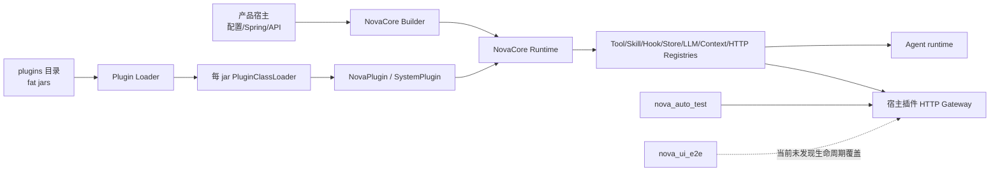
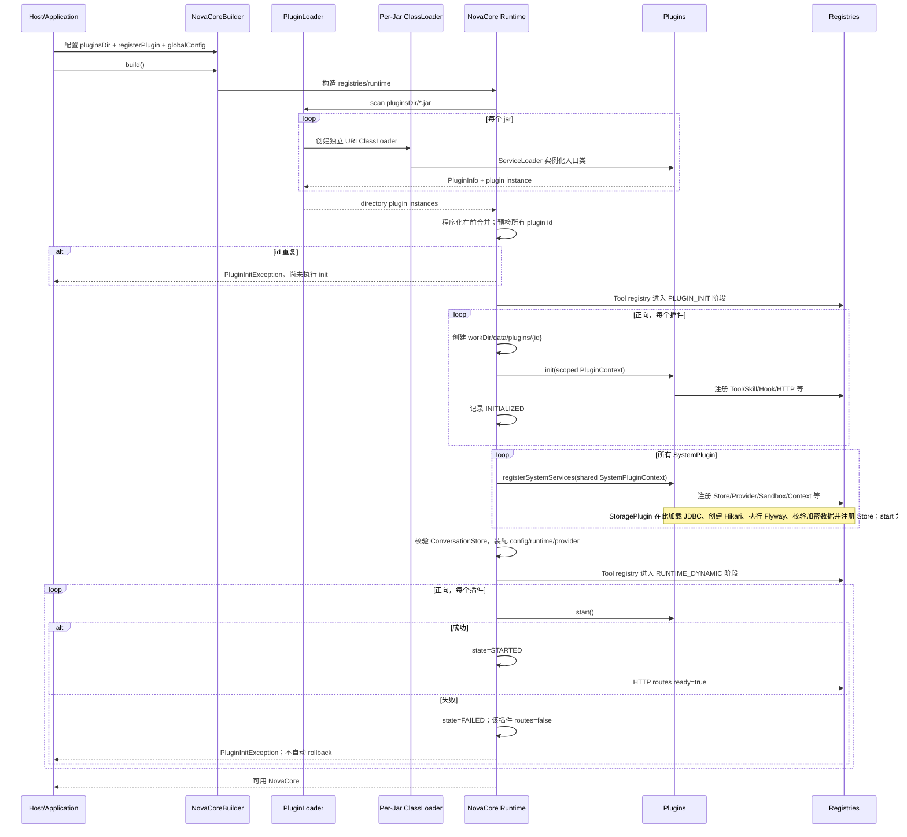
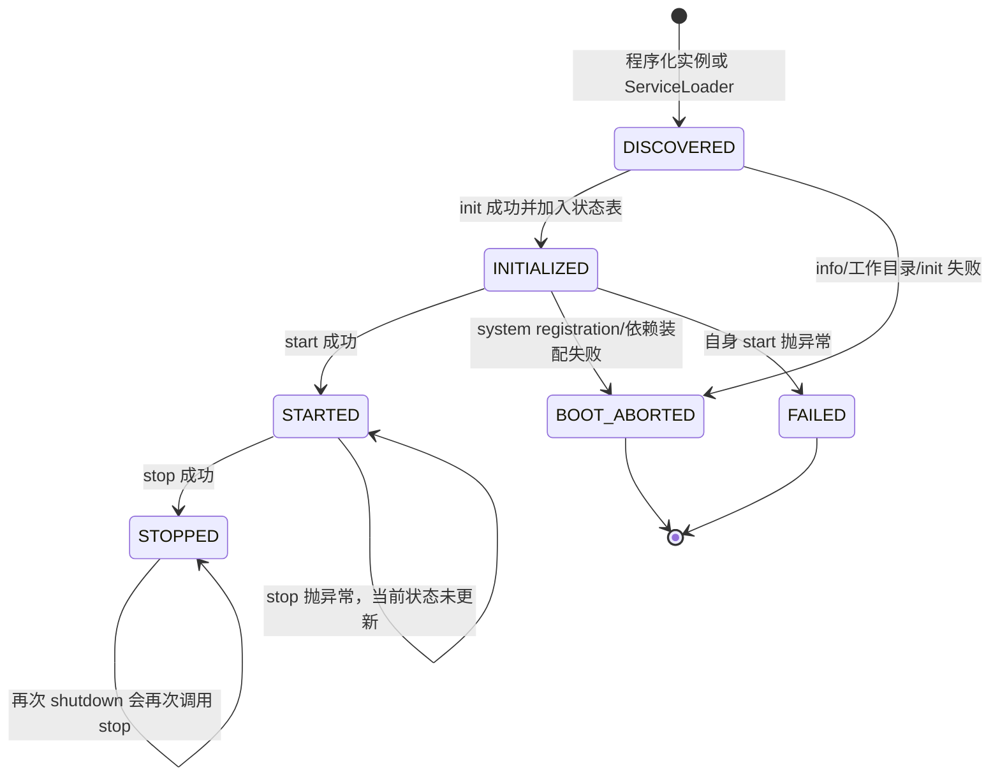
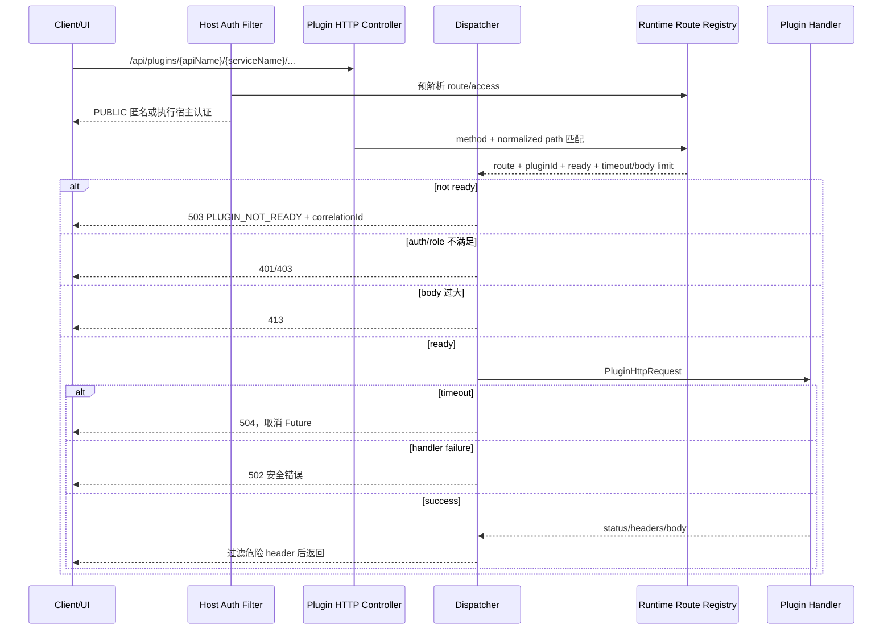

```
# 插件加载、生命周期与资源释放复刻文档

> 文档类型：技术架构复刻文档
>
> 适用读者：Agent 平台架构师、插件运行时实现者、插件作者、宿主应用与测试平台开发者
>
> 证据时间：2026-08-13
>
> 证据标记：`I` 已实现事实，`A` Active 自动化契约（本次未执行），`K` 已知缺陷，`P` 规划要求，`R` 本次运行验证，`F` 强推断，`D` 复刻建议
> 本文没有使用 `R`：本次仅做静态取证，按用户要求未运行编译、构建或测试。

## 1. 结论与边界

### 1.1 一句话结论

Nova 的插件系统是一个“启动期发现、按阶段注册、运行期使用、宿主关闭时逆序释放”的 Java 插件运行时：插件通过 Java `ServiceLoader` 服务文件或宿主程序化注册进入 NovaCore；目录插件每个 jar 使用独立类加载器；普通插件只能贡献工具、技能、Hook、HTTP 服务等受限能力，系统插件还能贡献模型工厂、存储、沙箱和上下文扩展。当前实现适合随进程一起启动和关闭的静态插件集合，不是支持在线安装、升级、卸载的热插件平台。`I`

### 1.2 解决的业务问题

该模块解决四类问题：

1. **能力扩展**：在不修改 Agent 核心循环的前提下增加 Tool、Skill、LLM provider、Store、Sandbox、MCP、CAN 等能力。
2. **依赖隔离**：插件可携带自己的第三方依赖，避免不同插件的依赖版本互相覆盖；SPI 类型由宿主统一加载，保证 Java 类型身份一致。
3. **启动顺序**：先完成普通能力注册，再装配系统服务，最后激活其余网络连接、线程和缓存，使 Agent 只在依赖齐备后运行。当前 StoragePlugin 是一个有界例外：它必须在系统服务注册阶段创建并注册可立即使用的 Store，因此 JDBC/Hikari/Flyway 等资源也在该阶段获得，而不是等到 `start()`。
4. **资源治理**：插件在宿主关闭时释放线程、连接、数据源、回调和临时资源，避免泄漏或阻止 JVM 退出。

### 1.3 目标用户与调用方

| 角色 | 关心的结果 |
|---|---|
| 产品宿主 | 以配置或代码选择插件，启动后获得稳定的能力清单和插件 HTTP 入口 |
| 插件作者 | 只依赖稳定 SPI，实现一次注册、激活和释放 |
| Agent runtime | 在启动完成后获得无重复、可路由、线程安全的能力注册表 |
| 运维与测试平台 | 能识别加载失败、阶段、插件 id、版本、资源泄漏和可见能力 |
| 最终用户 | 在工具设置、Agent 对话和插件页面看到已就绪能力；未就绪服务得到明确错误 |

### 1.4 输入、输出与最终可见效果

**输入**包括：插件目录、程序化插件实例、全局配置、工作目录、宿主提供的出站 HTTP 工厂和身份解析器，以及各插件 jar 的服务发现文件。

**输出**包括：已加载插件元数据及状态、多个能力注册表、可路由的插件 HTTP 服务、供 Agent 使用的模型/工具/技能/存储/沙箱能力。
**可见效果**包括：工具出现在设置与 Agent 可用清单；插件 HTTP 服务可被发现并访问；插件未启动返回 `503 PLUGIN_NOT_READY`；重复插件 id 或注册表 key 使启动失败而不是静默覆盖。`I`

### 1.5 包含范围

本文覆盖：

- 发现描述、ServiceLoader、程序化注册和两个来源的合并；
- 每 jar 类加载器隔离与 SPI/runtime 包边界；
- `init → registerSystemServices → start → stop` 生命周期；
- 工具、技能、Hook、Store、LLM provider、Sandbox、Context、Prompt、HTTP 路由的注册与所有权；
- fat jar 打包、宿主应用桥接、测试 fixture；
- 启动失败、重复 id、兼容性、并发、安全、可观察性和资源释放；
- 最小可用复刻方案与生产级增强方案。

### 1.6 明确不包含

- 本文不展开 Agent 的 LLM/tool loop；这里只说明插件如何向该循环贡献能力。
- 本文不把某个插件的业务协议（例如 CAN Gateway 或 MCP wire protocol）作为插件加载器契约。
- 本文不声称当前系统具有热安装、热升级、按插件重启、依赖图解析、签名验证或进程级沙箱；这些均不是当前实现。`I`
- 本文不把 `nova_ui_e2e` 当作插件生命周期证据：静态检索未发现其覆盖类加载、init/start/stop 或卸载语义。`F`

### 1.7 当前实现、缺陷与推荐设计的分界

| 主题 | 当前状态 |
|---|---|
| 目录发现 | 只扫描目录第一层 `*.jar`，每 jar 独立类加载器，ServiceLoader 可发现 jar 中多个实现。`I` |
| 描述符 | 当前没有 JSON/YAML manifest；服务文件给出入口类，`PluginInfo` 给出 id/name/version。`I` |
| 版本兼容 | version 仅为非空字符串，不解析 SemVer，不检查 core/SPI/Java 兼容范围。`I/K` |
| 生命周期 | 严格分阶段、启动顺序正向、关闭顺序逆向。`I` |
| StoragePlugin 例外 | `registerSystemServices` 即 force-load JDBC driver、创建 HikariDataSource、按配置执行 Flyway、构建 MyBatis Store 并校验加密历史；`start()` 为空。它是“init 注册无 IO、start 激活资源”原则在 mandatory Store 装配上的当前有界例外。`I` |
| 启动回滚 | init/system registration/start 中途失败均没有运行时级事务回滚；start 失败前已启动插件仍运行。`K` |
| 系统插件信任 | SPI 文档要求可信 id 前缀，但当前运行时没有执行该 gate。`K` |
| 热装卸 | 不支持；“运行期动态”仅指插件 start 后仍可注册 Tool 等能力。`I` |
| 注册所有权 | HTTP 路由记录 plugin id；多数通用 Registry 不维护统一的插件所有权账本。`I/K` |
| 类加载器释放 | 目录扫描器创建 URLClassLoader，但 NovaCore 未保留并关闭它。`I/K` |
| stop | 逆序、单插件异常不阻塞其余 stop；但没有整体幂等 guard，失败状态不更新，注册项也不会统一撤销。`I/K` |
| 生产增强 | 推荐 manifest、签名与权限、依赖拓扑、事务化启动、所有权账本、幂等 stop 和可关闭 classloader。`D` |

## 2. 术语与参与方

| 术语 | 定义 |
|---|---|
| SPI | 宿主与插件共同编译依赖的稳定 Java 接口和 DTO |
| Runtime | 负责发现、类加载、生命周期、注册表和 Agent 编排的实现 |
| 普通插件 | 实现基础插件接口，可注册受限业务能力 |
| 系统插件 | 实现特权插件接口，可注册 Store、LLM provider factory、Sandbox、Context 等系统服务 |
| 服务描述文件 | jar 内 `META-INF/services/<SPI接口全名>`，内容为插件实现类全名 |
| PluginInfo | 运行时调用插件代码得到的 id、显示名、版本；不是独立文件 manifest |
| fat jar | 把插件和第三方运行依赖打入同一 jar 的发布物，SPI 和日志门面由宿主提供 |
| 注册阶段 | `PROGRAMMATIC`、`PLUGIN_INIT`、`RUNTIME_DYNAMIC` 等能力进入注册表的时间桶 |
| 资源所有权 | 谁创建连接、线程、回调、注册项或类加载器，谁负责按生命周期释放 |
| 就绪 | 插件 `start()` 成功后，其 HTTP 路由被标记为可接收请求 |



职责边界如下：

- **宿主**决定启用哪些插件、提供什么配置与可信能力、何时 shutdown。
- **加载器**发现和实例化插件，不应执行插件业务 IO。
- **Runtime**校验全局唯一性、组织阶段、维护状态和注册表。
- **插件**只在允许的阶段执行相应动作，并释放自己创建的资源。
- **HTTP Gateway**只做宿主协议桥接、认证、超时、限流前置和安全响应，不替插件实现业务逻辑。
- **测试仓库**表达黑盒可见契约；它不能证明 JVM 内部资源已释放，除非有专门探针。

## 3. 业务规则

### 3.1 发现与元数据规则

1. 程序化插件和目录插件可以同时启用；合并顺序为程序化插件在前、目录插件在后。目录 jar 的遍历顺序没有稳定保证，插件不能依赖文件系统返回顺序。`I`
2. 插件目录不存在、不是目录或没有可发现插件时，目录来源返回空，不单独阻止启动；但 NovaCore 的其他强制依赖仍可能使启动失败。`I`
3. 目录扫描只匹配第一层 `*.jar`，不递归子目录。`I`
4. 一个 jar 可以通过服务文件声明多个插件实现，它们共享该 jar 的类加载器。推荐生产规范仍是一插件一 jar，便于版本、权限和回滚。`I/D`
5. `PluginInfo.id/name/version` 都必须非 null、非空白；id 必须在一个 NovaCore 实例内全局唯一。`I`
6. 当前仅有文档约定 id 使用反向域名、version 使用 SemVer；代码没有正则或版本解析器。`I`
7. 当前工作目录通过字符串拼接 plugin id 后交给路径解析；由于 id 没有字符集和路径分隔符校验，不能把它当作安全路径片段。目录插件本已是 JVM 内高信任代码，但生产复刻仍必须用严格 id 正则阻断 `/`、`\\`、空段和 `..` 路径语义。`I/K/D`
8. 重复 id 在任何插件 init 前统一失败，包括程序化实例与目录 jar 的跨来源冲突。`I/A`
9. 程序化注册绕过 ServiceLoader 和每 jar 类加载隔离，插件类使用宿主/应用类加载器。它适合内建插件、测试和嵌入式宿主，不等价于 drop-in 第三方插件。`I`

### 3.2 类加载与依赖边界规则

1. SPI 包、SLF4J、`java.*` 和 `javax.*` 由父加载器优先加载，确保所有插件共享相同接口类型和日志门面。`I`
2. runtime 内部包对目录插件直接隐藏，请求该命名空间时抛类不存在；插件只能依赖 SPI。`I`
3. 其他类采用 child-first：优先使用插件 jar 内版本，找不到再回退父加载器。这允许两个插件携带不同版本的第三方 SDK。`I`
4. `META-INF/services/*` 的资源枚举只查当前插件 jar，避免父 classpath 上的服务文件被每个插件类加载器重复发现。该结论来自类加载器实现；现有 `PluginClassLoaderTest` 没有覆盖此资源枚举分支，因此证据等级仅为 `I`。`I`
5. 类加载隔离不是安全沙箱。插件仍是宿主 JVM 内代码，原则上可使用文件、网络、反射、线程和系统属性；命名空间隐藏只能降低耦合，不能抵御恶意插件。`I/K`
6. 插件不得编译依赖 runtime 或另一插件。跨插件协作使用 SPI 注册表、公共外部协议或宿主显式适配器。`I/D`

### 3.3 生命周期规则

1. `init(context)` 只能保存上下文能力、构造无 IO 对象并注册 Tool/Skill/Hook/HTTP 路由；不得连接网络、启动线程、读写业务存储或注册 JVM shutdown hook。`I`（SPI 契约）
2. 所有插件 init 成功后，系统插件才统一执行 `registerSystemServices(systemContext)`。`I`
3. ConversationStore 是当前启动必需服务；系统服务注册阶段结束后仍不存在时启动失败。`I`
4. `start()` 按注册顺序执行；通常用于打开连接、启动线程、预热缓存和执行需要外部 IO 的动态发现。`I`
5. 只有 `start()` 成功后，插件 HTTP 路由才 ready。`I`
6. `shutdown()` 按注册顺序的逆序调用 stop；一个 stop 抛运行时异常只记录错误，不阻止其他插件释放。`I`
7. `stop()` 必须可以在部分启动情况下安全执行，并应自行幂等；当前 runtime 并不保证只调用一次。`I/K/D`
8. 生命周期是单向的：当前没有 STOPPED → STARTED、在线 reload 或版本切换。`I`

当前 StoragePlugin 是上述阶段职责的明确例外，而不是可推广的插件写法：它在 `registerSystemServices` 中 force-load 所选 vendor 的 JDBC driver，创建 HikariDataSource，按开关执行 Flyway migration，构建 MyBatis/Artifact Store，并扫描受保护列验证会话加密 key；完成后把六类 Store 注册进共享 StoreRegistry。其 `start()` 是空方法，因为 mandatory ConversationStore 必须在 runtime 完成后续装配前已经可用。该插件对自身注册冲突会逆序 unregister 已注册 Store，并在初始化失败时关闭 DataSource，但 runtime 没有统一记录或回滚 system-registration 阶段获得的资源。`I/K`

### 3.4 注册和所有权规则

| 能力 | 唯一键/顺序 | 冲突 | 当前撤销能力 | 所有权现状 |
|---|---|---|---|---|
| Tool | tool name；展示按阶段再按名称稳定排序 | 重复抛冲突 | 可按 name unregister | 无统一 plugin owner；插件需自记 key。`I` |
| Skill | skill id | 重复抛冲突 | 可按 id unregister | 无统一 owner；`all()` 顺序不应作为契约。`I` |
| Hook | 列表顺序 | 可注册重复实例 | 按实例 unregister | 无 owner；会话临时 Hook 必须 finally 撤销。`I` |
| Store | SPI Class | 同 type 重复抛冲突 | 按 type unregister | 无 owner。`I` |
| LLM provider factory | provider type | 重复抛冲突 | SPI 当前无对称 unregister | 无 owner。`I/K` |
| Sandbox/Reducer/HistoryLoader | 单实例槽 | 第二个注册冲突 | 有全局 unregister/clear | 无 owner，卸载时无法证明清的是谁。`I/K` |
| ContextInjector | injector id；priority 后 id 排序 | 重复 id 冲突 | 按 id unregister | 无 owner。`I` |
| PromptSegment | provider id | 重复 id 冲突 | 按 provider 撤销 | 无统一 owner。`I` |
| Plugin HTTP | apiName 归属 plugin；method+path 唯一 | 跨插件 apiName 或路由冲突 | 当前无删除 API，只切 ready | 明确记录 pluginId。`I/K` |

通用原则是“冲突 fail-fast，不静默覆盖”。个别业务插件可能捕获重复 Skill 冲突并保留旧实例，这是插件局部容错，不应上升为平台默认规则。`I`

### 3.5 资源规则

1. 运行期资源不得放在 static 字段；否则类加载器无法回收，多个 NovaCore 实例会互相污染。`D`（亦为本工程插件规则）
2. 插件不得自行注册 JVM 全局 shutdown hook 或 static listener；宿主拥有进程生命周期。`D`（亦为本工程插件规则）
3. `ThreadLocal` 必须是实例字段，并在所有正常、异常、取消分支的 `finally` 中 `remove()`。当前 OpenAI 与 Anthropic 客户端采用该模式。`I`
4. Executor、定时任务、连接池、数据源、HTTP client、Docker client、消息订阅、回调和缓存 watcher 必须被实例字段持有；stop 先停止新流量，再取消任务，最后关闭依赖。`D`
5. stop 应有最大等待时间；等待被中断时恢复中断标志；超时后记录仍存活线程名。`D`
6. 当前 Docker 容器跟踪器在构造时注册 JVM shutdown hook，而且在插件 init 中被创建，违反“init 只注册”和“插件不建全局 hook”约束；虽然正常 stop 会尝试移除 hook，但启动失败路径仍有泄漏风险。`K`

## 4. 完整执行链路

### 4.1 启动时序



### 4.2 逐步算法

1. 宿主建立 Builder，设置插件目录、工作根目录、全局嵌套配置、出站 HTTP 工厂和可选身份解析器。
2. 宿主可直接注册内建插件实例。产品应用当前大量使用该路径，因此这些一方插件在应用 classpath 上，不具备目录 jar 的类隔离。`I`
3. Builder 构造 NovaCore。Runtime 先创建所有 Registry、路由器和基础服务，再扫描插件目录。
4. 每个目录 jar 创建独立 classloader，服务文件中的每个实现通过无参构造器实例化；服务配置错误使本次扫描失败。没有服务声明的 jar 被警告并跳过。`I`
5. 两来源合并后先读取所有 id 做重复校验。这个阶段会再次调用 `info()`；插件必须保证 `info()` 纯函数、快速、稳定且无副作用。`I/D`
6. Runtime 为每个插件创建 `<workDirRoot>/data/plugins/<pluginId>`。当前所有插件收到同一份全局配置视图，不会自动裁剪为自己的命名空间；插件应读取自身前缀。`I`
7. Runtime 创建按插件 id 绑定的 HTTP registrar，并把插件实际 classloader、工作目录、配置、Registry 和出站 HTTP 工厂交给 init。
8. init 成功后才把插件加入状态表，标为 INITIALIZED。若 init 抛异常，失败插件不在可查询状态中，之前成功注册的内容没有统一回滚。`I/K`
9. Runtime 创建一个共享系统上下文，依次让所有系统插件注册特权服务。该上下文包含模型工厂、可写 Store Registry、Sandbox、Reducer、Injector、Prompt、全局配置和部分核心 runner。当前 StoragePlugin 在这一步就 force-load JDBC driver、创建 Hikari pool、执行 Flyway、构建 Store 并校验加密数据，`start()` 不再做事；因此 system registration 不是全局无 IO 阶段。
10. 系统服务齐备后，Runtime 解析 ConversationStore、配置 overlay、Agent 运行服务和 LLM provider。缺少必需 Store 或注册冲突使 build 失败。
11. Runtime 把后续 Tool 注册归入动态阶段，然后逐个 start。每次成功后才开放该插件 HTTP 路由。
12. 所有 start 成功后，Builder 返回 NovaCore；宿主可以创建 Agent、查询 loadedPlugins/stateOf 或转发插件 HTTP 请求。

### 4.3 状态机与当前可观察差异



注意：`DISCOVERED` 与 `BOOT_ABORTED` 是本文用于解释的概念状态，不是当前公开枚举；当前公开状态为 NEW、INITIALIZED、STARTED、STOPPED、FAILED，但 NovaCore 只在 init 成功后建立记录。`I`

### 4.4 HTTP 请求链路



宿主 Gateway 支持 GET/POST/PUT/PATCH/DELETE，拒绝路径中的编码斜线、反斜线和点编码，最大请求体默认 10 MiB，单路由超时上限 30 秒；生成或清洗 `X-Correlation-Id`，响应不转发 hop-by-hop header 和 `Set-Cookie`。`I`

### 4.5 shutdown 链路

1. 宿主调用 `NovaCore.shutdown()`；宿主必须把此调用绑定到应用关闭流程，不能期待插件自行监听 JVM。`I/D`
2. Runtime 从最后注册插件向第一个插件遍历。
3. 每个插件在 stop 前先把其 HTTP route 标为 not ready，阻止新请求。
4. Runtime 调用 stop；成功则状态变 STOPPED，异常则完整记录异常并继续下一插件。
5. 当前 runtime 不等待在途插件 HTTP handler 完成、不统一清理 Registry、不关闭目录 classloader，也不防第二次 shutdown。`I/K`
6. 产品侧 HTTP Dispatcher 自己拥有虚拟线程 executor，并在 Spring 销毁回调中 `shutdownNow()`；它属于宿主资源，不由插件 stop 释放。`I`

### 4.6 推荐的事务化启动伪代码

以下是生产级复刻建议，不是 Nova 当前实现：`D`

```java
PluginRuntime boot(List<PluginArtifact> artifacts) {
  List<PluginHandle> initialized = new ArrayList<>();
  List<PluginHandle> started = new ArrayList<>();
  try {
    List<PluginHandle> handles = discoverVerifyResolve(artifacts);
    verifyUniqueIdsAndCompatibility(handles);
    for (PluginHandle h : topologicalOrder(handles)) {
      h.ownership().begin();
      h.plugin().init(h.normalContext());
      h.ownership().commitInit();
      initialized.add(h);
    }
    for (PluginHandle h : initialized) {
      if (h.plugin() instanceof SystemPlugin p) {
        p.registerSystemServices(h.systemContext());
      }
    }
    validateRequiredServices();
    for (PluginHandle h : initialized) {
      h.plugin().start();
      h.routes().markReady();
      h.state(STARTED);
      started.add(h);
    }
    return new PluginRuntime(handles);
  } catch (Throwable bootFailure) {
    reverse(started).forEach(h -> bestEffort(h::stop));
    reverse(initialized).forEach(h -> bestEffort(h.ownership()::unregisterAll));
    reverse(initialized).forEach(h -> bestEffort(h.classLoader()::close));
    throw translatedBootFailure(bootFailure);
  }
}
```

## 5. 对外契约

### 5.1 当前发现描述契约

当前“描述符”由两个部分共同组成。第一部分是 jar 内的 Java 服务文件：

```text
# path
META-INF/services/com.aloudata.nova.core.spi.plugin.NovaPlugin

# content: one implementation FQCN per line
com.example.nova.weather.WeatherPlugin
```

第二部分由入口对象返回：

```java
public record PluginInfo(String id, String name, String version) {}

new PluginInfo(
    "com.example.nova.weather",
    "Weather Tools",
    "1.2.3");
```

| 字段 | 类型 | 必填 | 当前校验 | 语义 |
|---|---|---|---|---|
| id | string | 是 | 非 null、非空白、运行时全局唯一 | 插件身份、工作目录、HTTP ownership 和状态查询键 |
| name | string | 是 | 非 null、非空白 | 人类可读名称 |
| version | string | 是 | 非 null、非空白 | 展示版本；当前不参与兼容与排序 |

当前不存在描述 dependencies、permissions、minimumCoreVersion、Java range、checksum、signature、entrypoint kind 的正式文件。`I`

### 5.2 最小插件接口

```java
interface NovaPlugin {
  PluginInfo info();
  void init(PluginContext context);
  void start();
  void stop();
}

interface SystemPlugin extends NovaPlugin {
  void registerSystemServices(SystemPluginContext context);
}
```

最小普通插件：

```java
final class WeatherPlugin implements NovaPlugin {
  private PluginContext context;
  private WeatherClient client;

  public PluginInfo info() {
    return new PluginInfo("com.example.weather", "Weather", "1.0.0");
  }

  public void init(PluginContext ctx) {
    this.context = ctx;
    ctx.tools().register(new WeatherTool(() -> requireStartedClient()));
  }

  public void start() {
    this.client = WeatherClient.connect(context.config(), context.outboundHttpClients());
  }

  public void stop() {
    WeatherClient c = this.client;
    this.client = null;
    if (c != null) c.close();
  }
}
```

Tool 在 init 注册而资源在 start 才存在，因此实现必须避免 Agent 在 start 前被调用；当前 NovaCore 仅在 build 完成后向宿主返回实例，提供了这层启动屏障。`I`

### 5.3 PluginContext 能力面

普通上下文至少应提供以下契约：

```java
interface PluginContext {
  ToolRegistry tools();
  SkillRegistry skills();
  HookRegistry hooks();
  StoreLookup stores();               // read-only lookup
  OutboundHttpClientFactory outboundHttpClients();
  PluginHttpRegistrar httpRoutes();   // permanently scoped to plugin id
  PluginConfig config();
  Path workDir();
  ClassLoader classLoader();
}
```

- `workDir` 是插件专属持久工作目录，不应访问其他插件目录。
- `config` 当前是全局视图；复刻时推荐提供 `config.subtree(pluginId)`，同时保留受控公共配置。`I/D`
- `classLoader` 用于加载插件自带资源；缓存由它加载的 Class/Method 时不得放入宿主 static map。`D`
- `stores` 只读，防止普通插件注册或替换平台关键 Store。`I`
- HTTP registrar 自动绑定 plugin id；调用方不能伪造另一个插件 owner。`I`

### 5.4 SystemPluginContext 能力面

系统上下文在普通上下文之外提供：

- LLM provider factory registry；
- 可写 Store registry；
- 单例 Sandbox provider registry；
- Context reducer、injector、working history loader registry；
- Prompt segment registry；
- 全局配置解析与配置 Store；
- 可选 SubAgent dispatcher、background LLM job、Agent runner；
- 可选外部身份解析器。

这是高权限面。复刻时必须先完成签名/信任校验，再创建系统上下文；不能只凭插件自己实现 `SystemPlugin` 就授予权限。当前 Nova 尚缺运行时 gate。`K/D`

### 5.5 Builder 配置契约

```java
NovaCore core = NovaCore.builder()
    .pluginsDir(Path.of("/opt/nova/plugins"))
    .registerPlugin(new BuiltInStoragePlugin())
    .globalConfig(parsedYaml)
    .workDirRoot(Path.of("/var/lib/nova"))
    .outboundHttpClients(hostControlledFactory)
    .externalIdentityResolver(optionalResolver)
    .build();
```

| 参数 | 必填 | 默认/语义 |
|---|---|---|
| pluginsDir | 否 | 未设置则不扫描；不存在也按 0 个目录插件处理 |
| programmatic plugin | 否 | 可多次添加，保持添加顺序 |
| globalConfig | 否 | 默认空 map；浅层不可变复制，允许嵌套 map/list |
| workDirRoot | 否 | 默认用户目录下 `.nova`；插件实际目录再拼 `data/plugins/{id}` |
| outboundHttpClients | 否 | 默认系统 JDK HTTP 工厂；生产建议宿主统一代理、TLS、DNS、审计 |
| externalIdentityResolver | 否 | 仅系统插件可见 |

`build()` 是同步启动调用。成功返回表示所有插件 start 已成功；失败抛异常，但当前可能遗留已启动资源。`I/K`

### 5.6 插件状态查询契约

```java
List<PluginInfo> loadedPlugins();                 // registration order
Optional<PluginState> stateOf(String pluginId);   // known records only
void shutdown();
```

状态 API 是宿主内 Java 接口，不是当前独立 REST 管理 API。产品 HTTP discovery 会基于插件注册的 service 汇总 apiName、plugin id、version、ready 和 management manifest 地址，但它不是安装/启停接口。`I`

示例 discovery 响应的等价结构：

```json
[
  {
    "apiName": "weather",
    "pluginId": "com.example.weather",
    "pluginName": "Weather",
    "pluginVersion": "1.0.0",
    "manifestUrl": "/api/plugins/weather/management/manifest",
    "services": [
      {"serviceName": "query", "ready": true},
      {"serviceName": "management", "ready": true}
    ]
  }
]
```

### 5.7 插件 HTTP 契约

通用入口：

```text
GET /api/plugins
{GET|POST|PUT|PATCH|DELETE} /api/plugins/{apiName}/{serviceName}/{routePath...}
```

| 属性 | 当前语义 |
|---|---|
| apiName/serviceName | 小写字母开头，后续小写字母、数字或 `-`，总长不超过 32 |
| access | 枚举只有 PUBLIC、AUTHENTICATED；后者可再通过 `requiredAuthorities` 要求 `tenant-admin` 等宿主 authority |
| request body | 全局最大 10 MiB；路由可更严格 |
| timeout | 路由最大 30 秒 |
| correlation | 读取安全的 `X-Correlation-Id`，否则生成；响应总是回传 |
| cancellation | timeout 时取消执行 Future 并尝试中断 |
| response header | 过滤 hop-by-hop、`Set-Cookie` 和 CR/LF 注入 |

标准宿主错误体：

```json
{
  "success": false,
  "errorCode": "PLUGIN_NOT_READY",
  "error": "Plugin service is not ready",
  "correlationId": "9b43f3..."
}
```

主要状态：401 未认证、403 权限不足、413 请求过大、503 插件未就绪、504 handler 超时、502 handler 异常。PUBLIC 路由允许匿名，因此插件如需自己的协议认证，必须在 handler 内额外校验。`I`

### 5.8 fat jar 发布契约

当前一方插件使用 Maven Shade：

```xml
<plugin>
  <artifactId>maven-shade-plugin</artifactId>
  <configuration>
    <minimizeJar>false</minimizeJar>
    <transformers>
      <transformer implementation=
        "org.apache.maven.plugins.shade.resource.ServicesResourceTransformer"/>
    </transformers>
    <relocations>
      <relocation>
        <pattern>com.fasterxml.jackson</pattern>
        <shadedPattern>com.aloudata.nova.shaded.jackson</shadedPattern>
      </relocation>
    </relocations>
  </configuration>
</plugin>
```

发布要求：

1. 合并 `META-INF/services`，否则入口可能在 shade 后丢失。
2. SPI 与 SLF4J 以 `provided` 使用，不能把另一份 SPI 打入插件 jar。
3. 反射使用的类型要求 `minimizeJar=false`，除非有完整 reachability 配置。
4. 对容易与宿主冲突的库可 relocation；当前一方插件统一 relocation Jackson。
5. 去除依赖签名文件和 `module-info.class`；因此 jar 原依赖签名不能作为插件信任证据。`I`
6. 同一个插件不能同时作为程序化插件和 drop-in jar 启用，否则重复 id 启动失败。`I/A`

### 5.9 推荐生产 manifest

下面是复刻增强，不是 Nova 当前文件：`D`

```json
{
  "$schema": "https://example.com/nova/plugin-manifest-v1.schema.json",
  "schemaVersion": 1,
  "id": "com.example.weather",
  "name": "Weather",
  "version": "1.2.3",
  "entrypoint": "com.example.nova.weather.WeatherPlugin",
  "kind": "NORMAL",
  "compatibility": {
    "spi": ">=1.3.0 <2.0.0",
    "core": ">=0.3.0 <0.4.0",
    "java": ">=21 <22"
  },
  "requires": [
    {"pluginId": "com.example.common", "version": "^2.0.0", "optional": false}
  ],
  "capabilities": ["tool", "plugin-http"],
  "permissions": ["network:https://api.weather.example", "workdir:rw"],
  "artifact": {
    "sha256": "0123456789abcdef0123456789abcdef0123456789abcdef0123456789abcdef",
    "signatureKeyId": "prod-plugins-2026-01"
  }
}
```

最小 JSON Schema 关键约束：

```json
{
  "type": "object",
  "required": ["schemaVersion", "id", "name", "version", "entrypoint", "kind", "compatibility"],
  "properties": {
    "$schema": {"type": "string", "format": "uri"},
    "schemaVersion": {"const": 1},
    "id": {"type": "string", "pattern": "^[a-z][a-z0-9]*(\\.[a-z][a-z0-9-]*)+$"},
    "name": {"type": "string", "minLength": 1, "maxLength": 128},
    "version": {"type": "string", "pattern": "^[0-9]+\\.[0-9]+\\.[0-9]+([+-].*)?$"},
    "entrypoint": {"type": "string", "minLength": 3},
    "kind": {"enum": ["NORMAL", "SYSTEM"]},
    "compatibility": {
      "type": "object",
      "required": ["spi", "core", "java"],
      "properties": {
        "spi": {"type": "string", "minLength": 1},
        "core": {"type": "string", "minLength": 1},
        "java": {"type": "string", "minLength": 1}
      },
      "additionalProperties": false
    },
    "requires": {
      "type": "array",
      "items": {
        "type": "object",
        "required": ["pluginId", "version", "optional"],
        "properties": {
          "pluginId": {
            "type": "string",
            "pattern": "^[a-z][a-z0-9]*(\\.[a-z][a-z0-9-]*)+$"
          },
          "version": {"type": "string", "minLength": 1},
          "optional": {"type": "boolean"}
        },
        "additionalProperties": false
      },
      "uniqueItems": true
    },
    "capabilities": {
      "type": "array",
      "items": {"type": "string", "minLength": 1},
      "uniqueItems": true
    },
    "permissions": {
      "type": "array",
      "items": {"type": "string", "minLength": 1},
      "uniqueItems": true
    },
    "artifact": {
      "type": "object",
      "required": ["sha256", "signatureKeyId"],
      "properties": {
        "sha256": {
          "type": "string",
          "pattern": "^[A-Fa-f0-9]{64}$"
        },
        "signatureKeyId": {"type": "string", "minLength": 1}
      },
      "additionalProperties": false
    }
  },
  "additionalProperties": false
}
```

Runtime 应验证 manifest 与 `PluginInfo` 完全一致；系统插件还需受信任签名、allowlist 和显式 permission 同时满足。`D`

## 6. 数据模型与生命周期

### 6.1 当前内存模型

当前核心记录可抽象为：

```java
record PluginRecord(
    NovaPlugin plugin,
    PluginInfo info,
    PluginState state
) {}

record PluginInstance(
    NovaPlugin plugin,
    PluginInfo info,
    ClassLoader classLoader
) {}
```

目录 loader 在发现阶段拥有 `PluginInstance.classLoader`，但 NovaCore 合并时只保留 plugin 对象，核心状态记录不保存 classloader/source jar。由 plugin 对象仍可间接到达 classloader，所以不会提前失效；问题是 shutdown 无法显式 close。`I`

### 6.2 当前持久化模型

插件清单、生命周期状态和注册所有权当前没有数据库表；进程重启后由配置和 jar 重新发现。插件工作数据由各插件自己的 Store 或工作目录管理。`I`

- **业务唯一键**：进程内 plugin id。
- **租户/用户归属**：插件安装是 runtime 级；租户/用户能力可见性由具体 Tool/Skill/Store 策略处理，不由加载器复制插件实例。
- **创建/更新**：启动时重新构建；无在线更新。
- **删除/过期**：停止进程并移除配置或 jar；无软删除。
- **敏感数据**：不得存于 manifest 或 jar 服务文件；credential 应来自宿主配置/credential store。

### 6.3 推荐生产所有权账本

```java
record PluginHandle(
  PluginManifest manifest,
  Path sourceJar,
  CloseableClassLoader classLoader,
  NovaPlugin plugin,
  AtomicReference<LifecycleState> state,
  RegistrationLedger registrations,
  ResourceLedger resources
) {}

interface RegistrationLedger {
  Registration add(RegistryKind kind, String key, AutoCloseable undo);
  void unregisterAllReverse();
}

interface ResourceLedger {
  <T extends AutoCloseable> T own(String name, T resource);
  void closeAllReverse(Duration timeout);
}
```

如果需要跨重启审计，可增加宿主数据库表；它不是插件业务状态真源：`D`

```sql
CREATE TABLE plugin_deployment_audit (
  deployment_id UUID PRIMARY KEY,
  plugin_id VARCHAR(255) NOT NULL,
  plugin_version VARCHAR(64) NOT NULL,
  artifact_sha256 CHAR(64) NOT NULL,
  source_uri TEXT NOT NULL,
  trust_key_id VARCHAR(128),
  lifecycle_state VARCHAR(32) NOT NULL,
  enabled BOOLEAN NOT NULL DEFAULT TRUE,
  installed_at TIMESTAMP NOT NULL,
  started_at TIMESTAMP,
  stopped_at TIMESTAMP,
  last_error_code VARCHAR(64),
  last_error_summary TEXT,
  UNIQUE(plugin_id, plugin_version, artifact_sha256)
);
CREATE INDEX idx_plugin_audit_id_time
  ON plugin_deployment_audit(plugin_id, installed_at DESC);
```

错误摘要必须脱敏；不得保存 API key、完整异常请求体或用户业务数据。

### 6.4 生命周期数据一致性

- 只有 state=STARTED 才允许 HTTP route ready。
- 状态改变与路由 readiness 应在同一 runtime 临界区提交。
- 注册表内容应与 owner ledger 一致；rollback/unload 由 ledger 逆序撤销。
- classloader 只能在所有插件线程终止、回调撤销、registry 强引用解除后关闭。
- 热升级若实现，应采用 side-by-side 加载、健康检查、流量切换、旧版本 drain/stop，而不是覆盖 jar 后原地重新定义类。`D`

## 7. 核心实现设计

### 7.1 最小可用版本

最小可用复刻需实现六个组件：

1. **SPI artifact**：插件、上下文、注册表和错误类型，不依赖 Spring。
2. **PluginLoader**：扫描一层 jar、每 jar classloader、ServiceLoader、来源信息。
3. **PluginClassLoader**：SPI/日志/JDK parent-first，runtime hidden，其余 child-first，服务资源 jar-local。
4. **PluginRuntime**：重复 id 预检、init/system/start、状态查询、逆序 stop。
5. **Registry set**：所有唯一键冲突 fail-fast；对称 register/unregister。
6. **Host bridge**：Builder 配置、应用关闭回调、可选 HTTP gateway。

最小版本可明确不支持：插件依赖、热卸载、签名、在线管理。但必须在接口和运维文档中写明“重启生效”。

### 7.2 生产级版本

生产级在最小版之上增加：

- manifest schema、SemVer 兼容、Java/SPI/core range；
- artifact SHA-256、签名链、可信仓库和系统插件 allowlist；
- 插件依赖 DAG、循环检测、稳定拓扑排序；
- 每插件注册/资源账本与阶段事务；
- start 失败逆序 stop、init 失败逆序 unregister、classloader close；
- stop 幂等、在途请求 drain、超时与 thread leak detection；
- 进程外隔离选项：不可信插件运行在独立 worker/container，通过 RPC 暴露 Tool；
- 安装审计、健康状态、指标和诊断包；
- side-by-side 升级与原子流量切换。

### 7.3 类加载算法

```java
Class<?> loadClass(String name, boolean resolve) {
  synchronized (classLoadingLock(name)) {
    if (alreadyLoaded(name)) return loaded(name);
    if (name.startsWith("com.example.spi.")
        || name.startsWith("org.slf4j.")
        || name.startsWith("java.")
        || name.startsWith("javax.")) {
      return parent.loadClass(name);
    }
    if (name.startsWith("com.example.runtime.")) {
      throw new ClassNotFoundException("runtime internals are hidden");
    }
    try { return findClassInPlugin(name); }
    catch (ClassNotFoundException absent) { return parent.loadClass(name); }
  }
}
```

生产增强还应明确 `jakarta.*`、`jdk.*`、序列化 API 和宿主 API 的共享策略，并对 split package 做启动检查。`D`

### 7.4 依赖解析与兼容

当前没有插件依赖图，顺序就是来源合并顺序。复刻生产版应：`D`

1. 解析所有 manifest，不实例化入口类。
2. 校验 id 唯一、artifact 签名、SPI/core/Java 范围。
3. 建立必需依赖 DAG；缺失依赖直接失败。
4. 检测环；错误列出完整环路径。
5. 使用稳定拓扑排序：同层按 plugin id 排序，避免文件系统顺序影响启动。
6. stop 使用拓扑逆序，使消费者先于提供者关闭。

当前 version 不参与任何步骤；错误的 SPI 二进制版本可能在 ServiceLoader 实例化时表现为服务配置错误，也可能以 `LinkageError` 逃出当前只捕获 RuntimeException 的生命周期包装。`I/K`

### 7.5 注册表事务

推荐所有 registrar 自动绑定 owner：`D`

```java
ToolRegistrar scopedTools = tools.scoped(pluginId, ledger);
scopedTools.register(tool); // registry write + ledger undo atomically

try {
  plugin.init(contextWith(scopedTools));
} catch (Throwable e) {
  ledger.unregisterAllReverse();
  throw e;
}
```

Storage 一方插件当前在自己的系统服务注册中记录已注册 Store 类型，失败时逐个 unregister 并关闭创建失败的数据源，这证明插件局部可以实现补偿；但它不是 runtime 通用保证。`I`

生产 rollback 不能只覆盖 `init` 注册项和 `start` 资源，还必须把 **system registration 阶段获得的资源**纳入同一 owner ledger。每个系统插件进入该阶段前创建 checkpoint；registrar 写入、JDBC driver 注册、DataSource/client 创建和回调注册都登记逆操作。任一 system plugin 注册失败、mandatory Store 校验失败或后续 runtime 装配失败时，应先按全局逆序回滚 system-registration ledger，再撤销 init 注册并关闭目录 classloader。对 StoragePlugin 至少执行：停止对 Store 的新解析 → 逆序 unregister 六类 Store → 关闭 HikariDataSource → 在确认 driver 由该插件 classloader 独占时撤销其 DriverManager 注册 → 清空插件持有引用；异常作为 suppressed cause 汇总，不能阻断其余资源释放。Flyway 已提交的 schema 变更不是内存资源，不能靠 stop 自动逆转；应使用可重入 migration、数据库事务能力和 forward-fix 恢复，并把已执行版本纳入启动失败审计。`D`

### 7.6 动态能力与插件热加载的区分

当前 runtime 在开始 start 前将 Tool 注册阶段切到 `RUNTIME_DYNAMIC`。MCP 等插件可在 start 或后续远端发现中加入 Tool；这会影响 Agent 后续可见工具。`I`

它不意味着：

- 新 jar 被自动监视和安装；
- 老 jar 可以卸载；
- Skill/Store/Provider 都能安全替换；
- 已创建 Agent 的工具快照会自动刷新；
- 旧 classloader 可回收。

若要热插件，必须补充 owner ledger、引用 drain、Agent snapshot 版本、classloader leak 检测和 side-by-side 升级。`D`

### 7.7 资源释放参考实现

```java
final class ExamplePlugin implements NovaPlugin {
  private final AtomicBoolean started = new AtomicBoolean();
  private final AtomicBoolean stopped = new AtomicBoolean();
  private ExecutorService executor;
  private ScheduledFuture<?> refreshTask;
  private AutoCloseable connection;
  private Registration callbackRegistration;

  public void start() {
    if (!started.compareAndSet(false, true)) return;
    try {
      connection = openConnection();
      executor = Executors.newSingleThreadExecutor(namedFactory(info().id()));
      refreshTask = scheduleRefresh(executor);
      callbackRegistration = subscribe();
    } catch (Throwable e) {
      bestEffortClosePartial();
      throw e;
    }
  }

  public void stop() {
    if (!stopped.compareAndSet(false, true)) return;
    closeQuietly(callbackRegistration);       // 先停止新回调
    if (refreshTask != null) refreshTask.cancel(true);
    if (executor != null) {
      executor.shutdown();
      if (!await(executor, Duration.ofSeconds(10))) executor.shutdownNow();
    }
    closeQuietly(connection);                 // 最后关闭底层连接
    requestThreadLocal.remove();
  }
}
```

资源必须按依赖逆序关闭。不要在插件中调用 `Runtime.addShutdownHook`；由宿主关闭 NovaCore，NovaCore 再关闭插件。`D`

## 8. 并发与非正常路径

### 8.1 非正常路径清单

| 场景 | 当前行为 | 风险/复刻要求 |
|---|---|---|
| pluginsDir 不存在 | 记录信息，目录来源为空 | 若插件必需，宿主需另做配置校验。`I/D` |
| jar 无服务文件 | 警告并跳过 | 生产可配置 strict mode 拒绝无效 artifact。`I/D` |
| 服务实现无法实例化 | 抛 PluginLoadException，整个 build 失败 | 错误需包含 jar 与实现。`I` |
| info 非空校验失败 | 异常中止 | 当前部分路径不一定统一包装为 PluginLoadException。`I/K` |
| 重复 plugin id | init 前失败 | 无注册副作用，是正确的 fail-fast。`I/A` |
| 工作目录创建失败 | PluginInitException | 应包含 plugin id 和路径。`I/D` |
| 第 N 个 init 失败 | build 失败 | 前 N-1 个注册未回滚，stop 未调用。`K` |
| system registration 失败 | build 失败 | 既有普通/系统注册和该阶段已获取资源未统一回滚；StoragePlugin 仅对自己的 Store/DataSource 做局部补偿。`K` |
| 缺 ConversationStore | build 失败 | 之前 init 结果留在不可返回的 core 中。`I/K` |
| 第 N 个 start 失败 | N 标 FAILED；之前插件仍 STARTED；之后不启动 | 当前明确无 reverse-stop rollback。`K` |
| stop 抛异常 | 记录并继续 | 该记录仍保持旧状态；宿主需告警。`I/K` |
| shutdown 调两次 | 每次都再次 stop | 插件自身必须幂等；生产 runtime 应 CAS guard。`I/K/D` |
| LinkageError/Error | 可能绕过只捕获 RuntimeException 的包装/补偿 | 生产 cleanup 应 catch Throwable 后区分致命错误并继续 best-effort。`F/D` |
| 同插件 classpath + drop-in | 重复 id 启动失败 | 部署清单必须去重。`I/A` |

### 8.2 并发约束

- 启动流程当前同步串行，不并行 init/start；插件可依赖“自己的 start 不与另一个 start 并发”，但不应依赖目录顺序。`I`
- Runtime 返回后，Tool、Hook、ContextInjector、HTTP handler 等单例可能被多个会话并发调用；插件能力实现必须线程安全。`I`
- Registry 多使用并发容器，但“可并发 register”不代表允许相同 key；相同 key 只有一个赢家，其余冲突。
- HTTP shutdown 与在途请求存在竞态：路由先 not ready 只阻止后续匹配，已经提交到 executor 的 handler 可能继续运行。插件 stop 必须对在途操作可容忍；生产版应 drain。`F/D`
- 动态 Tool 注册与 Agent 工具快照之间可能有版本差异。复刻时要定义快照边界：建议一次 Agent run 固定能力视图，下一 run 才观察更新。`D`

### 8.3 取消、超时与重试

- 插件加载/生命周期当前没有内建阶段超时；卡死的 init/start/stop 会卡住宿主线程。`I/K`
- 插件 HTTP handler 有路由超时，timeout 后取消 Future，但 Java 中断是协作式；handler 必须响应中断和下游超时。`I`
- Runtime 不自动重试插件 start。生产版默认不重试有副作用的 start；只有插件声明幂等且错误可重试时，才按有界退避重试。`D`
- stop 不应重试不可幂等的外部删除；应把释放操作设计为“资源不存在也成功”。`D`

### 8.4 进程重启和不一致

- 当前状态只在内存；进程异常退出后不会保留 FAILED/STARTED 状态。
- 插件的外部资源必须有租约、owner tag 或启动时 reconciliation，不能只依赖正常 stop。
- Docker/远程任务/订阅类资源应带 `{pluginId, instanceId, startedAt}` 标签，重启后只清理确认属于失效实例的资源。`D`
- 不应依靠 JVM shutdown hook 弥补生命周期；SIGKILL、容器驱逐超时都可能跳过 hook。`D`

## 9. 安全、权限和审计

### 9.1 信任边界

当前最重要的安全事实是：插件类加载器不是权限沙箱。目录中只要有可加载 jar，它的构造器、info、init、start 都是在宿主 JVM 权限下执行。`I/K`

因此生产环境必须至少做到：`D`

1. 插件目录只允许受控发布账号写入，进程账号只读。
2. 加载前验证 artifact SHA-256、签名与可信仓库 provenance。
3. 系统插件采用独立签名 trust root + id allowlist + manifest kind 三重校验。
4. 第三方/不可信插件使用进程外 worker，而非仅 classloader 隔离。
5. 禁止插件直接读取宿主 credential map；提供按权限、按目标域生成的客户端或短期凭据。

### 9.2 当前系统插件授权缺陷

系统插件 SPI 文档声明只有配置前缀允许的一方插件才能实现特权接口，但当前 runtime 静态实现没有此前缀检查；集成测试也显式把它记录为未实现 gap。因此任意被成功发现、实现系统接口的插件目前会得到系统上下文。`K`

影响包括：注册/替换关键 Store 的尝试、抢占 Sandbox/Reducer 槽、注册 LLM provider factory、获得 Agent runner 与外部身份能力，以及注册 PUBLIC HTTP route。虽然重复 Registry key 会阻止静默覆盖，但不能消除恶意“先注册”或未占用能力的风险。`I/K`

### 9.3 HTTP 安全

- 普通插件不能注册 PUBLIC route；当前该判断依据是否实现系统插件接口，因此受上述 trust gate 缺失影响。`I/K`
- AUTHENTICATED 由宿主 principal 判断；`tenant-admin` 等细粒度要求放在 `requiredAuthorities`，由宿主生成 authority 集合后校验。插件请求对象应接收已解析 principal 和 tenant，而不是自己信任 header。
- 路径标准化必须发生在匹配前，拒绝 encoded slash/backslash/dot 和 `..`。
- 请求体、超时、响应 header 和 correlation id 都需统一限制。
- 错误响应不得回显异常栈、文件路径、凭据、下游响应体或用户敏感数据。

### 9.4 配置与凭据

当前 PluginContext 配置是全局视图，扩大了插件看到非自身配置的可能性。生产复刻推荐：`D`

- 普通插件只获得 `plugin.<id>.*` 与显式公共配置；
- Secret 使用句柄/credential provider，不作为 String map 暴露；
- 出站 HTTP 工厂绑定允许域、代理、TLS 和身份；
- 每次 secret 读取和系统能力注册写审计事件，不写 secret 值。

### 9.5 审计事件

建议事件：`D`

```json
{
  "event": "plugin.lifecycle.transition",
  "pluginId": "com.example.weather",
  "pluginVersion": "1.2.3",
  "artifactSha256": "...",
  "from": "INITIALIZED",
  "to": "STARTED",
  "phase": "start",
  "durationMs": 82,
  "correlationId": "boot-20260813-001",
  "result": "success"
}
```

还应记录 artifact verify、compatibility reject、dependency resolve、registry conflict、rollback、stop timeout、classloader leak 和 PUBLIC route registration。审计中使用错误码与脱敏摘要。

## 10. 外部依赖对端设计

本主题的外部依赖不是 CAN Gateway，而是 **插件 artifact 仓库/文件系统、JVM 类加载与产品宿主**。Nova 可观察的是它们的交互，不可证明 artifact 构建系统或操作系统内部实现。

### 10.1 插件 artifact/目录兼容契约

已观察契约：`I`

- 宿主给定一个本地目录；直接子项中后缀为 `.jar` 的文件会被尝试加载。
- jar 必须包含服务文件和可由插件 classloader 加载的无参入口类。
- jar 应为自包含 fat jar，但不能包含私有副本 SPI/SLF4J。
- shade 后服务文件必须保留；反射依赖不得被误删。

最小兼容 Stub 可以是一只 jar：

```text
fixture-plugin.jar
├── META-INF/services/com.aloudata.nova.core.spi.plugin.NovaPlugin
└── com/example/FixturePlugin.class
```

入口返回唯一 PluginInfo，四个生命周期方法记录调用但不做 IO。该 Stub 可验证发现、状态和顺序，不足以验证资源释放。

生产级 artifact 服务建议提供：不可变坐标、SHA-256、签名、SBOM、许可证/漏洞扫描、发布审批、撤销列表和按环境 promotion。Nova 现有源码不能证明任何外部仓库已经提供这些能力。`D`

### 10.2 产品宿主契约

宿主必须：

1. 组装程序化插件与 pluginsDir，避免同 id 双份部署。
2. 在接受业务流量前完成 `build()`。
3. 把 NovaCore shutdown 绑定到应用关闭，并给足资源 drain 时间。
4. 为插件 HTTP 提供认证、权限、超时、body limit、correlation 和安全 header 过滤。
5. 对 build 失败做进程启动失败处理，不能继续提供半可用 Agent。

当前产品应用会程序化注册大量一方插件，同时仍允许配置目录插件；这意味着 drop-in 发布者必须知道应用 classpath 已有哪些 id。`I`

### 10.3 测试仓库契约

- Nova Java 测试包含发现、classloader 隔离、init/start/stop 顺序、逆序 shutdown、异常中止和跨来源重复 id 等自动化测试代码；本次未执行，只能视为 Active 契约。`A`
- `nova_auto_test` 的 `CAN-LIFE-003` 是 active 黑盒用例：通过工具设置 API 检查五个关键 CAN Tool 已进入注册库存。它证明产品可见注册结果，不证明 init/start/stop 或资源释放。`A`
- `CAN-LIFE-001/002/004/005/006/007/008` 在测试文档中为“未登记”，不能写成已自动化，也不能因表格存在就声称已实现。`F`
- `nova_ui_e2e` 未发现对插件 loader/lifecycle 的独立覆盖；UI 是否展示生命周期管理不能由该仓证明。`F`

### 10.4 无法证明的内部细节

静态代码无法证明：

- 生产 pluginsDir 的文件权限、artifact 来源与签名流程；
- JVM 在生产关闭时是否总会调用 NovaCore shutdown；
- 所有插件 stop 后是否没有存活线程、连接或 ThreadLocal；
- 所有 Active 测试在当前提交上通过；
- 插件 HTTP 的生产网关前是否另有 WAF、限流或审计。

这些项目需要部署配置、运行探针或用户授权测试后才能升级为 `R`。

## 11. 可观察性

### 11.1 日志

最小日志字段：

| 事件 | 必备字段 |
|---|---|
| scan start/end | pluginsDir、jarCount、durationMs |
| artifact discover | sourceJar、sha256（推荐）、classloaderId |
| plugin discovered | pluginId、version、source、entrypoint |
| lifecycle phase | pluginId、phase、from/to、durationMs、result |
| registry write | pluginId、registryKind、key、result；不记敏感 schema body |
| conflict | ownerA、ownerB、registryKind、key |
| rollback/stop | pluginId、resourceCount、failureCount、durationMs |
| HTTP | pluginId、api/service、status、duration、correlationId；不记明文 body |

当前实现对目录缺失、无服务声明、扫描失败、stop 异常和启动成功数有日志；尚无统一 lifecycle trace 或 owner ledger 指标。`I/K`

### 11.2 指标

推荐：`D`

```text
plugin_discovery_total{result}
plugin_lifecycle_transition_total{plugin_id,phase,result}
plugin_lifecycle_duration_seconds{plugin_id,phase}
plugin_registry_entries{plugin_id,kind}
plugin_registry_conflict_total{kind}
plugin_http_requests_total{plugin_id,service,status}
plugin_http_inflight{plugin_id,service}
plugin_http_duration_seconds{plugin_id,service}
plugin_stop_timeout_total{plugin_id}
plugin_threads_alive{plugin_id}
plugin_classloader_unclosed_total{plugin_id}
```

plugin id 标签通常基数可控；不要用请求 path、用户 id、tool arguments 做指标标签。

### 11.3 Trace

- 启动建立 `plugin.boot` 根 span，每 jar discovery 和每 lifecycle phase 为 child span。
- 插件 HTTP span 携带 plugin id/version/api/service/correlation，不携带请求正文。
- Tool 调用 trace 应能关联到注册 owner，生产 owner ledger 可提供该字段。
- stop trace 在宿主 shutdown deadline 内完成；超时记录未关闭资源摘要。

### 11.4 诊断附件和告警

推荐诊断包包含 manifest、artifact hash、依赖解析结果、状态时间线、注册 key 清单、线程名/栈摘要、未释放资源类型和最近错误码，不包含 secret 或用户内容。`D`

告警：

- 任一必需插件启动失败；
- 系统插件签名/allowlist 不通过；
- registry conflict；
- stop 超时或 shutdown 后插件线程仍存活；
- plugin HTTP 5xx/timeout 比例超阈值；
- classloader 在卸载后 GC 窗口仍可达。

## 12. 复刻实施顺序

### 12.1 实施步骤与静态验收点

1. **定义 SPI artifact**
   实现 PluginInfo、NovaPlugin、SystemPlugin、两个 Context 和 Registry 接口。
   静态验收：SPI 不依赖 Spring/runtime；PluginInfo 空值测试存在。

2. **实现注册表**
   所有唯一键都用原子 `putIfAbsent`；提供对称撤销。
   静态验收：每种 Registry 有重复 key 正反测试；错误含 key 和 owner。

3. **实现 classloader**
   parent-first/hidden/child-first 和 service resource jar-local。
   静态验收：两个 fixture jar 携带不同版本同名第三方类；SPI Class identity 相同；runtime 内部类不可见。

4. **实现 loader**
   扫目录、实例化、保留 source jar 和 closeable classloader。
   静态验收：缺目录、空目录、无服务文件、坏服务声明和多实现 jar 都有契约测试。

5. **实现重复与兼容预检**
   在任何插件回调前验证 id、manifest、签名和依赖 DAG。
   静态验收：失败测试断言 init 计数为 0。

6. **实现 scoped Context 和 owner ledger**
   所有 registrar 自动绑定 plugin id，普通/系统权限面分离。
   静态验收：普通插件不能获取系统 Registry；伪造 owner 不可编译或运行失败。

7. **实现事务化生命周期**
   init/system/start 正序，失败逆序补偿，stop 逆序且幂等。
   静态验收：在每个阶段第 N 个插件注入失败，前序资源和注册均归零。

8. **实现宿主桥接**
   build 前阻止流量，shutdown drain，HTTP gateway 安全策略。
   静态验收：not-ready 503、认证 401/403、body 413、timeout 504、handler 502。

9. **实现打包与供应链**
   shade/service merge、SPI provided、SBOM/签名。
   静态验收：从最终 fat jar 而不是源码 classpath 执行发现测试。

10. **补黑盒与泄漏测试**
    工具清单、HTTP readiness、线程/classloader/连接释放。
    静态验收：测试用例明确区分行为契约与 runtime verified 结果。

### 12.2 迁移策略

从 Nova 等价最小实现升级生产版时建议：

1. 先引入 manifest 但允许 legacy 服务文件，启动日志标记 legacy。
2. 建 owner ledger，只记录不自动卸载，验证所有注册都有 owner。
3. 增加启动失败 rollback，先覆盖 start，再覆盖 system/init。
4. 增加 stop 幂等与 classloader close；用弱引用测试泄漏。
5. 开启系统插件签名/allowlist enforcement。
6. 最后才提供热升级；在这之前管理 API 只能标注“重启生效”。

## 13. 验收标准

### 13.1 正向场景

- 一个合法 fat jar 被发现，PluginInfo 出现在加载清单；init、system registration、start 顺序正确，状态 STARTED。
- 两个插件携带不同版本的同名第三方库，各自得到自身版本；两者看到同一个 SPI Class。
- 程序化插件先于目录插件；不依赖目录内部顺序。
- Tool/Skill/Store/HTTP 注册进入相应 Registry；HTTP 只有 start 成功后 ready。
- shutdown 逆序 stop；一个 stop 失败时其余插件仍收到 stop。

### 13.2 参数与权限反向场景

- PluginInfo 任一字段空白，启动失败且错误定位插件 artifact。
- PluginInfo id 含 `/`、`\\`、空段或 `..` 时，生产实现必须在创建工作目录前拒绝；Nova 当前只有非空校验。
- 相同 plugin id 跨来源重复，在任何 init 前失败。
- 普通插件尝试注册 PUBLIC HTTP 或系统服务被拒绝。
- 未签名或不在 allowlist 的系统插件在入口类实例化前被拒绝（生产增强标准）。
- 插件路径含 traversal/encoded separator，HTTP 路由不匹配。

### 13.3 并发与恢复场景

- 并发注册同一 Registry key 只有一个成功，其余得到冲突，不出现覆盖。
- 多会话并发调用同一 Tool/Hook 不发生共享状态污染。
- 第 N 个 start 失败后，前 N-1 个插件按逆序 stop，所有注册和资源归零（生产增强；Nova 当前不满足）。
- shutdown 与在途 HTTP 并发时，先停止新流量，已有请求在 deadline 内 drain 或被取消。
- shutdown 调用两次不会重复关闭、抛错或破坏状态（生产增强；Nova 当前 runtime 不保证）。

### 13.4 外部依赖失败场景

- pluginsDir 不存在按配置策略返回 0 或 strict 失败。
- jar 损坏、入口缺失、构造器失败、SPI 二进制不兼容都返回带 artifact/plugin 线索的安全错误。
- 下游连接在 start 失败时关闭已创建的 client/executor。
- 插件 HTTP handler 超时返回 504 和 correlationId，不泄露栈。

### 13.5 数据与资源生命周期场景

- 插件工作目录稳定为 plugin id 专属目录，不能越权访问其他目录。
- stop 后插件线程、连接、任务、callback、ThreadLocal、Registry key 和 classloader 强引用均归零。
- 进程重启能 reconcile 带 owner tag 的孤儿外部资源。
- artifact 更新不覆盖运行中 jar；采用新版本 side-by-side 并在健康后切换（如实现热升级）。

### 13.6 UI/API/Tool 可观察结果

- `/api/plugins` 显示 plugin id/name/version、service 和 ready；它不伪装成安装管理页。
- 未就绪服务返回 503；无认证 401；权限不足 403；超限 413；超时 504；插件失败 502。
- `CAN-LIFE-003` 对应的五个关键 CAN Tool 能从设置 API 工具库存发现；此验收只覆盖注册可见性。
- 若产品提供插件管理 UI，必须明确“重启生效”或真实热升级状态；当前 `nova_ui_e2e` 不提供该项既有契约证据。

## 14. 测试矩阵

> `A` 表示仓库存在 Active 自动化契约，但本次未运行；表中没有 `R`。

| 场景 | 通道 | 前置条件 | 操作 | 预期结果 | 当前证据等级 |
|---|---|---|---|---|---|
| 目录不存在 | Java unit | 不存在路径 | loadFrom | 返回空列表，不抛扫描错误 | `A` 未运行 |
| 空目录 | Java unit | 空 pluginsDir | loadFrom | 0 个插件 | `A` 未运行 |
| 合法服务文件 | Java unit/integration | fixture jar | load/build | 实例化并进入 STARTED | `A` 未运行 |
| jar 无服务文件 | Java unit | 普通 jar | loadFrom | 警告并跳过 | `A` 未运行 |
| 服务资源父隔离 | Java static | `PluginClassLoader#getResources` | 检查 `META-INF/services/` 分支 | 仅调用 `findResources`，不合并 parent 资源；当前无对应单测 | `I` 静态实现 |
| runtime package 隐藏 | Java unit/e2e | fixture 引用 runtime 类 | load class | ClassNotFound/加载失败 | `A` 未运行 |
| 第三方依赖 child-first | Java unit/e2e | 插件/父有不同 fixture 版本 | 调用插件类 | 使用插件版本 | `A` 未运行 |
| 混合来源顺序 | Java unit | 程序化 + fixture jar | build | 程序化在前、目录在后 | `A` 未运行 |
| 跨来源重复 id | Java unit | 两来源同 id | build | init 前 PluginInitException | `A` 未运行 |
| init/start/stop 顺序 | Java integration | tracking plugins | build + shutdown | 每插件 init→start→stop | `A` 未运行 |
| 逆序 shutdown | Java integration | 三插件 | shutdown | 第三、第二、第一 stop | `A` 未运行 |
| init 异常 | Java integration | 第 N 个 init 抛错 | build | 中止后续阶段；当前无回滚 | `A/K` 未运行 |
| start 异常 | Java integration | 第 N 个 start 抛错 | build | 失败插件 FAILED；当前前序不回滚 | `A/K` 未运行 |
| 系统插件前缀 gate | Java integration | 非可信 id 的 SystemPlugin | build | 当前测试明确未实现，不能声称拒绝 | `K` |
| CAN 工具库存 | REST API | 部署启用 CAN | 执行 CAN-LIFE-003 | 五个关键 Tool 全部可见 | `A` 未运行 |
| CAN init 纯注册 | plugin unit | fault probes | init | 无网络/线程/IO | 未登记，`F` 缺口 |
| CAN stop 释放 | plugin unit | thread/client probes | stop | 无泄漏 | 未登记，`F` 缺口 |
| Plugin HTTP 未就绪 | REST | route registered, start未完成/已stop | 调用 route | 503 + PLUGIN_NOT_READY + correlation | `I` 静态实现 |
| HTTP timeout | REST | 慢 handler | 调用超过 route timeout | 504，Future 被取消 | `I` 静态实现 |
| stop 异常隔离 | Java integration | 中间插件 stop 抛错 | shutdown | 继续 stop 其他插件 | `A` 未运行 |
| shutdown 幂等 | Java unit | 已 shutdown core | 再次 shutdown | 当前会重复调用 stop，生产目标应不重复 | `I/K/D` |
| classloader 关闭 | leak test | drop-in jar | shutdown + GC探针 | 当前无显式 close；生产目标可回收 | `I/K/D` |
| UI 生命周期管理 | browser e2e | 管理页 | 安装/启停/卸载 | 当前未发现对应契约 | `F` |

## 15. 当前能力与建议汇总

### `I` 已实现事实

- 两种插件来源可组合，程序化在前；目录只扫描一层 jar。
- 每目录 jar 独立 URLClassLoader，SPI/SLF4J/JDK parent-first、runtime hidden、其余 child-first。
- 服务资源限定 jar-local，避免父 classpath 服务声明重复发现。
- id 在 init 前全局去重；PluginInfo 三字段非空白。
- 生命周期为所有 init → 所有系统服务注册 → 所有 start；shutdown 逆序且 best-effort。
- StoragePlugin 在 system registration 阶段即加载 JDBC、创建 Hikari、执行 Flyway、校验加密历史并注册 mandatory Store，`start()` 为空；这是当前有界例外。
- HTTP route 与 plugin id 绑定，并在 start/stop 切换 ready。
- 多数 Registry 冲突 fail-fast；存在不同类型的 unregister 能力。
- 一方插件使用 shade fat jar、合并服务文件、relocate Jackson、SPI/SLF4J provided。
- OpenAI/Anthropic 客户端的实例 ThreadLocal 在 finally 中 remove。

### `A` Active 自动化契约（本次未执行）

- Java 测试代码覆盖插件发现、classloader 隔离、生命周期顺序、异常中止、逆序 stop、混合来源和重复 id。
- 最终 fat jar 的加载/隔离存在 e2e 契约，但构建产物不存在时用例可能跳过；不能把测试文件存在写成发布物已验证。
- `nova_auto_test` 的 CAN-LIFE-003 active 黑盒用例要求五个 CAN Tool 在设置 API 的工具库存可见。

### `K` 已知缺陷

- 系统插件可信前缀规则写在 SPI 说明中，但 runtime 未强制。
- start 部分失败不回滚已经 STARTED 的插件；init/system registration 失败也无统一补偿。
- runtime 不统一跟踪 system registration 阶段获得的 DataSource/client 等资源；StoragePlugin 的局部 unregister/close 不能替代全局 rollback。
- shutdown 没有 core 级幂等 guard，stop 失败不把状态改成 FAILED。
- 目录 classloader 没有被 NovaCore 保存并显式关闭。
- 通用 Registry 缺统一 plugin owner ledger；HTTP route 也没有删除接口。
- version 不参与 SemVer/兼容检查，缺插件依赖图。
- plugin id 仅校验非空，却直接参与工作目录路径拼接，缺安全路径片段校验。
- Docker sandbox 插件在 init 路径创建会注册 JVM shutdown hook 的 tracker，违反生命周期资源约束。

### `P` 规划能力

本次三仓取证没有发现一个已登记、状态明确的插件热装卸或 manifest/signature 规划用例，因此本文不把这些增强标为 `P`。CAN-LIFE-001/002/004-008 是“未登记”测试清单，不等于已承诺的 Active 自动化。`F`

### `R` 本次运行验证

无。本次按要求没有执行编译、构建、单元测试、集成测试、E2E 或运行时泄漏探针。

### `F` 强推断

- shutdown 与在途 HTTP handler 可能竞态；route not-ready 不能取消已经提交的 handler。
- LinkageError 等 Error 可能绕过只捕获 RuntimeException 的统一异常翻译。
- 未关闭 classloader 加上未撤销的线程/static/callback 会阻止未来热卸载和类回收。
- `nova_ui_e2e` 当前不能证明存在插件安装、启停、卸载的用户体验。

### `D` 复刻建议

- 增加签名 manifest、SemVer/core/SPI/Java compatibility 和依赖 DAG。
- 系统插件使用签名、allowlist、permission 三重授权；不可信插件进程外隔离。
- 所有 Context registrar 自动绑定 owner ledger，失败逆序撤销。
- 事务化 init/system registration/start；把 system-registration 注册项和资源纳入 owner ledger，失败时 reverse rollback；shutdown CAS 幂等，classloader 显式 close。
- 插件不持有 static 运行资源、不注册 JVM hook；ThreadLocal finally remove。
- 热升级采用 side-by-side + health + traffic switch + drain，不原地覆盖 jar。

## 16. 证据附录

> 本节只用于追溯；删除本节不影响正文复刻。所有测试均未在本次分析中运行。

### 16.1 Nova 主仓：SPI、loader 与 lifecycle

| 证据 | 路径/符号 | 支撑结论 |
|---|---|---|
| 插件 SPI | `nova-core/nova-core-spi/src/main/java/com/aloudata/nova/core/spi/plugin/NovaPlugin.java` | init/start/stop 阶段契约 |
| 系统插件 SPI | `nova-core/nova-core-spi/src/main/java/com/aloudata/nova/core/spi/plugin/SystemPlugin.java` | 特权注册阶段及文档中的 prefix governance |
| 元数据 | `nova-core/nova-core-spi/src/main/java/com/aloudata/nova/core/spi/plugin/PluginInfo.java` | 仅非空校验，无 SemVer 实施 |
| 普通上下文 | `nova-core/nova-core-spi/src/main/java/com/aloudata/nova/core/spi/plugin/PluginContext.java` | 普通能力面 |
| 系统上下文 | `nova-core/nova-core-spi/src/main/java/com/aloudata/nova/core/spi/plugin/SystemPluginContext.java` | 特权能力面 |
| 扫描器 | `nova-core/nova-core-runtime/src/main/java/com/aloudata/nova/core/runtime/loader/PluginLoader.java` | 一层 jar、ServiceLoader、无描述文件跳过 |
| 类加载器 | `nova-core/nova-core-runtime/src/main/java/com/aloudata/nova/core/runtime/loader/PluginClassLoader.java` | parent/hidden/child 与 service resource 隔离 |
| 核心生命周期 | `nova-core/nova-core-runtime/src/main/java/com/aloudata/nova/core/runtime/NovaCore.java` | 合并、去重、init/system/start/shutdown、状态和 HTTP ready |
| Builder | `nova-core/nova-core-runtime/src/main/java/com/aloudata/nova/core/runtime/NovaCoreBuilder.java` | programmatic/pluginsDir/globalConfig/workDir 契约 |
| HTTP registry | `nova-core/nova-core-runtime/src/main/java/com/aloudata/nova/core/runtime/http/DefaultPluginHttpRouteRegistry.java` | owner、冲突、路径、access、ready |
| 各 Registry | `nova-core/nova-core-runtime/src/main/java/com/aloudata/nova/core/runtime/registry/` | 唯一键、顺序、撤销行为 |

### 16.2 Nova 主仓：打包、桥接和资源实例

| 证据 | 路径/符号 | 支撑结论 |
|---|---|---|
| shade 基线 | `nova-bundled-plugins/pom.xml` | 服务文件合并、Jackson relocation、minimize=false、签名过滤 |
| 服务描述 | `nova-bundled-plugins/*/src/main/resources/META-INF/services/com.aloudata.nova.core.spi.plugin.NovaPlugin` | 一方插件入口 |
| 产品桥接 | `nova-app/src/main/java/com/aloudata/nova/config/NovaCoreConfig.java` | 程序化注册与可选 pluginsDir |
| HTTP controller | `nova-app/src/main/java/com/aloudata/nova/plugin/http/PluginHttpGatewayController.java` | `/api/plugins` discovery/dispatch |
| HTTP resolver | `nova-app/src/main/java/com/aloudata/nova/plugin/http/PluginHttpRouteResolver.java` | 方法和路径安全解析 |
| HTTP dispatcher | `nova-app/src/main/java/com/aloudata/nova/plugin/http/PluginHttpDispatcher.java` | 认证、ready、超时、错误、安全 header、executor 关闭 |
| Store 局部补偿 | `nova-bundled-plugins/nova-ext-storage/src/main/java/com/aloudata/nova/ext/storage/StoragePlugin.java` | 注册失败时插件自实现 rollback |
| Docker 生命周期问题 | `nova-bundled-plugins/nova-ext-sandbox-docker/src/main/java/com/aloudata/nova/ext/sandbox/docker/DockerSandboxPlugin.java`、`ContainerTracker.java` | init 建 tracker、JVM hook 注册/移除 |
| ThreadLocal 清理 | `nova-bundled-plugins/nova-ext-llm-openai/src/main/java/com/aloudata/nova/ext/llm/openai/OpenAiClient.java`、`nova-bundled-plugins/nova-ext-llm-anthropic/src/main/java/com/aloudata/nova/ext/llm/anthropic/AnthropicClient.java` | finally remove 的正例 |

### 16.3 Nova 自动化测试代码（Active 契约，本次未运行）

| 测试 | 支撑结论 |
|---|---|
| `nova-core/nova-core-runtime/src/test/java/com/aloudata/nova/core/runtime/loader/PluginLoaderTest.java` | 缺目录、空目录、发现、无描述符 |
| `nova-core/nova-core-runtime/src/test/java/com/aloudata/nova/core/runtime/loader/PluginClassLoaderTest.java` | SPI parent-first、runtime hidden、Java/SLF4J parent-first 和第三方 parent fallback；不覆盖服务资源 jar-local 分支 |
| `nova-test/nova-test-integration/src/test/java/com/aloudata/nova/test/integration/PluginLoaderIntegrationTest.java` | init/start/stop、逆序 stop、prefix gate 缺口说明 |
| `nova-core/nova-core-runtime/src/test/java/com/aloudata/nova/core/runtime/NovaCoreTest.java` | 混合来源、重复 id、状态 |
| `nova-test/nova-test-e2e/src/test/java/com/aloudata/nova/test/e2e/FatJarLoadingTest.java` | 最终 fat jar 服务发现的条件式 E2E 契约 |
| `nova-test/nova-test-e2e/src/test/java/com/aloudata/nova/test/e2e/ClassLoaderIsolationTest.java` | 最终 jar 依赖隔离的条件式 E2E 契约 |

### 16.4 nova_auto_test

| 证据 | 支撑结论 |
|---|---|
| `nova_auto_test/cases/19-can-plugin/plugin-lifecycle/CAN-LIFE-003.yaml` | Active 黑盒 Tool 库存检查 |
| `nova_auto_test/docs/nova-test-cases/19-can-plugin/plugin-lifecycle.md` | CAN-LIFE-003 的边界；001/002/004-008 未登记 |
| `nova_auto_test/tests/unit/features/can/cases.spec.ts` | runner 能发现 CAN-LIFE-003 配置 |

### 16.5 nova_ui_e2e

静态检索未找到与 PluginLoader、NovaPlugin 生命周期、插件安装/启停/卸载或 classloader 资源释放直接对应的用例。该“未发现”只支持测试覆盖缺口判断，不证明产品绝对没有任何相关 UI。`F`

```
