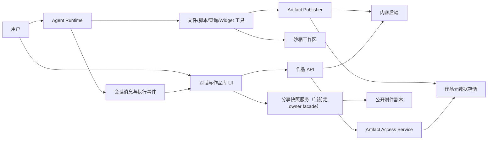
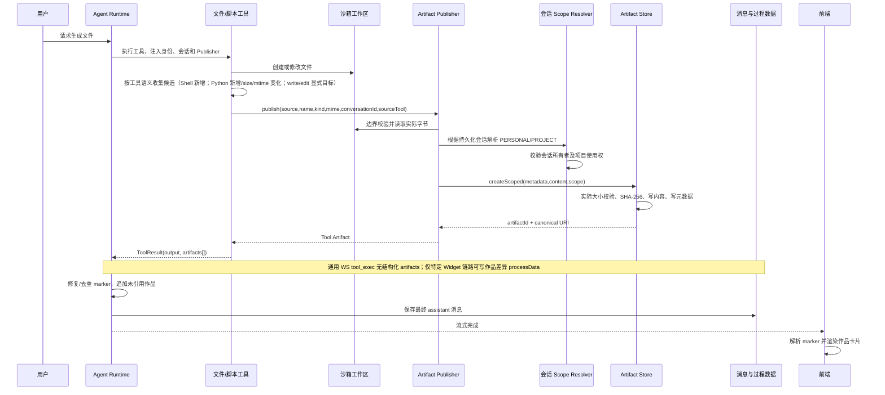
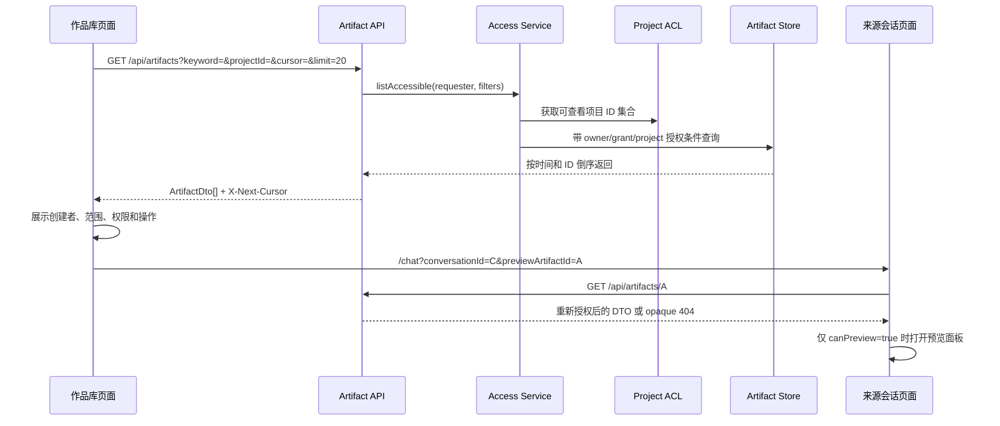
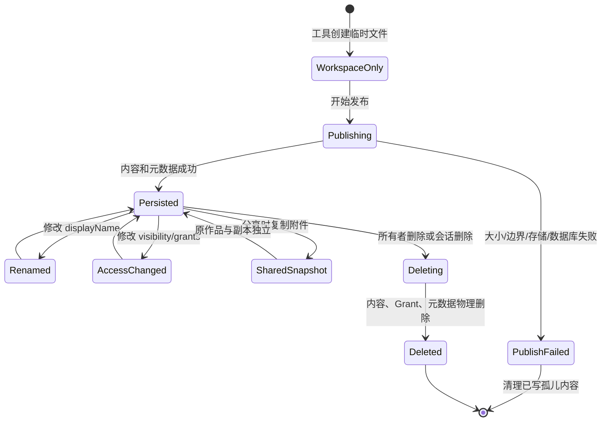

```
# Artifact 创建、归档、预览与来源追踪复刻说明

## 1. 结论与边界

### 1.1 能力结论

Artifact（下文称“作品”）是 Agent 或用户把一次性文件输出提升为长期、可授权、可预览成果的机制。它解决四个问题：

1. 工具在隔离工作区生成的文件不能直接作为稳定产品资源暴露给浏览器。
2. 一次 Agent 运行可能产生多个文件，模型可能漏写、错写或重复写文件链接。
3. 作品必须与租户、所有者、会话及项目建立归属，并支持列表、搜索、预览、下载、重命名、删除和分享访问。
4. 会话消息、作品库、工具执行证据和公开分享必须使用受控引用，而不是泄露本地路径或内部存储地址。

当前实现采用“元数据记录 + 可替换内容后端 + 产品访问服务 + 前端类型化预览”的结构：工具产生临时文件或字节，发布器生成不含业务语义的短作品 ID，将内容写入数据库或受控目录，再把结构化作品标记写入 Agent 回复。工具 SPI 的 `ToolResult` 可以携带 Artifact 列表，但当前通用 WebSocket `tool_exec` 消息没有结构化 `artifacts` 字段；不能把某些工具的 `processData` 当成所有工具都具备的执行证据。浏览器只根据作品 ID 重新取得服务端授权后的元数据和内容。当前 8 位十六进制 ID 只有 32 bit 空间，不能把“难猜”当作安全边界。

### 1.2 目标用户和最终效果

| 角色 | 可见效果 |
|---|---|
| 对话用户 | 在 Agent 回复中看到作品卡片；可以预览或下载有权限的作品 |
| 作品所有者 | 在“全部作品”和会话侧栏中管理作品，重命名、删除、调整可见性 |
| 项目成员 | 可读取项目范围且可见性为 `PROJECT` 的作品，但不能代替所有者管理 |
| 显式被授权用户 | 可读取 `GRANTED` 作品，但不能重命名、删除或修改授权 |
| 匿名分享访问者 | 只能读取分享时复制出的快照附件，不能直接访问原始作品 |
| 工具/Agent Runtime | 发布文件，取得稳定引用，并把引用加入 ToolResult 和回复正文；特定 Widget 链路可另写 processData |

### 1.3 输入与输出

典型输入包括：

- 工具生成的沙箱文件路径；
- 工具直接返回的字节内容；
- 用户主动保存的 HTML、SVG 或 Mermaid 内容；
- 作品名称、MIME 类型、来源工具、会话 ID；
- 当前租户用户身份及会话绑定的项目；
- 作品列表过滤、授权变更或内容读取请求。

典型输出包括：

- 持久化作品记录和内容对象；
- 形如 `/api/artifacts/{artifactId}/content` 的稳定内容地址；
- Agent 回复中的结构化作品卡片标记；
- Tool SPI 结果中的作品清单；特定 Widget 链路的 processData 可能另有作品差异信息；
- 作品库列表、类型化预览、下载文件和来源会话回链；
- 公开分享命名空间中的独立附件副本。

### 1.4 明确边界

本文包含作品发布、自动发现、持久化、授权、列表、预览、下载、版本展示、来源追踪、删除、会话联动和公开分享复制。

本文不负责讲解：

- 上传文件如何进入会话工作区；
- 图表、报告、PPT 的业务生成逻辑；
- Citation 如何生成和编号；
- 分享链接的完整生命周期；
- Docker/目录沙箱的完整实现。

这些能力与作品存在交互，本文只给出复刻本模块所需的接口边界。

### 1.5 当前实现、缺陷与建议的区别

- `I`：作品记录是物理持久化；当前没有软删除、归档时间或独立的 `ARCHIVED` 状态。“归档到作品库”只是创建持久化记录。
- `I`：当前持久化来源字段包括 `conversationId`、`sourceTool`；工具 SPI 的 `ToolResult` 可以带 Artifact，但通用 WebSocket `tool_exec` 消息不带结构化 `artifacts`，且没有独立 `sourceMessageId`、`toolCallId`、`runId` 或血缘边表。
- `I`：同一会话中同一原始文件名可以保存多次，每次生成不同 ID 和独立内容；前端把它们解释成版本。
- `A`：API 黑盒用例要求列表、详情、内容、删除、同名版本、跨账号隔离和发布引用可用，但本次分析没有运行用例。
- `K`：黑盒测试记录旧的会话路径 `/api/files/{conversationId}/artifacts/{path}` 在发布环境可能返回 404；应使用 canonical 作品内容 URL。
- `K/I`：UI E2E 仍将“缺少版本入口”登记为预期失败，但当前前端源码已经存在版本入口。说明测试仓与产品仓可能不在完全相同版本，不能据此声称运行环境已修复。
- `I`：兼容桥接可直接接受 `file:` URI 并读取宿主路径，没有先证明它位于当前沙箱根内。这是需要在复刻时收紧的高风险兼容边界。
- `P`：发布失败无悬空引用、按保留期清理过期作品等测试仍为 planned，不能视为当前运行保证。
- `D`：生产复刻应增加显式生命周期状态、来源消息/运行血缘、对象存储、病毒扫描、Outbox 和异步物理删除。

## 2. 术语与参与方

| 术语 | 含义 |
|---|---|
| 工作区文件 | 工具执行期间位于沙箱或会话文件目录中的临时文件，不天然具有长期产品权限 |
| Tool Artifact | 工具结果中的轻量产物描述：种类、名称、MIME、字节或 URI |
| Published Artifact | 已写入作品存储并获得稳定 ID 的产品作品 |
| Artifact Record | NovaCore SPI 的持久化作品元数据：ID、身份、会话、名称、类型、MIME、大小、存储、哈希、来源工具、metadata、创建时间；本身没有 `projectId` 或 `visibility` |
| Scoped Artifact | `ArtifactRecord + scopeType + scopeId + visibility` 的应用层组合，表达个人或项目访问范围 |
| Artifact DB Row | 产品数据库中的落库形态；将 Artifact Record 与 scope 的 `projectId/visibility` 等字段扁平存储 |
| Artifact API DTO | 面向 UI 的投影；除作品字段外还包含项目名、创建者、计算后的 permissions 和 canonical content URL |
| Artifact Content | 作品字节，可存数据库 blob、受控本地目录或生产对象存储 |
| Artifact Marker | 回复正文中的结构化引用，包含 ID、名称、URL、类型、大小；只用于展示，不是授权凭证，也不是独立持久化 Manifest |
| Scope | `PERSONAL` 或 `PROJECT`，由来源会话的持久化项目绑定决定 |
| Visibility | `OWNER_ONLY`、`GRANTED` 或 `PROJECT` |
| Grant | 同租户内授予特定用户读取作品的记录 |
| Source Conversation | 生成作品的来源会话；作品库点击后可回到该会话并请求预览指定作品 |
| Share Attachment | 创建公开分享时复制到分享命名空间的独立附件，不再依赖原作品 ACL |



## 3. 业务规则

### 3.1 创建与发布规则

1. 作品必须归属于一个具体租户用户，租户级匿名所有者不允许发布作品。
2. 产品主链路要求存在来源会话；发布时必须确认该会话确实属于当前租户和用户。
3. 会话没有项目绑定时，作品写入 `PERSONAL + OWNER_ONLY`。
4. 会话绑定有效项目时，发布者必须仍具备项目使用权，作品写入 `PROJECT + PROJECT`。
5. 作品 ID 由服务端生成；当前实现使用 8 位十六进制短 ID。生成器会先调用 `exists(id)` 并在发现已占用时有限重试，但 `exists` 通过后到数据库插入前存在 TOCTOU 窗口；若此时唯一键冲突，当前实现会清理已写内容并抛错，不会换 ID 重试。
6. `displayName` 初始等于 `originalFilename`；重命名只能修改 `displayName`。
7. 实际读取的字节数是大小上限的权威依据，不能信任调用方声明的大小。
8. 未提供内容哈希时计算 SHA-256；哈希用于完整性和诊断，当前不用于内容去重。
9. 单作品默认上限为 100 MiB。超过上限必须在元数据创建前失败。
10. 内容先写后端、元数据插入失败时，应删除刚写入的孤儿内容。
11. 同名作品不覆盖旧记录，每次发布创建新 ID；同名只是前端版本归组条件。
12. 工具没有显式引用已生成作品时，最终化阶段仍要把本次新作品追加到回复末尾。

### 3.2 自动发现规则

不同文件工具的发现语义并不相同，复刻时不能统一写成“都只扫描新增文件”：

| 工具路径 | 当前候选判定 |
|---|---|
| Shell | 执行前后快照比较，只把执行后新增的路径作为自动发布候选；原路径内容被覆盖不算新增 |
| Python | 新增路径，或同一路径的 `size`/`mtime` 发生变化，均可成为候选 |
| write/edit 类文件工具 | 不依赖全盘差异扫描；把本次调用的显式目标路径作为候选 |

这些候选还必须满足：

- 只扫描工作区根内的普通文件；
- 目录和结果按稳定路径顺序处理；
- 跳过隐藏目录和依赖/构建目录；
- 自动发现只接纳规定扩展名；
- 工具明确指定的目标文件可以绕过扩展名白名单，但不能绕过路径边界和硬排除目录。

自动发现扩展名至少覆盖：Office 文档、PDF、CSV/TSV、文本/Markdown、HTML、常见图片、常见压缩包、音视频。

硬排除目录至少包括：`outputs`、依赖目录、版本控制目录、缓存目录、虚拟环境、构建目录和编译输出目录。隐藏路径在自动发现模式中也必须排除。

### 3.3 访问规则

读权限满足以下任一条件：

1. 请求者是同一租户下的所有者；
2. 作品为 `GRANTED`，且存在当前用户的同租户 Grant；
3. 作品为 `PROJECT`，其 `projectId` 有效，且当前用户仍有项目查看权。

管理权限只属于所有者。租户管理员能够读取他人会话，不代表能读取该会话产生的作品。对不存在、跨租户或无读权限的作品统一返回 404，以免泄露资源存在性；已能读取但不是所有者的管理操作返回 403。

`canPreview`、`canDownload`、`canManage` 必须由服务端逐作品返回，前端缺少该字段时应默认全部拒绝。下载还受租户级下载开关控制，预览不受该开关影响。

### 3.4 列表与版本规则

- 排序固定为 `created_at DESC, artifact_id DESC`。
- 游标由精确时间和 ID 组成，保证同一微秒创建的记录不丢不重。
- 单页允许 1～500 条，产品页面默认 20，通用客户端通常按 100 分页。
- 支持会话、关键字、项目、个人范围、可见性过滤。
- `projectId` 与 `personalOnly=true` 互斥。
- 关键字对显示名和原始文件名做不区分大小写的包含匹配。
- 版本不是独立后端实体：同一 `conversationId + originalFilename` 的记录由前端聚合，按创建时间倒序显示。
- 修改显示名不会改变版本归组；改变原始文件名当前没有产品 API。

### 3.5 内容与预览规则

- Canonical 内容地址是 `/api/artifacts/{id}/content`。
- `download=false` 返回 `Content-Disposition: inline`；`download=true` 返回 `attachment`。
- MIME 优先使用记录值，缺失时降级为 `application/octet-stream`。
- 文件名必须用 UTF-8 Content-Disposition 编码，避免中文和特殊字符破坏响应头。
- 未知或不支持预览的文件只能给出下载入口，不能把原始字节当 HTML 插入页面。
- HTML 必须在无同源权限的 sandbox iframe 中执行；当前语义为 `sandbox="allow-scripts"`，不得增加 `allow-same-origin`。
- 文本预览上限 5 MiB，读取超时 30 秒；表格预览上限 200 行、50 列，超出时显示截断提示。
- PDF、DOCX、PPTX、XLSX 应由浏览器本地库读取受控内容 URL，不向外部 Office 在线预览服务泄露私有 URL。

### 3.6 来源、删除和分享规则

- 作品记录保存来源会话和来源工具；工具 SPI 的 `ToolResult.artifacts` 可在同一次 Java 调用链中返回轻量 Artifact 描述。
- 通用 WebSocket `tool_exec` 消息没有结构化 `artifacts` 字段。只有 WidgetRegistry 相关链路会比较执行前后作品并把差异写入自己的 `processData`；这不保证 Shell、Python 或任意 Tool 都有同样字段。
- 回复 Marker 能证明某条最终文本展示了作品；ToolResult 只能证明调用时返回过描述。当前没有数据库级 `source_message_id` 强关联，不能仅凭通用 WS 事件精确建立“消息—tool call—作品”血缘。
- 作品库中的来源回链只携带 `conversationId` 和 `previewArtifactId`，目标页面必须重新请求作品详情并重新鉴权，不能信任 URL 中的文件名或内容地址。
- 删除作品是物理删除：内容与元数据均删除，Grant 通过外键级联删除。
- 删除会话时先软删除会话，再删除该用户在该会话下的全部作品和旧文件目录，最后清理沙箱。沙箱清理失败只告警，不回滚前面的删除。
- 创建公开分享时，把能读取到的原作品字节复制到 `shares/{shareId}/{publicFileToken}`，私有 URL 改写为公开附件 URL。分享访问者不直接持有原 Artifact ID 权限。
- 当前 SnapshotBuilder 读取 Artifact 时走 owner facade，而不是通用 ArtifactAccessService。因此创建者能够复制自己所有的作品；仅因 `GRANTED` 或 `PROJECT` 获得读取权、但作品属于他人的分享者，复制会失败并把引用替换为“文件已省略”。这是当前限制，不应误写为统一读权限已覆盖分享。
- 会话删除会触发分享撤销/清理链；生产实现应保证分享快照、作品删除和会话软删的一致性边界清晰。

## 4. 完整执行链路

### 4.1 工具生成并自动发布



关键分支：

1. 工具直接返回已经是 canonical 内容地址的作品时，桥接层复用已有作品，不重复复制。
2. 工具返回旧 `/api/files/...`、`file:` 或字节内容时，桥接层读取源并创建新作品。
3. Artifact bridge 可在本次运行前后做作品 ID 快照，把运行后新增记录视为本次生成；WidgetRegistry 也会用差异生成自己的 processData，但这不是所有工具的通用 WS 契约。
4. 同一次运行中同名多次生成时，最终回复只选择最新成功持久化的版本；数据库仍保留所有版本。
5. 无法解析或未持久化的结构化 Marker 必须从最终输出删除，防止 UI 展示伪造引用。

### 4.2 用户主动保存内联内容

用户点击 HTML/SVG/Mermaid 块的“保存为作品”后：

1. 前端提交会话 ID、标题、内容、类型。
2. 服务端拒绝空标题、空内容以及包含 `..` 或 `/` 的非法会话 ID。
3. 类型映射为 `.html`、`.svg` 或 `.md`。
4. 标题只保留文字、数字、中文、点、横线和空格，最多 60 字符；空结果使用 `artifact`。
5. 内容先写入当前用户会话的沙箱工作区。
6. 发布器从沙箱读取并创建作品，来源工具记为 `InlineSave`。
7. 成功返回 ID、URL 和文件名，前端增加刷新计数并重新拉取会话作品。

### 4.3 作品库列表、搜索与来源回链



无来源会话的作品在新窗口打开 canonical 内容地址；有来源会话的作品进入会话页面。回链查询参数不能带可信权限数据，历史的 `preview`、`previewName` 等参数必须忽略。

### 4.4 预览与下载

1. UI 从详情 DTO 读取 `permissions`，没有 `canPreview` 时不发内容请求。
2. 根据显示文件名扩展名选择 Renderer。
3. Renderer 读取 canonical 内容地址；下载则附加 `download=1`。
4. 服务端先按 ID 和租户加载作品，再判断 owner/grant/project 权限。
5. 下载请求额外读取租户下载开关。
6. 内容后端按 `storageType` 打开流；如果迁移前本地内容尚未入新后端，则可在严格根目录校验后从 legacy 根读取。
7. 找不到记录、无权或内容缺失时分别返回 opaque 404；不得暴露存储路径、堆栈或后端类型。

### 4.5 删除与会话联动



当前没有“回收站”或恢复路径。复刻若需要审计和可恢复性，应使用软删除状态 + 延迟物理清理，不要改变外部 API 的立即不可读效果。

## 5. 对外契约

### 5.1 Artifact REST API

所有 `/api/artifacts/**` 接口均要求已认证租户用户。

#### 5.1.1 列表

```http
GET /api/artifacts?conversationId=conv-123&keyword=report&projectId=prj-9&visibility=PROJECT&cursor=v2%3A1786000000%3A123000%3Aa1b2c3d4&limit=20
```

| 参数 | 类型 | 必填 | 默认 | 语义 |
|---|---|---:|---|---|
| `conversationId` | string | 否 | 无 | 精确来源会话过滤 |
| `keyword` | string | 否 | 无 | 显示名或原始文件名包含匹配 |
| `projectId` | string | 否 | 无 | 项目范围过滤，与 `personalOnly` 互斥 |
| `personalOnly` | boolean | 否 | false | 只查询个人范围 |
| `visibility` | enum | 否 | 无 | `OWNER_ONLY`、`GRANTED`、`PROJECT` |
| `cursor` | string | 否 | 无 | 上页响应给出的不透明游标 |
| `limit` | integer | 否 | 100 | 1～500 |

响应头在还有下一页时包含：

```http
X-Next-Cursor: v2:1786000000:123000:a1b2c3d4
```

响应体：

```json
[
  {
    "id": "a1b2c3d4",
    "displayName": "月度订单额分析.pptx",
    "originalFilename": "monthly-order-analysis.pptx",
    "type": "DOCUMENT",
    "mimeType": "application/vnd.openxmlformats-officedocument.presentationml.presentation",
    "size": 428156,
    "conversationId": "conv-123",
    "sourceTool": "execute_python",
    "projectId": "prj-9",
    "projectName": "增长分析",
    "visibility": "PROJECT",
    "creator": {
      "userId": "user-7",
      "displayName": "分析员甲"
    },
    "permissions": {
      "canPreview": true,
      "canDownload": true,
      "canManage": false
    },
    "createdAt": "2026-08-07T10:15:30.123",
    "contentUrl": "/api/artifacts/a1b2c3d4/content"
  }
]
```

错误：

- `400`：limit 越界、互斥参数同时出现、未知可见性、非法游标。
- `401`：未认证。

非法游标的稳定错误体应为：

```json
{
  "success": false,
  "message": "Artifact cursor is invalid",
  "errorCode": "ARTIFACT_CURSOR_INVALID"
}
```

游标编码兼容：

```text
v2:<epochSecond>:<nano>:<artifactId>
legacy: <epochMillis>:<artifactId>
```

新客户端只能把游标当作不透明字符串。服务端可在内部签名游标以防过滤条件篡改。

#### 5.1.2 详情

```http
GET /api/artifacts/{artifactId}
```

成功返回单个 `ArtifactDto`。无记录、跨租户和无读权限统一返回：

```http
HTTP/1.1 404 Not Found
Content-Type: application/json

{
  "success": false,
  "message": "Artifact not found: a1b2c3d4",
  "errorCode": "ARTIFACT_NOT_FOUND"
}
```

生产环境建议把 message 也改为不回显提交的 ID。

#### 5.1.3 内容与下载

```http
GET /api/artifacts/{artifactId}/content
GET /api/artifacts/{artifactId}/content?download=true
```

响应示例：

```http
HTTP/1.1 200 OK
Content-Type: text/html
Content-Disposition: inline; filename*=UTF-8''report.html
Content-Length: 2874

<binary body>
```

下载关闭时：

```http
HTTP/1.1 403 Forbidden

download is disabled for this tenant
```

复刻建议统一成 JSON 错误信封，并增加 `Cache-Control: private, no-store`、`X-Content-Type-Options: nosniff`、可配置 CSP。内容缺失返回 404，绝不能返回数据库异常或物理路径。

#### 5.1.4 重命名

```http
PATCH /api/artifacts/{artifactId}
Content-Type: application/json

{"displayName":"董事会汇报.pptx"}
```

规则：trim 后非空、最多 255 字符；只允许所有者。成功返回更新后的 DTO。

#### 5.1.5 删除

```http
DELETE /api/artifacts/{artifactId}
```

成功：`204 No Content`。只允许所有者。删除后详情和内容均必须变成 404，列表中不得再出现。

#### 5.1.6 Grants 与访问替换

```http
GET /api/artifacts/{artifactId}/grants
```

```json
[
  {"userId":"user-8","displayName":"分析员乙"}
]
```

```http
PUT /api/artifacts/{artifactId}/access
Content-Type: application/json

{
  "visibility": "GRANTED",
  "granteeUserIds": ["user-8", "user-9"]
}
```

访问更新是全量替换，不是增量追加：

- `GRANTED`：校验全部用户存在且属于同一租户，然后原子替换 Grant 集合。
- `OWNER_ONLY` 或 `PROJECT`：忽略请求携带的用户集合并清空已有 Grant。
- 个人作品不能设置 `PROJECT`。

稳定错误码：

| HTTP | errorCode | 条件 |
|---:|---|---|
| 400 | `ARTIFACT_VISIBILITY_INVALID` | 空、未知可见性，或个人作品设置 PROJECT |
| 400 | `ARTIFACT_GRANTEE_INVALID` | 空白用户 ID、用户不存在或跨租户 |
| 403 | `ARTIFACT_ACCESS_DENIED` | 非所有者管理 |
| 404 | `ARTIFACT_NOT_FOUND` | 不存在或不可读 |

候选用户接口：

```http
GET /api/artifacts/grant-candidates?artifactId=a1b2c3d4&keyword=alice
```

只允许所有者调用；最多返回 100 个同租户用户，排除所有者本人。

### 5.2 内联作品保存接口

```http
POST /api/files/save-artifact
Content-Type: application/json

{
  "conversationId": "conv-123",
  "title": "区域订单趋势",
  "content": "<!doctype html><html>...</html>",
  "type": "html"
}
```

成功响应：

```json
{
  "status": "ok",
  "id": "a1b2c3d4",
  "url": "/api/artifacts/a1b2c3d4/content",
  "filename": "区域订单趋势.html"
}
```

这是兼容入口。生产复刻建议提供专门的 `POST /api/artifacts`，使用 multipart 或受限 JSON payload，并把会话所有权校验置于写沙箱前。

### 5.3 旧接口兼容

| 路径 | 用途 | 复刻建议 |
|---|---|---|
| `GET /api/files/all-artifacts` | 旧的全作品数组 | 保留一版兼容，内部转调新列表 |
| `GET /api/files/{conversationId}/artifacts-list` | 旧的会话作品数组 | 保留一版兼容 |
| `GET /api/files/{conversationId}/artifacts/{path}` | 旧路径下载 | 只做迁移兼容，返回 308 到 canonical URL 更稳妥 |
| `GET /api/files/{conversationId}/{subpath}` | 会话文件或上传文件 | 这是工作区文件句柄，不是作品句柄 |

`K`：旧会话作品路径在黑盒发布环境中存在 404 记录。新实现必须以 ID 内容接口为唯一对外主契约。

### 5.4 工具发布契约

工具侧请求：

```json
{
  "source": "workspace-relative-or-host-path",
  "name": "monthly-report.pptx",
  "kind": "FILE",
  "mimeType": "application/vnd.openxmlformats-officedocument.presentationml.presentation",
  "conversationId": "conv-123",
  "sourceTool": "execute_python"
}
```

工具侧返回：

```json
{
  "kind": "FILE",
  "name": "monthly-report.pptx",
  "mimeType": "application/vnd.openxmlformats-officedocument.presentationml.presentation",
  "content": null,
  "uri": "/api/artifacts/a1b2c3d4/content"
}
```

`sourceTool` 缺失时应由 Tool Executor 装饰器自动补入当前工具名，避免依赖每个工具手工填写。

### 5.5 消息 Marker、ToolResult 与 WebSocket 事件

Agent 回复 Marker：

```text
[artifact:{"id":"a1b2c3d4","filename":"monthly-report.pptx","url":"/api/artifacts/a1b2c3d4/content","type":"DOCUMENT","size":428156}]
```

Tool SPI 的 Java 侧结果可以表达：

```json
{
  "output": "generated monthly-report.pptx",
  "artifacts": [
    {
      "kind": "FILE",
      "name": "monthly-report.pptx",
      "mimeType": "application/vnd.openxmlformats-officedocument.presentationml.presentation",
      "uri": "/api/artifacts/a1b2c3d4/content"
    }
  ]
}
```

这不是当前通用 WebSocket `tool_exec` 帧的 JSON 契约。通用帧只应按其真实字段消费，不能假设存在 `artifacts[]`。WidgetRegistry 是特例：它比较 Widget 执行前后的作品集合，并把差异生成到该 Widget 的 `processData`；Shell/Python 的自动发布并不因此获得相同的结构化 WS 字段。

自动化用例 `FILE-ART-001` 会从多个可能载体扫描 Artifact 引用来适配不同版本/链路；用例成功最多证明“某个受支持载体出现了引用”，不能单独证明通用 `tool_exec.artifacts[]` 存在。若生产协议需要稳定执行血缘，推荐显式新增版本化 WS 内容块：

```json
{
  "type": "artifact_refs",
  "schemaVersion": 1,
  "toolCallId": "call-72",
  "artifactIds": ["a1b2c3d4"]
}
```

Marker 解析必须校验：对象形状、非空 ID/名称、有限且非负大小、已知类型，以及 URL 必须以 `/api/` 开头且不含空白、尖括号、引号或圆括号。即便 Marker 合法，点击时仍必须按 ID 请求详情重新鉴权。

### 5.6 配置契约

```yaml
nova:
  artifacts:
    allowed-extensions: [html, pdf, docx, xlsx, pptx, csv, png, jpg, jpeg, gif, svg, webp]

  storage:
    artifact:
      default-storage-type: db       # db | local-dir
      max-size-bytes: 104857600
      local-dir:
        base-path: data/artifacts
```

注意：产品旧配置 `nova.artifact.storage.*` 只服务分享快照及兼容清理；聊天作品的实际内容后端由 `nova.storage.artifact.*` 控制。复刻时应删除这种双配置歧义，只保留一个主配置并为分享附件使用独立命名空间。

`nova.artifacts.allowed-extensions` 主要约束旧磁盘扫描结果；当前数据库驱动的 `/api/artifacts` 主列表不会据此过滤已有记录。复刻时应明确选择：若它是安全策略，应在发布入口统一拒绝；若它只是 UI 展示策略，就不应让列表和详情产生不一致。

## 6. 数据模型与生命周期

### 6.1 四层数据形态（不可合并为一个 Manifest）

当前实现不存在一个同时承担存储、授权、展示和血缘的独立 Artifact Manifest。复刻时必须区分以下四层，否则容易把 UI 字段误塞进 SPI 稳定契约。

#### 第一层：Artifact Record（NovaCore SPI）

```json
{
  "artifactId": "a1b2c3d4",
  "tenantId": "tenant-1",
  "ownerUserId": "user-7",
  "conversationId": "conv-123",
  "displayName": "董事会汇报.pptx",
  "originalFilename": "monthly-report.pptx",
  "fileType": "DOCUMENT",
  "mimeType": "application/vnd.openxmlformats-officedocument.presentationml.presentation",
  "sizeBytes": 428156,
  "storageType": "db",
  "storageRef": "a1b2c3d4",
  "contentHash": "3c56...64-hex-chars",
  "sourceTool": "execute_python",
  "metadata": {
    "pptxSlidePreview": {
      "schemaVersion": 1,
      "role": "deck",
      "batchId": "pptx-slide-preview:conv-123:a1b2c3d4",
      "artifactId": "a1b2c3d4",
      "slideImageCount": 6
    }
  },
  "createdAt": "2026-08-07T02:15:30.123456Z"
}
```

Artifact Record 没有 `projectId`、`projectName`、`visibility`、`creator` 或 `permissions`。示例使用 DB 内容后端，因此 `storageRef` 等于 Artifact ID；本地目录后端才使用受控相对路径。

#### 第二层：Scoped Artifact（应用组合）

```json
{
  "artifact": {"artifactId":"a1b2c3d4", "conversationId":"conv-123"},
  "scopeType": "PROJECT",
  "scopeId": "prj-9",
  "visibility": "PROJECT"
}
```

它把 Artifact Record 与访问范围组合起来。个人作品通常是 `scopeType=PERSONAL`、`scopeId=user-7`、`visibility=OWNER_ONLY`；项目作品是 `scopeType=PROJECT`、`scopeId=prj-9`。Grant 是另一组关系，不嵌入 Artifact Record。

#### 第三层：Artifact DB Row

数据库为查询效率把上述两层扁平到一行，使用 `owner_user_id`、`project_id` 和 `visibility` 等列，并由 Grant 表表达显式授权。下一节 DDL 是这一层，不等价于 NovaCore SPI 对象。

#### 第四层：Artifact API DTO

API DTO 是面向当前请求者的投影：在记录字段上补充 `projectId/projectName`、创建者、计算得到的 `canPreview/canDownload/canManage` 和 canonical `contentUrl`。它不返回 `storageRef`、内容哈希或物理路径；完整示例见 5.1.1。

`metadata` 是扩展字段，不应承载核心授权语义。PPTX 预览可用它关联幻灯片图片，生产实现应给 metadata 增加 schema version 并限制大小。CAN 指标链路中出现的“指标 manifest”属于另一种业务产物/协议，不是 Artifact 生命周期的通用 Manifest，也不能据此推导每个 Artifact 都有独立 manifest 记录。

### 6.2 可复刻 PostgreSQL DDL

```sql
CREATE TABLE chat_artifact (
    id                  bigint GENERATED BY DEFAULT AS IDENTITY PRIMARY KEY,
    artifact_id         varchar(16) NOT NULL,
    tenant_id           varchar(64) NOT NULL,
    owner_user_id       varchar(64) NOT NULL,
    conversation_id     varchar(64),
    display_name        varchar(255) NOT NULL,
    original_filename   varchar(255) NOT NULL,
    file_type           varchar(31) NOT NULL,
    mime_type           varchar(127),
    size_bytes          bigint NOT NULL CHECK (size_bytes >= 0),
    storage_type        varchar(31) NOT NULL,
    storage_ref         varchar(512) NOT NULL,
    content_hash        varchar(64),
    source_tool         varchar(63),
    project_id          varchar(64),
    visibility          varchar(32) NOT NULL DEFAULT 'OWNER_ONLY',
    created_at          timestamp(6) NOT NULL,
    metadata            text,
    CONSTRAINT uk_chat_artifact_artifact_id UNIQUE (artifact_id),
    CONSTRAINT uk_chat_artifact_tenant_artifact UNIQUE (tenant_id, artifact_id),
    CONSTRAINT ck_artifact_visibility
      CHECK (visibility IN ('OWNER_ONLY', 'GRANTED', 'PROJECT')),
    CONSTRAINT ck_artifact_scope_visibility
      CHECK (project_id IS NOT NULL OR visibility <> 'PROJECT')
);

CREATE INDEX idx_artifact_owner_created
    ON chat_artifact (tenant_id, owner_user_id, created_at DESC, artifact_id DESC);
CREATE INDEX idx_artifact_conversation_created
    ON chat_artifact (tenant_id, conversation_id, created_at DESC, artifact_id DESC);
CREATE INDEX idx_artifact_project_visibility_created
    ON chat_artifact (tenant_id, project_id, visibility, created_at DESC, artifact_id DESC);

CREATE TABLE chat_artifact_blob (
    storage_ref varchar(512) PRIMARY KEY,
    content bytea NOT NULL,
    created_at timestamp(6) NOT NULL
);

CREATE TABLE artifact_grant (
    id bigint GENERATED BY DEFAULT AS IDENTITY PRIMARY KEY,
    tenant_id varchar(64) NOT NULL,
    artifact_id varchar(16) NOT NULL,
    grantee_user_id varchar(64) NOT NULL,
    granted_by varchar(64) NOT NULL,
    created_at timestamp(6) NOT NULL,
    CONSTRAINT uk_artifact_grant
      UNIQUE (tenant_id, artifact_id, grantee_user_id),
    CONSTRAINT fk_artifact_grant_tenant_artifact
      FOREIGN KEY (tenant_id, artifact_id)
      REFERENCES chat_artifact (tenant_id, artifact_id) ON DELETE CASCADE
);

CREATE INDEX idx_artifact_grantee
    ON artifact_grant (tenant_id, grantee_user_id, artifact_id);
```

当前实现没有把 `conversation_id` 设为外键，因为任务会话、迁移数据和孤儿兼容记录可能不存在于普通会话表。代价是需要服务层负责删除和来源完整性。

### 6.3 推荐的生产血缘扩展

当前字段不足以精确回答“哪条消息、哪个 Agent run、哪次 tool call 生成了这个作品”。建议增加：

```sql
ALTER TABLE chat_artifact
  ADD COLUMN lifecycle_status varchar(24) NOT NULL DEFAULT 'AVAILABLE',
  ADD COLUMN source_message_id bigint,
  ADD COLUMN source_run_id varchar(64),
  ADD COLUMN source_tool_call_id varchar(128),
  ADD COLUMN deleted_at timestamp(6),
  ADD COLUMN deleted_by varchar(64),
  ADD COLUMN content_scan_status varchar(24) NOT NULL DEFAULT 'PENDING';

CREATE TABLE artifact_relation (
    tenant_id varchar(64) NOT NULL,
    parent_artifact_id varchar(16) NOT NULL,
    child_artifact_id varchar(16) NOT NULL,
    relation_type varchar(32) NOT NULL,
    ordinal integer,
    metadata jsonb,
    PRIMARY KEY (tenant_id, parent_artifact_id, child_artifact_id, relation_type)
);
```

建议状态为：

```text
PUBLISHING -> SCANNING -> AVAILABLE -> DELETING -> DELETED
                      \-> QUARANTINED
PUBLISHING/SCANNING -> FAILED
```

UI 只能读取 `AVAILABLE`；删除接口可立即变为不可读，再异步删对象。

### 6.4 内容后端

#### 数据库后端

适合小体量、本地部署和事务运维简单的场景。`storageRef` 指向 blob 主键。优点是备份一致；缺点是大文件增加数据库 IO、WAL、内存和连接占用。

#### 本地目录后端

当前后端路径语义是：

```text
{base}/{tenantId}/{yyyy}/{MM}/{artifactId}-{sanitizedFilename}
```

租户段拒绝路径分隔符、NUL、`.` 和 `..`；文件名去除目录部分，替换控制字符及平台不安全字符，并限制最终路径段长度。读取时永远以数据库 `storageRef` 为准。当前正式后端做 lexical normalize 和根目录前缀检查；复刻生产版还应使用 `realpath` 和禁止跟随符号链接的普通文件检查，防止已存在符号链接造成根目录逃逸。

#### 对象存储后端（推荐生产）

对象 Key 不应包含未经处理的用户文件名：

```text
artifacts/{tenantHash}/{yyyy}/{MM}/{artifactId}/content
```

下载由应用鉴权后流式代理或签发极短期、单对象、Content-Disposition 固定的预签名 URL。预签名 URL 不进入 LLM 消息、长期数据库字段或分享快照。

### 6.5 删除生命周期

当前物理删除顺序为“删内容后端，再删元数据”。若后端删除成功而数据库删除失败，会留下指向缺失内容的记录；若后端删除失败则元数据保留，便于重试。生产建议：

1. 事务内把状态改为 `DELETING`，使 API 立即不可读；
2. 提交 Outbox 删除任务；
3. Worker 幂等删除内容；
4. 清理 Grant、关系和元数据，或保留最小审计墓碑；
5. 对失败任务指数退避并告警。

### 6.6 公开分享附件

分享附件至少保存：`shareId`、随机 public token、MIME、大小、原名、分享存储引用、原作品 ID、创建时间。公开 URL 只包含 share token 和 public file token。SnapshotBuilder 会发现消息中的 `/api/files/**` 和 `/api/artifacts/**` 引用，复制成功后改写 URL；复制失败则替换为“文件已省略”，不能把原始私有地址留给匿名访问者。

当前读取实现经过 owner facade，只能按分享创建者的所有权找到 Artifact，并没有复用 owner/grant/project 三分支的 ArtifactAccessService。因此：

| 分享创建者与作品关系 | 当前结果 |
|---|---|
| 创建者是作品 owner | 可读取并复制为分享附件 |
| 创建者仅有 `GRANTED` 读取权 | owner facade 查不到，复制失败，公开快照显示“文件已省略” |
| 创建者仅因项目成员身份可读 `PROJECT` 作品 | 同上，复制失败并省略 |

这是当前实现限制。生产复刻应让 ShareAttachmentCopier 调用统一读权限服务，并在同一时刻记录授权判定和复制审计；公开访问仍只读取快照副本，不能回源绕过 ACL。

## 7. 核心实现设计

### 7.1 模块划分

```text
artifact-domain
  Artifact, ArtifactDraft, ArtifactScope, ArtifactGrant, ArtifactReference
artifact-publish
  ToolArtifactPublisher, WorkspaceScanner, MarkerFinalizer
artifact-application
  ArtifactApplicationService, ArtifactAccessPolicy, ScopeResolver
artifact-storage
  ArtifactRepository, ContentBackend, DbBackend, ObjectStorageBackend
artifact-api
  ArtifactController, ContentController, LegacyAdapter
artifact-preview-web
  ArtifactLibrary, PreviewRouter, typed renderers, access dialog
artifact-lineage
  SourceLinkWriter, RelationRepository, conversation cleanup listener
artifact-share-adapter
  ShareAttachmentCopier, public URL rewriter
  current OwnerArtifactFacade adapter; production UnifiedArtifactReadAccess adapter
```

### 7.2 发布核心伪代码

```java
PublishedArtifact publish(UserIdentity actor, PublishRequest request) {
  requireNonBlank(request.conversationId());
  Conversation conv = conversationRepo.requireOwned(
      actor.tenantId(), actor.userId(), request.conversationId());
  Path source = sandbox.requireReadableRegularFile(actor, conv.id(), request.source());

  long actualSize = Files.size(source);
  require(actualSize <= config.maxArtifactBytes());
  String hash = sha256(source);
  ArtifactScope scope = conv.projectId() == null
      ? personalOwnerOnly()
      : requireProjectUseAndBuildProjectScope(actor, conv.projectId());

  // 当前 nextUniqueId 只对预检查已存在的 ID 做有限重试。
  String artifactId = idGenerator.nextIdWhoseExistsCheckIsFalse();
  String storageRef = null;
  try {
    storageRef = contentBackend.put(artifactId, actor, source, actualSize, hash);
    Artifact row = repository.insert(new ArtifactDraft(
        artifactId, actor, conv.id(), request.name(), request.name(),
        classify(request.name()), normalizeMime(request.mimeType()), actualSize,
        contentBackend.type(), storageRef, hash, request.sourceTool(), scope));
    lineage.record(row.id(), request.sourceMessageId(), request.runId(), request.toolCallId());
    return toPublished(row);
  } catch (RuntimeException failure) {
    if (storageRef != null) contentBackend.deleteQuietly(storageRef);
    throw failure;
  }
}
```

上述伪代码忠实表达当前边界：`exists=false` 不是插入保留。若并发请求在检查后抢先插入同一 ID，`repository.insert` 的唯一键错误进入 catch，刚写内容被清理，然后错误向上抛出；当前代码不生成新 ID 重做。生产复刻应在识别到“Artifact ID 唯一键冲突”时，确认内容清理完成后以新 ID 重做完整 put+insert，使用有限次数和退避；其他数据库错误不得误判为冲突重试。

### 7.3 授权查询核心 SQL

```sql
SELECT a.*
FROM chat_artifact a
WHERE a.tenant_id = :tenantId
  AND (
       a.owner_user_id = :userId
       OR (a.visibility = 'GRANTED' AND EXISTS (
            SELECT 1 FROM artifact_grant g
            WHERE g.tenant_id = a.tenant_id
              AND g.artifact_id = a.artifact_id
              AND g.grantee_user_id = :userId))
       OR (a.visibility = 'PROJECT' AND a.project_id = ANY(:viewableProjectIds))
  )
  AND (:conversationId IS NULL OR a.conversation_id = :conversationId)
  AND (:keyword IS NULL OR lower(a.display_name) LIKE '%' || lower(:keyword) || '%'
                         OR lower(a.original_filename) LIKE '%' || lower(:keyword) || '%')
  AND (:beforeTime IS NULL OR
       a.created_at < :beforeTime OR
       (a.created_at = :beforeTime AND a.artifact_id < :beforeId))
ORDER BY a.created_at DESC, a.artifact_id DESC
LIMIT :limit;
```

项目 ID 的授权集合必须由项目权限服务计算；不能直接相信请求的 `projectId`。

### 7.4 Marker 最终化算法

```text
输入：模型正文、ToolResult.artifacts、本次运行前作品快照、本次运行后作品列表
1. 识别已经是 canonical URL 的作品并复用。
2. 把字节、file URI、旧 files URL 发布为 canonical 作品。
3. 用文件名和本次新增 ID 关联工具返回与已提前发布的记录。
4. 对同名记录选择本次运行最后一个成功版本作为正文最终版本。
5. 解析结构化 Marker；无对应持久化作品的 Marker 删除。
6. 修复模型把 Marker 塞进 Markdown 图片目的地址的情况。
7. 把 Markdown 链接、行内代码文件名或裸文件名替换成作品卡片 Marker。
8. 去掉重复 Marker。
9. 对未在正文出现的本次作品按生成顺序追加 Marker。
10. 保存最终正文；若当前工具属于 WidgetRegistry 链路，可另保存该链路按前后差异生成的 processData。不要虚构通用 `tool_exec.artifacts`。
```

不要用单个贪婪正则处理任意 JSON。生产实现应使用明确 token 协议或消息内容块，例如：

```json
{
  "type": "artifact_ref",
  "artifactId": "a1b2c3d4"
}
```

由服务端在返回 DTO 时补齐文件名、权限和 URL。

### 7.5 预览路由

| 扩展名 | Renderer | 安全与上限 |
|---|---|---|
| html/htm | sandbox iframe srcDoc | 仅 `allow-scripts`，动态高度限制 240～20000 px |
| pdf | PDF.js canvas | 不执行 PDF 中脚本，逐页渲染 |
| docx | docx-preview | Blob 本地解析；限制解压大小和元素数 |
| pptx | pptx-preview 或关联幻灯片图片 | 修复无效 Content-Type 引用；失败显示明确错误 |
| xlsx/xls/csv | SheetJS 表格 | 第一工作表，最多 200 行×50 列，显示截断提示 |
| md | Markdown 预览/源码切换 | 禁止原始 HTML 或做严格 sanitize |
| png/jpg/jpeg/gif/svg/webp | image | SVG 建议以图片响应隔离，不内联 DOM |
| json/txt/log/xml/yaml/sql/code | text | 5 MiB、30 秒、自动换行；JSON 可格式化 |
| 其他 | fallback | 仅在 canDownload 时提供下载 |

### 7.6 最小可用版与生产级版

| 方面 | 最小可用版 | 生产级版 |
|---|---|---|
| 存储 | PostgreSQL blob | 对象存储 + 校验和 + 生命周期策略 |
| ID | 随机短 ID + 冲突检测 | UUIDv7/ULID 或随机 128-bit 公共 ID |
| 发布 | 同步读取和写入 | 流式上传、隔离扫描、Outbox 状态机 |
| 来源 | conversationId + sourceTool | message/run/toolCall/parent-child 完整血缘 |
| 删除 | 同步物理删除 | 软删立即不可读 + 异步幂等物理删除 |
| 版本 | 同会话同原名动态聚合 | artifact_family/version 表，乐观锁与版本标签 |
| 预览 | 浏览器本地库 | 独立预览服务、资源限额、缓存和恶意文件隔离 |
| 分享 | 创建时复制 | 加密对象、副本保留策略、撤销清理和审计 |

## 8. 并发与非正常路径

### 8.1 并发发布与同名版本

- 同名发布不应使用名称唯一约束；每次发布独立 ID。
- 当前 ID 生成器只在 `exists(id)=true` 时有限重试。`exists=false` 与后续 insert 不是原子操作；TOCTOU 唯一冲突会先清理本次已写内容，再直接抛错，不会换 ID 重试。
- 生产实现应优先使用足够长的随机 ID/UUIDv7/ULID；仍发生 Artifact ID 唯一键冲突时，只捕获可确认的目标唯一约束，清理本轮内容，再用新 ID 有界重试整个写入。不得对其他唯一约束或未知数据库异常盲目重试。
- 同一工具执行被重试时，当前实现可能创建重复版本。生产接口应接受 `idempotencyKey = tenant/run/toolCall/outputName`。
- 幂等表应记录发布状态和结果 ID；同 key 的并发请求只允许一个创建，其他返回相同结果。

### 8.2 内容和元数据部分成功

- 内容成功、元数据失败：同步清理内容；清理失败记录 orphan 指标并交后台回收。
- 元数据成功、内容失败：禁止提交元数据。
- ID 的 TOCTOU 唯一冲突：当前行为是清理内容并失败；推荐行为是清理后用新 ID 有界重试，且每轮 storage key 都必须随 ID 更新。
- 文件发布成功但最终消息保存失败：作品仍存在于作品库；需要来源 run 状态标记为 orphaned-response，而不是偷偷删除用户成果。
- Marker 桥接失败：主对话 fail-soft，去掉未验证 Marker并记录告警；作品仍可在作品库发现。

### 8.3 删除竞争

- 下载与删除并发：授权和打开内容之间可能发生删除。允许下载成功或返回 404，但不得返回 500。
- 列表与删除并发：游标分页可能看到页间变化；客户端按 ID 去重，并检测重复游标。
- 修改权限与下载并发：至少在打开流前重新读取权限；高敏感环境应使用短事务或授权版本号。
- 会话删除与作品发布并发：Scope Resolver 必须拒绝已删除会话；生产实现应以会话行锁或状态条件写防止删除后新增作品。

### 8.4 内容异常

- 超过上限：`413` 或稳定业务错误 `ARTIFACT_TOO_LARGE`，不得产生记录。
- 未注册的 storage type：内部配置错误，不回显后端映射。
- 内容记录存在但 blob/对象缺失：返回 404 或 `ARTIFACT_CONTENT_UNAVAILABLE`，告警并进入一致性修复队列。
- MIME 与扩展名不一致：下载可保留原字节；预览必须按服务端嗅探/安全策略决定，不能只信上传 MIME。
- 恶意压缩包、Office zip bomb：解析前检查压缩比、解压大小、文件数和 XML 实体。
- HTML 外链：sandbox 能隔离同源权限，但仍可能发出网络请求；生产建议 CSP `default-src 'none'`，按业务白名单放行内联图表资源。

### 8.5 兼容迁移

新存储首次出现作品记录后，不应继续从工作区全盘扫描补列表，否则用户删除最后一条记录后旧文件会“复活”。迁移流程应：

1. 扫描 legacy 文件；
2. 为每个文件创建正式记录和哈希；
3. 校验新内容可读；
4. 标记迁移完成；
5. 永久关闭在线磁盘扫描 fallback；
6. 延迟清理 legacy 文件。

## 9. 安全、权限与审计

### 9.1 必须实施的安全控制

- 所有作品查询首要条件必须是 `tenant_id`，Grant 外键必须包含租户。
- 无读权限返回 404；租户管理员不能通过会话权限绕过作品 ACL。
- 只有所有者可以改名、删除和改授权。
- 项目可见性每次读取都基于当前项目成员关系；成员移除后立即失去项目读权限。
- 显式 Grant 与项目成员关系独立：项目成员被移除后，`GRANTED` 权限仍可继续有效。
- 文件路径只存在服务端内部，不出现在 Marker、Tool 输出、API 错误、日志和公开分享中。
- 读取本地文件要同时抵御 lexical traversal 和符号链接逃逸。
- 内容 URL 不能作为 bearer token；始终重新认证和鉴权。
- HTML 预览不得获得 same-origin；公开分享附件的可执行 MIME 强制下载。
- 下载功能使用租户开关；UI 按服务端权限隐藏动作，但后端仍必须强校验。
- 日志不得记录内容字节、完整用户文档或预签名 URL。

### 9.2 建议审计事件

```json
{
  "event": "ARTIFACT_ACCESS_CHANGED",
  "tenantId": "tenant-1",
  "actorUserId": "user-7",
  "artifactId": "a1b2c3d4",
  "oldVisibility": "PROJECT",
  "newVisibility": "GRANTED",
  "granteeCount": 2,
  "traceId": "trace-91",
  "occurredAt": "2026-08-07T02:20:00Z"
}
```

至少审计：发布成功/失败、预览拒绝、下载、重命名、权限替换、删除、分享副本创建、孤儿清理。避免审计原始标题；可记录不可逆哈希或经过长度限制的脱敏标题。

## 10. 外部依赖对端设计

作品能力没有必须依赖的第三方 SaaS，但有三个可替换对端。

### 10.1 内容存储对端

最小接口：

```typescript
interface ContentBackend {
  put(input: ReadableStream, metadata: {
    artifactId: string;
    tenantId: string;
    sizeBytes: number;
    sha256: string;
  }): Promise<{ storageRef: string }>;
  open(storageRef: string): Promise<ReadableStream>;
  delete(storageRef: string): Promise<void>;
}
```

语义要求：`put` 成功后内容必须完整可读；`delete` 幂等；`storageRef` 永远不直接暴露给客户端。对象存储对端建议启用服务端加密、对象版本/保留策略、租户前缀、校验和和访问日志。

### 10.2 沙箱对端

Publisher 需要“当前身份/会话下读取某个普通文件”的能力，而不是任意宿主文件读取：

```typescript
interface SandboxArtifactSource {
  stat(handle: SandboxFileHandle): Promise<{ size: number; regularFile: boolean }>;
  open(handle: SandboxFileHandle): Promise<ReadableStream>;
  listChangedFiles(runId: string): Promise<SandboxFileHandle[]>;
}
```

推荐使用 opaque `SandboxFileHandle`，不要允许 Tool 把 `file:///etc/passwd` 交给产品发布器。当前兼容桥接能处理 `file:` URI，但生产复刻应去掉这一宽入口或只允许由沙箱签发的 capability handle。

### 10.3 浏览器预览库

PDF.js、docx-preview、pptx-preview、SheetJS 等都应当作不可信解析器运行：固定版本、限制输入大小、用 Web Worker/iframe 隔离、设置解析超时。若改为独立预览服务，对端只接受内部服务身份和 Artifact ID，不接受任意 URL；输出只允许静态图片或经过清洗的 HTML。

## 11. 可观察性

### 11.1 日志

建议结构化字段：`traceId`、`runId`、`toolCallId`、`artifactId`、`tenantHash`、`ownerHash`、`conversationHash`、`sourceTool`、`storageType`、`sizeBytes`、`durationMs`、`result`、`errorCode`。

不得记录：作品内容、物理绝对路径、存储凭据、公开分享 token、预签名 URL、未经处理的用户文件名。

### 11.2 指标

```text
artifact_publish_total{source_tool,result}
artifact_publish_bytes_total{storage_type}
artifact_publish_duration_seconds{storage_type}
artifact_open_total{mode=preview|download,result}
artifact_delete_total{result}
artifact_orphan_content_total{storage_type}
artifact_content_missing_total{storage_type}
artifact_preview_failure_total{renderer}
artifact_acl_denied_total{operation}
artifact_share_copy_total{result}
```

告警建议：发布失败率、内容缺失、孤儿清理积压、对象删除持续失败、预览解析异常激增、跨租户拒绝异常增长。

### 11.3 诊断附件

测试失败保留经过脱敏的 API 轨迹、作品 DTO、响应头、内容长度和 SHA-256；不要默认保存完整业务作品。必须保存文件时使用专用测试数据、限制保留期并标明来源 case/run marker。

## 12. 复刻实施顺序

1. 定义 Artifact、Scope、Visibility、Grant 和 ContentBackend 接口；静态检查禁止把物理路径暴露到 DTO。
2. 建表并实现 owner-scoped 创建、详情、内容和删除；用数据库 blob 完成最小闭环。
3. 实现会话 Scope Resolver，确保个人/项目默认可见性由持久化会话决定。
4. 实现唯一 Access Service，所有 REST、预览和下载经它授权；分享复制也应接入该服务。若兼容当前 owner facade，必须明确 `GRANTED/PROJECT` 非 owner 作品会被省略，不能声称统一授权。
5. 实现列表过滤和精确游标分页；验证同一时间戳记录不丢失。
6. 实现 Tool Publisher 和 ToolResult artifact contract，先覆盖显式文件输出。
7. 实现工作区自动发现、运行前后快照、Marker 最终化和未引用作品追加。
8. 实现会话侧栏和“全部作品”页面，包括来源回链和服务端权限动作。
9. 逐类实现预览器，优先图片/文本/HTML/PDF，再实现 Office；添加资源限额。
10. 实现访问替换、Grant 候选和项目成员实时权限。
11. 实现会话删除联动、孤儿扫描和迁移兼容。
12. 实现公开分享副本，不允许匿名 viewer 访问原作品 URL。
13. 增加来源消息/run/toolCall 血缘、软删状态、Outbox、对象存储和安全扫描。

每一步静态验收都应检查：所有 SQL 带租户；所有内容访问先鉴权；所有文件读取受根目录约束；响应 DTO 不含 `storageRef`。

## 13. 验收标准

### 13.1 正向场景

1. Python 工具创建 TXT，Artifact Store 和最终回复能观察到同一作品 ID；若该工具直接返回 `ToolResult.artifacts`，其中 URI 指向同一 ID。不得要求通用 WS `tool_exec.artifacts` 或通用持久化 processData，因为当前没有该契约。
2. 用户保存 HTML 后，详情中的会话、原文件名、MIME、大小和 content URL 正确，内容字节完全一致。
3. 同一会话连续保存两个同名作品，ID 不同、两份内容各自可读，版本对话框按新到旧展示。
4. 作品库可以按名称、个人范围、项目和可见性过滤；分页无重复、无遗漏、无游标循环。
5. 点击来源作品进入正确会话并预览指定 ID；不信任 URL 中旧的文件名或内容地址。
6. 所有者可改名和删除；原始文件名及内容哈希不随改名改变。
7. 项目成员能预览 PROJECT 作品；成员移除后立即不可读。
8. 显式授权用户能预览和下载，不能改名、删除或改授权。
9. 关闭租户下载后预览仍可用，所有下载入口隐藏且服务端下载返回 403。
10. 创建公开分享后，公开页面只出现 public attachment URL，不出现私有作品 URL。
11. owner 分享自己的作品可复制；仅通过 `GRANTED/PROJECT` 读取他人作品时，兼容当前实现应明确省略，生产统一 Access Service 实现则应在鉴权成功后复制，两种模式不能混称。

### 13.2 反向与异常场景

1. 跨租户详情和内容请求均返回 opaque 404，响应无 Java 类名、堆栈或物理路径。
2. 伪造 Marker、未知 ID 或不安全 URL 不渲染为可点击作品。
3. 超限作品失败且作品表、blob 表和对象存储均无残留。
4. 元数据插入失败后，已上传对象被清理；清理失败进入孤儿指标和重试队列。
5. 本地存储的 `..`、双重 URL 编码和符号链接逃逸均被拒绝。
6. HTML 作品不能访问宿主页面 DOM、Cookie、localStorage 或认证 API。
7. 文本、表格、Office 压缩包超过预览限制时友好降级，页面不崩溃。
8. 内容缺失返回 404，不返回 500；UI 提示不可用但仍允许处理其他作品。
9. 删除会话后其作品不可列出、详情不可读、内容被清理；沙箱已不存在时删除仍成功。
10. 发布失败不能在最终回复中留下悬空 Marker。
11. 空字节 Artifact 通过 Artifact Store 发布后 `size=0` 且内容可读；multipart 上传入口是否接纳空文件是独立契约。
12. 人为制造 `exists=false` 后 insert 唯一冲突：兼容当前实现清理内容并失败；生产实现清理后换新 ID 有界重试成功。

## 14. 测试矩阵

| 场景 | 通道 | 前置条件 | 操作 | 预期结果 | 当前证据等级 |
|---|---|---|---|---|---|
| 工具作品引用可观测 | WS/API | 可用 execute_python | 创建 TXT | FILE-ART-001 从多个兼容载体找到引用且作品可读；不据此断言通用 `tool_exec.artifacts[]` | A/I |
| 会话和全局列表 | API | 已保存作品 | 查询两类列表后删除 | 两处可见，删除后均消失 | A |
| 手动保存作品 | API | 登录用户 | 保存 HTML、查详情和内容 | 元数据和字节一致 | A/I |
| canonical 发布引用 | API | 保存成功 | GET 返回的 URL | 200 且字节一致 | A/I |
| 同名版本 | API | 同一会话 | 保存 V1/V2 | 不同 ID、各自内容可读 | A/I |
| 发布失败无悬空引用 | API | 可控存储失败 | 发布 | 错误可定位，无 Marker/孤儿 | P/D |
| 过期清理 | API/Job | 可控时钟 | 执行保留期任务 | 只删过期作品 | P/D |
| 旧会话路径 | API | canonical 作品存在 | 访问旧 path URL | 目标期望 200/重定向；当前发布记录 404 | K |
| 跨账号隔离 | API | 两个不同租户账号 | 外部账号读详情/内容 | 403/404，所有者仍可读 | A/I |
| 缺失内容 | API | 不存在 ID | GET content | 404，无后端泄露 | A/I |
| 全部作品来源回链 | Browser | 有来源作品 | 搜索并点击名称 | 跳到带 conversationId 的对话 | A/I |
| 下载非空 | Browser | 租户允许下载 | 从作品库下载 | 文件大小 > 0 | A |
| 重命名与删除 | Browser | 允许远程租户变更 | 创建临时作品并操作 | 新名可查，删除后消失 | A/I |
| 版本入口 | Browser | 有作品 | 打开行菜单 | 测试仓标 Known Failure；当前源码存在入口 | K/I，版本冲突 |
| PPT 预览下载 | Browser | 生成 PPT | 点击卡片、预览、下载 | 中文内容可见，文件非空 | A/I |
| PPT 生成失败 | WS/Browser | 注入失败帧 | 请求生成 PPT | 显示错误，不新增 PPT 作品 | A |
| 会话删除级联 | API/Browser | 会话有作品 | 删除会话 | 会话和关联作品均消失 | A/I |
| HTML 沙箱隔离 | Browser | 恶意 HTML 作品 | 预览 | 无宿主同源权限及敏感信息泄露 | I/D |
| 分享附件独立复制 | API/Public | 消息引用作品 | 创建分享后匿名访问 | 私有 URL 被改写，副本可控下载 | I |
| 非 owner 作品分享 | API/Public | 创建者仅有 GRANTED 或 PROJECT 读取权 | 创建分享 | 当前 owner facade 复制失败并显示“文件已省略”；生产统一 ACL 后可复制 | I/D |
| multipart 零字节上传 | API | 空 multipart 文件 | 上传 | 当前 FILE-IO-008 记录跳过/失败；只约束上传入口 | K |
| Artifact Store 零字节 | Unit/API | `size=0` 内容 | 直接发布作品 | 记录成功、size 为 0、读取为空字节；需补工具链测试 | I/D |
| ID 检查插入竞争 | Unit/Integration | exists 后注入唯一冲突 | 发布 | 当前清理内容后失败；生产版换 ID 有界重试 | I/D |

本次未执行任何测试，因此没有 `R` 级结论。

## 15. 当前能力与建议汇总

### `I` 已实现事实

- 已有作品 SPI、数据库/本地目录内容后端、元数据表、Grant 表和产品 API。
- 工具可显式发布；Shell 发现新增路径，Python 发现新增或 size/mtime 变化路径，write/edit 使用显式目标路径。
- Agent 最终化会修复 Marker、去重同名输出并追加未引用的新作品。
- 作品支持个人/项目范围、所有者/显式授权/项目成员读取模型。
- 列表支持过滤和精确游标，详情、内容、下载、改名、删除和访问替换已具备静态实现。
- 前端支持作品库、会话侧栏、来源回链、版本聚合和多种文件预览。
- 会话删除会清理作品；公开分享会复制当前 owner facade 能读取的作品为独立附件并去除私有 URL，非 owner 的 GRANTED/PROJECT 作品当前会省略。

### `A` Active 测试契约

- FILE-ART-001 必须能从其兼容扫描的至少一个载体找到工具作品引用；它不定义通用 WS `tool_exec.artifacts[]`。
- 手动保存、列表、详情、内容、canonical URL 和删除构成完整闭环。
- 同名作品保留独立版本。
- 跨账号必须隔离，缺失内容返回 404 且不泄露后端。
- 浏览器要求来源回链、下载、重命名、删除和图表/PPT 预览。

### `K` Known Failure/冲突

- 旧 `/api/files/{conversationId}/artifacts/{path}` 在发布环境记录过 404。
- `FILE-IO-008` 记录 multipart 零字节上传被跳过/失败；这只是上传入口缺陷。Artifact Store 的大小约束允许 `size=0`，不能把工具发布零字节作品归为同一已知缺陷。
- UI E2E 仍把版本入口记为缺陷，而产品源码已有实现，需要运行环境验证后更新缺陷状态。

### `P` 规划能力

- 可控发布失败的无悬空引用验证。
- 按保留期删除过期作品而不影响活跃作品。
- 更完整的 Widget 安全和稳定浏览器预览用例。

### `F` 强推断

- “归档”当前是业务措辞，不是数据库状态；没有 archive/unarchive 契约。
- 作品与来源消息主要通过最终消息 Marker 间接关联；特定 Widget 还有 processData，但无法只靠作品表精确还原 source message。
- 通用 WebSocket `tool_exec` 没有结构化 Artifact 数组；WidgetRegistry processData 是特定链路差异数据，不能外推到 Shell/Python。
- 当前版本对同名作品的“最新版本”语义主要由运行桥接和前端聚合实现，而非后端版本实体。

### `D` 复刻建议

- 使用 UUIDv7/ULID、对象存储、显式生命周期、完整来源血缘、Outbox 删除和恶意内容扫描。
- 把 Marker 升级为结构化消息内容块，只传 Artifact ID。
- 用 opaque 沙箱文件 handle 取代任意 `file:` URI。
- 旧 `/api/files/**/artifacts/**` 只保留重定向兼容，canonical ID URL 是唯一主入口。
- 将版本建模为 artifact family/version，而不是长期依赖同会话同文件名推断。
- 分享复制统一调用 owner/grant/project 读权限服务；不再用 owner facade 限制合法的 GRANTED/PROJECT 读取者。
- 对 insert 的目标 ID 唯一冲突清理本轮内容并换新 ID 有界重试，消除 `exists` 预检查的 TOCTOU 失败窗口。

## 16. 证据附录

以下路径仅用于追溯，正文已经包含复刻所需契约。

### Nova 产品与核心

- `nova-core/nova-core-spi/src/main/java/com/aloudata/nova/core/spi/artifact/`
- `nova-core/nova-core-spi/src/main/java/com/aloudata/nova/core/spi/tool/Artifact.java`
- `nova-core/nova-core-spi/src/main/java/com/aloudata/nova/core/spi/tool/ArtifactPublishRequest.java`
- `nova-core/nova-core-runtime/src/main/java/com/aloudata/nova/core/runtime/artifact/DirectoryArtifactPublisher.java`
- `nova-bundled-plugins/nova-ext-storage/src/main/java/com/aloudata/nova/ext/storage/artifact/`
- `nova-bundled-plugins/nova-ext-storage/src/main/resources/com/aloudata/nova/ext/storage/artifact/mapper/`
- `nova-bundled-plugins/nova-ext-core-tools/src/main/java/com/aloudata/nova/ext/core/tools/artifact/`
- `nova-app/src/main/java/com/aloudata/nova/controller/ArtifactController.java`
- `nova-app/src/main/java/com/aloudata/nova/controller/FileController.java`
- `nova-app/src/main/java/com/aloudata/nova/service/artifact/`
- `nova-app/src/main/java/com/aloudata/nova/service/NovaCoreArtifactBridge.java`
- `nova-app/src/main/java/com/aloudata/nova/service/ArtifactCleanupService.java`
- `nova-app/src/main/java/com/aloudata/nova/agent/ProcessDataCollector.java`
- `nova-app/src/main/java/com/aloudata/nova/share/service/SnapshotBuilder.java`
- `nova-app/src/main/resources/db/product-migration/*/V3__add_chat_artifact.sql`
- `nova-app/src/main/resources/db/product-migration/*/V4__add_chat_artifact_blob.sql`
- `nova-app/src/main/resources/db/product-migration/*/V202607221710__add_artifact_scope_and_grants.sql`
- `nova-app/src/main/resources/db/product-migration/*/V202607221730__enforce_artifact_grant_tenant_ownership.sql`
- `web/lib/api/artifacts.ts`
- `web/lib/artifact.ts`
- `web/app/(app)/artifacts/page.tsx`
- `web/components/artifacts/`
- `web/components/chat/ArtifactBlock.tsx`
- `web/app/(app)/chat/[conversationId]/ChatPageClient.tsx`

### API/WS 黑盒测试仓

- `nova_auto_test/cases/12-files-artifacts/artifact/FILE-ART-001.yaml` ～ `FILE-ART-007.yaml`
- `nova_auto_test/cases/12-files-artifacts/file-io/FILE-IO-001.yaml` ～ `FILE-IO-008.yaml`
- `nova_auto_test/cases/12-files-artifacts/chart/FILE-CHART-001.yaml` ～ `FILE-CHART-006.yaml`
- `nova_auto_test/cases/12-files-artifacts/widget/FILE-WIDGET-001.yaml` ～ `FILE-WIDGET-006.yaml`
- `nova_auto_test/src/features/files/runner.ts`
- `nova_auto_test/src/features/files/client.ts`

### UI E2E 测试仓

- `nova_ui_e2e/tests/agent-artifacts.spec.ts`
- `nova_ui_e2e/tests/agent-artifacts.midscene.spec.ts`
- `nova_ui_e2e/src/agent-artifacts-page.ts`
- `nova_ui_e2e/flows/05-artifacts/search-open-conversation.yaml`
- `nova_ui_e2e/tests/agent-conversation-history.spec.ts`
- `nova_ui_e2e/tests/agent-chart-ppt.spec.ts`

```
