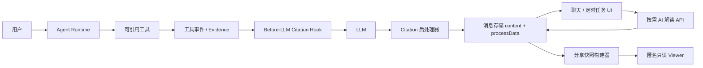
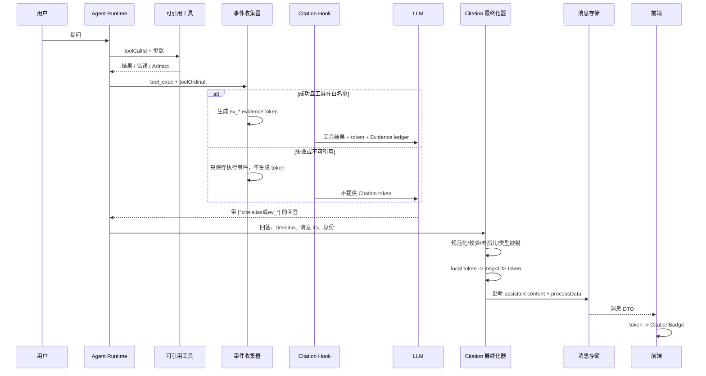
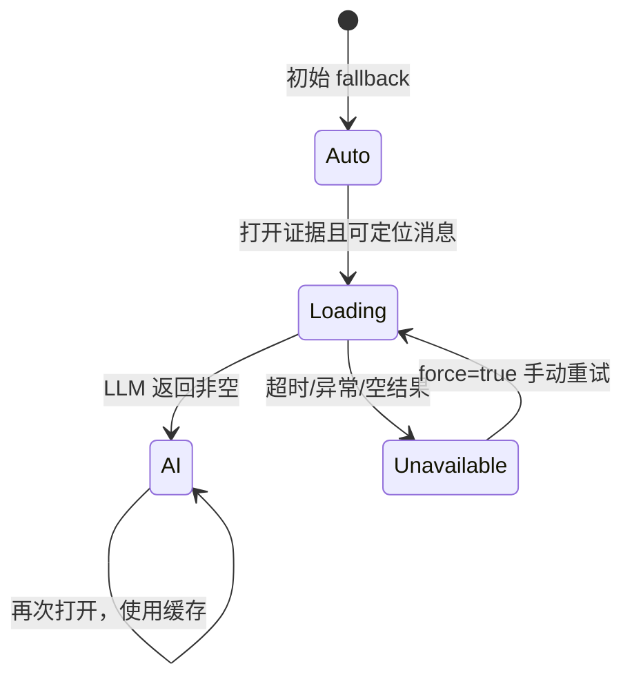
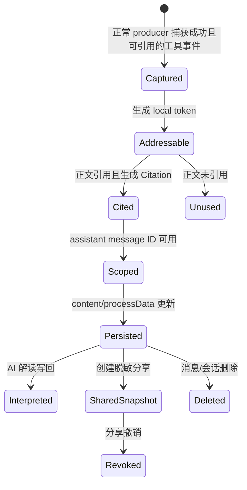

```
# Citation、Evidence 绑定和来源展示复刻指南

## 1. 结论与边界

### 1.1 结论

Citation 能力解决的不是“在回答末尾显示几个来源链接”，而是把 Agent 使用过的一个具体工具结果，与回答中的一项事实建立可追踪、可持久化、可交互的绑定。等价复刻至少需要同时实现以下六层：

1. **证据生产**：正常 producer 仅将成功的、被允许引用的工具调用登记为 Evidence；兼容 consumer 对历史/畸形事件的接纳条件更宽，不能反向视为同一保证。
2. **模型协议**：给每次具体工具调用一个不可歧义的稳定 token，并指导模型把 token 放到受该证据支持的结论旁。
3. **后处理绑定**：验证模型 token、修复一部分错位、移除伪造 token，生成按正文首次出现顺序编号的 Citation。
4. **消息持久化**：正文保存带消息作用域的 token，结构化 Citation 和工具事件一起写入 assistant 消息。
5. **阅读交互**：正文角标、来源汇总、类型化证据面板、网页跳转、业务语言解读共同工作。
6. **安全传播**：登录态聊天保留必要的私有下载能力；公开分享必须同时重写正文 token、投影 Citation、投影执行过程。当前实现只完成了 Citation DTO 的字段白名单，正文 token 可用性和公开 `processData` 的敏感字段控制仍有缺口，不能把现状描述为安全闭环。

当前实现的核心持久化单元是 assistant 消息的 `content + processData`，并没有独立 Citation 表。`processData.events[]` 保存工具执行证据，`processData.citations[]` 保存面向阅读器的投影；正文保存形如 `[^cite:msg104.ev_0f13a5b7c9d2]` 的标记。前端根据 Citation 元数据把标记渲染为 `[1]` 风格角标。

### 1.2 目标用户与最终效果

| 用户/调用方 | 目标效果 |
|---|---|
| 对话用户 | 知道某个数字、结论或表格来自哪次指标、SQL、Python、知识、Web 或文件操作 |
| 审阅者 | 点击来源后检查查询条件、结果表、代码、知识内容或文件摘录，而不是只相信模型文案 |
| 公开分享访客 | 目标是在不获得私有系统权限的前提下查看脱敏证据快照；当前实现存在 token 丢失和过程数据泄露风险 |
| 评测系统 | 用结构化 Citation 与原始工具事件检查答案是否有证据、证据是否匹配 |
| 定时任务读者 | 在任务执行结果中获得与普通聊天一致的 Citation，并可跨步骤引用历史证据 |

### 1.3 输入和输出

输入包括：

- 一次 Agent 运行中的工具名、`toolCallId`、参数、结果、成功状态、调度顺序和关联 Artifact。
- LLM 最终回答中的内部 Citation token。
- 会话 ID、assistant 消息 ID、租户/用户身份和语言。
- 可选的指标财务日历、模型生成的 Citation 解读。

输出包括：

- 含消息作用域 token 的 Markdown 正文。
- `processData.citations[]` 类型化元数据。
- 可点击角标、来源列表和证据详情面板。
- 可选的异步 AI 业务解读及其持久化结果。
- 公开分享场景中的脱敏 Citation 快照。

### 1.4 明确不包含

本模块不负责：

- 执行指标查询、SQL、Python、知识检索、Web 搜索或文件检索本身。
- 创建或存储 Artifact 内容本身。
- 文件沙箱的授权、文件上传和文件预览服务。
- 判断模型最终业务结论绝对正确。`numericVerified` 仅是有限的数字存在性检查，不是完整事实校验。
- 把 `knowledge_recall` 自动等同于 Citation。召回事件说明知识进入过上下文；只有 `read_knowledge` 等可引用工具的具体成功结果才能成为正文 Citation。

### 1.5 当前状态

- `I`：指标、SQL、Python、归因知识、知识条目、Web、文件搜索已进入可引用工具白名单。
- `I`：正常 producer 可为成功工具调用生成稳定 `ev_*` token，失败工具在该路径不生成 Evidence；兼容 consumer 会把缺失 `success` 的事件视为成功。
- `I`：消息落库后 token 被提升为 `msg<messageId>.ev_*`，支持后续轮次安全引用历史证据。
- `I`：聊天、定时任务和无头评测入口均存在 Citation 最终化路径。
- `I`：公开 Citation DTO 使用按类型白名单，去除该 DTO 中的 Web URL、Artifact 下载 URL和文件路径。
- `K`：分享正文仍保存 scoped token，但公开 Citation DTO没有 `token/localToken`；公开 renderer 无法解析这些 token并会删除它们。现有分享测试用手工 `[1]` 内容，未覆盖真实最终化消息。
- `K`：公开 `processData` 仍允许工具 `args/result` 和 `taskPlan`；当前仅替换文件/Artifact API URL，Web URL、普通路径、`read_knowledge` ID/meta及任意任务计划内容仍可能进入匿名快照。
- `A`：active黑盒覆盖“可识别 Citation marker”和“角标点击后面板非空、无后端错误泄露”，但没有证明持久化映射、数字 backing或多 Citation编号一致性。
- `K`：favicon 接口当前不会拒绝 `localhost`、回环地址或 URL 形输入。
- `P`：多 Web Citation持久化编号与 UI编号一致性（CITE-RENDER-003）、缺失 Evidence 的 UI 降级、解读 fallback 和 citeRef 错配仍是 planned 测试，不能当作已运行保证。
- `R`：本次没有运行应用或测试，不存在运行时验证结论。

## 2. 术语与参与方

| 术语 | 定义 |
|---|---|
| Evidence | 一次具体、成功、可引用工具调用及其参数、结果和身份。它是来源事实，不是展示对象。 |
| local token | 当前运行内的稳定标识，例如 `ev_0f13a5b7c9d2`。 |
| scoped token | 加入来源消息 ID 后的标识，例如 `msg104.ev_0f13a5b7c9d2`。 |
| Citation | Evidence 在一条 assistant 消息中的展示投影，含编号、类型、标题、解读和类型化 metadata。 |
| Citation ID | 当前 assistant 正文中的显示编号，从 1 开始，按 token 第一次出现顺序分配；不是全局 ID。 |
| Evidence ledger | 在 LLM 调用前注入的紧凑清单，用语义别名描述当前轮所有可引用来源。 |
| processData | assistant 消息的 JSON 字符串列，包含执行事件、统计、计划和 Citation。 |
| Artifact | 工具生成并独立存储的成果文件。Citation 可以携带它的下载引用，但二者不是同一对象。 |
| Sandbox file | 会话工作区中的文件路径和内容。文件 Citation 只能展示经过投影的摘录，不应把沙箱路径视为公共下载 URL。 |
| Knowledge | 租户/项目/个人/系统范围的知识条目。Knowledge Citation 是一次读取结果的快照，不等于知识实体权限本身。`read_knowledge` 的 `metadata.code` 当前实际承载 entry ID；归因知识中的 `code` 才可能是业务 code，两者不得混为一个公开字段。 |



## 3. 业务规则

### 3.1 Evidence 资格

当前可引用工具白名单为：

| 工具 | Citation 类型 | Evidence 内容 |
|---|---|---|
| `metric_query` | `metric` | MQL/查询条件、结果表、可选 CSV Artifact |
| `semantic_jdbc_query` | `sql` | SQL、数据源别名、用途、结果表、可选 CSV Artifact |
| `execute_python` | `python` | Python 代码与 stdout |
| `attribution_knowledge_search` | `knowledge` | 指标归因因子、维度链、关联关系 |
| `read_knowledge` | `knowledge` | 条目标题、范围、摘要、关键词、同义词和正文 |
| `web_search` | `web` | 搜索结果来源数组，第一项作为角标主来源 |
| `web_fetch` | `web` | 被抓取页面标题、URL 和域名 |
| `file_index_search` | `file` | 首个文件命中、路径和摘录 |
| `knowledge_search_file` | `file` | 首个知识文件命中和摘录 |

生产者和消费者的保证并不相同：

- 正常事件生产者仅对 `success=true`、工具在白名单、`toolCallId` 非空的调用生成 `ev_*`。
- 提取器为了兼容历史数据，把缺失 `success` 解释为 `true`；没有 `evidenceToken` 时，任何工具名在 legacy prefix表中的事件都可能按 `m1/p1/...` 被接纳。
- 若未知工具事件已经携带格式合法的 `ev_*`，当前提取器不会再次检查白名单，可生成 `generic` Citation。
- 用于生成解读的内部工具会被显式排除。

因此“失败工具和未知工具绝不成为 Citation”目前只是正常生产路径保证，不是对畸形/迁移数据的完整消费者保证。生产复刻应在最终绑定处重新验证 `success === true`、工具白名单、`toolCallId` 与 token 推导结果一致，不能信任事件自带 token。

### 3.2 Token 身份

local token 的当前算法：

```text
localToken = "ev_" + hex(sha256(toolName + ":" + toolCallId))[0:12]
scopedToken = "msg" + assistantMessageId + "." + localToken
```

规则：

- 相同工具名和 `toolCallId` 必须稳定地产生相同 token。
- 缺少 `toolCallId` 时不应伪造 `ev_*`；历史数据才允许回退到按工具类型计数的 `m1/p1/s1/k1/w1/f1`。
- scoped token 的消息 ID 指向 Evidence 的来源 assistant 消息，而不是当前引用它的消息。
- token 在代码围栏和行内代码中是文档文字，不参与转换。

### 3.3 编号、排序和去重

- Citation ID 是正文 token **第一次出现顺序**，不是工具完成顺序。
- 同一 token 在正文重复出现时编号映射复用同一 ID。当前候选列表本身不按 token 去重：若 `events[]` 出现两个相同 token，构建循环会生成两个具有相同 ID 的 Citation 对象。这是实现缺口；生产复刻必须先以 token稳定去重，并对同 token但内容不同的事件报一致性错误。
- 并行工具事件在候选生成时优先按 `toolOrdinal`（LLM 发起顺序）排序；没有 `toolOrdinal` 的历史事件保持原始相对顺序并排在有序事件之后。
- 来源汇总列表按 Citation ID 升序展示。
- 当前消息引用历史 token 时，最终化器从来源消息复制 Citation 元数据，并按当前正文出现顺序重新编号。
- 语义别名重复时追加 `_1`、`_2` 等序号，防止两个来源共享别名。
- Web 搜索一次返回多个页面时，当前实现仍生成一个 Citation，`metadata.sources[]` 保存页面列表，第一项作为角标点击目标。这不等价于多个独立 Citation。

### 3.4 不可信 token

- 不在 Evidence 集合中的 `[^cite:...]` 必须删除，不能作为普通文本泄露。
- 未知裸 `[N]` 默认应保留为普通数字文本，避免误删合法文本；在明确进入严格清理模式时才删除。
- 前端只为 `processData.citations[]` 中存在的 ID/token 创建角标。
- Citation token 位于 Markdown 链接文本内时不创建嵌套角标；历史文件链接中的内部前缀应被清理但链接保留。

### 3.5 类型和资源边界

| 对象 | 身份与生命周期 | Citation 里允许保存 | 不应混入 Citation |
|---|---|---|---|
| Artifact | 独立 `artifactId`，有内容服务、权限和生命周期 | 仅指标/SQL首个 CSV 的 `{url, filename, size}` 登录态下载引用 | Artifact 内容、权限记录、版本历史 |
| Sandbox file | 会话工作区相对路径，受会话身份约束 | 文件名、扩展名、摘录；仅在受控后端换取短期下载 token | 把本地路径当作 `href`、公共 URL或跨会话下载凭据 |
| Knowledge entry | 有 entry ID、scope、project/tenant/user 归属；归因知识还可能有独立业务 code | 一次读取形成的名称、scope、摘要、正文/结构化快照和明确审计过的 business code | 把 entry ID命名成 `code` 后公开；以 Citation绕过实体权限 |
| Citation | 消息内部的来源投影 | Evidence 详情、展示标题、解读、来源消息标识 | 代替 Artifact/Knowledge 的主数据和授权 |

## 4. 完整执行链路

### 4.1 当前轮 Evidence 生成与绑定



具体步骤：

1. 工具被调度时分配单调递增的 `toolOrdinal`。它表达发起顺序，不能用并行完成时间替代。
2. 工具完成后登记事件。传统产品事件收集器把参数和结果各截断到 4000 字符并追加标志，并可在其产品事件中保留结构化 Artifact 摘要；NovaCore timeline 投影器本身没有在映射处重复这个上限，且 timeline 转为产品 `processData.events[]` 时不会保留 `artifactRefs`，因此该入口不保证产品事件含 Artifact 摘要。两个入口都会投影字节数、耗时、时间戳和成功状态，但复刻者不能据此假设字段全集天然一致，应在统一 Evidence 存储层明确限额和 Artifact 投影策略。
3. 正常生产路径仅在工具成功、在白名单内且存在 `toolCallId` 时生成 `evidenceToken`；最终消费者仍需重验这些条件。
4. 每次 LLM 调用前，Hook 扫描当前轮工具结果：
   - 给每项加入“可引用”提醒；
   - 构建语义 Evidence ledger；
   - 最后一项可引用工具结果携带完整 ledger，避免每项重复导致 O(N²) token 开销；
   - 已加入提醒的结果不重复追加；
   - 历史轮次只有已经具有 scoped token 才重新提示模型引用。
5. 模型用别名或稳定 token在结论附近写 `[^cite:...]`。示例别名包括 `metric_overall`、`metric_by_region`、由 SQL/Python `purpose` 生成的语义名。
6. 后处理器把别名映射回 `ev_*`，并针对指标/SQL/Python表格、数字和章节上下文做保守的错位修复。
7. 只保留能解析到 Evidence 的 token并构建类型化 Citation 元数据和自动 fallback 解读。当前 consumer 对缺失 `success`、未知工具自带 token及重复候选过于宽松；生产版必须在这里严格重验并确定性去重。
8. 当 assistant 消息 ID 可用后，把 local token 改成 scoped token，写入 `messageId` 和 `conversationId`。
9. 若正文还引用历史 scoped token，从来源消息复制对应 Citation，当前消息按正文顺序重新编号。
10. 财务粒度指标 Citation 在落库前可调用财务日历服务补充 `timeFiscalLabel`；失败不阻断。
11. 使用 `(tenantId, userId, messageId)` 更新原 assistant 消息的正文和 `process_data`。

#### 4.1.1 三层事件投影不能混写

Citation 链路存在三个相似但不等价的数据层：

| 层 | 主要字段 | 下一层增加/删除 | 复刻注意 |
|---|---|---|---|
| NovaCore `ToolExecEvent` | timestamp、toolCallId、toolName、argsJson、resultText、success、input/outputBytes、durationMs、`retention`、`artifactRefs[]`、`toolOrdinal` | runtime recorder可把大结果外置到 Sandbox，timeline保存预览和 artifactRefs | 这是运行时/压缩语义的权威对象；`retention` 决定上下文保留，不能被 Citation 元数据替代 |
| 产品 `processData.events[]` | `type=tool_exec`、tool、toolCallId、args/result、success、字节数、耗时、timestamp、toolOrdinal、条件性 `evidenceToken` | 当前 NovaCore 映射丢弃 `retention` 和 `artifactRefs`；传统产品收集器另可生成 `sub_tool_exec`、`agentLabel` 和结构化 `artifacts[]` | 两个投影入口字段并不完全一致；不能声称所有 processData事件都含 agentLabel/artifacts，也不能从其缺失反推 runtime没有外置结果 |
| `processData.citations[]` | id、token/localToken、message/conversation、type、toolName、caption/interpret、metadata | 从事件参数/结果投影为 UI schema，丢弃 retention、调度信息和多数执行诊断 | 它是展示快照，不是完整 ToolExecEvent，也不是 Artifact/Sandbox 主数据 |

当前字段丢失意味着：仅凭 `processData.citations` 无法恢复运行时 retention或完整 offload引用；仅凭 NovaCore timeline的 `artifactRefs` 也不一定能生成 Citation的登录态 `download`，因为当前 Citation下载投影读取的是产品事件 `artifacts[]`。生产版应定义一个版本化的统一投影器并写契约测试，明确每个丢弃字段是有意为之。

### 4.2 Token 修复策略

当前实现不仅做正则替换，还包含以下保守校准：

- 优先信任唯一语义别名；别名由查询维度、SQL/Python 用途、知识标题生成。
- 识别 Markdown 表格、表前标题、列表项、段落、章节标题和 citation 所在子句作为上下文窗口。
- 对指标结果使用指标/维度名、维度值、结果列、时间/总体关键词和数字匹配评分。
- 对正文声称的数字检查其是否出现在来源结果中；只有明显唯一且超过阈值的候选才替换错指 token。
- 如果多候选得分相同或差异不足，不进行猜测性改绑。
- 对未显式标注但显然对应维度表或数据表的指标结果，可自动补 Citation；该能力是启发式，应保留诊断记录。
- 对旧消息裸 `[N]`，按候选顺序转换为 token 后再结合上下文复核。

生产复刻时应把“确定性 token 绑定”和“启发式修复”分开：前者属于正确性主链路，后者必须可观测、可关闭并有误绑率监控。

### 4.3 展示链路

1. 前端从 assistant `processData.citations` 建立：
   - `validIds: Set<number>`；
   - `byId: Map<number, Citation>`；
   - `tokenToId: Map<string, number>`，同时登记 scoped token 和 local token。
2. Markdown AST 插件处理 `[N]` 和 `[^cite:token]`，把可解析标记转换为安全的内部 marker。
3. marker 渲染为按钮：类型图标、来源标签、编号、失败/归档状态。
4. 非 Web Citation 点击后打开当前消息内对应 Citation 的证据面板；Web Citation 在登录态直接用 `noopener` 打开主 URL。
5. 每条 assistant 消息底部可展示折叠的“来源（N）”列表，按 ID 排序。
6. 数据类 Citation 在聊天页使用并列侧栏；其他页面使用遮罩抽屉。抽屉宽度限制为 360–800px并持久化宽度；路由变化或 Escape 关闭。
7. 定时任务执行详情从其消息 `processData` 恢复 Citation；缺少 `conversationId` 时可用执行结果关联会话补齐，但已有来源会话 ID不得覆盖。

### 4.4 按需 AI 解读

只有 `metric/sql/python` 默认触发按需 AI 解读：



规则：

- 初始 Citation 含 `interpretSource=auto` 和工具派生的 fallback 文案。
- 打开可解读 Citation 时，前端必须获得 server message ID 和 `conversationId` 才能请求聊天解读接口。
- 后端先验证会话可读权限，再按 owner 的 tenant/user 读取消息，不能用请求者身份直接查另一用户消息。
- tenant admin 只读访问需要审计记录。
- 当前实现用 JVM 内 `ConcurrentMap`，仅按 `conversationId:messageId:citationId:force` 合并 in-flight 请求。它不跨实例，也没有把 tenant/user、locale、解读策略版本和模型版本纳入键；因此同一对象的不同语言请求可能错误共享结果，多实例部署也可能重复生成。
- `interpretSource=ai` 且文案非空为终态；`unavailable` 在非 force 请求下也是终态。
- LLM 解读超时、异常或空结果时保留原 fallback，只写 `interpretSource=unavailable` 和生成时间。
- 当前写回锁也是 JVM 本地消息锁。单实例内会在事务中重读 `processData` 并 patch 目标 Citation，但多实例可同时读到旧版本并后写覆盖先写，不能宣称全局无丢更新。
- 生产复刻的生成业务键至少应为 `(tenantId, ownerUserId, conversationId, messageId, citationId, locale, force, synthesisPolicyVersion, modelVersion)`。生成任务应使用数据库唯一键或分布式任务幂等；写回使用行版本 CAS、数据库悲观锁或对 Citation 子文档的原子 JSON patch，冲突后重读重试。

### 4.5 公开分享链路

公开分享使用创建时快照，而不是匿名读取私有消息。当前实现有一部分正确边界：从私有 `processData.citations[]` 生成独立的公开 Citation DTO，按类型复制字段；指标/维度显示名在拥有者身份下预解析，匿名 viewer 不再调用私有网关；公开抽屉不触发 AI 解读和私有下载。

但当前链路不能视为安全闭合，存在两个独立缺口：

1. **引用标记断链**：快照只改写附件引用，不改写 assistant 正文中的 scoped token，例如 `[^cite:msg104.ev_xxx]`。公开 Citation DTO 又没有 `token/localToken`。公开 renderer 只能从 `[N]` 或 DTO token 建映射，因此会删除无法解析的 scoped token。现有分享单测使用人工 `[1]`，没有覆盖真实私有消息到公开快照的转换。
2. **并行 `processData` 泄露面**：公开 Citation DTO 白名单并不等于整个快照安全。当前 sanitizer 允许 `tool_exec/sub_tool_exec` 的 `args/result` 和 `taskPlan` 原样通过，仅替换文件/Artifact API URL；Web URL、沙箱路径、`read_knowledge` 的实体 ID/metadata、提示词或计划文本仍可能泄露。

生产复刻应在快照构建时完成以下不可逆投影：

1. 从源消息 Citation 建立 `token/localToken -> citation.id` 映射，使用 Markdown AST 在代码块外把已验证 token 改写为 `[N]`；丢弃未解析 token，快照中不保留 `messageId`。也可以生成分享级随机 opaque token，但不能复用私有 scoped token。
2. 公开 Citation 和正文 `[N]` 必须由同一次快照事务生成，验证每个编号恰好对应一项 DTO。
3. `processData` 按事件类型做公开投影，默认不输出 `args/result`：指标/SQL只输出经过 schema 审计的展示摘要；Web不输出 URL；文件/沙箱不输出路径；knowledge 不输出 entry ID、原始 metadata 或权限策略；`taskPlan` 默认省略，若产品必须展示则递归应用独立 schema，而不是字符串替换。
4. 公开知识字段区分稳定业务编码 `businessCode` 与存储实体 `entryId`；公开快照只可按政策保留前者，永不保留后者。当前 `knowledgeCode` 同时承接 `read_knowledge metadata.code`，而该值实际上是实体 ID，必须在复刻中拆分。
5. 所有类型（包括 Web）在公开页只打开本地只读抽屉，不执行外部跳转；新增字段默认不公开。

## 5. 对外契约

### 5.1 消息读取契约

Citation 没有独立读取 API；它随会话消息返回。最小等价响应：

```json
[
  {
    "id": 104,
    "role": "assistant",
    "content": "华东销售额为 2341 万。[^cite:msg104.ev_0f13a5b7c9d2]",
    "processData": "{\"events\":[...],\"citations\":[...]} ",
    "turnIndex": 3,
    "state": "COMPLETED",
    "createdAt": "2026-08-07T09:30:00Z"
  }
]
```

当前黑盒读取路径为：

```http
GET /api/conversations/{conversationId}/messages
Authorization: authenticated session
```

权限语义：仅 owner 或被正式授权的租户管理员读取；不存在与无权访问应避免产生对象枚举差异。

### 5.2 AI 解读生成

```http
POST /api/messages/{messageId}/citations/{citationId}/interpret
    ?conversationId={conversationId}&force=false
X-Nova-Lang: zh-CN
Authorization: authenticated session
```

字段：

| 字段 | 位置 | 类型 | 必填 | 默认/约束 |
|---|---|---|---|---|
| `messageId` | path | positive integer | 是 | assistant 消息 ID |
| `citationId` | path | positive integer | 是 | 当前消息内 Citation ID |
| `conversationId` | query | string | 是 | 用于对象级授权和 owner 解析 |
| `force` | query | boolean | 否 | `false`；`true` 可重试 unavailable |
| `X-Nova-Lang` | header | string | 否 | `en*` 归一化为英文，其余中文 |

成功响应是更新后的完整 Citation：

```json
{
  "id": 1,
  "token": "msg104.ev_0f13a5b7c9d2",
  "localToken": "ev_0f13a5b7c9d2",
  "messageId": "104",
  "conversationId": "conv-8f2",
  "type": "metric",
  "toolName": "metric_query",
  "caption": "查询华东近三月销售额",
  "interpret": "对华东区域近三个完整财月的销售金额做了按月汇总，用于验证趋势结论。",
  "interpretSource": "ai",
  "interpretGeneratedAt": "2026-08-07T09:31:20Z",
  "failed": false,
  "numericVerified": true,
  "metadata": {
    "type": "metric",
    "metricSpec": {
      "metrics": ["sales_amount"],
      "dimensions": ["metric_time__FY_month"],
      "filters": {"region": ["华东"]},
      "timeConstraint": "last_3_complete_FY_month"
    },
    "result": {
      "columns": ["metric_time__FY_month", "sales_amount"],
      "rows": [["FY2026-M01", "781"], ["FY2026-M02", "760"]],
      "totalRows": 3
    },
    "timeFiscalLabel": "FY2026-M01 ~ FY2026-M03",
    "download": {
      "url": "/api/artifacts/art-91/content",
      "filename": "metric_sales.csv",
      "size": 2048
    }
  }
}
```

错误语义：

| 场景 | 建议 HTTP | 当前可观察语义 |
|---|---:|---|
| 缺少认证上下文 | 401 | `Sandbox context is missing` |
| 会话不可读、消息不存在或 Citation 不存在 | 404 | 对外统一 not found，避免枚举 |
| `processData` 非 JSON 对象 | 500 | 内部消息数据损坏；UI显示可重试错误，保留 fallback |
| LLM 解读不可用 | 200 | Citation 保持 fallback，`interpretSource=unavailable` |

幂等语义：非 force 且已是 `ai`/`unavailable` 时直接返回；force 可覆盖 unavailable。当前接口没有显式幂等 key，依赖业务键和 in-flight 合并。

### 5.3 Favicon 描述器

```http
GET /api/citation/favicon?domain=www.wikipedia.org
Authorization: authenticated session
```

```json
{"kind":"color","text":"W","color":"#000000"}
```

当前服务并不抓取远端图片，而是：

- 内置少量域名及颜色/文字；当前匹配条件同时接受 `domain.endsWith("." + known)` 和 `domain.endsWith(known)`。后一条件缺少点边界，`evilwikipedia.org` 也会误命中 `wikipedia.org`。
- 未知域名使用首字符作为文字；当前 fallback 颜色只对这个首字符做 hash，而不是对完整规范域名做 hash，所以首字母相同的未知域名会得到相同描述器。
- 前端以域名为 key 缓存 Promise；请求失败在浏览器端降级为灰色首字母块。

`K`：当前接口不会拒绝 `127.0.0.1`、`localhost`、`http://169.254.169.254/...` 等输入。虽然实现不发外部 HTTP 请求，输入校验缺失仍会造成契约混乱，并为未来切换到真实 favicon 抓取留下 SSRF 风险。复刻必须把 domain 限制为规范 hostname，拒绝 URL、IP、localhost、私网/链路本地域名，返回 400–499。

### 5.4 工具事件契约

下面 JSON 是**传统产品事件收集路径**可形成的 `processData.events[]` 示例，其中 `artifacts[]` 是该路径的结构化 Artifact 摘要，不是所有 runtime 入口的通用保证。NovaCore `ToolExecEvent` 自身可持有 `artifactRefs[]`，但当前 timeline 到产品事件的投影会丢弃这些引用，因此经该路径得到的产品事件不保证出现 `artifacts[]`。

```json
{
  "type": "tool_exec",
  "tool": "metric_query",
  "toolCallId": "call_a7c2",
  "evidenceToken": "ev_0f13a5b7c9d2",
  "toolOrdinal": 2,
  "args": "{\"metrics\":[\"sales_amount\"]}",
  "inputBytes": 47,
  "outputBytes": 932,
  "result": "| month | sales_amount |\n|---|---|\n| FY2026-M01 | 781 |",
  "success": true,
  "durationMs": 1830,
  "timestamp": 1786075800000,
  "artifacts": [
    {
      "id": "art-91",
      "filename": "metric_sales.csv",
      "url": "/api/artifacts/art-91/content",
      "type": "DATA",
      "size": 2048
    }
  ]
}
```

`sub_tool_exec` 额外允许 `agentLabel`。产品事件收集路径的参数与结果各截断至 4000 字符；不同 runtime 入口可能提供更长 timeline 文本。复刻时应在统一边界明确限制，并另存加密/受控的完整 Evidence blob，让事件只持有摘要和 blob 引用，否则无法对长结果做完整审计。

### 5.5 Citation JSON Schema

```json
{
  "$schema": "https://json-schema.org/draft/2020-12/schema",
  "$id": "https://example.invalid/schemas/citation.json",
  "type": "object",
  "required": ["id", "token", "type", "toolName", "failed", "metadata"],
  "properties": {
    "id": {"type": "integer", "minimum": 1},
    "token": {"type": "string", "pattern": "^(msg[0-9]+\\.)?(ev_[0-9a-f]{12}|[a-z]+[0-9]+)$"},
    "localToken": {"type": "string"},
    "messageId": {"type": "string"},
    "conversationId": {"type": "string"},
    "type": {"enum": ["metric", "sql", "python", "knowledge", "web", "file", "generic"]},
    "toolName": {"type": "string"},
    "caption": {"type": "string"},
    "interpret": {"type": "string"},
    "interpretSource": {"enum": ["auto", "ai", "unavailable"]},
    "interpretGeneratedAt": {"type": "string", "format": "date-time"},
    "failed": {"type": "boolean"},
    "archived": {"type": "boolean"},
    "numericVerified": {"type": "boolean"},
    "metadata": {"type": "object", "required": ["type"]}
  }
}
```

`numericVerified=false` 表示正文归给该来源的数字在完整、适用的来源结果里没有找到；当前实现只标记，不阻断回答。来源被清理或长期归档时可用 `archived=true`，但这是前端已支持的状态，并未从本次静态取证证明存在完整归档写入流程。

### 5.6 各类型 metadata

```ts
type MetricMetadata = {
  type: "metric";
  metricSpec: object;
  result: { columns: string[]; rows: string[][]; totalRows?: number } | { raw: string };
  download?: { url: string; filename: string; size?: number };
  timeFiscalLabel?: string;
};

type SqlMetadata = {
  type: "sql";
  sql: string;
  datasourceAlias?: string;
  purpose?: string;
  result: { columns: string[]; rows: string[][]; totalRows?: number } | { raw: string };
  download?: { url: string; filename: string; size?: number };
};

type PythonMetadata = { type: "python"; pyCode: string; pyStdout: string };

// I：当前私有 Citation wire schema。字段 code 的语义依工具来源而异。
type CurrentKnowledgeMetadata = {
  type: "knowledge";
  name: string;
  code: string;
  scope?: "PERSONAL" | "PROJECT" | "TENANT" | "SYSTEM";
  projectId?: string;
  summary?: string;
  keywords?: string[];
  synonyms?: string[];
  content?: string;
  factors: Array<{ name: string; isDefault?: boolean; enabled?: boolean; desc?: string }>;
  dimensions: Array<{ name: string; chain: [string, string][] }>;
  relations: Array<{ name: string; code?: string; direction: "pos" | "neg" }>;
};

// D：复刻目标 schema，不是 Nova 当前 wire contract。
type TargetKnowledgeMetadata = {
  type: "knowledge";
  name: string;
  businessCode?: string; // 经政策允许、可面向用户展示的稳定业务编码
  entryId?: string;      // 私有存储实体 ID，只能留在鉴权后的私有 Citation
  scope?: "PERSONAL" | "PROJECT" | "TENANT" | "SYSTEM";
  projectId?: string;
  summary?: string;
  keywords?: string[];
  synonyms?: string[];
  content?: string;
  factors: Array<{ name: string; isDefault?: boolean; enabled?: boolean; desc?: string }>;
  dimensions: Array<{ name: string; chain: [string, string][] }>;
  relations: Array<{ name: string; code?: string; direction: "pos" | "neg" }>;
};

type WebMetadata = {
  type: "web";
  url: string;
  title: string;
  siteName: string;
  sources?: Array<{ index: number; title: string; url: string; siteName: string }>;
};

type FileMetadata = {
  type: "file";
  fileName: string;
  fileType: string;
  fileRef?: string;
  quotedSnippet?: string;
  previewable: boolean;
};
```

当前 `CurrentKnowledgeMetadata.code` 存在歧义：归因知识工具把它作为业务 code；`read_knowledge` 则把读取参数或 `[meta]` 中的知识实体 ID 写入同一字段。当前公开快照又把该字段复制为 `knowledgeCode`，所以不能把 `code/knowledgeCode` 一概描述为可公开业务编码。`TargetKnowledgeMetadata` 是 `D` 级复刻设计：生产者必须在来源处拆成 `businessCode` 与 `entryId`，私有 Citation 可在对象级鉴权后保存二者，公开投影必须删除 `entryId`，并且只有政策明确允许时才保留 `businessCode`；不得用字段改名猜测旧 `code` 的真实语义。

指标/SQL结果优先把 Markdown pipe table 转成列和行，并识别中英文“返回 N 行”注记；无法解析时保存 `{raw}`。超长/损坏参数要尽量救回 `code/sql/datasource_alias/purpose` 等已知字段，不能因局部 JSON 截断把整个类型降为 generic。

上面的 File schema 是生产复刻目标。当前实现把 `filePath` 放进 Citation，映射器还无条件设置 `previewable=true`，但没有产生经过授权的预览/下载 URL；聊天 UI 有 snippet 时仍展示路径，无 snippet 时直接把路径作为 `<a href download>`。这既可能暴露本机/容器布局，也可能生成浏览器无法访问的链接。复刻时应保存 opaque `fileRef`，在确认 MIME 和预览能力后才设置 `previewable`；用户点击时由服务端校验会话权限并签发短时下载 token，绝不把原始路径作为 href。

### 5.7 公开分享 Citation 契约

公开 DTO 使用消息级 `citations` 数组，不复用私有 `processData.citations`。以下是生产目标；当前实现能生成类似 DTO，但尚不能把真实 scoped token稳定改写为 `[N]`：

```json
{
  "role": "ASSISTANT",
  "content": "华东销售额为 2341 万。[1]",
  "citations": [
    {
      "label": "1",
      "type": "metric",
      "title": "查询华东近三月销售额",
      "text": "对华东近三个完整财月的销售金额做了汇总。",
      "metricSpec": {"metrics": ["sales_amount"]},
      "result": {"columns": ["month", "sales"], "rows": [["M1", "781"]]},
      "metricDisplayNames": {"sales_amount": "销售金额"}
    }
  ],
  "processData": {
    "tokenStats": {"inputTokens": 1200, "outputTokens": 320},
    "totalDurationMs": 1830
  }
}
```

公开允许字段：

- 公共 Citation：label、type、title、text和各类型明确列出的数据字段。
- 公共 `processData` 根建议只保留经过审计的聚合统计，例如 tokenStats、totalDurationMs；events 和 taskPlan 默认不公开。
- 若必须展示工具阶段，为每个工具定义独立公开事件 schema，默认不发 args/result；Artifact 只保留公开副本的 filename/type/size，不保留私有 id 或 URL。
- knowledge recall 只保留 title/summary/synonyms/scope 和经政策允许的 `businessCode`；删除 `entryId`、原始 metadata 与权限策略。

必须删除：Web URL、`download.url`、`filePath`、knowledge entry ID、内部文件/Artifact ID 与 URL、任意未来未审计字段。公开快照中的 Web Citation 不应导航到原 URL。当前 sanitizer 尚未达到这一要求，不能直接作为复刻实现。

匿名读取契约：

```http
GET /api/public/shares/{token}
Authorization: none
```

- 有效且 ACTIVE 的 token 返回包含消息和脱敏 Citation 的快照。
- 不存在、已撤销或快照内容已清空统一返回 `410 Gone`，避免泄露 token 是否曾存在。
- 按客户端 IP 限流；超限返回 `429` 和 `Retry-After`。
- 分享附件使用 `GET /api/public/shares/{token}/files/{fileToken}`，它是经过复制和重新授权的公共附件，不是 Citation 中的私有 Artifact URL。
- 租户关闭下载时附件接口返回 `403`；响应使用安全 MIME、`Content-Disposition` 和 `X-Content-Type-Options: nosniff`。

## 6. 数据模型与生命周期

### 6.1 当前持久化

当前不需要独立 Citation 表，最小数据库结构如下：

```sql
CREATE TABLE message (
    id              BIGINT GENERATED BY DEFAULT AS IDENTITY PRIMARY KEY,
    tenant_id       VARCHAR(255),
    user_id         VARCHAR(255),
    conversation_id VARCHAR(255) NOT NULL,
    role            VARCHAR(255) NOT NULL,
    content         TEXT,
    process_data    TEXT,
    turn_index      INTEGER,
    state           VARCHAR(16) NOT NULL DEFAULT 'COMPLETED',
    is_deleted      BOOLEAN NOT NULL DEFAULT FALSE,
    created_at      TIMESTAMP NOT NULL
);

CREATE INDEX idx_msg_tenant_user_conv
    ON message (tenant_id, user_id, conversation_id);
CREATE INDEX idx_msg_turn ON message (conversation_id, turn_index);
```

消息行是 Citation 的一致性边界：正文 token 和 `processData.citations` 必须在同一次逻辑更新中提交。删除消息/会话后 Citation 随之不可读；关联 Artifact 和分享快照按照各自生命周期处理。

### 6.2 推荐生产模型

当 `process_data` 可能达到数十 MB、需要全文审计或按来源查询时，推荐拆分：

```sql
CREATE TABLE evidence (
    evidence_id       VARCHAR(64) PRIMARY KEY,
    tenant_id         VARCHAR(255) NOT NULL,
    owner_user_id     VARCHAR(255) NOT NULL,
    conversation_id   VARCHAR(255) NOT NULL,
    source_message_id BIGINT,
    tool_call_id      VARCHAR(255) NOT NULL,
    tool_name         VARCHAR(128) NOT NULL,
    tool_ordinal      BIGINT,
    success           BOOLEAN NOT NULL,
    args_json         JSONB,
    result_summary    TEXT,
    encrypted_blob_ref VARCHAR(512),
    created_at        TIMESTAMPTZ NOT NULL,
    UNIQUE (tenant_id, owner_user_id, tool_name, tool_call_id)
);

CREATE TABLE message_citation (
    message_id          BIGINT NOT NULL,
    citation_no         INTEGER NOT NULL,
    evidence_id         VARCHAR(64) NOT NULL,
    token               VARCHAR(128) NOT NULL,
    caption             TEXT,
    interpret           TEXT,
    interpret_source    VARCHAR(16) NOT NULL,
    metadata_json       JSONB NOT NULL,
    numeric_verified    BOOLEAN,
    created_at          TIMESTAMPTZ NOT NULL,
    PRIMARY KEY (message_id, citation_no),
    UNIQUE (message_id, evidence_id)
);
```

这不是当前 Nova 的存储事实，而是 `D` 生产化建议。它能支持：结构化索引、Evidence 保留策略、异步重新投影、引用图查询和大结果外置。

### 6.3 生命周期



未被正文引用的 Evidence 仍可保留在执行事件中，但不进入 `citations[]`。公开分享是创建时快照：原知识或 Artifact 后续删除不应自动把私有 URL重新暴露；是否同时让快照失效由分享模块策略决定。

## 7. 核心实现设计

### 7.1 模块划分

```text
citation/
├── evidence-policy        # 可引用工具、token 生成、保留策略
├── event-recorder         # tool_exec/sub_tool_exec 顺序和摘要
├── model-hook             # reminder + evidence ledger
├── token-normalizer       # alias/legacy/scoped token 处理
├── evidence-binder        # 正文上下文匹配、去孤儿、编号
├── metadata-projector     # 每种工具 -> Citation metadata
├── message-finalizer      # scope、历史合并、落库
├── interpret-service      # 按需 LLM 解读和并发写回
├── public-snapshot        # 公共字段白名单与脱敏
└── ui/
    ├── markdown-plugin
    ├── badge/source-list
    ├── typed-drawer
    └── public-readonly-drawer
```

### 7.2 最小绑定算法

```pseudo
function finalizeCitation(messageId, conversationId, identity, answer, events):
    evidence = events
      .filter(type in [tool_exec, sub_tool_exec])
      .filter(success == true)
      .filter(tool in CITEABLE_TOOLS)
      .sortBy(toolOrdinal ASC NULLS LAST, originalIndex ASC)

    byToken = map evidence using stableToken(tool, toolCallId)
    normalized = resolveAliasesAndLegacyTokens(answer, byToken)

    tokenOrder = orderedDistinctTokensOutsideCode(normalized)
      .filter(token exists in byToken OR token is valid historical scoped token)

    cleanedAnswer = removeOrphanTokens(normalized, tokenOrder)
    citations = []
    for each token,index in tokenOrder:
        source = current evidence or authorized historical message lookup
        citations.add(project(source, id=index+1))

    scopedAnswer = scopeCurrentTokens(cleanedAnswer, messageId)
    citations = scopeCurrentCitationTokens(citations, messageId, conversationId)
    atomicallyUpdateMessage(identity, messageId, scopedAnswer, events, citations)
```

### 7.3 元数据投影原则

- 投影器只读工具参数/结果，绝不重新执行工具。
- 每种类型有独立 schema；类型解析失败时保持该类型并尽量展示结果，不能轻易降为 generic。
- 结果表只负责展示快照，不代表数据源实体。
- CSV 只从指标/SQL工具事件的第一个 `.csv` Artifact 提取；Python Artifact 当前不进入 Citation 下载契约。
- Knowledge正文必须去除内部使用策略块，只保留用户可见知识内容。
- Web工具兼容结构化 JSON 和 `<<<REFERENCES>>>` 文本块。
- 文件搜索当前取首个命中，生产设计建议让模型 token 可绑定具体 hit ID，避免多个命中时信息丢失。

### 7.4 最小可用版与生产级版

| 能力 | MVP | 生产级 |
|---|---|---|
| token | 随机/哈希 `toolCallId` | HMAC/哈希 + schema version + 碰撞监控 |
| 绑定 | 精确 token 映射 | 语义别名、历史引用、保守错位修复 |
| 存储 | message JSON | Evidence/Citation 分表 + 大结果外置 |
| 展示 | 角标 + 通用 JSON面板 | 六类专用面板、来源列表、移动端、a11y |
| 解读 | 自动 fallback | 按需 LLM、缓存、force 重试、并发合并 |
| 分享 | 不展示 Citation | 类型化脱敏快照和只读抽屉 |
| 校验 | token 存在性 | 数字 backing、错绑率、来源完整性和审计 |

## 8. 并发与非正常路径

| 情形 | 必须行为 |
|---|---|
| 多工具并行，完成乱序 | 用调度时 `toolOrdinal` 排序，不能按完成时间编号 |
| 同 Evidence 在正文多次出现 | 复用一个 ID和一个 Citation对象 |
| 两个 Evidence 别名相同 | 给别名追加稳定序号；不能用一个别名覆盖两项 |
| 模型引用失败/未知工具 | 正常 producer 不发 token；最终 consumer 必须重验 `success=true`、工具白名单、toolCallId与 token，否则当前兼容提取器可能把缺失 success或未知工具合法 `ev_*` 接成 Citation |
| 模型伪造 token | 删除内部 token并记录协议告警 |
| 模型漏写所有 token | 可用数字/上下文做保守补标；不确定则宁缺勿错，不应全部挂到第一段 |
| 模型 token 指错来源 | 只有唯一候选明显胜出时修正；并列时保留/删除并记录诊断 |
| 工具参数/结果截断 | 保持类型，救回已知字段，UI明确显示部分内容；不要假装完整 |
| Citation 最终化异常 | fail-soft 返回原回答；记录错误；生产环境应标记消息 provenance 不完整 |
| 历史 token 指向别租户消息 | owner-scoped lookup 返回空，不复制元数据 |
| 同 Citation 多个解读请求 | 当前仅 JVM 内 in-flight 去重；生产用完整身份/locale/策略键和跨实例幂等任务 |
| 不同 Citation 并发写回同消息 | 当前 JVM 本地消息锁仅保护单实例；生产用 DB 行版本/锁或原子 JSON patch，冲突重试 |
| 解读超时/模型失败 | 返回 `unavailable`，保留自动解读和证据详情 |
| 前端找不到 Citation | 不显示空角标；planned 场景要求非空 fallback 面板，当前未形成 active 契约 |
| Web URL 空或非法 | 登录态不跳转；显示标题/域名 fallback |
| File Citation | 当前 raw `filePath` 会展示或被当作下载 href，且 `previewable` 恒 true；生产只保存 opaque fileRef，并通过鉴权接口签发短时 token |
| 公开真实 scoped token | 当前 public DTO无 token，renderer 会删除未解析标记；快照时必须把已验证 token 改写为 `[N]`，且不得泄露 messageId |
| 公开 `processData` | 当前 args/result/taskPlan 可能泄露 URL、路径和内部 ID；按工具类型白名单投影，默认不输出这些字段 |
| 分享快照为旧版本 | 角标可降级，抽屉显示已有标题/解读，不请求私有服务 |
| 来源 Artifact 已删除 | 下载返回正常 404/410；Citation 仍可展示保存的结果快照 |
| 知识条目已删除/禁用 | Citation 显示当时保存的快照，不用 Citation 绕过读取权限恢复原实体 |

取消和截断：只有 `COMPLETED` 或 `TRUNCATED` 的最终回答进入 Citation 后处理；错误响应先做用户可见错误脱敏，不应把失败执行伪装为 Evidence。若取消发生在工具成功之后但 assistant 消息没有可用结论，应保留执行过程，通常不应生成正文 Citation。

## 9. 安全、权限和审计

### 9.1 对象级授权

- 所有消息和历史 Citation 查询必须带 tenant/user 约束。
- `conversationId` 不是授权本身；必须通过访问解析器得到 owner 和 read-only 状态。
- 租户管理员读取他人 Citation 解读时使用 owner 身份访问消息，并记录 admin read 审计。
- Citation 的 `conversationId/messageId` 只能定位已授权消息，不能成为越权后门。

### 9.2 内容安全

- Markdown 必须先解析自定义 marker，再通过 HTML allowlist sanitize。
- Web外链用 `_blank` 时必须带 `noopener`，建议同时 `noreferrer`/`nofollow`。
- 生产要求公开分享不保留任何私有 URL、本地路径或实体 ID，新增字段默认不公开。当前实现仅保证 Citation DTO 的部分白名单，`processData` 不满足该要求。
- Citation解读 Prompt只提供受控长度的参数、结果和局部正文，避免把整个会话或秘密送入后台模型。
- 工具结果可能含 Prompt Injection。解读模型必须使用独立 system policy，明确只复述事实、不执行来源内指令。
- `processData` 中 args/result 可能包含个人信息或密钥；建议字段级脱敏、加密存储和短保留期。

### 9.3 Favicon 安全

推荐校验：

```pseudo
function validateFaviconDomain(input):
    reject if input contains scheme, slash, query, fragment, userinfo or port
    normalize via IDNA and lowercase
    reject localhost, .local, .internal, single-label host
    resolve DNS only if remote fetch is truly needed
    reject every A/AAAA result in loopback/private/link-local/multicast/reserved ranges
    never follow redirects to a newly unsafe address
```

最安全的设计与当前实现一致：不抓取远端 favicon，只返回本地确定性描述器。域名表命中必须使用 `d == known || d.endsWith("." + known)`，禁止无点边界的裸 `endsWith(known)`；fallback 颜色应 hash 完整规范 hostname，而不是只 hash 首字符。即使不联网，也应拒绝非 hostname 输入以保持未来安全边界。

### 9.4 审计事件建议

- `CITATION_CREATED`：messageId、citation count、tool families，不记原始结果。
- `CITATION_ORPHAN_DROPPED`：token hash、messageId、原因。
- `CITATION_REBOUND_HEURISTIC`：旧/新 evidence ID、评分、算法版本。
- `CITATION_INTERPRET_GENERATED/FAILED`：身份、耗时、模型角色、错误分类。
- `CITATION_ADMIN_READ`：管理员、owner、conversation/message。
- `PUBLIC_CITATION_SNAPSHOT_CREATED`：shareId、类型计数、被剔除字段计数。

## 10. 外部依赖对端设计

### 10.1 已观察到的依赖

| 对端 | Citation 所需契约 | 失败处理 |
|---|---|---|
| LLM Gateway | SIMPLE角色调用，支持租户身份、温度 0.2、最大 800 token、关闭 thinking | 超时/失败返回 unavailable，不影响证据展示 |
| CAN/指标网关 | 指标显示名、维度显示名、财务日历标签 | fail-soft 使用原始 code或普通时间文本 |
| Artifact内容服务 | 登录态私有 CSV URL，按 Artifact权限下载 | 404/403只影响下载，不影响快照表格 |
| Knowledge系统 | 工具结果内提供标题、范围、摘要和正文 | Citation保存读取时快照，不在展示时重新越权读取 |
| Web工具 | JSON results或 `<<<REFERENCES>>>` block | 无来源时保留空 Web metadata，不打开链接 |
| 消息存储 | owner-scoped find/update、同轮用户问题查询 | 不可读统一 not found；写失败保留 fallback |

### 10.2 最小兼容 Stub

复刻测试环境可实现以下 Stub：

```ts
interface ToolEvidenceStub {
  execute(input: {
    toolCallId: string;
    toolName: string;
    args: unknown;
  }): Promise<{
    success: boolean;
    result: string;
    artifacts?: Array<{id:string; filename:string; url:string; type:string; size:number}>;
  }>;
}

interface InterpretLlmStub {
  summarize(input: {
    locale: "zh" | "en";
    tool: string;
    args: string;
    result: string;
    userQuery?: string;
    bodyContext?: string;
  }): Promise<string | null>;
}
```

Stub 必须支持固定 `toolCallId` 以得到确定 token；支持成功、失败、延迟、空解读和超长结果。不要用模型最终文案代替结构化工具事件夹具。

### 10.3 生产参考架构

- Evidence 记录在 runtime 与工具执行同一事件流中，使用 append-only event ID。
- Citation projection 异步可重建，但消息发布前必须完成一个同步最小投影，保证正文不会出现裸 token。
- 完整工具结果加密外置，对话消息仅存可展示快照和内容摘要。
- 解读任务进入受租户配额控制的后台队列，使用 `(messageId,citationNo,modelPolicyVersion)` 作幂等键。
- 分享快照在独立 trust boundary 内做 schema allowlist；通过契约测试证明未出现 URL/path/secret。
- CAN显示名和财务标签使用短超时缓存，快照携带解析结果及解析时间。

无法由当前工程证明的对端内部细节包括：CAN 网关内部存储、Web搜索供应商排序、Artifact物理存储和身份系统实现。复刻只需要维持上述调用语义。

## 11. 可观察性

### 11.1 指标

- `citation.evidence.captured{tool}`
- `citation.created{type}`
- `citation.orphan_token.count`
- `citation.heuristic_rebind.count` 与抽样误绑率
- `citation.finalize.failure`
- `citation.interpret.latency_ms{source}`、timeout、unavailable ratio
- `citation.drawer.open{type}`、empty panel rate
- `citation.public.redacted_fields`
- `citation.favicon.reject{reason}`

### 11.2 日志与 Trace

Trace 应关联 `runId/conversationId/messageId/toolCallId/evidenceId/citationNo`。日志不可记录完整 args/result、知识正文、SQL结果或 URL查询中的秘密。失败日志至少包含阶段、工具名、Citation类型和稳定错误码。

### 11.3 用户可定位错误

- 证据存在但 AI 解读失败：继续显示自动解读，提供“重试解读”。
- Citation 数据损坏：显示“来源详情暂不可用”，不要展示 Java异常或 JSON debug payload。
- 下载失效：显示“来源快照仍可查看，原始文件已不可用”。
- 来源归档：展示归档状态和保留的快照，不提供无效操作。

当前 UI 对 failed/archived 已有状态块，但未知 Citation 或缺失 Citation 仍可能显示 debug JSON；生产复刻应使用明确的非技术 fallback。

## 12. 复刻实施顺序

1. 定义 `EvidenceEvent`、`Citation` 和六类 metadata schema；静态验收：schema 可独立序列化/反序列化。
2. 实现可引用工具白名单、`toolCallId` 和 `toolOrdinal`；静态验收：正常 producer 不为失败工具生成 token，并行完成不改变调度序；最终 consumer 另行严格拒绝 `success` 缺失或不为 `true` 的事件。
3. 实现稳定 token 与消息 scope；静态验收：相同输入稳定、跨消息 token 不冲突。
4. 实现 Before-LLM reminder 和 Evidence ledger；静态验收：幂等、不触碰不可引用工具、重复别名可区分。
5. 实现严格 token 绑定、去孤儿和编号；静态验收：正文首次出现顺序、重复 token 去重、代码块保护。
6. 实现六类 metadata 投影和 fallback 解读；静态验收：截断输入仍保留类型。
7. 实现消息最终化和历史 Citation 合并；静态验收：tenant/user约束、正文与 JSON 同步更新。
8. 实现 Markdown AST角标、来源列表和类型化抽屉；静态验收：未知 token 不产生可点击空角标。
9. 实现按需解读接口、完整幂等键、跨实例任务去重和带版本写回；静态验收：不同 Citation patch 不丢失，不同 locale/策略不误合并。
10. 实现公开快照正文 token→`[N]` 重写、Citation/processData 双重 allowlist与只读抽屉；静态验收：正文不泄露 messageId，URL/path/internal ID 全部剔除。
11. 最后增加启发式错位修复、财务标签、favicon、指标显示名和可观测性；这些增强不得破坏精确绑定主链路。

## 13. 复刻目标验收标准

本节是目标系统必须满足的规范，不代表当前 Nova 已全部达到；与现状差异以第 2、8、14、15 节为准。

### 13.1 正向场景

- 一次成功指标查询生成一个 Evidence，回答引用后持久化一个 `metric` Citation。
- UI角标编号、正文顺序和后端 `citations[].id` 完全一致。
- 点击指标 Citation 后面板展示查询条件、结果表、MQL/代码视图和可选下载。
- SQL/Python/知识/Web/文件分别展示本类型数据，不落入原始 debug JSON。
- 同一 Evidence 在答案三处引用时三处都显示相同编号，来源列表只有一项。
- 定时任务结果与聊天使用同一 Citation 契约。
- 后续轮次引用上一轮 scoped token时，当前消息获得复制后的来源元数据且编号按当前正文重排。

### 13.2 反向和权限场景

- 最终 consumer 重验后，失败工具、未知工具和伪造 token不生成 Citation。
- 用户不能用别人的 `messageId + conversationId` 生成解读。
- 管理员只读解读会留下审计；管理员不能改写为自己的 owner数据。
- 公开分享正文只含 `[N]` 等公开编号，不含 scoped token/messageId；JSON不包含 `download.url`、Web URL、filePath、知识 entryId或未经审计的 args/result/taskPlan。
- Favicon拒绝回环、私网、URL形输入和空/非法 hostname。
- Markdown中的脚本、恶意 HTML 和 Citation token注入不能执行。

### 13.3 并发与恢复场景

- 两个工具并行、完成顺序反转，Citation候选仍按 `toolOrdinal`稳定。
- 两个浏览器或两个服务实例同时请求同一完整业务键的 Citation解读，仅产生一次等价生成并返回相同终态；不同 locale/策略版本不得错误合并。
- 两个 Citation同时生成解读，最终消息保留两项 patch。
- 解读服务超时后原证据面板仍可用；force重试可从 unavailable变为 ai。
- 页面刷新后由消息 `processData` 恢复 Citation，不依赖历史 WebSocket帧重放。
- 旧快照缺字段、消息 Citation缺少 conversationId、Web URL为空时均不崩溃。

### 13.4 数据生命周期场景

- 删除会话后用户无法读取其 Citation解读；关联分享按分享策略撤销或保留脱敏快照。
- 删除 Artifact后 Citation表格快照仍可显示，下载明确失效。
- 删除 Knowledge实体后历史 Citation仍展示当时快照，但不能打开私有知识详情。
- 分享撤销后匿名接口返回 410，Citation抽屉不可再访问。

## 14. 测试矩阵

| 场景 | 通道 | 前置条件 | 操作 | 预期结果 | 当前证据等级 |
|---|---|---|---|---|---|
| 指标端到端 Citation | WS | 稳定指标数据 | 查询近三财月并要求引用 | 成功工具事件、持久化 token→Citation映射、可点击编号和正确来源完全闭环 | `A-弱`：CITE-TOKEN-003 只检查可识别 citation marker和工具生命周期，未证明持久化映射、点击正确性或数字 backing |
| Citation证据面板 | Browser | guest-analysis 数据集 | 查询指标，点击非 Web角标 | 一个 active角标，面板可见且非空，无堆栈 | `A`：CITE-RENDER-002 |
| 多 Citation顺序 | Browser + API | 至少两个稳定 Web来源 | 比较 UI编号与消息持久化 ID | 正整数、唯一、升序、完全一致 | `P`：CITE-RENDER-003 |
| 缺失 Evidence降级 | Browser | 种子损坏消息 | 点击缺失来源角标 | 显示非空友好 fallback，无技术错误 | `P`：CITE-RENDER-005 |
| 结构化 AI解读 | WS | 稳定 Web工具 | 生成引用回答 | Citation含 caption/interpretSource | `P`：CITE-INTERP-001 |
| 解读服务不可用 | WS | fault injection | 使 synthesizer返回空 | Citation仍可读，使用 fallback/unavailable | `P`：CITE-INTERP-004 |
| citeRef错配 | WS | 可控畸形夹具 | 引用错误来源 | 不附加错误解读，受控错误或安全完成 | `P`：CITE-INTERP-006 |
| 已知 favicon | API | 已登录 | 查询 wikipedia子域 | 200和稳定 kind/text/color | `A`：CITE-FAVI-001 |
| 未知 favicon | API | 已登录 | 查询 `.invalid` 域 | 200和确定性 fallback | `A`：CITE-FAVI-002/005 |
| favicon域名边界 | API | 已登录 | 查询 `evilwikipedia.org` 与两个同首字母未知域 | 不误命中 wikipedia；完整域名产生稳定且可区分的 fallback | `K`：当前裸 `endsWith` 会误命中，fallback只 hash首字符 |
| 非安全 favicon输入 | API | 已登录 | 回环、localhost、metadata URL | 4xx拒绝 | `K`：CITE-FAVI-003 当前返回200 |
| File Citation授权 | Browser + API | 文件搜索命中私有路径 | 点击预览/下载 | UI不显示 raw path；服务端鉴权后签发短时 token | `K`：当前路径可展示/作 href且 previewable恒 true |
| 主聊天证据入口 | UI E2E | 固定财月查询 | 完成主流程 | 回答、持久化 Citation和点击面板闭环 | `F-弱`：通用主流程不是 Citation专项；断言可由其他证据入口或原始 token满足，本次未运行 |
| 图表/PPT分析来源 | UI E2E | 可用指标数据 | 生成分析和作品 | 分析正文、Citation映射和来源面板一致 | `F-弱`：图表/PPT通用流程不是 Citation专项，宽松正则不能证明绑定正确，本次未运行 |
| 分享隐私 | API + Browser | 从真实 scoped-token消息创建分享 | 匿名读取并点击 `[N]` | 正文已重写、抽屉可读且无私有 URL/path/ID | `K`：没有 active端到端；现有单测人工构造 `[1]`，未覆盖 scoped token断链和processData泄露 |
| 刷新恢复 | API + Browser | 已持久化 Citation消息 | 刷新/重进会话 | 从 processData恢复角标和面板 | `F`：存储/UI链路支持，需独立端到端用例 |
| 并发解读 | API | 两实例、一条消息两个 Citation | 并行请求 | 不重复生成、不丢另一项 patch | `K`：当前只具备 JVM内 in-flight/锁，多实例语义未闭合；内部单实例测试不能证明该目标 |

结论：三个仓库目前没有一条 active 用例同时证明“工具事件→持久化 Citation映射→正文编号→点击正确证据→公开快照安全”的完整端到端闭环。

## 15. 当前能力与建议汇总

### `I` 已实现事实

- 稳定 `ev_*` token、消息级 scope、历史 Citation合并和按正文顺序编号。
- 正常 producer 的工具调度顺序字段和成功 Evidence过滤；兼容 consumer 仍把缺失 `success` 视为 `true`，二者不是同一保证。
- 六类 Citation投影、自动 fallback、指标数字存在性标记。
- 消息 `process_data` 持久化，聊天/定时任务/无头 Agent统一最终化。
- Markdown AST角标、来源汇总、类型化抽屉、Web外链和 favicon描述器。
- 指标/SQL/Python按需 AI解读、JVM内 in-flight去重、JVM内消息锁和事务内单 Citation patch。
- 公开分享 Citation DTO白名单和只读抽屉；`processData` sanitizer另行工作，安全边界并不等价。

### `A` Active测试契约

- 指标查询回答必须出现可识别 Citation marker；现有 active断言尚未验证 marker到持久化对象和UI面板的完整绑定。
- Citation点击后必须打开非空来源面板，且不泄露中断/后端错误。
- favicon已知/未知域名返回合法、确定性描述器。

### `K` Known Failure

- 公开快照不重写真实 scoped token，public DTO又没有 token/localToken，renderer会删除未解析引用。
- 公开 `processData` 可透传工具 args/result和 taskPlan，可能泄露 Web URL、路径、knowledge entryId/meta。
- `read_knowledge metadata.code` 是实体 entry ID，却被映射为公开 `knowledgeCode`，业务编码与实体 ID未分离。
- Evidence candidates不按 token去重，同 token重复事件可生成多个同 ID Citation对象。
- AI解读去重与写锁仅 JVM内，键缺 identity/locale/policy/model，多实例存在重复生成和丢更新风险。
- File Citation暴露 raw `filePath`/href，`previewable`恒 true但没有授权预览 URL。
- favicon对不安全 domain输入未做拒绝；已知域裸后缀匹配缺点边界，fallback颜色只 hash首字符。

### `P` Planned能力/尚未激活验证

- 多 Web Citation跨环境稳定编号。
- 缺失 Evidence的友好 fallback。
- 结构化解读 payload、解读不可用降级和 citeRef错配端到端注入。

### `F` 强推断

- 私有页面刷新可由持久化 `processData`恢复 Citation；代码链路完整，但本次未运行浏览器验证。公开 viewer是否能从真实 scoped-token消息显示六类 Citation不能据现有测试推出。

### `D` 复刻建议

- Evidence/Citation结构化分表，大结果加密外置。
- 精确绑定与启发式修复分层、版本化、可关闭并监控误绑率。
- 最终 consumer严格重验并按 token确定性去重；冲突 payload拒绝或记录隔离。
- 分享时把私有 token重写为 `[N]`，Citation与processData分别 default-deny投影。
- File只保存 opaque引用并通过鉴权服务签发短时下载/预览 token；Knowledge明确拆分 businessCode/entryId。
- AI解读使用完整幂等键、跨实例任务去重和数据库并发控制。
- favicon永不远程抓取；若必须抓取，执行严格 DNS/IP/重定向 SSRF防护。
- 补充 Citation分享、刷新恢复、Artifact/Knowledge失效、并发解读和六类型 UI的 active测试。

## 16. 证据附录

以下仅用于追溯，本文件正文不依赖这些路径才能实现。

### Nova实现

- `nova-app/src/main/java/com/aloudata/nova/service/citation/EvidenceId.java`
- `nova-app/src/main/java/com/aloudata/nova/agent/ProcessDataCollector.java`
- `nova-app/src/main/java/com/aloudata/nova/service/citation/ProductCitationBeforeLlmHook.java`
- `nova-app/src/main/java/com/aloudata/nova/service/citation/EvidenceLedger.java`
- `nova-app/src/main/java/com/aloudata/nova/service/citation/EvidenceExtractor.java`
- `nova-app/src/main/java/com/aloudata/nova/service/citation/EvidencePayloadMapper.java`
- `nova-app/src/main/java/com/aloudata/nova/service/citation/CitationTokenReplacer.java`
- `nova-app/src/main/java/com/aloudata/nova/service/citation/ScopedCitationTokenRewriter.java`
- `nova-app/src/main/java/com/aloudata/nova/service/citation/ProductCitationScopeFinalizer.java`
- `nova-app/src/main/java/com/aloudata/nova/service/citation/CitationInterpretService.java`
- `nova-app/src/main/java/com/aloudata/nova/service/citation/CitationInterpretSynthesizer.java`
- `nova-app/src/main/java/com/aloudata/nova/service/citation/FaviconService.java`
- `nova-app/src/main/java/com/aloudata/nova/service/citation/MetricCitationFiscalEnricher.java`
- `nova-app/src/main/java/com/aloudata/nova/config/ProductCitationAgentPostProcessor.java`
- `nova-app/src/main/java/com/aloudata/nova/config/FinalizingAgentRunner.java`
- `nova-app/src/main/java/com/aloudata/nova/controller/CitationController.java`
- `nova-app/src/main/java/com/aloudata/nova/controller/CitationInterpretController.java`
- `nova-app/src/main/java/com/aloudata/nova/share/service/SnapshotBuilder.java`
- `nova-app/src/main/java/com/aloudata/nova/share/service/ProcessDataSanitizer.java`
- `nova-app/src/main/java/com/aloudata/nova/share/dto/PublicMessageDto.java`
- `web/types/citation.ts`
- `web/types/share.ts`
- `web/lib/remark-citation-badge.ts`
- `web/components/citation/**`
- `web/components/chat/MessageBubble.tsx`
- `web/components/scheduled/ExecutionDetail.tsx`
- `web/app/(public)/share/[token]/ShareViewerClient.tsx`

### nova_auto_test

- `nova_auto_test/cases/08-citation/**`
- `nova_auto_test/src/features/citations/browserRunner.ts`
- `nova_auto_test/src/features/citations/faviconClient.ts`
- `nova_auto_test/src/features/citations/faviconRunner.ts`
- `nova_auto_test/tests/unit/features/citations/**`

### nova_ui_e2e

- `nova_ui_e2e/tests/agent-main-flow.spec.ts`
- `nova_ui_e2e/tests/agent-chart-ppt.spec.ts`
- `nova_ui_e2e/tests/agent-conversation-share.spec.ts`
- `nova_ui_e2e/flows/01-chat/main-flow.yaml`
- `nova_ui_e2e/flows/01-chat/chart-ppt.yaml`
- `nova_ui_e2e/docs/agent-p0-playwright-migration-test-design.md`
- `nova_ui_e2e/docs/agent-conversation-history-share-test-design.md`

本次只进行了静态分析，未执行编译、单元测试、Playwright、WebSocket探针或运行时环境验证。

```
