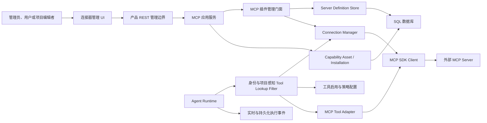
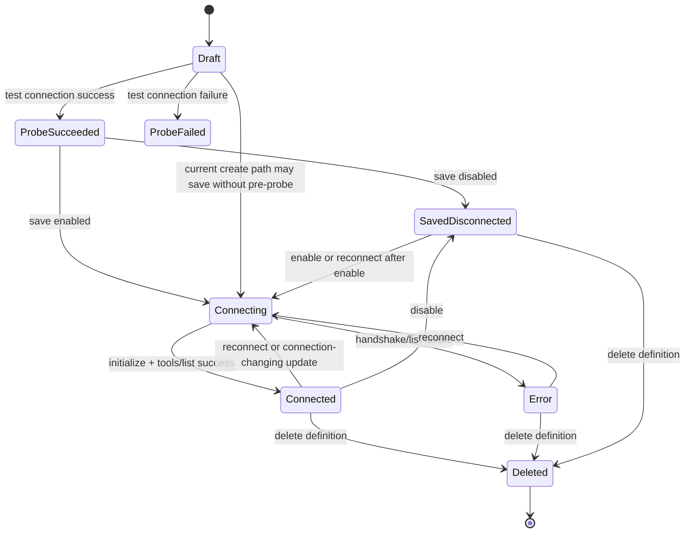
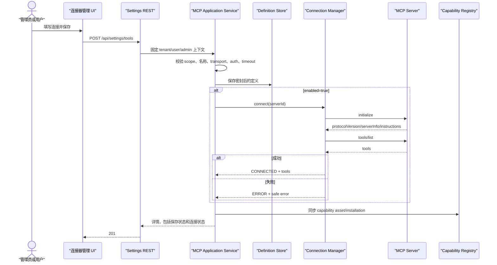
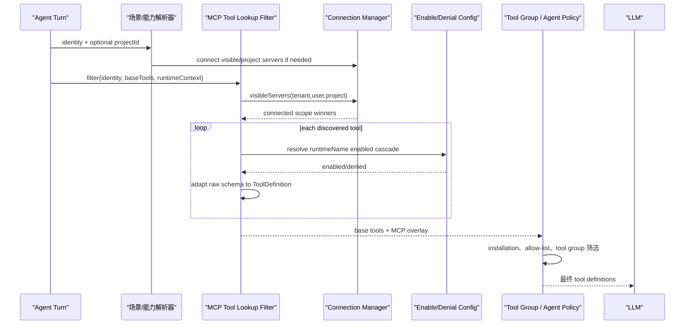
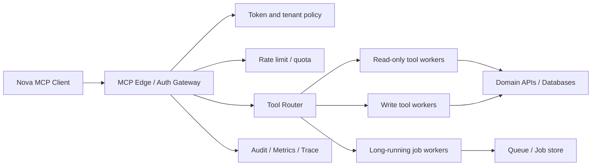

```
# MCP 服务配置、工具发现和运行时调用

## 1. 结论与边界

### 1.1 解决的业务问题

本模块让一个多租户 AI Agent 平台能够把外部 MCP（Model Context Protocol）服务接入为 Agent 工具，并同时解决四类问题：

1. 管理员、普通用户或项目维护者如何创建、查看、修改、测试、重连和删除 MCP 连接。
2. 平台如何通过 `stdio`、`sse`、`streamable_http` 建立 MCP 会话，完成初始化握手和工具发现。
3. 已发现工具如何按系统、租户、项目和个人作用域解析，并进一步受到安装、启用、工具组和 Agent 策略约束。
4. Agent 如何把 MCP 工具当作普通 Tool 调用，同时保留错误、超时、审计和密钥安全边界。

目标用户包括：

- 平台运维：通过部署配置声明系统级连接。
- 租户管理员：管理租户级连接和租户默认工具策略。
- 项目编辑者：安装平台/租户连接，或创建项目私有连接。
- 普通用户：创建个人连接，并将其中的工具加入个人默认工具组。
- Agent Runtime：按当前身份、项目和策略解析真正可调用的工具。

### 1.2 输入、输出和最终可见效果

输入是连接名称、传输协议、传输参数、认证参数、超时、启用状态和管理作用域。输出不是单一的“保存成功”，而是下面四个相互独立的结果：

| 层次 | 含义 | 典型可观察结果 |
|---|---|---|
| 定义已保存 | 连接配置已经持久化 | 列表和详情可以读回配置 |
| 连接已建立 | MCP initialize 成功 | `status=CONNECTED`，存在协议版本和服务信息 |
| 工具已发现 | `tools/list` 成功 | 详情中有原始工具名、描述和数量 |
| Agent 可调用 | 作用域、安装、启用和工具策略均允许 | 新对话中出现 `tool_exec_end`，持久化过程记录成功 |

复刻时必须保留这四层区分。仅看到 HTTP 2xx 或数据库记录，不能判定 Agent 已获得工具。

### 1.3 当前实现结论

- `I` 当前支持 `stdio`、`sse`、`streamable_http` 三种传输。
- `I` 当前认证模式只有 `NONE` 和静态 `HEADER`；后者支持 Bearer Token 和任意自定义 Header。OAuth2 不在当前实现范围内。
- `I` 当前存在 `SYSTEM`、`TENANT`、`PROJECT`、`PERSONAL` 四种 MCP 定义作用域。产品设置页使用 `TENANT` 和个人页的 `USER` 管理视角，其中 `USER` 对应 MCP 的 `PERSONAL`。
- `I` 同名服务按 `PERSONAL > PROJECT > TENANT > SYSTEM` 选择一个可见来源；低优先级同名来源被整体遮蔽，而不是合并工具。
- `I` 新建启用的连接会先保存、再尝试连接。连接失败时记录仍可存在并返回 `ERROR`，因此“创建成功”不等于“连接成功”。
- `I` 修改会影响连接的字段时，应用层先用候选配置做连接测试；测试失败会拒绝更新。新建和修改存在非对称语义。
- `I` 测试连接使用临时 client，完成 initialize 和 tools/list 后关闭，不持久化定义，也不改变存量连接状态。
- `I` 每个已连接服务持有一个不可变连接快照；Connection Manager 内单次 connect/disconnect 各自受 per-server lock 保护，但产品层 reconnect 实际是两个分离操作：先 disconnect，再调用 connect。两次加锁之间存在无连接空窗。
- `I` connect 会先关闭旧 client，再执行新 handshake；失败时写入 `ERROR` snapshot，旧的健康连接不会保留。它不是“新连接成功后再原子切换”的零停机重连。
- `I` 更新连接参数的候选 pre-probe 若失败，会在持久化和断开旧连接之前返回 400，因此该分支可以保持旧定义和旧 client；但 pre-probe 成功后的正式二次连接仍可能失败并丢失旧连接。
- `I` 同一 MCP client 的工具调用被串行化，以避免 stdio 单一管道并发写入失败；不同服务可并行。
- `I` 删除定义会断开 client；应用层同时退役能力资产、禁用安装记录并清理默认工具组引用。
- `I` 密钥以逐值密封形式保存，管理接口只返回部分掩码；编辑提交掩码值表示保留原密钥。
- `I` 管理详情中的工具 `enabled` 存在兼容投影，插件原始视图仍可能把全部已发现工具显示为启用；运行时以作用域拒绝记录和配置级联为准。复刻时不能把展示字段当成唯一权威。
- `A` API 黑盒用例要求 MCP 密钥字段必须掩码或缺省，且内部密钥 envelope 不得返回。
- `A` UI E2E 要求连接成功至少同时验证状态、协议/服务信息和工具列表；发布阻断链路还要求真实工具执行事件和最终业务结果。
- `K` PROJECT 定义在插件 Store 中被映射为 tenant-scope identity，通用按 serverId 的授权加载不校验 projectId。项目专用 Controller 有对象级 guard，但通用 settings 的详情、测试、重连、更新和删除路径存在绕过项目对象边界的风险；重连还会在设置页 scope 检查前先执行动作。
- `K` UI 用例记录了当前若干产品差异：`PTOOL-05` 指出个人 MCP 非法 URL/超时可能被提交并保存成 `ERROR`；`MCP-09` 的 UI 超时下限与后端不一致；`MCP-13` 指出服务 instructions 可能覆盖用户 description；`MCP-17` 要求 stdio env 不泄漏，但当前实现只密封 HTTP authConfig，stdio env 会随 transportConfig 明文落库并可回显到 API/DOM；连接器术语也尚未完全统一。
- `K` 首次可见连接采用一次性 lazy-connect key；key 在尝试连接前写入集合。若该批连接失败，后续普通访问不会自动重试，只有详情触发的按需连接、人工 reconnect 或进程重启才可能恢复。
- `P` `nova_auto_test` 中 MCP 专项 server、load、adapter、lifecycle、error 用例目前均为“未登记”，只能作为待补质量目标，不能声称当前黑盒验证通过。

### 1.4 不包含的范围

本文不展开通用 Tool Group 的递归算法、整个 Agent Tool Loop、MCP Server 对端的生产实现以及全平台密钥中心设计；但会给出 MCP 复刻所必需的接口边界。MCP 对端如何从零实现应另有专门文档，本文只定义宿主所要求的对端契约。

本次没有运行 Nova、没有连接真实 MCP 服务、没有执行 API、WebSocket 或浏览器测试。因此本文不使用 `R` 证据等级。

## 2. 术语与参与方

| 术语 | 定义 |
|---|---|
| Server Definition | 一个 MCP 连接的持久化定义，包括 owner、transport、auth 和 enabled |
| Connection Snapshot | 内存中的 client、服务信息、工具定义、状态和连接修订号的不可变快照 |
| Raw Tool Name | MCP Server 在 `tools/list` 返回的名字，如 `query-docs` |
| Runtime Name | LLM 和 Nova Tool Runtime 使用的名字，如 `mcp__docs__query-docs` |
| Capability Asset | 把 MCP Server 投影为平台可安装能力的稳定资产 |
| Installation | 能力在租户、项目或用户作用域的安装/启用记录 |
| Scope Winner | 多个同名 Server 中，按当前上下文优先级胜出的唯一来源 |
| Per-tool Denial | 租户或用户对一个 runtime tool name 的禁用记录 |
| Default Binding | 将可用工具加入某个 Agent 默认工具组的绑定 |
| Connected | initialize 与 tools/list 均成功，并保有 live client |
| Available | 当前身份和场景可以解析到该工具；仍不必然被默认 Agent 策略选择 |

### 2.1 组件关系



### 2.2 管理面和运行面的关键边界

管理面负责“声明和治理”；运行面负责“解析和执行”。两者通过以下稳定对象衔接：

- `serverId`：连接定义及内存 client 的主身份。
- `capabilityId`：安装、治理和删除引用的业务身份。
- `runtimeName`：工具组、Agent 策略、LLM tool call 和执行事件的工具身份。
- `bindingFingerprint`：标识一次具体来源和连接修订，用于发现连接漂移或重连后绑定变化。

## 3. 业务规则

### 3.1 连接定义规则

1. 名称必填，最长 64 字符，只允许 ASCII 字母、数字和下划线。
2. 名称在同一所有权作用域内唯一。持久层业务唯一维度应为 `(scope, tenantId, userId, projectId, name)`；当前早期表约束未包含 `projectId`，生产复刻应修正。
3. `SYSTEM` 只能来自部署配置，UI/API 不允许创建、更新或删除。
4. `TENANT` 只能由租户管理员创建和修改。
5. `PERSONAL` 必须绑定当前 tenant 和 user，只对所有者可管理。
6. `PROJECT` 的产品契约要求绑定当前 tenant 和 project；项目专用 API 会从路径和已认证上下文固定这些字段。不过当前插件 Store 把 PROJECT owner 折叠为 tenant identity，通用按 serverId 的加载没有 projectId 条件，这是必须修复的既有安全缺口，不能当成已经满足的规则。
7. 默认 `enabled=true`，默认超时 30 秒；后端接受 1～300 秒，而当前 UI 要求 5～300 秒。复刻时建议统一为 5～300 秒并由服务端再次校验。
8. `stdio` 需要非空 `command`，可带字符串数组 `args` 和字符串映射 `env`。
9. `sse` 与 `streamable_http` 需要非空 `url`。
10. `HEADER` 必须至少包含一个非空 Bearer Token，或一个键值均非空的自定义 Header。
11. `NONE` 必须清除旧认证配置，不能保留历史密钥。
12. name 和 scope 在普通设置 UI 的编辑流程中不可变；项目应用 DTO 虽可传 name，但建议新实现同样保持稳定，改名应建新版本或执行显式 rename 流程。

### 3.2 作用域、继承和覆盖规则

| 定义作用域 | 所有者 | 非项目对话 | 指定项目对话 | 管理权限 |
|---|---|---:|---:|---|
| `SYSTEM` | 平台 | 可见 | 可见 | 只读，由部署配置控制 |
| `TENANT` | tenant | 同租户可见 | 同租户可见，但项目还需满足安装/mandatory 策略 | 租户管理员 |
| `PROJECT` | project | 不可见 | 仅同 tenant、同 project 可见 | 项目编辑者，仅可管理项目私有定义 |
| `PERSONAL` | user | 同 tenant、同 user 可见 | 同一用户进入项目时仍可作为个人扩展 | 所有者 |

同一 `serverName` 存在多个可见来源时，只选优先级最小者：

```text
PERSONAL(1) > PROJECT(2) > TENANT(3) > SYSTEM(4)
```

这里的“覆盖”是整台 Server 的来源替换：若个人和租户都存在名为 `docs` 的服务，个人 `docs` 的工具集合完全取代租户 `docs`，不能从两个来源拼接工具。

项目的有效基线应解释为：

```text
租户 mandatory 能力
+ 项目已安装的 SYSTEM/TENANT 能力
+ 项目私有能力
+ 当前用户的 PERSONAL 扩展
- 当前作用域禁用
- Agent 工具组/策略未选择项
```

`SYSTEM`、`TENANT`、`PROJECT`、`PERSONAL` 是来源作用域；`TENANT`、`PROJECT`、`USER` 的 denial 或 installation 是治理作用域，两者不要混为一张 enabled 字段。

#### 覆盖与恢复默认值

“恢复”至少包含三种不同操作，接口实现不能用一个批量删除混为一谈：

1. **恢复子工具启用值**：用户或租户把一个 MCP 子工具重新开启时，删除当前作用域的 denial；随后继续受更高层适用 denial、installation 和 Agent policy 约束。它不是写一个永久 `enabled=true` 来压过其他治理层。
2. **恢复同名来源**：删除或禁用 PERSONAL 同名 Server 后，运行时重新执行 scope winner 解析，从 PROJECT、TENANT、SYSTEM 中选择下一层来源。因为来源可能拥有不同工具 schema，恢复后必须重新解析工具组绑定并检查 runtime name。
3. **恢复个人内置工具覆盖**：当前个人扩展页的批量恢复接口只删除个人内置工具配置覆盖；Active UI 契约明确要求独立创建的 PERSONAL MCP 仍然存在。它不是“清空所有个人连接器”。

当前设置管理视图以 `scope=USER` 查询时，后端静态实现只保证返回 PERSONAL MCP；UI 用例对可能出现的继承 MCP 采用条件式只读断言，并未证明所有环境都会把 TENANT/SYSTEM MCP 列在个人页。复刻时需要先选定产品语义：建议个人页分别展示“我的连接”和“继承连接”，但继承项只读且其来源标签不可省略。

### 3.3 可调用性判定

一个 MCP 工具只有同时满足下列条件才可以进入一次 Agent turn：

1. Server 定义存在且 `enabled=true`。
2. Server 当前是 `CONNECTED`，并在连接快照中存在该 raw tool。
3. Server 对当前 tenant/user/project 可见。
4. 同名 Server 竞争中该来源胜出。
5. 若当前场景要求安装，该 capability 已被 tenant/project/user 安装或继承为 mandatory。
6. runtime name 没有被当前用户、租户或全局配置禁用；最具体作用域优先。
7. 当前 Agent 的工具组或策略允许该 runtime name。
8. 能力解析器生成的 allow-list 包含该 MCP runtime name。

因此以下判断均不成立：

- “数据库中有 MCP 记录，所以 Agent 能用。”
- “连接测试成功，所以新对话一定能用。”
- “工具详情开关为开，所以一定会出现在 main Agent。”
- “项目安装了连接，所以所有成员的个人覆盖会被忽略。”

### 3.4 工具命名规则

LLM-facing 名称为：

```text
mcp__<sanitized-server-name>__<sanitized-raw-tool-name>
```

清洗规则：所有不属于 `[A-Za-z0-9_-]` 的字符替换为 `_`。总长度不超过 64；超过时保留前缀部分并附加由完整原始名确定生成的短 hash。算法必须满足：

- 同一输入跨进程稳定。
- raw name 发回 MCP Server 时仍使用原值，不能发送清洗后的 runtime name。
- 工具开关、工具组、事件和 allow-list 必须使用完全一致的 runtime name。
- 重命名 Server 会改变全部 runtime name，因此应当被视为能力身份变更，而非普通展示字段修改。

示例：

```text
server = context7
raw tool = resolve-library-id
runtime = mcp__context7__resolve-library-id
```

### 3.5 “保存”和“生效”状态模型



推荐 UI 使用不同文案：

- `已保存，尚未连接`
- `已保存，连接失败：<安全错误>`
- `连接成功，发现 N 个工具`
- `连接成功，但尚未加入当前 Agent`
- `已在当前 Agent 生效`

## 4. 完整执行链路

### 4.1 系统级连接启动链路

1. 应用读取 `nova.mcp.enabled` 和 `nova.mcp.servers.<name>`。
2. 插件初始化阶段只解析配置，不访问数据库、不创建线程、不连网络。
3. 系统服务注册阶段创建 Connection Manager，注册 Tool Lookup Filter 和 Prompt Segment。
4. 插件启动阶段运行 MCP 表迁移，构造存储和服务，并绑定管理门面。
5. 将配置中的 SYSTEM Server 与数据库做幂等对账：同名保留稳定 `serverId`，新增写入，配置中删除的旧项断开并删除。
6. 并行连接所有启用的 SYSTEM Server，连接池最多 16 个线程；单个失败不阻塞其他连接。
7. initialize 和 tools/list 成功后缓存 client 和工具，并保存协议版本、serverInfo、instructions/description。
8. 应用 Ready 后把 Server 定义同步为 Capability Asset；缺失来源的旧能力被标记为 `WITHDRAWN`。

`nova.mcp.enabled=false` 只阻止 SYSTEM 配置自动装载，不应关闭用户、租户和项目通过页面创建的连接。

### 4.2 租户或个人创建链路



当前静态实现允许连接失败后仍返回已创建记录。因此调用方必须检查响应内 `mcpInfo.status`，不能只检查 201。

### 4.3 项目安装和项目私有连接

项目有两种不同操作：

**安装共享连接**

1. 列出对项目可见的 PLATFORM/SYSTEM 与 TENANT capability supply pool。
2. 返回每项的 `installed`、`mandatory`、`availability`、`governance`。
3. 项目编辑者以 `capabilityId` 安装；服务验证能力对该 tenant/project 可见。
4. 以 `(tenant, capability, PROJECT, projectId)` 幂等 upsert 安装。
5. 增加项目 `configVersion` 并发布 capability changed 事件，使下一轮重新解析场景。

**创建项目私有连接**

1. 路径参数给出 projectId；服务端强制 `scope=PROJECT`。
2. 创建 Server Definition，owner 为 tenant + project。
3. 同步生成 capability asset，ownership 为 PROJECT。
4. 自动安装到该项目。
5. 返回 capabilityId、serverId、serverName。
6. 只有项目私有连接允许通过项目 API 修改或永久删除；共享来源只能安装/卸载。

项目卸载共享连接只改变 installation，不删除原 Server Definition。项目私有连接的“永久删除”则断开、删定义、退役资产并禁用安装。

### 4.4 测试连接

测试连接必须采用无副作用语义：

1. 校验与正式保存相同的名称、transport、auth 和 timeout。
2. 用随机临时 serverId 构造连接参数。
3. 创建临时 transport/client。
4. SSE 先进行带认证 Header 的 GET 预探测。
5. 执行 MCP initialize。
6. 执行 tools/list。
7. 生成 success、protocolVersion、serverInfo、instructions/description、tool 摘要。
8. 在 finally 中优雅关闭 client。
9. 不写数据库、不替换当前 live client、不改变 installation。

测试存量连接时，必须先做对象级授权，再在服务端解密存储凭据；响应仍只能返回无密钥的连接结果。

### 4.5 更新和重连

普通更新请求可省略 description、enabled 和 MCP 子字段；应用层将缺省值与现有详情合并。掩码认证字段表示保留旧值，真正的新值表示覆盖，缺省字段按接口语义保留或删除。

当前更新过程：

1. 读取并授权现有定义。
2. scope 必须与管理上下文一致；SYSTEM 拒绝修改。
3. 合并候选配置。
4. 若 transport、transportConfig、auth、timeout 变化，或从 disabled 变 enabled，则使用候选配置测试连接。
5. 候选连接失败则返回 400，不修改定义。
6. 对候选工具集合执行策略变更保护，避免删除租户/项目保证所依赖的工具。
7. 保存定义；断开旧 client；若 enabled 则连接新 client。
8. 项目私有连接同时更新 capability 展示信息并 bump 项目配置版本。

重连过程不修改定义，但当前不是无损切换：

1. 应用层确认定义 `enabled=true`。
2. 应用层调用 `disconnectServer`，在第一段 per-server lock 内关闭并移除旧 snapshot，然后释放锁。
3. 应用层再次从 Store 取定义并调用 `connectServer`；第二段 lock 会再次执行 close-existing，然后 handshake。
4. 两段锁之间，读者可观察到 `DISCONNECTED`，工具也会暂时从运行时消失。
5. initialize 或 tools/list 失败时，新 snapshot 为 `ERROR`，旧 client 已关闭，不会回滚。

这与“连接成功后原子替换”的 CAS/swap 设计不同。UI 应在请求期间禁用重连按钮，完成后同时刷新详情和列表；生产复刻应先建立候选 client，成功后在一个锁内比较 definition version / connection revision 并原子交换，失败则关闭候选并保留旧 snapshot。

候选 update pre-probe 是另一个需要单独理解的分支：若连接字段变化，临时 probe 失败会在写 Store 前终止，旧定义和旧连接都保持；若 probe 成功，随后保存和正式 reconnect 仍会第二次访问网络，第二次失败时新定义已保存且旧连接已丢失。

### 4.6 工具发现、可见性和 Agent 装配



MCP Filter 发生异常时 fail-soft：记录告警并返回 base tools，不让 MCP 层击穿整个 Agent turn。其代价是故障可能表现为“工具突然不可用”，因此必须有日志、指标和 UI 连接健康状态配合。

用户和项目的 lazy connect 还具有一次性闩锁语义：`tenant:user` 或 `tenant:project` key 在真正发起网络尝试之前就加入进程内 initialized set。同一 JVM 生命周期里，即使连接失败，该 key 也不会因失败自动移除。因此后续普通场景解析不会重新尝试整批连接。读取某个 enabled Server 的详情会触发单项按需连接，人工 reconnect 也可恢复；否则只能等配置变更路径主动连接或进程重启。生产设计应把“正在初始化”“成功”“失败及 nextRetryAt”作为显式状态，并使用有界指数退避，而不是永久的一次性 boolean。

### 4.7 MCP 工具调用

1. LLM 使用 runtime name 发起 tool call。
2. Tool Adapter 已绑定胜出 Server 的 live client、raw tool name 和输入 schema。
3. Adapter 删除所有 `_` 开头的宿主内部参数，避免把内部控制字段发给第三方。
4. 对该 client 加同步锁，调用 `tools/call(rawName, cleanArguments)`。
5. MCP `isError=true` 时返回失败结果：`MCP tool <rawName> failed: <text>`。
6. 成功时仅拼接所有 TextContent，以换行连接；当前实现不会完整保留图片、资源链接等非文本内容。
7. 异常被翻译为 ToolResult error，不伪装成空成功。
8. 默认结果保留策略为 `CONDENSABLE`，允许上下文压缩。
9. Runtime 继续产生 tool start/end 事件和持久化 processData；UI E2E 的真实验收应同时检查实时与持久化证据。

### 4.8 删除和清理

删除定义时至少执行：

1. 对象级授权和策略变更保护。
2. 关闭 live client。
3. 删除 Server Definition。
4. Capability Asset 标记 `DELETED`；若启动对账发现来源消失则标记 `WITHDRAWN`。
5. Installation 保留为 disabled 审计行。
6. 清除引用该能力的默认工具组成员。
7. 项目私有连接先卸载，再删除定义。

插件 stop 必须幂等关闭所有 client、清空连接快照和锁、释放 transport，并解除管理门面的绑定；不能用 static 保存运行态资源或注册全局 shutdown hook。

## 5. 对外契约

### 5.1 通用认证和错误体

所有管理 API 均从认证会话解析 tenant、user 和 admin 信息，禁止由客户端提交 owner 字段。项目 API 还必须做项目对象级 view/edit 校验。

业务错误统一形态：

```json
{
  "success": false,
  "message": "名称只能包含字母、数字和下划线"
}
```

| 语义 | HTTP |
|---|---:|
| 参数、transport、scope、timeout 无效 | 400 |
| 非管理员写 TENANT、修改 SYSTEM、无项目编辑权 | 403 |
| 资源不存在或为避免枚举而隐藏 | 404 |
| 同作用域重名 | 409 |
| MCP 连接或内部编解码错误 | 当前多映射为 500 |

推荐生产实现将外部连接失败映射为稳定的 422 或 502，并返回 `errorCode`，不要把可预期的握手失败归类成无差别 500。

### 5.2 设置页 Server API

#### 列表

```http
GET /api/settings/tools?scope=TENANT
GET /api/settings/tools?scope=USER
```

- `TENANT`：需要租户管理员；展示 SYSTEM 和 TENANT MCP，以及内置工具集合。
- `USER`：展示当前用户 PERSONAL MCP，不展示内置工具和租户 MCP。
- 默认 scope 是 `USER`。

响应：

```json
{
  "items": [
    {
      "id": "47bd...",
      "type": "mcp",
      "name": "context7",
      "description": "Documentation lookup",
      "scope": "TENANT",
      "toolCount": 2,
      "status": "CONNECTED",
      "transport": "streamable_http"
    }
  ],
  "total": 1
}
```

列表只表示管理视图，不承诺该工具已绑定到 main Agent。

#### 详情

```http
GET /api/settings/tools/{serverId}?scope=TENANT|USER
```

核心响应：

```json
{
  "effectiveStateSchemaVersion": 2,
  "id": "47bd...",
  "type": "mcp",
  "name": "context7",
  "description": "Documentation lookup",
  "scope": "TENANT",
  "toolCount": 2,
  "tools": [
    {
      "name": "resolve-library-id",
      "runtimeName": "mcp__context7__resolve-library-id",
      "capabilityId": "cap_mcp_...",
      "description": "Resolve a library",
      "enabled": true,
      "availability": {
        "installedAtScope": false,
        "effectiveAvailable": true,
        "inherited": true,
        "sources": ["TENANT"]
      },
      "defaultBinding": {
        "boundAtScope": false,
        "defaultInContext": false,
        "inherited": false,
        "editable": false,
        "primarySource": null,
        "sources": []
      },
      "governance": {
        "readOnly": true,
        "allowedActions": [],
        "readOnlyReasons": ["TENANT_MANAGED"]
      }
    }
  ],
  "createdAt": "2026-08-07T10:00:00",
  "updatedAt": "2026-08-07T10:00:02",
  "mcpInfo": {
    "transport": "streamable_http",
    "transportConfig": {"url": "https://mcp.example.com/mcp"},
    "authType": "HEADER",
    "authConfig": {
      "bearerToken": "abcd****wxyz",
      "headers": {"X-API-Key": "key_****7890"}
    },
    "timeoutSeconds": 60,
    "enabled": true,
    "status": "CONNECTED",
    "errorMessage": null,
    "protocolVersion": "2025-03-26",
    "serverInfo": {"name": "Example MCP", "version": "1.0.0"}
  }
}
```

MCP Tool 的 `category` 当前转换链没有赋值保证，JSON 中可能为 `null` 或按序列化策略省略，不能硬编码为 `MCP`。客户端必须 fail-closed 校验 `effectiveStateSchemaVersion=2`，并使用上述精确字段名；`enabled` 只是兼容投影，不是有效可用性和默认绑定的权威来源。

#### 创建

```http
POST /api/settings/tools
Content-Type: application/json
```

Streamable HTTP 示例：

```json
{
  "type": "mcp",
  "name": "context7",
  "description": "Documentation lookup",
  "scope": "TENANT",
  "enabled": true,
  "mcp": {
    "transport": "streamable_http",
    "transportConfig": {"url": "https://mcp.example.com/mcp"},
    "authType": "HEADER",
    "authConfig": {
      "bearerToken": "raw-secret-only-on-write",
      "headers": {"X-Workspace": "tenant-a"}
    },
    "timeoutSeconds": 60
  }
}
```

stdio 示例：

```json
{
  "type": "mcp",
  "name": "filesystem",
  "scope": "PERSONAL",
  "enabled": true,
  "mcp": {
    "transport": "stdio",
    "transportConfig": {
      "command": "/usr/local/bin/npx",
      "args": ["-y", "@modelcontextprotocol/server-filesystem", "/workspace/read-only"],
      "env": {"MCP_API_KEY": "raw-secret"}
    },
    "authType": "NONE",
    "timeoutSeconds": 60
  }
}
```

当前成功状态为 201，响应是完整详情。实现者必须注意 stdio `env` 当前属于 transportConfig，静态源码只确认 HTTP authConfig 做了数据库密封；生产复刻必须把 env 中所有敏感值也纳入密封字段，而不能明文存入 transport envelope。

#### 更新与删除

```http
PUT /api/settings/tools/{serverId}
DELETE /api/settings/tools/{serverId}
```

更新请求不含 name 和 scope：

```json
{
  "type": "mcp",
  "description": "updated",
  "enabled": true,
  "mcp": {
    "transport": "streamable_http",
    "transportConfig": {"url": "https://mcp.example.com/mcp"},
    "authType": "HEADER",
    "authConfig": {
      "bearerToken": "abcd****wxyz",
      "headers": {"X-API-Key": "key_****7890"}
    },
    "timeoutSeconds": 45
  }
}
```

包含 `****` 的密钥值被解释为“保持旧值”。这一约定要求：

- 服务端不能把掩码本身保存成凭据。
- 前端新增连接不能提交掩码占位符。
- 真正包含 `****` 的新密钥会被误判；推荐新系统使用显式 `secretOperation: KEEP|REPLACE|CLEAR`，而不是内容启发式。

删除成功返回 204。取消删除只发生在 UI，本身不发 API。

#### 测试、存量测试和重连

```http
POST /api/settings/tools/test
POST /api/settings/tools/{serverId}/test
POST /api/settings/tools/{serverId}/reconnect?scope=TENANT|USER
```

探测响应：

```json
{
  "success": true,
  "errorMessage": null,
  "protocolVersion": "2025-03-26",
  "description": "Use this server for documentation",
  "serverInfo": {"name": "Context7", "version": "1.0.0"},
  "tools": [
    {"name": "resolve-library-id", "description": "Resolve library id"},
    {"name": "query-docs", "description": "Query documentation"}
  ]
}
```

握手失败也通常以 HTTP 200 返回 `success=false` 和 `errorMessage`。重连 disabled Server 返回 400；重连成功返回更新后的详情。

#### 子工具启停

```http
PUT /api/settings/tools/{serverId}/items/{rawToolName}?scope=TENANT|USER
```

请求：

```json
{
  "enabled": false,
  "scope": "TENANT"
}
```

服务端根据 `serverName + rawToolName` 计算 runtimeName，把禁用写为 capability scope denial，并同步兼容配置。该修改需要经过策略变更保护；若工具是租户或项目保证链路不可缺少的工具，应拒绝破坏性禁用。

### 5.3 项目 MCP API

| 方法 | 路径 | 语义 | 权限 |
|---|---|---|---|
| GET | `/api/v1/projects/{projectId}/mcp` | 共享与私有 MCP supply pool | project view |
| POST | `/api/v1/projects/{projectId}/mcp/install` | 安装 capability | project edit |
| DELETE | `/api/v1/projects/{projectId}/mcp/{capabilityId}` | 卸载，不删除来源 | project edit |
| POST | `/api/v1/projects/{projectId}/mcp` | 创建项目私有连接并自动安装 | project edit |
| GET | `/api/v1/projects/{projectId}/mcp/{capabilityId}/detail` | 查看详情 | project view |
| POST | `/api/v1/projects/{projectId}/mcp/test` | 测试未保存连接 | project edit |
| POST | `/api/v1/projects/{projectId}/mcp/{capabilityId}/test` | 测试存量连接 | project edit |
| POST | `/api/v1/projects/{projectId}/mcp/{capabilityId}/reconnect` | 重连 | project edit |
| PUT | `/api/v1/projects/{projectId}/mcp/{capabilityId}` | 仅更新项目私有连接 | project edit |
| DELETE | `/api/v1/projects/{projectId}/mcp/{capabilityId}/definition` | 永久删除项目私有连接 | project edit |

上述权限是项目专用入口的产品契约，但不能据此推断底层已经端到端安全。当前实现存在如下跨入口缺口：

1. Store 的 `identityFor(PROJECT, tenantId, userId)` 返回 tenant-scope identity，`matchesIdentity` 不比较 projectId。
2. 插件通用 `loadAndAuthorize(serverId, tenantId, userId)` 只依次探测 GLOBAL、TENANT、PERSONAL；由于 PROJECT 被映射成 tenant identity，同租户调用者可以命中项目定义。
3. 通用 `POST /api/settings/tools/{id}/test` 不要求租户管理员，也不携带 projectId，因此同租户普通用户可能让服务端解密并使用项目凭据发起 probe。
4. 通用详情会在 settings scope 可见性检查之前执行 get；get 对 enabled 且未连接的 Server 会按需连接。因此即使最终返回 404，连接副作用也可能已经发生。
5. 通用 reconnect 先执行 disconnect/connect，再检查请求的 USER/TENANT settings scope；越权请求可能收到 404，但已经改变项目连接状态。
6. 通用 update/delete 以 tenant admin 标志授权 PROJECT，缺少项目成员和 project edit 检查，可能让租户管理员通过 settings serverId 绕开项目对象 guard。

这些是 `I` 可由控制流确认、并按安全影响归入 `K` 的当前缺陷。生产复刻必须让持久层和服务层授权函数都接收不可伪造的 `ManagementScope(scope, tenantId, userId, projectId, roles)`；PROJECT 的读取、解密、测试、连接和写入都必须比较 tenantId + projectId，并在任何网络、解密或状态变更之前完成对象级授权。通用 settings API 应明确拒绝 PROJECT serverId，不能依赖操作后的展示过滤。

安装请求：

```json
{"capabilityId": "cap_mcp_2a1f..."}
```

列表响应：

```json
{
  "effectiveStateSchemaVersion": 2,
  "mcpServers": [
    {
      "capabilityId": "cap_mcp_2a1f...",
      "serverId": "47bd...",
      "serverName": "docs",
      "description": "Shared docs",
      "installed": true,
      "mandatory": false,
      "sourceType": "MCP",
      "ownershipScope": "TENANT",
      "availability": {
        "installedAtScope": true,
        "effectiveAvailable": true,
        "inherited": false,
        "sources": ["PROJECT"]
      },
      "governance": {
        "readOnly": false,
        "allowedActions": ["UNINSTALL"],
        "readOnlyReasons": []
      }
    },
    {
      "capabilityId": "cap_mcp_required...",
      "serverId": "88ac...",
      "serverName": "required_docs",
      "description": "Tenant-required connector",
      "installed": false,
      "mandatory": true,
      "sourceType": "MCP",
      "ownershipScope": "TENANT",
      "availability": {
        "installedAtScope": false,
        "effectiveAvailable": true,
        "inherited": true,
        "sources": ["TENANT"]
      },
      "governance": {
        "readOnly": true,
        "allowedActions": [],
        "readOnlyReasons": ["INHERITED", "TENANT_MANAGED"]
      }
    }
  ]
}
```

创建项目私有连接的 body 与 `McpServerRequest` 相同，但不允许提交 scope/project owner；响应：

```json
{
  "capabilityId": "cap_mcp_2a1f...",
  "serverId": "47bd...",
  "serverName": "project_docs"
}
```

### 5.4 部署配置契约

```yaml
nova:
  security:
    credential-master-key: ${NOVA_SECURITY_CREDENTIAL_MASTER_KEY:}
  mcp:
    enabled: true
    servers:
      filesystem:
        enabled: true
        transport: stdio
        command: /usr/local/bin/npx
        args:
          - -y
          - "@modelcontextprotocol/server-filesystem"
          - /srv/allowed
        env: {}
        timeout-seconds: 60
      remote_docs:
        enabled: true
        transport: streamable_http
        url: https://mcp.example.com/mcp
        timeout-seconds: 30
```

当前 SYSTEM 配置描述没有 HTTP auth 字段；需要认证的系统连接若要复刻，建议只允许 Secret 引用：

```yaml
auth:
  type: HEADER
  bearer-token-secret-ref: secret://mcp/remote_docs/token
```

不要在版本库配置中放原始凭据。

### 5.5 MCP 对端协议契约

当前宿主依赖 MCP Java SDK `1.1.1` 的同步 Client。对端至少满足 JSON-RPC 2.0 和 MCP 生命周期：

1. transport 建立成功。
2. Client 发送 `initialize` request；Server 返回协商后的 protocolVersion、capabilities、serverInfo，可带 instructions。
3. Client 发送 `notifications/initialized`，对端应接受无响应通知。
4. Client 发送 `tools/list`；空列表合法。
5. 每个 Tool 最少有 raw `name`，可带 `description` 和 JSON Schema `inputSchema`。
6. `tools/call` 接收 raw tool name 与 JSON object arguments。
7. 返回 `content[]` 和可选 `isError`；当前宿主只提取 TextContent。
8. JSON-RPC 成功响应包含同 request 的 `id` 和 `result`；协议错误返回同 `id` 与 `error{code,message,data?}`，通知没有 `id` 且不得回复。

当前超时不是单一值，而是三个独立层次：

| 层次 | 当前值 | 作用 |
|---|---:|---|
| SSE GET preflight | 固定 5 秒 | 探测 URL、认证和协议错配；HTTP Client 使用 `Redirect.NORMAL` |
| MCP initialization timeout | 用户配置，后端 1～300 秒，UI 5～300 秒 | transport 建立、initialize 生命周期 |
| JSON-RPC request timeout | `max(configuredTimeout, 120秒)` | initialize 以外也覆盖 tools/list、tools/call、ping 等 SDK round-trip |

SSE preflight 的 read timeout 被解释为“流式端点可达”，connect timeout 才是不可达。重定向使用 `NORMAL` 且当前没有逐跳 SSRF 复验保证，这是安全缺口。配置 5 秒不会把 tools/call 限制为 5 秒，因为 SDK request timeout 至少为 120 秒；但对端自己的反向代理和业务 deadline 仍需独立配置。

推荐对端提供稳定 tool name 和兼容 schema；删除或重命名工具会使已有工具组绑定失效。

### 5.6 WebSocket 与执行证据

MCP 没有专属聊天 WebSocket 命令。它通过通用 Tool 事件可观察：

```json
{
  "type": "tool_exec_end",
  "content": "call_123|mcp__context7__resolve-library-id|128|true|842|resolved result",
  "seq": 17,
  "conversationId": "conv_123",
  "messageId": 456
}
```

真实 `content` 是 pipe 编码：

```text
<callId>|<toolName>|<outputBytes>|<success>|<durationMs>|<truncatedResult>
```

结果中可以包含 `|`，解析器只能切前五个分隔符，剩余内容全部属于 result。`seq`、`conversationId` 和 `messageId` 随发送路径可能存在，消费者必须容忍缺省；不能把示例中的 `data.toolName` 当成真实外壳。

持久化 conversation processData 另有结构化记录，典型形态：

```json
{
  "type": "tool_exec",
  "toolCallId": "call_123",
  "tool": "mcp__context7__resolve-library-id",
  "args": "{\"libraryName\":\"react\"}",
  "inputBytes": 23,
  "outputBytes": 128,
  "result": "resolved result",
  "success": true,
  "durationMs": 842,
  "timestamp": 1786077600000,
  "toolOrdinal": 1,
  "artifacts": []
}
```

子代理执行时 `type` 为 `sub_tool_exec` 并带 `agentLabel`；`toolCallId`、`toolOrdinal`、`artifacts` 都可能缺省。MCP 验收至少断言实时 pipe 中的精确 runtimeName/success，并在持久化结构中找到同一次成功执行，防止刷新后丢失。

## 6. 数据模型与生命周期

### 6.1 Server Definition 推荐 DDL

下面 DDL 是自包含的生产复刻版本，修补了现有早期表约束对 PROJECT name 唯一性表达不足的问题：

```sql
CREATE TABLE mcp_server_definition (
    id                 BIGINT GENERATED BY DEFAULT AS IDENTITY PRIMARY KEY,
    server_id          VARCHAR(64) NOT NULL UNIQUE,
    capability_id      VARCHAR(64),
    name               VARCHAR(64) NOT NULL,
    description        TEXT,
    scope              VARCHAR(32) NOT NULL,
    tenant_id          VARCHAR(255),
    user_id            VARCHAR(255),
    project_id         VARCHAR(64),
    transport_type     VARCHAR(32) NOT NULL,
    transport_config   TEXT NOT NULL,
    auth_type          VARCHAR(32) NOT NULL DEFAULT 'NONE',
    auth_config        TEXT,
    timeout_seconds    INTEGER NOT NULL DEFAULT 30,
    enabled            BOOLEAN NOT NULL DEFAULT TRUE,
    protocol_version   VARCHAR(32),
    server_info        TEXT,
    last_connect_at    TIMESTAMP,
    created_at         TIMESTAMP NOT NULL,
    updated_at         TIMESTAMP NOT NULL,
    deleted_at         TIMESTAMP,
    CHECK (scope IN ('SYSTEM','TENANT','PROJECT','PERSONAL')),
    CHECK (transport_type IN ('STDIO','SSE','STREAMABLE_HTTP')),
    CHECK (auth_type IN ('NONE','HEADER')),
    CHECK (timeout_seconds BETWEEN 5 AND 300),
    CHECK (
      (scope='SYSTEM' AND tenant_id IS NULL AND user_id IS NULL AND project_id IS NULL) OR
      (scope='TENANT' AND tenant_id IS NOT NULL AND user_id IS NULL AND project_id IS NULL) OR
      (scope='PROJECT' AND tenant_id IS NOT NULL AND user_id IS NULL AND project_id IS NOT NULL) OR
      (scope='PERSONAL' AND tenant_id IS NOT NULL AND user_id IS NOT NULL AND project_id IS NULL)
    )
);

CREATE UNIQUE INDEX uk_mcp_scope_owner_name
ON mcp_server_definition (
  scope,
  COALESCE(tenant_id, ''),
  COALESCE(user_id, ''),
  COALESCE(project_id, ''),
  name
)
WHERE deleted_at IS NULL;

CREATE INDEX idx_mcp_scope_owner
ON mcp_server_definition(scope, tenant_id, user_id, project_id);
```

当前实现把 transport type 和 config 折叠进一个 JSON envelope，把 auth type 和已密封 config 折叠进另一个 envelope。复刻可以沿用，但应建立版本字段，避免未来 schema 演进只能猜测 JSON 形状。

### 6.2 JSON envelope

```json
{
  "type": "STREAMABLE_HTTP",
  "config": {"url": "https://mcp.example.com/mcp"}
}
```

认证列：

```json
{
  "type": "HEADER",
  "config": {
    "bearerToken": "enc:v1:...",
    "headers": {
      "X-API-Key": "enc:v1:..."
    }
  }
}
```

Header 名可以明文，Header 值必须逐值密封。主密钥不得入库；应用启动时从环境或 Secret Manager 注入。换密钥需要显式轮换方案，否则旧密文不可读。

### 6.3 Capability 和 Installation

推荐最小字段：

```sql
CREATE TABLE capability_asset (
  capability_id VARCHAR(64) PRIMARY KEY,
  tenant_id VARCHAR(255),
  kind VARCHAR(32) NOT NULL,
  logical_name VARCHAR(255) NOT NULL,
  display_name VARCHAR(255),
  ownership_scope VARCHAR(32) NOT NULL,
  owner_ref_id VARCHAR(255),
  source_type VARCHAR(32) NOT NULL,
  source_ref VARCHAR(64) NOT NULL,
  status VARCHAR(32) NOT NULL,
  version BIGINT NOT NULL,
  created_at TIMESTAMP NOT NULL,
  updated_at TIMESTAMP NOT NULL,
  deleted_at TIMESTAMP
);

CREATE TABLE capability_installation (
  id BIGINT GENERATED BY DEFAULT AS IDENTITY PRIMARY KEY,
  tenant_id VARCHAR(255) NOT NULL,
  capability_id VARCHAR(64) NOT NULL,
  scope_type VARCHAR(32) NOT NULL,
  scope_id VARCHAR(255) NOT NULL,
  enabled BOOLEAN NOT NULL,
  installed_by VARCHAR(255),
  created_at TIMESTAMP NOT NULL,
  updated_at TIMESTAMP NOT NULL,
  UNIQUE(tenant_id, capability_id, scope_type, scope_id)
);
```

`capabilityId` 可由 serverId 确定性生成，例如 `cap_mcp_` 加 name-based UUID 前 16 字符。关键要求是同步和重启不能改变 ID。

### 6.4 运行状态不应完全入库

`CONNECTED/ERROR/DISCONNECTED` 是进程内连接快照的状态，不应仅依据数据库字段恢复。数据库保存的 protocolVersion/serverInfo 是上次成功连接元数据，不代表当前仍在线。

建议响应增加：

```json
{
  "desiredState": "ENABLED",
  "runtimeState": "ERROR",
  "lastConnectedAt": "2026-08-07T10:00:00Z",
  "lastCheckedAt": "2026-08-07T10:05:00Z",
  "connectionRevision": 42
}
```

### 6.5 生命周期

| 操作 | Definition | Client | Capability | Installation |
|---|---|---|---|---|
| 创建 disabled | 新增 | 无 | ACTIVE | 按 scope 创建 |
| 创建 enabled 成功 | 新增 | CONNECTED | ACTIVE | 按 scope 创建 |
| 创建 enabled 失败 | 当前仍新增 | ERROR snapshot | ACTIVE | 当前仍可创建，但 runtime 不可用 |
| 测试连接 | 不变 | 正常完成后关闭；握手中途异常存在泄漏风险 | 不变 | 不变 |
| 重连成功 | 不变 | 先关闭旧 client，经历空窗后写新 snapshot | 不变 | 不变 |
| 重连失败 | 不变 | 旧 client 已丢失，最终 ERROR snapshot | 不变 | 不变 |
| 卸载共享连接 | 不变 | 可仍供其他场景使用 | ACTIVE | 当前 project disabled |
| 永久删除 | 删除/软删 | 关闭 | DELETED | 保留 disabled 审计行 |
| 启动发现来源缺失 | 缺失 | 无 | WITHDRAWN | disabled |

## 7. 核心实现设计

### 7.1 模块划分

```text
mcp-management-api
  - SettingsMcpController
  - ProjectMcpController
  - stable application DTOs

mcp-application
  - ownership/scope pinning
  - capability synchronization
  - mutation guard
  - exception translation

mcp-plugin
  - ServerDefinitionStore
  - SecretSealer port
  - ConnectionManager
  - TransportFactory
  - ToolLookupFilter
  - ToolAdapter
  - AdminFacade

capability-governance
  - CapabilityAsset
  - Installation
  - ScopeDenial
  - ToolGroup and AgentPolicy

agent-runtime
  - identity/project context
  - tool policy resolution
  - tool events and persistence
```

HTTP Controller 不应直接暴露插件 DTO。应用 DTO 是稳定产品契约，插件内部模型可以独立演进。

### 7.2 当前连接管理与推荐 CAS 切换

下面伪代码忠实表达当前关键语义：先关旧连接，再 handshake；异常写 ERROR。还应注意真实 handshake 内部先创建 transport/client，再执行 initialize/tools-list。如果 initialize 或 list 抛异常，client 没有作为成功的 Handshake 返回给调用者；`doConnect` catch 没有局部 client 引用可关闭，`testConnection` 的 finally 也可能仍拿到 null。因此异常路径可能残留 SDK 资源或 stdio 子进程。

```java
ConnectResult connect(ConnectionParam p) {
  Lock lock = lockByServerId(p.serverId());
  lock.lock();
  try {
    closeExisting(p.serverId());
    long revision = revisionSequence.incrementAndGet();
    try {
      Transport t = transports.create(p);
      if (p.transport() == SSE) preflightSse(p);
      Client c = Client.sync(t)
          .initializationTimeout(p.timeout())
          .requestTimeout(max(p.timeout(), 120s))
          .build();
      InitializeResult init = c.initialize();
      List<ToolSchema> tools = immutableCopy(c.listTools());
      snapshots.put(p.serverId(), connected(c, p.owner(), tools, init, revision));
      return success(init, tools);
    } catch (Exception e) {
      String safe = sanitize(e);
      snapshots.put(p.serverId(), error(p.owner(), safe, revision));
      return failure(safe);
    }
  } finally {
    lock.unlock();
  }
}
```

生产复刻应使用候选连接 + compare-and-swap：

```java
ConnectResult reconnectSafely(ConnectionParam p, long expectedDefinitionVersion) {
  Candidate candidate = null;
  try {
    candidate = handshakeCandidate(p); // owns transport/client; closes itself on failure
    Lock lock = lockByServerId(p.serverId());
    lock.lock();
    try {
      if (definitionVersion(p.serverId()) != expectedDefinitionVersion) {
        throw new Conflict("definition changed while reconnecting");
      }
      Snapshot previous = snapshots.get(p.serverId());
      Snapshot next = candidate.detachAsSnapshot(nextRevision());
      snapshots.put(p.serverId(), next); // atomic visible swap
      closeQuietly(previous == null ? null : previous.client());
      return next.connectResult();
    } finally {
      lock.unlock();
    }
  } catch (Exception e) {
    closeQuietly(candidate); // closes transport, client and stdio process tree
    return failureWithoutReplacingHealthySnapshot(sanitize(e));
  }
}
```

所有 handshake 阶段都必须在资源所有权对象中登记 transport/client/process；即使 build、initialize、initialized notification 或 tools/list 任一步失败，也要按逆序关闭。stdio 还应等待子进程有界退出，超时后杀死整个进程树。

`testConnection` 复用相同 handshake，但不能写 snapshots，并必须 finally close。

### 7.3 可见性解析伪代码

```java
List<ServerSnapshot> visibleWinners(Context c) {
  return snapshots.values().stream()
      .filter(ServerSnapshot::connected)
      .filter(s -> visibleTo(s.owner(), c.tenantId(), c.userId(), c.projectId()))
      .collect(groupingBy(s -> s.serverName()))
      .values().stream()
      .map(group -> minByScopePriority(group))
      .toList();
}

ToolLookup materialize(Context c, ToolLookup base) {
  List<Tool> overlay = new ArrayList<>();
  for (ServerSnapshot s : visibleWinners(c)) {
    for (RemoteTool raw : s.tools()) {
      String runtimeName = externalName(s.name(), raw.name());
      if (resolveEnabled(c.identity(), runtimeName)
          && installedForScene(c, s.capabilityId())
          && allowedByAgentPolicy(c.agent(), runtimeName)) {
        overlay.add(new McpToolAdapter(s.client(), raw, runtimeName));
      }
    }
  }
  return overlay.isEmpty() ? base : composite(base, overlay);
}
```

推荐只在一个 canonical resolver 内做“作用域 winner”，管理预览、变更前策略检查、能力 allow-list 和实际执行都必须复用它，防止预览可用而运行时选择不同来源。

### 7.4 子工具启停级联

```text
USER exact value
  -> TENANT exact value
    -> GLOBAL exact value
      -> default true
```

若用 denial 表，等价逻辑是：当前场景中任何适用且优先级最高的 denial 决定有效值。启停写入需要携带 capabilityId 和 runtimeName，防止同名工具因来源替换而误用旧配置。

### 7.5 最小可用版本

MVP 可以只实现：

- `streamable_http`。
- `NONE` 和 Bearer Token。
- TENANT 与 PERSONAL。
- 创建、列表、详情、测试、删除。
- initialize、tools/list、tools/call。
- runtime name、密钥加密、租户隔离。
- 一个默认 Agent 工具 allow-list。

即便是 MVP，也不能省略对象级授权、密钥掩码、超时、client close 和“保存/连接/发现/调用”四层状态。

### 7.6 生产级版本

生产版本应增加：

- PROJECT supply pool、installation、mandatory 和个人扩展。
- SSE 与受控 stdio worker。
- Secret Manager 引用和轮换。
- SSRF/DNS rebinding/重定向策略。
- 命令 allow-list、容器隔离、资源限额和网络策略。
- 定期健康检查、断线检测、退避重连和熔断。
- 工具列表版本化、schema drift 检测和管理员确认。
- 非文本 MCP content 完整映射。
- 分布式连接 ownership 或无状态按需连接。
- 操作审计、调用审计和秘密泄漏扫描。
- create 的原子策略：先 probe 再保存，或显式允许保存为 Draft/Error。

## 8. 并发与非正常路径

### 8.1 并发约束

- 同一 `serverId` 的 connect/disconnect/reconnect 必须由同一互斥锁串行化。
- snapshot 必须整体不可变并原子替换；读者不能看到新 client 搭配旧 tools。
- 同一 client 的 tools/call 串行；否则 stdio 单管道可能在竞争时发送失败。
- 不同 server 的初始化可并行，连接线程池必须有上限。
- 项目安装必须幂等 upsert；重复安装不产生重复行。
- 删除和重连竞争时，生产实现应使用 definition version 或删除墓碑，避免删除后迟到的 reconnect 又恢复 snapshot。
- 更新必须使用 optimistic version；否则两个管理员提交会互相覆盖。

### 8.2 失败矩阵

| 故障 | 当前/推荐行为 |
|---|---|
| DNS/连接拒绝 | `ERROR`，工具不进入运行时，安全错误可见 |
| initialize 超时 | 候选 update pre-probe 失败时旧连接保持；create/reconnect 写 ERROR；当前握手中途 client/stdio 可能未关闭完整 |
| tools/list 超时 | 不上线部分工具；create/reconnect 丢失旧连接并写 ERROR；同样存在异常资源清理风险 |
| SSE 返回 405 | 明确提示端点不支持 SSE，检查 transport |
| HTTP 4xx/5xx | 提取 JSON `message/error/detail`，否则截断 body |
| 畸形 serverInfo | 连接可继续，但管理元数据为空并记录告警 |
| tool schema 无法转换 | 当前降级为空 schema；推荐标记该工具不可用 |
| tools/call `isError=true` | ToolResult error，LLM/UI 不当作零结果 |
| tools/call 抛异常 | 错误穿透，包含安全可定位原因 |
| server 中途断线 | 当前没有完整主动检测/自动重连保证；推荐健康检查和退避 |
| lazy connect 首次失败 | initialized key 已占用，普通访问不再自动重试；详情/人工重连/重启可恢复 |
| MCP Filter 出错 | fail-soft 返回 base tools，MCP 工具暂不可用 |
| 插件未 ready | late-binding facade 应给受控 unavailable，而非 NPE |
| capability 同步失败 | 可能出现定义存在但不可安装；需事务/outbox 修复 |
| 删除清理部分失败 | 需补偿任务扫描 orphan asset/installation/binding |

### 8.3 取消语义

当前工具调用通过同步 SDK 且在 client 锁内执行，静态源码没有证明通用 Agent cancel 能向 MCP 请求发送协议级 cancellation。复刻时应明确：

- 对话 cancel 首先停止等待并标记 turn cancelled。
- 若 SDK 支持 request cancellation，发送协议取消。
- 若不支持，超时后丢弃迟到结果，不能让其写入已终止 turn。
- 对具有副作用的远程工具，客户端取消不等于服务端回滚；应在工具契约中提供 idempotencyKey 或 job status。

### 8.4 重启和分布式部署

当前 connection snapshot 是 JVM 内存态。重启后 SYSTEM 会启动连接；用户可见连接在首次访问时异步连接；项目连接在项目解析时阻塞连接。多个副本会各自建立 client。

生产复刻需选择：

1. 每个应用副本各自连接，简单但会放大外部连接数。
2. 按 serverId 一致性哈希分配连接 owner，通过内部 RPC 调用。
3. 每次调用短连接，不适合高频工具但部署简单。

无论选择哪种，管理接口返回的 runtimeState 必须说明是本副本、聚合状态还是目标 owner 状态。

## 9. 安全、权限和审计

### 9.1 权限

以下是产品应满足的权限契约，不代表当前实现已全部满足：

- 租户管理员才能读写 TENANT 设置视图。
- PERSONAL 对非所有者返回 404，避免存在性枚举。
- 项目 list/detail 需要 view；create/test/update/delete/install/uninstall/reconnect 需要 edit。
- 项目 API 必须服务端固定 projectId 和 scope；不能信任 body 中 owner。
- SYSTEM 不可由 UI 改写。
- 会破坏租户/项目保证工具的删除、禁用或凭据变更必须经过 mutation guard。

`I+K` 当前 PROJECT 有一个对象级授权缺口：插件 Store 把 PROJECT 映射为 tenant identity，通用按 serverId 加载不比较 projectId。项目专用 API 虽有 project guard，但同租户调用者可能通过通用 settings 的详情、测试、重连、更新或删除路径命中项目定义；其中重连路径还可能先改变连接，再做页面 scope 可见性判断。复刻时必须让授权函数显式接收并比较 `(scope, tenantId, projectId, actorRoles)`，并在解密、网络连接和状态变更之前拒绝不匹配对象；通用 settings 路径应直接拒绝 PROJECT serverId。

### 9.2 密钥

必须保护：Bearer Token、自定义 Header value、stdio env value、未来 OAuth client secret。

`I+K` 当前只有 HTTP `authConfig` 逐值密封；stdio `env` 位于 `transportConfig`，会以明文进入数据库，并可能由详情 API 回显到浏览器 DOM。所以下列规则中的 stdio env 密封/掩码是复刻必须补齐的安全要求，而不是当前保证。UI 用例 MCP-17 已要求 env 不泄漏，这与当前后端数据模型存在差距。

规则：

1. 原始密钥只存在于写请求、内存解密窗口和出站请求。
2. 数据库逐值使用认证加密；不要仅 Base64 或整段可逆混淆。
3. API 返回 `first4 + **** + last4`；长度不超过 8 的值统一 `****`。
4. 日志只记录 tenant/user/server/transport/name，不记录 authConfig、env 或完整 URL query。
5. 测试和 trace 禁止通过浏览器表单或 Playwright `page.request` 传真实密钥；可由 Node 侧受控 API 准备，trace 中只留脱敏服务信息。
6. 401/500 页面不得恢复管理表单里的原始密钥，不展示请求体、堆栈和内部路径。
7. Secret 轮换需独立操作和审计事件。

### 9.3 SSRF

`sse` 和 `streamable_http` URL 是用户控制的服务器出站地址。当前静态实现可确认使用统一 HTTP factory 和无代理请求，但没有确认完整的私网 IP、metadata endpoint、DNS rebinding 或跨域重定向阻断。因此 SSRF 防护属于当前缺口，而非既有保证。

生产要求：

- 只允许 `https`，本地开发例外需显式环境开关。
- 解析 DNS 后拒绝 loopback、link-local、RFC1918、ULA、multicast 和云 metadata 地址。
- 每次重定向重新校验目标；限制重定向次数。
- 连接后校验实际 peer IP，防 DNS rebinding。
- 可配置租户域名 allow-list。
- 出站网络通过 egress proxy/network policy 控制。
- 禁止 URL userinfo；query 中可能有密钥时禁止日志。
- response body 大小受限；错误体截断并脱敏。

### 9.4 stdio 命令执行

当前使用 ProcessBuilder 风格的 command + args，不经过 shell，因此 `;`、`$()` 等不会自动变成 shell 注入。但允许远程管理员选择任意 executable 本身就是远程代码执行能力；`env` 还可携带密钥。

生产要求：

- 远程环境默认禁用 stdio 创建。
- 测试工程要求远程 stdio 除租户写授权外，再显式设置 `E2E_ALLOW_REMOTE_MCP_STDIO=<environment>`；产品管理也应采用同级别审批。
- command 只能选择预注册 connector image/package，不能提交任意宿主路径。
- 在独立低权限容器或 microVM 中运行，根文件系统只读、无宿主 socket、限制 CPU/内存/pid/文件数/执行时长。
- 文件挂载使用显式 allow-list，默认无宿主目录。
- 网络默认拒绝，只开放 connector 所需域名。
- env 使用 Secret 引用注入，不在数据库 transportConfig 明文保存。
- stderr 需要脱敏；当前将子进程 stderr 记录为 warn，生产实现不能让 Server 把 env 回显进日志。

### 9.5 工具与提示注入

MCP tool description、inputSchema、server instructions 和调用结果都来自外部不可信方。需要：

- 对长度、字符集和 schema 深度做限制。
- instructions 只能作为标明来源的低信任上下文，不覆盖系统策略或用户资料。
- tool result 视为数据，不视为新的 system instruction。
- 高风险工具标记读/写/外发等级，并支持调用前确认。
- tool list 变化要产生审计和管理员确认，避免对端静默新增危险工具。

### 9.6 审计事件

至少记录：

```text
MCP_SERVER_CREATED
MCP_SERVER_UPDATED
MCP_SERVER_DELETED
MCP_CONNECTION_TESTED
MCP_RECONNECTED
MCP_TOOL_ENABLED_CHANGED
MCP_PROJECT_INSTALLED
MCP_PROJECT_UNINSTALLED
MCP_TOOL_CALLED
MCP_SECRET_ROTATED
```

字段包括 actor、tenantId、projectId、serverId、capabilityId、runtimeName、结果、错误码、duration、connectionRevision 和 request correlation id；不记录参数中的秘密。

## 10. 外部 MCP Server 对端设计

### 10.1 已观察到的对端契约

宿主对 MCP Server 的可证实要求是：

- 支持官方 MCP SDK 可互操作的 stdio、SSE 或 streamable HTTP transport。
- initialize 返回 protocolVersion，可返回 serverInfo 和 instructions。
- tools/list 返回工具名、描述、输入 JSON Schema。
- tools/call 接收 raw name 和对象参数，返回 content 和 isError。
- SSE 建连前可能收到一次带相同认证 Header 的 GET 探测。
- HTTP transport 接收 `Authorization: Bearer ...` 和自定义 Header。
- 单次调用可能持续至少 120 秒；服务端应支持超时和取消。

无法从宿主源码证明对端内部语言、进程模型、数据库、鉴权存储、幂等实现或高可用方式。

### 10.2 最小兼容 Stub

#### JSON-RPC 2.0 消息

initialize request：

```json
{"jsonrpc":"2.0","id":"<sdk-generated-id>","method":"initialize","params":{"protocolVersion":"2024-11-05","capabilities":{},"clientInfo":{"name":"host","version":"1.0"}}}
```

initialize response 必须原样回显 `id` 的 JSON 类型和值；SDK 1.1.1 可能使用字符串 ID，不能强转数字：

```json
{"jsonrpc":"2.0","id":"<sdk-generated-id>","result":{"protocolVersion":"2024-11-05","capabilities":{"tools":{}},"serverInfo":{"name":"stub","version":"1.0.0"},"instructions":"Test-only server"}}
```

随后 Client 发送无 id 通知：

```json
{"jsonrpc":"2.0","method":"notifications/initialized"}
```

工具发现和调用：

```json
{"jsonrpc":"2.0","id":"2","method":"tools/list","params":{}}
{"jsonrpc":"2.0","id":"2","result":{"tools":[{"name":"echo","description":"Echo text","inputSchema":{"type":"object","properties":{"text":{"type":"string"}},"required":["text"],"additionalProperties":false}}]}}
{"jsonrpc":"2.0","id":"3","method":"tools/call","params":{"name":"echo","arguments":{"text":"hello"}}}
{"jsonrpc":"2.0","id":"3","result":{"content":[{"type":"text","text":"echo:hello"}],"isError":false}}
```

协议错误与业务工具错误必须区分。未知 JSON-RPC method/tool 可以返回：

```json
{"jsonrpc":"2.0","id":"3","error":{"code":-32601,"message":"tool not found"}}
```

而工具已运行但业务失败应返回成功的 JSON-RPC envelope，内部 `isError=true`。

#### 三种 transport 的最低线规约

**stdio**

- Client 启动 `command + args`，逐行向 stdin 写 UTF-8 JSON-RPC；每条消息以换行结束。
- Server stdout 只能输出协议消息，每条一行并及时 flush；任何 banner、调试日志或下载进度都会破坏协议解析。
- Server stderr 专用于诊断，但必须脱敏。宿主当前会把 stderr 行写入 warn 日志。
- stdin EOF、SIGTERM 或父进程退出时，Server 必须停止接收、完成有界清理并退出；不得留下孙进程。
- 不允许把同一 JSON 对象漂亮打印成多行。

**legacy SSE**

- Client 对配置 URL 发起带认证 Header 的 GET；响应为 `text/event-stream`。
- Server 先发送 `event: endpoint`，`data:` 是 Client 后续 POST JSON-RPC 的 URI；再通过 `event: message` 返回 JSON-RPC。
- Client 向 endpoint POST request/notification；Server 对已接收 notification 可返回 202。
- SSE GET 会保持打开；心跳注释不能被当成 JSON-RPC。断线时清理 session。
- 当前宿主还会先做固定 5 秒 GET preflight，因此对端不能要求只有 POST 才能判定协议。

**streamable HTTP**

- 单一 MCP URL 接受 POST JSON-RPC；Client `Accept` 应允许 `application/json` 与 `text/event-stream`。
- request 可以直接得到 `application/json` response，也可以得到 SSE stream；notification 通常返回 202 且无 body。
- Server 可在 initialize response 的 `Mcp-Session-Id` Header 分配 session；Client 后续 GET/POST/DELETE 必须带同一 ID。
- 如实现服务端消息流，GET 返回 SSE；如支持显式销毁，DELETE 终止 session。
- 应校验 `MCP-Protocol-Version`（若 Client 发送）、Content-Type、Origin、body 大小和 session owner；无效 session 返回受控 404，非法协议返回 400，认证失败为 401/403。

HTTP 两种 transport 都必须在 Bearer 和自定义 Header 校验成功后才创建 session；错误响应不得回显完整 Header。

#### 可直接运行的 SDK 1.1.1 兼容 stdio Stub

下面 Stub 不依赖宿主工程，只需 Java 17 与 Jackson 2.x；它实现 SDK 1.1.1 Client 实际需要的最小 wire contract。将文件保存为 `FakeMcpServer.java`，用 Maven/Gradle 加 `jackson-databind` 后编译，再把 `java -cp <classes-and-jackson> FakeMcpServer` 配为 stdio command/args。

```java
import com.fasterxml.jackson.databind.JsonNode;
import com.fasterxml.jackson.databind.ObjectMapper;
import java.io.*;
import java.nio.charset.StandardCharsets;
import java.util.*;

public final class FakeMcpServer {
  public static void main(String[] args) throws Exception {
    var in = new BufferedReader(new InputStreamReader(System.in, StandardCharsets.UTF_8));
    var out = new PrintWriter(new OutputStreamWriter(System.out, StandardCharsets.UTF_8), true);
    var json = new ObjectMapper();
    for (String line; (line = in.readLine()) != null; ) {
      JsonNode req = json.readTree(line);
      String method = req.path("method").asText();
      JsonNode id = req.get("id"); // preserve String/number exactly
      switch (method) {
        case "initialize" -> write(out, json, ok(id, Map.of(
            "protocolVersion", "2024-11-05",
            "capabilities", Map.of("tools", Map.of()),
            "serverInfo", Map.of("name", "stub", "version", "1.0.0"),
            "instructions", "Test-only echo server")));
        case "notifications/initialized" -> { /* notification: no response */ }
        case "tools/list" -> write(out, json, ok(id, Map.of("tools", List.of(Map.of(
            "name", "echo",
            "description", "Echoes input.text",
            "inputSchema", Map.of(
                "type", "object",
                "properties", Map.of("text", Map.of("type", "string")),
                "required", List.of("text"),
                "additionalProperties", false))))));
        case "tools/call" -> {
          String name = req.path("params").path("name").asText();
          String text = req.path("params").path("arguments").path("text").asText("");
          if ("echo".equals(name)) {
            write(out, json, ok(id, Map.of(
                "content", List.of(Map.of("type", "text", "text", "echo:" + text)),
                "isError", false)));
          } else if ("boom".equals(name)) {
            write(out, json, ok(id, Map.of(
                "content", List.of(Map.of("type", "text", "text", "intentional failure")),
                "isError", true)));
          } else {
            write(out, json, Map.of("jsonrpc", "2.0", "id", id,
                "error", Map.of("code", -32601, "message", "tool not found")));
          }
        }
        default -> {
          if (id != null) write(out, json, Map.of("jsonrpc", "2.0", "id", id,
              "error", Map.of("code", -32601, "message", "method not found")));
        }
      }
    }
  }

  static Map<String,Object> ok(JsonNode id, Map<String,Object> result) {
    var response = new LinkedHashMap<String,Object>();
    response.put("jsonrpc", "2.0");
    response.put("id", id);
    response.put("result", result);
    return response;
  }

  static void write(PrintWriter out, ObjectMapper json, Object value) throws Exception {
    out.println(json.writeValueAsString(value)); // one JSON object per line + flush
  }
}
```

故障注入版本应通过启动参数控制：`fail-initialize`、`fail-list`、`delay-call-ms=N`、`tool-is-error`、`malformed-json`、`close-after-initialize` 和 `stderr-secret-canary`。最后一项用来确认日志/trace 脱敏；测试完成必须终止子进程并确认无残留 PID。

### 10.3 生产级参考架构



推荐能力：

- Header token 映射为 tenant/principal，不接受客户端自行声明 tenant。
- initialize 和 tools/list 低延迟且无副作用。
- tool schema 有版本和兼容策略。
- 写工具接受 `idempotencyKey`，长任务返回 jobId。
- 每个工具声明风险、权限、数据分类、默认超时和是否支持取消。
- 限流按 tenant + principal + tool。
- 错误返回稳定 code 和安全 message；详细堆栈只留服务端 trace。
- tools/list 的变更发布审计事件，避免宿主策略漂移。
- Server 支持 graceful shutdown，保证 in-flight 请求可观测结束。

## 11. 可观察性

### 11.1 日志

建议结构化字段：

```json
{
  "event": "mcp.connect.finished",
  "tenantId": "tenant-a",
  "projectId": null,
  "serverId": "47bd...",
  "serverName": "context7",
  "scope": "TENANT",
  "transport": "STREAMABLE_HTTP",
  "success": true,
  "toolCount": 2,
  "protocolVersion": "2025-03-26",
  "durationMs": 734,
  "connectionRevision": 42,
  "errorCode": null
}
```

禁止记录 authConfig、stdio env、完整调用参数和未脱敏 stderr。

### 11.2 指标

- `mcp_connections{scope,transport,status}` gauge
- `mcp_connect_total{result,error_code}` counter
- `mcp_connect_duration_seconds` histogram
- `mcp_discovered_tools{server}` gauge，server label 应限基数或使用 server class
- `mcp_tool_call_total{tool,result}` counter
- `mcp_tool_call_duration_seconds{tool}` histogram
- `mcp_reconnect_total{reason,result}` counter
- `mcp_visibility_resolution_failures_total`
- `mcp_secret_unseal_failures_total`
- `mcp_orphan_capabilities_total`

### 11.3 Trace

建议 span：

```text
mcp.test_connection
mcp.connect
mcp.initialize
mcp.tools_list
mcp.tool_call
mcp.capability_sync
mcp.visibility_resolve
```

Trace attribute 只允许 serverId、scope、transport、runtimeName、result、duration 和安全 error code。参数和值需要 allow-list 脱敏。

### 11.4 告警

- SYSTEM 或 mandatory TENANT Server 连续连接失败。
- 连接工具数从非零突降为零。
- schema/tool name 发生未确认变化。
- 认证失败或 secret 解密失败激增。
- stdio 子进程异常退出或资源超限。
- capability source 缺失、installation/binding orphan。
- MCP Filter fail-soft 次数超过阈值。

## 12. 复刻实施顺序

1. 定义稳定 DTO、scope、transport、auth、状态和错误码。静态验收：JSON Schema 完整，owner 字段不接受客户端输入。
2. 实现 Server Definition Store 和 migration。静态验收：唯一键覆盖 projectId，密钥列不存明文。
3. 实现 Secret Sealer 和显式 KEEP/REPLACE/CLEAR。静态验收：列表、详情、日志无明文。
4. 实现 streamable HTTP transport、initialize、tools/list、testConnection。静态验收：临时 client finally close。
5. 实现 Connection Manager。静态验收：候选 client 由明确 owner 在所有失败分支关闭；成功后以 definition version/revision 做 CAS，在同一临界区交换 immutable snapshot；失败保留旧健康连接；closeAll 无残留 client、SSE session 或 stdio PID。
6. 实现管理 API。静态验收：SYSTEM/TENANT/PERSONAL 权限和保存/连接状态分离。
7. 实现 Tool Adapter 和 runtime naming。静态验收：raw name 与 runtime name 不混用，内部 `_` 参数被剥离。
8. 实现 scope winner 和 per-tool denial。静态验收：PERSONAL > PROJECT > TENANT > SYSTEM，复用 canonical resolver。
9. 接入 Capability Asset、Installation、Tool Group 和 Agent Policy。静态验收：存在定义但未安装/未绑定时不可调用。
10. 增加 PROJECT 管理 API。静态验收：共享连接只能安装/卸载，私有连接才能修改/删除；持久层唯一键包含 projectId；任意通用 settings 路径拿到 PROJECT serverId 时，在解密、测试或连接等副作用前返回 404/403，不能跨 project 读取或变更。
11. 增加 SSE 和受控 stdio。静态验收：SSRF、command allow-list、容器隔离和远程授权门。
12. 增加可观察性、健康检查、补偿对账和 E2E。静态验收：四层状态和清理均有证据。

## 13. 验收标准

### 13.1 正向场景

1. 创建 TENANT streamable HTTP 连接，响应保存成功且 `CONNECTED`，包含 protocolVersion、serverInfo 和工具清单。
2. 刷新页面后配置、超时和掩码认证仍一致。
3. 新对话中 runtimeName 精确匹配，实时与持久化均有成功 tool execution，最终回答使用真实结果。
4. 关闭一个子工具后，新对话不再获得或调用它；重新开启后恢复。
5. 重连期间按钮防重复提交，完成后列表和详情均为 CONNECTED。
6. 项目安装共享 MCP 后下一 turn 生效；卸载后下一 turn 不可用但原连接仍供其他场景使用。
7. PERSONAL 同名 Server 覆盖项目/租户/系统来源，删除个人定义后回退到下一层。

### 13.2 参数和权限反向场景

1. 空名、超长、非法字符、重复名分别返回 400/409，且不产生第二条记录。
2. 非管理员不能写 TENANT；非项目编辑者不能测试带密钥的项目连接。
3. 用户不能读取或删除其他用户 PERSONAL Server，响应不泄漏其存在性。
4. body 伪造 scope、tenantId、projectId 不得越权。
5. Header auth 没有有效凭据时拒绝。
6. 非法 timeout 不发请求（UI）且即使直调 API 也被拒绝。
7. 同租户 Project A 的编辑者把 Project B 的 serverId 传给项目 API或通用 settings 的 detail/test/reconnect/update/delete，均在解密、出站连接和状态变更前被拒绝；Project B 的 snapshot、revision 和审计状态不变。

### 13.3 并发和恢复场景

1. 同一 server 重复重连只保留一个 live client 和一个最新 revision。
2. 删除与重连竞争时最终必须是 deleted，不得出现幽灵 snapshot。
3. 16 个以上 Server 启动连接时并发有界，单个失败不阻塞其他。
4. 应用重启后 SYSTEM 自动恢复；用户和项目 Server 在首次相关访问时恢复。
5. 断线后健康状态变为不可用，Agent 不暴露死工具；恢复后工具重新出现。
6. 健康连接重连到故障端点时，推荐实现保留旧 client、旧工具和旧 revision，仅记录失败尝试；当前实现会先断开旧 client 并写 `ERROR`，该差异应作为迁移前基线用例保留。
7. lazy connect 首次失败后按有上限的指数退避自动重试，且同一 server 同一时刻至多一个尝试；当前实现会先写 initialized key，普通访问不会再次触发，必须用回归用例锁定修复。

### 13.4 外部依赖失败

1. 连接拒绝、DNS、initialize timeout、tools/list error 都显示具体但安全的错误。
2. SSE 端点返回 405 时提示 transport 不匹配。
3. tool isError 和异常均以失败事件结束，不被 LLM 当作空成功。
4. 畸形 schema 不导致整个 Agent turn 崩溃。
5. 取消长调用后迟到结果不能写入已结束 turn。
6. initialize 或 tools/list 中途断开时，候选 client、HTTP/SSE session 和 stdio 进程全部关闭；用 PID/连接计数确认没有残留。

### 13.5 数据和安全

1. 数据库、API、浏览器 DOM、日志、trace、截图和错误页均无完整 token/header/env secret。
2. 掩码回填更新不改变密钥；显式清除后旧密钥不可再使用。
3. SSRF 私网、metadata、DNS rebinding 和跨域重定向被拒绝。
4. stdio 不能执行未批准命令，不能读取未挂载宿主目录。
5. 删除后能力资产退役、安装 disabled、工具组引用清理，无 orphan。

## 14. 测试矩阵

| 场景 | 通道 | 前置条件 | 操作 | 预期结果 | 当前证据等级 |
|---|---|---|---|---|---|
| TENANT 列表含 MCP 状态 | API | 已认证管理员 | GET settings tools | MCP item 有 id/name/toolCount/status/transport | `A` TOOL-REG-004 |
| 断开测试连接显示不可用 | API | 固定断开 fixture | GET settings tools | toolCount=0，状态 DISCONNECTED 或 ERROR | `A` TOOL-REG-005 |
| 密钥不泄漏 | API | 至少一个带密钥详情 | 读取所有详情 | 密钥掩码或缺省，无 secret envelope | `A` SET-TOOL-005 |
| 列表与详情一致 | API | USER scope 可读 | list 后逐项 detail | 列表/详情状态一致 | `A` SET-TOOL-001 |
| 默认值 | UI | 打开新增弹窗 | 不输入 | TENANT、streamable HTTP、30 秒 | `A` MCP-01（未在本次运行） |
| 非法名称 | UI | 新增弹窗 | 空/超长/非法字符 | 阻止创建请求 | `A` MCP-02（未在本次运行） |
| 重名 | UI/API | 已有同 scope 名称 | 再创建 | 409，弹窗输入保留 | `A` MCP-03（未在本次运行） |
| Streamable HTTP 真实连接 | UI/API | Context7 可达 | 创建并刷新 | CONNECTED、元数据和工具持久可见 | `A` MCP-04 |
| SSE 配置保存 | UI/API | 不可达 SSE fixture | 创建 | URL/auth/timeout 保存，状态 ERROR 可见 | `A` MCP-05 |
| 远程 stdio | UI/WS | 双重显式授权、密钥 | Firecrawl 创建并真实调用 | 工具列表和真实抓取成功 | `A` MCP-06；高风险门控 |
| 多 Header/env 清洗 | UI/API | 新增弹窗 | 增删多行含空项 | 请求体不含无效空项 | `A` MCP-07 |
| 掩码回填 | UI/API | 带 token/header | 编辑非密钥字段 | 掩码显示，原密钥继续有效 | `A` MCP-08 |
| Timeout 边界 | UI | 新增弹窗 | 小于5/大于300 | 字段错误且不提交 | `A+K` MCP-09；UI 目标边界与后端1～300不一致 |
| 测试连接无副作用 | UI/API | 正常连接 | 点击测试 | 返回元数据/工具，不新增定义 | `A` MCP-10 + `I` |
| 测试错误恢复 | UI/API | 异常 Server | 点击测试 | 具体错误，页面仍可操作 | `A` MCP-11 |
| 重连 | UI/API | CONNECTED Server | 点击重连 | 按钮暂禁用，详情/列表 CONNECTED | `A` MCP-12 |
| 编辑持久化 | UI/API | 已有 Server | 修改配置、跨页、刷新 | name/scope 只读，用户 description 不被 server instructions 覆盖，其余持久化 | `A+K` MCP-13；当前 instructions 覆盖风险 |
| 删除确认 | UI/API | 已有 Server | 取消后再确认 | 取消保留，确认删除并选择安全默认项 | `A` MCP-14 |
| 子工具开关 | UI/API | 多工具 Server | 关闭后刷新 | 状态持久，运行时立即不可用 | `A` MCP-15 |
| Agent 实际调用 | WS/UI/API | 工具已加入 main 工具组 | 开启调用，再关闭调用 | 开时真实成功，关后无执行事件 | `A` MCP-16 |
| 多种 secret 不可见 | UI/API/DB/DOM/Trace | HTTP + stdio fixture | 打开详情和错误页、检查持久化 | token/header/env 不出现完整值 | `A+K` MCP-17；当前 stdio env 明文存于 transportConfig 并可回显 |
| 搜索 | UI | 多个 connector | 搜索并清空 | 只显示匹配项，清空恢复 | `A` MCP-18 |
| 连接器术语 | UI | 管理页 | 检查标题/搜索/列表 | 应统一 connector；当前记录为缺陷 | `K` MCP-19 |
| 个人固定 scope | UI/API | 个人扩展页 | 添加 MCP | scope 强制 PERSONAL，非法 URL/timeout 不提交 | `A+K` PTOOL-05；当前无效配置可能保存为 ERROR |
| 个人工具真实调用 | WS/UI/API | 个人 Context7 + main binding | 新对话调用 | 实时和持久化成功 | `A` PTOOL-09 |
| 专项 lifecycle/error | API/WS | MCP fixture | 执行 SRV/LOAD/ADAPT/LIFE/ERR | 按文档 invariant | `P`：当前未登记 YAML |
| SSRF | API | 私网/metadata/DNS rebinding fixture | 测试连接 | 拒绝且不发出危险请求 | `D`，当前未证明 |
| stdio arbitrary command | API | 未批准 executable | 创建/测试 | 拒绝 | `D`，当前仅测试授权门 |
| PROJECT 通用路由越权 | API | 同租户两个项目、已知另一项目 serverId | detail/test/reconnect/update/delete | 在任何副作用前 404/403 | `I+K` 当前通用授权缺 projectId；目标为 `D` 修复 |
| 重连失败保留旧连接 | API/Runtime | 已有健康 client，候选端点失败 | reconnect | 旧 revision 和工具仍可用，候选关闭 | `I+K` 当前先断旧连接并写 ERROR；目标为 `D` CAS swap |
| lazy connect 失败重试 | Runtime | 首次连接失败后端点恢复 | 多次解析工具 | 有界退避后自动恢复且无并发风暴 | `I+K` 当前 initialized key 阻止普通重试；目标为 `D` |
| 握手失败资源清理 | API/OS | initialize/list 中途断开的 stdio/SSE fixture | test/create/reconnect | client/session/PID 计数回到基线 | `I+K` 当前部分构造 client 的关闭与 stdio 残留无完整保证；目标为 `D` |

## 15. 当前能力与建议汇总

### `I` 已实现事实

- 三种 transport、两种 auth、四种定义 scope。
- 数据库存储、连接快照、能力资产/安装、Tool Lookup 四层结构。
- initialize + tools/list 发现、tools/call 适配。
- 同名来源优先级、per-tool 配置级联、项目 runtime context。
- 测试连接使用临时 client；connect/reconnect 在断开与连接阶段分别加锁并整体替换 snapshot，但不是候选成功后的原子无损切换；同 client 调用串行。
- HTTP auth 逐值密封、管理响应部分掩码、掩码回填。
- 插件 init/register/start/stop 生命周期和 stop 清理。

### `A` Active 测试契约

- API 列表/详情一致、动态 MCP 展示、断开状态、密钥不泄漏。
- UI 对新增、编辑、测试、重连、删除、子工具启停、真实 Agent 调用、个人扩展和秘密显示有细粒度验收目标。
- 本次没有执行这些用例，不代表当前环境已通过。

### `K` 已知缺陷或已登记差异

- 个人非法 URL/timeout 可能提交并留下 ERROR 记录；客户端应提前阻止。
- 连接返回 instructions 可能覆盖用户 description，应拆分 `userDescription` 和 `serverInstructions`。
- PROJECT 被折叠为 tenant identity，通用 settings 按 serverId 路径缺少 projectId 对象校验，测试/重连/更新/删除可能越过项目 guard。
- 只有 HTTP authConfig 被密封；stdio env 会在 transportConfig 中明文落库并可能回显到 API/DOM，未满足 MCP-17。
- lazy connect 在尝试前写 initialized key，失败后普通访问不会自动重试；只能由详情、人工重连或重启等路径恢复。
- initialize/tools-list 中途失败时，部分构造 client、SSE/HTTP session 和 stdio 子进程的完全释放缺少保证。
- 页面“工具/连接器”术语尚未统一。

### `P` 规划能力

- `nova_auto_test` 的 MCP server management、tool load、adapter、client lifecycle 和 error handling 共 31 个专项场景目前没有 YAML 登记。
- 这些场景是很好的复刻验收补充，但不能当作当前 release 黑盒保证。

### `F` 强推断

- 当前生产流量很可能依赖应用第一次访问时的 lazy connect；不同副本会拥有独立连接状态。静态代码支持这一推断，但未运行验证多副本行为。
- UI E2E 通过临时工具组绑定才能真实调用，说明“连接成功”与“默认 Agent 可用”确实是独立治理层。

### `D` 复刻建议

- 创建改为“先 probe 后原子保存”，或显式提供 `saveAsDraft`，不要用同一个 201 混合成功和 ERROR。
- secret 更新改用显式操作，不根据 `****` 猜测。
- stdio 在隔离 worker 中运行，命令只允许预注册 connector。
- 对 HTTP transport 增加完整 SSRF、防重定向和 DNS rebinding 策略。
- 为 stdio env 提供与 authConfig 相同的密封和掩码保证。
- PROJECT identity 和所有授权加载都纳入 projectId；通用 settings 对 PROJECT serverId fail-closed，且授权必须早于解密、网络和 mutation。
- 重连采用候选连接 + version/revision CAS swap：成功才替换，失败关闭候选并保留旧连接；明确所有中间资源 owner 和 finally 清理。
- lazy connect 使用单飞、指数退避、抖动和最大间隔；失败不能永久占用 initialized 标记。
- 把 runtime state、desired state、installation、availability、default binding 作为不同字段。
- 增加健康检查、自动重连、schema drift、非文本 content 和协议取消支持。

## 16. 证据附录

正文不依赖本附录；以下仅用于在原工程中追溯静态证据。

### Nova 实现证据

- MCP 插件与生命周期：`nova-bundled-plugins/nova-ext-mcp/src/main/java/com/aloudata/nova/ext/mcp/McpPlugin.java`
- 定义编排、校验、连接和掩码：`nova-bundled-plugins/nova-ext-mcp/src/main/java/com/aloudata/nova/ext/mcp/McpServerService.java`
- 连接快照、scope winner 和 handshake：`nova-bundled-plugins/nova-ext-mcp/src/main/java/com/aloudata/nova/ext/mcp/McpServerManager.java`
- stdio/SSE/streamable HTTP：`nova-bundled-plugins/nova-ext-mcp/src/main/java/com/aloudata/nova/ext/mcp/protocol/McpTransports.java`
- 动态工具装配：`nova-bundled-plugins/nova-ext-mcp/src/main/java/com/aloudata/nova/ext/mcp/McpToolLookupFilter.java`
- 工具执行适配：`nova-bundled-plugins/nova-ext-mcp/src/main/java/com/aloudata/nova/ext/mcp/McpToolAdapter.java`
- runtime naming：`nova-bundled-plugins/nova-ext-mcp/src/main/java/com/aloudata/nova/ext/mcp/McpToolNaming.java`
- SQL Store 和密钥 envelope：`nova-bundled-plugins/nova-ext-mcp/src/main/java/com/aloudata/nova/ext/mcp/McpServerStore.java`、`nova-bundled-plugins/nova-ext-mcp/src/main/java/com/aloudata/nova/ext/mcp/McpServerCodec.java`
- 作用域与模型：`nova-bundled-plugins/nova-ext-mcp/src/main/java/com/aloudata/nova/ext/mcp/model/McpScope.java`、`nova-bundled-plugins/nova-ext-mcp/src/main/java/com/aloudata/nova/ext/mcp/model/McpTransportType.java`、`nova-bundled-plugins/nova-ext-mcp/src/main/java/com/aloudata/nova/ext/mcp/model/McpServerView.java`
- 设置管理入口：`nova-app/src/main/java/com/aloudata/nova/controller/ToolSettingsController.java`、`nova-app/src/main/java/com/aloudata/nova/tools/ToolManager.java`
- 项目入口：`nova-app/src/main/java/com/aloudata/nova/controller/ProjectMcpController.java`、`nova-app/src/main/java/com/aloudata/nova/project/service/ProjectMcpService.java`
- 稳定产品边界：`nova-app/src/main/java/com/aloudata/nova/mcp/McpServerApplicationService.java`、`nova-app/src/main/java/com/aloudata/nova/mcp/McpServerMapper.java`、`nova-app/src/main/java/com/aloudata/nova/mcp/dto/`
- 能力同步：`nova-app/src/main/java/com/aloudata/nova/capability/McpCapabilityBackfillService.java`
- 密钥实现：`nova-app/src/main/java/com/aloudata/nova/mcp/McpSecretSealerAdapter.java`、`nova-app/src/main/java/com/aloudata/nova/security/ConfigSecretSealer.java`
- 前端 API：`web/lib/api/toolSettings.ts`、`web/lib/api/projectMcp.ts`
- 前端页面：`web/components/settings/ToolSettings.tsx`、`web/components/projects/ProjectMcpCreateDialog.tsx`
- 数据库迁移：`nova-bundled-plugins/nova-ext-mcp/src/main/resources/db/migration/mcp/h2/`、`nova-bundled-plugins/nova-ext-mcp/src/main/resources/db/migration/mcp/postgresql/`
- 配置示例：`nova-app/src/main/resources/application.yml.example`

### nova_auto_test 证据

- Active API 契约：`nova_auto_test/cases/02-tool-execution/registry/TOOL-REG-004.yaml`、`nova_auto_test/cases/02-tool-execution/registry/TOOL-REG-005.yaml`
- Active 设置契约：`nova_auto_test/cases/15-settings/tool-settings/SET-TOOL-001.yaml`、`nova_auto_test/cases/15-settings/tool-settings/SET-TOOL-005.yaml`
- 尚未登记的专项设计：`nova_auto_test/docs/nova-test-cases/10-mcp/server-mgmt.md`、`nova_auto_test/docs/nova-test-cases/10-mcp/tool-load.md`、`nova_auto_test/docs/nova-test-cases/10-mcp/tool-adapter.md`、`nova_auto_test/docs/nova-test-cases/10-mcp/client-lifecycle.md`、`nova_auto_test/docs/nova-test-cases/10-mcp/error-handling.md`

注意：专项设计中仍残留旧版命名和旧 scope 表述，正文采用当前实现的 `mcp__<server>__<tool>` 与四级 scope，未把历史设计直接当作事实。

### nova_ui_e2e 证据

- 系统设置 MCP 全流程：`nova_ui_e2e/tests/settings-mcp.spec.ts`，用例 `MCP-01`～`MCP-19`
- 个人 MCP 与真实运行：`nova_ui_e2e/tests/personal-extensions-tools.spec.ts`，特别是 `PTOOL-05`～`PTOOL-11`
- MCP 页面和安全 API helper：`nova_ui_e2e/src/system-settings-mcp.ts`、`nova_ui_e2e/src/personal-extensions.ts`
- 远程授权门：`src/test-environment-policy.ts` 和仓库 `AGENTS.md`
- 安全可见行为：`tests/agent-security-ui.spec.ts`

### 取证限制

- 没有运行编译、单测、API、WebSocket、浏览器或真实 MCP 调用。
- 没有读取 Context7、Firecrawl 或其他 MCP Server 的源码。
- 文中 `R` 为空；所有“通过”措辞均只出现在验收目标或测试契约解释中。

```
