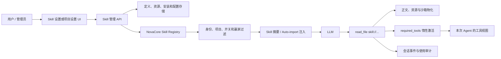
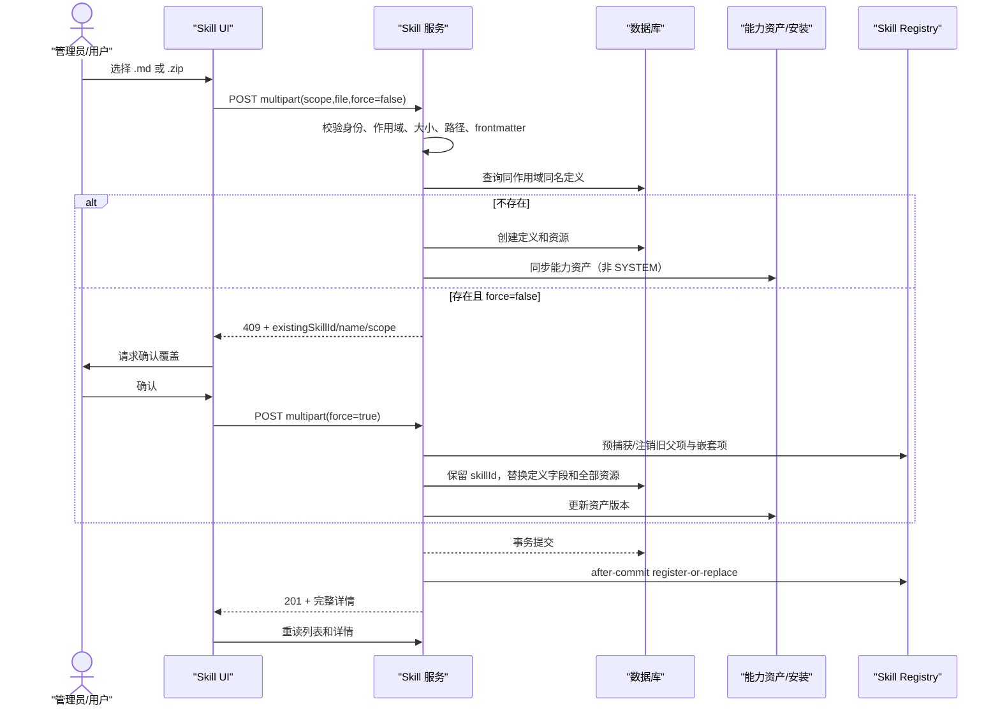
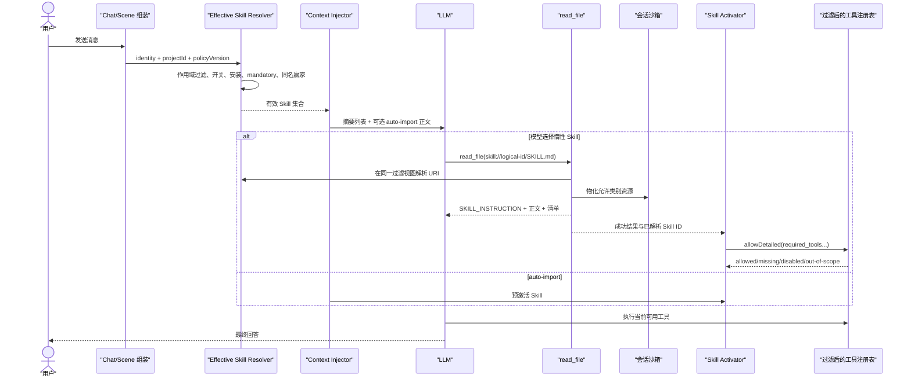
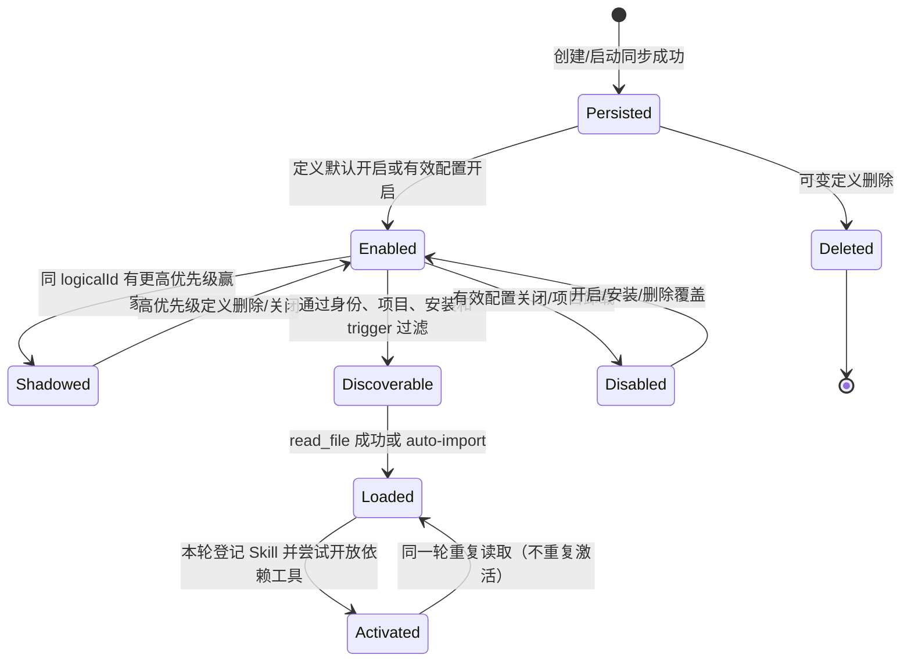

```
# Skill 上传、资源包、作用域、激活和执行

## 1. 结论与边界

Skill 是一份可安装、可分层覆盖、可按需加载的 Agent 行为说明包。它至少包含一份 `SKILL.md`，可以附带 `references/`、`scripts/`、`assets/`、`templates/` 等文本资源。系统不会把所有 Skill 正文永久塞进 system prompt；每次 Agent 运行只注入当前身份可见、已启用的 Skill 摘要，模型选择后通过 `read_file(source="skill://<逻辑 ID>/SKILL.md")` 读取完整说明。成功读取才会在本次 Agent loop 内激活该 Skill 声明的 `required_tools`。

本模块解决四类问题：

1. 平台、租户、项目和个人如何提供可复用的 Agent 行为包。
2. 同名 Skill 如何按 `PERSONAL > PROJECT > TENANT > SYSTEM` 得到唯一生效版本。
3. Skill 正文和资源如何安全上传、替换、下载、读取并进入会话工作区。
4. Skill 声明的工具依赖如何在不突破工具授权边界的前提下按需开放。

目标用户包括平台开发者、租户管理员、项目编辑者、普通用户以及 Agent Runtime。最终可见效果包括：设置页中的 Skill 列表、详情、资源树、开关与上传操作；对话中的 `read_file` 工具事件、Skill 指令产生的回答以及脚本执行结果；运营侧的 Skill 使用记录。

本文包含：

- `SYSTEM`、`TENANT`、`PROJECT`、`PERSONAL` 四类定义与两类设置视图。
- `SKILL.md`、ZIP 包、资源预览、下载、替换、删除和同名覆盖。
- Skill 发现、auto-import、mandatory、`skill://` 读取和工具激活。
- 项目供给池、项目安装与项目私有 Skill。
- API、数据、权限、安全、失败和验收契约。

本文不展开工具本身的注册和执行实现、MCP 生命周期、多代理调度细节、项目整体生命周期；但会定义 Skill 与这些模块之间必须维持的边界。

### 1.1 当前能力判断

| 结论 | 状态 |
|---|---|
| 支持 JSON 创建以及 `.md`、`.zip` 上传 | `I` |
| 支持 SYSTEM/TENANT/PROJECT/PERSONAL 四层定义 | `I` |
| 设置入口分为租户管理视图 `TENANT` 和个人扩展视图 `USER`；项目 Skill 使用独立项目 API | `I` |
| 同逻辑 ID 的运行时赢家顺序为 PERSONAL、PROJECT、TENANT、SYSTEM | `I` |
| Agent 通过 `skill://<id>/SKILL.md` 惰性读取，不把完整目录硬编码进基础 system prompt | `I` |
| `required_tools` 只申请开放已注册、已授权且在本次运行能力上限内的工具 | `I` |
| 主 `.md/SKILL.md` 宽松 UTF-8 解码；ZIP/目录辅助资源做严格 UTF-8+文本检查；直接读取另有 200 KiB 与前 512 字节 NUL 检测 | `I` |
| API/WS 黑盒仓中的 29 条 Skill 用例为 active 验收契约 | `A`，本次未运行 |
| malformed YAML、非法 examples/config schema、空 frontmatter 的受控错误存在三个已知缺陷 | `K` |
| UI 的开关失败回滚、替换失败提示、删除二次确认存在三个产品缺陷根因 | `K` |
| 当前上传入口的 frontmatter 解析器并非严格 YAML 解析器 | `I/K` |
| 顶层 JSON/Markdown/ZIP 产品链路当前不保存 `required_skills`；嵌套包解析和直接插件 Bundle 才能携带该字段 | `I` |
| USER 批量恢复的静态实现只删除开关配置，但 PSKILL-11 要求删除“同名个人覆盖定义”并保留独立个人 Skill；两者契约当前不一致 | `I/A` 冲突，本次未运行 |
| 本次没有启动服务或执行测试 | 无 `R` 结论 |

### 1.2 复刻时必须保留的业务不变量

- 资源存在不等于依赖工具可用。Skill 不能越过 Agent 工具允许集合、工具开关、租户/项目策略或 MCP 可见性。
- 读取和激活必须使用同一份按身份过滤后的 Skill 视图，不能只过滤提示词列表而允许通过已知 ID 旁路读取。
- 项目 Skill 在没有有效 `projectId` 的普通对话中不可见。
- SYSTEM 定义不能由普通管理 API 创建、替换或删除。
- 上传替换保留稳定的定义 ID 和开关配置；删除则同时清除定义、资源和相关配置。
- 所有失败必须是可观察的；不得保存失败后仍提示成功，也不得让 UI 乐观状态替代持久化事实。

## 2. 术语与参与方

| 术语 | 定义 |
|---|---|
| 定义 ID | 数据库稳定 UUID，本文示例为 `skillId`。用于管理 API 和关联资源。 |
| Registry ID | NovaCore 全局注册表中的唯一 ID。租户、个人、项目定义带作用域前缀。 |
| Logical ID | 模型和用户使用的稳定短 ID，由名称 slug 化得到；同名多层定义共享它。 |
| Capability ID | 项目能力资产 ID，用于供给池和安装关系，不等于 `skillId`。 |
| Settings Scope | 管理页面的读取/开关视图，只有 `TENANT`、`USER` 两种。 |
| Definition Scope | Skill 的归属范围：`SYSTEM`、`TENANT`、`PROJECT`、`PERSONAL`。 |
| Trigger Type | `AUTO` 自动列入发现摘要；`COMMAND` 面向显式命令；`MANUAL` 不进入普通自动发现，但若另声明 `auto_import=true`，当前 auto-import 策略仍可能直接注入。 |
| Auto Import | 每请求直接注入完整 Skill 正文并预激活依赖工具的声明。 |
| Mandatory | 租户管理员要求所有场景都发现的 Skill；用户不能关闭或覆盖同逻辑 ID。 |
| Shadowing | 同逻辑 ID 的低优先级定义仍存在，但不再是当前运行时赢家。 |
| Activation | 成功读取 Skill 指令后，在本次 Agent loop 中尝试开放 `required_tools`。 |
| Resource Materialization | 读取主 `SKILL.md` 时，把选定资源复制到当前会话沙箱的 `skills/<logical-id>/...`。 |



参与方职责：

- 管理 UI：提供列表、搜索、详情、Markdown/源码预览、资源树、上传、覆盖确认、下载、替换、删除、开关和恢复默认值。
- 产品服务：校验身份、作用域、包格式和变更权限；事务性写入；发布注册表变更。
- Skill Registry：保存全局唯一 `SkillBundle`，支持并发读和冲突检测。
- Effective Resolver：按身份、项目、安装、开关、mandatory 和同名优先级产生本次运行的有效视图。
- Context Injector：把有限长度的发现摘要或 auto-import 正文放入当前用户消息的运行时上下文区域。
- `read_file`：解析虚拟 URI、返回受保护的 Skill 指令、读取资源，并把允许物化的资源写入沙箱。
- Skill Activator：在单次 Agent loop 内记录已激活 Skill，并申请开放依赖工具。
- 会话/运营审计：保存工具事件、消息使用的 Skill 名称和按激活次数统计的使用记录。

## 3. 业务规则

### 3.1 四类定义作用域

| Scope | 数据归属 | 谁可创建/修改 | 谁可见 | Registry ID 示例 |
|---|---|---|---|---|
| SYSTEM | 全局，无 tenant/user/project | 仅启动同步或插件资源 | 所有身份 | `metric-query` |
| TENANT | `tenantId` | 租户管理员 | 同租户用户及该租户项目 | `tenant/t-01/sales-guide` |
| PROJECT | `tenantId + projectId` | 具有项目 EDIT 权限者 | 仅同租户同项目运行 | `project/p-01/sales-guide` |
| PERSONAL | `tenantId + userId` | 本人 | 同租户本人 | `personal/u-01/sales-guide` |

定义约束：

- SYSTEM：`tenantId/userId/projectId` 均为空。
- TENANT：`tenantId` 非空，`userId/projectId` 为空。
- PERSONAL：`tenantId/userId` 非空，`projectId` 为空。
- PROJECT：`tenantId/projectId` 非空，`userId` 为空。
- 普通 `/api/settings/skills` 创建入口拒绝 SYSTEM 和 PROJECT；PROJECT 必须走项目 API。

### 3.2 名称、ID 与同名赢家

名称去除首尾空白后最长 64 个字符，不能为空，并且 slug 化后至少包含一个 Unicode 字母或数字。Logical ID 算法：

```text
trim -> lowercase -> 连续非字母数字替换为 "-" -> 删除首尾 "-"
```

例如 `Revenue Health / CN` 变为 `revenue-health-cn`。同一归属范围内名称必须唯一；即使两个不同名称会产生同一个 slug，也必须返回 409，不能让后注册者静默覆盖注册表条目。

运行时对同一 Logical ID 只保留一个赢家：

```text
PERSONAL > PROJECT > TENANT > SYSTEM
```

项目层只有在请求携带当前项目上下文且项目安装有效时参与竞争。没有项目上下文时顺序退化为 `PERSONAL > TENANT > SYSTEM`。低优先级条目可以在管理 API 中带 `shadowed=true` 展示，但不能出现在 Agent 的有效发现列表中。

### 3.3 `SKILL.md` 包契约

最小文件：

```markdown
---
name: weather-forecast
description: Use this skill when the user asks for a weather forecast.
trigger: auto
required_tools:
  - read_file
  - weather_query
auto_import: false
---

# Weather forecast

1. Read `references/output-format.md`.
2. Query the requested location with `weather_query`.
3. Return the result in the referenced format.
```

可识别字段：

| 字段 | 类型 | 必填 | 默认 | 语义 |
|---|---|---:|---|---|
| `name` | string | 是 | 无 | 显示名称及 Logical ID 来源 |
| `description` | string | 是 | 无 | 注入摘要，承担模型选中 Skill 的主要语义 |
| `trigger` | `auto/command/manual` | 否 | `auto` | 发现方式；未知值在当前运行时映射为 AUTO |
| `required_tools` | string list | 否 | `[]` | 读取后尝试开放的工具名 |
| `required_skills` | string list | 否 | `[]` | Skill 依赖；当前只有嵌套 Skill frontmatter 装载和第三方插件直接构造 `SkillBundle` 的链路能传给 Runtime |
| `auto_import` | boolean/string boolean | 否 | `false` | 是否每次请求直接注入全文 |
| `examples`、`config` | YAML 任意结构 | 否 | 无 | 当前产品保存原文但不执行严格 schema 语义 |

上述必填规则只适用于 `.md/.zip` 上传：上传解析器从 frontmatter 取得 `name/description/trigger/required_tools/auto_import`，正文原样保存。当前解析器只理解顶层简单标量、flow list、block list 和 block scalar，并非完整 YAML 校验器。

JSON CRUD 是另一条契约：`POST/PUT` 不解析 `content` 的 frontmatter，正文可以完全没有 `---`；名称、描述、trigger、required tools 和 metadata 以请求字段为准。顶层 JSON DTO、顶层上传投影、定义表和 DB Bundle loader 都没有 `requiredSkills` 字段，因此顶层 `required_skills` 即使写在上传 frontmatter 中也会在投影时丢失，JSON 也无法提交它。若复刻目标包含顶层 Skill 依赖，必须同时扩展 create/update DTO、响应 DTO、数据库字段或规范化依赖表、frontmatter 投影、DB loader、下载/替换语义及正反测试；只改解析器没有效果。

文件替换还存在一个非对称点：替换会用新包更新 description、正文、trigger、required tools、metadata 和全部资源，但保留旧定义的稳定 `name`，也不校验新 frontmatter 的 `name` 是否等于旧 name。结果可能出现“API/下载目录名仍是旧名，而正文 frontmatter 声明新名”。生产复刻应选择并固定一种规则：要么要求两者完全相等并以 400 拒绝，要么显式支持 rename 并重新检查逻辑 ID 冲突、安装引用和 Registry 原子迁移；不得静默分裂。

复刻实现应对上传路径使用安全模式的正式 YAML 解析库，并额外校验允许字段和数据类型；JSON 路径则应独立校验 DTO，不能假设正文 frontmatter 会补齐字段。

推荐包结构：

```text
weather-forecast/
├── SKILL.md
├── references/
│   └── output-format.md
├── scripts/
│   └── normalize.py
├── assets/
│   └── schema.json
├── templates/
│   └── answer.md
└── bin/
    └── helper.sh
```

编码校验按入口分层，不能概括成统一规则：

- 单 `.md` 和 ZIP 内主 `SKILL.md` 使用宽松 UTF-8 构造字符串，非法字节会被替换字符吸收，当前没有 strict decoder。
- ZIP 辅助资源先检查全量 NUL 和严格 UTF-8 decoder；已知文本 MIME 直接接受，其他 MIME 再按可疑控制字符比例判断，然后入库。
- 产品侧外部目录同步对辅助资源使用同一严格文本检查；不合格文件被跳过并告警，而不是让整个父 Skill 失败。
- classpath/direct plugin Bundle 是 SPI 提供方传入的内容，不经过上述产品摄取检查，不能据此保证编码或二进制安全。
- `skill://` 直接读取时另做 200 KiB 硬上限及前 512 字节 NUL 采样；这不是摄取校验的替代品。

`references/scripts/assets/templates` 是 `read_file` 默认列入清单并物化的目录。额外类别可以来自运行时工具配置 `read-file.skill-resource-categories`（逗号分隔），也可以来自 Bundle metadata 的 `resource_categories`（字符串或数组）。但来源能力不同：DB-backed 普通 JSON/upload 虽可保存请求 metadata，当前 DB Bundle loader 只向 Runtime 投影受控字段（主要是 scope/ID/trigger/required_tools/auto_import），不会传播 `resource_categories`；上传 frontmatter 更只生成 `auto_import` metadata。因此对普通产品 Skill，运行配置是当前有效的扩展方式。`metadata.resource_categories` 主要适用于直接 plugin/file Bundle，或未来显式加入白名单投影后的 DB Bundle。

`bin` 可以保存，也能用明确的 `skill://<id>/bin/<file>` 直接读取；只有当有效来源把 `bin` 加入运行配置或 Runtime Bundle metadata 后，主文件读取才会列举并物化它。直接资源读取硬上限为 200 KiB，NUL 检测只采样前 512 字节，不能替代严格编码和内容扫描。

把 `bin` 加入自动物化集合等同扩大代码供应链入口：恶意包可以让可执行文本自动落入会话工作区。生产复刻默认不开放 `bin`，并将额外类别配置限定在可信来源、记录审计，脚本执行另过沙箱与授权。

### 3.4 ZIP 规则

支持两种根布局：

```text
SKILL.md
references/...
```

或：

```text
one-root/SKILL.md
one-root/references/...
```

当前实现会拒绝：

- 根层 `SKILL.md` 与带 `SKILL.md` 的顶层子目录并存。
- 多个顶层目录分别包含 `SKILL.md`。
- 没有合法根 `SKILL.md`。
- 绝对路径、空路径、`.`、`..` 或路径穿越条目。
- 单一条目解压后超过 10 MiB。
- 上传 ZIP 或所有解压内容累计超过 50 MiB。
- 由 MIME/字节启发式判定的明显二进制资源。

重复路径也要区分：组装后所有辅助资源会经过 `ensureUniqueResourcePaths`，归一化后重复的 resource path 当前会被显式 400 拒绝；但重复的主 `SKILL.md` entry 在组装时反复赋值，不进入资源唯一性检查，缺少前置的统一 entry-path 拒绝。当前仍没有主文件 strict UTF-8、symlink/硬链接属性检查、ZIP entry 数量、压缩比、嵌套压缩包或解析 CPU/墙钟时限。生产复刻的 `D` 级门禁必须在解包之初对所有 entry（包括主文件）统一拒绝重复，并分别加入主文件 strict UTF-8、symlink/硬链接拒绝、entry count、压缩比、嵌套归档拒绝与 deadline；不要把这些建议写成当前保证。

### 3.5 嵌套 Skill

嵌套识别只在“包裹根目录”布局成立。合法示例：

```text
parent/SKILL.md
parent/child/SKILL.md
parent/child/references/rule.md
```

根解析先选择 `parent/`，剥掉它后，`child/SKILL.md` 才是父 Skill 根下恰好一层的私有嵌套 Skill。下面这个看似等价的平铺布局当前非法：

```text
SKILL.md
child/SKILL.md
```

因为根层 `SKILL.md` 与“带 SKILL.md 的顶层子目录”并存会触发根歧义 400，而不会先选择根再把 child 当嵌套项。合法嵌套项具有以下语义：

- 不创建独立产品定义记录，而作为父 Skill 的资源保存。
- Registry ID 为 `<parent-registry-id>/<child-directory>`。
- Trigger 强制为 `MANUAL`，不进入普通自动发现词表；但 child frontmatter 的 `auto_import=true` 仍会进入 auto-import 选择，MANUAL 并不会覆盖该声明，因此配置不当仍可能把子 Skill 正文注入主 Agent。
- 读取自己的 frontmatter `description/required_tools/required_skills`。
- 当前 child Bundle 使用 `SkillResourceLoader.empty()`。虽然 child 目录下其他文件仍作为父定义资源行保存，但通过直觉 URI（例如 `skill://<parent>/<child>/references/rule.md`）解析到 child Bundle 后没有 loader，不能读取这些辅助资源；这是静态实现缺口，不应把父级资源保存等同于 child 可用。
- 删除或替换父 Skill 时，必须先从 Registry 注销父项和所有嵌套项，再删除资源，否则子项会泄漏到内存 Registry。

生产复刻的 `D` 级修复是为 child 提供 prefix-aware ResourceLoader：把 child 内部的 `references/x` 映射到父定义资源的 `<child>/references/x`，同时保持身份过滤、200 KiB、二进制检查和物化路径隔离；并规定 `MANUAL + auto_import=true` 是拒绝、忽略还是显式允许，避免两套触发语义互相打架。

更深层的 `a/b/SKILL.md` 当前只作为普通资源，不注册为嵌套 Skill。

### 3.6 开关、继承、覆盖和 mandatory

- `TENANT` 设置视图只展示 SYSTEM/TENANT，不让某个管理员自己的 PERSONAL 定义影响租户管理事实。
- `USER` 设置视图展示当前用户可见的 SYSTEM/TENANT/PERSONAL，并按同名优先级选择有效项。
- PERSONAL 定义只能写 USER 开关；SYSTEM/TENANT 定义的普通开关必须由租户管理员写入 TENANT 层。
- 删除开关配置意味着回退到下一层，而不是删除 Skill 定义。
- 当前“恢复租户配置”批量端点枚举当前用户的 PERSONAL 定义，但静态实现只删除这些定义对应的新旧 enabled key 和 `skill_config` 行，不删除任何 `skill_definition`。因此它只能恢复开关配置，不能让同名 PERSONAL 定义消失并回退到 TENANT。
- Active UI 契约 `PSKILL-11` 的目标不同：批量恢复应删除“与继承项同名的个人覆盖定义”，同时保留没有继承同名项的独立 PERSONAL Skill。该目标与上一条静态实现冲突；本次未运行，不能把测试目标写成已实现保证。复刻时应把这两类对象显式分类后再事务删除，或把 API 改名为“重置个人开关”并另设“删除继承覆盖”端点，不能继续保留含混语义。
- mandatory Skill 由租户管理员设置。它必须保持可发现，个人不能关闭、移除配置或创建同名覆盖；项目也不能卸载或用同名私有定义覆盖。
- mandatory 数量默认最多 20；所有 mandatory 描述必须能完整装入 Skill listing 预算，超预算返回 409。

### 3.7 工具边界

`required_tools` 表示依赖申请，不是授权声明。激活器对每个名称得到四种结果：

- 已开放或本来已开放：加入本次 Agent 工具视图。
- 未注册：记为 missing。
- 被工具策略关闭：记为 disabled。
- 超出本次运行不可变允许集合：记为 out-of-scope。

Skill 本身仍可激活，缺失依赖不会自动终止对话；真正调用不可用工具时由正常工具执行链返回错误。不得因为 Skill 需要某工具就在 resolver、prompt 或场景上下文中旁路注入该工具。

这里还有一个必须显式设计的 bootstrap 边界：惰性 Skill 要先成功调用 `read_file(skill://.../SKILL.md)` 才会激活 `required_tools`，所以 `required_tools: [read_file]` 不能让一个原本未授权的 `read_file` 解锁自身。若本次 Agent 的正式工具策略没有提供 `read_file`，模型即使看见 Skill 摘要也无法加载它，这是正确的 fail-closed 结果。`auto_import` 不同：Injector 直接把正文放入请求上下文并预激活其依赖，不需要模型先调用 `read_file`；但依赖工具仍受相同的不可变允许集合、开关和作用域策略约束。不得为了让 lazy Skill 可用就在场景上下文、resolver 或 system prompt 中旁路注入 `read_file`。

## 4. 完整执行链路

### 4.1 上传、覆盖与热更新

管理面有两条不能混写的写入链路：

| 链路 | 输入事实源 | frontmatter 要求 | 资源 | 更新/替换语义 |
|---|---|---|---|---|
| JSON CRUD | 请求 DTO 字段 | 不解析；`content` 可无 frontmatter | 不创建 ZIP 资源 | `PUT` 部分更新 description/content/trigger/requiredTools/metadata；name/scope 不可改 |
| Markdown/ZIP upload | `SKILL.md` frontmatter | 必须有可解析的 name/description | ZIP 其余条目写资源表 | create/force/replace 全量投影正文和资源；replace 保留旧 name，当前不校验包内 name 一致性 |

下图描述文件上传链路；JSON 创建绕过包扫描，直接从 DTO 进入权限、冲突、持久化和 Registry 同步。



关键顺序：

1. 从认证上下文取得 `tenantId/userId/isTenantAdmin`，不接受客户端声明身份。
2. UI 可先检查扩展名，但服务端必须独立校验。
3. 解析整个包后再开始持久化，避免半包入库。
4. `force=false` 的同名冲突返回已有记录摘要，不改变旧数据。
5. `force=true` 或替换操作保留 `skillId`、归属和开关配置，完全替换正文和资源集合；普通 replace 还保留旧 name。force 同名上传因为已按解析出的名称定位旧定义，名称天然相同。
6. Registry 更新只能在数据库事务提交后生效；回滚时旧注册项必须仍然可用。
7. UI 以重新读取的服务端状态为准。

### 4.2 SYSTEM 同步

Skill 并非只有一个来源。复刻时必须给每个来源定义唯一 owner、设置页可见性和删除责任：

| 来源链路 | 进入 DB | 进入 Runtime Registry | 设置页可见 | 当前冲突/匹配行为 | 当前删除/停止事实 |
|---|---:|---:|---|---|---|
| 产品侧外部 skills 目录同步 | 是，目录扫描同步 SYSTEM 定义/资源 | DB 提交后通过 backfill/DB loader 注册 | 是，因为有定义表记录 | 以 `name` 匹配现有 SYSTEM：已有项保留原 `skillId` 并更新，新名称生成 UUID；不是按 ID upsert | 文件消失时同步器删除其托管 DB 行并注销；带 bundled source 标记的记录不被目录清理 |
| listing 插件直接扫描外部目录 | 否 | 是，直接注册文件 Bundle | 否，没有产品定义记录 | Registry 同 ID 时保留先装载项、跳过后装载项 | 当前 `stop()` 是 no-op，注明 Bundle 由 host 持有，不执行注销 |
| DB source plugin | 已存在 | 启动时从定义/资源表装载，并在产品变更后 replace | 是 | 产品写入后按 Registry ID 注销再注册；同 ID 冲突可能覆盖/失败 | 产品生命周期删除 DB，change listener/loader 注销 |
| 一方白名单 classpath 包 | 是，Bundled sync 按白名单 upsert 并标 source | 随后用 DB Bundle replace Registry 中可能已有的同 ID 条目 | 是 | 白名单是准入边界；DB 版本用 replace 收敛 classpath 直注册/旧记录 | Bundled sync 负责版本更新；目录清理不得删除它 |
| 第三方插件直接 `SkillBundle` | 否 | 是，插件向 SPI Registry 注册 | 否 | ID 必须全局唯一；与 DB/一方同 ID 时 fail-fast，不能靠随机启动顺序选赢家 | 通用 SPI 不保证每个插件都会注销；产品 API不能删除 Registry-only Bundle |

“外部目录→DB”和“listing 直接目录→Registry”可同时存在，最容易产生同一包的双来源注册；生产配置应选一个主路径，或保证两者生成完全相同 ID 并由明确 replace owner 收敛，而不是依赖谁先启动。第三方 Registry-only Skill 不会出现在设置页，也不应被产品删除 API声称管理；若产品需要可治理性，应先镜像成带来源/版本的 DB asset。

生产建议 `D` 与当前事实分开：所有直接注册来源都应保存本插件实际注册成功的 ID 集合，并在 `stop()` 精确注销；listing 插件当前 no-op 应改造，但不能在复刻文档中当作既有保证。目录→DB 同步应为记录增加不可变 source key/path/hash，避免仅按可变 name 误认来源；第三方若不遵守 stop 责任，host 应提供 registration lease/owner token，在插件卸载时统一回收。

启动顺序风险是现实存在的：产品 `@PostConstruct` 的目录同步、DB source plugin 的 Registry 装载，以及稍后的 bundled `ApplicationRunner` 并不天然同序。若 Registry 初装发生在 bundled DB upsert 之前，新增项可能第一次启动不可见；当前通过 backfill/replace 路径尝试收敛。生产复刻应采用单一启动阶段屏障或版本化 outbox：先完成所有持久化 source sync，再构建一次 Registry 快照，最后开放聊天流量；运行期变更再走同一事件链。

### 4.3 每轮发现、读取和激活



发现摘要的模型可见形态：

```text
Available skills. Before use, load relevant instructions with
`read_file skill://<id>/SKILL.md`.

- metric-query (Metric Query): Query business metrics...
- weather-forecast: Use this for weather forecast requests...
```

可选描述受单条和总字符预算限制；mandatory 描述优先且不可截断。Auto-import 正文使用明确 XML 风格边界嵌入当前用户消息的运行时上下文，不修改基础 system prompt。默认最多 auto-import 2 个 Skill，总正文最多 256000 字符；超出者跳过并记录诊断。

### 4.4 `skill://` 读取与资源物化

支持：

```text
skill://<logical-or-registry-id>/SKILL.md
skill://<logical-or-registry-id>/<category>/<nested/file>
```

URI 不允许绝对路径、空段、`.` 或 `..`。对于路径式 Registry ID，解析器做最长前缀匹配，因此 `skill://metric/analysis/attribution/SKILL.md` 可以把 `metric/analysis/attribution` 作为 Skill ID。

读取主文件时：

1. 从本次运行过滤后的 SkillLookup 解析，而不是全局 Registry。
2. 返回以内部 `SKILL_INSTRUCTION` 标记开头的正文。
3. 追加“资源未自动进入 LLM 上下文，按需读取”的资源清单。
4. 把 `references/scripts/assets/templates` 以及通过运行配置 `read-file.skill-resource-categories` 增补的类别写入会话沙箱；direct plugin/file Bundle 还可用 `metadata.resource_categories` 增补，普通 DB-backed Skill 当前不传播该 metadata。目标路径为 `skills/<logical-id>/<category>/<file>`。
5. 单个直接读取资源硬上限为 200 KiB；超过上限或前 512 字节采样发现 NUL 时返回工具错误。

资源写入失败不使主 Skill 读取失败：返回已成功物化的路径、失败数量，并提示模型对失败项改用 `skill://` 读取。这属于 fail-soft；执行脚本之前仍应检查目标文件确实存在。

资源是否“存储/可直接读取”和是否“被主读取列举/自动物化”是两套边界。未配置的 `bin` 仍可能通过已知 URI 直接读取，但不会出现在默认 manifest 或工作区；配置扩展后才参与列举和物化。复刻时应同时对直接读取和物化路径做身份过滤、大小限制、内容扫描和审计，不能只保护其中一条。

### 4.5 状态模型



`Loaded/Activated` 是单次 Agent loop 状态，不跨新运行恢复。历史消息可以保存读取证据和 Skill 名称，但新一轮不能因为历史里曾激活就自动恢复工具权限。黑盒测试另有“同一会话后续轮继续遵循已加载指令”的产品期望；这依赖历史消息上下文保留，不等于跨运行延续工具开放状态。

## 5. 对外契约

所有 `/api/settings/skills/**` 请求依赖服务端认证上下文。错误统一为：

```json
{
  "success": false,
  "message": "同名技能已存在：weather-forecast",
  "existingSkillId": "3e0e...",
  "existingSkillName": "weather-forecast",
  "existingSkillScope": "PERSONAL"
}
```

错误语义映射：参数/包错误 400，无权操作 403，不可见或不存在 404，重名/mandatory/预算冲突 409，受控内部错误 500，上游错误 502；Spring 全局 multipart 上限触发时为 413，并带 `errorCode=UPLOAD_SIZE_EXCEEDED`。

### 5.1 租户与个人设置 API

| 方法 | 路径 | 请求要点 | 成功 |
|---|---|---|---|
| GET | `/api/settings/skills?scope=&settingsScope=USER|TENANT` | `scope` 可选定义范围过滤；默认 USER | 200 列表 |
| GET | `/api/settings/skills/search?name=x&scope=&settingsScope=...` | 名称子串、大小写不敏感 | 200 列表 |
| GET | `/api/settings/skills/{skillId}?settingsScope=...` | 对象级可见性 | 200 详情 |
| POST | `/api/settings/skills` | JSON 创建 PERSONAL/TENANT | 201 详情 |
| POST | `/api/settings/skills/upload?force=false` | multipart `scope,file` | 201 详情；同名 409 |
| PUT | `/api/settings/skills/{skillId}` | 部分更新，不允许改 name/scope | 200 详情 |
| PUT | `/api/settings/skills/{skillId}/upload` | multipart `file`，全量替换正文资源 | 200 详情 |
| DELETE | `/api/settings/skills/{skillId}` | 删除可变定义 | 204 |
| GET | `/api/settings/skills/{skillId}/download?settingsScope=...` | 下载 ZIP | 200 octet-stream |
| GET | `/api/settings/skills/{skillId}/resources/{resourceId}?settingsScope=...` | 文本资源 | 200 `{content}` |
| PUT | `/api/settings/skills/{skillId}/config?settingsScope=...` | `{enabled}` | 200 空体 |
| DELETE | `/api/settings/skills/{skillId}/config?settingsScope=...` | 删除显式开关 | 204 |
| DELETE | `/api/settings/skills/overrides?settingsScope=USER` | 批量清理用户覆盖 | 200 `{deleted}` |
| PUT | `/api/settings/skills/{skillId}/mandatory` | 租户管理员 `{required}` | 200 状态 |
| GET | `/api/settings/skills/mandatory-preset` | 租户管理员 | 200 预置状态 |
| POST | `/api/settings/skills/mandatory-preset/apply` | 租户管理员 | 200 应用结果 |

创建请求：

```json
{
  "name": "weather-forecast",
  "description": "Use for weather forecast requests.",
  "content": "---\nname: weather-forecast\ndescription: Use for weather forecast requests.\n---\n...",
  "scope": "PERSONAL",
  "triggerType": "auto",
  "requiredTools": ["read_file", "weather_query"],
  "metadata": {"auto_import": false}
}
```

这份当前 create/update DTO 都没有 `requiredSkills`。即使 `content` 中写了 `required_skills`，JSON 服务也不会读取；要支持该字段必须按 3.3 节扩展完整数据链。

部分更新：

```json
{
  "description": "Updated discovery description",
  "content": "完整的新 SKILL.md，可省略表示不改",
  "triggerType": "command",
  "requiredTools": ["read_file"],
  "metadata": {"auto_import": false}
}
```

列表响应的关键字段：

```json
{
  "effectiveStateSchemaVersion": 2,
  "policyVersion": "skill-policy:42",
  "total": 1,
  "items": [{
    "skillId": "db-uuid",
    "capabilityId": "cap-skill-uuid",
    "registryId": "personal/u-01/weather-forecast",
    "logicalId": "weather-forecast",
    "name": "weather-forecast",
    "description": "Use for weather forecast requests.",
    "scope": "PERSONAL",
    "triggerType": "auto",
    "requiredTools": ["read_file", "weather_query"],
    "enabled": true,
    "autoImport": false,
    "shadowed": false,
    "availability": {
      "configuredAtScope": true,
      "effectiveAvailable": true,
      "effectiveSources": ["USER"]
    },
    "governance": {
      "allowedActions": ["EDIT_DEFINITION", "DELETE_DEFINITION"],
      "readOnlyReasons": []
    },
    "skillPolicy": {
      "tenantRequired": false,
      "requiredInListing": false,
      "effectiveWinner": true,
      "winnerSkillId": "db-uuid",
      "winnerRegistryId": "personal/u-01/weather-forecast",
      "winnerSource": "PERSONAL",
      "shadowed": false,
      "shadowReason": null
    },
    "policyVersion": "skill-policy:42",
    "createdAt": "2026-08-07T10:00:00",
    "updatedAt": "2026-08-07T10:00:00"
  }]
}
```

客户端必须拒绝未知的 effective-state schema 或缺失/不一致的 policy version，不能猜测权限状态。

详情在列表字段基础上增加：

```json
{
  "content": "完整 SKILL.md",
  "metadata": {"auto_import": false},
  "configOverridden": true,
  "resources": [{
    "resourceId": "resource-uuid",
    "resourcePath": "references/output-format.md",
    "mimeType": "text/markdown",
    "fileSize": 318
  }]
}
```

资源响应只返回文本：

```json
{"content":"# Output format\n..."}
```

下载响应：

```http
HTTP/1.1 200 OK
Content-Type: application/octet-stream
Content-Disposition: attachment; filename="weather-forecast.zip"
```

归档中的路径统一加名称根目录，例如 `weather-forecast/SKILL.md`、`weather-forecast/references/output-format.md`。

### 5.2 项目 API

路径前缀：`/api/v1/projects/{projectId}/skills`。身份仍来自服务端上下文。

| 方法 | 路径 | 权限 | 语义 |
|---|---|---|---|
| GET | `/` | project VIEW | PLATFORM/TENANT/本项目 PROJECT 供给池和安装状态 |
| GET | `/{capabilityId}` | project USE | 只读详情 |
| GET | `/{capabilityId}/resources/{resourceId}` | project USE | 读取文本资源 |
| POST | `/install` | project EDIT | `{capabilityId}`，幂等启用项目安装 |
| DELETE | `/{capabilityId}` | project EDIT | 卸载，仅关闭安装，不删除定义 |
| POST | `/` | project EDIT | JSON 创建项目私有定义并自动安装 |
| POST | `/upload?force=false` | project EDIT | 上传项目私有包并自动安装 |
| PUT | `/{capabilityId}` | project EDIT | 更新项目私有定义 |
| PUT | `/{capabilityId}/upload` | project EDIT | 替换项目私有定义 |
| DELETE | `/{capabilityId}/definition` | project EDIT | 删除项目私有定义、能力资产和安装 |
| GET | `/{capabilityId}/download` | project USE | 下载可见 Skill |

项目列表项必须同时给出 `capabilityId/skillId/registryId/logicalId`、`installed`、`mandatory`、`sourceType`、`ownershipScope`、有效状态和治理动作。平台/租户 Skill 在项目中只可安装、卸载和读取；只有本项目私有定义可编辑或删除。mandatory 项不可卸载。

### 5.3 Tool/WS 契约

Skill 本身没有独立 WebSocket 事件；它复用通用工具事件。最关键调用：

```json
{
  "tool": "read_file",
  "arguments": {"source": "skill://weather-forecast/SKILL.md"}
}
```

WS 应可观察：

```text
tool_exec_start(read_file)
tool_exec_end(read_file, success=true, result=<受保护/可截断结果>)
...依赖工具或 bash 的 start/end...
complete(final answer)
```

持久化消息的 `processData.events` 应保存可审计的工具执行结果。实时事件结果可能因截断为空，验收原始工具结果时以持久化事件为权威；最终模型文案不能代替工具成功证据。

## 6. 数据模型与生命周期

下面是可直接复刻的最小 PostgreSQL 模型；生产实现可将 JSON 文本改为 JSONB。

```sql
CREATE TABLE skill_definition (
  id BIGINT GENERATED BY DEFAULT AS IDENTITY PRIMARY KEY,
  skill_id VARCHAR(64) NOT NULL UNIQUE,
  capability_id VARCHAR(64),
  name VARCHAR(64) NOT NULL,
  description TEXT NOT NULL,
  content TEXT NOT NULL,
  scope VARCHAR(16) NOT NULL,
  tenant_id VARCHAR(64),
  user_id VARCHAR(64),
  project_id VARCHAR(64),
  trigger_type VARCHAR(16) NOT NULL DEFAULT 'auto',
  required_tools TEXT,
  metadata TEXT,
  enabled BOOLEAN NOT NULL DEFAULT TRUE,
  created_at TIMESTAMP,
  updated_at TIMESTAMP,
  CHECK (scope <> 'SYSTEM' OR
         (tenant_id IS NULL AND user_id IS NULL AND project_id IS NULL)),
  CHECK (scope <> 'TENANT' OR
         (tenant_id IS NOT NULL AND user_id IS NULL AND project_id IS NULL)),
  CHECK (scope <> 'PERSONAL' OR
         (tenant_id IS NOT NULL AND user_id IS NOT NULL AND project_id IS NULL)),
  CHECK (scope <> 'PROJECT' OR
         (tenant_id IS NOT NULL AND user_id IS NULL AND project_id IS NOT NULL))
);

CREATE TABLE skill_resource (
  id BIGINT GENERATED BY DEFAULT AS IDENTITY PRIMARY KEY,
  resource_id VARCHAR(64) NOT NULL UNIQUE,
  skill_id VARCHAR(64) NOT NULL,
  category VARCHAR(512) NOT NULL,
  file_name VARCHAR(256) NOT NULL,
  content TEXT,
  mime_type VARCHAR(128),
  file_size BIGINT,
  created_at TIMESTAMP,
  updated_at TIMESTAMP,
  UNIQUE(skill_id, category, file_name)
);

CREATE TABLE skill_config (
  id BIGINT GENERATED BY DEFAULT AS IDENTITY PRIMARY KEY,
  tenant_id VARCHAR(64) NOT NULL,
  user_id VARCHAR(64) NOT NULL,
  skill_id VARCHAR(64) NOT NULL,
  enabled BOOLEAN NOT NULL,
  settings TEXT,
  created_at TIMESTAMP,
  updated_at TIMESTAMP,
  UNIQUE(tenant_id, user_id, skill_id)
);

CREATE INDEX idx_skill_system ON skill_definition(scope, name);
CREATE INDEX idx_skill_tenant ON skill_definition(scope, tenant_id, name);
CREATE INDEX idx_skill_personal ON skill_definition(scope, tenant_id, user_id, name);
CREATE INDEX idx_skill_project ON skill_definition(scope, tenant_id, project_id, name);
```

该最小表忠实反映当前顶层产品链：只有 `required_tools`，没有 `required_skills`。若采用本文建议支持顶层依赖，应增加 `required_skills` JSONB/数组列，或建立 `skill_dependency(skill_id, required_logical_id, ordinal)`；并让 JSON DTO、上传解析、DB loader、响应和版本迁移全部使用同一规范源。

当前新架构还使用通用能力表：

```text
capability_asset
  capability_id, tenant_id, kind=SKILL, logical_name, runtime_name,
  ownership_scope, owner_ref_id, source_type, source_ref=skill_id,
  status, version, created_by, created_at, updated_at, deleted_at

capability_installation
  id, tenant_id, capability_id,
  scope_type=TENANT|PROJECT|USER, scope_id,
  enabled, installed_by, installed_at, updated_at

skill_installation_config
  installation_id PK/FK, settings_json, required,
  updated_by, updated_at
```

`skill_config` 是兼容旧用户级配置的表；运行时开关的正式读写通过 scope-aware ConfigStore，键为：

```text
skill:<definition-skill-id>:enabled
skill:<registry-id>:enabled
```

双键用于兼容迁移期数据。复刻新系统应选择一个规范 Registry ID 键并提供一次性迁移，避免永久双写。

### 6.1 生命周期

- 创建：生成 `skillId`，写定义；ZIP 时写资源；同步能力资产；发布 after-commit upsert。
- 更新：名称和归属不变；更新正文/描述/trigger/依赖/metadata；刷新 Registry。
- 替换：保留 `skillId` 和配置；删除全部旧资源后保存新资源；刷新父与嵌套 Registry 条目。
- 开关：只修改 ConfigStore/安装，不修改正文。
- 卸载：仅关闭项目 installation，定义和资源保留。
- 删除：可变定义先通过 mandatory/依赖变更 guard，注销 Registry，删除资源和配置，再删除定义；项目定义还要关闭 installation 并退役能力资产。
- SYSTEM 同步：来源文件是事实源，可 upsert 和移除托管记录。
- 使用审计：每次成功产生 `read_file(skill://.../SKILL.md)` 调用记录一条使用事件；同一问题重复读取可多条，问题数按 message 去重。

当前删除使用物理删除定义/资源/旧配置，能力资产侧具有状态/软删除语义。生产复刻建议给上传包版本表和不可变内容摘要，支持回滚、供应链审计和并发控制。

## 7. 核心实现设计

### 7.1 模块划分

```text
skill-domain/
  SkillDefinition, SkillResource, Scope, TriggerType
skill-package/
  StrictFrontmatterParser, ZipScanner, ResourceValidator, PackageHasher
skill-application/
  SkillLifecycleService, SkillSettingsService, ProjectSkillService
skill-policy/
  EffectiveSkillResolver, MandatoryPolicy, CapabilityMutationGuard
skill-registry/
  SkillBundle, Registry, IdentityFilteredLookup, ChangeSubscriber
skill-runtime/
  ListingInjector, SkillUriResolver, SkillActivator, ResourceMaterializer
skill-persistence/
  DefinitionRepository, ResourceRepository, InstallationRepository, ConfigStore
skill-api/
  SettingsController, ProjectController, ErrorTranslator
skill-observability/
  UsageRecorder, AuditPublisher, Metrics
```

### 7.2 严格解析伪代码

```text
parsePackage(file):
  require extension in {md, zip}
  if md:
    require bytes <= 10 MiB
    main = decodeUtf8Strict(bytes)
    resources = []
  else:
    require archive bytes <= configured transport limit
    entries = []
    for each zip entry with deadline and count limit:
      normalized = normalizeRelativePath(entry.name)
      reject unsafe/duplicate/nested archive/symlink
      data = readBounded(entry, 10 MiB)
      enforce totalUncompressed <= 50 MiB
      enforce compressionRatio <= configured ratio
      entries += (normalized, data)
    root = determineSingleSkillRoot(entries)
    # nested skills are legal only below a wrapped root:
    # parent/SKILL.md + parent/child/SKILL.md
    # root SKILL.md + child/SKILL.md is ambiguous and rejected
    main = decodeUtf8Strict(entries[root/SKILL.md])
    resources = every file under root except root/SKILL.md
    require every resource is approved UTF-8 text

  yaml = safeYamlParse(extractFrontmatter(main))
  reject aliases/custom tags/duplicate keys
  require nonBlank string yaml.name, yaml.description
  validate yaml.trigger enum
  validate required_tools/required_skills are unique string arrays
  validate examples/config against published schema if supported
  return ParsedPackage(definitionProjection, exactMainText, resources, sha256)

createFromJson(dto):
  validate dto.name/description/scope/trigger/requiredTools/metadata
  do not parse dto.content frontmatter
  persist DTO fields as authoritative metadata

replaceFromPackage(existing, parsed):
  require parsed.name == existing.name  # production recommendation
  preserve existing.id/scope/owner/config
  replace content/description/trigger/tools/requiredSkills/metadata/resources
```

### 7.3 有效赢家解析伪代码

```text
resolveEffective(identity, runtimeContext, triggerFilter):
  tenantId, userId = decodeTrustedIdentity(identity)
  projectId = authorizeAndReadProjectId(runtimeContext)
  policy = resolveAuthoritativePolicy(tenantId, projectId, userId)
  projectInstalls = enabledInstallations(tenantId, projectId)

  candidates = registry.all
    .filter(triggerFilter)
    .filter(scopeVisibleTo(identity, projectId))
    .filter(policyAllowsRegistryId)
    .filter(skill ->
       policy.mandatory contains skill.id
       OR projectInstalls contains skill.capabilityId
       OR (skill.scope != PROJECT AND configEnabled(skill, identity)))

  group candidates by logicalId
  winner per group = max(scopePriority)
  assert every mandatory registryId exists among winners
  return immutable lookup indexed by logicalId and registryId
```

项目 ID 不能直接信任客户端 opaque map；场景装配器必须先做项目 USE 权限校验，再把可信 projectId 放入运行时上下文。过滤结果按单次运行快照固定，避免运行中切换定义导致同一轮前后看到不同指令；下一轮重新解析最新状态。

### 7.4 注册表更新

最小实现可在事务提交后同步执行：

```text
afterCommit Upsert(skillId):
  oldIds = registryIndex.idsByDefinition(skillId)
  bundle, nestedBundles = loadFromDatabase(skillId)
  atomically replace oldIds with new bundle set

afterCommit Delete(oldIds):
  atomically unregister all oldIds
```

当前 Registry 的基础接口是并发 Map，单 ID 注册冲突 fail-fast，产品层通过“先注销再注册”实现 replace。生产设计应提供按定义批量原子 replace，防止父项已更新而子项注册失败的短暂撕裂。

### 7.5 激活算法

```text
activate(readToolUse, toolResult):
  require tool == read_file
  require result.success and result startsWith SKILL_INSTRUCTION marker
  resolvedId = resolveSkillMdUriAgainstFilteredLookup(arguments.source or path)
  if absent: ignore
  if alreadyActivated(resolvedId): return ALREADY_ACTIVE
  bundle = filteredLookup.get(resolvedId) else SKILL_NOT_FOUND
  for distinct nonblank name in bundle.requiredTools:
    result = agentToolRegistry.allowDetailed(name)
    classify result as activated/missing/disabled/outOfScope
  mark bundle.id activated even if some dependencies unavailable
  return structured SkillActivationResult
```

必须同时验证工具调用类型和可信的 Skill 指令结果标记，不能只看到参数里有 `skill://` 就激活；否则模型可伪造任意 read 结果解锁工具。

### 7.6 最小可用版与生产级版

| 主题 | 最小兼容版 | 生产级推荐 |
|---|---|---|
| 包 | `.md/.zip`、文本资源、基本路径校验 | 严格 YAML、压缩炸弹防护、签名/摘要、供应链扫描 |
| 存储 | 定义/资源/开关三表 | 内容寻址对象存储、版本表、审计表、乐观锁 |
| Registry | 单机 ConcurrentMap + after-commit 更新 | 事务 outbox、跨实例事件、原子 bundle replace、版本水位 |
| Policy | 身份与同名优先级 | 权威 policyVersion、安装快照、跨租户属性测试 |
| 执行 | 资源写入目录沙箱 | 隔离容器、只读资源、无网络默认、CPU/内存/时间配额 |
| UI | CRUD、预览、开关 | diff/回滚、包风险提示、权限原因、发布审批 |
| 审计 | 使用计数 | 上传者、包 hash、版本、激活结果、工具授权结果、导出审计 |

## 8. 并发与非正常路径

| 场景 | 当前/兼容语义 | 生产复刻要求 |
|---|---|---|
| 同作用域并发创建同名 | 应有一方成功、一方 409 | 数据库业务唯一键必须真正覆盖 scope+owner+name；仅应用层检查不够 |
| 两个名称 slug 冲突 | 创建前 409 | 同 Registry namespace 建唯一索引 |
| 替换中读取 | 当前事务后刷新，旧 Registry 可短暂可用 | 使用版本化 bundle；提交后原子切换 |
| DB 提交后 Registry 更新失败 | 当前部分路径会 warn/no-op | outbox 重试、注册表版本监控、管理 API 显示同步状态 |
| Registry 尚未启动 | 产品写入成功，Registry 同步跳过并告警 | 启动重放或 outbox 确保最终收敛 |
| 资源物化部分失败 | 主读取成功，列出失败数 | 工具事件含失败路径与原因；不得执行缺失脚本 |
| required tool 缺失/关闭/越权 | Skill 激活成功，依赖保持不可用 | 向 LLM 返回结构化诊断；绝不扩大能力上限 |
| 重复读取同一 Skill | 本轮只激活一次 | 读取可重复，激活幂等；审计口径明确 |
| 列表预算不足 | 可选项截断；mandatory 超预算失败 | 保存 mandatory 时预检查，记录被截断数量 |
| auto-import 超预算 | 跳过超额项并继续 | 记录 included/skipped 和原因，不静默 |
| 项目卸载同时执行 | 当前运行使用组装时快照 | 下一运行生效；高风险撤销可提供主动取消策略 |
| 上传失败 | 不应产生定义或资源 | 单事务；失败后按名称/ID验证无残留 |
| 删除失败 | 数据应保留 | UI 保留选择与错误；不可先从列表乐观删除 |
| 服务重启 | DB 重新装载 Registry | 检查重复 ID、损坏包、孤儿资源并告警 |

当前数据库只对全局 `skill_id` 和资源路径设唯一约束，同作用域名称主要依赖应用层检查，存在并发竞态风险。生产复刻必须增加适合数据库空值语义的部分唯一索引，例如：

```sql
CREATE UNIQUE INDEX uk_skill_tenant_name
ON skill_definition(tenant_id, name) WHERE scope='TENANT';
CREATE UNIQUE INDEX uk_skill_personal_name
ON skill_definition(tenant_id, user_id, name) WHERE scope='PERSONAL';
CREATE UNIQUE INDEX uk_skill_project_name
ON skill_definition(tenant_id, project_id, name) WHERE scope='PROJECT';
CREATE UNIQUE INDEX uk_skill_system_name
ON skill_definition(name) WHERE scope='SYSTEM';
```

## 9. 安全、权限和审计

### 9.1 授权矩阵

| 操作 | 普通用户 | 租户管理员 | 项目 VIEW/USE | 项目 EDIT |
|---|---:|---:|---:|---:|
| 查看本人 USER 有效视图 | 是 | 是 | - | - |
| 创建/改/删本人 PERSONAL | 是 | 是 | - | - |
| 查看 TENANT 管理视图 | 否 | 是 | - | - |
| 创建/改/删 TENANT | 否 | 是 | - | - |
| 修改 SYSTEM 定义 | 否 | 否 | 否 | 否 |
| SYSTEM/TENANT 开关 | 否 | 是 | - | - |
| 设置 mandatory | 否 | 是 | - | - |
| 查看项目供给池 | - | - | VIEW | EDIT |
| 读取项目 Skill 详情/下载 | - | - | USE | EDIT |
| 安装/卸载/创建项目私有 Skill | - | - | 否 | 是 |
| 修改/删除 PROJECT 定义 | - | - | 否 | 仅本项目 |

对跨租户、跨用户、跨项目对象应优先返回 404，避免泄露存在性。TENANT 写操作明确要求管理员。PROJECT 普通设置入口 fail-closed，不得因知道 `skillId` 绕过项目 Controller。

### 9.2 上传与执行风险

Skill 是提示词和代码供应链入口，必须视为主动内容：

- 防路径穿越、Zip Slip、symlink、硬链接和压缩炸弹。
- 只接受 UTF-8 并限制资源 MIME，不用文件扩展名作为唯一依据。
- Markdown 预览必须清理 HTML/脚本；源码用纯文本渲染。
- Skill 指令不得获得系统提示同级不可覆盖权限；平台应标出来源和信任级别。
- 脚本必须在受限沙箱执行，限制 CPU、内存、进程、磁盘、网络和超时。
- 物化路径只允许 `skills/<safe-logical-id>/...`，且沙箱写 API再次校验。
- `required_tools` 不得自动安装工具，也不得打开被关闭、越权或未知工具。
- SYSTEM/bundled 包建议构建时签名；TENANT/PROJECT/PERSONAL 上传保存 SHA-256 和操作者。
- 下载和资源读取要执行与列表相同的对象权限，不能只按资源 UUID 查询。

### 9.3 审计事件

生产实现至少记录：

```json
{
  "event": "skill.package.replaced",
  "tenantId": "t-01",
  "actorUserId": "u-01",
  "skillId": "db-uuid",
  "capabilityId": "cap-uuid",
  "scope": "TENANT",
  "oldVersion": 3,
  "newVersion": 4,
  "packageSha256": "...",
  "resourceCount": 5,
  "timestamp": "2026-08-07T10:00:00Z"
}
```

还要有 create/delete/enable/disable/reset/install/uninstall/mandatory/activation 事件。激活审计记录 `activated/missing/disabled/outOfScope` 工具集合，但不记录密钥、完整用户提示、脚本输出中的敏感业务数据或上传包的全部正文。

当前使用统计从完成响应的工具调用列表中提取 `read_file(skill://.../SKILL.md)`；写入失败 fail-soft，不中断聊天。这适合运营计数，但不应替代安全审计。

## 10. 外部依赖对端设计

本能力没有类似 CAN Gateway 的单一外部服务，但依赖五个对端契约：

1. 身份系统：提供可信 `tenantId/userId/isTenantAdmin`；不能由请求 body 覆盖。
2. 项目授权系统：提供 VIEW/USE/EDIT 检查和可信 projectId。
3. ConfigStore：按 USER→TENANT→GLOBAL 层级解析布尔值，put/delete 后对新运行可见。
4. Sandbox：提供安全的相对路径写入与 bash/python 执行；不能逃逸工作区。
5. Tool Registry：`allowDetailed(name)` 必须区分 unknown、disabled、out-of-scope 和 allowed。

最小 Stub：

```text
IdentityStub.current() -> {tenantId, userId, tenantAdmin}
ProjectGuardStub.require(projectId, action) -> allow/throw
ConfigStoreStub.resolve(key, identityChain) -> Optional<Boolean>
SandboxStub.writeFile(relativePath, bytes) -> normalizedRelativePath
AgentToolsStub.allowDetailed(name) -> enum
```

生产对端要支持审计、并发、实例间一致性和敏感信息治理。尤其 ConfigStore 与项目 installation 必须能生成稳定 policyVersion；场景组装时把版本随有效 Skill 集合固化，避免列表、读取和激活各自查询出不同结果。

## 11. 可观察性

### 11.1 日志

建议结构化字段：`skillId`、`registryId`、`logicalId`、`scope`、`tenantHash`、`projectHash`、`operation`、`policyVersion`、`packageHash`、`resourceCount`、`durationMs`、`result`。不得记录 Skill 全文、用户上传脚本内容、Cookie 或其他凭据。

必须有：

- 启动同步 added/updated/unchanged/removed 计数。
- Registry 冲突和同步未就绪告警。
- 可选 listing 被预算截断数量。
- auto-import included/skipped 及 count/chars 原因。
- 激活的依赖工具分类。
- 资源物化成功/失败计数。
- 使用审计写入失败告警。

### 11.2 指标

```text
skill_package_upload_total{scope,result,reason}
skill_package_parse_duration_seconds
skill_registry_bundle_count{scope}
skill_registry_sync_lag_seconds
skill_listing_visible_count
skill_listing_truncated_total
skill_auto_import_skipped_total{reason}
skill_activation_total{status}
skill_required_tool_unavailable_total{reason}
skill_resource_materialize_total{result}
skill_usage_total{logical_id}
```

高优告警：Registry 同步持续失败、mandatory Registry ID 缺失、跨租户授权拒绝异常增加、包扫描超时/压缩炸弹、脚本沙箱逃逸检测、审计 outbox 堆积。

## 12. 复刻实施顺序

1. 定义四类 scope、三种 trigger、ID/slug 和权限矩阵；静态验收：所有作用域约束和赢家示例可演算。
2. 建 definition/resource/asset/installation/config schema 与迁移；静态验收：唯一键、归属 CHECK、删除策略完整。
3. 实现严格 `.md/.zip` 解析；静态验收：路径、大小、压缩比、UTF-8、frontmatter 类型测试矩阵齐全。
4. 实现事务性生命周期服务和错误契约；静态验收：force 覆盖保留 ID，失败无残留。
5. 实现 Registry、DB loader 和 after-commit/outbox 同步；静态验收：父/嵌套项批量替换无泄漏。
6. 实现 effective resolver 和项目安装；静态验收：PERSONAL/PROJECT/TENANT/SYSTEM 全组合赢家表通过。
7. 实现 listing、auto-import、mandatory 与预算；静态验收：mandatory 不被截断且可保存时预校验。
8. 实现 `skill://`、过滤 lookup、资源清单与物化；静态验收：已知 ID 不能旁路权限。
9. 实现 SkillActivator 与工具边界；静态验收：四类 allow 结果不越权。
10. 实现 UI CRUD、预览、下载、失败回滚和确认；静态验收：刷新和详情接口证明确实持久化。
11. 实现 WS/持久化事件与运营/安全审计；静态验收：模型文案不作为工具成功的唯一证据。
12. 最后接入 SYSTEM/plugin 同步和跨实例一致性；静态验收：重启、删除来源和注册失败均能收敛。

## 13. 验收标准

### 13.1 正向场景

- 上传合法 Markdown，201 返回，名称、描述、trigger、依赖工具和完整正文保持一致。
- JSON 创建的 content 不含 frontmatter 仍成功，返回元数据严格取请求字段；文件上传则必须从 frontmatter 取元数据。
- 上传单根 ZIP，资源树按目录展示，文本可读取，下载包结构与内容一致。
- `parent/SKILL.md + parent/child/SKILL.md` 成功注册父与 MANUAL 子 Skill；当前验收只保证 child 正文 Bundle，不把 child 辅助资源可读误作保证。顶层依赖支持版还要验证 `required_skills` 经 DTO/DB/loader 往返不丢失。
- 同名上传先返回 409；取消不改旧版本；确认 force 后保留 skillId 并替换全部资源。
- PERSONAL 同名定义覆盖 TENANT；删除个人定义后租户版本重新成为赢家。
- PROJECT Skill 只在所属项目安装并运行；普通对话和其他项目不可见。
- 启用的 AUTO Skill 在摘要中出现，模型成功读取 `SKILL.md`，随后读取 reference 或执行脚本。
- 依赖工具已授权时，`read_file` 成功后工具出现在本轮可用集合；新运行重新从策略解析。
- 删除 Skill 后新对话无法读取旧 ID/Logical ID，也无法获得其唯一标记。

### 13.2 反向和恢复场景

- 无 frontmatter、缺 name/description、严格 YAML 语法错误、字段类型错误均返回 400 且无持久化。
- `.txt`、损坏 ZIP、多根 ZIP、`../escape`、绝对路径、二进制、超限条目/总量均拒绝。
- 跨租户 read/update/delete 返回 403/404，拥有者记录保持不变。
- 普通用户创建 TENANT 或读取他人 PERSONAL 被拒绝。
- SYSTEM 可预览、下载和由管理员配置开关，但不能通过管理 API 替换/删除。
- 开关 PUT 500 时 UI 回滚并显示错误，跨页面、刷新和接口仍为原值。
- 替换 500 时旧正文、资源、ID 保持，UI 显示可重试错误。
- 删除必须二次确认；取消零 DELETE；DELETE 失败列表不消失。
- 缺失 reference 返回失败的 `tool_exec_end`，Agent 按 Skill 指令明确降级，不伪装成功。
- 脚本退出非零时保留 exit code/错误证据，Agent 不自动假报成功。
- required tool 未注册、关闭或越权时保持不可用，且激活诊断分类正确。
- 没有正式 `read_file` 授权时，lazy Skill 不能用自己的 `required_tools` 自举加载；auto-import 可加载正文但仍不能突破工具策略。
- `SKILL.md + child/SKILL.md` 以根歧义 400 拒绝；重复归一化路径、非法 UTF-8、symlink、超 entry count/ratio/deadline 在生产复刻门禁中分别拒绝。
- 文件替换包内 name 与旧定义 name 不一致时，生产复刻必须受控 400，不能产生 API 名称与正文名称分裂。
- 当前 child 读取辅助资源应暴露受控“resource not found”缺口；完成 D 级 prefix loader 后，再验收 `skill://<parent>/<child>/references/x` 映射父资源前缀成功。
- 对 `MANUAL + auto_import=true` 建立显式用例：当前可能注入；生产策略选择拒绝/忽略/允许之一后必须可预测，不能假设 MANUAL 自动屏蔽 auto-import。
- Registry 更新失败可通过 outbox/重放恢复，不能要求重新上传。

## 14. 测试矩阵

本次只做静态分析，以下 `A/K` 均不表示本次已运行。UI E2E case 本身没有统一的 `status` 字段；状态要从测试代码判断：普通可执行 case 记 `A`，显式调用 Playwright `test.fail(...)` 的 case 记 `K`。个人 Skill 中 `PSKILL-07` 和 `PSKILL-08` 正是后者；`PSKILL-11` 没有 `test.fail`，所以它仍是 active 目标契约，但如前文所述与静态服务实现冲突，不能推定通过。

| 场景 | 通道 | 前置条件 | 操作 | 预期结果 | 当前证据等级 |
|---|---|---|---|---|---|
| 合法 frontmatter | API | 登录用户 | 上传 Markdown | 字段和原文保持 | `A: SKILL-FM-001` |
| examples/config 合法文本 | API | 登录用户 | 上传 | 保存原文 | `A: SKILL-FM-002` |
| malformed YAML | API | 登录用户 | 上传未闭合引号 | 应 400 且不入库；当前宽松接受 | `K: SKILL-FM-003` |
| 缺 name/description | API | 登录用户 | 分别上传 | 400、无记录 | `A: SKILL-FM-004` |
| 非法 examples/config schema | API | 登录用户 | 上传 | 应 400；当前 201 持久化 | `K: SKILL-FM-005` |
| Unicode frontmatter | API | 登录用户 | 上传中英符号 emoji | 完整保持 | `A: SKILL-FM-006` |
| 无 delimiter/空 frontmatter | API | 登录用户 | 上传 | 应受控 400；空块当前可能 500 | `K: SKILL-FM-007` |
| 列表搜索详情一致 | API/UI | 有可见 Skill | list/search/detail | ID、scope、enabled 一致 | `A: SKILL-CONF-001, SKILL-01/02, PSKILL-01` |
| JSON 与 Markdown 创建 | API/UI | 写授权 | 创建两种 PERSONAL | 201、详情可读 | `A: SKILL-CONF-002, PSKILL-04` |
| 开关与重置 | API/UI | 可配置 Skill | 关、开、删配置 | 状态持久化并回退 | `A: SKILL-CONF-003, SKILL-03/04` |
| 开关保存失败 | UI | 拦截 PUT 500 | 切换开关 | 应回滚并提示；当前不满足 | `K: SKILL-05 / NOVA-BUG-007` |
| 资源和下载 | API/UI | ZIP Skill | 读取资源并下载 | 内容和 ZIP entries 一致 | `A: SKILL-CONF-004, SKILL-07/08/11/15, PSKILL-05` |
| 删除后不可见 | API | PERSONAL Skill | reset 后删除 | detail 404、搜索无记录 | `A: SKILL-CONF-005` |
| 非法/超大上传 | API/UI | 写授权 | 上传 | 400、无记录 | `A: SKILL-CONF-006, SKILL-12, PSKILL-03` |
| 跨租户隔离 | API | 两个不同租户账号 | foreign read/update/delete | 403/404、owner 保留 | `A: SKILL-CONF-007` |
| 不存在对象 | API | 登录用户 | 读缺失 skill/resource | 404 | `A: SKILL-CONF-008` |
| Zip Slip | API | 登录用户 | 上传 `../escape` | 400、无记录 | `A: SKILL-CONF-009` |
| 重名无 force | API/UI | 同作用域已有同名 | 再创建/取消覆盖 | 409、原记录不变 | `A: SKILL-CONF-010, SKILL-13` |
| force 覆盖 | UI/API | 已有同名 | 确认覆盖 | 新正文生效、无重复 | `A: SKILL-14` |
| 替换回滚 | UI | 先成功再拦截 500 | 替换 | 旧版本保留且提示；提示当前缺失 | `K: SKILL-16, PSKILL-07(test.fail) / NOVA-BUG-008` |
| 删除确认 | UI | 可删定义 | 取消/确认 | 取消零请求，确认删除；当前立即删除 | `K: SKILL-17, PSKILL-08(test.fail) / NOVA-BUG-009` |
| SYSTEM 边界 | UI | 有 SYSTEM Skill | 查看操作菜单 | 可开关/下载，不可替换/删 | `A: SKILL-18, PSKILL-02` |
| 深链定位 | UI | 有可见 Skill | highlight ID/name | 展开作用域并选中 | `A: SKILL-19` |
| 运行时开关 | UI/WS | 可控 Skill | 开启新对话、关闭再新对话 | 只在开启时成功 read_file | `A: SKILL-20, SKILL-TRIG-007` |
| 个人覆盖/回退 | UI | 同名 TENANT+PERSONAL | 删 PERSONAL | TENANT 重新出现 | `A: PSKILL-06` |
| 删除后运行时不可用 | UI/WS | PERSONAL Skill | 读取、删除、新对话再读 | 后者无标记且明确不可用 | `A: PSKILL-09` |
| 批量恢复失败 | UI/API | 同名覆盖 | 取消或 DELETE 500 | 覆盖保留并提示 | `A: PSKILL-10` |
| 批量恢复边界 | UI/API | `E2E_ALLOW_PERSONAL_OVERRIDE_RESET=<envName>` 且干净基线 | 真实 reset | 只删除同名覆盖定义，独立个人 Skill 保留；静态实现只删 config，结果未知 | `A: PSKILL-11`，未运行且与 `I` 冲突 |
| 指令注入 | WS | PERSONAL Skill | 精确触发 | read_file 成功、答案含标记 | `A: SKILL-EXEC-001` |
| reference 读取 | WS | ZIP reference | 触发 | 两次 read_file 顺序成功 | `A: SKILL-EXEC-002` |
| script 成功 | WS | ZIP script + bash 可用 | 触发 | read_file→bash，输出标记 | `A: SKILL-EXEC-003` |
| 多轮指令保持 | WS | 已加载 Skill | 两轮消息 | 两个 complete，后轮遵循指令 | `A: SKILL-EXEC-004` |
| script 失败降级 | WS | 退出码 17 脚本 | 触发 | 不重试/不伪装，返回 fallback | `A: SKILL-EXEC-005` |
| 缺资源降级 | WS | 指向不存在 reference | 触发 | 第二个 read_file 失败，明确 fallback | `A: SKILL-EXEC-006` |
| 多 Skill 协作 | WS | 两个可见 Skill | 同时触发 | 两次读取、两个标记、无溢出 | `A: SKILL-EXEC-007` |
| 长指令完整读取 | WS | 长正文 | 触发 | 最终指令标记出现、无溢出 | `A: SKILL-EXEC-008` |
| 触发准确性 | WS | 典型/改写/相似/模糊请求 | 发送问题 | 选中正确、无关不触发、模糊可澄清 | `A: SKILL-TRIG-001..006` |

门禁值不是布尔值，而必须精确等于当前 `envName`：`local`、`demo` 或 `release`。远程租户写入需 `E2E_ALLOW_REMOTE_TENANT_MUTATION=<envName>`；本地回环租户写入可自动允许，远程才需要该变量。`PSKILL-11` 的批量个人恢复无论本地还是远程都必须另外设置 `E2E_ALLOW_PERSONAL_OVERRIDE_RESET=<envName>`，例如本地为 `E2E_ALLOW_PERSONAL_OVERRIDE_RESET=local`；它不能被租户写入门禁隐式包含。所有自动化定义名使用 `e2e_ + runMarker`，case 内按 ID 删除，并由 `afterEach/afterAll` 做当前 runMarker 兜底；清理失败必须使测试失败。

## 15. 当前能力与建议汇总

### `I` 已实现事实

- 四层定义、两类设置视图和项目独立管理入口已经存在。
- 支持 JSON、Markdown、ZIP、资源读取、下载、force 覆盖和替换。
- JSON content 不要求 frontmatter；文件上传要求 frontmatter，普通文件 replace 保留旧 name 且当前不校验包内 name 一致性。
- 顶层产品链当前丢弃 `required_skills`；嵌套 frontmatter 和直接插件 Bundle 可向 Runtime 携带它。
- Registry ID 与 Logical ID 分离，读取使用有效身份过滤 lookup。
- Skill listing 放在当前用户消息的运行时注入区，不依赖把工具/Skill 信息硬编码到基础 system prompt。
- `read_file` 主读取会附加资源清单，把默认及运行配置扩展类别写到沙箱；direct Bundle metadata 也可扩展，DB-backed 普通 Skill 当前不传播该字段；直接资源读取上限 200 KiB。
- required tools 激活按 unknown/disabled/out-of-scope 分类且不越权。
- SYSTEM 目录、DB source、一方白名单 classpath 和第三方 Registry-only Bundle 有不同可见性、替换与删除 owner；不能概括成全部都进统一产品表。
- listing 插件当前 `stop()` 不注销已注册 Bundle；目录→DB 当前按 name 匹配并为新项生成 skillId，而非按 ID upsert。
- 使用事件可以从成功完成响应的 `read_file(skill://.../SKILL.md)` 记录。

### `A` Active 契约

- API/WS 仓对设置、frontmatter、触发准确性和执行链有 29 条 active 用例。
- UI 仓定义了系统 Skill 20 个编号场景和个人 Skill 11 个编号场景；case 没有统一 status 字段，个人 `PSKILL-07/08` 通过 `test.fail(...)` 明确为 K，`PSKILL-11` 是未运行的 active 目标。
- 上述用例本次没有执行，因此只能作为当前验收目标，不能声称通过。

### `K` 已知缺陷

1. 宽松 frontmatter 解析可能接受未闭合引号的 malformed YAML。
2. `examples/config` 当前不做严格 schema 校验，非法内容仍可能持久化。
3. 空 frontmatter 块可能返回 500，而不是受控 400。
4. Skill 开关 PUT 失败后 UI 当前可能不回滚且无明确错误。
5. 替换 500 时旧数据保持，但 UI 当前缺少用户可见失败提示。
6. 删除当前可能立即执行，缺少二次确认和取消路径。
7. USER 批量恢复端点的静态实现只删除 PERSONAL Skill 的开关配置；active `PSKILL-11` 却要求删除同名个人覆盖定义并保留独立个人定义。该实现/验收冲突尚无本次运行结论。

### `P` 规划能力

三仓中本主题没有被单独标记为 planned 的 YAML 用例。严格 schema 验证虽然是测试期望，但当前由 known failure 明确说明尚未满足，不能写成已实现。

### `F` 强推断

- 同一会话后续轮继续遵循已加载指令主要依赖对话历史保留 Skill 指令证据，而不是运行时工具激活状态跨轮持久化；静态代码显示 activator 是每 Agent loop 实例状态，黑盒 active 用例要求用户体验连续。
- 当前双 ID enabled key 和旧 `skill_config`/新 installation config 并存属于迁移兼容阶段；长期规范源应收敛为单一有效策略。

### `D` 复刻建议

- 用正式安全 YAML 解析器和 JSON Schema 取代手写 frontmatter 解析。
- 增加作用域名称和 Registry ID 数据库唯一索引，消除并发竞态。
- Registry 使用事务 outbox、跨实例版本和按定义原子替换。
- 上传包保存 hash、版本、操作者和扫描结果；支持 diff/回滚。
- 顶层依赖若纳入产品能力，成套增加 requiredSkills DTO、持久化、parser projection、DB loader、响应与测试，不能只解析后丢弃。
- 默认不物化 `bin`，脚本进入隔离执行环境并按信任级别审批。
- 为 nested child 实现带父资源路径前缀的 ResourceLoader；当前 empty loader 不能读取 child 辅助资源。
- 直接 Registry 来源记录 owner/lease，并在插件停止时由插件或 host 精确回收；这是 D，不是当前 listing 插件保证。
- UI 所有写操作采用“请求成功→重读事实→更新状态”，并补齐失败提示与删除确认。
- 明确定义 USER 批量恢复语义：若选择 PSKILL-11 契约，服务端必须先按逻辑 ID 判断是否存在可回退的 TENANT/SYSTEM 继承项，只删除对应 PERSONAL 定义及资源/配置；独立 PERSONAL 定义必须保留，并以单事务或可重放作业保证一致性。

## 16. 证据附录

以下路径只用于追溯，不承担正文解释。

### Nova 产品和运行时

- `nova-app/src/main/java/com/aloudata/nova/controller/SkillSettingsController.java`
- `nova-app/src/main/java/com/aloudata/nova/controller/ProjectSkillController.java`
- `nova-app/src/main/java/com/aloudata/nova/skill/SkillService.java`
- `nova-app/src/main/java/com/aloudata/nova/skill/SkillFrontmatterParser.java`
- `nova-app/src/main/java/com/aloudata/nova/skill/SkillUtils.java`
- `nova-app/src/main/java/com/aloudata/nova/skill/BundledSkillDefinitionSync.java`
- `nova-app/src/main/java/com/aloudata/nova/skill/model/SkillDefinitionEntity.java`
- `nova-app/src/main/java/com/aloudata/nova/skill/model/SkillResourceEntity.java`
- `nova-app/src/main/java/com/aloudata/nova/skill/model/SkillScope.java`
- `nova-app/src/main/java/com/aloudata/nova/skill/novacore/DbSkillBundleLoader.java`
- `nova-app/src/main/java/com/aloudata/nova/skill/novacore/DbSkillResourceLoader.java`
- `nova-app/src/main/java/com/aloudata/nova/skill/novacore/SkillIdStrategy.java`
- `nova-app/src/main/java/com/aloudata/nova/skill/policy/EffectiveSkillViewResolver.java`
- `nova-app/src/main/java/com/aloudata/nova/skill/policy/MandatorySkillService.java`
- `nova-app/src/main/java/com/aloudata/nova/project/service/ProjectSkillService.java`
- `nova-app/src/main/java/com/aloudata/nova/service/AssetUsageRecorder.java`
- `nova-core/nova-core-spi/src/main/java/com/aloudata/nova/core/spi/skill/SkillBundle.java`
- `nova-core/nova-core-spi/src/main/java/com/aloudata/nova/core/spi/skill/SkillResourceLoader.java`
- `nova-core/nova-core-spi/src/main/java/com/aloudata/nova/core/spi/skill/SkillUri.java`
- `nova-core/nova-core-runtime/src/main/java/com/aloudata/nova/core/runtime/agent/SkillActivator.java`
- `nova-bundled-plugins/nova-ext-skill-listing-multitenant/src/main/java/com/aloudata/nova/ext/skill/listing/SkillResolver.java`
- `nova-bundled-plugins/nova-ext-skill-listing-multitenant/src/main/java/com/aloudata/nova/ext/skill/listing/SkillListingInjector.java`
- `nova-bundled-plugins/nova-ext-skill-listing-multitenant/src/main/java/com/aloudata/nova/ext/skill/listing/MultitenantSkillListingPlugin.java`
- `nova-bundled-plugins/nova-ext-core-tools/src/main/java/com/aloudata/nova/ext/core/tools/fs/ReadFileTool.java`
- `web/lib/api/skillSettings.ts`
- `web/components/settings/SkillsSettings.tsx`
- `nova-app/src/main/resources/db/product-migration/postgresql/V1__baseline.sql`
- `nova-app/src/main/resources/db/product-migration/postgresql/V202607271430__add_skill_project_fields.sql`
- `nova-app/src/main/resources/db/product-migration/postgresql/V202607291700__add_skill_installation_config.sql`

### nova_auto_test

- `nova_auto_test/cases/05-skills/frontmatter/*.yaml`
- `nova_auto_test/cases/05-skills/skill-settings/*.yaml`
- `nova_auto_test/cases/05-skills/execution/*.yaml`
- `nova_auto_test/cases/05-skills/trigger-accuracy/*.yaml`
- `nova_auto_test/src/features/skills/client.ts`
- `nova_auto_test/src/features/skills/settingsRunner.ts`
- `nova_auto_test/src/features/skills/errorRunner.ts`
- `nova_auto_test/src/features/skills/frontmatterRunner.ts`
- `nova_auto_test/src/features/skills/executionRunner.ts`
- `nova_auto_test/src/features/skills/triggerRunner.ts`

### nova_ui_e2e

- `nova_ui_e2e/tests/settings-skills.spec.ts`
- `nova_ui_e2e/tests/personal-extensions-skills.spec.ts`
- `nova_ui_e2e/src/system-settings-skills.ts`
- `nova_ui_e2e/src/personal-extensions.ts`
- `nova_ui_e2e/src/test-environment-policy.ts`
- `nova_ui_e2e/docs/system-settings-tools-skills-ui-regression-test-design.md`
- `nova_ui_e2e/docs/personal-extensions-tools-skills-test-design.md`
- `nova_ui_e2e/docs/known-product-issues.md`
- `nova_ui_e2e/tests/fixtures/skills/weather-forecast.zip`

```
