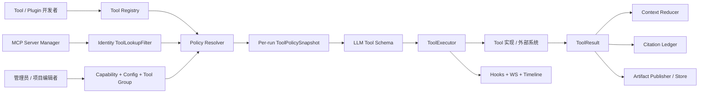
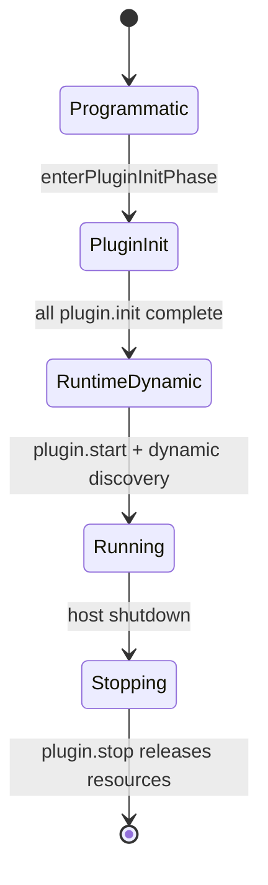
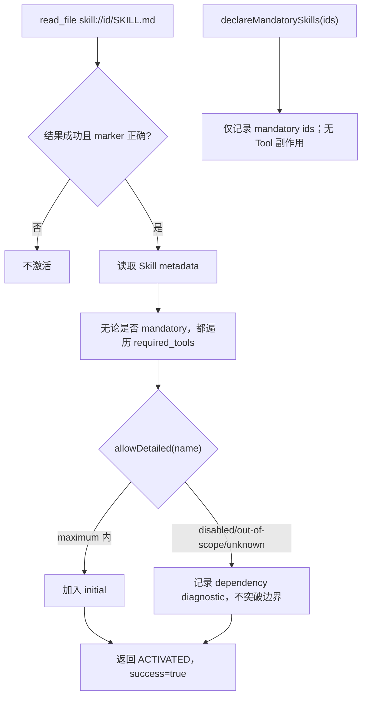
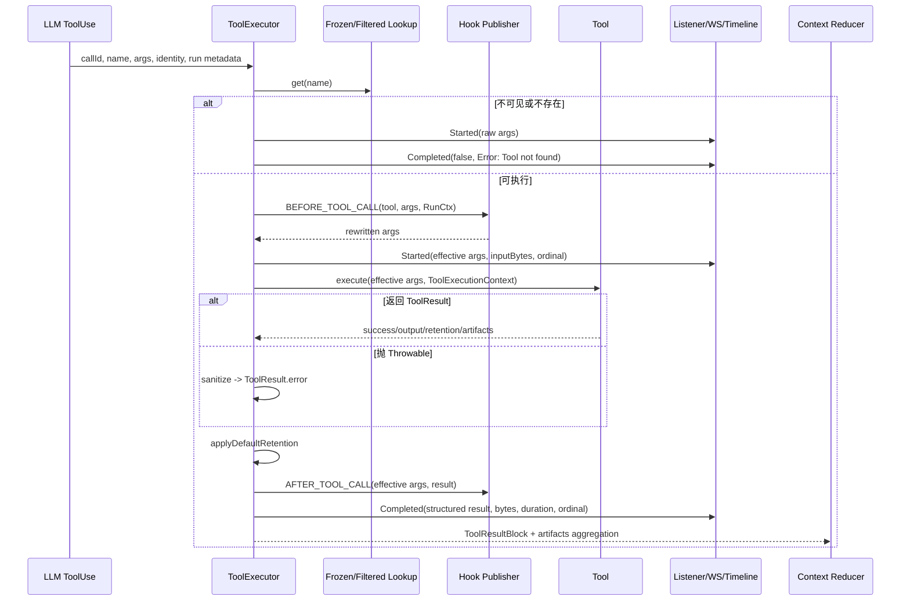

```
# T08 工具注册、可见性、执行与结果保留：可复刻技术设计

> 文档目标：读者不依赖 Nova 源码、当前会话或原工程，即可实现一套业务效果等价的 Agent Tool 平台。
>
> 证据标记：`I` 已实现；`A` 有自动化证据；`K` 已知失败；`P` 已规划但未证明；`R` 运行验证；`F` 基于多处静态证据的强推断；`D` 生产复刻建议。静态代码存在不等于运行环境已验证。

## 1. 结论与边界

### 1.1 模块解决什么问题

该模块把“系统里存在一个 Tool 实现”转化为“某个身份在某次 Agent 运行中可以安全、稳定、可审计地调用它”。完整能力不是一个注册表，而是五层相互独立的控制面：

1. **供给层**：Tool SPI、静态插件、产品桥接和动态 MCP 提供可执行实现。
2. **安装层**：能力资产与 TENANT / PROJECT / USER 安装决定业务场景可用候选集。
3. **治理层**：禁用、Agent Tool Group、项目约束和排除项形成不可突破的最大权限。
4. **运行层**：逐次运行冻结策略快照，向模型公布初始集合；Skill 只允许在最大权限内懒激活。
5. **结果层**：执行生命周期、错误、取消、三档保留、上下文压缩、Timeline、引用和 Artifact 各自使用明确契约。

核心安全结论是：

```text
“资源存在” != “Tool 已注册” != “场景已安装” != “进入 Agent 最大权限” != “本轮已暴露给模型”
```

知识库挂载、项目资源存在、Skill 声明依赖或 MCP 已连接，都不得在 resolver、system prompt 或 runtime context 中旁路注入工具。Tool 必须同时经过正式注册、安装/系统组、拒绝规则、Agent policy 和逐运行快照；Skill 只能在已有 maximum 内改变 initial `[I/D]`。

### 1.2 用户、输入和输出

| 角色 | 输入 | 输出 |
| --- | --- | --- |
| Tool 开发者 | ToolDefinition、执行实现、配置声明、默认保留策略 | 可被注册的线程安全 Tool |
| 插件开发者 | 生命周期与注册逻辑 | 静态或动态供给 |
| 租户管理员 | 开关、配置、Tool Group、Agent policy | 租户治理规则 |
| 项目编辑者 | 项目安装、项目配置、项目 Tool 扩展 | 项目场景候选集 |
| 普通用户 | USER 安装/覆盖、个人 MCP、聊天请求 | 个人有效集合和执行结果 |
| Agent Runtime | 身份、场景、策略、模型 ToolUse | ToolResult、Timeline、事件、Artifacts |
| UI / 自动化 | 设置 API、WebSocket、持久化消息 | 可观察的管理状态和运行证据 |

### 1.3 本文包含与不包含

本文包含 Tool SPI、Definition/config/category、三种 Registry、插件/MCP/产品桥接、能力安装、Tool Group、最大权限、Skill 懒激活、snapshot/source collision/rebinding、ToolExecutor、结果保留/卸载、Timeline、citation/artifact/persistence、API/UI/自动化和生产验收。

本文不展开某个业务 Tool 的内部算法、完整 MCP transport 实现、整个聊天协议或 Artifact 产品库的所有预览细节；但会给出它们与 Tool 系统交互所需的完整契约。

### 1.4 当前实现与推荐生产实现

| 主题 | 当前实现 | 生产复刻应做 |
| --- | --- | --- |
| 注册冲突 | 单 Registry 用 `putIfAbsent` 拒绝同名；Composite extra 可遮蔽 primary | 合并前对所有来源做 name + fingerprint 全量冲突检查 |
| 运行冻结 | 名称集合、source fingerprint 和 version 被快照 | 每次 dispatch 再校验当前 fingerprint 等于快照，阻止同名换绑 |
| Skill 激活 | 逐个 best-effort，可能部分放开 | 若 Skill 依赖要求原子性，使用批量 all-or-none |
| Tool 参数 | Runtime 传 Map；各 Tool 自行做类型容错 | 通用层做结构校验，Tool 层仍保留宽松 coercion 和业务校验 |
| 取消 | cooperative signal + thread interrupt | 外部 I/O 必须有 timeout，取消后禁止启动新副作用，并定义不可回滚结果 |
| 大结果 | 超过 8192 UTF-8 bytes 写 Sandbox，Timeline 留前 10 行和 handle | 使用有 TTL、ACL、加密和对象审计的 Blob/Artifact Store |
| WS 成功信号 | 一条事件曾从 `Error: ` 文本推断，另一条来自结构化 success | 所有事件只消费同一结构化 ToolResult |
| 管理恢复 | legacy/V2/denial 多条存储链不完全一致 | 单一配置模型、事务恢复、read-after-write 验证 |

## 2. 术语、参与者与不变量

### 2.1 关键术语

| 术语 | 定义 |
| --- | --- |
| runtime tool name | 模型调用和 Runtime 查找使用的唯一名称，如 `metric_query` 或 `mcp__crm__search` |
| capabilityId | 管理和安装层稳定 ID；绝不能直接当 runtime name |
| binding fingerprint | 不含秘密、稳定标识执行来源的字符串，用于检测同名不同实现 |
| supply | 当前可发现的 Tool 实现全集 |
| available | 系统组和显式安装形成的场景候选集 |
| maximum | available 经 Agent allow-list、disabled、excluded 等治理后的硬上限 |
| initial/default context | 开始运行时实际暴露给模型的工具集合 |
| lazy activation | Skill 被读取后，把 required tool 从 maximum 加入 initial |
| retention | EPHEMERAL / CONDENSABLE / DURABLE，供上下文 reducer 使用 |
| offload | 大输出从 Timeline 内联文本转存受控文件，只保留预览和 handle |

### 2.2 参与方



### 2.3 必须始终成立的不变量

1. runtime name 是执行层唯一主键；capabilityId 只用于治理映射。
2. 同一运行任意时刻 `initial ⊆ maximum ⊆ available ⊆ supply`。
3. `disabled ∩ maximum = ∅`，`excluded ∩ maximum = ∅`。
4. Skill、资源 resolver、prompt injector 不能扩大 maximum。
5. 用户和租户身份只能来自认证上下文，不接受模型参数或客户端自报。
6. 一个 `tool_exec_started` 最终对应一个 completed 或在 Timeline finalize 时对应 cancelled orphan。
7. Tool 异常必须成为结构化失败并对 LLM/UI 可见；不得伪装为成功。
8. 配置参数和模型参数严格分离；秘密永不进入 Tool JSON Schema、prompt、日志或 WS。
9. 运行策略默认冻结；设置修改只影响新运行，除非产品明确实现可审计热更新。
10. 子代理只能继承父代理有效工具的子集，不能借委派扩大权限。

## 3. Tool SPI 与数据契约

### 3.1 最小可实现接口

```java
interface Tool {
  ToolDefinition definition();

  // 稳定、无秘密；动态来源必须重写。
  default String bindingFingerprint() { return getClass().getName(); }

  ToolResult execute(Map<String, Object> arguments, ToolExecutionContext context);

  default ResultRetention defaultRetention() { return CONDENSABLE; }
}

record ToolDefinition(
    String name,
    String description,
    Map<String, Object> parametersSchema,
    List<ConfigParam> configParams,
    String category) {}

record ToolResult(
    boolean success,
    String output,
    ResultRetention retention,
    List<Artifact> artifacts) {}
```

约束：

- `name`、`description`、`category` 非空；默认 category 为 `Other`。
- `parametersSchema` 非 null、不可变，描述模型可填写的参数。
- `configParams` 非 null、不可变，描述操作者配置；不得混入 model schema。
- `category` 是 UI display metadata，不是 provider 或权限边界。
- `execute` 必须返回非 null；同一个 Tool singleton 可能被多会话并发调用，禁止把请求态存在实例字段。
- Runtime 只保证 arguments 是 Map；模型可能把 integer/boolean 输出为字符串，Tool 必须容错并在业务边界 fail-fast。
- `ToolResult.output`、`retention` 非 null；artifacts 的 null 归一为空列表。
- `ToolResult.error(reason)` 应固定输出 `Error: <sanitized reason>` 且 `success=false`。

### 3.2 参数 Schema 示例

```json
{
  "type": "object",
  "properties": {
    "query": {
      "type": "string",
      "description": "Search expression"
    },
    "limit": {
      "type": "integer",
      "minimum": 1,
      "maximum": 100,
      "default": 20
    },
    "include_archived": {
      "type": "boolean",
      "default": false
    }
  },
  "required": ["query"],
  "additionalProperties": false
}
```

执行层解析推荐：

```text
parseInteger(value):
  if value is Integer/Long -> range-check
  if value is Number -> reject fractional part, then range-check
  if value is String -> trim, decimal-parse, range-check
  else -> Error: invalid argument 'limit'

parseBoolean(value):
  accept Boolean
  accept case-insensitive "true" / "false"
  reject all other strings rather than silently default
```

当前 Runtime 不对 JSON Schema 做统一强校验，Schema 主要供 provider/model 使用，具体 Tool 负责 coercion `[I]`。生产实现建议在 dispatch 前增加通用 validator，但不能因此删除 Tool 侧业务校验 `[D]`。

### 3.3 ConfigParam 契约

```java
record ConfigParam(
  String key,
  String label,
  String description,
  ConfigParamType type,       // STRING/PASSWORD/INTEGER/NUMBER/BOOLEAN
  boolean required,
  Object defaultValue,
  List<String> allowedValues,
  String pattern,
  Integer minLength,
  Number minimum,
  Number maximum,
  String group) {}
```

规则：

- `key` 非空，`type` 非 null；空 label 回退到 key，空 description 回退空串。
- PASSWORD 必须掩码展示、加密持久化、从日志/trace 排除。
- 配置通过 `context.resolveConfig(qualifiedKey, type)` 解析，按身份/项目/租户的正式优先级回退。
- 当前产品 DTO 桥存在信息损失：NUMBER 可能降成 STRING，allowedValues 被投影为 SELECT/options，而 pattern、minLength、minimum、maximum 可能丢失 `[I/K]`。复刻时前后端应直接承载完整 ConfigParam。

### 3.4 Artifact 契约

```java
enum ArtifactKind { TEXT, JSON, IMAGE, FILE, BINARY }

record Artifact(
  ArtifactKind kind,
  String name,
  String mimeType,
  byte[] content,
  String uri) {}
```

`kind`、`name` 必填；`mimeType`、`content`、`uri` 在当前 SPI 中都可空，且当前构造器**没有**强制 `content XOR uri`。因此当前合法形态包括：仅 content、仅 uri、二者都有、二者都空 `[I]`。后两种形态未必有可消费意义，生产复刻建议把下列约束放到发布边界，而不是误称为当前保证 `[D]`：

```text
inline artifact: content != null && uri == null
external artifact: content == null && uri != null
reject: both null or both non-null
```

Tool 可以：

1. 在 ToolResult 中直接返回轻量 Artifact；或
2. 用 `context.artifactPublisher.publish(sourcePath, name, kind, mime, conversationId, sourceTool)` 取得稳定 URI，再放入 ToolResult。

Artifact 不应自动拼入 LLM ToolResult 文本；AgentResponse 聚合 `artifacts[]`，最终 UI 通过结构化标记或稳定 API 渲染。当前通用 WebSocket tool event 不含完整结构化 artifacts，因此不能把 WS 当作工件血缘权威 `[I]`。

### 3.5 ToolExecutionContext

```java
interface ToolExecutionContext {
  Identity identity();
  Sandbox sandbox();
  boolean isCancelled();
  <T> Optional<T> resolveConfig(String key, Class<T> type);
  Optional<String> conversationId();
  Optional<String> messageId();
  Optional<String> agentName();
  Optional<String> providerName();
  Map<String,Object> runtimeContext();
  int callerSubAgentDepth();
  Set<String> callerAllowedToolNames();
  Optional<SkillLookup> skills();
  Optional<ArtifactPublisher> artifactPublisher();
}
```

`runtimeContext` 是不可变的非身份扩展数据，例如 locale/requestId/projectId；tenantId/userId 必须从 identity 取。`callerAllowedToolNames` 用于委派收窄。空集合在兼容模式表示“宿主未报告”，生产环境不应把空集合误当作“允许全部”。

## 4. 注册、组合与动态来源

### 4.1 Default Registry

推荐数据结构：

```text
ConcurrentHashMap<runtimeName, RegisteredTool(tool, phase, sequence)>
AtomicLong registrationSequence
volatile RegistrationPhase currentPhase
```

注册阶段：`PROGRAMMATIC`、`PLUGIN_INIT`、`RUNTIME_DYNAMIC`。`register` 使用 `putIfAbsent`，重复名称抛 `RegistryConflictException`；禁止“先 unregister 再 register”，否则并发读取会看到空窗并允许劫持。`all()` 返回 immutable snapshot，按 phase 后 runtime name 稳定排序 `[I]`。

SPI 文档可允许“注册顺序”，但具体 Runtime 的可重复排序应成为复刻契约；不要依赖 HashMap 遍历顺序。

### 4.2 Composite Registry

组合规则为 extras 优先于 primary：

```text
get(name): 第一个 extra 命中 -> 返回；否则 primary
all(): extras 按声明顺序 + primary 中未被 extra 名称遮蔽的项
register/unregister: UnsupportedOperationException
```

这个结构适合把 identity-specific MCP overlay 叠在静态工具上，但有两个风险：

- extra 与 primary 同名时，primary 被静默遮蔽；若冲突检查发生在组合后，就看不到被遮蔽来源。
- 多个 extras 同名时，`get` 取第一个，而 `all` 可能出现重复。

因此生产合并必须先枚举所有输入，按 `(runtimeName, fingerprint)` 检查：同名同 fingerprint 可去重，同名异 fingerprint 必须 fail closed `[D]`。

### 4.3 Filtered Registry

每次运行创建只读 `FilteredToolRegistry`：

```text
source: live ToolLookup
allowedNames: CopyOnWriteArraySet
maximumNames: immutable set
disabledNames: immutable set
```

`get/all` 同时要求 name 在 allowed、不在 disabled、且 source 当前仍有该 Tool。`allowDetailed(name)` 返回：

| 结果 | 含义 |
| --- | --- |
| ALLOWED | 成功加入 initial |
| ALREADY_ALLOWED | 已在 initial，幂等成功 |
| DENIED_DISABLED | 被硬禁用 |
| DENIED_OUT_OF_SCOPE | 不在 maximum |
| DENIED_UNKNOWN | source 不存在 |

批量 `allowAllDetailed` 应同步并 all-or-none；当前 SkillActivator 逐个调用单项方法，因此一个 Skill 的多个依赖可能部分激活 `[I]`。

### 4.4 插件生命周期与注册



- `init(context)` 只注册 Tool、Store、Filter、Hook 等，不建立长期连接。
- `start()` 激活线程、网络连接、动态发现。
- `stop()` 释放连接、线程、listener、ThreadLocal。
- 插件只能依赖稳定 SPI，不依赖 Runtime 或其他插件。
- Tool 由 `context.tools().register(tool)` 注册；注册冲突必须让启动失败，而不是覆盖。

产品桥插件在 init 时把 NovaCore ToolLookup 写入 Spring holder，并安装 ConfigStore bridge；start 后再次失效 Tool key/cache，因为其他插件可能在 init 后注册。holder 在未接线时返回空集合而不是 null `[I]`。

### 4.5 MCP 动态 overlay

MCP 不把每个用户可见 Tool 永久写入全局 Registry，而是注册唯一的 identity `ToolLookupFilter`。每次请求：

1. 从 identity 和 projectId 解析可见 server，优先级 personal > tenant > system。
2. 解析 enabled：user 显式值 > tenant 显式值 > global，默认 true。
3. 连接管理器枚举 server tools。
4. 把外部名称规范成 `mcp__<server>__<tool>`。
5. 创建 adapter，其 fingerprint 至少包含 serverId、transport/source identity 和 tool 原名。
6. 与 base lookup 组合，再交给正常 capability/policy 处理。

MCP 可见性解析失败时保留静态工具、排除 MCP 工具，即“static fail-soft / MCP fail-closed” `[I]`。MCP 已连接只代表 supply 可发现，不代表 capability 已安装。

系统 StoreRegistry 当前只允许一个 ToolLookupFilter；如果多个插件都需要 overlay，应实现 filter chain 或显式 composite，而不是互相覆盖 `[I/D]`。

## 5. 安装、Tool Group 与逐运行可见性

### 5.1 数据模型

```sql
CREATE TABLE capability_asset (
  capability_id        varchar(64) PRIMARY KEY,
  tenant_id            varchar(64),
  kind                 varchar(32) NOT NULL,       -- TOOL/MCP_SERVER/SKILL/KNOWLEDGE
  logical_name         varchar(255) NOT NULL,
  display_name         varchar(255),
  display_description  varchar(1000),
  ownership_scope      varchar(32) NOT NULL,       -- PLATFORM/TENANT/PROJECT/USER
  owner_ref_id         varchar(64),
  source_type          varchar(32) NOT NULL,       -- BUILTIN/PLUGIN/MCP/UPLOAD
  source_ref           varchar(255) NOT NULL,      -- Tool runtime name or server id
  status               varchar(32) NOT NULL DEFAULT 'ACTIVE',
  version              bigint DEFAULT 1,
  created_by           varchar(64),
  created_at           timestamp NOT NULL,
  updated_at           timestamp NOT NULL,
  deleted_at           timestamp,
  UNIQUE(kind, source_type, source_ref)
);

CREATE TABLE capability_installation (
  id             bigint GENERATED BY DEFAULT AS IDENTITY PRIMARY KEY,
  tenant_id      varchar(64) NOT NULL,
  capability_id  varchar(64) NOT NULL REFERENCES capability_asset(capability_id),
  scope_type     varchar(32) NOT NULL,       -- TENANT/PROJECT/USER
  scope_id       varchar(64) NOT NULL,
  enabled        boolean NOT NULL DEFAULT true,
  installed_by   varchar(64),
  installed_at   timestamp NOT NULL,
  updated_at     timestamp NOT NULL,
  UNIQUE(tenant_id, capability_id, scope_type, scope_id)
);

CREATE INDEX idx_cap_install_scope
  ON capability_installation(tenant_id, scope_type, scope_id, enabled);

-- LEGACY compatibility table: configuration used to be coupled to an installation.
-- Do not use this as the authoritative model for new implementations.
CREATE TABLE tool_installation_config (
  id               bigint GENERATED BY DEFAULT AS IDENTITY PRIMARY KEY,
  installation_id  bigint NOT NULL REFERENCES capability_installation(id) ON DELETE CASCADE,
  config_json      text,
  updated_at       timestamp NOT NULL,
  UNIQUE(installation_id)
);

-- Current authoritative scope configuration; independent from installation lifecycle.
CREATE TABLE tool_scope_config (
  id                  bigint GENERATED BY DEFAULT AS IDENTITY PRIMARY KEY,
  tenant_id           varchar(64) NOT NULL,
  capability_id       varchar(64) NOT NULL REFERENCES capability_asset(capability_id),
  scope_type          varchar(32) NOT NULL,       -- TENANT/PROJECT/USER
  scope_id            varchar(64) NOT NULL,
  config_json         text,
  schema_fingerprint  varchar(64) NOT NULL,
  schema_version      integer NOT NULL DEFAULT 1,
  status              varchar(32) NOT NULL DEFAULT 'ACTIVE', -- ACTIVE/DORMANT
  dormant_reason      varchar(255),
  migration_source    varchar(64),
  created_by          varchar(64),
  updated_by          varchar(64),
  created_at          timestamp NOT NULL,
  updated_at          timestamp NOT NULL,
  UNIQUE(tenant_id, capability_id, scope_type, scope_id)
);

CREATE INDEX idx_tool_scope_config_lookup
  ON tool_scope_config(tenant_id, scope_type, scope_id, status);

CREATE TABLE tool_platform_config (
  capability_id       varchar(64) PRIMARY KEY REFERENCES capability_asset(capability_id),
  config_json         text,
  schema_fingerprint  varchar(64) NOT NULL,
  schema_version      integer NOT NULL DEFAULT 1,
  status              varchar(32) NOT NULL DEFAULT 'ACTIVE', -- ACTIVE/DORMANT
  dormant_reason      varchar(255),
  migration_source    varchar(64),
  updated_by          varchar(64),
  updated_at          timestamp NOT NULL
);

CREATE TABLE capability_scope_denial (
  id                 bigint GENERATED BY DEFAULT AS IDENTITY PRIMARY KEY,
  tenant_id          varchar(64) NOT NULL DEFAULT '',
  capability_id      varchar(64) NOT NULL REFERENCES capability_asset(capability_id),
  tool_runtime_name  varchar(255) NOT NULL,
  scope_type         varchar(32) NOT NULL, -- PLATFORM/TENANT/PROJECT/USER
  scope_id           varchar(64) NOT NULL,
  reason             varchar(255),
  created_by         varchar(64),
  created_at         timestamp NOT NULL,
  UNIQUE(tenant_id, capability_id, tool_runtime_name, scope_type, scope_id)
);

CREATE INDEX idx_capability_scope_denial_lookup
  ON capability_scope_denial(tenant_id, tool_runtime_name, scope_type, scope_id);

-- Migration audit contains metadata only: never copy config values or secrets here.
CREATE TABLE tool_config_migration_report (
  id             bigint GENERATED BY DEFAULT AS IDENTITY PRIMARY KEY,
  source_table   varchar(128) NOT NULL,
  source_key     varchar(255) NOT NULL,
  target_table   varchar(128),
  target_key     varchar(255),
  outcome        varchar(32) NOT NULL,
  details        varchar(1000),
  migrated_at    timestamp NOT NULL
);
```

PLATFORM ownership仅表示共享供给，不表示自动可用。有效安装集合是：

```text
TENANT enabled installations
∪ PROJECT enabled installations（仅 project scene）
∪ USER enabled installations
```

加载 asset 时还要检查 status=ACTIVE、tenant/owner 可见性，并把 capabilityId 映射为 runtime name。MCP_SERVER 安装需进一步与当前可见 server binding 相交，产生多个 runtime tool names。

配置和安装是两条正交生命周期 `[I]`：`tool_scope_config`/`tool_platform_config` 不以 installation id 为外键，保存配置不会安装能力，卸载也不应级联删除配置。当前配置解析要求 capability asset 可解析、`status=ACTIVE` 且对该 tenant/user/project 可见；“必须先安装才能保存配置”不是当前持久化契约，只能作为产品选择的额外前置条件 `[D]`。

配置解析先计算所有有效 denial；任意 PLATFORM/TENANT/PROJECT/USER denial 命中便整体返回 `DENIED` 和空值，低层配置不能突破高层拒绝。未拒绝时，从 ToolDefinition 默认值开始叠加兼容层：

```text
personal scene: DEFAULT -> PLATFORM -> TENANT -> USER
project scene:  DEFAULT -> PLATFORM -> USER(credentials only) -> TENANT -> PROJECT
```

后应用层覆盖前层；project scene 中 USER 只允许显式 allowlist 的个人凭据字段，并在 TENANT/PROJECT 之前应用，所以项目/租户的连接单元仍可覆盖它。TENANT/PROJECT/PLATFORM 的“原子组”覆盖会先清除同组旧字段，防止新主机沿用低层旧密码。只有 `ACTIVE + schemaVersion=1 + schemaFingerprint=当前 SHA-256(toolName, configParams)` 的行参与解析；不兼容或 DORMANT 行保留用于迁移/诊断但不生效。PASSWORD 入库前封装加密，执行解析才解封；设置读取始终投影成掩码，migration report、日志、快照和审计不保存明文 `[I]`。

### 5.2 available / maximum / initial 算法

```text
source = identityToolLookupFilter(identity, globalRegistry, runtimeContext)
assertNoSourceNameCollision(source bindings)

frozenGroup = resolveSystemToolGroup(agentName, identity)
installed = resolveEnabledInstallationRuntimeNames(scene, identity)
available = frozenGroup.effectiveNames ∪ installed
available = available ∩ sceneConstraint.allowedNames   // 若约束非空

excluded = projectModeExcluded ∪ requestExcluded ∪ effectiveDenials
maximum = available ∩ source.names
maximum = maximum - disabled - excluded

initial = allAvailableFallback
  ? maximum
  : frozenGroup.defaultNames ∩ maximum
initial += runtimeExtensionNames ∩ maximum

snapshot = freeze(all sets, fingerprints, diagnostics, canonicalHash)
registry = FilteredToolRegistry(source, initial, maximum, disabled∪excluded)
```

NovaCore 的低层兼容 resolver 在 Agent 未配置 policy 且 main fallback 也缺失时可能警告后暴露全部 source `[I/K]`。产品场景应始终传 authoritative available/maximum，并把这种 fallback 计为启动或运行错误 `[D]`。

### 5.3 Tool Group

Tool Group entries 支持：

- 精确 runtime name：`read_file`
- 子组引用：`@analysis-tools`
- glob：如 `mcp__crm__*`

解析必须：递归展开、检测 cycle、稳定去重。当前 Core 对两种未知项的处理并不对称 `[I]`：

- 精确 runtime name 不存在：记录服务端 warn 并跳过；**不会**向返回的 snapshot `diagnostics` 追加条目，因此调用者不能依赖 diagnostics 发现这类错误。
- `@subgroup` 不存在：立即抛 `IllegalArgumentException("Unknown tool group: ...")`，本轮策略组装失败。

自动化已稳定证明“删除仍被父组引用的子组”会留下悬空 `@group`，运行时可能报 `Unknown tool group`（`NOVA-BUG-006/GROUP-19`）`[K/A]`。生产写入应拒绝 unknown exact tool/unknown subgroup，删除应先查反向依赖并返回 409，或在同一事务中更新所有父组；若保留 warn+skip 兼容模式，也应把结构化诊断写入 snapshot `[D]`。

### 5.4 Snapshot 契约

```json
{
  "agentName": "main",
  "systemGroupName": "core-tools",
  "allAvailableFallback": false,
  "effectiveSystemToolNames": ["read_file", "metric_query"],
  "runtimeExtensionToolNames": ["mcp__crm__search"],
  "defaultContextToolNames": ["read_file"],
  "maximumToolNames": ["read_file", "metric_query", "mcp__crm__search"],
  "disabledToolNames": [],
  "excludedToolNames": [],
  "sourceFingerprints": {
    "read_file": "plugin:core-tools:ReadFileTool:v1",
    "mcp__crm__search": "mcp:server-17:search:schema-sha256"
  },
  "diagnostics": [],
  "version": "sha256-of-canonical-fields"
}
```

快照应随 run/message 审计存储，设置变更只影响新运行。`expectedResolvedPolicyVersion` 可用于拒绝客户端基于旧设置提交的运行，但 version 必须覆盖 Group、安装、denial、source fingerprint 和 scene constraints。

### 5.5 Source collision 与 rebinding

静态 resolver 可收集 `name -> fingerprint`；同名不同 fingerprint 抛 `RUNTIME_TOOL_SOURCE_CONFLICT`，同名同 fingerprint 去重 `[I]`。但存在两处空隙：

1. Composite 先遮蔽后检查，会丢失冲突来源。
2. Filtered Registry 在 dispatch 时只按 name 从 live source 取 Tool；原 Tool 被注销后同名新实现注册，仍可能在旧快照 maximum 中执行，快照虽保存 fingerprint，却没有重新比对 `[I/K]`。

生产 dispatch 必须执行：

```text
current = source.get(name) or ToolResult.error("Tool no longer available")
expected = snapshot.sourceFingerprints[name]
actual = current.bindingFingerprint()
if expected != actual:
  audit TOOL_BINDING_CHANGED(expected, actual)
  fail closed; do not invoke current
```

## 6. Skill 懒激活与禁止旁路放权

Skill instruction 通过读取 `skill://<id>/SKILL.md` 激活。激活器只处理成功、以固定 `SKILL_INSTRUCTION` marker 开头的 read result，并对同一 Skill 去重。

`declareMandatorySkills(ids)` 只是把规范化后的 id 记入 mandatory 集合，**没有注册、放开或激活 Tool 的副作用**。mandatory Skill 后续真正被 `activateSkillDetailed(id)` 激活时，与普通 Skill 使用完全相同的 `required_tools` best-effort 流程；mandatory 不是跳过依赖检查的特殊通道 `[I]`。



精确结果契约如下 `[I]`：

| 条件 | activation status | `success()` | 对读取 Skill 的 ToolResult 影响 |
| --- | --- | --- | --- |
| 合法且首次激活；所有依赖可放开 | `ACTIVATED` | true | 保持原 read_file 成功 |
| 合法且首次激活；依赖 missing/disabled/out-of-scope | `ACTIVATED`，附依赖诊断 | true | 仍保持原 read_file 成功；不可用依赖不进入 initial |
| 已激活 | `ALREADY_ACTIVE` | true | 保持成功 |
| 空 id | `INVALID_SKILL_ID` | false | ToolLoop 改写为 `SKILL_ACTIVATION_FAILED...` |
| 找不到 Skill | `SKILL_NOT_FOUND` | false | ToolLoop 改写为 `SKILL_ACTIVATION_FAILED...` |

即 missing/disabled/out-of-scope 不是 activation failure；模型只会在随后真的调用未暴露 Tool 时收到常规 not found/unavailable。只有 activation result 本身 `success=false` 时，ToolLoop 才把触发激活的读取结果改成 `SKILL_ACTIVATION_FAILED`。若业务要求 Skill 依赖原子可用，应先 `inspect all`，全部可放开才提交，并把这一更严格行为标为生产扩展而非当前语义 `[D]`。

以下做法一律禁止：

- 项目挂知识库后 resolver 自动注入 `search_knowledge/read_knowledge`。
- Skill 声明 required_tools 后把工具直接写 systemPrompt。
- MCP server 可见后绕过 capability installation。
- 场景 runtimeContext 塞 `forceEnableTools`。
- 为修一个测试，把 Tool 临时硬编码进 main Agent。

正确方式是修改正式安装/Tool Group/policy，并开启新会话验证。

## 7. 从模型 ToolUse 到 ToolResult 的完整执行链

### 7.1 输入与事件

模型返回：

```json
{
  "toolCallId": "call_01J...",
  "toolName": "metric_query",
  "arguments": {
    "metric": "revenue",
    "start": "2026-07-01",
    "end": "2026-07-31"
  }
}
```

执行时序：



### 7.2 精确控制流

```text
execute(use, identity, conversationId, messageId, runtimeContext, depth, ordinal):
  require use != null and identity != null
  require depth >= 0
  startNanos = monotonicClock()
  tool = filteredLookup.get(use.toolName)

  if tool missing:
    publish Started(rawArgs)
    result = Error("Tool not found: " + name)
    publish Completed(success=false, duration, bytes)
    return result

  effectiveArgs = hooks.beforeToolCall(tool, rawArgs, runCtx)
  publish Started(effectiveArgs, canonicalJsonUtf8Bytes, ordinal)
  context = immutable execution context
  try:
    result = tool.execute(effectiveArgs, context)
  catch Throwable t:
    log full exception internally
    result = Error(safeClassAndMessage(t))

  result = applyDefaultRetention(tool, result)
  hooks.afterToolCall(tool, effectiveArgs, result, runCtx)
  publish Completed(result.success, outputUtf8Bytes, duration, ordinal)
  return result
```

Hook 可做参数清理、PII redact、sandbox path rewrite，但改变后的 arguments 必须同时传 Tool、AFTER hook 和审计，避免“审计参数与实际参数不同”。Hook 不得扩大工具可见性。

### 7.3 身份、配置和 Sandbox

- identity、conversationId、messageId、agentName、providerName、subAgentDepth 由 Runtime 注入，不由 LLM 提供。
- runtimeContext 在入口做 immutable copy；身份字段禁止重复放入。
- ConfigStore 解析前后检查 cancellation；取消与数据库读取竞态时丢弃刚读到的值，避免取消后启动新外部调用。
- Sandbox 是每个 run/agent 的受控文件与进程边界；Tool 不应自行拼主机绝对路径。
- ArtifactPublisher 与 Sandbox 分责：Sandbox 管隔离与执行，Publisher 管导出、URL、ACL 和持久化。

### 7.4 并行、顺序和取消

同一 LLM round 可并行执行多个 Tool。每个 call 分配稳定 ordinal；结果等待全部完成后，按模型 ToolUse 原顺序生成 ToolResultBlock，不能按 worker 完成顺序喂给模型。Timeline 同毫秒 Tool event 也用 ordinal 排序 `[I]`。

取消包括全局 CancellationSignal 和 worker thread interrupt。Tool 应在以下位置调用 `isCancelled()`：解析后、外部请求前、分页循环、重试间、写副作用前。Future cancel 只能 interrupt，不能自动回滚已完成的邮件、数据库写或远程请求；必须使用业务幂等键和审计。

当前 Executor 不在调用 Tool 前统一拒绝 cancelled，也依赖 Tool cooperative polling；生产实现应在 BEFORE hook 前和副作用前各做一次硬检查 `[I/D]`。

### 7.5 错误契约

| 场景 | LLM/UI 可见结果 | 审计 |
| --- | --- | --- |
| Tool 不存在/不可见 | `success=false`, `Error: Tool not found: <name>` | started + completed |
| 参数非法 | `Error: invalid argument '<field>': <safe reason>` | completed false |
| Tool 抛异常/Error | `Error: <type>: <safe message>` | 内部日志含 throwable，外部不含 stack/secret |
| 外部超时 | `Error: upstream timeout after <ms>` | endpoint logical name、duration、retry count |
| 取消中断 | `Error: cancelled` 或 run CANCELLED | orphan finalize 或 completed false |
| offload 写失败 | Tool 本身仍成功；Timeline 仅 bounded preview + failure marker | warn + counter |

当前实现捕获 `Throwable` 来维持 started→completed，但如果 Tool 违反契约返回 null，`applyDefaultRetention` 会在 try/catch 之外空指针，可能破坏该不变量 `[I/K]`。生产实现必须在 try 内 `requireNonNull(result)` 并翻译为 ToolResult.error。

## 8. ResultRetention、上下文与大结果卸载

### 8.1 三档语义

| 等级 | 典型内容 | reducer 行为 |
| --- | --- | --- |
| EPHEMERAL | 写文件确认、资源目录、一次性控制结果 | 最先丢弃；仍保留实时/审计事件 |
| CONDENSABLE | 搜索结果、普通查询、子代理摘要 | 可进入压缩摘要，预算不足时早于 DURABLE 删除 |
| DURABLE | 关键数据查询、用户要求原文保留的证据 | 常规 trim 不删除；仅最终强制降级可处理并必须记录损失 |

Retention 是上下文提示，不等于数据库 TTL，也不等于 Artifact 生命周期。

### 8.2 非对称合并真值表

`ToolResult.ok/error` 默认构造 CONDENSABLE。Runtime 合并：只有 result 仍为 CONDENSABLE 时才应用 Tool default；Tool 显式返回 EPHEMERAL 或 DURABLE 永远优先。

| Tool default | Result retention | 最终 |
| --- | --- | --- |
| CONDENSABLE | 任意 | Result 原值 |
| EPHEMERAL | CONDENSABLE | EPHEMERAL |
| DURABLE | CONDENSABLE | DURABLE |
| EPHEMERAL/DURABLE | EPHEMERAL | EPHEMERAL |
| EPHEMERAL/DURABLE | DURABLE | DURABLE |

```java
if (tool.defaultRetention() == CONDENSABLE || result.retention() != CONDENSABLE) {
  return result;
}
return result.withRetention(tool.defaultRetention());
```

### 8.3 Reducer 原子分组

ToolUse assistant block 与对应 ToolResult 应视为一个 atomic message group，避免删除一半造成 provider 协议非法。常规 trim：

1. 保护 system/current user/最近若干 assistant。
2. 收集可丢弃组。
3. 按 retention ordinal：EPHEMERAL → CONDENSABLE；同档 oldest first。
4. DURABLE 不参与常规 trim。
5. Skill instruction 可重读，预算紧张时可成对丢弃 ToolUse/ToolResult。

### 8.4 Timeline 记录

```json
{
  "type": "tool_exec",
  "timestamp": 1786550400123,
  "toolCallId": "call_01",
  "toolName": "metric_query",
  "argsJson": "{\"metric\":\"revenue\"}",
  "resultText": "...",
  "success": true,
  "inputBytes": 20,
  "outputBytes": 15420,
  "durationMs": 318,
  "retention": "DURABLE",
  "artifactRefs": ["sandbox://offloaded/<sha>.txt"],
  "toolOrdinal": 2
}
```

TimelineRecorder 的 inflight 是并发 Map，events 是并发安全列表。complete 时移除 start；finalize 时把孤儿 start 转为 `success=false, [cancelled before completion]`。args JSON 失败时写可解析 sentinel `{"__error":"args_serialization_failed"}`。SKILL_INSTRUCTION 正文直接替换为 `[SKILL_INSTRUCTION elided]`，不 offload，避免把可重读的大段 Skill 持久化 `[I]`。

### 8.5 8 KiB Offload

当前阈值为 **8192 UTF-8 bytes**，保留前 **10 行**。超过阈值：

```text
path = offloaded/<sha256(full UTF-8 bytes)>.txt
write full bytes verbatim to run Sandbox
timeline.resultText = boundedHead +
  "[offloaded N bytes to <handle>; read full via read_file]"
timeline.artifactRefs = [handle]
timeline.outputBytes = original full byte count
```

内容 hash 使相同结果路径幂等；预览同时受行数和 8192 byte 限制，UTF-8 截断回退 continuation byte，避免乱码。写失败 fail-soft：保留 bounded preview 和 `[offload failed; full result not persisted]`，Tool 执行状态不改为失败 `[I]`。

注意：当前 offload 只写 Sandbox，recall 依赖 read_file，独立 artifact-store target 尚未完成 `[I/P]`。生产系统应记录 owner/run/toolCallId、TTL、加密、hash、size、contentType，并在读取时重新授权。

## 9. Citation、Artifact 与持久化

### 9.1 Citation

可引用 ToolResult 在下一次 LLM 前由 hook 增补系统 reminder 和稳定 evidence token。失败结果、已含 reminder 或不可引用 Tool 被跳过。token 至少包含 toolName + toolCallId；历史消息再加 messageId scope，避免不同轮 callId 碰撞。

最后一个可引用结果可附完整 evidence ledger，避免每个结果都附 ledger 导致 O(N²) token。最终回答的 citation extractor 把 token 转为 UI citation DTO，并与助手消息 processData 持久化。引用证据应来自成功 ToolResult，不应从 Artifact 文件名或最终自然语言猜测。

### 9.2 Artifact 发布

Publisher 推荐流程：

1. 校验 conversationId 只含 `[A-Za-z0-9._-]+`。
2. 规范化 outputRoot/conversationRoot/source path 并检查 `startsWith`，阻止路径逃逸。
3. 只有 conversation `artifacts/` 目录内文件是用户可见 deliverable；根目录中间文件只可供后续 Tool 读。
4. 外部源文件复制到 `artifacts/<random-prefix>-<safe-name>`。
5. 写入产品 Artifact Store 后返回 `/api/artifacts/{artifactId}/content`；未配置 Store 时，conversation 文件**不会**进入产品 Artifact Store，但 Publisher 仍返回 `/api/files/{conversationId}/{relativePath}`，由 conversation File API 按身份读取。
6. Artifact Store 失败在非强制 scoped 模式可 warn 并保留本地 URI；强制 scoped 模式应 fail closed。

因此 `/api/files/...` URI 只证明“存在可授权读取的 conversation 文件”，不证明存在 artifact id、Artifact Store 记录或血缘元数据。当前 Artifact metadata 有 conversationId/sourceTool，但通用链路缺 sourceMessageId/toolCallId/runId 的数据库强关联 `[I]`。生产应增加血缘边表：

```sql
CREATE TABLE tool_artifact_lineage (
  artifact_id      varchar(64) NOT NULL,
  tenant_id        varchar(64) NOT NULL,
  user_id          varchar(64),
  conversation_id  varchar(64) NOT NULL,
  message_id       varchar(64),
  run_id           varchar(64) NOT NULL,
  tool_call_id     varchar(128) NOT NULL,
  tool_name        varchar(255) NOT NULL,
  binding_fp       varchar(512) NOT NULL,
  created_at       timestamp NOT NULL,
  PRIMARY KEY(artifact_id, tool_call_id)
);
```

### 9.3 持久化权威顺序

管理状态权威：数据库 Config/Installation/Group > API read-back > UI optimistic state。

运行结果权威：持久化 message `processData.events[].success` > 结构化 `tool_call_result` > 旧 `tool_exec_end` 文本推断 `[I]`。生产应消除多重派生，所有层共享 `success` 字段。

## 10. 管理与运行 API 契约

身份必须来自服务器认证上下文。`scope=TENANT` 仅租户管理员可写；项目 list 需 view 权限，install/config/uninstall 需 edit 权限。

### 10.1 系统工具

| Method | Path | 说明 |
| --- | --- | --- |
| GET | `/api/settings/tools?scope=USER|TENANT` | 列表 |
| GET | `/api/settings/tools/{id}?scope=...` | 详情；builtin id 可为固定 `builtin` |
| POST | `/api/settings/tools` | 创建 MCP/自定义供给 |
| PUT | `/api/settings/tools/{id}` | 更新自定义供给 |
| DELETE | `/api/settings/tools/{id}` | 删除自定义供给 |
| PUT | `/api/settings/tools/{id}/items/{runtimeName}?scope=...` | 修改某个供给中的 Tool item；builtin 的 id 为 `builtin` |
| GET | `/api/settings/tools/builtin/items/{runtimeName}/config?scope=...` | 读取范围配置 |
| DELETE | `/api/settings/tools/builtin/overrides?scope=USER` | 批量恢复用户覆盖 |
| POST | `/api/settings/tools/test` | 提交前测试连接 |
| POST | `/api/settings/tools/{id}/test` | 测试已保存连接 |
| POST | `/api/settings/tools/{id}/reconnect?scope=...` | 重连并刷新动态工具 |

更新 builtin 示例：

```http
PUT /api/settings/tools/builtin/items/metric_query?scope=TENANT
Content-Type: application/json

{
  "enabled": true,
  "configValues": {
    "timeoutMs": "30000"
  },
  "scope": "TENANT"
}
```

`ToolConfigRequest` 的精确字段为：`enabled: Boolean?`、`configValues: Map<String,String>?`、`scope: TENANT|PERSONAL ?`；query `scope` 决定设置读取/治理范围，body `scope` 是配置 DTO 的兼容字段，缺省按 PERSONAL 处理。配置值在线路上统一为字符串，执行前再按 ConfigParam 类型转换。

Secret read-back：

```json
{
  "capabilityId": "cap_tool_metric_query",
  "runtimeName": "metric_query",
  "scopeType": "TENANT",
  "scopeId": "tenant-1",
  "configParams": [
    {"key":"apiKey","label":"API key","type":"PASSWORD","required":true,"group":"connection","options":null}
  ],
  "localValues": {"apiKey":"******"},
  "effectiveValues": {"apiKey":"******","timeoutMs":"30000"},
  "inherited": false,
  "effectiveSource": "TENANT",
  "contributingLayers": ["PLATFORM","TENANT"],
  "writableFields": ["apiKey","timeoutMs"],
  "missingRequiredFields": [],
  "schemaFingerprint": "sha256-hex",
  "schemaStatus": "COMPATIBLE",
  "registered": true,
  "available": true,
  "availabilitySources": ["TENANT_INSTALLATION"],
  "denied": false,
  "denialSources": [],
  "toolGroupSelected": true,
  "toolGroupSources": ["main"],
  "readOnly": false,
  "readOnlyReason": null
}
```

绝不能返回可逆 secret。

管理端点的成功状态为：创建 `POST /tools` 返回 201；删除 `/tools/{id}` 返回 204；item 更新返回 200 空 body；其余上述 GET/PUT/test/reconnect 正常返回 200。业务错误采用统一 body `{"success":false,"message":"...", ...details}`：INVALID→400、FORBIDDEN→403、NOT_FOUND→404、CONFLICT→409、INTERNAL→500、UPSTREAM→502；认证缺失由认证层返回 401。典型映射是 schema/字段/未知 group/cycle 为 400，租户或项目越权为 403，不可见 id 为 404，运行名冲突或被引用 group 为 409。生产 API 不得把 secret 或内部堆栈放入 message/details。

### 10.2 Tool Group 与 Agent Policy

```http
GET    /api/settings/tool-groups?scope=TENANT
GET    /api/settings/tool-groups/available-tools?scope=TENANT
POST   /api/settings/tool-groups
PUT    /api/settings/tool-groups/{groupName}
DELETE /api/settings/tool-groups/{groupName}
GET    /api/settings/agent-policies?scope=TENANT
POST   /api/settings/agent-policies
DELETE /api/settings/agent-policies/{agentId}
```

```json
{
  "name": "analysis-tools",
  "entries": ["read_file", "metric_*", "@shared-safe-tools"]
}
```

创建 group body 为 `{name:string, entries:string[]}`；更新 body 只消费 `entries:string[]`，路径 `{groupName}` 是真实 name 而非数字主键。用户/项目默认扩展采用原子替换 DTO：

```json
{
  "entries": [
    {"capabilityId":"cap_tool_metric_query","runtimeName":"metric_query"}
  ]
}
```

响应为 `{"agentName":"main","entries":[...],"staleDefaultExtension":false}`；null entries 归一为空列表。capabilityId 与 runtimeName 必须能映射到同一当前可见 binding，冲突返回 409。

Group 写入应预解析并验证 cycle、unknown sub-group、反向依赖和当前租户可见工具；不能等聊天时才失败。

### 10.3 项目安装与扩展

```http
GET    /api/v1/projects/{projectId}/tools
POST   /api/v1/projects/{projectId}/tools/install
DELETE /api/v1/projects/{projectId}/tools/{capabilityId}
GET    /api/v1/projects/{projectId}/tools/{capabilityId}/config
PUT    /api/v1/projects/{projectId}/tools/{capabilityId}/config
DELETE /api/v1/projects/{projectId}/tools/{capabilityId}/config
GET    /api/v1/projects/{projectId}/tool-group-extensions/{agentName}
PUT    /api/v1/projects/{projectId}/tool-group-extensions/{agentName}
```

```json
POST /api/v1/projects/p-17/tools/install
{ "capabilityId": "cap_tool_metric_query" }
```

安装 body 只有必填非空 `capabilityId:string`。项目配置 PUT 使用原子替换 DTO `{"configValues":{"apiKey":"new-secret","timeoutMs":"30000"}}`；GET/PUT/DELETE 均返回上节完整 `ToolScopeConfigView`。项目 list/GET config 要求 view 权限，extension GET 要求 use 权限；install/uninstall/config 写和 extension replace 要求 edit/admin。当前 install/uninstall 成功均返回 200 空 body，config 与 extension 操作返回 200 JSON。

安装使用 `(tenantId, capabilityId, PROJECT, projectId)` 幂等 upsert；卸载将 enabled=false 而非误删 asset。配置写入不创建安装、不改变可用性，配置行也不依赖 installation 外键 `[I]`。当前保存前置是 capability asset `ACTIVE` 且对目标 scope 可见/可解析；如果复刻产品决定“仅已安装能力可配置”，应在 service 层额外验证并返回 409/400，但这是 `[D]`，不能作为当前实现保证。

### 10.4 WebSocket 运行事件

生产推荐统一 JSON，不用分隔字符串：

```json
{
  "type": "tool_exec_end",
  "conversationId": "c-1",
  "messageId": "m-2",
  "runId": "r-3",
  "toolCallId": "call-4",
  "toolName": "metric_query",
  "success": false,
  "output": "Error: upstream timeout after 30000ms",
  "inputBytes": 42,
  "outputBytes": 38,
  "durationMs": 30007,
  "retention": "CONDENSABLE",
  "artifactRefs": [],
  "toolOrdinal": 1
}
```

当前一条 WS end 信号曾按 output 是否以精确 `Error: ` 开头推断 success，而后续结构化结果使用 ToolResult.success；“成功输出恰以 Error: 开头”会冲突 `[I/K]`。复刻必须只使用结构化布尔值，并以 toolCallId 关联，不能只按同名 Tool FIFO。

## 11. 安全、并发、幂等与审计

### 11.1 安全边界

- Registry 只接受宿主/插件代码注册，不提供普通用户任意 class loading。
- MCP adapter 的 transport credential 从 ConfigStore/secret vault 取，不写 definition/schema/fingerprint。
- Tool output 进入 LLM 前仍是不可信数据；必须防 prompt injection，并将外部内容标为 data。
- 文件路径 normalize + root containment；URL 工具需要 SSRF、DNS rebinding、redirect 和私网限制。
- UI/API 按 tenant/user/project 授权；跨租户返回不泄露存在性的 404/403。
- 日志记录 logical endpoint、状态和 traceId，不记录 Authorization、API key、完整数据结果。
- category、display name、资源存在均不是授权依据。

### 11.2 并发与幂等

| 操作 | 要求 |
| --- | --- |
| Tool register | `putIfAbsent`，同名冲突原子失败 |
| installation | 唯一键 + upsert，同一请求重试不重复 |
| Group replace | transaction/compare-and-set，写完重新解析 |
| Skill activation | 同 run 去重；若原子依赖则批量提交 |
| Tool execute | Tool singleton 线程安全；副作用携带 idempotency key |
| offload | SHA-256 内容路径，重复内容幂等 |
| Timeline | callId keyed inflight，ordinal 稳定排序 |
| Artifact publish | 随机/内容寻址 ID + 唯一约束，不覆盖其他用户文件 |

### 11.3 审计事件

至少记录：

```json
{
  "event": "TOOL_EXECUTION_COMPLETED",
  "tenantId": "t-1",
  "userId": "u-2",
  "projectId": "p-3",
  "runId": "r-4",
  "toolCallId": "call-5",
  "toolName": "metric_query",
  "bindingFingerprint": "plugin:can:metric_query:v3",
  "policyVersion": "sha256:...",
  "success": true,
  "inputBytes": 81,
  "outputBytes": 2048,
  "durationMs": 232,
  "retention": "DURABLE",
  "artifactIds": [],
  "timestamp": "2026-08-13T10:00:00Z"
}
```

参数和结果默认不进入审计明文；如为合规采样，需字段级 redact、访问控制和保留周期。

## 12. 可观测性与告警

推荐指标：

- `tool_registry_size{phase,source}`
- `tool_registry_conflicts_total{name,source_a,source_b}`（name 应做低基数映射）
- `tool_policy_resolve_total{scene,status}`
- `tool_policy_maximum_size{agent,scene}` / `initial_size`
- `tool_policy_fallback_all_total{agent}`：生产应为 0
- `tool_binding_changed_total{tool}`：任意值 P0 安全告警
- `tool_skill_activation_total{status}`
- `tool_execution_total{tool,status}`
- `tool_execution_duration_seconds{tool,status}`
- `tool_input_bytes` / `tool_output_bytes`
- `tool_cancel_total{stage}`
- `tool_result_offload_total{status}` / `tool_result_offload_bytes`
- `tool_ws_success_signal_conflict_total`
- `tool_config_write_total{scope,status}`
- `tool_config_readback_mismatch_total{scope}`

每个运行 debug endpoint 应可返回经过授权和脱敏的 Policy Snapshot、diagnostics、source fingerprints，不返回 secrets 或 Tool output。

告警：注册冲突、binding changed、all-tools fallback、跨租户拒绝异常、Group cycle/unknown、offload 持续失败、结构化成功信号冲突、工具错误率/延迟突增。

## 13. Known Failures：已知失败、缺口与不要误判的证据

| 编号 | 状态 | 现象 | 复刻处置 |
| --- | --- | --- | --- |
| TOOL-CONF-005 | K/A | 某 release 中 main policy 持久化了 Tool Group，但运行时仍调用组外 Tool | 必须断言新会话的持久化 policy snapshot 和实际 Tool call，不只查设置 API |
| TOOL-CONF-006 | K/A | 某 release 接受 unknown builtin Tool config | 写入前与 Registry/asset 双重校验，unknown 返回 404/400 |
| NOVA-BUG-001 / TOOL-07 | K/A | PUT 失败时数据库不变，但 UI 无可见错误 | UI 回滚 optimistic state、toast/inline error、read-back |
| NOVA-BUG-006 / GROUP-19 | K/A | 删除被引用子组留下悬空引用 | 反向依赖保护或事务级联 |
| PTOOL restore | K/A | 单项 delete 未清 USER denial；批量恢复只清 legacy store，未清 V2 config/denial | 单一真相源；恢复事务覆盖 config+denial+override |
| USER source/detail | K/F | 来源接口只列个人 MCP，而 UI 期望含继承 builtin 与个人覆盖 | 定义清晰的 effective view 与 owned-only view，不混用 |
| ConfigParam bridge | I/K | 类型和约束投影有损 | API 原样承载 SPI 约束 |
| Composite collision | I/K | overlay 可遮蔽 primary，检查不到所有来源 | merge 前冲突检查 |
| Same-name rebinding | I/K | 旧 snapshot 按 name 可能执行新 fingerprint | dispatch 比对 fingerprint |
| Null ToolResult | I/K | null 在 execute catch 外触发异常 | 在 try 内检查并翻译失败 |
| WS success 双源 | I/K | 文本前缀与结构化布尔可能冲突 | 统一 ToolResult success + callId |
| Result retention E2E | P | 自动化目录已有计划用例，但不能等同 runtime 已证明所有 reducer 行为 | 以 unit/integration + persistence runtime fixture 补证 |
| Artifact lineage | I/P | 通用 WS/DB 缺 message/run/toolCall 强血缘 | 增 lineage 表与事件字段 |

自动化中的 `TOOL-REG-004/005` 只通过 GET 占位检查时，不能证明运行时注册 mutation、并发冲突或卸载行为。测试标题/用例文件存在也不代表已运行通过；必须保存报告和环境版本。

## 14. 最小复刻与生产复刻顺序

### 14.1 最小可用版本

1. 定义 Tool/Definition/Result/Context 和严格构造校验。
2. 实现线程安全 Default Registry、冲突拒绝和稳定列表。
3. 实现单一租户 enabled + Agent allow-list，计算 maximum/initial。
4. 每个运行创建 Filtered Registry 和快照；模型与 Executor 使用同一个实例。
5. 实现 ToolExecutor、hooks、started/completed、异常翻译、取消 signal。
6. 实现 retention 合并和 ToolUse/Result 原子上下文组。
7. 提供 list/detail/toggle/group API 与 read-back UI。
8. 实现真实 runtime E2E：设置 → 新会话 → Tool call → 持久化事件。

### 14.2 生产完备版本

1. capability asset/installations 与 project/user scope。
2. MCP identity overlay、source-aware binding 和 fingerprint。
3. Group recursion/glob/cycle/reverse dependency。
4. authoritative scene policy、snapshot hash 和 expected version。
5. Skill lazy activation，仅在 maximum 内；必要时原子依赖。
6. dispatch fingerprint recheck 和 source disappearance handling。
7. Config vault、完整 ConfigParam schema、恢复事务。
8. Timeline、8 KiB offload、Blob/Artifact Store、lineage。
9. citation ledger 和持久化 processData。
10. 统一结构化 WS、指标、审计、告警和跨租户安全测试。

## 15. 可验收复刻标准与测试矩阵

### 15.1 验收前置条件

- 至少两个 tenant、每个 tenant 两个 user，一个 tenant admin。
- personal 与 project 两种 scene；两个 project 权限不同。
- 一个静态 Tool、一个有 secret 配置 Tool、一个副作用 Tool、一个动态 MCP Tool。
- 一个同名不同 fingerprint 的冲突 fixture。
- 一个依赖 2 个 Tool 的 Skill，其中一个在 maximum 外。
- 可控慢 Tool、抛异常 Tool、返回 null 的违规 Tool、8 KiB 以上输出 Tool。
- 可读取 WS、消息 processData、Timeline 和 Artifact metadata。

### 15.2 核心验收场景

| ID | 场景 | 操作 | 预期 |
| --- | --- | --- | --- |
| REG-01 | 重复注册 | 并发注册同名不同实现 | 仅一个成功，其余 RegistryConflict；原实现不被替换 |
| REG-02 | 稳定顺序 | 多阶段随机顺序注册后多次 list | 每次按 phase/name 一致 |
| REG-03 | Composite 冲突 | MCP 与 builtin 同名异 fingerprint | 场景组装 fail closed，不静默 shadow |
| POL-01 | 安装边界 | asset 存在但无任何安装 | 不在 available/maximum/model schema |
| POL-02 | 项目隔离 | 仅项目 A 安装 | A 新运行可见，B/个人不可见 |
| POL-03 | denial | installed + group 中存在但 USER denial | maximum 不含；Tool call 返回 not found |
| POL-04 | 冻结 | 运行开始后修改 group | 当前 run 不变；新 run 使用新 version |
| POL-05 | fallback | 删除 main policy | 生产请求失败/告警，不可静默暴露全部 |
| POL-06 | rebinding | 快照后注销并同名注册新 fp | 旧 run 拒绝 TOOL_BINDING_CHANGED；新 run 可按新快照执行 |
| SKILL-01 | 合法懒激活 | required tool 在 maximum 但不在 initial | 读 Skill 前不可见，读后可见 |
| SKILL-02 | 越权依赖 | required tool 在 maximum 外 | activation 返回 `ACTIVATED/success=true` 和 out-of-scope 诊断；依赖不放开，原 Skill read 保持成功 |
| SKILL-03 | mandatory 声明 | 仅调用 `declareMandatorySkills` | 只记录 id，不激活 Skill、不新增任何 Tool |
| SKILL-04 | mandatory 实际激活 | mandatory Skill 有一个 maximum 内、一个 disabled 依赖 | 与普通 Skill相同 best-effort：前者加入 initial，后者诊断；整体 `ACTIVATED/success=true` |
| EXEC-01 | Hook 重写 | before hook 改 path | Tool/after/audit 三处参数完全一致 |
| EXEC-02 | 参数容错 | `"20"`/`"false"` | 合法解析；非法字符串明确失败 |
| EXEC-03 | 异常 | Tool 抛 RuntimeException/Error | completed false，LLM/UI 收到 safe Error，内部日志含 cause |
| EXEC-04 | null 违规 | Tool 返回 null | 转为 completed false，不中断事件链 |
| EXEC-05 | 并行顺序 | 同轮两个不同延迟 Tool | 执行并行；结果按 ToolUse ordinal |
| EXEC-06 | 取消 | 慢 Tool 中途取消 | 无新副作用；completed/orphan 明确；run CANCELLED |
| EXEC-07 | 子代理 | 子代理请求父集合外 Tool | 始终拒绝 |
| RET-01 | default 合并 | 覆盖真值表全部组合 | 最终 ToolResultBlock/Timeline retention 精确一致 |
| RET-02 | trim | 预算不足同时存在三档 | EPHEMERAL 最先、CONDENSABLE 次之、DURABLE 常规保留 |
| RET-03 | offload 边界 | 8192 与 8193 UTF-8 bytes | 前者内联，后者写 hash 文件并有 preview/handle |
| RET-04 | UTF-8 | 单行大量中文跨阈值 | preview 无乱码且不超 byte limit |
| RET-05 | offload 失败 | Sandbox write 抛错 | Tool 状态不变，Timeline bounded marker，告警增加 |
| CIT-01 | 引用 | 两个可引用结果 + 一个失败 | 只成功结果有唯一 token；历史 token 含 message scope |
| ART-01 | 路径逃逸 | 非法 conversationId/`../` source | 发布拒绝且不创建外部文件 |
| ART-02 | 血缘 | Tool 产生 Artifact | owner/run/message/call/name/fp 可追溯 |
| ART-03 | 当前 SPI 形态 | 分别构造仅 content、仅 uri、二者都有、二者都空 | 当前构造器四种均接受；生产 Publisher 边界按 `[D]` XOR 规则拒绝后两种 |
| ART-04 | 无 Store 发布 | 禁用 Artifact Store 后发布 conversation 文件 | 文件不入 Store，仍返回可鉴权 `/api/files/{conversationId}/...`；不得声称有 artifact id/lineage |
| API-01 | 租户权限 | 普通 user 写 TENANT | 403；状态不变 |
| API-02 | secret | 保存再读 PASSWORD | 仅掩码和 configured 标记；日志/trace 无明文 |
| API-03 | UI 写失败 | 拦截 PUT 500 | 页面可见错误并回滚，read-back 不变 |
| API-04 | Group 依赖 | 删除被引用子组 | 409 + 父组列表，状态不变 |
| API-05 | 配置独立于安装 | ACTIVE/visible asset 未安装时保存 scope config | 当前存储契约允许且不改变 available；若产品选择安装前置，明确按 `[D]` 返回错误 |
| API-06 | schema 漂移 | 保存后修改 ConfigParam fingerprint | 旧行保留但不生效，view 为 incompatible/dormant 诊断，secret 不进 migration report |
| E2E-01 | 管理到运行 | 开启 Tool、加 group、绑定 main、新会话强制调用 | WS 与 processData 同 callId/success；旧会话不作为证据 |
| E2E-02 | 禁用到运行 | 禁用后新会话强制调用 | 无真实执行，返回不可用；设置和 snapshot 一致 |

### 15.3 通过标准

1. 所有集合不变量由属性测试覆盖。
2. 冲突、越权、跨租户、同名换绑全部 fail closed。
3. API 写成功必须 read-after-write；写失败 UI 不得假成功。
4. runtime 验收必须同时看到实时结构化事件和持久化事件，且 callId、success、bytes 一致。
5. 不以模型最终回答文本作为唯一 Tool 执行证据。
6. 不以测试文件存在、GET 列表存在或 UI 可见作为注册/执行通过证据。

## 16. I/A/K/P/R/F/D 汇总与证据附录

### 16.1 结论分级

- `[I]` Tool SPI、Definition/config/category、Default/Composite/Filtered Registry、插件阶段、MCP identity overlay、安装解析、Tool Group/maximum/initial、Skill 懒激活、ToolExecutor、retention、Timeline 和 Sandbox offload 均有静态实现。
- `[A]` 三仓存在设置、运行、CAN Tool inventory、参数鲁棒性、错误、UI 回滚、Tool Group 和 personal extension 自动化；其中部分是已知失败或 planned，不能统一标记为通过。
- `[K]` 已确认问题包括组外调用、unknown builtin config、UI PUT 失败无提示、悬空子组、恢复链不完整、Composite collision、同名 rebinding、null ToolResult、WS success 双源和 Artifact 血缘不足。
- `[P]` result retention 自动化目录、完整 artifact store recall/lineage 等存在规划，但本次仅静态分析，未做运行确认。
- `[R]` 本文没有新增运行验证；不得把本文的静态结论写成部署环境保证。
- `[F]` 管理 DTO effective/owned view 冲突、部分恢复行为和多源观察权威来自跨 controller/service/UI test 的一致证据。
- `[D]` 生产复刻的关键增强是 merge 前 collision、dispatch fingerprint、authoritative no-fallback、统一结构化 WS、原子恢复、Blob Store 与 lineage。

### 16.2 Nova 主工程证据

以下路径仅用于追溯，不承担正文理解：

- Tool SPI：`nova-core/nova-core-spi/src/main/java/com/aloudata/nova/core/spi/tool/Tool.java`、`nova-core/nova-core-spi/src/main/java/com/aloudata/nova/core/spi/tool/ToolDefinition.java`、`nova-core/nova-core-spi/src/main/java/com/aloudata/nova/core/spi/tool/ToolResult.java`、`nova-core/nova-core-spi/src/main/java/com/aloudata/nova/core/spi/tool/Artifact.java`、`nova-core/nova-core-spi/src/main/java/com/aloudata/nova/core/spi/tool/ArtifactPublisher.java`、`nova-core/nova-core-spi/src/main/java/com/aloudata/nova/core/spi/tool/ToolExecutionContext.java`。
- Config SPI：`nova-core/nova-core-spi/src/main/java/com/aloudata/nova/core/spi/config/ConfigParam.java`、`nova-core/nova-core-spi/src/main/java/com/aloudata/nova/core/spi/config/ConfigParamType.java`。
- Registry：`nova-core/nova-core-runtime/src/main/java/com/aloudata/nova/core/runtime/registry/DefaultToolRegistry.java`、`nova-core/nova-core-runtime/src/main/java/com/aloudata/nova/core/runtime/registry/CompositeToolRegistry.java`、`nova-core/nova-core-runtime/src/main/java/com/aloudata/nova/core/runtime/registry/FilteredToolRegistry.java`。
- Policy：`nova-core/nova-core-runtime/src/main/java/com/aloudata/nova/core/runtime/tool/ToolPolicyResolver.java`、`nova-core/nova-core-runtime/src/main/java/com/aloudata/nova/core/runtime/tool/ToolPolicySnapshot.java`、`nova-core/nova-core-runtime/src/main/java/com/aloudata/nova/core/runtime/tool/SystemToolGroupSnapshot.java`。
- Skill：`nova-core/nova-core-runtime/src/main/java/com/aloudata/nova/core/runtime/agent/SkillActivator.java`。
- 执行：`nova-core/nova-core-runtime/src/main/java/com/aloudata/nova/core/runtime/agent/ToolExecutor.java`、`nova-core/nova-core-runtime/src/main/java/com/aloudata/nova/core/runtime/agent/ToolLoopRunner.java`、`nova-core/nova-core-runtime/src/main/java/com/aloudata/nova/core/runtime/agent/TimelineRecorder.java`、`nova-core/nova-core-runtime/src/main/java/com/aloudata/nova/core/runtime/agent/ResultOffloader.java`。
- reducer：`nova-bundled-plugins/nova-ext-ctx-default/src/main/java/com/aloudata/nova/ext/ctx/defaults/TrimStrategy.java`、`nova-bundled-plugins/nova-ext-ctx-default/src/main/java/com/aloudata/nova/ext/ctx/defaults/CompactionSegmenter.java`、`nova-bundled-plugins/nova-ext-ctx-default/src/main/java/com/aloudata/nova/ext/ctx/defaults/MessageGroups.java`。
- 插件桥：产品 `ToolRegistryBridgePlugin`、NovaCore plugin lifecycle 和 `NovaCore` 注册阶段切换。
- MCP：`nova-bundled-plugins/nova-ext-mcp/src/main/java/com/aloudata/nova/ext/mcp/McpPlugin.java`、`nova-bundled-plugins/nova-ext-mcp/src/main/java/com/aloudata/nova/ext/mcp/McpToolLookupFilter.java`、`nova-bundled-plugins/nova-ext-mcp/src/main/java/com/aloudata/nova/ext/mcp/McpToolAdapter.java`。
- 能力：`nova-app/src/main/java/com/aloudata/nova/capability/ToolCapabilityResolver.java`、`nova-app/src/main/java/com/aloudata/nova/capability/EffectiveToolCapabilityResolver.java`、`nova-app/src/main/java/com/aloudata/nova/project/service/FoundationSceneToolPolicyProvider.java`、`nova-app/src/main/java/com/aloudata/nova/project/service/SceneToolPolicy.java`。
- 数据库：`nova-app/src/main/resources/db/product-migration/{postgresql,h2}/V202607221500__add_capability_tables.sql`。
- API：`ToolSettingsController.java`、`ProjectToolController.java`、`ProjectToolGroupExtensionController.java`。
- citation：`ProductCitationBeforeLlmHook.java`、`EvidenceExtractor.java`。
- artifact：`DirectoryArtifactPublisher.java`、产品 Artifact service/store/controller。

### 16.3 `nova_auto_test` 证据

- Tool 设置 transport：`nova_auto_test/src/features/settings/toolSettingsClient.ts`。
- 注册：`nova_auto_test/cases/02-tool-execution/registry/`，用例编号 `TOOL-REG-001` 至 `TOOL-REG-011`。
- 配置：`nova_auto_test/cases/02-tool-execution/tool-config/`，用例编号 `TOOL-CONF-001` 至 `TOOL-CONF-011`。
- 参数：`nova_auto_test/cases/02-tool-execution/param-robustness/`，用例编号 `TOOL-PARAM-001` 至 `TOOL-PARAM-009`。
- 路由/执行：`nova_auto_test/cases/02-tool-execution/routing/`、`nova_auto_test/cases/02-tool-execution/builtin-exec/`、`nova_auto_test/cases/02-tool-execution/builtin-file/`、`nova_auto_test/cases/02-tool-execution/builtin-comm/`。
- retention：`nova_auto_test/cases/02-tool-execution/result-retention/`，用例编号 `TOOL-RETAIN-001` 至 `TOOL-RETAIN-007`；当前应按 planned/报告状态逐项判定。
- CAN inventory：`cases/19-can-plugin/plugin-lifecycle/CAN-LIFE-003.yaml` 与 `src/features/can/runner.ts`。

### 16.4 `nova_ui_e2e` 证据

- 系统工具：`nova_ui_e2e/tests/settings-tools.spec.ts`。
- Tool Group：`nova_ui_e2e/tests/settings-tool-groups.spec.ts`。
- 个人扩展：`nova_ui_e2e/tests/personal-extensions-tools.spec.ts`。
- runtime：`nova_ui_e2e/tests/agent-tool-runtime.spec.ts`。
- ask_human 开关与 runtime：`nova_ui_e2e/tests/agent-ask-human-tool-toggle.spec.ts`。
- 已知问题：`nova_ui_e2e/docs/known-product-issues.md`。

### 16.5 本次验证声明

本文件基于三仓静态代码、数据库迁移、既有测试定义和已知问题台账编写。按任务约束，本次未运行 Maven、npm、Playwright 或任何构建/测试命令，因此本章没有 `R`（Runtime Verified）结论；测试定义和已知问题分别保持 `A/K`，其他内容保持 `I/F/P/D` 边界。

```
