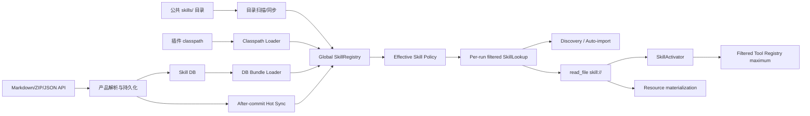
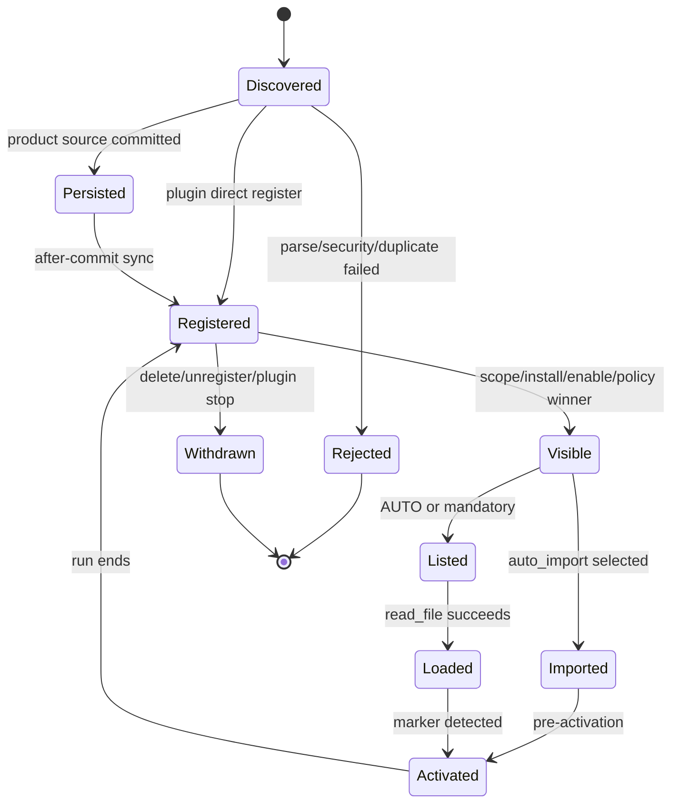
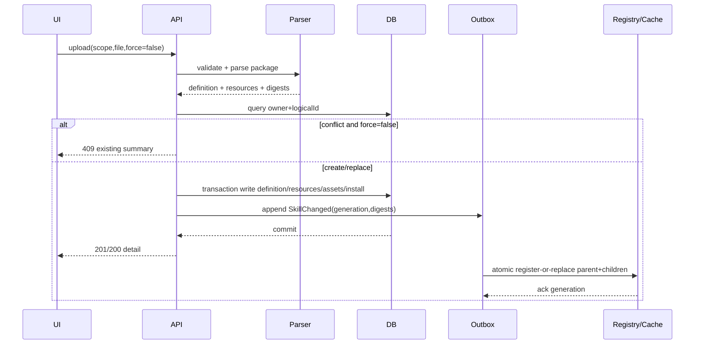
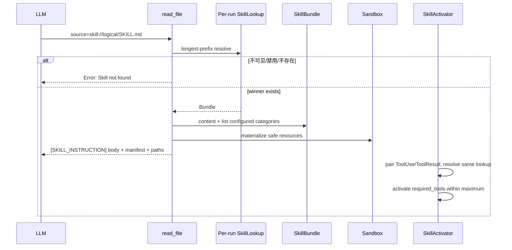

```
# T09 Skill 扫描、解析、激活与运行时：可复刻技术设计

> 目标：实现者只依赖本文，即可在另一套 Agent 工程中复刻 Nova 的 Skill 包、作用域、发现、读取、激活和运行时治理能力。
>
> 证据标签：`I` 已实现；`A` 有自动化契约/证据；`K` 已知失败；`P` 已规划但未证明；`R` 运行验证；`F` 静态强推断；`D` 推荐生产设计。本次未运行服务、构建或测试，因此没有新增 `R`。

## 1. 结论与边界

### 1.1 Skill 是什么

Skill 是“可安装、可分层覆盖、可按需加载的 Agent 行为说明包”，不是可执行代码插件，也不是 Tool 权限。它至少包含 `SKILL.md`，可附带 `references/`、`scripts/`、`assets/`、`templates/`，以及默认不自动物化的 `bin/`。

完整能力链为：

```text
文件/插件/DB 供给
→ 解析为 SkillBundle
→ 全局唯一 Registry ID 注册
→ 身份/项目/安装/开关/mandatory/同名 winner 解析
→ 每次运行创建不可变 SkillLookup
→ 仅注入摘要或受预算约束的 auto-import 正文
→ read_file(skill://logical-id/SKILL.md)
→ 返回带 SKILL_INSTRUCTION marker 的正文并物化资源
→ SkillActivator 尝试在 Tool maximum 内开放 required_tools
```

必须区分：

```text
Skill 存在 != 当前身份可见 != 已启用 != 当前同名赢家
Skill 正文已读 != required_tools 全部可用
脚本被物化 != 脚本获准执行
```

Skill 不能突破 Tool 注册、能力安装、Agent Tool Group、disabled、maximum、Sandbox 或外部系统权限。禁止因 Skill、知识库或项目资源存在而在 system prompt、resolver 或 runtimeContext 中硬编码 Tool `[I/D]`。

### 1.2 目标用户、输入和输出

| 角色 | 输入 | 输出 |
| --- | --- | --- |
| 平台/插件开发者 | classpath Skill 包或程序化 SkillBundle | SYSTEM/插件供给 |
| 租户管理员 | TENANT Skill、开关、mandatory | 租户默认行为与治理 |
| 项目编辑者 | 安装供给池 Skill、项目私有 Skill | PROJECT 场景行为 |
| 普通用户 | PERSONAL Skill、个人覆盖 | 用户级有效 winner |
| Runtime | identity、projectId、policy version、Tool maximum | 逐运行 SkillLookup、listing、激活记录 |
| 模型 | 摘要、`skill://` URI、Skill 正文 | ToolUse、回答、脚本/资源调用请求 |
| UI/自动化 | 管理 API、WS、消息过程数据 | 可观测的生命周期和执行证据 |

### 1.3 本文覆盖

- Skill SPI：Bundle、Frontmatter、Resource、Loader、Lookup/Registry/Filter。
- 公共目录、插件 classpath、产品上传/DB、多租户 listing 直接目录四类来源。
- Markdown、目录、ZIP、frontmatter、ID 归一化、嵌套 Skill、limits 与安全。
- scope、enable、installation、mandatory、同名 winner、版本与逐运行冻结。
- listing、auto-import、`skill://`、资源 manifest/物化、SkillActivator。
- scripts/bin 的“读取、落盘、执行”三段边界。
- API、DDL、缓存/热更新、并发、审计、Known Failures 和三仓测试。

不展开 Shell/Python Tool 自身的完整实现、多代理调度或 Tool Policy 的全部细节；但提供 Skill 与它们交互所需的精确契约。

### 1.4 当前实现与生产复刻差异

| 主题 | 当前实现 | 生产复刻建议 |
| --- | --- | --- |
| 上传 frontmatter | 手写宽松解析器；可能接受 malformed YAML | 安全模式 YAML + 字段白名单 + JSON Schema |
| 插件目录 frontmatter | Jackson YAML 解析；失败中止扫描 | 单包隔离失败，输出诊断并继续其他包 |
| ZIP | `readAllBytes` 后才检查 10 MiB/entry、50 MiB total；有路径检查 | bounded stream，再加 count、ratio、deadline、link 与重复全路径检查 |
| Registry replace | 产品层 unregister 后 register | owner-aware 原子 batch replace + generation |
| 同名覆盖 | 管理候选会选 logical winner，但 winner 不等于 runtime 可用 | 保留优先级，再独立执行 runtime eligibility |
| 每运行视图 | 解析一次后构造不可变 lookup | 保留；审计 policyVersion 和 bundle digest |
| Skill 激活 | required_tools 逐项 best-effort | 对需要全依赖的 Skill 支持原子激活模式 |
| scripts/bin | 物化后由独立 Tool 执行 | 默认不自动物化 bin；签名/扫描/信任级别/沙箱审批 |
| 热更新失败 | after-commit 最多重试 3 次，可能 DB/Registry 不一致 | transactional outbox + 重放 + 健康状态 |

## 2. 术语、参与者与核心不变量

### 2.1 术语

| 术语 | 定义 |
| --- | --- |
| definition ID / skillId | 数据库稳定 UUID，供管理 API 和资源外键使用 |
| registry ID | 全局 SkillRegistry 唯一键，含 scope namespace |
| logical ID | 模型使用的稳定短 ID；同名多层定义共享 |
| bundle | 已解析的正文、typed frontmatter、metadata、resource loader |
| source | filesystem、classpath plugin、DB/upload、third-party programmatic |
| trigger | AUTO / COMMAND / MANUAL |
| auto-import | 每请求直接注入全文并预激活，不要求模型先 read_file |
| mandatory | 租户强制发现项；用户/项目不可关闭或同名覆盖 |
| winner | 同 logical ID 在当前身份/场景中唯一生效定义 |
| activation | Skill 指令生效，并尝试把 required tools 加入本轮 Tool initial |
| materialization | 把资源复制到当前 run Sandbox 的 `skills/<logical-id>/...` |

### 2.2 参与方图



### 2.3 不变量

1. Registry ID 全局唯一；重复注册不得静默覆盖。
2. Logical winner 每个 identity + scene + policy version 只有一个。
3. 读取和激活必须使用与 listing 相同的身份过滤结果；知道 registry ID 不能旁路。
4. PROJECT-owned Skill 无合法、已授权 projectId 时不可见；它在 PROJECT_RUN 默认 eligible，不要求 capability installation。安装链用于把 SYSTEM/TENANT supply-pool Skill显式带入项目运行。
5. SYSTEM 定义不能由普通管理 API 修改或删除。
6. `required_tools` 只能在当前 Tool maximum 内改变 initial。
7. `required_tools: [read_file]` 不能为没有 read_file 权限的 Agent 自举 read_file。
8. `SKILL.md` 正文不硬编码进基础 system prompt；动态 listing 合并到当前 user runtime context。
9. Resource path 必须是相对安全 segment chain，读取和物化都再次验证。
10. 脚本执行必须经过显式 Tool + Sandbox；Skill 包本身没有执行权。
11. 当前运行使用冻结 SkillLookup；管理变更影响新运行，不重写历史运行权限。
12. DB 提交成功与 Registry 同步成功要分别可观察。

## 3. Skill SPI 与自包含数据契约

### 3.1 Bundle

```java
interface SkillBundle {
  String id();                    // registry ID
  String name();                  // display name
  String description();           // discovery description
  String content();               // SKILL.md body
  Map<String,Object> metadata();  // scope/owner/logicalId/tags/extensions
  SkillResourceLoader resources();
  TriggerType triggerType();      // AUTO/COMMAND/MANUAL
  List<String> requiredTools();
  List<String> requiredSkills();
  default boolean autoImport() { return false; }
}
```

所有字段非 null，集合与 Map 不可变。`id` 是运行注册键，不能用数据库 UUID 替代。typed 字段在 load 时解析一次并固化；运行时不能每次从 metadata 重解析，否则不同消费者可能产生不同默认值 `[I]`。

### 3.2 Frontmatter typed projection

```java
record SkillFrontmatter(
  TriggerType triggerType,
  List<String> requiredTools,
  List<String> requiredSkills,
  boolean autoImport) {}
```

Core parser 接受：

- trigger：`trigger`、`triggerType`、`trigger_type`，不区分大小写；未知/非法回退 AUTO 并 warn。
- required tools：`required_tools`、`requiredTools`，必须 YAML string list；scalar/map/非 string item 被忽略并 warn。
- required skills：`required_skills`、`requiredSkills`，同上。
- auto import：`auto_import`、`autoImport`、`autoimport`，Boolean 或字符串 true/false；非法回退 false。

生产摄取应比 Runtime projection 更严格：未知 trigger、错误类型、未知顶层字段、非法依赖都应在上传时 400，而不是等运行时回退 `[D]`。

### 3.3 推荐 SKILL.md Schema

```markdown
---
name: weather-forecast
description: Use when the user asks for a weather forecast.
trigger: auto
required_tools:
  - weather_query
required_skills:
  - shared/output-style
auto_import: false
---

# Weather forecast

1. Read `references/output-format.md` only when needed.
2. Query the requested location.
3. Follow the referenced response format.
```

| 字段 | 类型 | 上传必填 | 默认 | 运行语义 |
| --- | --- | ---: | --- | --- |
| name | nonblank string ≤64 | 是 | 无 | display + logical ID 来源 |
| description | string | 是 | 无 | discovery 选择语义 |
| trigger | auto/command/manual | 否 | auto | 发现方式 |
| required_tools | string[] | 否 | [] | 激活时申请 Tool |
| required_skills | string[] | 否 | [] | 子代理/依赖声明 |
| auto_import | boolean | 否 | false | 是否每请求注入全文 |
| examples/config/tags | schema-defined | 否 | 空 | 产品扩展；当前部分仅保留原文 |

当前顶层 JSON DTO、上传投影、definition 表和 DB Bundle loader 不完整承载 `required_skills`；嵌套 Skill 和直接插件 Bundle 可以承载 `[I/K]`。生产复刻需要专门依赖表或 JSON 列，并贯穿 CRUD、下载、loader 和响应。

### 3.4 Resource 与 Loader

```java
record SkillResource(
  String category,
  String name,
  String mimeType,
  byte[] content) {}

interface SkillResourceLoader {
  Optional<SkillResource> load(String skillId, String category, String name);
  List<SkillResource> listCategory(String skillId, String category);
}
```

Resource 构造和读取都 defensive-copy byte[]。category/name/mime/content 非 null。默认类别：

```text
references, scripts, assets, templates
```

`bin` 可存储和显式读取，但默认不在 manifest/物化集合。Category 可有子目录；路径规范统一 `/`，禁止绝对路径、空 segment、`.`、`..`。

### 3.5 Lookup、Registry 和 Filter

```java
interface SkillLookup {
  Optional<SkillBundle> get(String id);
  List<SkillBundle> all();
}

interface SkillRegistry extends SkillLookup {
  void register(SkillBundle skill);
  void unregister(String id);
}

interface SkillLookupFilter {
  SkillLookup filter(Identity identity, SkillLookup base,
                     Map<String,Object> runtimeContext);
}
```

Default Registry 使用 ConcurrentHashMap + `putIfAbsent`；重复 id 抛 RegistryConflict，unregister missing no-op，all 返回 immutable snapshot `[I]`。当前 all 的顺序来自 ConcurrentHashMap，不应作为模型列表顺序契约；生产层必须显式按 logicalId/source priority 排序 `[D]`。

若没有 Filter，PASSTHROUGH 会让所有已注册 Skill 可通过已知 ID 读取，这是多租户部署的危险兼容模式。生产启动必须验证 identity filter 已注册，否则 fail closed。

## 4. ID 归一化、作用域与同名 winner

### 4.1 三种 ID

```text
definitionId = UUID，例如 8f0f...   // DB/API 外键
logicalId = slug(name)              // 模型 URI
registryId = namespace + logicalId  // 全局 Registry
```

slug 算法：

```text
trim
→ Unicode lowercase
→ 连续非 Unicode letter/number 替换为 '-'
→ 去除首尾 '-'
→ 结果为空则拒绝
```

Registry 示例：

| Scope | Registry ID |
| --- | --- |
| SYSTEM | `weather-forecast` |
| TENANT | `tenant/t-01/weather-forecast` |
| PROJECT | `project/p-01/weather-forecast` |
| PERSONAL | `personal/u-01/weather-forecast` |
| nested | `<parent-registry-id>/<child-dir>` |

### 4.2 Scope metadata

| Scope | 必需 owner 字段 | management candidate / 所有权范围（非 runtime 默认） |
| --- | --- | --- |
| SYSTEM | 无 | 所有身份 |
| TENANT | tenantId | 同 tenant |
| PROJECT | tenantId + projectId | 同 tenant、当前 project；PROJECT_RUN 默认 eligible |
| PERSONAL | tenantId + userId | 本人 |

缺 scope metadata 的旧 bundle 默认 SYSTEM `[I]`。这有兼容价值但会扩大可见性；生产第三方 Bundle 必须显式 scope/source/trust，缺失时拒绝注册 `[D]`。

### 4.3 管理供给可见、logical winner 与 runtime eligibility

这三层必须分开 `[I]`：management supply visibility 决定设置页能列出哪些 definition/capability（包括 disabled、shadowed）；logical winner 从 enabled candidates 中按 mandatory 优先和 scope 优先级选一个同名定义；runtime eligibility 再决定 winner 是否进入本次 authoritative `allowedRegistryIds`。不能用一个 `visible` 布尔值替代三者。

同 logical ID 的优先级：

```text
PERSONAL > PROJECT > TENANT > SYSTEM
```

PROJECT 只在 project run 参与；personal run 候选为 PERSONAL > TENANT > SYSTEM。低优先定义仍可在 management effective view 中显示 `shadowed=true`，但 Agent lookup 只能包含“winner 且 runtime eligible”的项。

| winner scope | PERSONAL_RUN 默认 | PROJECT_RUN 默认 | 非默认进入条件 |
| --- | --- | --- | --- |
| PERSONAL | 是 | 是 | - |
| PROJECT | 不参与 | 是 | - |
| TENANT | 否 | 否 | tenant mandatory，或 `SceneRunConstraints.allowedSkillIds` 显式选择 |
| SYSTEM | 否 | 否 | tenant mandatory，或 `SceneRunConstraints.allowedSkillIds` 显式选择 |

显式选择可用 registryId、logicalId 或 definition skillId 命中。约束集合为空也不会让普通 SYSTEM/TENANT 自动进入 PERSONAL/PROJECT runtime；约束非空时，未显选且非 mandatory 的 winner 均被过滤 `[I]`。

Mandatory winner 不能被低层同名定义覆盖；创建 PERSONAL/PROJECT 定义前要调用 mandatory conflict guard。项目也不能卸载 mandatory Skill。

### 4.4 EffectiveSkillPolicy

```json
{
  "authoritative": true,
  "allowedRegistryIds": [
    "tenant/t-01/weather-forecast",
    "personal/u-01/query-style"
  ],
  "mandatoryRegistryIds": [
    "tenant/t-01/compliance-rules"
  ],
  "winnerRegistryIdByLogicalId": {
    "weather-forecast": "tenant/t-01/weather-forecast",
    "query-style": "personal/u-01/query-style",
    "compliance-rules": "tenant/t-01/compliance-rules"
  },
  "version": "skill-policy-1a2b3c4d5e6f7788"
}
```

不变量：mandatory ⊆ allowed；winner values ⊆ allowed；每个 mandatory 必须是某个 logical winner。权威 policy 指定 winner 时，plugin 不再自行猜测优先级。

Version canonical input 包括 mode、tenantId/projectId/userId、每个 candidate registryId/enabled/mandatory/updatedAt、installation id/updatedAt、mandatory config/updatedAt；SHA-256 截取摘要。生产还应加入 Bundle content/resource digest、source generation 和 dependency digest，否则正文同时间戳异常变化可能未反映 `[I/D]`。

## 5. 四类来源与扫描合并

### 5.1 公共产品目录 → DB → Registry

产品 `nova.skills.sync-dir` 默认 `skills`，主 `SKILL.md` 默认最大 256 KiB。扫描：

1. 若 sync root 自身有 SKILL.md，视为一个 Skill，并扫描一层 child sub-agent。
2. 否则若存在 `skills/` 子目录，以它为 search root；否则直接枚举 root 子目录。
3. 子目录按文件名排序，最多处理 200 个含 SKILL.md 的 child。
4. 主文件过大、无 frontmatter或 I/O 失败：warn 并跳过该 Skill。
5. 递归收集资源；明显非文本资源 warn 并跳过，不让父 Skill 全失败。
6. 与 DB SYSTEM 定义比较正文、description、trigger、required tools、metadata和资源；差异时 upsert。
7. DB commit 后同步 live Registry。

目录扫描当前会把 `result.put(finalName, skill)`，同名后项可能覆盖前项而非 fail-fast `[F/K]`。生产扫描阶段要保留 source path，发现同 logical/registry ID 立即输出冲突并拒绝本批次。

### 5.2 插件 classpath

插件显式声明 `SKILL_IDS`，loader 从：

```text
skills/<skillId>/SKILL.md
skills/<skillId>/<any-relative-resource>
```

读取 file 或 jar URL。主文件缺失使插件注册失败；resource 遍历过滤不安全路径，MIME 按后缀/探测。插件 `init` 中调用 Registry register，冲突 fail-fast；CAN、Tasks 等插件采用此模式 `[I]`。

Classpath 简化 frontmatter parser 只支持顶层 scalar、block list/scalar 等有限形态；与 filesystem YAML/产品 parser 语义不完全一致 `[I/K]`。复刻应共享一个 parser library 和 validation profile，避免同一包在不同来源得出不同 typed metadata。

### 5.3 产品 JSON / Markdown / ZIP 上传 → DB loader

- JSON CRUD：元数据来自 DTO，不解析 content frontmatter；content 可没有 `---`。
- `.md`/`.zip`：元数据来自主 SKILL.md frontmatter；只允许 TENANT/PERSONAL，PROJECT 走项目 API。
- DB loader 生成 scope namespace registry ID，把 DB resource 行包装成 ResourceLoader。
- Nested `<child>/SKILL.md` 注册为 MANUAL child bundle。
- 产品变更发布 after-commit event；listener 更新 product metadata cache 和 NovaCore Registry。

### 5.4 多租户 listing 插件直接 filesystem

配置 `nova.skill-listing.skills-dir` 后，插件 init 只保存路径，start 才执行 Files.walk 并注册；符合“init 不做外部 I/O”生命周期。它用完整 YAML parser，支持 path-style ID。

同一个公共目录若同时走“产品目录同步→DB→Registry”和“listing 插件直接目录→Registry”，会产生双来源同 ID 冲突。当前插件遇冲突保留先加载、跳过后加载，结果受启动顺序影响 `[I/K]`。生产只能选一个 owner，或用 source manifest 声明预期 digest 后去重。

### 5.5 第三方程序化 Bundle

第三方可直接 `registry.register(bundle)`，不进入 DB，因此管理 UI 不可见、产品 API 不可删除。若需要治理，应先镜像成 capability asset/definition，记录 source owner/version/digest；不能让 Registry-only Skill 被管理 API 误报为可管理。

### 5.6 生命周期状态



当前 filesystem listing plugin stop 不注销其 bundles，注释称由 host 所有 `[I]`。若插件支持动态卸载，必须保存自己注册的 `(id,digest)` 并只删除仍由自己拥有的版本 `[D]`。

## 6. Markdown、ZIP 与资源安全解析

### 6.1 Markdown 上传

当前限制：单 `.md` ≤10 MiB，按 `new String(bytes, UTF-8)` 宽松解码；必须有被产品 parser 接受的 frontmatter，name/description 校验后创建 `[I]`。

生产门禁：严格 UTF-8 decoder `REPORT`、主正文上限建议 256 KiB、BOM 归一、换行归一、YAML alias/depth/size 限制、字段白名单。

### 6.2 ZIP 根布局

只允许：

```text
SKILL.md
references/...
```

或：

```text
one-root/SKILL.md
one-root/references/...
```

拒绝根 SKILL.md 与 top-level child root 同时存在；拒绝多个 top-level 目录各有 SKILL.md；拒绝找不到合法根。

### 6.3 当前 ZIP limits

| 限制 | 当前值/行为 |
| --- | --- |
| 上传压缩文件 bytes | 50 MiB |
| 每个解压 entry | 10 MiB |
| 全部解压 bytes | 50 MiB |
| 路径 | normalize 后拒绝绝对、空、`.`、`..` |
| resource 类型 | 严格 UTF-8/文本启发式；二进制拒绝 |
| duplicate resource path | 归一后拒绝 |
| duplicate main SKILL.md | 当前可能后项覆盖前项，未统一拒绝 |
| entry count/ratio/deadline | 当前没有 |
| symlink/hardlink | 当前没有显式属性拒绝 |
| nested archive | 当前没有明确拒绝 |

当前实现对每个 ZIP entry 先调用 `readAllBytes()`，**完整分配到堆后**才检查 10 MiB entry 上限和累计 50 MiB 解压上限 `[I/K]`。因此这些是事后拒绝阈值，不是堆内存上界；恶意单 entry 可在校验前显著膨胀。生产必须 bounded streaming：每次最多读取“剩余 entry budget + 1 byte”，同时累计 total、entry count、压缩比和 deadline，越界立即停止并释放流 `[D]`。

filesystem 目录扫描/资源读取也没有在所有入口统一执行 symlink 防护：词法 relative path 校验不能阻止符号链接文件指向 root 外，递归实现若跟随目录链接还可能出现循环 `[K]`。生产应把 root 固定为 `toRealPath(NOFOLLOW_LINKS)`，每个节点用 `readAttributes(..., NOFOLLOW_LINKS)` 拒绝 link/device，读取前验证目标 realpath 仍 `startsWith(root)`，维护 visited fileKey/realpath，并限制 depth、file count 与 total bytes `[D]`。

生产扫描 Stub：

```text
scanZip(stream):
  deadline = now + 3s
  seenPaths = set()
  count = 0; totalInflated = 0; totalCompressed = uploadSize
  for entry:
    require ++count <= 1000
    require now < deadline
    require regular-file; reject link/device
    path = normalizeRelative(entry.name)
    require path != null && seenPaths.add(path)
    require !looksLikeArchive(path)
    bytes = readBounded(entry, 10MiB)
    totalInflated += bytes.length; require <= 50MiB
    require totalInflated/max(1,totalCompressed) <= ratioLimit
    if path ends SKILL.md: strictUtf8(bytes)
    else: strictTextResource(bytes, mime(path))
  root = determineUniqueRoot(paths)
  validateSkillMd(root)
```

### 6.4 Frontmatter parser Known Failures

产品上传 parser 不是完整 YAML parser：未闭合 quote 可被接受并创建记录；非法 examples/config schema 可被 201 持久化；空 frontmatter 可能触发 500 而非 400。对应 `SKILL-FM-003/005/007` `[K/A]`。

生产建议统一错误 `[D]`（当前通常没有 `errorCode`，详见 13.3）：

```json
{
  "errorCode": "INVALID_SKILL_PACKAGE",
  "message": "SKILL.md frontmatter field 'required_tools' must be an array of nonblank strings",
  "details": { "path": "SKILL.md", "field": "required_tools" },
  "traceId": "..."
}
```

不得回显完整包正文或解析器 stack。

### 6.5 嵌套 Skill

合法 nested 只识别根下恰好一层 `<child>/SKILL.md`。Child：

- registry ID 为 parent registry ID + `/child`；logical ID 同样加 `/child`。
- trigger 强制 MANUAL。
- description/required_tools/required_skills/auto_import 从 child frontmatter 读取。
- 不创建独立 definition row；资源仍属于 parent。
- 删除/替换 parent 前必须先捕获并注销 parent + child ids。

当前 child Bundle 的 ResourceLoader 是 empty；`skill://parent/child/references/x` 会 longest-prefix 到 child，但 child 读不到父资源行中的 `child/references/x` `[I/K]`。生产实现应使用 prefix-aware loader，把 child 内路径映射到 parent resource namespace。

`MANUAL + auto_import=true` 当前仍可能 auto-import，因为 auto-import 选择不按 trigger 排除 `[I/K]`。生产策略必须选定：拒绝该组合（推荐）、忽略 auto_import，或显式允许并审计。

## 7. 数据模型、配置与生命周期

### 7.1 核心 DDL

```sql
CREATE TABLE skill_definition (
  id              bigint GENERATED BY DEFAULT AS IDENTITY PRIMARY KEY,
  skill_id        varchar(64) NOT NULL UNIQUE,
  name            varchar(64) NOT NULL,
  logical_id      varchar(128) NOT NULL,
  description     text NOT NULL,
  content         text NOT NULL,
  scope           varchar(15) NOT NULL,
  tenant_id       varchar(64),
  user_id         varchar(64),
  project_id      varchar(64),
  capability_id   varchar(64),
  trigger_type    varchar(16) NOT NULL DEFAULT 'auto',
  required_tools  text,
  required_skills text,
  metadata        text,
  enabled         boolean NOT NULL DEFAULT true,
  source_type     varchar(32) NOT NULL,
  source_ref      varchar(512),
  content_digest  varchar(64) NOT NULL,
  version         bigint NOT NULL DEFAULT 1,
  created_at      timestamp NOT NULL,
  updated_at      timestamp NOT NULL,
  CHECK (
    (scope='SYSTEM' AND tenant_id IS NULL AND user_id IS NULL AND project_id IS NULL) OR
    (scope='TENANT' AND tenant_id IS NOT NULL AND user_id IS NULL AND project_id IS NULL) OR
    (scope='PERSONAL' AND tenant_id IS NOT NULL AND user_id IS NOT NULL AND project_id IS NULL) OR
    (scope='PROJECT' AND tenant_id IS NOT NULL AND user_id IS NULL AND project_id IS NOT NULL)
  )
);

CREATE UNIQUE INDEX uk_skill_owner_logical
ON skill_definition(
  scope,
  COALESCE(tenant_id,''),
  COALESCE(user_id,''),
  COALESCE(project_id,''),
  logical_id
);

CREATE TABLE skill_resource (
  id          bigint GENERATED BY DEFAULT AS IDENTITY PRIMARY KEY,
  resource_id varchar(64) NOT NULL UNIQUE,
  skill_id    varchar(64) NOT NULL REFERENCES skill_definition(skill_id) ON DELETE CASCADE,
  category    varchar(512) NOT NULL,
  file_name   varchar(256) NOT NULL,
  content     text,
  mime_type   varchar(128),
  file_size   bigint,
  digest      varchar(64) NOT NULL,
  created_at  timestamp NOT NULL,
  updated_at  timestamp NOT NULL,
  UNIQUE(skill_id, category, file_name)
);

CREATE TABLE skill_config (
  id         bigint GENERATED BY DEFAULT AS IDENTITY PRIMARY KEY,
  tenant_id  varchar(64) NOT NULL,
  user_id    varchar(64) NOT NULL,
  skill_id   varchar(64) NOT NULL,
  enabled    boolean NOT NULL,
  settings   text,
  created_at timestamp,
  updated_at timestamp,
  UNIQUE(tenant_id,user_id,skill_id)
);
```

上面三张表是“当前字段 + 生产补强字段”的合并目标，不能整体标成现状。逐项证据边界：`skill_definition` 的 id/skill_id/name/description/content/scope/owner/trigger/required_tools/metadata/enabled/timestamps 与 project scope 字段为 `[I]`；`logical_id`、`required_skills`、`source_type/source_ref`、`content_digest/version`、owner+logical 唯一索引和统一四分支 scope CHECK 为 `[D]`。`skill_resource` 的 id/resource_id/skill_id/category/file_name/content/mime_type/file_size/timestamps，以及现有唯一约束 `resource_id` 和唯一索引 `(skill_id,category,file_name)` 均为 `[I]`；把 `skill_id` 改成指向 definition 的 FK、`ON DELETE CASCADE` 和 `digest NOT NULL` 是目标 `[D]`。`skill_config` 属 legacy 用户 enabled/settings 链 `[I]`，不应扩展成 installation 权威。

Mandatory 挂在 capability installation：

```sql
CREATE TABLE skill_installation_config (
  installation_id bigint PRIMARY KEY
    REFERENCES capability_installation(id) ON DELETE CASCADE,
  settings_json text,
  required boolean NOT NULL DEFAULT false,
  updated_by varchar(64),
  updated_at timestamp NOT NULL
);
```

`skill_installation_config` 及其指向 installation 的 `ON DELETE CASCADE` 为当前 `[I]`。其依赖的外部表不是抽象占位符；下面是当前完整 PostgreSQL/H2 等价契约（PostgreSQL 的 `display_description` 后续已扩成 `text`，`runtime_name` 是后续 nullable 列）`[I]`：

```sql
CREATE TABLE capability_asset (
  capability_id       varchar(64) PRIMARY KEY,
  tenant_id           varchar(64),
  kind                varchar(32) NOT NULL,
  logical_name        varchar(255) NOT NULL,
  runtime_name        varchar(255),
  display_name        varchar(255),
  display_description text,
  ownership_scope     varchar(32) NOT NULL,
  owner_ref_id        varchar(64),
  source_type         varchar(32) NOT NULL,
  source_ref          varchar(255) NOT NULL,
  status              varchar(32) NOT NULL DEFAULT 'ACTIVE',
  version             bigint DEFAULT 1,
  created_by          varchar(64),
  created_at          timestamp(6) NOT NULL,
  updated_at          timestamp(6) NOT NULL,
  deleted_at          timestamp(6),
  CONSTRAINT uk_capability_asset_source UNIQUE(kind, source_type, source_ref)
);
CREATE INDEX idx_capability_asset_ownership
  ON capability_asset(ownership_scope, owner_ref_id, status);
CREATE INDEX idx_capability_asset_tenant_kind
  ON capability_asset(tenant_id, kind, status);

CREATE TABLE capability_installation (
  id             bigint GENERATED BY DEFAULT AS IDENTITY PRIMARY KEY,
  tenant_id      varchar(64) NOT NULL,
  capability_id  varchar(64) NOT NULL,
  scope_type     varchar(32) NOT NULL,
  scope_id       varchar(64) NOT NULL,
  enabled        boolean NOT NULL DEFAULT true,
  installed_by   varchar(64),
  installed_at   timestamp(6) NOT NULL,
  updated_at     timestamp(6) NOT NULL,
  CONSTRAINT fk_capability_installation_asset
    FOREIGN KEY(capability_id) REFERENCES capability_asset(capability_id),
  CONSTRAINT uk_capability_installation_scope
    UNIQUE(tenant_id, capability_id, scope_type, scope_id)
);
CREATE INDEX idx_capability_installation_scope
  ON capability_installation(tenant_id, scope_type, scope_id, enabled);
CREATE INDEX idx_capability_installation_capability
  ON capability_installation(tenant_id, capability_id, enabled);
```

枚举线路值也是契约：`kind=TOOL|MCP_SERVER|SKILL|KNOWLEDGE`；`ownership_scope=PLATFORM|TENANT|PROJECT|USER`；`source_type=BUILTIN|PLUGIN|MCP|UPLOAD`；`status=ACTIVE|DISABLED|WITHDRAWN|DELETED`；installation `scope_type=TENANT|PROJECT|USER`。数据库当前主要以 varchar 保存这些值，应用 enum 负责解析；复刻应增加 CHECK 或引用表，避免未知值延迟到读取时失败 `[D]`。

逐字段现状/目标差异：

| 对象/字段或约束 | 当前 `[I]` | 生产目标 `[D]` |
| --- | --- | --- |
| `skill_resource.resource_id` | `varchar(64) NOT NULL UNIQUE` | 保持；明确生成策略和不可变性 |
| `skill_resource.skill_id` | `varchar(64) NOT NULL`，无 FK | FK 到 `skill_definition(skill_id)` |
| `skill_resource(category,file_name)` | 均 NOT NULL；唯一索引 `(skill_id,category,file_name)` 已存在 | 保持并统一路径规范化/case 策略 |
| `skill_resource.digest` | 当前无列 | `varchar(64) NOT NULL`，写入内容 SHA-256 |
| resource 删除 | service 显式管理，无 DB cascade | definition FK `ON DELETE CASCADE`，或若需审计则 RESTRICT+软删除（二选一写死） |
| `capability_asset` 主键 | `capability_id varchar(64)` | 保持稳定、不可复用 |
| asset source 唯一 | `(kind,source_type,source_ref)` | 若 tenant-local source_ref 可重名，将 tenant/owner 纳入唯一键 |
| asset 状态/软删除 | status 默认 ACTIVE，deleted_at 可空 | 状态机约束；DELETED 后 source key 是否可复用需明确 |
| installation FK | `capability_id -> asset`，默认 RESTRICT/no action | 保持 RESTRICT 或显式软删除；不得级联误删安装历史 |
| installation 唯一 | `(tenant_id,capability_id,scope_type,scope_id)` | 保持，幂等 install/upsert 以此为键 |
| installation enabled | NOT NULL default true | 保持；uninstall 优先置 false并审计 |
| skill definition `capability_id` | nullable、仅索引、无 FK | 若作为权威反向关系，补 FK/唯一性；否则声明只作缓存并可重建 |
| content/resource digest 边界 | 当前 definition/resource 无 digest 列 | digest 用于版本/同步，不做跨租户所有权去重；唯一边界采用 owner+logicalId+digest 或 source manifest |

安装解析沿 `enabled PROJECT installation -> ACTIVE asset(kind=SKILL) -> source_ref(skill_id) -> skill_definition -> registryId`，任一缺失、非 ACTIVE 或 kind 不符都跳过并记录诊断。当前 DB 外键保证 skill installation config 随 installation 物理删除；definition/resource 删除和 capability asset/installation 的退役顺序仍由 service 事务负责，并非所有边都由 FK 级联 `[I]`。

### 7.2 配置

```yaml
nova:
  skills:
    enabled: true
    sync-dir: skills
    max-skill-file-bytes: 262144
    dirs: [skills]
  skill-listing:
    skills-dir: null          # 若用 DB source，不要重复配置同目录
    budget-chars: 4000
    max-description-chars: 240
    mandatory:
      enabled: true
      max-skills: 20
      preset-skills: []
  read-file:
    skill-resource-categories: ""  # 默认 categories 已内置；谨慎扩展 bin
```

Auto-import 当前默认最多 2 个、正文总计 256000 chars `[I]`。应把 count/chars 也做显式配置并在启动时校验正数。

### 7.3 Create / replace / delete



Replace 保留 skillId、scope、owner 和 config，全文替换 definition/resource。当前 file replace 保留旧 name，却不验证新 frontmatter name，相当于 API 名与正文名可分裂 `[I/K]`。生产默认要求名称相等；rename 走独立事务 API，重新检查 logical collision、asset 和 registry IDs。

Delete：先捕获 parent/child registry IDs，检查 mandatory/依赖/权限，删除 definition/resources/config，退役 project asset/installation，commit 后注销 Registry。若先删资源再计算 child IDs，会泄漏 child Bundle `[I]`。

## 8. 多租户解析、缓存、版本与热更新

### 8.1 Candidate 和 winner 算法

```text
scope = identityScope(identity)
projectId = authorized runtimeContext['nova.project.id']
policy = runtimeContext.frozenPolicy ?? appPolicyProvider.resolve(identity, projectId)
validate(policy invariants)

candidates = registry.all
  .filter(trigger if requested)
  .filter(scope owner matches)
  .filter(policy.allowedRegistryIds)
  .filter(enabled || mandatory || explicitly installed in project)

winners = authoritative
  ? policy.winnerRegistryIdByLogicalId order
  : maxByScopePriority(candidates)

assert every mandatory registryId is a resolved winner
return winners + policyVersion
```

项目安装与 `allowedSkillIds` 的当前真实链存在断点，不能把“安装存在”直接等同于 policy allowed `[I/K]`：

```text
capability_installation(PROJECT, enabled)
 -> SkillCapabilityResolver 可解析 ACTIVE SKILL asset/source_ref/definition/registryId
 -> 但普通 Chat/Task scene 当前以 SceneRunConstraints.none() 或 allowedSkillIds=empty 组装
 -> 没有已实现 adapter 把上述安装 registryIds 写入 SceneRunConstraints.allowedSkillIds
 -> EffectiveSceneSkillPolicyProvider.resolveRuntime(..., empty allowedSkillIds)
 -> 普通 SYSTEM/TENANT winner 被 runtime eligibility 排除
 -> winner 显式命中后进入 EffectiveSkillPolicy.allowedRegistryIds
 -> SkillResolver 再按 authoritative policy 构建本次 lookup
```

插件侧虽保留 `ProjectSkillInstallationProvider` 并能让“已经通过 authoritative allowed 过滤”的 installed SYSTEM/TENANT 绕过 ConfigStore disabled，但过滤顺序是先 `isAllowedByPolicy`、后 `isEnabled`，所以它不能修复 allowed 集合缺失。复刻必须在受信 scene assembler 中增加 adapter：按 tenant/project 权限解析 enabled installations，将 registryIds 与调用方显式 constraints 做明确 union/intersection，再传入 `SceneRunConstraints.allowedSkillIds`；客户端不得自报安装权限 `[D]`。

### 8.2 每运行 SkillLookup

Runtime 调用 SkillLookupFilter 一次，构建：

```text
visible: immutable List<Bundle>
byLogicalId: logicalId -> winner
byRegistryId: exact winner registryId -> bundle
```

get 先查 logical，再查 exact registry ID；低优先/disabled/out-of-scope registry ID 不进入索引。AUTO、COMMAND、MANUAL 都可读，只是 listing 规则不同。该设计修复“只过滤 listing、已知 ID 仍可 read/activate”的越权路径 `[I]`。

运行开始后管理修改不改变当前 lookup，新运行才看到新 policy。历史消息中曾出现 skill URI 也不能恢复工具权限。

### 8.3 两个 Registry/Cache 不要混淆

- 产品 `SkillRegistry`：DB SkillMetadata cache，key=definition skillId，用于管理辅助；volatile map 全量替换，单项 refresh/remove。
- NovaCore `SkillRegistry`：Agent-facing SkillBundle registry，key=registry ID，提供正文/resource/typed fields。

Agent 不应从产品 metadata cache 执行读取/激活。两者同步失败必须显示 registry sync health，而不是假设 DB 存在即 Runtime 可用。

### 8.4 热同步

当前 after-commit listener：

1. 先注销 event 携带的 old registry IDs。
2. DELETE：删除 product cache。
3. UPSERT：重读 committed definition，刷新 product cache。
4. NovaCore unregister old + register parent/children。
5. 写 enabled default。
6. 同步异常最多立即重试 3 次；耗尽只 log error `[I/K]`。

`unregister → register` 有短暂空窗，parent 成功而 child 冲突可形成撕裂。生产 Registry 应支持：

```java
replaceOwnedBatch(sourceOwner, expectedGeneration, List<SkillBundle> bundles)
```

先离线验证所有 ID、digest、owner、dependency，再原子发布新 immutable generation。Outbox 异步重试，UI 返回 `runtimeSyncState=PENDING|READY|FAILED`。

## 9. Listing、Prompt 与 Auto-import

### 9.1 Trigger

| Trigger | 普通 auto listing | 显式读取 | auto_import 当前行为 |
| --- | --- | --- | --- |
| AUTO | 是 | 是 | 声明 true 时可注入全文 |
| COMMAND | 否，供 slash/显式入口 | 是 | 声明 true 时仍可注入 |
| MANUAL | 否，供子代理/依赖 | 是 | 声明 true 时仍可注入，属风险 |

### 9.2 Listing 注入

Listing 被构造成一个 USER message contribution，插到最新 user message 内，而不是新增相邻 USER role；后者会导致部分 OpenAI-compatible reasoning provider 返回空 completion `[I]`。

```text
Available skills. Before use, load relevant instructions with
`read_file skill://<id>/SKILL.md`.

- weather-forecast: Use when the user asks for weather forecasts.
- query-style: Apply the user's preferred query format.
```

基础 system prompt 只包含通用 Skill 协议，绝不枚举业务 Skill ID/Tool。每轮 listing 来自 Registry + policy 动态计算。

### 9.3 预算

- 总 listing 4000 chars。
- 可选 description 单项最多 240 chars。
- mandatory 先渲染，description 不截断；mandatory 自身超预算抛 `MANDATORY_SKILL_CONTEXT_TOO_LARGE`。
- optional 在剩余预算中先决定能容纳的行数，再均分 description chars。
- mandatory 数量最多 20，保存 mandatory 时应预验证完整 listing。

### 9.4 Auto-import

选择 current winners 中 `autoImport=true` 的 bundle，按 resolver 顺序纳入，最多 2 个、总正文 256000 chars；超额跳过并记录 count/chars 原因。正文用边界包裹：

```xml
<auto-imported-skill id="weather-forecast" name="Weather Forecast">
...full SKILL.md body...
</auto-imported-skill>
```

插入当前 user runtime context，不修改 base system prompt。Injector 随后调用 `activateSkillDetailed` 预激活 required tools；失败只 warn 并继续正文，不能突破 maximum `[I]`。

Auto-import 是高信任能力：上传者可令全文进入每次请求。生产应仅允许管理员/签名来源开启，并限制总 token、正文安全扫描、来源标签和审计。

## 10. `skill://` 读取、资源 manifest 与物化

### 10.1 URI

```text
skill://<logical-or-registry-id>/SKILL.md
skill://<logical-or-registry-id>/<category>/<file>
```

`read_file` 参数 canonical key 为 `source`，兼容 `path`。ID 可含 `/`；resolver 对 `skill://a/b/c/SKILL.md` 做 longest-prefix：尝试 `a/b/c`、`a/b`、`a` 中第一个 lookup 命中的 ID。URI 任意空/`.`/`..` segment 均拒绝。

### 10.2 主文件读取



若 host 未注入 SkillLookup，返回明确 error。成功主读取把正文包装为固定 `[SKILL_INSTRUCTION] ` 前缀；只有 success + read_file + marker + 合法 URI 四条件同时满足，Activator 才执行。

### 10.3 资源 manifest

主读取仅把 metadata 列表加入上下文，不把所有资源正文拼进去：

```markdown
## Skill Resources (lazy — read on demand)

### references/
- `references/output-format.md` (1.2 KB)
### scripts/
- `scripts/normalize.py` (2.0 KB)
```

直接资源读取限制为 200 KiB；前 512 bytes 含 NUL 视为 binary；结果用 UTF-8 解码 `[I]`。生产应对完整内容 strict UTF-8，不仅 NUL sample。

### 10.4 物化

默认 categories 的资源同时写：

```text
skills/<safe-logical-id>/<category>/<name>
```

写前验证非绝对、无 parent traversal；Sandbox 写 API再次 containment。写失败 fail-soft：正文仍成功，结果附失败数量，模型可改用 `skill://` 读取 `[I]`。

配置 `read-file.skill-resource-categories` 和 direct Bundle `metadata.resource_categories` 可扩展类别。当前 DB loader 不完整传播任意 metadata，因此普通 DB Skill 主要依赖运行配置扩展 `[I/K]`。

## 11. SkillActivator 与 Tool maximum

### 11.1 Structured activation result

```json
{
  "status": "ACTIVATED",
  "skillId": "tenant/t-01/weather-forecast",
  "activatedRequiredTools": ["weather_query"],
  "missingRequiredTools": ["unknown_tool"],
  "disabledRequiredTools": ["send_email"],
  "outOfScopeRequiredTools": ["admin_shell"]
}
```

Status：ACTIVATED、ALREADY_ACTIVE、UNSUPPORTED、INVALID_SKILL_ID、SKILL_NOT_FOUND、REQUIRED_TOOLS_UNAVAILABLE。`success` 仅 ACTIVATED/ALREADY_ACTIVE。

### 11.2 算法

```text
activateSkillDetailed(requestedId):
  reject blank
  if requested already active -> ALREADY_ACTIVE
  bundle = perRunSkills.get(requestedId) or SKILL_NOT_FOUND
  if canonical bundle.id active -> ALREADY_ACTIVE
  required = trim + stable dedupe(bundle.requiredTools)
  for name in required:
    result = filteredTools.allowDetailed(name)
    ALLOWED/ALREADY -> activated set
    DENIED_UNKNOWN -> missing
    DENIED_DISABLED -> disabled
    DENIED_OUT_OF_SCOPE -> outOfScope
    exception -> missing + warn
  mark bundle.id active
  return ACTIVATED with diagnostics
```

当前逐项 best-effort，部分依赖成功也标 activated；Skill 指令仍可用于不需要全部 Tool 的分支 `[I]`。ToolLoop 可把 activation failure 映射为 `SKILL_ACTIVATION_FAILED` ToolResult 反馈模型，但不可用工具始终隐藏。

### 11.3 Mandatory

Injector 通过 context 声明 mandatory IDs；Activator 只记录，不自动加载正文、不改变 Tool allow-list。Mandatory 的含义是“必须发现/不可关闭”，不是“自动拥有 required_tools” `[I]`。

### 11.4 Bootstrap

Lazy Skill 必须先使用正式授权的 read_file 才能加载。若 Agent 没有 read_file，Skill 摘要即使可见也无法激活，这是正确 fail-closed。不得让 `required_tools:[read_file]` 自举，也不得 resolver 自动加入 read_file。

## 12. scripts/bin 执行边界、安全与审计

### 12.1 三段权限

```text
包被摄取（storage permission）
≠ resource 被读取/物化（read + sandbox write permission）
≠ script 被执行（bash/python Tool + process sandbox permission）
```

Skill ResourceLoader 只返回 bytes。执行必须由模型显式调用 `bash`/`python` Tool，Tool 本身须在本轮 maximum/initial，命令在当前 Sandbox，外网/文件/CPU/内存/时间受限。

### 12.2 推荐信任策略

| 来源 | 默认 trust | scripts | bin |
| --- | --- | --- | --- |
| 签名一方插件 | trusted | 可物化，执行仍走 Tool | 默认不物化 |
| SYSTEM Git 目录 | reviewed | 可物化 | 需显式 allowlist |
| TENANT admin upload | tenant-trusted | 扫描后可物化 | 默认拒绝 |
| PROJECT/PERSONAL upload | untrusted | 默认只读；执行需用户确认 | 禁止自动物化 |

门禁：strict text、恶意内容扫描、hash/signature、依赖锁定、禁止 shebang 逃逸、命令参数分离、no host mount、网络 egress policy、timeout、output cap、审计 script digest。Skill 指令本身也属于不可信 prompt data，不能获得 system prompt 同级权威。

### 12.3 权限矩阵

| 动作 | 普通用户 | 租户管理员 | 项目 editor | Runtime |
| --- | ---: | ---: | ---: | ---: |
| 创建 PERSONAL | 是 | 是 | - | 否 |
| 创建 TENANT | 否 | 是 | - | 否 |
| 创建 PROJECT | - | - | 是 | 否 |
| 修改 SYSTEM | 否 | 否（仅配置） | 否 | 启动同步/插件 owner |
| 设置 mandatory | 否 | 是 | 否 | 否 |
| 读取 effective winner | 本人范围 | 租户范围 | 项目 USE | 按 identity lookup |
| 执行 script | 取决于 Tool policy | 同左 | 同左 | Sandbox enforcement |

身份来自认证上下文，不能由 body 中 tenantId/userId/projectId 覆盖。跨租户不可见统一 404/403，不泄露名称、内容或 owner。

### 12.4 审计

```json
{
  "event": "SKILL_ACTIVATED",
  "tenantId": "t-01",
  "userId": "u-01",
  "projectId": "p-01",
  "runId": "r-01",
  "registryId": "project/p-01/weather-forecast",
  "logicalId": "weather-forecast",
  "bundleDigest": "sha256:...",
  "policyVersion": "skill-policy-...",
  "activationMode": "LAZY_READ",
  "requiredTools": {
    "activated": ["weather_query"],
    "missing": [],
    "disabled": [],
    "outOfScope": ["admin_shell"]
  },
  "timestamp": "2026-08-13T10:00:00Z"
}
```

还应审计 create/update/replace/delete/install/uninstall/enable/disable/reset/mandatory/read/materialize/script-exec。不要记录完整 Skill 正文、secret、用户 prompt 或脚本敏感输出。

## 13. 对外 API、异常和可观测性

### 13.1 租户/个人 API

| Method | Path | 说明 |
| --- | --- | --- |
| GET | `/api/settings/skills?settingsScope=USER|TENANT&scope=...` | 列表 |
| GET | `/api/settings/skills/search?name=...&settingsScope=...` | 搜索 |
| GET | `/api/settings/skills/{skillId}?settingsScope=...` | 详情 |
| POST | `/api/settings/skills` | JSON 创建 |
| POST | `/api/settings/skills/upload?force=false` | multipart `scope,file` |
| PUT | `/api/settings/skills/{skillId}` | JSON 更新，name/scope 不变 |
| PUT | `/api/settings/skills/{skillId}/upload` | 文件替换 |
| DELETE | `/api/settings/skills/{skillId}` | 删除可变定义 |
| GET | `/api/settings/skills/{skillId}/download` | 下载 ZIP |
| GET | `/api/settings/skills/{skillId}/resources/{resourceId}` | 读取文本资源 |
| PUT | `/api/settings/skills/{skillId}/config?settingsScope=...` | enabled override |
| DELETE | `/api/settings/skills/{skillId}/config?settingsScope=...` | 回退配置 |
| DELETE | `/api/settings/skills/overrides?settingsScope=USER` | 批量恢复 |
| PUT | `/api/settings/skills/{skillId}/mandatory` | `{required}`，tenant admin |
| GET/POST | `/api/settings/skills/mandatory-preset[/apply]` | 查看/应用预置 |

Create JSON：

```json
{
  "name": "weather-forecast",
  "description": "Use for weather forecast requests.",
  "content": "# Weather forecast\n...",
  "scope": "PERSONAL",
  "triggerType": "auto",
  "requiredTools": ["weather_query"],
  "requiredSkills": [],
  "metadata": {"auto_import": false}
}
```

响应必须同时给 definitionId/registryId/logicalId/scope/owner visibility、enabled/effectiveEnabled、shadowed、mandatory、autoImport、resources、version 和 governance actions。当前 DTO 不完整时应扩展，而不是让 UI自行推断。

### 13.2 项目 API

```http
GET    /api/v1/projects/{projectId}/skills
GET    /api/v1/projects/{projectId}/skills/{capabilityId}
GET    /api/v1/projects/{projectId}/skills/{capabilityId}/resources/{resourceId}
POST   /api/v1/projects/{projectId}/skills/install
DELETE /api/v1/projects/{projectId}/skills/{capabilityId}
POST   /api/v1/projects/{projectId}/skills
POST   /api/v1/projects/{projectId}/skills/upload?force=false
PUT    /api/v1/projects/{projectId}/skills/{capabilityId}
PUT    /api/v1/projects/{projectId}/skills/{capabilityId}/upload
DELETE /api/v1/projects/{projectId}/skills/{capabilityId}/definition
GET    /api/v1/projects/{projectId}/skills/{capabilityId}/download
```

Uninstall 仅 disabled installation；definition delete 仅项目私有 owner，并退役 asset/installation。Read 需 project USE，写需 EDIT。

### 13.3 HTTP 错误

当前 NovaBusinessException 的通常 envelope 只有 `{"success":false,"message":"..."}`，可附 details，但**不保证** `errorCode`；INVALID/FORBIDDEN/NOT_FOUND/CONFLICT/INTERNAL/UPSTREAM 分别映射 400/403/404/409/500/502 `[I]`。唯一与上传直接相关的明确特例是 Spring multipart 总限制：413 且 body 含 `errorCode:"UPLOAD_SIZE_EXCEEDED"`。因此不能把 message 中的英文前缀误写成当前结构化 errorCode。

生产复刻建议统一为下列 `[D]` envelope；表中 code 是目标契约，不是当前保证：

```json
{"success":false,"message":"Package path is invalid","errorCode":"INVALID_SKILL_PACKAGE","details":{"path":"references/../x"}}
```

| 条件 | Status | 推荐 errorCode `[D]` |
| --- | ---: | --- |
| 包/frontmatter/path/字段非法 | 400 | INVALID_SKILL_PACKAGE |
| 上传超过 Spring 总限制 | 413 | UPLOAD_SIZE_EXCEEDED（当前特例 `[I]`） |
| 无权限 | 403 | SKILL_FORBIDDEN |
| 不可见/不存在 | 404 | SKILL_NOT_FOUND |
| 同 owner 同 logical ID | 409 | SKILL_NAME_CONFLICT |
| mandatory/预算冲突 | 409 | MANDATORY_SKILL_CONFLICT |
| Registry owner/digest conflict | 409/503 | SKILL_REGISTRY_CONFLICT |
| 上游存储不可用 | 502/503 | SKILL_STORAGE_UNAVAILABLE |

### 13.4 指标与告警

- `skill_scan_total{source,status}` / `skill_scan_duration_seconds`
- `skill_package_rejected_total{reason,source}`
- `skill_registry_size{source,scope}`
- `skill_registry_conflicts_total{source}`
- `skill_registry_sync_total{action,status}` / `sync_lag_seconds`
- `skill_policy_resolve_total{mode,status}` / `winner_count`
- `skill_listing_chars{type}` / `skill_listing_truncated_total`
- `skill_auto_import_total{status,reason}` / `chars`
- `skill_read_total{kind,status}` / `resource_bytes`
- `skill_materialize_total{status,category}`
- `skill_activation_total{status}` / `required_tool_denied_total{reason}`
- `skill_script_execution_total{trust,status}`

P0 告警：Registry 与 DB generation 长期不一致、mandatory missing、跨租户 read、同 owner/digest 冲突、ZIP bomb/escape、脚本沙箱逃逸、policy fallback PASSTHROUGH。

## 14. Known Failures 与并发/非正常路径

### 14.1 已知失败

| 编号 | 事实 | 后果 | 生产处置 |
| --- | --- | --- | --- |
| SKILL-FM-003 | malformed quote 被宽松 parser 接受 | 非法包入库 | strict YAML |
| SKILL-FM-005 | 非法 examples/config schema 返回 201 | 未验证扩展进入正文 | schema validation |
| SKILL-FM-007 | 空 frontmatter 可能 500 | 不受控错误 | 空 Map 显式 400 |
| NOVA-BUG-007 / SKILL-05 | toggle PUT 失败 UI 不回滚/不提示 | UI 与持久化不一致 | rollback + toast + read-back |
| NOVA-BUG-008 | replace 500 仅 console error | 用户误判 | 保留旧状态 + visible error |
| NOVA-BUG-009 | delete 无确认立即执行 | 误删 | 二次确认，取消零 DELETE |
| PSKILL-11 冲突 | 静态 bulk reset 只删 config；用例要求删同名 personal override definition 并保留独立 personal | 契约含混 | 拆分 reset-config 与 delete-shadowing-overrides |
| required_skills 丢失 | 顶层产品链不承载 | 依赖静默缺失 | normalized dependency table |
| replace name 分裂 | 文件名字段保留旧 name，正文可声明新 name | logical ID/显示/正文不一致 | 相等校验或正式 rename |
| duplicate main ZIP | 主 SKILL.md 重复未统一去重 | 后 entry 获胜 | 所有 entry path 统一 set |
| nested resource loader empty | child 无法读取自己的辅助资源 | 子代理指令不完整 | prefix-aware loader |
| MANUAL auto_import | MANUAL 仍可能全文注入 | 私有 Skill 泄漏语义 | 拒绝组合 |
| direct FS duplicate | 保留 first-loaded，启动顺序影响 winner | 不确定运行 | 单 owner/source manifest |
| hot replace empty window | unregister/register 非原子 | 短暂不可见/撕裂 | generation batch replace |

### 14.2 并发与恢复

| 场景 | 当前/风险 | 复刻规则 |
| --- | --- | --- |
| 同 owner 并发同名 create | 应一方 201、一方 409；只做应用层检查会双写 | DB unique owner+logicalId |
| update 与 delete 并发 | after-commit 事件可能乱序 | aggregate version/generation，旧事件拒绝 |
| replace parent/children | 多 ID 非原子 | batch validate + swap |
| project uninstall 与 run start | 安装 snapshot 与 Registry变化竞态 | run policy version + per-run immutable lookup |
| enable toggle 与 listing | 当前 run 已冻结 | 新 run 生效；UI 明示 |
| DB commit 后 sync 失败 | 最多 3 次 log | outbox 无限重试/死信/人工重放 |
| auto-import budget | 超额跳过 | 记录 included/skipped；mandatory 单独 fail |
| resource materialize 部分失败 | 正文成功、部分路径缺失 | 返回 failed count，read URI仍可用 |
| script 被取消 | 进程可能已产生副作用 | process kill + idempotency + artifact quarantine |

## 15. 最小/生产实施顺序与验收矩阵

### 15.1 最小可用设计

1. SkillBundle/Frontmatter/Resource/Lookup/Registry SPI 与 immutable 实现。
2. 单一 filesystem loader，安全 YAML 和路径校验。
3. SYSTEM + PERSONAL scope、enabled、logical winner。
4. 每运行 filtered lookup；listing 只注入 ID+description。
5. `read_file skill://.../SKILL.md` + marker + direct resource read。
6. SkillActivator 在 immutable Tool maximum 内 best-effort 激活。
7. CRUD/upload/list/detail/toggle API 和安全错误。
8. WS runtime E2E：创建 → 新会话 → read → marker →回答。

### 15.2 生产完备设计

1. TENANT/PROJECT/installation/mandatory 与 authoritative policy version。
2. Markdown/ZIP limits、strict parser、digest、签名、恶意扫描。
3. DB/source ownership、atomic Registry generations、outbox。
4. auto-import trust、预算、审计和 mandatory save-time validation。
5. resource manifest/materialization、Blob-backed loader、nested prefix loader。
6. scripts/bin trust policy、独立 process sandbox、network policy。
7. management effective view、governance actions、sync health。
8. 属性测试、安全测试、两租户两项目完整 E2E。

### 15.3 验收矩阵

| ID | 场景 | 操作 | 预期 |
| --- | --- | --- | --- |
| SPI-01 | immutable | 修改 metadata/resource byte[] | Bundle不变，返回 defensive copy |
| REG-01 | duplicate | 并发注册同 registry ID | 一方成功，其余冲突；原 Bundle 不变 |
| REG-02 | source collision | DB 与 direct FS 同 ID 异 digest | 启动/同步 fail closed，报告 owners |
| ID-01 | Unicode slug | 中英符号名称 | 稳定 logical ID；仅符号名称 400 |
| SCOPE-01 | tenant isolation | tenant B 精确读 tenant A registry ID | 404，内容不泄漏 |
| SCOPE-02 | project isolation | project B 使用 project A ID | 404，即使同 tenant |
| WIN-01 | four layers | 四层同 logical ID | personal run PERSONAL；project run PERSONAL，其次 PROJECT |
| WIN-02 | delete override | 删除 PERSONAL | TENANT/SYSTEM 可成为 management winner；仅 mandatory/显式 allowed 时进入 runtime |
| RUN-01 | runtime defaults | 各有普通 SYSTEM/TENANT/PERSONAL，constraints empty | personal run 仅 PERSONAL；project run 仍仅 PERSONAL（另有 PROJECT 时也加入 PROJECT） |
| RUN-02 | explicit selection | constraints 以 logicalId 选择 TENANT/SYSTEM | 对应 winner 进入 allowed；其他普通 SYSTEM/TENANT 仍排除 |
| RUN-03 | project installation断点 | 只安装 SYSTEM Skill，Chat 使用 empty allowedSkillIds | 当前 authoritative runtime 不可见并暴露 `[K]`；加可信 installation→constraints adapter 后才可见 |
| MAN-01 | mandatory | 用户关闭/同名覆盖 | 409/禁止；mandatory仍 winner |
| MAN-02 | budget | mandatory descriptions >4000 chars | 保存时 409，不等 run 才失败 |
| PARSE-01 | valid YAML | 全 typed fields | CRUD/download/reload 完整往返 |
| PARSE-02 | malformed/empty | 未闭合 quote/空 block | 400，无 DB/Registry残留 |
| PARSE-03 | required_skills | 顶层依赖 | DB/API/Bundle 完整保留 |
| ZIP-01 | layouts | root 与 one-root | 两者成功且下载等价 |
| ZIP-02 | ambiguity | 多 root 或 root+child root | 400 |
| ZIP-03 | traversal | `../`、absolute、`.`、empty | 400，无逃逸文件 |
| ZIP-04 | bomb | entry/total/count/ratio/deadline 越界 | 413/400，资源释放 |
| ZIP-05 | duplicate | 重复 SKILL.md/resource | 400，不使用后 entry |
| ZIP-06 | heap bound | 单 entry 高压缩膨胀到 >10 MiB | bounded reader 在 10 MiB+1 停止；峰值不随完整 entry 膨胀 |
| FS-01 | symlink escape | root 内链接指向 root 外文件/目录循环 | NOFOLLOW 拒绝；无外部读取、无无限递归 |
| RES-01 | binary | NUL/非法 UTF-8 | 摄取拒绝；direct read拒绝 |
| RES-02 | size | 200 KiB/200 KiB+1 direct read | 前者成功，后者明确 error |
| RES-03 | nested | child 读取 own reference | prefix-aware loader成功 |
| POL-01 | frozen version | run 后 toggle/replace | 当前 run不变，新 run用新 version/digest |
| POL-02 | PASSTHROUGH | 多租户无 filter 启动 | 启动失败，不暴露全 Registry |
| LIST-01 | dynamic | 新增 AUTO 后新 run | listing出现；base system prompt无 ID |
| LIST-02 | trigger | COMMAND/MANUAL | 普通 listing 不出现，显式授权读取可用 |
| AUTO-01 | budget | 3 个 auto-import | 最多2个；跳过原因可观测 |
| AUTO-02 | MANUAL | MANUAL+auto_import | 按选定生产策略受控拒绝 |
| READ-01 | lazy | 摘要后 read SKILL.md | marker、manifest、materialized paths齐全 |
| READ-02 | known ID bypass | disabled/out-of-scope exact ID | 404/ToolResult error，不激活 |
| ACT-01 | allowed dependency | Tool 在 maximum 不在 initial | 读后加入 initial |
| ACT-02 | denied dependency | missing/disabled/out-of-scope 各一个 | 分类准确，均不放权 |
| ACT-03 | bootstrap | Agent 没有 read_file | required_tools不能自举 |
| SCRIPT-01 | success | read→materialize→authorized bash | digest/命令/退出码/输出可审计 |
| SCRIPT-02 | failure | exit 17 | 不误报成功、不无限重试、回答可降级 |
| SCRIPT-03 | unauthorized | bash 不在 maximum | 脚本不能执行，即使已物化 |
| SYNC-01 | after commit | create/update/delete | DB generation和Registry generation最终一致 |
| SYNC-02 | injected failure | Registry三次失败 | API显示PENDING/FAILED，outbox可重放 |
| UI-01 | toggle 500 | 拦截请求 | visible error + rollback + read-back不变 |
| UI-02 | replace 500 | 拦截请求 | 旧ID/正文/资源保留，visible error |
| UI-03 | delete cancel | 点击删除后取消 | 零 DELETE，记录保留 |

### 15.4 通过标准

1. 所有 scope/winner/mandatory 不变量有属性测试。
2. 读取、listing、activation 三条路径使用同一 policy version 和 winner map。
3. 不以最终回答文本单独证明 Skill 执行；至少验证 read_file callId、marker/结果和持久化过程事件。
4. 不以 API 列表存在证明 Registry 扫描了全部文件；扫描 manifest/digest 另有检查。
5. 上传失败无 definition/resource/asset/installation/Registry残留。
6. 任何 script 都不能仅凭 Skill 包内容获得执行权。

## 16. I/A/K/P/R/F/D 汇总与证据附录

### 16.1 结论分级

- `[I]` Skill SPI、并发 Registry、classpath/filesystem/DB loaders、多租户 filter、authoritative winner policy、listing、auto-import、`skill://`、资源物化、structured activation 和 Tool maximum 边界均有静态实现。
- `[A]` `nova_auto_test` 有 frontmatter、设置、trigger、execution cases；`nova_ui_e2e` 有系统/个人完整 UI 生命周期。部分标为 known_failure 或 planned，不能统一声称通过。
- `[K]` malformed YAML、非法 examples/config、空 frontmatter、UI toggle/replace/delete、bulk restore语义、required_skills丢失、replace name分裂、nested loader、duplicate main ZIP、ZIP 检查前堆膨胀、filesystem symlink 逃逸/循环风险、project installation 未进入 allowedSkillIds、MANUAL auto-import、direct source冲突和非原子热更新均有明确缺口。
- `[P]` 长 instruction/多轮/部分 registry invariant 在用例目录或设计中出现；是否 active/已跑必须以 case status 和报告判断。
- `[R]` 本次没有运行环境验证。
- `[F]` 目录同名覆盖、DB/runtime registry 双缓存风险、某些 source merge 行为来自跨 service/loader/listener 一致静态证据。
- `[D]` strict parser、source manifest、atomic generation、outbox、dependency table、nested prefix loader、script trust/sandbox 是生产复刻增强。

### 16.2 Nova 主工程证据

- SPI：`nova-core/nova-core-spi/src/main/java/com/aloudata/nova/core/spi/skill/`（包括 `SkillBundle.java`、`DefaultSkillBundle.java`、`SkillFrontmatter.java`、Skill Resource/Lookup 契约、`SkillRegistry.java` 与 `SkillUri.java`）。
- Registry/activation：`nova-core/nova-core-runtime/src/main/java/com/aloudata/nova/core/runtime/registry/DefaultSkillRegistry.java`、`nova-core/nova-core-runtime/src/main/java/com/aloudata/nova/core/runtime/agent/SkillActivator.java`。
- Classpath：`ClasspathSkillBundleLoader.java`；CAN/Tasks plugin 注册调用。
- Filesystem/listing：`nova-bundled-plugins/nova-ext-skill-listing-multitenant/src/main/java/com/aloudata/nova/ext/skill/loader/SkillBundleLoader.java`、`nova-bundled-plugins/nova-ext-skill-listing-multitenant/src/main/java/com/aloudata/nova/ext/skill/loader/FileSystemSkillResourceLoader.java`、`nova-bundled-plugins/nova-ext-skill-listing-multitenant/src/main/java/com/aloudata/nova/ext/skill/listing/SkillResolver.java`、`nova-bundled-plugins/nova-ext-skill-listing-multitenant/src/main/java/com/aloudata/nova/ext/skill/listing/EffectiveSkillPolicy.java`、`nova-bundled-plugins/nova-ext-skill-listing-multitenant/src/main/java/com/aloudata/nova/ext/skill/listing/IdentityFilteredSkillLookup.java`、`nova-bundled-plugins/nova-ext-skill-listing-multitenant/src/main/java/com/aloudata/nova/ext/skill/listing/SkillListingInjector.java`、`nova-bundled-plugins/nova-ext-skill-listing-multitenant/src/main/java/com/aloudata/nova/ext/skill/listing/SkillAutoImportPolicy.java`。
- Read：`nova-bundled-plugins/nova-ext-core-tools/src/main/java/com/aloudata/nova/ext/core/tools/fs/ReadFileTool.java`、`nova-core/nova-core-spi/src/main/java/com/aloudata/nova/core/spi/tool/ToolResultMarkers.java`。
- 产品摄取：`nova-app/src/main/java/com/aloudata/nova/skill/SkillService.java`、`nova-app/src/main/java/com/aloudata/nova/skill/SkillFrontmatterParser.java`、`nova-app/src/main/java/com/aloudata/nova/skill/SkillUtils.java`。
- DB/runtime bridge：`DbSkillBundleLoader.java`、`DbSkillResourceLoader.java`、`NovaCoreSkillSyncService.java`、`ProductSkillRegistrySyncListener.java`。
- policy：`EffectiveSkillViewResolver.java`、`MandatorySkillService.java`、`ProductSkillLifecycleService.java`。
- API：`SkillSettingsController.java`、`ProjectSkillController.java`。
- DB：PostgreSQL/H2 `V1__baseline.sql`、`V202607271430__add_skill_project_fields.sql`、`V202607291700__add_skill_installation_config.sql`。

### 16.3 `nova_auto_test`

- Frontmatter：`cases/05-skills/frontmatter/SKILL-FM-001..007.yaml`；003/005/007 为 known-failure 契约。
- 设置：`cases/05-skills/skill-settings/SKILL-CONF-001..010.yaml`。
- Trigger：`cases/05-skills/trigger-accuracy/SKILL-TRIG-001..007.yaml`。
- 执行：`cases/05-skills/execution/SKILL-EXEC-001..008.yaml`，覆盖 instruction、reference、script、missing resource、多 Skill和长正文；状态以 case YAML/报告为准。
- 测试语义说明：`docs/nova-test-cases/05-skills/*.md`；已明确黑盒列表不证明全部磁盘扫描、长正文不直接证明 systemPrompt 字节数。

### 16.4 `nova_ui_e2e`

- 系统 Skill：`nova_ui_e2e/tests/settings-skills.spec.ts`。
- 个人 Skill：`nova_ui_e2e/tests/personal-extensions-skills.spec.ts`，PSKILL-01..11。
- Known issues：`nova_ui_e2e/docs/known-product-issues.md` 中 NOVA-BUG-007/008/009。
- Personal 设计：`nova_ui_e2e/docs/personal-extensions-tools-skills-test-design.md`。

### 16.5 本次验证声明

本文依据三仓静态代码、数据库迁移、既有测试定义和问题台账编写。按任务约束，仅执行了只读检索和文档静态检查；未运行 Maven、npm、Playwright、服务启动或任何测试。所有“当前实现”均标 `I/F`，已有用例标 `A/K/P`，不把未运行内容表述为部署环境保证。

```
