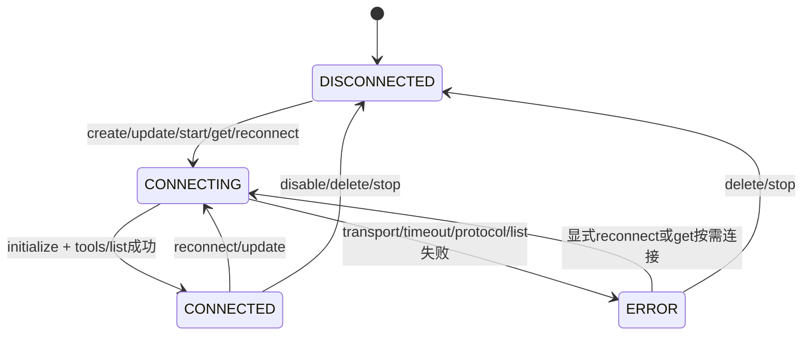
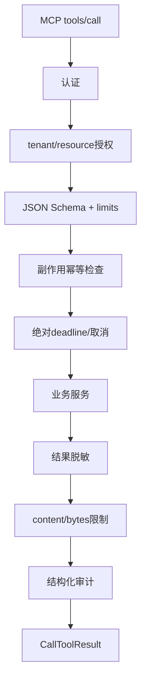

```
# T10 MCP 桥接、Transport、权限与同步：可复刻技术设计

> 目标：实现者不接触 Nova 源码，也能复刻一套从 MCP Server 管理、握手、工具发现、动态权限过滤到 Tool 调用的等价能力。
>
> 证据标签：`I` 已由当前静态实现确认；`A` 已有自动化测试契约；`K` 已登记 Known Failure；`P` 规划/旧测试清单，未证明；`R` 本次运行验证；`F` 静态强推断；`D` 推荐生产设计。本次未运行服务、构建或测试，因此没有新增 `R`。

## 1. 结论、业务边界与当前能力

### 1.1 模块解决的问题

MCP 桥接把一个外部 Model Context Protocol Server 暴露的工具转换为 Agent 可调用的本地 `Tool`。管理员或用户配置连接后，系统完成：

```text
定义持久化与密钥封存
→ transport 创建
→ initialize 协商
→ notifications/initialized
→ tools/list
→ 缓存连接与工具描述
→ 每次 Agent Run 按身份/项目动态物化 Tool overlay
→ capability installation + enable cascade + Tool Group/Agent Policy + maximum 收窄
→ tools/call
→ MCP result 翻译为 ToolResult
```

目标用户包括：

- 平台运维：用部署配置声明 SYSTEM Server。
- 租户管理员：管理 TENANT Server、连接、子工具开关和项目安装。
- 普通用户：管理 PERSONAL Server。
- 项目编辑者：安装平台/租户 MCP，或创建 PROJECT 私有 Server。
- Agent Runtime：只消费已经通过身份、安装和策略过滤的动态 Tool。

### 1.2 当前实现结论 `[I]`

- 实际支持 `stdio`、`sse`、`streamable_http` 三种 transport，使用官方 Java MCP SDK 1.1.1。
- SDK 客户端是同步客户端；握手顺序是 transport → SSE 专属预探测 → initialize → tools/list。
- Server 的协议版本、serverInfo、instructions 和工具清单来自握手结果；协议选择与 HTTP session header 由 SDK transport 管理，Nova 没有自建 Session Store。
- 工具不是静态写入全局 Registry。每个 Agent Run 都按 Identity、项目 runtime context 和当前连接快照动态构造 overlay。
- 外部名为 `mcp__<sanitized-server>__<sanitized-tool>`，最长 64 字符；过长时带确定性 hash 后缀。
- 同名 Server 的作用域 winner 为 PERSONAL > PROJECT > TENANT > SYSTEM；但“可见”不等于“已安装”，运行 maximum 还要验证 capability installation。
- 单个 Server 的所有 `tools/call` 用同一个同步客户端锁串行执行，避免 STDIO stdin 并发写失败；不同 Server 可并行。
- create/update 先持久化再连接。连接失败不会回滚定义，而是留下 `ERROR` 状态；test connection 不持久化。
- 没有周期 ping、断线自动重连、指数退避、工具列表变更订阅、连接租约或分布式 owner。

### 1.3 当前不能视为保证的能力

- `tools/listChanged`、resources、prompts、sampling、elicitation 和 roots 没有产品桥接 `[I/P]`。
- MCP Tool 输出只保留 `TextContent`；图片、音频、资源链接、embedded resource 和 structured content 会被忽略 `[I]`。
- 管理详情底层一度把所有 MCP 子工具写成 `enabled=true`；产品设置层会再按治理配置补齐，但插件裸 Facade 的 view 不能独立代表最终 enable 状态 `[I]`。
- `nova_auto_test` 的 31 个 MCP 用例只有设计文档，没有 YAML 登记，且部分文字仍描述旧 `mcp_` 命名/静态注册架构 `[P]`。
- `nova-test` 的历史场景也使用旧名称，不能作为当前 `mcp__...__...` 契约证据 `[P]`。

### 1.4 安全结论

当前实现有三个复刻时不得照搬为生产默认的边界：

1. 管理 API 可提交任意 STDIO `command/args/env`，会以 Nova 进程权限启动子进程；没有命令 allowlist、签名包或独立执行沙箱 `[I/F]`。
2. HTTP URL 只校验非空和 URI 可创建，没有 scheme、DNS、私网、metadata endpoint、重定向后地址或 DNS rebinding 防护 `[I/F]`。
3. Bearer 与自定义 Header 值会加密，但 STDIO `transportConfig.env` 不属于 authConfig，会明文入库并回显；UI 已登记 `NOVA-BUG-004 / MCP-17` `[K]`。

## 2. 参与者、分层与核心不变量

### 2.1 参与者

| 参与者 | 职责 | 不应承担 |
|---|---|---|
| Settings/Project Controller | 身份认证、scope 固定、HTTP DTO | 直接暴露 plugin DTO 或密钥明文 |
| Application Service | capability 同步、安装、mutation guard、异常翻译 | 实现 MCP wire protocol |
| MCP Admin Facade | 稳定的 app↔plugin 管理边界 | 绕过 Identity 授权 |
| Server Service | 校验、持久化、连接编排、mask | 全局 Tool 静态注册 |
| Server Store | SQL、scope identity、密钥 envelope | 连接和 Tool 调用 |
| Server Manager | client 生命周期、连接快照、winner、fingerprint | 持久化业务定义 |
| Transport Factory | STDIO/SSE/HTTP 创建、Header 注入、SSE probe | 安装和 Agent Policy |
| Tool Lookup Filter | 每 Run 动态物化可见 MCP Tool | 把可见误当安装 |
| Capability Resolver | installation 与 runtime maximum | 建立 MCP 连接 |
| MCP Tool Adapter | schema 适配、tools/call、结果翻译 | 修改 scope/maximum |
| MCP Server | initialize、tools/list、tools/call | 信任客户端传来的租户声明 |

### 2.2 总体架构

```mermaid
flowchart LR
    UI["Settings / Project UI"] --> API["Product REST API"]
    API --> APP["MCP Application Service"]
    APP --> FACADE["Late-bound Admin Facade"]
    FACADE --> SERVICE["MCP Server Service"]
    SERVICE --> DB[("mcp_server_definition")]
    SERVICE --> MANAGER["MCP Server Manager"]
    MANAGER --> TRANSPORT["STDIO / SSE / Streamable HTTP"]
    TRANSPORT --> REMOTE["External MCP Server"]
    MANAGER --> SNAP["Immutable Connection Snapshot"]
    SNAP --> FILTER["Per-run Tool Lookup Filter"]
    FILTER --> ENABLE["user → tenant → global enable"]
    ENABLE --> CAP["Capability Installation"]
    CAP --> GROUP["Tool Group / Agent Policy"]
    GROUP --> MAX["Agent maximum"]
    MAX --> ADAPTER["MCP Tool Adapter"]
    ADAPTER --> REMOTE
```



### 2.3 核心不变量

1. HTTP body 不得携带可信 tenantId/userId；身份来自认证上下文。
2. SYSTEM 只从部署配置同步，UI 不可创建、更新或删除。
3. PERSONAL 必须同时匹配 tenant+user；TENANT/PROJECT 写操作必须管理员或项目编辑授权。
4. `visible ∩ connected ∩ installed ∩ enabled ∩ policy ∩ maximum` 才是可执行集合。
5. Tool 对外名与 `tools/call.params.name` 分离：LLM 使用 external name，Server 收到 raw name。
6. reconnect 必须改变 source fingerprint，使冻结的 policy snapshot 能识别执行源漂移。
7. 密钥只在连接建立瞬间解密；REST、日志和持久化 view 不得出现明文。
8. 单个 Server 的 client 生命周期变更必须串行；读者只能看到完整旧快照或完整新快照。

## 3. Server 定义、配置与校验契约

### 3.1 产品请求 Schema

Settings 和 Project 入口最终归一成以下对象；scope/projectId 由服务器端管理上下文补入：

```typescript
interface McpServerRequest {
  name: string;                         // create必填；[A-Za-z0-9_]{1,64}
  description?: string;
  transport: "stdio" | "sse" | "streamable_http";
  transportConfig: StdioConfig | HttpConfig;
  authType?: "NONE" | "HEADER";        // 默认NONE
  authConfig?: HeaderAuthConfig;
  timeoutSeconds?: number;              // 默认30；服务端范围1..300
  enabled?: boolean;                    // 默认true
}

interface StdioConfig {
  command: string;                      // 非空
  args?: string[];
  env?: Record<string, string>;
}

interface HttpConfig {
  url: string;                          // 当前只校验非空
}

interface HeaderAuthConfig {
  bearerToken?: string;
  headers?: Record<string, string>;
}
```

`HEADER` 至少要有一个非空 bearerToken，或一个 key/value 均非空的自定义 Header。`NONE` 会把 auth_config 清空，避免旧密钥残留。服务端 timeout 接受 1～300；UI 期望 5～300，但当前非法值校验存在 `NOVA-BUG-002 / MCP-09`，两层契约不一致 `[I/K]`。

### 3.2 示例

Streamable HTTP：

```json
{
  "name": "context7",
  "description": "Documentation lookup",
  "transport": "streamable_http",
  "transportConfig": {"url": "https://example.test/mcp"},
  "authType": "HEADER",
  "authConfig": {
    "bearerToken": "secret-token",
    "headers": {"X-Workspace": "tenant-a"}
  },
  "timeoutSeconds": 30,
  "enabled": true
}
```

STDIO：

```json
{
  "name": "filesystem",
  "transport": "stdio",
  "transportConfig": {
    "command": "/usr/local/bin/npx",
    "args": ["-y", "@modelcontextprotocol/server-filesystem", "/srv/allowed"],
    "env": {"LOG_LEVEL": "warn"}
  },
  "authType": "NONE",
  "timeoutSeconds": 60,
  "enabled": true
}
```

### 3.3 SYSTEM YAML

```yaml
nova:
  mcp:
    enabled: true   # false会把SYSTEM配置解析为空；启动sync随后删除DB中全部SYSTEM行
    servers:
      filesystem:
        enabled: true
        transport: stdio
        command: /usr/local/bin/npx
        args: ["-y", "@modelcontextprotocol/server-filesystem", "/srv/allowed"]
        env: {LOG_LEVEL: warn}
        timeout-seconds: 60
      docs:
        transport: streamable_http
        url: https://example.test/mcp
        timeout-seconds: 30
```

SYSTEM 配置只支持无认证；每次启动按 name 与 DB 对账：配置内 upsert 并保留已有 serverId，DB 中已经不在配置的 SYSTEM 行会断连并删除。配置重复 name 取第一个。`init()` 只解析，`start()` 才迁移数据库和联网。

`nova.mcp.enabled=false` 不是“只停止本次自动加载”。当前解析器返回空 SYSTEM 列表，而 `start()` 仍调用全量 sync；sync 会把现存 SYSTEM DB 行全部视为 stale，逐个断连并删除。TENANT/PERSONAL/PROJECT 行不在 `listSystem()` 中，不会被此步骤删除。复刻时必须把这个破坏性配置语义写进变更说明与回滚预案；若期望“暂停但保留”，应另增 `reconcile-enabled` 开关而不是复用当前字段 `[I/REQ/F]`。

## 4. Transport 与 MCP Wire 契约

### 4.1 三种实际 Transport

| Transport | 当前配置 | 连接行为 | 特殊边界 |
|---|---|---|---|
| STDIO | command、args、env | SDK 用 ProcessBuilder 启子进程，stdin/stdout 逐行 JSON-RPC | stderr 写 warn 日志；无 shell，但 command 仍可任意执行 |
| SSE | url | 先 GET probe，再构建 SDK SSE transport | probe 5s；read timeout 视为可达；405 判 transport 错误 |
| STREAMABLE_HTTP | url | 直接构建 SDK streamable HTTP transport | 无独立 preflight |

HTTP transport 显式使用 no-proxy client，auth headers 与 host-wide outbound request decoration 会注入 SDK 请求。SSE probe 使用独立 `HttpClient`，携带 auth headers；它不会复用 SDK 会话。

### 4.2 Header 规则

```text
if authType == HEADER:
  if bearerToken nonblank:
    headers["Authorization"] = "Bearer " + bearerToken
  for custom header where key nonblank:
    headers[key] = string(value)
```

自定义 `Authorization` 会覆盖 bearer 生成值，因为最后写入同一 Map key。空 Header key 丢弃；空 value 在 transport helper 可穿透，但管理校验要求用于满足 HEADER 必填的条目必须非空。生产实现应拒绝 Host、Content-Length、Connection、Transfer-Encoding、Mcp-Session-Id 等 hop/session headers，并明确 Authorization 冲突策略 `[D]`。

### 4.3 JSON-RPC 握手

Nova 自身不手写 request id 和 session，以下是协议等价 wire；实际 framing 由 SDK transport 决定：

```json
{"jsonrpc":"2.0","id":"<uuid>-0","method":"initialize","params":{"protocolVersion":"<client-version>","capabilities":{},"clientInfo":{"name":"...","version":"..."}}}
```

```json
{"jsonrpc":"2.0","id":"<same>","result":{"protocolVersion":"2024-11-05","capabilities":{"tools":{}},"serverInfo":{"name":"fake","version":"0.0.1"},"instructions":"optional"}}
```

```json
{"jsonrpc":"2.0","method":"notifications/initialized"}
```

```json
{"jsonrpc":"2.0","id":"<uuid>-1","method":"tools/list","params":{}}
```

```json
{"jsonrpc":"2.0","id":"<same>","result":{"tools":[{"name":"echo","description":"echoes input.text","inputSchema":{"type":"object","properties":{"text":{"type":"string"}}}}]}}
```

测试 Stub 的关键规则是 response `id` 必须原样回显 JSON node；把 SDK 的字符串 ID 转数字会导致请求无法匹配并最终超时。

### 4.4 协议协商与 Session

- `initialize()` 的 server-selected `protocolVersion` 被缓存并写入 DB metadata。
- Server `instructions` 会在连接成功后覆盖空/原 description；这导致重连覆盖用户 description 的 `NOVA-BUG-003 / MCP-13` `[K]`。
- Streamable HTTP 的 `Mcp-Session-Id`、SSE endpoint 路由、DELETE session 等由 SDK transport 管理；Nova 没有 sessionId 字段、恢复 API 或持久化 session。
- 客户端不检查 Server 是否声明 tools capability 后再 list；交由 SDK/Server 报错。
- 没有 pagination cursor 循环的产品代码；一次 `client.listTools().tools()` 被视为完整清单。若 SDK 不自动分页，后续页会遗漏 `[F]`。

## 5. 连接、状态机、缓存与生命周期

### 5.1 状态机



`CONNECTING` 没有公开枚举，只是同步调用期间的瞬时态。公开状态只有 CONNECTED、DISCONNECTED、ERROR。

### 5.2 不可变快照

每个 serverId 在内存保存：

```typescript
interface ConnectedServerSnapshot {
  client?: McpSyncClient;
  meta: {serverId:string; serverName:string; scope:string; tenantId?:string; userId?:string; projectId?:string};
  tools: McpToolDefinition[];
  status: {status:"CONNECTED"|"ERROR"; toolCount:number; errorMessage?:string};
  connectResult: {success:boolean; protocolVersion?:string; serverInfoJson?:string; description?:string; tools:ToolInfo[]; errorMessage?:string};
  connectionRevision: number;
}
```

`ConcurrentHashMap<serverId,snapshot>` 保证读者看到完整快照。每 serverId 的 `ReentrantLock` 串行 connect/disconnect/reconnect；lock entry 在单 server disconnect 后保留，避免与并发 reconnect 竞态。`closeAll()` 清快照和 lock。

### 5.3 连接算法

```text
connect(param):
  lock(serverId)
  close and remove old snapshot
  revision = globalSequence.increment()
  try:
    transport = createTransport(param)
    if SSE: probe(url, authHeaders)
    client = syncClient(
      requestTimeout=max(timeoutSeconds,120s),
      initializationTimeout=timeoutSeconds)
    init = client.initialize()
    tools = client.listTools().tools()
    atomically put CONNECTED(client, tools, init, revision)
    return success
  catch exception:
    atomically put ERROR(no client, empty tools, safeError, revision)
    return failure
  finally unlock
```

注意：失败连接在 transport/client 已部分创建而 initialize 失败时，当前 `doConnect` 没有显式关闭局部 client，因为 client 变量封装在 handshake 成功返回后才可见；存在资源释放缺口 `[F]`。test connection 的 client 在 finally 关闭。

### 5.4 启动与懒连接

- SYSTEM：启动时最多 16 线程并行连接全部 enabled Server，等待全部 settled。
- TENANT/PERSONAL：某用户首次访问时用公共 `CompletableFuture` 异步触发；JVM 生命周期内 `tenant:user` 只初始化一次。第一次失败后不会因普通访问自动再试。
- PROJECT：首次项目装配时同步连接 enabled PROJECT Server；`tenant:project` 只初始化一次。
- `getById`：enabled 且当前非 CONNECTED 时同步连接。
- update：写 DB → disconnect → enabled 时 connect。
- delete：disconnect → delete DB。
- stop：关闭全部 client、清缓存、解除 Admin Facade；transport probe client 在 Java 17 无 close API，依赖 GC。

## 6. 管理 CRUD、测试连接、密钥封存与回显

### 6.1 完整执行链

```mermaid
sequenceDiagram
    participant U as Operator
    participant C as REST Controller
    participant A as Application Service
    participant G as Mutation Guard
    participant F as Plugin Admin Facade
    participant S as Server Service
    participant DB as Store
    participant M as Manager
    participant X as MCP Server

    U->>C: create/update/test/reconnect/delete
    C->>C: authentication + scope authorization
    C->>A: app-owned DTO + trusted context
    A->>G: validate affected runtime tools
    A->>F: Identity + request
    F->>S: normalized params
    alt test
      S->>M: testConnection(ephemeral)
      M->>X: initialize + tools/list
      M-->>S: result; client closed
    else create/update
      S->>DB: seal auth + upsert
      S->>M: connect/reconnect if enabled
      M->>X: initialize + tools/list
      M-->>S: CONNECTED or ERROR
      S->>DB: success时写protocol/serverInfo/instructions
      A->>A: sync capability / project installation
    else delete
      S->>M: disconnect
      S->>DB: delete definition
      A->>A: retire capability/install/extension
    end
    A-->>C: masked view
    C-->>U: HTTP response
```

### 6.2 test、connect、reconnect 的差异

| 操作 | 保存定义 | 改 Manager 状态 | 关闭测试 client | 失败语义 |
|---|---:|---:|---:|---|
| raw test | 否 | 否 | 是 | HTTP 200 内 success=false 或输入400 |
| stored test | 否 | 否 | 是 | 同上，使用已封存密钥 |
| create/update | 是 | 是 | 长连接保留 | 定义保留，status=ERROR |
| reconnect | 否 | 替换快照 | 旧 client 先关 | disabled 时400；连接失败返回ERROR view |

### 6.3 当前 Settings 授权与副作用缺口

Controller 只对请求参数 `scope=TENANT` 做租户管理员检查；它没有把该 scope 传给 stored test。插件按 Identity 可加载 SYSTEM、同租户 TENANT 和本人 PERSONAL 定义，因此普通同租户用户只要知道 serverId，就可能读取/使用其已封存认证信息发起连接探测：

| 路径 | Controller 前置 | 实际顺序 | 风险 |
|---|---|---|---|
| `POST /tools/{id}/test` | 登录；没有 tenant-admin/scope guard | 直接按 Identity 加载存量定义并 ephemeral connect | 普通同租户用户可测试 TENANT；也可测试 SYSTEM |
| `GET /tools/{id}?scope=USER` | USER 不要求管理员 | plugin get；enabled 且未连接时先懒连接；之后 ToolManager 才验证 Settings scope | 知道 TENANT/SYSTEM id 可先触发连接，再得到 404 |
| `POST /tools/{id}/reconnect?scope=USER` | USER 不要求管理员 | 先 reconnect/关闭旧连接并重连；之后才验证 Settings scope | 知道 TENANT/SYSTEM id 可造成连接副作用，再得到 404 |

这是同租户越权和资源探测面，不应被“最终返回 404”掩盖 `[K/F]`。生产修复顺序必须是：先用无副作用 metadata lookup 取得 owner/scope → 对 SYSTEM 禁止 Settings mutation、对 TENANT 要求 tenant admin、对 PERSONAL 要求 owner → 再解封密钥或连接。stored test 也必须纳入 mutation/operation guard，并记录审计；不能把“只测试不保存”当成无害操作 `[D]`。

### 6.4 密钥 envelope

DB 的 `auth_config` 是：

```json
{
  "type": "HEADER",
  "config": {
    "bearerToken": {"<runtime-crypto-envelope>": "..."},
    "headers": {
      "X-Api-Key": {"<runtime-crypto-envelope>": "..."}
    }
  }
}
```

Header 名保留明文，bearerToken 与每个 Header value 单独加密。更新规则：

- 提交 `****` 或包含 `****` 的 partial mask → 保留旧值。
- 提交真实值 → 覆盖并重新封存。
- 缺失字段 → 删除该字段。
- authType 切到 NONE → 整个 auth_config 置 null。

当前 MCP plugin 要区分“掩码函数”与“response mapper 的调用 guard” `[I]`：`partialMask(value)` 本身对 `null`、空字符串和长度 1..8 都返回 `****`，长度 >8 返回 `前4位 + **** + 后4位`。但 bearer 字段只有在值是 **non-blank String** 时才调用该函数，所以 bearer 长度 >8 部分显示、长度 1..8 显示 `****`，空字符串保持原样 `""`；custom headers 的每个 value 无条件调用，因而 null、空和长度 ≤8 都显示 `****`，长度 >8 部分显示。只有整个 `auth_config` 缺失/blank 时 response mapper 返回 null。连接前才解封成 plaintext。与此并存的产品通用 `ConfigSecretSealer.maskForOutput` 契约是“非空 secret 永远 `****`、空 secret 返回 `""`”；MCP 当前没有使用该通用回显语义，而是 plugin-local partial mask `[I/K]`。

若复刻以最小泄露为目标，应统一为通用契约：非空 bearer/header value 一律 `****`，空值为 `""`。无论采用当前 partial mask 还是推荐 full mask，更新提交的值只要包含 `****` 就表示“保留相同字段旧值”；真实值覆盖；字段缺失删除。当前 contains 判定意味着真实新密钥含 `****` 时无法设置 `[D/F]`。

### 6.5 当前密钥缺口

- `transport_config` 完整明文持久化；STDIO env 即使 key 含 TOKEN/SECRET/PASSWORD 也不封存、不 mask `[K]`。
- SYSTEM YAML 的 env 本身也必须由部署 Secret 注入，而不是写入仓库 `[D]`。
- 错误和 stderr 可能由第三方进程自行打印密钥；当前 stderr 原样进入 warn 日志 `[F]`。
- `looksMasked` 以“字符串包含 `****`”判断 unchanged，真实新密钥若包含该字面量会被误判 `[I/F]`。

## 7. 持久化与生产数据模型

### 7.1 当前 MCP 表 `[I]`

```sql
CREATE TABLE mcp_server_definition (
  id BIGINT GENERATED BY DEFAULT AS IDENTITY PRIMARY KEY,
  server_id VARCHAR(64) NOT NULL UNIQUE,
  name VARCHAR(255) NOT NULL,
  description TEXT,
  scope VARCHAR(32) NOT NULL,
  tenant_id VARCHAR(255),
  user_id VARCHAR(255),
  transport_config TEXT NOT NULL,
  auth_config TEXT,
  timeout_seconds INTEGER NOT NULL DEFAULT 30,
  enabled BOOLEAN NOT NULL DEFAULT TRUE,
  protocol_version VARCHAR(32),
  server_info TEXT,
  created_at TIMESTAMP NOT NULL,
  updated_at TIMESTAMP,
  project_id VARCHAR(64),
  capability_id VARCHAR(64),
  UNIQUE(scope, tenant_id, user_id, name)
);
CREATE INDEX idx_mcp_server_def_scope_tenant_user
  ON mcp_server_definition(scope, tenant_id, user_id);
CREATE INDEX idx_mcp_server_def_project
  ON mcp_server_definition(tenant_id, project_id);
CREATE INDEX idx_mcp_server_def_capability
  ON mcp_server_definition(capability_id);
```

`transport_config` 和 `auth_config` 都是 `{type,config}` JSON envelope；应用 Map 解包后再使用。当前 DDL 没有 scope/owner CHECK、project owner unique、capability FK、JSON 类型、version 或 optimistic lock。

### 7.2 能力表 `[I]`

```sql
CREATE TABLE capability_asset (
  capability_id VARCHAR(64) PRIMARY KEY,
  tenant_id VARCHAR(64),
  kind VARCHAR(32) NOT NULL,              -- MCP_SERVER
  logical_name VARCHAR(255) NOT NULL,
  runtime_name VARCHAR(255),
  display_name VARCHAR(255),
  display_description VARCHAR(1000),
  ownership_scope VARCHAR(32) NOT NULL,   -- PLATFORM/TENANT/PROJECT/USER
  owner_ref_id VARCHAR(64),
  source_type VARCHAR(32) NOT NULL,       -- MCP
  source_ref VARCHAR(255) NOT NULL,       -- server_id
  status VARCHAR(32) NOT NULL DEFAULT 'ACTIVE',
  version BIGINT DEFAULT 1,
  created_by VARCHAR(64),
  created_at TIMESTAMP NOT NULL,
  updated_at TIMESTAMP NOT NULL,
  deleted_at TIMESTAMP,
  UNIQUE(kind, source_type, source_ref)
);
CREATE INDEX idx_capability_asset_ownership
  ON capability_asset(ownership_scope, owner_ref_id, status);
CREATE INDEX idx_capability_asset_tenant_kind
  ON capability_asset(tenant_id, kind, status);
CREATE UNIQUE INDEX uk_capability_asset_runtime_name
  ON capability_asset(tenant_id, kind, runtime_name);

CREATE TABLE capability_installation (
  id BIGINT GENERATED BY DEFAULT AS IDENTITY PRIMARY KEY,
  tenant_id VARCHAR(64) NOT NULL,
  capability_id VARCHAR(64) NOT NULL REFERENCES capability_asset(capability_id),
  scope_type VARCHAR(32) NOT NULL,         -- TENANT/PROJECT/USER
  scope_id VARCHAR(64) NOT NULL,
  enabled BOOLEAN NOT NULL DEFAULT TRUE,
  installed_by VARCHAR(64),
  installed_at TIMESTAMP NOT NULL,
  updated_at TIMESTAMP NOT NULL,
  UNIQUE(tenant_id, capability_id, scope_type, scope_id)
);
CREATE INDEX idx_capability_installation_scope
  ON capability_installation(tenant_id, scope_type, scope_id, enabled);
CREATE INDEX idx_capability_installation_capability
  ON capability_installation(tenant_id, capability_id, enabled);
```

当前枚举 wire：`kind=TOOL|MCP_SERVER|SKILL|KNOWLEDGE`，`ownership_scope=PLATFORM|TENANT|PROJECT|USER`，`source_type=BUILTIN|PLUGIN|MCP|UPLOAD`，`status=ACTIVE|DISABLED|WITHDRAWN|DELETED`，installation `scope_type=TENANT|PROJECT|USER`。`runtime_name` 是后续 migration 增列；PostgreSQL 的 tenant_id null 使 platform runtime unique 不受该索引约束，平台唯一仍依赖 Registry 注册期检查 `[I/K]`。

### 7.3 推荐生产扩展 `[D]`

```sql
ALTER TABLE mcp_server_definition ADD COLUMN definition_version BIGINT NOT NULL DEFAULT 1;
ALTER TABLE mcp_server_definition ADD COLUMN secret_version VARCHAR(64);
ALTER TABLE mcp_server_definition ADD COLUMN last_connect_at TIMESTAMP;
ALTER TABLE mcp_server_definition ADD COLUMN last_success_at TIMESTAMP;
ALTER TABLE mcp_server_definition ADD COLUMN last_error_code VARCHAR(64);
ALTER TABLE mcp_server_definition ADD COLUMN last_error_safe TEXT;
ALTER TABLE mcp_server_definition ADD COLUMN tool_catalog_digest VARCHAR(64);

CREATE TABLE mcp_connection_outbox (
  event_id VARCHAR(64) PRIMARY KEY,
  server_id VARCHAR(64) NOT NULL,
  definition_version BIGINT NOT NULL,
  operation VARCHAR(16) NOT NULL CHECK (operation IN ('CONNECT','DISCONNECT','DELETE')),
  status VARCHAR(16) NOT NULL,
  attempt INTEGER NOT NULL DEFAULT 0,
  next_attempt_at TIMESTAMP,
  created_at TIMESTAMP NOT NULL,
  UNIQUE(server_id, definition_version, operation)
);

CREATE TABLE mcp_tool_catalog (
  server_id VARCHAR(64) NOT NULL,
  connection_revision BIGINT NOT NULL,
  raw_name VARCHAR(255) NOT NULL,
  external_name VARCHAR(64) NOT NULL,
  schema_json TEXT NOT NULL,
  description TEXT,
  digest VARCHAR(64) NOT NULL,
  PRIMARY KEY(server_id, connection_revision, raw_name)
);
```

生产唯一约束应使用显式 `owner_key`，避免 SQL NULL 唯一语义差异：`UNIQUE(scope, owner_key, name)`。

### 7.4 应用事务与 plugin JDBC 的非原子边界 `[I/K/F]`

产品 Application Service 的 create/update/delete/project 方法虽标注 Spring `@Transactional`，但 MCP plugin store 自己从 DataSource 取 JDBC connection 并提交；它不自动加入产品 capability/project repository 的同一事务。网络 connect/disconnect 更不可能由数据库回滚。因此“方法有 Transactional”不等于定义、capability、installation、project version 与连接状态原子。

| 操作与故障点 | plugin 定义/连接 | 产品库 | 可见 orphan |
|---|---|---|---|
| create：plugin 已创建，capability sync 失败 | 定义已提交，可能已连接 | capability/installation 回滚或缺失 | 可列出 MCP，但 runtime maximum 无 capability |
| PROJECT create：capability 成功，install/bump 失败 | PROJECT 定义存在 | asset 可能回滚；installation 缺失 | 项目私有定义无安装，或 source_ref 悬空 |
| update：plugin 已更新/重连，asset update 失败 | 新连接和定义已生效 | capability display/version 仍旧 | 管理面与运行 source fingerprint 漂移 |
| delete：先卸载/退役部分产品记录，plugin delete 失败 | 定义/连接仍存在 | installation/asset 已变化 | 活连接无可执行安装，或下次 backfill 复活 |
| delete：plugin 已删，后续 extension/asset cleanup 失败 | 定义消失、已断连 | active capability/source binding 残留 | resolver 指向不存在 serverId |
| reconnect | 没有 DB 事务；旧 client 已关闭 | 无对应产品事务 | 失败后只剩 ERROR/无连接 |

启动 backfill/sync 只能覆盖一部分 orphan：它可能由现存 server 重建 capability，但不会自动知道失败操作的原始意图，也不能保证删除型 orphan 被清理。生产复刻必须提供可重复 reconciliation：按 `source_type=MCP, source_ref=serverId` 双向比对 definition/asset/installation/extension，缺定义的 active asset 退役，缺 asset 的有效 definition 补建，owner/scope 不一致 fail closed 并告警 `[REQ]`。

推荐 outbox/saga：plugin 定义变更与 `mcp_definition_outbox` 在同一 plugin JDBC 事务提交；产品消费者以 `(serverId,definitionVersion,eventType)` 幂等同步 capability/install，并写 completion。删除先写 tombstone，maximum 立即排除，再异步断连和清理。网络连接是可重试 projection，不作为业务事务提交条件。只有 reconciliation watermark 追上 outbox 才把管理状态标为 CONSISTENT `[D]`。

## 8. Tool 发现、命名、Schema、动态同步与 fingerprint

### 8.1 命名算法

```text
sanitize(x) = replace every char outside [A-Za-z0-9_-] with "_"
raw = "mcp__" + sanitize(serverName) + "__" + sanitize(rawToolName)
if length(raw) <= 64: externalName = raw
else:
  hash = base36(nonNegative(javaStringHash(raw)))
  externalName = "mcp__" + keptPrefix + "_" + hash
```

例：`Context 7 / resolve-library` → `mcp__Context_7__resolve-library`。

碰撞风险：不同原名可 sanitize 成同一名；32-bit Java hash 也不是防碰撞标识。当前同一 overlay 中后写者覆盖，跨 source 冲突在产品 effective resolver 会根据 source capability/fingerprint fail closed。生产设计应采用 canonical ID 或至少 128-bit digest，并在连接时拒绝 collision `[D]`。

### 8.2 Schema 适配

MCP `inputSchema` 经 Jackson 转为 Nova Tool parameters Map；转换失败时退化为空 Schema 并记录 warn。执行时所有以 `_` 开头的内部参数会剥离，再发送原始 arguments。

```typescript
NovaToolDefinition = {
  name: externalName,
  description: `${rawName} [MCP:${serverName}] ${mcpDescription ?? ""}`,
  parameters: convert(inputSchema) ?? {},
  category: "MCP"
}
```

### 8.3 动态 overlay

```text
filter(identity, base, runtimeContext):
  scope = resolveIdentity(identity)
  projectId = runtimeContext["nova.project.id"] if string
  winners = visibleConnectedServers(scope, projectId)
  overlay = []
  for server in winners:
    for tool in cached server.tools:
      external = normalize(server.name, tool.name)
      if enabledCascade(identity, external):
        overlay += Adapter(server.client, tool, fingerprint)
  return overlay empty ? base : Composite(base, overlay)
```

Overlay 的 `get(name)` 优先 MCP，`all()` 是 base 后接 overlay。整个物化异常时记录 warn 并返回 base，因此 MCP 层 fail-soft，不会中断 Agent Run。

### 8.4 Source fingerprint

当前连接 binding fingerprint：

```text
mcp|serverId|scope|tenantId|userId|projectId|connectionRevision|externalName
```

每次 connect 尝试 revision 都递增，包括失败。proposal 检查使用 `proposed` 固定段。fingerprint 让同名 runtime Tool 在重连或 owner 变化后不再被误认为同一执行源。

### 8.5 同步缺口

- 工具清单只在 connect 时 `tools/list` 一次；没有 TTL、主动 refresh、listChanged notification 或 schema digest 对账。
- Server 掉线后 manager 未必立即知道，旧 Tool 仍会被物化，直到 call 失败或显式 reconnect。
- 删除/disable 会及时 disconnect 并使 overlay 消失。
- 多节点部署各有独立连接和 revision；DB 更新没有广播/owner election，节点间可能暂时暴露不同 catalog `[F]`。

## 9. Scope、安装、开关、Tool Group 与 maximum

### 9.1 可见性 winner

| Scope | owner 条件 | 使用场景 | priority |
|---|---|---|---:|
| PERSONAL | 同 tenant+user | 用户扩展 | 1 |
| PROJECT | 同 tenant+project 且 runtimeContext 有 projectId | 项目私有 | 2 |
| TENANT | 同 tenant | 租户供给 | 3 |
| SYSTEM | 全局 | 平台供给 | 4 |

按 Server name 分组，最小 priority 胜出。低优先级同名 Server 的所有 Tool 都隐藏，而不是逐 Tool 合并。

### 9.2 enable cascade

每个 external Tool 使用配置 key：

```text
tool:<externalName>:enabled
```

解析顺序 USER → TENANT → GLOBAL，第一个 Boolean 胜出，全部未配置默认 true。管理写入同时更新新的 `capability_scope_denial` 治理源和旧 ConfigStore projection，处于兼容窗口。

### 9.3 installation 不是 visibility

连接 Manager 会返回身份可见的所有 winner；Capability Resolver 另外读取 enabled installations：

```text
installedCapabilities = TENANT installation
                      ∪ PROJECT installation (project scene only)
                      ∪ USER installation

allowedMcpBindings = visibleMcpBindings
                   filtered by binding.serverId belongs to installed MCP capability
```

PLATFORM ownership只表示供给池，不自动可执行。Personal Server 也必须有 USER installation 才进入 runtime maximum；创建流程负责 capability 同步和相应安装。

### 9.4 Tool Group、Agent Policy 和 maximum

正确顺序为：

```text
global/base ToolLookup
→ MCP per-identity overlay
→ installed capability available set
→ system Tool Group defaults
→ project/user group extension
→ Agent policy
→ AgentSpec.allowedToolIds hard maximum
```

MCP filter 本身不读取 Tool Group/Agent Policy。这样才能保证“连接可见”不会绕过正式能力安装，也不会因 plugin 自行注入而扩大 maximum。

同一 runtime name 若对应不同 capabilityId 或 fingerprint，effective resolver 抛 `RUNTIME_TOOL_SOURCE_CONFLICT`，fail closed。mutation guard 在删除、禁用、改连接/工具名之前用 proposed source 预演，防止破坏 mandatory 或正在被 Group 引用的能力。

## 10. Tool 调用、并发、结果与错误翻译

### 10.1 `tools/call` wire

```json
{"jsonrpc":"2.0","id":"<uuid>-2","method":"tools/call","params":{"name":"echo","arguments":{"text":"hello"}}}
```

```json
{"jsonrpc":"2.0","id":"<same>","result":{"content":[{"type":"text","text":"echo:hello"}],"isError":false}}
```

Agent 看到的是 `mcp__fake__echo`，Server 收到的仍是 `echo`。

### 10.2 执行伪码

```text
execute(arguments, toolContext):
  clean = remove keys starting "_"
  try:
    synchronized(serverClient):
      result = client.callTool(rawToolName, clean)
    text = join("\n", result.content where type == TextContent)
    if result.isError == true:
      return ToolResult.error("MCP tool <raw> failed: " + text)
    return ToolResult.ok(text, retention=CONDENSABLE)
  catch exception:
    log exception
    return ToolResult.error("MCP tool <raw> call failed: " + exception.message)
```

### 10.3 并发与顺序

- 同一 McpSyncClient 上所有 calls 串行，因此一个慢调用会 head-of-line block 该 Server 的其它工具。
- 不同 Server 使用不同 client lock，可被父 Tool Executor 并发调用。
- connect/disconnect 使用 serverId lock，但 `callTool` 锁 client 对象；reconnect 可以先 close 旧 client，而一个调用仍在旧 client lock 上，二者没有共同锁，存在 close-vs-call 竞态 `[F]`。
- 没有 per-server queue 上限、tenant 并发额度、circuit breaker 或 bulkhead。

### 10.4 内容损失边界

只拼接 TextContent。若 Server 只返回 image/resource/structuredContent，当前成功结果可能是空字符串；这不等价于没有结果。生产 Adapter 应保留 MCP content union，转换成 Nova Artifact/Resource Link，并设置字节、MIME、数量和引用权限上限 `[D]`。

## 11. 对外 REST API 与响应契约

### 11.1 Settings API `[I]`

Settings 把 MCP 统一建模为 Tool，路径不是 `/mcp`：

| Method | Path | 语义 |
|---|---|---|
| GET | `/api/settings/tools?scope=USER|TENANT` | 列表；TENANT需管理员 |
| GET | `/api/settings/tools/{serverId}?scope=...` | MCP详情、masked auth、tools |
| POST | `/api/settings/tools` | 创建 MCP，201 |
| PUT | `/api/settings/tools/{serverId}` | 更新，name/scope不可变 |
| DELETE | `/api/settings/tools/{serverId}` | 删除，204 |
| POST | `/api/settings/tools/test` | raw config测试 |
| POST | `/api/settings/tools/{serverId}/test` | stored config测试 |
| POST | `/api/settings/tools/{serverId}/reconnect?scope=...` | 重连 |
| PUT | `/api/settings/tools/{serverId}/items/{rawToolName}?scope=...` | 子工具 enable |

Settings create wrapper：

```json
{
  "type": "MCP",
  "name": "context7",
  "description": "docs",
  "scope": "TENANT",
  "enabled": true,
  "mcp": {
    "transport": "streamable_http",
    "transportConfig": {"url": "https://example.test/mcp"},
    "authType": "HEADER",
    "authConfig": {"bearerToken": "secret"},
    "timeoutSeconds": 30
  }
}
```

Settings 列表 wire 与详情 wire 是两个不同 DTO，不能用 plugin `McpServerResponse` 代替：

```json
{
  "items": [
    {
      "id": "server-uuid",
      "type": "MCP",
      "name": "context7",
      "description": "docs",
      "scope": "TENANT",
      "toolCount": 2,
      "status": "CONNECTED",
      "transport": "streamable_http"
    }
  ],
  "total": 1
}
```

```json
{
  "effectiveStateSchemaVersion": 2,
  "id": "server-uuid",
  "type": "MCP",
  "name": "context7",
  "description": "docs",
  "scope": "TENANT",
  "toolCount": 1,
  "tools": [
    {
      "name": "resolve-library",
      "runtimeName": "mcp__context7__resolve-library",
      "capabilityId": "cap_mcp_tool_...",
      "description": "Resolve a library",
      "category": "MCP",
      "enabled": true,
      "configInherited": false,
      "configParams": null,
      "configValues": null,
      "availability": {
        "installedAtScope": true,
        "effectiveAvailable": true,
        "inherited": false,
        "sources": ["TENANT_INSTALLATION"]
      },
      "defaultBinding": null,
      "governance": {
        "readOnly": false,
        "allowedActions": ["UNINSTALL", "EDIT_DEFINITION"],
        "readOnlyReasons": []
      }
    }
  ],
  "createdAt": "2026-08-13T10:00:00",
  "updatedAt": "2026-08-13T10:01:00",
  "mcpInfo": {
    "transport": "streamable_http",
    "transportConfig": {"url": "https://example.test/mcp"},
    "authType": "HEADER",
    "authConfig": {"bearerToken": "secr****cret"},
    "timeoutSeconds": 30,
    "enabled": true,
    "status": "CONNECTED",
    "errorMessage": null,
    "protocolVersion": "2024-11-05",
    "serverInfo": {"name": "remote", "version": "1.0.0"}
  }
}
```

`effectiveStateSchemaVersion` 默认取当前 effective capability schema 版本；客户端必须先识别版本再解释 `availability/defaultBinding/governance`，不能只看 legacy `enabled`。上例中的 effective 子对象只展示关键字段，实际 wire 由统一 capability view schema 约束，未知字段应向前兼容保留。MCP 的 `configParams/configValues` 通常 null；内置工具才使用这两个字段 `[I]`。

### 11.2 Project API `[I]`

| Method | Path | 语义 |
|---|---|---|
| GET | `/api/v1/projects/{projectId}/mcp` | 平台/租户供给池与安装状态 |
| GET | `/api/v1/projects/{projectId}/mcp/{capabilityId}/detail` | 详情 |
| POST | `/api/v1/projects/{projectId}/mcp/install` | 安装 `{capabilityId}` |
| DELETE | `/api/v1/projects/{projectId}/mcp/{capabilityId}` | 卸载，不删定义 |
| POST | `/api/v1/projects/{projectId}/mcp` | 创建 PROJECT 私有并安装 |
| POST | `/api/v1/projects/{projectId}/mcp/test` | raw测试 |
| POST | `/api/v1/projects/{projectId}/mcp/{capabilityId}/test` | stored测试 |
| POST | `/api/v1/projects/{projectId}/mcp/{capabilityId}/reconnect` | 重连 |
| PUT | `/api/v1/projects/{projectId}/mcp/{capabilityId}` | 更新私有定义 |
| DELETE | `/api/v1/projects/{projectId}/mcp/{capabilityId}/definition` | 卸载并永久删除私有定义 |

Project 供给池不是 Settings `ToolListResponse`。其独立 wire 为：

```json
{
  "effectiveStateSchemaVersion": 2,
  "mcpServers": [
    {
      "capabilityId": "cap_mcp_...",
      "serverId": "server-uuid",
      "serverName": "context7",
      "description": "docs",
      "installed": true,
      "mandatory": false,
      "sourceType": "MCP",
      "ownershipScope": "TENANT",
      "availability": {
        "installedAtScope": true,
        "effectiveAvailable": true,
        "inherited": false,
        "sources": ["PROJECT_INSTALLATION"]
      },
      "governance": {
        "readOnly": false,
        "allowedActions": ["UNINSTALL"],
        "readOnlyReasons": []
      }
    }
  ]
}
```

`installed/mandatory` 为兼容字段；新客户端以 versioned `availability/governance` 为准。Project detail 使用产品 `McpServerResponse`：serverId/name/description/scope/transport/transportConfig/authType/authConfig/timeoutSeconds/enabled/status/errorMessage/protocolVersion/serverInfo/toolCount/tools/createdAt/updatedAt；其 tools 只有 `name/description/enabled`，不含 Settings ToolDetail 的 runtimeName、capability state 与 config fields `[I]`。

### 11.3 响应

```json
{
  "serverId": "uuid",
  "name": "context7",
  "scope": "TENANT",
  "transport": "streamable_http",
  "transportConfig": {"url": "https://example.test/mcp"},
  "authType": "HEADER",
  "authConfig": {"bearerToken": "secr****oken"},
  "timeoutSeconds": 30,
  "enabled": true,
  "status": "CONNECTED",
  "errorMessage": null,
  "protocolVersion": "2024-11-05",
  "serverInfo": {"name": "remote", "version": "1.0.0"},
  "toolCount": 2,
  "tools": [{"name":"resolve-library","description":"...","enabled":true}]
}
```

异常种类由 plugin `INVALID/NOT_FOUND/FORBIDDEN/CONFLICT/CONNECT/INTERNAL` 翻译为产品 400/404/403/409/500/500；`CONNECT` 与 `INTERNAL` 都映射产品 INTERNAL。连接测试的正常不可达通常是 HTTP 200 + `success:false,errorMessage`，不是 5xx。

## 12. Timeout、重试、健康、重连与异常路径

### 12.1 当前 timeout

- 用户字段 1～300 秒。
- initialization timeout = 用户值。
- 所有 JSON-RPC request timeout = `max(用户值, 120秒)`；即 timeout=30 不会把 tool call 限到30秒。
- SSE probe connect/read timeout = 5秒；read timeout 被当成健康 SSE 流。
- API、Agent turn 和下游 tool timeout 没有统一绝对 deadline。

### 12.2 当前没有的机制

- connect/tools call 自动 retry：无。
- 指数退避+jitter：无。
- heartbeat/ping：无。
- circuit breaker：无。
- 周期 reconnect：无。
- tools catalog refresh：无。
- half-open health state：无。
- 用户主动取消传播到 SDK：未见专用链路。

### 12.3 异常传播

| 异常 | 当前结果 |
|---|---|
| command不存在 | ConnectResult失败，Manager状态ERROR，工具不物化 |
| SSE 405 | “endpoint不支持SSE”安全消息 |
| HTTP >=400 | 优先取JSON `message/error/detail`，否则body截断200字符 |
| initialize/listTools失败 | ERROR snapshot，空工具 |
| tool result `isError=true` | `ToolResult.error("MCP tool ... failed: ...")` |
| tools/call抛异常 | `ToolResult.error("... call failed: ...")` |
| overlay物化异常 | MCP整体从该Run移除，base tools继续 |
| Server断线但快照仍CONNECTED | Tool仍可见，调用时才报错 |

错误文本可能包含 endpoint、命令路径、远端 body 或 exception message。生产层应保存内部 cause chain，但对 LLM/UI 返回稳定 errorCode + 脱敏 safeMessage `[D]`。

### 12.4 推荐恢复策略 `[D]`

```text
CONNECT failure:
  retry only network/5xx/timeout
  maxAttempts=5, exponential backoff+jitter, absolute deadline
  auth/protocol/validation errors do not retry

CALL failure:
  retry only if tool declares idempotent=true and no response was observed
  otherwise return ambiguous outcome; never blind retry side effects

HEALTH:
  periodic ping with per-tenant jitter
  CLOSED → OPEN after threshold → HALF_OPEN single probe
  tools removed from new runs while OPEN
```

## 13. 安全、审计与可观测性

### 13.1 当前权限与审计事实

- Identity resolver 从可信 Identity 得到 tenant/user；项目 ID 只接受 server-derived runtime context。
- PERSONAL 跨用户不可见；TENANT/PROJECT 跨租户不可见；SYSTEM UI immutable。
- mutation guard 在删除、disable、替换 source 前验证 Tool 可用性约束。
- capability run audit 可投影工具来源，但 MCP Manager 本身没有独立持久审计表。
- 日志包含 server name/id、tool raw name、状态、tool 参数（debug）及异常；没有统一 requestId/sessionId/tenant hash。

### 13.2 必须补的生产安全控制 `[D]`

**STDIO：**

- 默认只允许 SYSTEM 配置；禁止普通 HTTP 用户提交 command。
- command 必须是已安装、签名、管理员审批的 package ID，不接受任意绝对路径。
- 每 Server 独立低权限容器/用户、只读根、限定工作目录、CPU/内存/pid/文件/网络配额。
- env 全字段按 secret policy 封存，日志对 key/value 脱敏。

**HTTP/SSE：**

- 只允许 `https`；开发例外显式配置。
- DNS 解析后拒绝 loopback、link-local、RFC1918、ULA、metadata ranges；每次 redirect 重新校验。
- 固定最大 redirects、响应头/body、SSE event、空闲时长。
- 防 DNS rebinding：connect 到已验证 IP 或在 TLS/SNI 正确前提下使用受控 resolver。
- Header allowlist，禁止覆盖 Host、session、hop-by-hop headers。

**Schema/Tool：**

- 限制 tools 数、name/description/schema 深度和字节数。
- schema 校验失败拒绝该 Tool，而不是空 schema 放宽参数。
- tool result 限制 content 数、总字节、URI scheme 和 MIME。

### 13.3 推荐指标

```text
mcp_connect_total{transport,scope,outcome,error_code}
mcp_connect_duration_seconds{transport,outcome}
mcp_connected_servers{scope,status}
mcp_tool_catalog_size{server}
mcp_tool_call_total{server,tool,outcome}
mcp_tool_call_duration_seconds{server,tool,outcome}
mcp_tool_queue_wait_seconds{server}
mcp_reconnect_total{reason,outcome}
mcp_policy_denied_total{scope,reason}
mcp_tool_catalog_revision{server}
```

日志/trace 应携带 `serverId`、`connectionRevision`、`externalName`、rawName、identity hash、projectId hash、toolCallId、transport、protocolVersion；禁止记录 args 全文、auth header、env secret 和完整远端错误 body。

## 14. 可复刻 Stub 与生产 MCP Server 设计

### 14.1 最小 STDIO Test Server

```text
for each UTF-8 line from stdin:
  req = parseJson(line)
  id = req.id  // preserve exact JSON type/value
  switch req.method:
    initialize:
      respond result(protocolVersion="2024-11-05",
                     capabilities={tools:{}},
                     serverInfo={name:"fake",version:"0.0.1"})
    notifications/initialized:
      no response
    tools/list:
      respond tools=[echo]
    tools/call:
      if name==echo: respond content=[TextContent("echo:"+arguments.text)], isError=false
      else: respond JSON-RPC error -32601
```

最小 Stub 应另外支持：initialize 延迟、畸形 JSON、错误 id、分页 cursor、isError、非文本 content、进程退出、stderr canary 和并发调用，以验收异常链。

### 14.2 生产 MCP Server 契约 `[D]`

```typescript
interface ProductionToolSpec {
  name: string;                    // stable, unique, <=128
  description: string;
  inputSchema: JsonSchema;
  annotations?: {
    readOnlyHint?: boolean;
    destructiveHint?: boolean;
    idempotentHint?: boolean;
    openWorldHint?: boolean;
  };
  authzAction: string;             // server-side permission action
  timeoutMs: number;
  maxResultBytes: number;
}
```

Server 必须自行认证并授权每次 `tools/call`，不能信任 Tool 名已经在 Agent maximum 就等于后端资源授权。HTTP Server 应把 bearer 映射为 tenant/service principal；STDIO Server 应从只读启动凭据得到固定最小权限。所有副作用 Tool 接收幂等键 `clientSessionId + requestId/toolCallId`。

### 14.3 推荐 Server 处理链



## 15. 实施顺序与验收矩阵

### 15.1 最小兼容实现顺序

1. 实现定义 DTO、scope owner 校验和 SQL；验收跨租户读取返回 not found。
2. 实现 secret envelope；验收 DB/REST/log 不含 bearer/header/env canary。
3. 先实现 STDIO Stub transport；验收 initialize、initialized、tools/list、tools/call。
4. 加 SSE 与 Streamable HTTP；验收 Header、session、超时和错误 body。
5. 实现 per-server lock、不可变 snapshot、close/reconnect。
6. 实现名称归一、schema adapter、文本/多模态结果转换。
7. 实现 per-run overlay 与 scope winner。
8. 接 capability installation、enable cascade、Tool Group/Agent Policy、maximum。
9. 接 settings/project CRUD、test、reconnect、install/uninstall 与 mutation guard。
10. 最后加 outbox、多节点 owner、health、retry、catalog refresh、审计与配额。

### 15.2 验收矩阵

| 场景 | 前置 | 操作 | 预期 | 当前等级 |
|---|---|---|---|---|
| STDIO握手 | Fake Server | connect | protocol、serverInfo、echo Tool缓存 | plugin单测`[A]` |
| SSE Header probe | Mock HTTP | HEADER auth连接 | GET带Header；405/401可定位 | plugin单测`[A]` |
| Streamable HTTP | Mock Server | initialize/call | SDK transport完成会话 | transport单测`[A]` |
| test不污染 | 已有Manager | raw test | 返回工具但Manager仍DISCONNECTED | `[A]` |
| reconnect换源 | 已连接 | reconnect | client实例和fingerprint revision变化 | `[A]` |
| 单Server并发 | 慢echo | 并行call | 调用串行、结果不串线 | adapter单测/建议压力测试`[A/D]` |
| 同名scope winner | 四级同名 | 分身份/项目解析 | PERSONAL>PROJECT>TENANT>SYSTEM | `[A]` |
| visibility≠installation | Server可见未安装 | Agent Run | overlay可发现但maximum排除，不可调用 | capability测试`[A]` |
| USER/TENANT enable | 配置冲突 | Run | USER优先，其次TENANT/GLOBAL | `[A]` |
| source冲突 | 同runtime name异source | assemble | fail closed | resolver单测`[A]` |
| 删除连接中Server | connected | delete | client关闭、DB删、下一Run无Tool | 局部单测`[A]` |
| 连接失败 | 不存在command | create/connect | ERROR、空Tools，其它Server正常 | `[A]` |
| tool isError | Stub返回isError | call | `success=false`、Error文本 | `[A]` |
| 非文本content | image-only | call | 当前为空；生产应保留Artifact | 当前缺口`[I/D]` |
| tools list变化 | Server改catalog | 不reconnect/再reconnect | 前者旧缓存，后者新catalog | 待补`[D]` |
| 跨租户访问 | tenant B请求A | get/update/call | not found/不可见 | app/plugin测试`[A]` |
| PROJECT隔离 | 同tenant不同project | Run | 仅匹配projectId且已安装 | `[A]` |
| 密钥更新mask | 详情后原样PUT | update | 旧cipher保留，不写mask | `[A]` |
| STDIO env secret | env含canary | 详情 | 当前明文，目标不可见 | `NOVA-BUG-004 [K]` |
| UI timeout | 4/非数字 | create | 目标阻止请求；当前不满足 | `NOVA-BUG-002 [K]` |
| description重连 | 用户自定义description | reconnect | 目标保留；当前instructions覆盖 | `NOVA-BUG-003 [K]` |
| SSRF | localhost/metadata/redirect | test/create | 生产必须拒绝且不联网 | 当前缺失`[F/D]` |
| 任意STDIO命令 | 用户提交shell/binary | create | 生产非SYSTEM必须拒绝 | 当前缺失`[F/D]` |
| stop清理 | 多连接 | plugin stop | clients关闭、cache/facade清空 | `[A]` |

## 16. I/A/K/P/R/F/D 汇总与证据附录

### 16.1 `I` 已实现

- 三 transport、官方 SDK 同步客户端、initialize/listTools/callTool。
- per-server连接锁、不可变快照、revision fingerprint、动态 per-run overlay。
- SYSTEM/TENANT/PROJECT/PERSONAL visibility、同名 winner、enable cascade。
- capability installation、group/policy/maximum 与 source conflict fail-closed。
- settings/project CRUD、test、reconnect、安装/卸载、mask-on-write。
- HEADER bearer/custom headers 加密与 HTTP 注入。

### 16.2 `A` 自动化证据

- plugin 单测覆盖 transport、SSE probe、Header、命名、Adapter、Manager生命周期、scope winner、Store/migration、secret、Facade、lookup/filter/prompt。
- app 单测覆盖 HTTP boundary、Application Service、Project MCP、scope resolver、backfill、capability/installation/mutation guard。
- `nova_ui_e2e` 覆盖 MCP-01..19 与 PTOOL-01..11；其中真实远端/STDIO受凭据和安全门禁影响，本次未运行。

### 16.3 `K` Known Failures

- NOVA-BUG-002 / MCP-09：UI timeout 校验不符合 5～300 目标。
- NOVA-BUG-003 / MCP-13：重连后 Server instructions 覆盖用户 description。
- NOVA-BUG-004 / MCP-17：STDIO env secret 明文展示。
- NOVA-BUG-005 / MCP-19：页面“工具/连接器”术语不统一。
- NOVA-BUG-012 / PTOOL-05：非法 URL/timeout 仍提交并创建 ERROR PERSONAL MCP。

### 16.4 `P` 规划或失效测试

- `nova_auto_test/docs/nova-test-cases/10-mcp` 列出 SRV 7、LOAD 6、ADAPT 7、LIFE 6、ERR 5，共31条，全部未登记 YAML。
- `nova-test` 的 mcp eval/e2e 场景使用旧 `mcp_<server>_<tool>` 名和静态注册描述；当前规范是 `mcp__<server>__<tool>` 动态 overlay，复刻测试需更新后才能作为证据。
- tools/listChanged、自动重连、health、catalog持久化、多模态结果和分布式 owner 未实现。

### 16.5 `R`

- 无。本次按约束未运行构建、测试、服务或远端 MCP。

### 16.6 `F`

- 任意 STDIO command、HTTP SSRF、close-vs-call、握手失败局部 client、catalog 多节点漂移和 sanitize collision 是静态可推导风险；未在运行环境利用验证。

### 16.7 `D`

- 默认禁用用户 STDIO，HTTP 做出站网络策略，所有 transport secret 统一封存。
- 用 outbox+owner lease 管理多节点连接，用 catalog digest/version 驱动原子更新。
- 增加 heartbeat/circuit breaker、幂等感知 retry、绝对 deadline、配额和结构化审计。
- 完整桥接 MCP content union，并限制 schema/result/URI/MIME。

### 16.8 Nova 证据路径

- SPI/plugin lifecycle：`nova-bundled-plugins/nova-ext-mcp/src/main/java/com/aloudata/nova/ext/mcp/McpPlugin.java`。
- transport：`nova-bundled-plugins/nova-ext-mcp/src/main/java/com/aloudata/nova/ext/mcp/protocol/McpTransports.java`。
- lifecycle：`nova-bundled-plugins/nova-ext-mcp/src/main/java/com/aloudata/nova/ext/mcp/McpServerManager.java`。
- management/store：`nova-bundled-plugins/nova-ext-mcp/src/main/java/com/aloudata/nova/ext/mcp/McpServerService.java`、`nova-bundled-plugins/nova-ext-mcp/src/main/java/com/aloudata/nova/ext/mcp/McpServerStore.java`、`nova-bundled-plugins/nova-ext-mcp/src/main/java/com/aloudata/nova/ext/mcp/McpServerCodec.java`。
- dynamic Tool：`McpToolLookupFilter.java`、`CompositeToolLookup.java`、`McpToolAdapter.java`、`McpToolNaming.java`。
- product：`McpServerApplicationService.java`、`ToolSettingsController.java`、`ProjectMcpController.java`。
- capability：`ToolCapabilityResolver.java`、`EffectiveToolCapabilityResolver.java`、`ProjectMcpService.java`。
- DB：plugin `db/migration/mcp/*` 与 product capability migrations。
- Stub：`nova-bundled-plugins/nova-ext-mcp/src/test/java/com/aloudata/nova/ext/mcp/FakeMcpServer.java`。

### 16.9 三仓测试证据

- Nova plugin/app tests：`nova-ext-mcp/src/test/**`、`nova-app/src/test/**Mcp**`、capability tests。
- `nova_auto_test/docs/nova-test-cases/10-mcp/*.md`：31条未登记设计清单。
- `nova_ui_e2e/tests/settings-mcp.spec.ts`、`personal-extensions-tools.spec.ts`、`docs/known-product-issues.md`。
- `nova-test/nova-test-e2e/src/test/resources/scenarios/mcp-integration/mcp-integration.yaml`、`nova-test/nova-test-eval/src/test/resources/scenarios/mcp/dynamic.yml` 与 `nova-test/nova-test-eval/src/test/resources/scenarios/mcp/tools.yml`：旧命名场景，只作迁移线索。

### 16.10 本次验证声明

本文基于三仓静态代码、迁移、现有测试和 Known Issues 编写。只执行只读检索与文档静态检查；未把未运行测试写成运行保证。源码路径仅用于证据追溯，正文已经嵌入复刻所需的契约、算法、DDL、wire、异常和验收规则。

```
