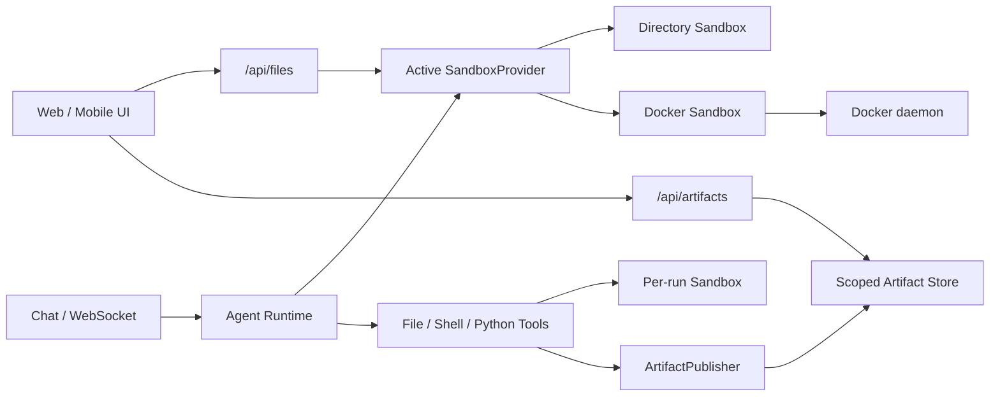
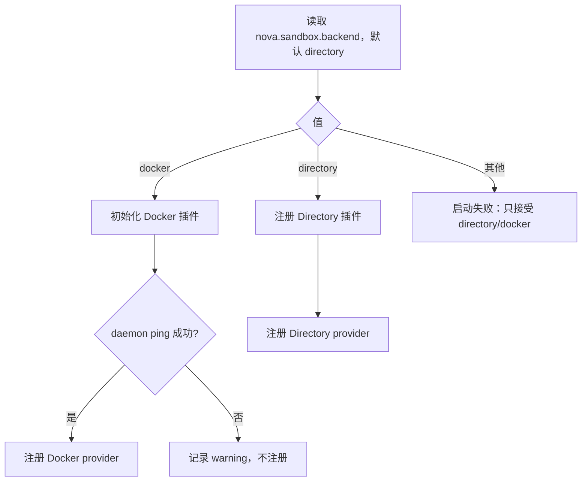
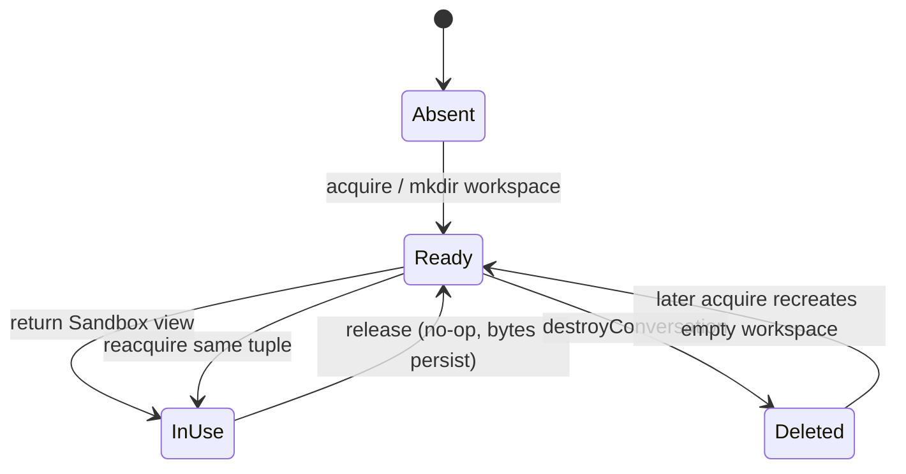
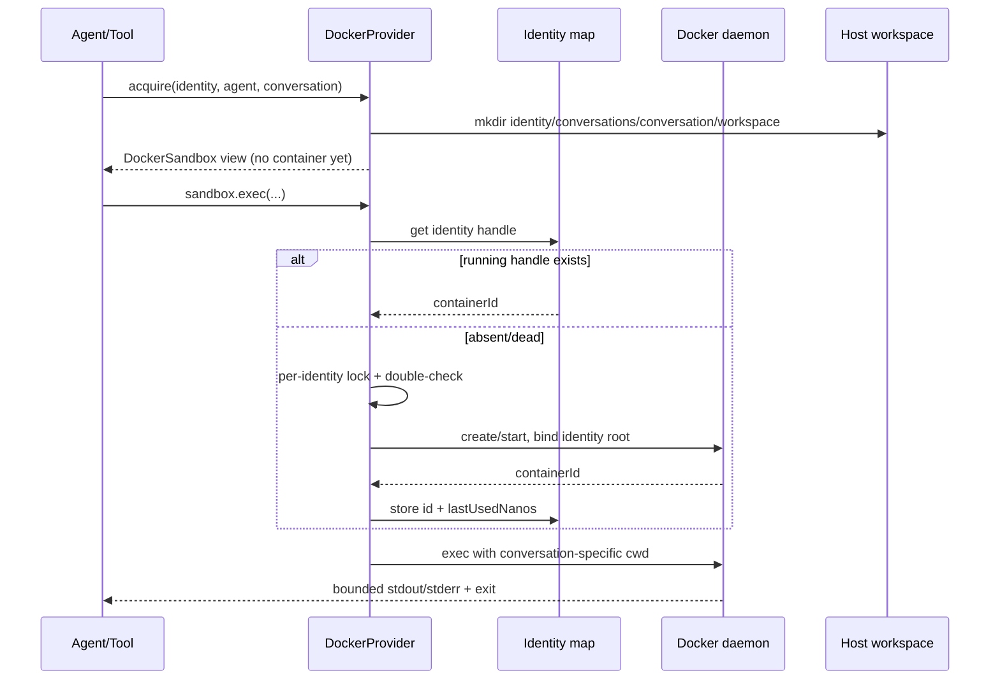
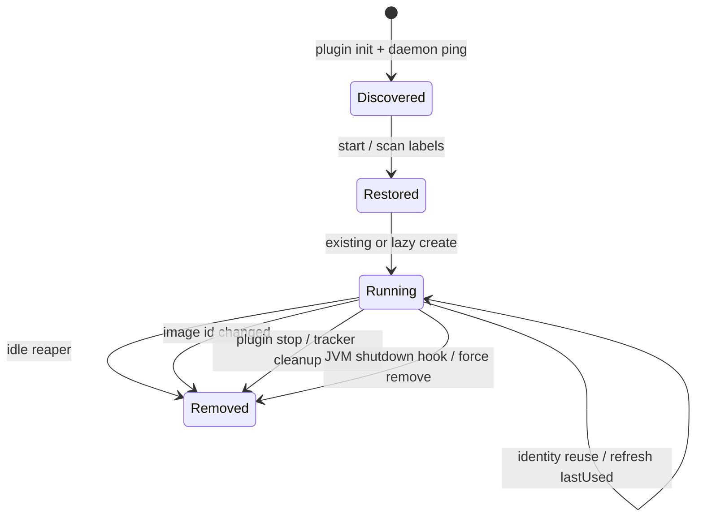
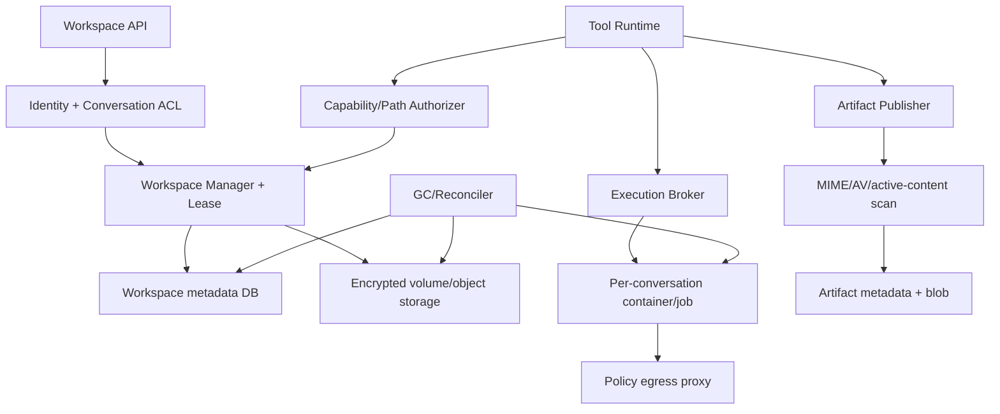

```
# T14：Workspace、文件工具、Directory / Docker Sandbox 可复刻设计

> 文档目标：读者不拥有 Nova 源码、当前仓库或本次会话上下文，仅凭本文即可实现业务效果等价、边界清晰且可上线的 Workspace 与 Sandbox 子系统。
>
> 覆盖范围：Sandbox SPI、Provider 选择、身份/会话/子代理 key、Directory 与 Docker 后端、路径与符号链接防护、文件读写/搜索/命令执行、超时/取消/环境/网络/资源限制、上传、Artifact 发布、工具大结果 offload、容器生命周期、REST/UI、三仓测试，以及当前实现与建议生产设计的差异。

## 1. 事实分级与结论

本文使用以下标签，避免把静态推断或建议误写成既有保证：

| 标签 | 含义 |
|---|---|
| **I（Implemented）** | 当前源码明确实现 |
| **A（Automated）** | 当前仓库存在自动化测试或用例 |
| **K（Known limitation）** | 当前实现已知缺口、兼容行为或不完整保证 |
| **P（Planned）** | 测试仓或设计材料明确规划、尚未自动化 |
| **REQ（Verification requirement）** | 复刻验收必须在真实 Docker、OS、浏览器或部署环境完成的验证要求；不表示本轮已经验证 |
| **F（Failure semantics）** | 失败、降级、清理和错误传播语义 |
| **D（Recommended design）** | 在其他 Agent 工程复刻时建议采用的生产设计，不代表 Nova 当前已实现 |

### 1.1 一句话结论

Nova 把“Agent 可操作的持久会话工作区”抽象为 `Sandbox`，主 Agent 的同一 `(identity, conversationId)` 在多轮运行、上传与工具执行之间复用同一目录；Directory 后端直接在宿主机执行，Docker 后端按 identity 复用长期容器，并为每个 conversation 切换到独立子目录。

但当前安全边界并不等价：

- **I** Directory 的 `Sandbox.resolve()` 有词法 containment 和已存在目标的 symlink real-path 检查；Docker 的 `resolve()` 只有词法 containment。
- **I/K** `bash` 与 `execute_python` 在 Docker 类型下走容器 `exec`，Directory 下走宿主进程；`grep` 无论后端都由 JVM 在宿主机直接启动。
- **I/K** `read_file`、`write_file`、`edit_file`、`grep` 和 `bash.working_directory` 接受显式绝对路径及 `~`；这些分支绕过 `Sandbox.resolve()`，与“所有文件访问被 workspace 隔离”的产品直觉不一致。
- **I/K** Docker 容器有只读 rootfs、非 root UID、cap-drop、no-new-privileges、内存/CPU/PID/tmpfs 限制，但默认网络是命名 bridge，仍可出网；Directory 后端没有 OS 级 CPU、内存、PID 或网络隔离。
- **I/K** SPI 的 `exec(command, timeout)` 没有取消句柄。Directory 工具自管进程时能轮询取消；Docker `sandbox.exec` 路径直到命令结束或超时才响应取消。
- **I** Artifact 是从 workspace 向用户可见、鉴权、可预览/下载的持久对象；offload 只是把大工具文本写回 `workspace/offloaded/`，不是 Artifact，也没有独立权限和保留策略。

### 1.2 模块边界

| 对象 | 解决的问题 | 默认归属 | 生命周期 | 用户可见性 |
|---|---|---|---|---|
| 会话 workspace | 上传、脚本、工具中间文件、多轮复用 | tenant + user + conversation | 直到删除会话 | 仅通过文件路由/工具间接可见 |
| identity shared root | 跨会话缓存，如 Python venv | tenant + user | 身份长期存在 | 不应直接暴露 |
| run/子代理 workspace | 临时或子代理隔离运行 | identity + synthetic key | 当前实现 release 后仍保留，需另行清理 | 默认不可见 |
| Artifact | 用户可管理作品/交付物 | owner + conversation + project/visibility | 独立持久化，可重命名/授权/删除 | Artifact UI、内容 API |
| tool-result offload | 避免超长工具文本挤占 timeline/context | 当前 run sandbox | 跟随 workspace | 仅由 `read_file` recall |
| legacy files/tmp/downloads | 兼容旧路径 | conversation 或全局目录 | 旧逻辑决定 | 兼容 REST 路由 |

## 2. 产品能力与参与方

### 2.1 用户可感知能力

1. 在新对话尚未发送消息时上传文件；服务端先生成 `conversationId`，文件写入该会话 workspace。
2. 后续消息和 Agent 运行重获同一 workspace，模型可用相对路径读取附件。
3. Agent 可读取、写入、精确编辑、搜索文件，以及执行 shell、Python、JavaScript。
4. 工具生成的可交付文件被发布为 Artifact，在聊天卡片、会话作品侧栏和“全部作品”页面展示。
5. Artifact 可预览、下载、重命名、删除和配置 OWNER_ONLY / GRANTED / PROJECT 可见性。
6. 删除会话时可删除该 conversation 的 workspace，但不会删除同身份其他会话目录。
7. Docker 模式把代码执行放入资源受限容器；Directory 模式适合可信开发环境。

### 2.2 参与方



## 3. 核心不变量

复刻实现必须先固定以下不变量：

1. **同身份、同会话稳定寻址**：上传阶段 acquire-write-release，稍后 Agent acquire 时必须读到相同字节。
2. **不同身份不共享路径**：tenant/user 必须进入存储 key，不能只以 conversationId 寻址。
3. **主 Agent 与同会话子能力的共享是显式策略**：Nova 的普通主 Agent 不把 agentName 放入路径，因此同 conversation 下不同 agentName 共享；子代理另用 synthetic conversation key 隔离。
4. **release 不等于删除**：release 结束使用权；destroyConversation 才删除持久 workspace。
5. **Artifact 发布与 Sandbox 隔离分层**：Sandbox 不生成公开 URL，不处理作品授权；Publisher 不负责代码执行隔离。
6. **所有工具路径必须经过同一授权器**（D）：不能让相对路径安全、绝对路径绕过。
7. **超时必须杀进程树**（D）：只杀父进程会让孙进程继续污染长期容器或 workspace。
8. **权限校验使用 owner identity**：管理员读他人会话时，先授权，再用会话 owner 的 identity 定位 workspace。

## 4. Sandbox SPI 契约

### 4.1 可复刻接口

```java
public interface Sandbox {
  Path resolve(String relative);              // 仅允许 workspace-relative
  Path root();                                // 当前 conversation workspace 的宿主视图
  Path sharedRoot();                          // 当前 identity 根
  ExecutionResult exec(String[] command, int timeoutSeconds);
  String writeFile(String suggestedRelativePath, byte[] content);
  byte[] readFile(String relativePath);
}

public record ExecutionResult(int exitCode, String stdout, String stderr) {}

public interface SandboxProvider {
  String name();                              // directory | docker
  Sandbox acquire(Identity id, String agentName, String conversationId);
  void release(Sandbox sandbox);
  void destroyConversation(Identity id, String agentName, String conversationId);
}

public interface SandboxProviderRegistry {
  void register(SandboxProvider provider);    // 单实例，第二次注册冲突
  Optional<SandboxProvider> get();
  void unregister();
}
```

### 4.2 当前语义

- **I** `writeFile` 默认 `resolve`、创建父目录、覆盖写；实现可以为防冲突改名，调用者必须使用返回路径。
- **I** `readFile` 默认读取全部字节，IO 错误包装为 Sandbox IO 异常。
- **I** `resolve/root` 假定宿主 `Path` 可用；非 Path 型后端可以抛 `UnsupportedOperationException`。
- **I** Provider 注册表通过原子引用保证最多一个 active provider；第二次注册抛 registry conflict。
- **I/F** Agent 的 acquire 在 run scope 创建时发生，finally 中 release；release 异常只记 warning，不覆盖主结果。
- **K** `ExecutionResult` 没有 `timedOut`、`cancelled`、signal、duration、truncated 字段，当前以 `exitCode=-1` 和 stderr 文本表达超时/中断。
- **K** SPI 没有 list/stat/delete/move、流式 IO、stdin、stdout 流、进程句柄或取消方法。

### 4.3 建议生产契约

```java
record ExecRequest(
    List<String> argv,
    String relativeCwd,
    Map<String,String> allowedEnv,
    Duration timeout,
    long stdoutLimitBytes,
    long stderrLimitBytes,
    NetworkPolicy networkPolicy) {}

record ExecResult(
    int exitCode,
    byte[] stdout,
    byte[] stderr,
    boolean timedOut,
    boolean cancelled,
    boolean outputTruncated,
    Duration duration) {}

interface RunningProcess {
  CompletionStage<ExecResult> completion();
  void cancel(CancelMode mode); // TERM_THEN_KILL | KILL
}
```

**D** 把 cwd、环境、输出上限、网络策略放进 typed request；不要用实现类名判断是否 Docker，也不要让工具自行选择宿主 `ProcessBuilder`。

## 5. Provider 选择与启动

### 5.1 当前选择流程



- **I** 产品装配层只构造一个插件，因此不是靠两个插件竞抢 registry。
- **I/F** Docker daemon 不可达时 Docker 插件优雅跳过注册，但产品装配不会自动再注册 Directory；最终可能是“无 provider”，上传/Agent 初始化随后失败。
- **K** 配置注释写有 `kubernetes`，实际产品选择器只接受 directory/docker。

### 5.2 配置契约

```yaml
nova:
  sandbox:
    backend: directory # directory | docker
    directory:
      base-dir: data/sandboxes
    docker:
      image: nova-sandbox:latest
      work-dir: /sandbox
      base-dir: data/sandboxes
      docker-host: ""                 # 空值自动探测
      network-mode: bridge            # host 时直接使用 host
      network-name: nova-sandbox-net  # 非 host 时实际传给 Docker
      memory-limit: 512m
      cpu-limit: 1.0                  # 当前解析后截断为 long CPU count
      pids-limit: 100
      idle-timeout-minutes: 120
      cleanup-interval-ms: 300000
      tmpfs-size: 64m
      user-id: 1000
      cap-add: []
    readable-dirs: []
```

重要细节：

- **I** Directory 同时兼容 `base-dir`、旧名 `root-dir`、flat key 和 nested map。
- **I** Docker size 只支持裸 bytes、`m`、`g`；非法值静默回退默认值。
- **I/K** `cpu-limit: 1.9` 被转换为 `long`，结果是 1；它不是精确 NanoCPU 配额。
- **I** Docker work-dir 必须是绝对路径；内存、CPU、PID、tmpfs、超时/扫描间隔必须大于 0，UID 必须非负。
- **I/K** `network-mode` 除大小写等于 host 外，任何值都被解释成 `network-name`，没有严格 enum 校验。
- **D** 配置解析错误应 fail-fast，不能把生产隔离参数拼写错误静默回退。

## 6. Identity、conversation 与 key 设计

### 6.1 Identity key

```text
user-only:      u/<userId>
tenant + user:  t/<tenantId>/u/<userId>
tenant scope:   t/<tenantId>
opaque dev:     <opaque-key>
```

**I** 文件布局把 identity key 原样当作多段相对路径；绝对 key 和含 `..` 段的 key 被拒绝，但合法的 `/` 会成为目录分隔符，`.`、重复分隔符等会被 `Path.normalize()` 折叠。

**K** 这不是无歧义编码。结构化 identity `t/acme/u/alice` 与一个 key 文本恰为 `t/acme/u/alice` 的 opaque identity 会映射到同一路径；不同 raw key 也可能经 Path 解析/normalize 得到同一目录。只做 containment 并不能证明“一个 identity 对应唯一 root”，会造成数据串用、容器共享和删除范围碰撞。

### 6.2 标准 workspace 布局

```text
<sandboxRoot>/
└── t/<tenantId>/u/<userId>/                 # sharedRoot / identityRoot
    └── conversations/
        └── <conversationId>/
            └── workspace/                   # root
                ├── uploads/
                ├── skills/
                ├── offloaded/
                ├── .nova-tmp/
                └── outputs/
                    └── <conversationId>/
                        └── artifacts/
```

- **I** `agentName` 被接口接收但不进入默认路径；同 identity/conversation 的 main agent 与其他 agentName 共享。
- **I** conversationId 必须是相对路径且不能含 `..` 段，但布局 helper 并未限制为单一安全 segment；Artifact publisher 更严格，只接受 `[A-Za-z0-9._-]+`。
- **K** 两处 conversationId 规则不一致，可能导致 workspace 已创建但 Artifact 发布拒绝。

### 6.3 各运行类型的 key

| 运行类型 | 传给 Provider 的 conversationId / sandbox key | 持久性 |
|---|---|---|
| 普通持久对话 | 真实 conversationId | 多轮稳定 |
| 无 conversationId 的普通运行 | 随机 UUID | release 后目录仍在 |
| 上传 | 请求 conversationId；缺失时生成 UUID 并返回 | 后续消息复用 |
| 子代理 | `subagents/<safe identity>/<safe parentConv or ephemeral>/<safe name>/<run UUID>` | 每次独立，当前无自动 destroy |
| 后台 LLM job | `background-jobs/<safe identity>/<safe jobName>/<run UUID>` | 每次独立，当前无自动 destroy |

`safeSegment` 把非 `[A-Za-z0-9._-]` 字符替换为 `_`，空值为 `_`。

**K** safeSegment 不是无碰撞编码，例如 `a/b` 和 `a:b` 都可能变成 `a_b`。虽然末尾 run UUID 降低子代理/后台 job 冲突，不能把它用于稳定唯一身份映射。

**D** 先形成带类型和长度分隔的 canonical identity（例如 `tenant\0<len>\0value\0user\0<len>\0value`），再使用 `base32(sha256(canonical identity))` 作为唯一目录 key，另存不可作为路径使用的审计元数据；conversationId 仅接受 UUID/ULID 或服务端生成 opaque ID。必须用测试证明不同 identity 类型、分隔符、Unicode normalization 和大小写不会碰撞。

## 7. Acquire / release / destroy 状态机



- **I** Directory acquire 创建目录并返回新 view，release no-op。
- **I** Docker acquire 也先创建宿主目录；容器直到首次 exec 才 lazy create。
- **I** destroyConversation 删除 `conversationId` 目录而非整个 identity；不存在时幂等。
- **K** destroy 与并发 acquire/exec 没有锁或 lease，可能出现删除中的文件被进程使用、删除后又被 acquire 重建。
- **K** 递归删除先 walk 再逐项 delete，部分删除失败会留下半清理目录；无 tombstone、重试队列或审计状态。

**D** 删除应先写 conversation tombstone，拒绝新 acquire，等待 active lease 清零，再使用异步幂等清理任务；失败记录重试次数和最后错误。

## 8. Directory Sandbox

### 8.1 路径解析

当前算法：

```text
reject null
reject string startsWith "/"
resolved = normalize(root.resolve(relative))
require resolved.startsWith(root)
if resolved exists without following final link:
    require resolved.toRealPath startsWith root.toRealPath
return resolved
```

- **I/A** 覆盖普通路径、嵌套路径、`..` escape、绝对路径、已存在 symlink escape。
- **K** 用字符串 `startsWith("/")` 判断绝对路径，不是跨平台完整判断；Windows drive/UNC 需由 `Path.isAbsolute()` 处理。
- **K** 对“不存在的最终目标”不检查现存父目录 symlink。例如 `linkOutside/new.txt` 若最终文件不存在，`Files.exists(final, NOFOLLOW_LINKS)` 为 false，可能跳过父链 real-path 校验。
- **K** 检查与实际 open/write 分离，存在 symlink TOCTOU 竞争。

### 8.2 宿主执行

Directory `exec`：

- cwd 固定为 workspace root；
- 清空继承环境，只注入 `PATH=/usr/local/bin:/usr/bin:/bin`、`HOME=root`、`TMPDIR=root`、`LANG=en_US.UTF-8`、`TERM=dumb`；
- 等待 timeout；超时 `destroyForcibly()`，返回 `exitCode=-1`；
- 完成后才 `readAllBytes(stdout/stderr)`。

**K** 完成前不并发消费 stdout/stderr；大量输出填满 OS pipe 后，子进程可能阻塞，父进程等待超时，形成假超时。Shell/Python 工具自己的 Directory 分支已用并发 reader，但 SPI `DirectorySandbox.exec` 本身仍有此问题。

**K** `destroyForcibly()` 只保证直接 Process 被杀，不保证独立进程组/孙进程全部终止。

**K** Directory 不是安全的多租户代码执行边界：宿主内核、挂载、网络、进程表和未被文件权限阻止的路径仍可接触。

## 9. Docker Sandbox

### 9.1 容器复用模型



- **I** 一个 identity 共享一个长期容器；不同 conversation 通过容器内 cwd `/sandbox/conversations/<conversationId>/workspace` 隔离。
- **I** 并发首次创建采用 identity 级 lock 和 double-check，避免重复容器。
- **I** `lastUsedNanos` 只在 get/reuse container 时更新；一次长命令运行期间不会持续续租。
- **K** reaper 可能在长命令执行中将容器判为 idle 并删除，因为没有 active-exec 计数/lease。
- **K** creationLocks map 没有回收，海量 identity 会留下锁对象。

### 9.2 宿主挂载与容器 cwd

- identity host root 读写 bind 到 `containerWorkDir`，默认 `/sandbox`。
- 当前 conversation workspace 映射到 `/sandbox/conversations/<conversationId>/workspace`。
- readable-dirs 中存在的宿主目录按 basename 挂为 `/skills/<name>`，只读；同 basename 加 `-2` 等后缀。
- 缺失 readable dir 被静默跳过。
- acquire 将 identity root 到 workspace 目录逐级 chmod `0777`，让配置 UID 可写。

**K** chmod 0777 扩大宿主同机用户攻击面，与“容器非 root”目标冲突。生产实现应预建专用 uid/gid、ACL 或 idmapped mount，不应 world-writable。

**K** Docker `resolve()` 没有 Directory 的 symlink real-path 检查。由于 host root 可写，工具可在 bind 内创建指向宿主其他位置的 symlink；host-side read/write/publish 若跟随链接，可能逃逸。

**K** readable-dir mount 的 basename 进入容器目标，虽由 Path filename 得出，但缺少运维层 allowlist/敏感目录拒绝；错误配置可暴露宿主秘密。

### 9.3 容器名、镜像与运行 ABI

当前容器名为 `nova-sandbox-<identityKey>`，再把不属于 `[A-Za-z0-9_.-]` 的字符全部替换为 `-`。

**K** 该清洗不是无碰撞编码，例如 `a/b` 和 `a:b` 都会得到 `nova-sandbox-a-b`。创建遇到 Docker 409 name conflict 时，当前实现会按这个名字 `force remove` 已有容器并重试；因此碰撞可能强制删除另一 identity 的活跃容器。label 中虽保存 raw identity，但删除前没有先 inspect 并比较 label owner。

**D** 容器名使用 `nova-sandbox-<sha256(canonicalIdentity)前N位>`，并把短可读名只作为 label；创建冲突时必须 inspect labels，owner 不匹配则 fail-closed，绝不删除。完整 digest 应保存在 label 并参与恢复认领；名称截断长度按部署最大 identity 数量计算碰撞概率。

镜像契约不是任意“有 Python 的镜像”，最低 ABI 为：

```text
entry command 可长期运行：sleep infinity
exec 必须存在：/usr/bin/bash、GNU coreutils timeout、python3、node
文档/文件能力依赖：curl/wget/jq/file/zip/unzip/git/pandoc、LibreOffice、poppler
字体与 locale：en_US.UTF-8、Noto CJK
默认非 root UID 1000；/sandbox 可写 bind；/tmp 可写
预装 Python/Node 文档处理依赖与对应 NODE_PATH
```

当前官方 sandbox image 基于 `python:3.12-slim`，安装上述 CLI、Python 数据/文档包和全局 Node 包，最终切换 UID 1000、`WORKDIR /sandbox`。容器创建命令固定为 `sleep infinity`，每次任务通过 Docker exec 进入。

镜像获得方式：容器首次创建先 inspect 配置的 tag；本地不存在才 pull，pull 最长等待 300 秒。运行时不负责从 Dockerfile build、load 导出的 tar、创建 tag 或验证软件 ABI；仓库另有 multi-arch build 脚本构建 amd64/arm64 tag并导出压缩 archive。

**F** image pull 的等待返回值没有被检查是否因 timeout 返回 false；网络慢时后续 create 可能以“镜像不存在”失败。配置为私有 registry 时还依赖 Docker daemon 既有认证。镜像 tag 可变，恢复时仅在能解析当前 image id 的情况下淘汰旧容器。

**D** 部署阶段而非请求阶段完成 build→SBOM/漏洞扫描→digest pin→pull/load→ABI health check。启动门禁执行：

```bash
bash --version
timeout --version
python3 -c 'import pandas,openpyxl,docx,reportlab'
node -e 'require("pptxgenjs"); require("docx")'
test -w /sandbox && test -w /tmp
```

`network-mode != host` 时当前实现直接引用 `network-name`，不会创建网络。运维必须预建 `nova-sandbox-net`；不存在时 create 失败。生产应明确 network lifecycle owner、subnet、DNS、egress和删除策略。

### 9.4 容器 hardening

当前 HostConfig：

| 控制 | 当前值 |
|---|---|
| root filesystem | read-only |
| workspace | identity root 可写 bind mount |
| `/tmp` | writable tmpfs，默认 64 MiB |
| user | UID:GID，默认 1000:1000 |
| capabilities | drop ALL，再加 cap-add allowlist |
| privilege escalation | `no-new-privileges` |
| memory | 512 MiB |
| CPU | Docker HostConfig `CpuCount=1` |
| PID | 100 |
| network | 默认命名 bridge，host 可选 |
| command | 长期 `sleep infinity` |
| labels | `nova.sandbox=true`, `nova.identity=<identityKey>` |

**D** 生产默认网络应为 none；出网改为按工具/请求通过受审计代理，限制 DNS、CIDR、端口、重定向和响应大小。绝不能默认允许访问云 metadata、集群 service CIDR、localhost/宿主 gateway。

**K/REQ** `CpuCount` 字段是否形成强制 CPU 限额取决于 Docker Engine、操作系统与 runtime；在 Linux 上不能仅凭 HostConfig getter 或配置值证明 cgroup quota 已生效。当前实现也把小数 `cpu-limit` 截断为 long。内存/PID/tmpfs 同样需要在目标 daemon/cgroup 模式下实测。

**D** Linux 生产使用明确的 `NanoCPUs` 或 `CpuQuota/CpuPeriod`，并通过压力任务和 `docker inspect`/cgroup 文件证明约束；Windows 再按平台映射 CpuCount。验收应测持续 CPU、fork bomb、OOM 和 tmpfs fill，不只检查配置对象。

### 9.5 exec、输出和超时

- 命令包装为 `timeout -s KILL <seconds> <argv...>`；
- Docker API await 多给 5 秒 grace；
- 124/137 或 await 未完成映射为 timeout；
- stdout、stderr 各最多采集 300,000 bytes，超出部分丢弃；
- 每次 exec 注入 `/sandbox` HOME、`/tmp` TMPDIR、identity venv PATH、UTF-8、`MPLBACKEND=Agg`。

**K** `timeout -s KILL` 对其直接监督进程有效，但注释声称所有 grandchild 都会死亡并非普遍成立；setsid/double-fork 进程可逃离。生产应使用独立 cgroup/container，超时后 kill exec process group，必要时重建容器。

**K** 输出超限没有 `truncated=true` 或提示，调用者无法区分完整输出与静默截断。

**K** Docker exec 没有轮询 `ToolExecutionContext.isCancelled()`；取消只能等待 timeout/命令完成。

### 9.6 daemon client 与恢复

Docker host 解析优先级（源码实际）：

1. 显式 `docker-host`；
2. `DOCKER_HOST` 环境变量；
3. `/var/run/docker.sock`；
4. `~/.docker/run/docker.sock`；
5. `~/.colima/docker.sock`；
6. fallback `/var/run/docker.sock`。

**K** 配置示例注释把 DOCKER_HOST 写在候选 socket 之后，与代码实际顺序不一致。

启动恢复：列出 `nova.sandbox=true` 的全部容器；若当前 image id 与容器 image id 不同则删除；否则按 label identity 重建内存 map。无法解析当前 image id 时跳过 image 变更淘汰。

## 10. 容器生命周期、Tracker 与 JVM hook



- **I** Tracker 使用并发 set 记录本进程创建的 container ID；创建后 track，stop/remove 后 untrack。
- **I** JVM hook 强制 remove 所有 tracked 容器；单容器失败被吞掉，仍从 set 移除。
- **I** 插件 stop 取消 reaper、shutdownNow、cleanupAll、detach hook、close client。
- **K** restore 进来的既存容器只是放入 provider map，没有重新 `tracker.track`；插件正常 stop 或 JVM hook 不一定清理恢复容器，除非被 reaper/eviction 删除。
- **K** Tracker 注册 JVM 全局 shutdown hook，与项目插件规范“插件不要注册 JVM 全局 hook”冲突；复刻应由宿主 lifecycle manager 统一托管。
- **K** cleanupAll 无持久清理账本；remove 失败后仍 untrack，成为无人接管的泄漏。

## 11. 文件工具契约

### 11.1 工具总表

| 工具 | 关键参数 | 当前行为 | Retention |
|---|---|---|---|
| `read_file` | `source`, paging/sheet/row | 本地、HTTP(S)、skill://、PDF/DOCX/XLS/PPT/文本 | 默认 condensable |
| `write_file` | `path`, `content`, `append=false` | 文本、DOCX、XLSX；父目录自动创建 | EPHEMERAL |
| `edit_file` | `path`, `old_string`, `new_string`, `replace_all=false` | 精确替换，失败后 whitespace fuzzy | EPHEMERAL |
| `grep` | `pattern`, `path`, `glob`, `limit` 等 | 直接启动宿主 rg | 默认 condensable |
| `bash` | `command`, `working_directory`, `timeout_seconds` | Directory 宿主进程；Docker exec | 默认 condensable |
| `execute_python` | `code`, `language`, `packages`, `timeout_seconds`, `purpose` | Python/Node、identity venv、产物扫描 | DURABLE |

### 11.2 read_file

- `source` 必填，兼容旧 `path`；
- 支持 `skill://<id>/...`，资源物化到 `workspace/skills/`；单 skill resource 最大 200 KiB；
- 普通输出最大约 15,000 字符，长行会裁剪；
- URL 下载 connect 30 秒、request 60 秒，临时文件写系统 temp 后删除；
- 可读格式按扩展名解析，分页字段对不同格式含义不同；
- `/api/files/<conv>/...` 可反解 conversation outputs 路径。

**K** URL 读取是 JVM 宿主网络请求，不受 Docker 网络策略约束；必须另做 SSRF 防护。

**K** HTTP client 使用 `BodyHandlers.ofByteArray()`，会在解析前把整个响应装入 JVM heap；当前没有响应字节上限，也没有在流式读取期间按 Content-Length/实际字节终止。攻击者可用大响应或压缩展开造成 heap DoS。请求 timeout 只限制时间，不限制内存。

**D** 使用 `ofInputStream()` + bounded stream，先检查最终 URL、Content-Length、Content-Type和重定向链，再边读边计数；压缩后和解压后分别限额，超限立即关闭连接并删除 staging 文件。

**K** `~` 和绝对本地路径直接 normalize 后读取，没有经过 Sandbox，也没有使用产品侧 readable-dirs 授权器。

### 11.3 write_file

请求示例：

```json
{
  "path": "reports/summary.md",
  "content": "# Summary\n...",
  "append": false
}
```

- 相对路径走 sandbox.resolve；
- `.env`、常见 SSH key 和 credentials 文件名被 block；
- HTML 写入先 sanitizer；
- DOCX/XLSX 支持结构化生成；
- 显式目标按 Artifact policy 发布，成功文本附 artifact marker。

**K** 绝对路径和 `~` 被直接写入宿主；blocked filename 只是很小的 denylist，无法构成安全边界。

### 11.4 edit_file

- 文件必须存在、为 regular file、最大 10 MiB、UTF-8 文本；
- `old_string` 为空、与 new 相同、0 次、非唯一且未 replace_all 都返回 Error；
- exact 0 次时尝试 whitespace-tolerant fuzzy；
- 成功后可重新发布 Artifact。

**K** 与 write_file 相同，absolute/`~` 绕过 sandbox；检查、读取、写回之间无文件版本/CAS，并发编辑可能 lost update。

### 11.5 grep

- 默认 root；limit 默认 30、最大 200；context 0..5；
- 直接 argv 调 `rg`，pattern 前加 `--` 防 option injection；
- 30 秒超时，输出最多 30,000 chars；exit 0=matches、1=no match、>=2=error。

**K** 搜索进程完全不通过 `sandbox.exec`，Docker 模式也在宿主执行；absolute/`~` 路径可搜索宿主文件。

**K** rg 与 Directory SPI 类似，先 `waitFor`，完成后才读取 stdout/stderr；高匹配量可能填满 pipe，使 rg 阻塞并被误报为 30 秒超时。`--max-count` 是每文件匹配限制，并不保证所有文件的总输出小于 pipe。

**D** stdout/stderr 启动后立即并发 bounded drain；达到全局字节/结果数上限时终止进程并返回 `truncated=true`，超时和输出上限必须是不同错误码。

### 11.6 bash

- command 必填；timeout 1..300 秒，默认 60；
- 有危险命令 regex denylist；
- Directory 分支清空环境、并发读 stdout/stderr、每 200ms 检查取消；
- Docker 分支通过实现类全限定名包含 `.ext.sandbox.docker.` 来判断，调用 sandbox.exec；
- 执行前后扫描 workspace，新出现的可发布文件转 Artifact。

**K** denylist 不是 shell sandbox，可被编码、别名、解释器、间接脚本绕过。

**K** 非零 Docker exit 仍由 bash 工具格式化为 `ToolResult.ok`；其输出含 Exit Code，但 success flag 仍 true。Python 工具则非零返回 error，语义不一致。

**K** absolute working_directory 在 Directory 下可直接作为宿主 cwd；Docker 下随后被 `commandForSandboxExec` 拒绝为 root 外路径。

### 11.7 execute_python

- Python 默认，language 可为 python/javascript；
- temp script 写 `workspace/.nova-tmp`，finally 删除；
- Directory 用宿主 python/node，Docker 用容器 python3/node；
- Directory 为每 identity 在系统 temp 建 `nova-v2-python/<safeIdentity>/python-venv`；
- packages 会执行 pip install，固定 120 秒；
- Python 代码前置文件访问 guard、字体配置、matplotlib/reportlab 支持；
- 前后文件快照差异转 Artifact。

**K** pip/venv 创建与安装由宿主 ProcessBuilder 执行，即使后续代码运行在 Docker；这是供应链和宿主执行面，且安装过程环境并未像用户代码一样统一清空。

**K** Docker 模式仍先在宿主系统临时目录创建 identity venv，并用这个宿主 Python执行 `packages` 安装；随后用户代码却在容器中调用 `python3`。该宿主 venv没有 bind 到容器 `/sandbox/python-venv`，因此 pip 可能返回安装成功，但容器 import 仍失败。容器环境声明的 `/sandbox/python-venv` 与宿主临时 venv 不是同一目录。

**D** Docker 模式的包安装必须也通过容器 exec，并安装到绑定的 identity package volume，或使用每任务不可变镜像/受控 wheel cache；安装后在同一 runtime执行 import smoke test。禁止让“安装方”和“执行方”使用两个 Python ABI/文件系统。

**K** identity venv key 也使用替换式 safe key，存在理论碰撞；缓存 map 无淘汰。

## 12. 路径授权与 symlink 威胁模型

### 12.1 当前路径矩阵

| 路径入口 | 相对路径 | `..` | 绝对/`~` | symlink 防护 |
|---|---|---|---|---|
| Directory Sandbox.resolve | root 下 | 拒绝 escape | 拒绝 `/` | 已存在 final path real-path |
| Docker Sandbox.resolve | root 下 | 拒绝 escape | 拒绝 `/` | 无 |
| read/write/edit | 走 resolve | resolve 拒绝 | 直接允许 | 取决于分支，absolute 无 sandbox 防护 |
| grep | 走 resolve | resolve 拒绝 | 直接允许 | 宿主 rg 自己跟随行为 |
| bash cwd | 走 resolve | resolve 拒绝 | Directory 允许；Docker root 外拒绝 | 不统一 |
| File REST serving | base.resolve + startsWith | 拒绝 | URL subpath 不应绝对 | 未统一 real-path |
| Artifact export | filename 截 basename、目标 containment | conversation 校验 | source 可为绝对 | source symlink 未统一拒绝 |

### 12.2 主要攻击

| 威胁 | 当前风险 | 生产对策（D） |
|---|---|---|
| `../../etc/passwd` | 相对路径大多拦截 | 统一 RelativePath value object |
| absolute / `~` | 多工具可绕过 | LLM 工具禁止；仅 admin capability 可读 allowlist |
| parent symlink + new child | Directory 检查可能漏，Docker 明确漏 | openat2 `RESOLVE_BENEATH|NO_MAGICLINKS` 或 secure directory stream |
| symlink TOCTOU | check/open 分离 | 基于目录 fd 原子 open，拒绝 follow |
| hardlink | workspace 内 hardlink 可指已有 inode | 独立 mount/user namespace，发布前 copy+scan |
| malicious archive | 解压炸弹/路径穿越 | 限 entries/ratio/bytes，逐项 secure open |
| output flood | Directory SPI 可能 pipe deadlock | 流式 bounded drain + truncation flag |
| fork bomb | Directory 仅 regex/PID 无限制 | 禁止多租户 Directory；Docker PID/cgroup |
| SSRF | read_file URL 走宿主 | egress proxy + DNS pinning + CIDR deny |
| artifact active content | HTML/SVG 可执行 | sanitizer、独立 origin、CSP、下载 disposition |

### 12.3 统一路径伪代码

```text
authorizePath(requested, operation, capability):
  reject NUL, empty, invalid UTF-8
  if requested is absolute or begins "~":
      require capability == ADMIN_READ_ONLY
      require operation == READ
      resolve against configured allowlist using real paths
  else:
      parse as normalized relative path
      reject root-name, '..', empty sensitive aliases
      fd = secureOpenBeneath(workspaceFd, path,
           noSymlink=true, create=operation allows create)
  return AuthorizedHandle(fd, operation, auditContext)
```

## 13. 上传链路

### 13.1 REST 契约

```http
POST /api/files/upload
Content-Type: multipart/form-data

files=<one or more files>
conversationId=<optional>
```

响应示例：

```json
{
  "conversationId": "01J...",
  "files": [
    {
      "id": "a1b2c3d4",
      "name": "销售 数据.csv",
      "path": "uploads/a1b2c3d4_销售_数据.csv",
      "size": 18234,
      "type": "text/csv"
    }
  ]
}
```

链路：

```mermaid
sequenceDiagram
  participant UI
  participant API as File API
  participant P as SandboxProvider
  participant FS as Workspace
  participant C as Chat

  UI->>API: multipart files + optional conversationId
  API->>API: auth identity; generate id if absent
  API->>P: acquire(identity, main, conversationId)
  P-->>API: sandbox.root
  API->>API: extension allowlist + safe filename
  API->>FS: write uploads/<8-char-id>_<safe-name>
  API->>P: release
  API-->>UI: relative path + conversationId
  UI->>C: send message using same conversationId + attachment metadata
  C->>P: reacquire same tuple
  P-->>C: attachment bytes still present
```

- **I** 上传扩展 allowlist：pdf/docx/xlsx/xls/pptx/txt/csv/json/xml/yml/yaml/md/log/conf。
- **I** 空 multipart file 被跳过；所有都空时仍可返回空 files。
- **I** 原名被清理，前置 8-char UUID；中文保留。
- **K** 控制器本身没有显式单文件/总量上限、配额或病毒扫描；可能依赖 Spring multipart 全局配置，但不构成模块自包含保证。
- **K** 上传失败可已写入前序文件，没有事务回滚；遇到后续非法扩展会返回 400 并留下先前文件。

**D** 先校验所有 part 元数据和配额，再写 staging；逐文件 hash/扫描；全部成功后原子 promote。响应中返回 sha256、server MIME、scan status。

## 14. Workspace、Artifact 与 offload 的区别

### 14.1 Artifact Publish

工具发布请求：

```json
{
  "source": "<host Path, JSON 中仅示意>",
  "name": "report.xlsx",
  "kind": "FILE",
  "mimeType": "application/vnd.openxmlformats-officedocument.spreadsheetml.sheet",
  "conversationId": "conv-123",
  "sourceTool": "execute_python"
}
```

Publisher 行为：

1. conversationId 为空时返回 file URI，或桥接 store；
2. 非空时要求 `[A-Za-z0-9._-]+`；
3. 目标为 `<workspace>/outputs/<conversationId>/artifacts/<uuid8>-<safeName>`；
4. source 已在 conversation output root 下时避免重复 copy；
5. scoped 模式解析 scope、写 ScopedArtifactStore，失败 fail-closed；
6. 兼容模式 store 写失败只 warning，保留 `/api/files/...` URL。

**边界澄清（I）** Publisher 的 `outputRoot` 是 workspace 中的 `outputs`，只有 `outputs/<conversationId>/artifacts/` 下的交付物会桥接为持久 ArtifactStore 对象。若 source 已在同 conversation output root、但不在 `artifacts/` 子目录，只生成兼容 API URI并明确不注册为用户作品。旧版 conversation root、`data/files`、`data/tmp`、downloads 等其他 legacy URL也不会因为可下载而自动进入 ArtifactStore。

**K** Publisher 与若干工具会调用 `setReadable(true, false)`，把文件设为“所有宿主用户可读”，而不是只让 Nova service account可读。在共享主机上，这会扩大数据暴露面；它也不能替代 HTTP 鉴权。

**D** 预建 service uid/gid 和最小 ACL，文件默认 `0600`、目录 `0700`；需要容器共享时用专用 group/idmapped mount。HTTP内容始终通过 Artifact授权流读取，不靠 world-readable 权限。

稳定 Artifact 引用：

```json
{
  "kind": "FILE",
  "name": "report.xlsx",
  "mimeType": "application/vnd.openxmlformats-officedocument.spreadsheetml.sheet",
  "content": null,
  "uri": "/api/artifacts/<artifactId>/content"
}
```

### 14.2 Tool result offload

当单次工具输出 UTF-8 大于 8192 bytes：

```text
relative = offloaded/<sha256(full bytes)>.txt
sandbox.writeFile(relative, full bytes)
timeline text = first 10 lines, additionally bounded to 8192 UTF-8 bytes
                + "[offloaded N bytes to <relative>; read full via read_file]"
artifactRefs = [relative]
```

- **I** content hash 使同内容幂等；不同内容不碰撞（按 SHA-256 假设）。
- **I/F** 写失败不影响工具事件，只保留 bounded preview 和失败提示。
- **K** artifactRefs 名称具有误导性：它只是 sandbox relative recall handle，不是 ArtifactStore ID。
- **K** offload 没有独立 size quota、TTL、垃圾回收或 UI。

### 14.3 不可混用规则

- 中间脚本、输入附件、skill materialization：workspace。
- 用户要保存、预览、下载、分享、授权的输出：Artifact。
- 只为 LLM 后续 recall 的大文本：offload。
- 不要把 sandbox absolute path 返回前端；不要把 Artifact content URL 当可写路径。

## 15. 文件与 Artifact REST

### 15.1 Workspace / legacy file API

| Method | 路径 | 作用 | 权限/约束 |
|---|---|---|---|
| POST | `/api/files/upload` | 上传到 workspace/uploads | 当前登录 identity |
| GET | `/api/files/{conversationId}/**` | data/files、legacy tmp、owner sandbox fallback | self 或同租户 admin；拒绝越界 |
| GET | `/api/files/{conversationId}/artifacts-list` | 会话作品兼容列表 | conversation read gate |
| GET | `/api/files/all-artifacts` | 当前用户全部作品兼容列表 | 当前 identity |
| POST | `/api/files/save-artifact` | HTML/SVG/Mermaid inline 内容转 Artifact | 当前会话 scope |
| GET | `/api/files/{conv}/artifacts/{path}` | legacy Artifact 路由 | scoped store 优先，旧文件 fallback |
| POST | `/api/files/open` | 宿主打开文件 | 本地产品能力，生产应禁用 |
| POST | `/api/files/reveal` | Finder/Explorer 定位 | 本地产品能力，生产应禁用 |

**I** conversation 文件读取先做 `ConversationAccessResolver`；越权对外统一 404，避免泄露存在性。同租户管理员只读会记录审计，并用 owner identity 定位 sandbox。

**K** `/downloads/{filename}` 是全局目录路由，虽然有 traversal guard，但从片段看没有 conversation owner gate；生产不应保留全局可猜文件名下载面。

**K** `/open` 和 `/reveal` 接受任意绝对路径或 `~`，只检查目标是否存在，随后启动宿主 GUI；没有 conversation owner ACL、workspace containment或独立 capability gate。只要请求能到达 controller，就可探测宿主路径存在性并触发打开。表格中的“生产应禁用”是建议，不是当前代码的默认开关保证。

**D** 服务端/容器部署默认不注册这两个 endpoint；仅 desktop profile + loopback bind + CSRF + 本机用户确认时启用。请求只接受服务器签发的 Artifact ID，不接受 raw path，并在调用 GUI 前重新做 owner授权。

### 15.2 Artifact API

| Method | 路径 | 关键输入/输出 |
|---|---|---|
| GET | `/api/artifacts` | filter: conversationId/keyword/projectId/personalOnly/visibility/cursor/limit；`X-Next-Cursor` |
| GET | `/api/artifacts/{id}` | ArtifactDto |
| GET | `/api/artifacts/{id}/content?download=` | inline/attachment bytes |
| PATCH | `/api/artifacts/{id}` | `{ "displayName": "..." }`，1..255 |
| DELETE | `/api/artifacts/{id}` | 204 |
| GET | `/api/artifacts/{id}/grants` | grantee user projection |
| PUT | `/api/artifacts/{id}/access` | visibility + granteeUserIds |
| GET | `/api/artifacts/grant-candidates?artifactId=&keyword=` | 同租户候选人 |

`ArtifactDto`：

```json
{
  "id": "a503c5ee...",
  "displayName": "月度报告.xlsx",
  "originalFilename": "report.xlsx",
  "type": "FILE",
  "mimeType": "application/vnd.openxmlformats-officedocument.spreadsheetml.sheet",
  "size": 19283,
  "conversationId": "conv-123",
  "sourceTool": "execute_python",
  "projectId": null,
  "projectName": null,
  "visibility": "OWNER_ONLY",
  "creator": {"userId": "u1", "displayName": "Alice"},
  "permissions": {"canPreview": true, "canDownload": true, "canManage": true},
  "createdAt": "2026-08-13T12:00:00",
  "contentUrl": "/api/artifacts/a503c5ee.../content"
}
```

- limit 1..500；projectId 与 personalOnly 互斥；
- visibility 仅 OWNER_ONLY/GRANTED/PROJECT；
- UI 不自行推断权限，缺失 permissions 时 deny all；
- tenant 可禁下载，即使可预览。

## 16. UI 产品形态

1. ChatInput 选择文件后立即上传；若当前没有 conversationId，保存服务端返回 id，发送消息时复用。
2. 上传中禁止发送，上传失败显示后端错误；附件 chip 展示原始文件名。
3. 聊天文本中的 artifact marker 被解析为卡片；卡片会按 Artifact ID 获取最新名称，删除后显示 tombstone。
4. 当前会话作品侧栏以 cursor 分页拉取全部页；流结束后延迟刷新，手工 save 成功后刷新。
5. 全部作品页支持搜索和跳回来源对话。
6. Preview 按扩展路由 HTML、PDF、DOCX、PPTX、表格、Markdown、图片、文本和 fallback；Markdown 可在 preview/source 间切换。
7. 下载按钮严格取决于 `permissions.canDownload`；预览依赖 `canPreview`；管理动作依赖 `canManage`。

**K** 以扩展名选择 renderer 必须配合服务端 MIME、内容嗅探和 sandboxed iframe，不能把扩展名当信任依据。

## 17. 并发、一致性与清理

### 17.1 当前并发语义

- Provider view 无 exclusive lock；同会话多 Agent run 可同时读写同文件。
- write_file overwrite 是 truncate/write，不带临时文件 rename；读者可能看到中间态。
- edit_file 是 read-modify-write，无 CAS。
- Artifact 自动发现用 before/after 路径集合，只识别“新路径”；已有文件被修改可能不被发布。
- Docker 容器按 identity 共享，两个 conversation 的进程能看见整个 identity bind root，而不仅当前 conversation；隔离主要依赖 cwd 和模型行为，不是 mount 边界。

### 17.2 建议设计

- 普通文件写入：同目录 temp + fsync + atomic rename。
- edit：携带 `expectedSha256` 或 version，冲突返回 409。
- 自动产物扫描：比较 `(relativePath, inode/fileKey, mtime, size, sha256)`，不只比较路径集合。
- 容器隔离：生产优先 per-conversation 容器或只 bind 当前 conversation；identity cache 单独只读/专用 volume。
- workspace quota：identity、conversation、单文件、总文件数四级限制。
- background GC：清理 ephemeral run key、offloaded、staging、孤儿 artifacts 和遗留容器；全程 metrics/audit。

## 18. 错误、降级和可观测性

### 18.1 错误规范

| 场景 | 当前表现 | 建议错误码（D） |
|---|---|---|
| 无 provider | IllegalState/SandboxException | SANDBOX_UNAVAILABLE |
| traversal | IllegalArgument / HTTP 400 | INVALID_PATH |
| 越权读取 | HTTP 404 | NOT_FOUND（外部），内部 ACCESS_DENIED |
| command timeout | exit -1 + stderr 或 Tool Error | EXEC_TIMEOUT |
| cancellation | Directory 工具 Tool Error；Docker 延迟 | EXEC_CANCELLED |
| output cap | Docker 静默丢弃 | OUTPUT_TRUNCATED + flag |
| daemon unreachable | 插件跳过注册 | SANDBOX_BACKEND_UNAVAILABLE |
| artifact scope/store 失败 | scoped 模式传播 | ARTIFACT_PUBLISH_FAILED |
| offload 写失败 | bounded preview，主流程继续 | metric + warning |

### 18.2 指标

至少采集：

- `sandbox_acquire_total{backend,result}` / latency；
- active identity containers、active exec、creation conflicts；
- exec duration、exit code、timeout、cancel、stdout/stderr bytes、truncated；
- workspace bytes/files、quota rejection；
- symlink/traversal/absolute-path rejection；
- reaper removed/failed、orphan containers；
- upload bytes/rejected/scanner verdict；
- artifact publish/store failure；offload count/bytes/failure。

审计至少包含 tenantId、userId、conversationId、runId、tool、operation、relative path hash、backend、containerId、结果；禁止记录文件正文、API key 和完整敏感命令环境。

## 19. 最小可运行 Stub

下面 Stub 只用于单元测试和本地开发，不允许生产多租户：

```java
final class InMemorySandbox implements Sandbox {
  private final Path root;
  private final Path sharedRoot;

  InMemorySandbox(Path root, Path sharedRoot) {
    this.root = root.toAbsolutePath().normalize();
    this.sharedRoot = sharedRoot.toAbsolutePath().normalize();
  }

  public Path resolve(String relative) {
    Path rel = Path.of(relative);
    if (rel.isAbsolute()) throw new IllegalArgumentException("absolute path");
    Path out = root.resolve(rel).normalize();
    if (!out.startsWith(root)) throw new IllegalArgumentException("path escape");
    return out;
  }

  public Path root() { return root; }
  public Path sharedRoot() { return sharedRoot; }

  public ExecutionResult exec(String[] argv, int timeoutSeconds) {
    throw new UnsupportedOperationException("exec disabled in stub");
  }
}

final class DevProvider implements SandboxProvider {
  private final Path base;
  public Sandbox acquire(Identity id, String agent, String conv) {
    String identityHash = sha256Base32(id.key());
    String safeConv = requireOpaqueId(conv);
    Path shared = base.resolve(identityHash);
    Path root = shared.resolve("conversations").resolve(safeConv).resolve("workspace");
    Files.createDirectories(root);
    return new InMemorySandbox(root, shared);
  }
  public void release(Sandbox ignored) {}
}
```

## 20. 最小生产设计（D）

### 20.1 组件



### 20.2 关键数据

```sql
create table workspace (
  workspace_id varchar(64) primary key,
  tenant_id varchar(128) not null,
  user_id varchar(128) not null,
  conversation_id varchar(64) not null,
  state varchar(16) not null, -- ACTIVE, DELETING, DELETED, ERROR
  bytes_used bigint not null default 0,
  files_used bigint not null default 0,
  version bigint not null default 0,
  created_at timestamp not null,
  updated_at timestamp not null,
  unique (tenant_id, user_id, conversation_id)
);

create table workspace_lease (
  lease_id varchar(64) primary key,
  workspace_id varchar(64) not null,
  run_id varchar(64) not null,
  expires_at timestamp not null
);
```

### 20.3 安全默认值

- 生产只启用 container/job backend；Directory 仅 dev/test 且启动时醒目 warning。
- per-conversation mount；identity cache 独立 volume，不可枚举其他 conversation。
- rootless container、seccomp、AppArmor/SELinux、read-only root、cap-drop all、no-new-privileges。
- network none；受允许的 HTTP 工具走宿主代理，不让 arbitrary bash 直接出网。
- 绝对路径全部拒绝；admin readable-dir 采用显式 resource URI，不把宿主 path 暴露给模型。
- 全部 IO 使用 secure open-beneath；Artifact 发布复制到隔离 blob 后再服务。
- 取消和超时通过 Execution Broker 杀 cgroup/job，而非只杀一个 PID。

## 21. 三仓验证现状

### 21.1 Nova 单元/集成测试

**A** Directory 覆盖：布局、sharedRoot、release 持久、单会话删除、相对/嵌套/`..`/absolute/symlink、read/write roundtrip、安全环境、超时、命令不存在和中断。

**A** Docker 覆盖：默认/嵌套配置、HostConfig hardening、只读 skill mounts、container name、provider 布局/权限/删除、identity reuse、并发创建、idle reap、restore/image eviction、Tracker cleanup、daemon 探测，以及需要真实 daemon 的 integration exec/跨会话复用。

**K/R** 仍需专门运行验证：Docker symlink escape、长命令与 reaper 竞争、取消延迟、输出截断提示、恢复容器 stop 清理、容器内进程树残留、网络策略/metadata 阻断、Directory pipe deadlock。

### 21.2 nova_auto_test

文件/Artifact 目录登记 47 条产品用例，当前关键状态：

- **A** 上传 roundtrip、Artifact 下载、非法类型、traversal、跨账号隔离、缺失内容；
- **K** legacy artifact path 在 release 环境 known failure；空 multipart 文件 roundtrip known failure；
- **A** write append+read、unique edit+read、edit 0 次/非唯一不改文件；
- **K** `grep` 用例在 release 环境 known failure：模型可调用但 executor 返回 Tool not found；
- **P** missing/permission、write traversal、past EOF/empty、大文件/长行、binary/non-UTF8 仍 planned；
- **A** Artifact tool event、列表、save、publish、同名版本；
- **P** publisher 可控失败和 cleanup 策略仍 planned。

文件工具 runner 明确要求 `workers=1`，流程为创建会话 → 上传 fixture → 在同 conversation 走 WS 工具调用 → 断言 → finally 删除会话。它验证了“上传与后续 acquire 复用”，但因单 worker 没覆盖同会话并发。

### 21.3 nova_ui_e2e

**A** UI 流覆盖：

- 新建任务、上传 TXT、显示附件、发送分析请求、等待回答；
- 切模型、上传图片、显示图片附件、视觉回答；
- 全部作品搜索目标、点击作品名返回来源对话；
- Playwright 作品测试还覆盖非空下载、临时作品重命名/删除、版本入口。

**K/REQ** UI E2E 主要验证可见结果，不能替代路径逃逸、跨租户字节隔离、Docker cgroup/network、清理竞态等底层测试。

## 22. 复刻验收矩阵

本节分两种目标：标记为 `CURRENT` 的用例验证与当前 Nova 等价，包括当前限制；标记为 `HARDENED` 的用例验证本文建议的生产加固，不应被误写为当前已有保证。

### 22.1 当前等价主流程（CURRENT）

| ID | 场景 | 操作 | 预期 |
|---|---|---|---|
| WS-01 | 上传后复用 | upload 无 conversationId，再用返回 id 对话 read_file | 字节一致，相对路径可读 |
| WS-02 | 多轮持久 | run1 write、release；run2 acquire/read | 内容仍在 |
| WS-03 | 身份隔离 | 同 convId、不同 user | 目录/字节互不可见 |
| WS-04 | 会话工作目录 | 同 identity、不同 conv | cwd不同，但同 identity Docker bind内仍可枚举其他 conv；记录为当前边界 |
| WS-05 | Artifact | Python 生成 xlsx | ArtifactDto、预览、下载字节一致 |
| WS-06 | offload | 工具返回 >8KiB | timeline 有 preview+handle，read_file 可取全文 |
| WS-07 | 删除 | 建 c1/c2，删除 c1 | c1 不存在，c2 保留 |

### 22.2 生产加固安全与异常（HARDENED）

| ID | 场景 | 预期 |
|---|---|---|
| SEC-01 | `../outside` | 所有文件工具、REST、publisher 一致拒绝 |
| SEC-02 | absolute、`~` | LLM 工具拒绝；仅显式 admin read capability 可用 |
| SEC-03 | parent symlink/new child | secure-open 拒绝，目标外文件不创建 |
| SEC-04 | symlink swap race | 压测中无 root 外读写 |
| SEC-05 | URL 指向 127.0.0.1/metadata/private CIDR | SSRF policy 拒绝 |
| SEC-06 | fork/output bomb | PID/output/timeout 生效，无残留进程 |
| SEC-07 | cancel Docker exec | 在 SLA 内结束，result.cancelled=true |
| SEC-08 | same-tenant admin read | 授权可读 owner workspace且有审计；不可写 |
| SEC-09 | cross-tenant read | 404 且无存在性泄露 |
| SEC-10 | HTML/SVG active content | sanitize + 独立 origin/CSP，不可访问主站 token |
| SEC-11 | 两个 raw identity 规范化为相同 Path | canonical hash root不同，绝不共享数据 |
| SEC-12 | 两个 identity 清洗为相同 Docker name | hash name不同；foreign owner conflict fail-closed且不删除 |
| SEC-13 | read URL 返回超大/chunked/压缩响应 | bounded stream提前中止，heap保持在预算内 |
| SEC-14 | desktop open/reveal raw absolute path | server profile endpoint不存在；desktop也只接受已授权 Artifact ID |
| SEC-15 | artifact 文件权限 | 宿主非 service用户不可读；HTTP owner授权仍有效 |

### 22.3 并发、镜像与恢复（CURRENT/HARDENED 按预期说明）

| ID | 场景 | 预期 |
|---|---|---|
| CON-01 | 同 identity 并发首次 exec | 只创建一个容器 |
| CON-02 | edit CAS 冲突 | 一个成功、一个 409，不丢更新 |
| CON-03 | delete 与 active lease | 先 DELETING，等待/取消 run 后清理 |
| CON-04 | reaper 遇长命令 | active exec 不被 reap |
| CON-05 | JVM crash 后重启 | 恢复/认领容器，过期者最终清理 |
| CON-06 | image 更新 | 旧 image 容器淘汰，新 exec 使用新 image |
| CON-07 | image ABI | digest-pinned image含 bash/timeout/python3/node及要求的 imports；缺项 readiness=false（HARDENED） |
| CON-08 | named network不存在 | CURRENT create失败可定位；HARDENED部署门禁预建并验证 egress |
| CON-09 | CPU/fork/OOM/tmpfs压测 | NanoCPU/cgroup、PID、memory、tmpfs实际生效，不只检查 HostConfig（HARDENED） |
| CON-10 | Docker packages安装 | 在容器执行安装并在同一 Python import成功（HARDENED）；当前宿主安装/容器执行差异被回归捕获 |
| CON-11 | grep大量输出 | 并发 drain，无 pipe假超时；超限与真实 timeout可区分（HARDENED） |

## 23. I / A / K / P / REQ / F / D 汇总

### I

- 单 active Provider；directory/docker 产品配置二选一。
- identity/conversation 持久 workspace；main agentName 不入路径。
- Directory host execution；Docker identity container reuse、conversation cwd。
- Docker rootfs/capability/user/resource hardening与 idle/image lifecycle。
- 上传、文件工具、Artifact publish、scoped Artifact API/UI、tool-result offload。

### A

- 两个 provider 的单元测试和 Docker integration scaffold。
- Nova 文件工具、Artifact、Controller 测试。
- auto_test 的上传/隔离/工具/Artifact 用例。
- ui_e2e 的附件和全部作品流程。

### K

- 文件工具 absolute/`~` 绕过、Docker resolve 无 symlink guard、Directory 不是真隔离。
- raw identity 到 Path 不是无碰撞编码；Docker容器名 sanitize可碰撞，冲突处理可能 force-remove其他 identity容器。
- grep 始终宿主执行且 wait后读 pipe；read_file URL宿主出网并无响应体限额。
- Docker cancel 不及时、输出静默截断、reaper 与 active exec 无 lease。
- shared identity bind 使容器内可枚举其他 conversation。
- Docker `CpuCount` 是否形成 Linux强制配额未证明；named network需预建；image ABI未做启动 health gate。
- Docker packages在宿主 venv安装、代码在容器 Python执行，可能安装成功却 import失败。
- `/open`、`/reveal` 对任意宿主绝对路径缺少 owner/capability gate。
- chmod 0777、artifact `setReadable(true,false)`、JVM hook、恢复容器 tracker、ephemeral workspace GC 等缺口。

### P

- 测试仓仍规划多项文件异常/边界、publisher failure、artifact cleanup 用例。
- Kubernetes 虽出现在配置说明，当前产品选择器未实现。

### REQ

- Docker daemon、镜像 ABI、rootless/SELinux/AppArmor、network预建/egress、NanoCPU/cgroup、进程树、macOS bind 权限必须在目标环境验证。
- 浏览器下载、各格式 preview、active content 隔离必须真实浏览器验证。

### F

- release best-effort；Docker 不可达可导致无 provider；offload fail-soft；scoped Artifact fail-closed。
- image缺失会首次使用时 pull；pull/create/network/ABI失败使首次 exec失败。容器名称冲突当前可能先强制删除同名容器。
- 越权 conversation 文件对外 404；删除当前 best-effort 且无 lease。

### D

- 统一 capability path authorizer + secure open-beneath。
- canonical identity hash和hash容器名；foreign label conflict永不删除。
- digest-pinned image + ABI health gate；per-conversation execution boundary、network none、egress proxy、rootless/NanoCPU/cgroup kill。
- workspace lease/tombstone/quota/GC、atomic write、edit CAS。
- bounded URL/grep streaming；Docker内 package install/import；desktop open/reveal默认关闭。
- Artifact staging/scan/blob 化、service-only ACL，绝不直接公开 sandbox path。

## 24. 证据追溯附录

以下路径仅用于审计本文结论，复刻实现不依赖读者访问它们：

- Sandbox SPI/layout/registry：`nova-core/nova-core-spi/src/main/java/com/aloudata/nova/core/spi/sandbox/`、`nova-core/nova-core-runtime/src/main/java/com/aloudata/nova/core/runtime/registry/DefaultSandboxProviderRegistry.java`
- key：`nova-core/nova-core-runtime/src/main/java/com/aloudata/nova/core/runtime/sandbox/SandboxKeySegments.java`、subagent/background runner
- Directory：`nova-bundled-plugins/nova-ext-sandbox-directory/`
- Docker：`nova-bundled-plugins/nova-ext-sandbox-docker/`
- 文件工具：`nova-bundled-plugins/nova-ext-core-tools/src/main/java/com/aloudata/nova/ext/core/tools/fs/`、`nova-bundled-plugins/nova-ext-core-tools/src/main/java/com/aloudata/nova/ext/core/tools/shell/`、`nova-bundled-plugins/nova-ext-core-tools/src/main/java/com/aloudata/nova/ext/core/tools/artifact/`
- Artifact/offload：`DirectoryArtifactPublisher`、`ResultOffloader`
- 产品桥接与 REST：`NovaCoreSandboxExecutor`、`FileController`、`ArtifactController`
- UI：`web/lib/api/files.ts`、`web/lib/api/artifacts.ts`、`web/components/artifacts/`
- 自动化：`nova_auto_test/cases/02-tool-execution/builtin-file`、`cases/12-files-artifacts`、`nova_ui_e2e/flows/01-chat/attachments`、`flows/05-artifacts`

```
