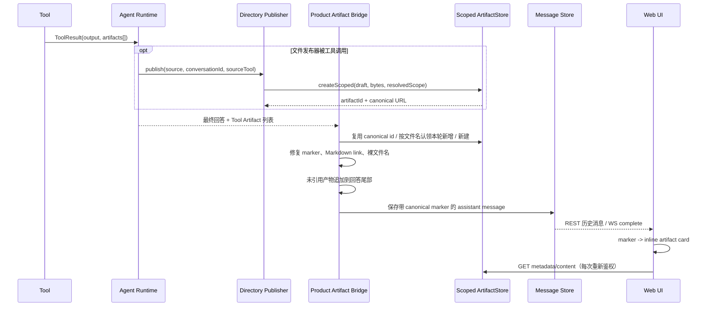
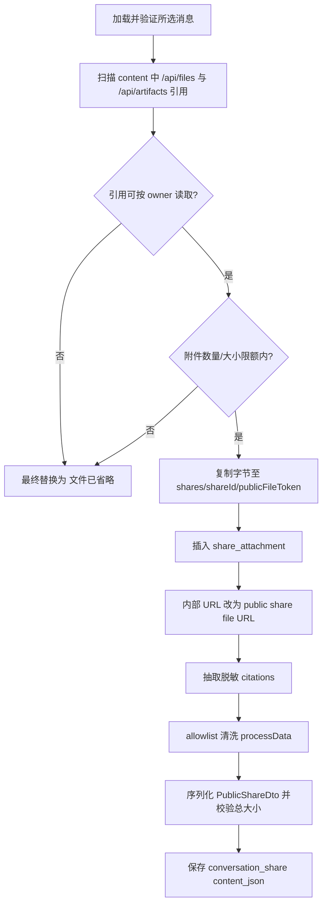

```
# T15：产物、引用证据与来源追踪流水线复刻说明

> 目标：在没有 Nova 源码、没有本次分析上下文的前提下，仅凭本文在另一个 Agent 工程中实现业务效果等价的产物发布、持久化、权限、消息绑定、引用证据、公开分享与来源追踪能力。

## 0. 证据等级与阅读约定

本文用以下标签严格区分事实、推断和建议：

| 标签 | 含义 |
|---|---|
| `I` | 已从 Nova 主仓当前实现静态确认 |
| `A` | 从 `nova_auto_test` 测试资产确认的预期/覆盖面；不代表测试已执行 |
| `K` | 已知当前缺口、风险或实现不一致 |
| `P` | 推荐复刻时采用的生产级设计，不是 Nova 当前保证 |
| `REQ` | 可直接复刻的接口、数据或规则 |
| `F` | 失败、降级或安全分支 |
| `D` | 推荐新增或修正的数据/协议设计 |

本次仅做静态分析，没有启动应用、编译或运行测试。`nova_ui_e2e` 是 UI 自动化仓，`nova_auto_test` 是跨 API/WS/浏览器的业务用例仓；二者仅作为契约证据。

## 1. 边界与结论

### 1.1 业务问题

Agent 的文本回答不是唯一输出。工具还会生成 CSV、HTML、图片、PPTX、PDF 等“产物”，回答中的事实又需要可追溯到一次工具执行或知识检索。系统必须同时解决：

1. 工具怎样声明文件副产物，而不把二进制塞进 LLM 上下文；
2. 文件怎样变成带租户、所有者、项目和可见性的持久对象；
3. 回答怎样绑定产物，页面怎样显示、预览、下载、重命名、删除和查看“版本”；
4. 引用编号怎样稳定绑定到真实工具证据；
5. 公开分享怎样冻结消息、引用和附件，同时不泄露内部 URL、知识 ID 或本地路径；
6. 内容 hash、版本、父子关系和来源链怎样保存与验收。

### 1.2 参与方和依赖

| 参与方 | 职责 |
|---|---|
| Tool / plugin | 执行业务动作，返回文本和零个或多个副产物描述 |
| Agent runtime | 执行工具循环、装饰发布器、收集事件、控制上下文保留与超长结果 offload |
| Directory publisher | 将工作区文件规范化到会话目录，并可桥接持久 ArtifactStore |
| Product artifact bridge | 把 Tool Artifact 转成产品产物，修复模型输出中的产物引用并绑定最终回答 |
| ArtifactStore | 保存元数据和字节，提供 cursor 列表、内容读取、删除、授权 |
| Citation pipeline | 给可引用工具分配 evidence token，提取载荷，最终绑定消息 ID |
| REST/WS/UI | 实时展示执行过程、消息产物卡片、作品库、引用抽屉和权限操作 |
| Share pipeline | 生成不可变公开快照、复制附件、剥离私有字段、撤销及清理 |

### 1.3 五条核心结论

- `I` Tool 的副产物、持久作品、会话文件和超长结果 offload 是四个层次，不能用一个“文件对象”混为一谈。
- `I` 持久作品的正式访问地址是 `/api/artifacts/{artifactId}/content`；`/api/files/{conversationId}/...` 是兼容文件面。
- `I` 引用的持久载体不是独立 citation 表，而是 assistant message 的 `processData.citations[]`；最终 token 在消息落库后带 `messageId` 作用域。
- `I` 分享不是给内部文件 URL 临时签名，而是复制所选消息的附件字节到 share 命名空间并保存脱敏 JSON 快照。
- `K` 当前产物表只有 payload `content_hash`，没有 `parent_artifact_id`、`version_no`、源输入 hash 或通用 lineage edge；UI 的“版本”是同会话、同 `originalFilename` 的临时归组。

## 2. 四类对象必须分开

| 对象 | 目的 | 生命周期 | 是否用户作品 | 地址/句柄 |
|---|---|---|---|---|
| Tool byproduct | 工具声明非文本输出 | 单次工具执行到 host 消费 | 尚不是 | 内存 `Artifact`，可含 bytes 或 URI |
| Persisted artifact | 可管理、可授权、可审计作品 | 独立于单次执行，直至删除 | 是 | `/api/artifacts/{id}/content` |
| Conversation file | 上传文件、工作区文件、历史兼容输出 | 依附会话目录 | 不一定 | `/api/files/{conversationId}/{path}` |
| Offloaded tool result | 避免大文本挤爆上下文 | sandbox/会话运行期 | 否 | `offloaded/{sha256}.txt` sandbox handle |

`I` 默认 offload 阈值为 8192 UTF-8 bytes。内容超过阈值时，以 SHA-256 命名写入 sandbox；timeline 只保留最多前 10 行且受字节阈值约束，并提示 LLM 用 `read_file` 读取完整结果。写失败时只保留受限预览并标注失败，不把它注册成作品。

`P` 复刻时在领域模型中分别命名 `ToolByproduct`、`ArtifactAsset`、`ConversationFile`、`ContextOffload`，禁止仅凭路径猜对象类型。

## 3. Tool 副产物 SPI

### 3.1 当前契约

```java
enum ArtifactKind { TEXT, JSON, IMAGE, FILE, BINARY }

record ToolArtifact(
    ArtifactKind kind,       // required
    String name,             // required
    String mimeType,         // nullable
    byte[] content,          // nullable
    String uri               // nullable, host 可解析地址
) {}

enum ResultRetention { EPHEMERAL, CONDENSABLE, DURABLE }

record ToolResult(
    boolean success,
    String output,           // non-null；失败惯例为 "Error: <原因>"
    ResultRetention retention,
    List<ToolArtifact> artifacts
) {}
```

`I` `artifacts` 默认空列表并防御性复制；它不会进入 LLM 消息文本，而是由 host 从 AgentResponse/事件侧消费。`retention` 控制文本结果的上下文折叠，不控制作品保留期。

文件型工具可以显式调用发布器：

```java
record ArtifactPublishRequest(
    Path source,             // required
    String name,             // required, non-blank
    ArtifactKind kind,       // required
    String mimeType,
    String conversationId,
    String sourceTool
) {}

interface ArtifactPublisher {
  ToolArtifact publish(ArtifactPublishRequest request) throws IOException;
  default void makeAccessible(Path path) throws IOException {}
}
```

`I` Runtime 会在 `sourceTool == null` 时注入当前工具名；工具显式传入时保留覆盖值。

### 3.2 工具作者规则

1. 文本摘要放 `output`，不要把 base64 或整份 CSV 放进去。
2. 二进制优先写工作区文件后发布。`K` SPI 虽能表达 bytes，但当前产品 Bridge 的入口先要求 URI，因而“只有 bytes、没有 URI”的 byproduct 实际到不了后续 bytes 持久化分支；复刻当前可用链路时必须先产出受控文件 URI，推荐设计则应把 `Bytes` 作为真正可达的封闭输入。
3. 失败必须返回 error 变体，不能用“空成功”掩盖失败。
4. 产物名必须是展示文件名，不得携带绝对路径。
5. MIME 是提示，host 必须重新校验；不能把它当安全边界。

示例：

```json
{
  "success": true,
  "output": "报告已生成。",
  "retention": "DURABLE",
  "artifacts": [{
    "kind": "FILE",
    "name": "sales-report.pptx",
    "mimeType": "application/vnd.openxmlformats-officedocument.presentationml.presentation",
    "uri": "file:/sandbox/workspace/sales-report.pptx"
  }]
}
```

## 4. DirectoryArtifactPublisher

### 4.1 当前算法

```text
publish(request):
  require request; make source accessible
  if requireScopedPublication and conversationId absent: fail
  if no conversationId:
      try legacy ArtifactStore; otherwise return file: URI
  validate conversationId matches [A-Za-z0-9._-]+
  conversationRoot = outputRoot/conversationId
  artifactsRoot = conversationRoot/artifacts
  if source under conversationRoot and not under artifactsRoot:
      return /api/files/{conversationId}/{relativePath}  // intermediate output
  if source is outside conversationRoot:
      copy to artifactsRoot/{uuid8}-{safeName}, REPLACE_EXISTING
      publishPath = copied path
  else:
      publishPath = source already under artifactsRoot
  if requireScopedPublication:
      resolve PERSONAL/PROJECT scope from persisted conversation
      persist publishPath with ScopedArtifactStore, fail closed
      return canonical /api/artifacts/{id}/content
  try legacy ArtifactStore best-effort
  return /api/files/{conversationId}/{relative publishPath}
```

`I` 所有路径均 normalize 并检查字符串路径仍位于预期根目录；外部文件复制名带 8 位随机前缀。`K` 该检查没有以 `toRealPath`/禁止跟随链接验证每一级路径，位于允许根内的 symlink 可以指向根外，随后读/复制会跟随它；因此当前不是 symlink-safe。`makeAccessible` 当前尝试设置所有用户可读，失败仅 debug 日志。

`I` scoped 模式在构造阶段要求 identity、scope resolver 和 scoped store，发布时还要求 conversationId；真正进入 deliverable 的 scoped 持久化失败会向上传播。`K` 但 `requireScopedPublication` 并不把所有会话目录文件自动升级为 scoped artifact：conversation root 内、`artifacts/` 外的 intermediate 分支先返回 `/api/files`，不会调用 resolver 或任何 store。兼容模式持久化失败仅 WARN，仍可返回文件 URL。

`K` 兼容模式可能出现“回答链接可用但作品库没有记录”；而 intermediate 分支即使开启 scoped 模式也有意只作为后续工具可读文件，不进入作品库。`D` 生产复刻应把“intermediate file”和“user-visible deliverable”作为显式 artifact role：前者可保持 conversation-scoped 临时文件并受同等读取鉴权，后者必须位于 deliverable namespace、解析 scope 并以“字节 + 元数据均成功”为发布成功；禁止仅靠落盘目录的偶然位置决定是否 fail closed。

### 4.2 自动发现候选

`I` 工作区扫描器递归、稳定排序，排除隐藏目录、VCS、依赖、缓存、虚拟环境、`dist/build/target` 等。自动发现使用扩展名 allowlist；工具显式声明的文件可绕过扩展名 allowlist，但仍不能绕过硬排除目录。

`P` 扫描器只作为便捷补偿，正式工具应显式返回 byproduct。对每次扫描记录：扫描根、排除原因、候选数、超限数和发布结果。

## 5. 产品持久化桥接与消息绑定

### 5.1 完整链路



### 5.2 Bridge 归一化规则

`I` Bridge 在运行前记录会话已有 artifact IDs，运行后做差集，用于认领本轮 Directory publisher 已经落库的对象，避免重复插入。

处理优先级：

1. URI 已是 `/api/artifacts/{id}/content`：按当前 owner 查询验证后复用；
2. 本轮已创建且同 filename：认领该行；
3. bytes 存在：代码存在直接持久化分支，但由于入口先要求 URI，bytes-only 输入当前不可达；
4. URI 是 `file:` 或 `/api/files/{conversationId}/...`：在受控 files、tmp、legacy workspace、sandbox 根下解析后持久化；
5. 无法解析：该产物跳过并记录 WARN，不阻塞文本回答。

`I` 默认单产物最大 100 MiB。Bridge 自己新建时 `sourceTool` 当前写为 `nova-core`；被认领的 publisher 行会保留真实工具名。`K` Bridge 新建调用 legacy `persist` 而不是 `persistScoped`，即使来源会话属于项目，也会丢失 PROJECT scope 并退化为 PERSONAL/owner 语义。

`K` 这会导致来源精度取决于发布路径。`P` Bridge 必须携带原 toolCallId/toolName，而不是写统一来源名。

### 5.3 Canonical marker

```text
[artifact:{"id":"a1b2c3d4","filename":"sales.csv",
"url":"/api/artifacts/a1b2c3d4/content","type":"DATA","size":12842}]
```

`I` 支持类型 `HTML|IMAGE|DOCUMENT|DATA|CODE`。Bridge 在 fenced code 之外修复：已有 marker、Markdown 链接、inline code 和裸文件名；错误或简写 marker 被移除。未在正文引用的本轮作品自动追加到末尾；重复引用去重。

同一轮同名文件被视为修订，所有引用指向最后成功持久化的对象，旧行仍保留。显式版本化文件名则是不同作品。

### 5.4 PPTX 与 slide preview

`I` PPTX 主文件与连续 slide 图片通过 metadata 建立展示关联：共享 batch id；主文件写角色、slide 数；图片写角色、PPTX artifactId、slideNumber。metadata 合并失败只 WARN。

`K` 这是特定格式的弱关系，不能替代通用 lineage。

## 6. Artifact 数据与存储契约

### 6.1 SPI 对象

```java
record ArtifactAsset(
  String artifactId,
  Identity identity,          // tenant + owner user
  String conversationId,
  String displayName,
  String originalFilename,
  String type,
  String mimeType,
  long sizeBytes,
  StorageType storageType,
  String storageRef,
  String contentHash,         // 当前仅 payload SHA-256
  String sourceTool,
  Map<String,Object> metadata,
  Instant createdAt
) {}

record ArtifactWriteScope(
  String scopeType,           // PERSONAL | PROJECT
  String scopeId,             // project scope 必填
  String visibility           // OWNER_ONLY | GRANTED | PROJECT
) {}
```

内容输入是三种封闭类型：`Bytes(byte[])`、`LocalFile(Path)`、`Stream(InputStream,size)`。`K` 当前 store 信任 draft 携带的 `contentHash`，没有对最终保存字节统一重算并比较；因此 hash 不能作为当前完整性保证。`K` store、local backend 与分享附件复制等路径存在先 `readAllBytes()`、再检查大小的实现，超大或伪报 size 的输入可在限额生效前占满堆。`D` 三类输入都应边流式读取边计数、计算 SHA-256、嗅探 MIME、写 staging，并把声明 size/hash 仅作提示，最终以实测值为准。

### 6.2 当前 DDL 的等价表达

```sql
CREATE TABLE chat_artifact (
  id BIGINT GENERATED BY DEFAULT AS IDENTITY PRIMARY KEY,
  artifact_id VARCHAR(16) NOT NULL UNIQUE,
  tenant_id VARCHAR(64) NOT NULL,
  owner_user_id VARCHAR(64) NOT NULL,
  conversation_id VARCHAR(64),
  display_name VARCHAR(255) NOT NULL,
  original_filename VARCHAR(255) NOT NULL,
  file_type VARCHAR(31) NOT NULL,
  mime_type VARCHAR(127),
  size_bytes BIGINT NOT NULL,
  storage_type VARCHAR(31) NOT NULL,
  storage_ref VARCHAR(512) NOT NULL,
  content_hash VARCHAR(64),
  source_tool VARCHAR(63),
  metadata TEXT,
  created_at TIMESTAMP(6) NOT NULL,
  project_id VARCHAR(64),
  visibility VARCHAR(32) NOT NULL DEFAULT 'OWNER_ONLY',
  UNIQUE (tenant_id, artifact_id)
);

CREATE TABLE chat_artifact_blob (
  storage_ref VARCHAR(512) PRIMARY KEY,
  content BYTEA NOT NULL,
  created_at TIMESTAMP(6) NOT NULL
);

CREATE TABLE artifact_grant (
  id BIGINT GENERATED BY DEFAULT AS IDENTITY PRIMARY KEY,
  tenant_id VARCHAR(255) NOT NULL,
  artifact_id VARCHAR(16) NOT NULL,
  grantee_user_id VARCHAR(255) NOT NULL,
  granted_by VARCHAR(255) NOT NULL,
  created_at TIMESTAMP(6) NOT NULL,
  UNIQUE (tenant_id, artifact_id, grantee_user_id),
  FOREIGN KEY (tenant_id, artifact_id)
    REFERENCES chat_artifact(tenant_id, artifact_id) ON DELETE CASCADE
);
```

推荐索引：owner 时间序、conversation 时间序、conversation+original filename、project+visibility 时间序、grantee lookup。`I/K` 当前 legacy facade cursor 编码 `epochMillis:artifactId`，而数据库时间戳可有微秒精度；同一毫秒内、位于 cursor 时间之前的行可能跨页遗漏。`D` 排序使用 `created_at DESC, artifact_id DESC`，cursor 编码完整秒+纳秒和 artifactId，并用严格 tuple comparison，保证同一时间戳稳定翻页。

### 6.3 存储后端与事务边界

`I` 默认配置可使用 `local-dir`，基目录 `data/artifacts`；另有 DB blob 后端。创建时先准备字节并计算 hash，再写 backend，最后插 metadata；metadata 插入失败会尝试删 backend，二次清理失败 WARN。

`F` backend 与数据库不是分布式事务。删除当前先删 backend 再删 metadata：若第二步失败，可能留下指向缺失内容的行。

`P` 最小生产设计应使用 staging + outbox：

```text
1. stream -> staging object; verify size/hash/virus scan
2. DB transaction: artifact=PENDING, lineage, access, outbox(PROMOTE)
3. worker promotes staging -> immutable object key
4. DB artifact=READY
5. delete: DB=TOMBSTONED + outbox(DELETE_BYTES), viewer immediately denies
6. worker deletes bytes, DB=PURGED；失败可重试
```

## 7. Scope、权限和可见性

### 7.1 写入 scope

`I` scope 必须从已持久化 conversation 解析，不能由工具自报：

- 会话不存在、已删除或不属于当前 tenant/user：拒绝；
- 无项目：`PERSONAL + null + OWNER_ONLY`；
- 有项目：先要求调用者有 project use 权限，再写 `PROJECT + projectId + PROJECT`。

### 7.2 读取规则

```text
canRead(requester, artifact):
  require tenant equal
  if requester == owner: true
  if visibility == GRANTED:
      return explicit grant exists for requester
  if visibility == PROJECT and scopeType == PROJECT:
      return requester has project view permission for exact projectId
  return false
```

`I` 不可读统一表现为 404，避免存在性泄漏；已可读但非 owner 的管理操作为 403。租户管理员没有隐式全读权限。

`I` 列表服务忽略客户端声称的 `accessibleScopeIds`，用服务端 `ProjectAccessGuard.listViewableProjectIds()` 替换；客户端 `scopeIds` 仅保留为进一步筛选。

`I` 访问更新仅 owner 可做。visibility：

- `OWNER_ONLY`：清空 grants；
- `GRANTED`：所有 grantee 必须是同租户存在用户；事务内替换全部 grants；
- `PROJECT`：作品必须属于 project scope；清空 grants。

`I` 下载还受实时租户开关控制；inline preview 不受该下载开关限制。

## 8. REST、WS 与 UI 契约

### 8.1 Artifact REST

| Method | Path | 语义 |
|---|---|---|
| GET | `/api/artifacts` | cursor 列表；支持 conversationId、keyword、projectId、personalOnly、visibility、cursor、limit |
| GET | `/api/artifacts/{id}` | 授权后元数据 |
| GET | `/api/artifacts/{id}/content?download=false` | inline/attachment 内容 |
| PATCH | `/api/artifacts/{id}` | owner 重命名，非空且 <=255 |
| DELETE | `/api/artifacts/{id}` | owner 物理删除 |
| GET | `/api/artifacts/{id}/grants` | owner 查看 grants |
| PUT | `/api/artifacts/{id}/access` | owner 替换 visibility/grantees |
| GET | `/api/artifacts/grant-candidates?artifactId=&keyword=` | 同租户候选，排除 owner，最多 100 |

`limit` 必须 1..500；`projectId` 与 `personalOnly=true` 互斥；有下一页时响应头 `X-Next-Cursor`。

```json
{
  "id": "a1b2c3d4",
  "displayName": "销售报告.csv",
  "originalFilename": "sales.csv",
  "type": "DATA",
  "mimeType": "text/csv",
  "size": 12842,
  "conversationId": "conv-42",
  "sourceTool": "metric_query",
  "projectId": "project-7",
  "projectName": "经营分析",
  "visibility": "PROJECT",
  "creator": {"userId": "u-1", "displayName": "Alice"},
  "permissions": {"canPreview": true, "canDownload": true, "canManage": true},
  "createdAt": "2026-08-13T10:00:00Z",
  "contentUrl": "/api/artifacts/a1b2c3d4/content"
}
```

### 8.2 WS 和 processData

`I` 实时 WS 发 `tool_exec_start` 和 `tool_exec_end`，载荷是竖线分隔的兼容字符串：callId、tool、截断 args/result、字节数、success、duration。稳定回放依赖结构化 `processData`，而不是解析 WS 文本。

每次工具结束写入事件：

```json
{
  "type": "tool_exec",
  "tool": "metric_query",
  "toolCallId": "call-9",
  "evidenceToken": "ev_a1b2c3d4e5f6",
  "args": "{...最多4000字符...}",
  "result": "...最多4000字符...",
  "inputBytes": 211,
  "outputBytes": 19442,
  "success": true,
  "durationMs": 832,
  "timestamp": 1786592800000,
  "toolOrdinal": 3,
  "artifacts": [{
    "id": "a1b2c3d4",
    "filename": "sales.csv",
    "url": "/api/artifacts/a1b2c3d4/content",
    "type": "DATA",
    "size": 12842
  }]
}
```

运行中断线重连可 GET `/api/chat/conversations/{id}/snapshot`，获得 status、processData JSON string 和 `lastSeq` 去重水位；完成后读取最新 assistant message 的 processData。

### 8.3 UI 行为

`I` 前端只接受 `/api/` 开头且不含空白/危险字符的 marker URL；解析失败保留原文。相同 filename 只显示最后 marker。带 ID 的卡片会实时拉元数据，因此重命名、删除、权限变化无需重载历史消息。

作品库支持搜索、预览、下载、重命名、删除、来源对话和版本入口。当前版本候选算法：`conversationId` 与 `originalFilename` 同时相同，按 `createdAt DESC` 排序。

`K` 该算法会把同名但无因果关系的文件误归版本，也无法跨会话表示派生关系。

## 9. Citation 证据流水线

### 9.1 哪些工具可引用

`I` 当前 citeable 工具集合包括指标查询、SQL、Python、归因知识、知识读取/搜索、Web 搜索/抓取和文件索引检索。仅成功事件获得 evidence token；普通产物生成不是天然引用证据。

局部 token：

```text
ev_ + first12hex(sha256(toolName + ":" + toolCallId))
```

`I/K` 截取 12 个 hex 只有 48-bit 碰撞域；当前提取/最终化链没有为同一消息内“不同 evidence 得到同 token”做显式检测或二次扩展。随着工具事件量增长，生日碰撞会先于 SHA-256 本身安全性成为边界。`D` 至少使用 128-bit token，或在 ledger 上建立 `(messageId,token)` 唯一约束；发现碰撞时用完整 evidenceId/追加确定性 nonce 重新生成，绝不能让两个证据静默映射到同一 citation。

消息落库后的 scoped token：

```text
msg{messageId}.ev_a1b2c3d4e5f6
```

### 9.2 生成、提取和最终化

```mermaid
sequenceDiagram
  participant X as Tool executor
  participant C as ProcessDataCollector
  participant H as Before-LLM hook
  participant L as LLM
  participant E as EvidenceExtractor
  participant M as MessageStore
  participant F as ScopeFinalizer
  participant UI as Citation UI
  X->>C: success event + toolCallId + args/result/artifacts
  C->>C: stable local evidenceToken + toolOrdinal
  H->>L: tool-result block + cite token reminder
  L-->>E: answer containing tokens
  E->>E: normalize aliases/legacy numeric refs; drop orphan tokens
  E->>E: map evidence payload; build citations[]
  E->>M: body + processData(local citations)
  M-->>F: messageId
  F->>F: local token -> msg{messageId}.token
  F->>M: finalized body/processData
  M-->>UI: citation badges + drawer source detail
```

`I` Before-LLM hook只给 citeable tool-result 加提醒并有幂等 marker；历史 scoped token 不重写。Extractor 若存在 toolOrdinal 就按其排序；失败事件跳过；优先使用已持久 evidenceToken，旧事件才按类型回退生成。

`I` 解析会保护 code span/fence，兼容模型语义别名和旧数字引用，删除找不到证据的 orphan token。任何解析异常 fail-soft：保留原回答/processData，不阻塞消息。

`I/K` 当前最终化是“先插入带 local token 的 assistant message，再更新为 message-scoped token”的两个数据库动作，不是一个原子事务。第二步失败时，消息会永久保留 local token，citation 也可能处于半最终化状态；fail-soft 保障了消息可见，却留下跨消息不唯一或不可点击的 orphan/local token。`D` 应在同一事务中先取得 messageId、完成 body/processData rewrite 后一次提交，或增加 `FINALIZING` 状态与可重放 finalizer；读取端在完成前不得把 local token 当稳定引用。

### 9.3 Citation DTO

```json
{
  "id": 1,
  "type": "metric",
  "token": "msg884.ev_a1b2c3d4e5f6",
  "localToken": "ev_a1b2c3d4e5f6",
  "messageId": 884,
  "conversationId": "conv-42",
  "toolName": "metric_query",
  "caption": "查询了近三月订单额",
  "interpret": "订单额连续增长。",
  "interpretSource": "ai",
  "generatedAt": "2026-08-13T10:01:00Z",
  "failed": false,
  "archived": false,
  "metadata": {
    "metricSpec": {"metrics":["order_amount"]},
    "result": {"columns":["month","amount"],"rows":[["2026-06",1200]]},
    "download": {"url":"/api/artifacts/a1b2c3d4/content"}
  }
}
```

类型包括 `metric/sql/python/knowledge/web/file/generic`。metadata mapper 按工具类型提取查询、SQL、代码、知识摘要、Web 来源或文件片段；metric/sql 的 CSV 产物可挂 `download`。

`K` processData 中 args/result 截断为 4000 字符，因此它不是完整审计账本。`P` 完整 evidence payload 应单独不可变存储，消息中仅保留 evidenceId、展示摘要和 hash。

### 9.4 Citation API 与显示

`I` favicon 辅助接口为 `GET /api/citation/favicon?domain=...`；按消息和 citationId 生成 AI 解读的接口为 `POST /api/messages/{messageId}/citations/{citationId}/interpret?conversationId=...&force=false`，可携带 `X-Nova-Lang`。生成必须重新校验登录上下文、消息与 conversation 归属。

UI 根据 type 展示不同抽屉：指标条件/结果表、SQL/数据源、Python/stdout、知识详情、Web 站点、文件片段。引用编号由最终 citations 顺序决定，不应由前端自行按 DOM 位置重算。

## 10. 公开分享

### 10.1 创建与去重

认证接口：

```http
POST /api/shares
Content-Type: application/json

{
  "sourceConversationId": "conv-42",
  "messageIds": [101, 102, 103],
  "title": "季度经营分析"
}
```

`I` 创建前校验租户分享开关、会话 owner、消息均属于该会话、消息非空。默认最多 200 条消息、快照 2 MiB、单附件 5 MiB、20 个附件、每用户 200 个 active shares。

selection hash 由 conversationId + 规范化 messageIds 计算。`I/K` 当前规范化只排序、不去重，`[101,101,102]` 与 `[101,102]` 会产生不同 hash，重复消息也可能进入快照；`D` 应先校验归属，再做稳定去重和排序。`(tenant,user,active_selection_hash)` 唯一：同选择重复创建复用 active share，可原子更新 title 与审计；并发冲突后查询胜者并复用。

`F` 并发失败路径中附件字节可能已写、DB 事务却回滚，当前只记录 orphan storage refs 供离线 GC。

### 10.2 快照和附件复制



只扫描消息 markdown 中 `/api/files/...` 和 `/api/artifacts/...`；`/api/files/local/...` 不分享。files URL 必须属于 source conversation 且不能 traversal；artifact 必须可按 tenant/user 读取。单附件失败只 WARN 并替换 `[文件已省略]`。

`K` SnapshotBuilder 当前通过 legacy owner-filtered ArtifactFacade 查询和打开内容，不走 `ArtifactAccessService` 的 GRANTED/PROJECT ACL。因而用户即使能在产品界面读取别人授权或项目共享的 artifact，也可能在创建分享时无法复制该附件，最终变成占位符。`P` 分享复制应复用统一 `requireRead(requester,artifactId)`，再叠加组织级“是否允许把共享项目内容公开分享”的独立策略；“有内部读取权”不能自动推导为“有外部公开权”。

公开附件地址：

```text
/api/public/shares/{shareToken}/files/{publicFileToken}
```

### 10.3 脱敏规则

`I` processData 使用 allowlist：保留 thinking、tool/subtool exec、agent phase、step start/complete、knowledge recall，以及 tokenStats、duration、taskPlan。删除：

- tool args/result/content/description 内内部 file/artifact URL；
- `artifacts[*].url`，仅保留 id、filename、type、size；
- knowledge recall item 的内部 id；
- 原始 citations（另行 cherry-pick，避免两份真相）；
- 所有未明确 allowlist 的未来字段。

公开 citation 按类型 cherry-pick 展示字段，并删除 metric/sql download URL、web URL、filePath、knowledge 内部 ID。知识 code 和业务内容可能仍进入快照，复刻方应依据组织的数据分级重新审查。

### 10.4 公开读取、撤销和清理

| Method | Path | 行为 |
|---|---|---|
| GET | `/api/shares?status=&page=&size=` | owner 列表；size 夹到 1..100 |
| PATCH | `/api/shares/{id}/revoke` | owner 撤销；首次 204，重复为冲突 |
| GET | `/api/public/shares/{token}` | 匿名快照；不存在/撤销/无内容统一 410 |
| GET | `/api/public/shares/{token}/files/{fileToken}` | 匿名附件；受实时 download 开关限制 |

`I` public 两类 endpoint 均按 client IP 限流，默认 60/min；快照读取增加 view counter。公开文件执行 MIME policy、`nosniff` 和安全 filename；下载开关在读取时实时计算，因此影响历史分享。`K` limiter 只是单 JVM 内存表，多节点上限按节点倍增；定时 cleanup 扫描整张 map；空 IP 直接放行；client IP 信任 `X-Forwarded-For` 而没有受信代理边界，客户端可伪造/轮换。`D` 应只在受信 ingress 后解析标准 forwarded header，无法确认来源时使用连接远端地址；用共享 Redis/token bucket 或网关限流，空地址进入独立受限桶而非放行。

撤销是两阶段：

```text
DB transaction:
  status=REVOKED
  revoked_at=now
  content_json=NULL
  active_selection_hash=NULL
  delete share_attachment rows
  write revoke audit with pending storage refs
afterCommit:
  delete each byte object
  on failure -> metric + REVOKE_CLEANUP_FAILED audit
```

删除 source conversation 时同步级联撤销 active shares，并与 conversation soft delete 共用事务；字节仍 afterCommit 删除。分享审计默认保留 90 天并有定时清理。作品本身当前没有等价 retention scheduler 或软删除。

### 10.5 分享 DDL

```sql
CREATE TABLE conversation_share (
  id VARCHAR(40) PRIMARY KEY,
  token VARCHAR(64) NOT NULL UNIQUE,
  tenant_id VARCHAR(64) NOT NULL,
  user_id VARCHAR(64) NOT NULL,
  source_conversation_id VARCHAR(40) NOT NULL,
  title VARCHAR(255) NOT NULL,
  message_count INT NOT NULL DEFAULT 0,
  content_json TEXT,
  selection_hash VARCHAR(64) NOT NULL,
  active_selection_hash VARCHAR(64),
  status VARCHAR(16) NOT NULL DEFAULT 'ACTIVE',
  view_count BIGINT NOT NULL DEFAULT 0,
  last_viewed_at TIMESTAMPTZ,
  created_at TIMESTAMPTZ NOT NULL,
  revoked_at TIMESTAMPTZ
);
CREATE UNIQUE INDEX uq_active_share
  ON conversation_share(tenant_id,user_id,active_selection_hash);

CREATE TABLE share_attachment (
  id BIGSERIAL PRIMARY KEY,
  share_id VARCHAR(40) NOT NULL,
  public_file_token VARCHAR(64) NOT NULL UNIQUE,
  mime_type VARCHAR(127) NOT NULL,
  size_bytes BIGINT NOT NULL,
  original_name VARCHAR(255) NOT NULL,
  storage_ref VARCHAR(512) NOT NULL,
  source_artifact_id VARCHAR(16),
  created_at TIMESTAMPTZ NOT NULL
);

CREATE TABLE share_audit_log (
  id BIGSERIAL PRIMARY KEY,
  share_id VARCHAR(40) NOT NULL,
  tenant_id VARCHAR(64) NOT NULL,
  user_id VARCHAR(64) NOT NULL,
  action VARCHAR(32) NOT NULL,
  metadata TEXT,
  created_at TIMESTAMPTZ NOT NULL
);
```

`K` 当前 migration 没有显式 share attachment -> share FK。`P` 应增加 FK/ON DELETE 策略，同时保留 tombstone 所需审计独立性。

## 11. Lineage、版本和来源 hash

### 11.1 当前能力与缺口

| 能力 | 当前状态 |
|---|---|
| payload 内容 hash | `I` 有，SHA-256 |
| sourceTool | `I` 有，但部分 bridge 路径退化为 `nova-core` |
| conversationId | `I` 有 |
| project/owner/visibility | `I` 有 |
| 同名修订展示 | `I` 有，运行时/前端推断 |
| parent artifact | `K` 无 |
| version number / logical asset id | `K` 无 |
| source input hash | `K` 无 |
| tool call/run/model/prompt version | `K` 无通用字段 |
| citation -> artifact/evidence 外键 | `K` 无 |

### 11.2 推荐生产数据模型

```sql
ALTER TABLE artifact ADD COLUMN logical_asset_id UUID NOT NULL;
ALTER TABLE artifact ADD COLUMN version_no INT NOT NULL;
ALTER TABLE artifact ADD COLUMN parent_artifact_id VARCHAR(16);
ALTER TABLE artifact ADD COLUMN source_run_id VARCHAR(64);
ALTER TABLE artifact ADD COLUMN source_tool_call_id VARCHAR(128);
ALTER TABLE artifact ADD COLUMN source_input_hash CHAR(64);
ALTER TABLE artifact ADD COLUMN payload_hash CHAR(64) NOT NULL;
ALTER TABLE artifact ADD COLUMN status VARCHAR(16) NOT NULL DEFAULT 'PENDING';
CREATE UNIQUE INDEX uq_asset_version ON artifact(logical_asset_id, version_no);

CREATE TABLE provenance_edge (
  tenant_id VARCHAR(64) NOT NULL,
  from_kind VARCHAR(32) NOT NULL,
  from_id VARCHAR(128) NOT NULL,
  relation VARCHAR(32) NOT NULL,
  to_kind VARCHAR(32) NOT NULL,
  to_id VARCHAR(128) NOT NULL,
  run_id VARCHAR(64),
  created_at TIMESTAMPTZ NOT NULL,
  PRIMARY KEY(tenant_id,from_kind,from_id,relation,to_kind,to_id)
);
```

推荐 relation：`DERIVED_FROM`、`GENERATED_BY`、`CITED_BY`、`SNAPSHOTTED_AS`、`PREVIEW_OF`、`SUPERSEDES`。

```text
sourceInputHash = SHA256(canonicalJson({
  toolName, toolVersion, normalizedArgs,
  inputArtifactPayloadHashes,
  modelId, promptTemplateVersion
}))
```

`P` 幂等键应是 `(tenant, sourceRunId, toolCallId, declaredOutputOrdinal, payloadHash)`；版本号在 logical asset 行上原子递增。不能把 filename 当 lineage key。

## 12. 并发、幂等与非正常路径矩阵

| 场景 | 当前行为 | 推荐补强 |
|---|---|---|
| 同一工具重试发布相同 bytes | 可能新 artifactId | 用 producer idempotency key 返回既有对象 |
| 同轮同名多次生成 | 最后成功对象接管引用，旧行保留 | 建 SUPERSEDES edge 和显式 version |
| artifact DB 写失败 | 尝试删 backend；失败 WARN | staging/outbox/GC |
| artifact 删除 DB 失败 | 可能内容已删、行仍在 | 先 tombstone，再异步删 bytes |
| Bridge 单个 URI 不可解析 | 跳过，回答继续 | processData 写 rejected artifact reason |
| citation 提取失败 | 回答继续，引用可能未结构化 | 原始 evidence ledger 单独持久化 |
| share 单附件失败/超限 | 占位符，其他内容继续 | UI 显示 omittedItems 结构化原因 |
| share 同选择并发创建 | DB unique 选胜者；败者字节可能 orphan | 先抢 dedup lease 或 staging namespace |
| share 撤销字节删除失败 | viewer 已 410，审计失败 ref | 可重试 outbox + dead letter |
| artifact grant 与读取并发 | 每次读取重新鉴权 | 内容流开始前和签名 URL 生成时绑定短 TTL ACL 版本 |
| conversation 删除 | 分享同步撤销；作品另行 cleanup | 明确作品保留策略：删除、转个人库或 legal hold |

## 13. 安全与可观测性

### 13.1 安全控制

**CURRENT（静态代码可确认）**：

1. `I` artifact ID 查询走 tenant/owner/ACL 约束，不可读资源采用隐藏存在性的响应语义；scope resolver 从持久 conversation 绑定推导 project，而不是信任工具自报。
2. `I/K` 路径执行绝对化、normalize 和字符串根目录检查，可挡住普通 `..`；没有 `toRealPath`/逐级禁止跟随链接，不能宣称可拒绝 symlink escape。
3. `I/K` public share 文件响应存在 MIME policy、`nosniff` 与安全 filename 处理；认证 artifact content 路径直接信 metadata MIME，且没有同等级 `nosniff`/隔离策略。
4. `I/K` 多处存在 100 MiB 等限制，但部分路径先 `readAllBytes()` 再检查，不能宣称限额能阻止内存耗尽；总快照/配额/并发限制也不是统一保证。
5. `I` public share token 是 32 字符字母数字随机值；`K` 数据库存明文 token。
6. `I` share/processData sanitizer 使用字段 allowlist；payload hash 不能作为授权。

**HARDENED（生产复刻必须补足）**：

1. `D` 所有 ID 查询先 tenant 再 ACL，不可读返回 404；trusted worker 的跨租户访问另建审计能力。
2. `D` conversation scope 只能由持久绑定解析，禁止工具指定 projectId/owner。
3. `D` path 只接受一次规范化输入，逐级拒绝符号链接或以安全目录句柄打开；拒绝双重 decode、绝对路径、控制字符和根外 real path。
4. `D` 边流式读取边计数、计算 hash 和嗅探 MIME；危险 HTML/SVG/脚本强制 attachment 或独立无认证 origin 的 sandbox iframe。
5. `D` 所有下载统一 `nosniff` 与安全 Content-Disposition，filename 去 CR/LF、路径与控制字符。
6. `D` token 使用 CSPRNG 且只存 hash；processData/share 继续默认拒绝的新字段 allowlist。
7. `D` 同时限制单文件实测字节、总快照、附件/消息数、分页、并发、租户配额和解压后大小。

`I/K` 认证后的 `/api/artifacts/{id}/content` 当前直接采用 metadata 中的 MIME，允许 inline，并只设置 Content-Type/Content-Disposition/Content-Length；它没有 public-share 下载路径的 MIME policy，也没有 `X-Content-Type-Options: nosniff`、HTML/SVG 隔离或 CSP。服务端“已鉴权”不能替代主动内容安全，伪造 MIME 的 owner 文件仍能攻击同 origin 用户。`D` 认证与匿名下载必须复用同一个内容策略：重新嗅探或读取保存时的可信检测结果，危险类型强制 attachment 或隔离 origin，所有响应 nosniff，HTML 预览使用 sandbox+CSP。

`I/K` 产品侧短 artifact reference ID 由 UUID 文本截取 8 个 hex 形成，仅 32-bit，创建路径没有统一的数据库唯一冲突重试契约；规模增长后可能因碰撞使一次合法发布失败。`D` 使用完整 UUID/ULID（至少 128-bit），数据库 unique 冲突时重新生成并有限重试，同时保持 producer idempotency key，避免重试生成重复资产。

### 13.2 指标、日志和追踪

当前分享指标包括：

- `nova_share_create_total{outcome=created|reused|rejected}`；
- `nova_share_view_total{outcome=ok|gone|rate_limited}`；
- `nova_share_revoke_total{reason=MANUAL|CASCADE}`；
- `nova_share_attachment_cleanup_failed_total`。

`P` 增加：publish latency/bytes/outcome、bridge resolution reason、artifact orphan count、hash mismatch、ACL denied、citation orphan token、evidence extraction failure、share omitted attachment、outbox lag、GC reclaimed bytes。

统一 trace fields：`tenantId,userId,conversationId,runId,toolCallId,artifactId,evidenceId,messageId,shareId`。日志不能写原始 token、API key、完整工具结果或私有 URL。

## 14. 最小可生产复刻方案

### 阶段 1：先实现稳定核心

1. ToolResult + byproduct SPI；
2. scoped publisher，强制 tenant/user/conversation scope；
3. metadata DB + immutable object storage + SHA-256；
4. Artifact REST、404/403 语义、owner/grant/project ACL；
5. canonical marker + UI 卡片；
6. processData tool event + local/scoped evidence token + citation DTO；
7. share snapshot copy + allowlist sanitizer + 410 revoke。

### 阶段 2：补生产一致性

1. staging/outbox、异步 promote/delete、可重试 GC；
2. logical asset/version/lineage edge；
3. evidence ledger 独立存储；
4. quota、恶意文件扫描、隔离预览；
5. lifecycle/retention/legal hold。

### 关键伪码

```text
publishByproduct(ctx, byproduct):
  scope = conversationScopeResolver.requireOwned(ctx, ctx.conversationId)
  stream = resolveWithinSandbox(byproduct)
  inspected = streamToStagingAndInspect(stream, limits, mimePolicy)
  key = idempotencyKey(ctx.runId, ctx.toolCallId, ordinal, inspected.hash)
  begin transaction
    existing = findByProducerKey(ctx.tenantId, key)
    if existing: return existing
    asset = insert PENDING artifact + scope + source metadata
    insert lineage edges
    insert outbox PROMOTE
  commit
  return asset marker only after READY, or emit pending event and finalize later
```

```text
finalizeAssistantMessage(draftBody, processData):
  evidence = extractSuccessfulCiteableEvents(processData.events)
  normalizedBody = replaceAliasesAndDropOrphans(draftBody, evidence)
  localCitations = mapCitationsInFirstAppearanceOrder(normalizedBody, evidence)
  messageId = insertMessage(normalizedBody, processData + localCitations)
  scoped = rewriteTokens(local -> "msg" + messageId + "." + local)
  updateMessage(messageId, scoped.body, scoped.processData)
  return messageId
```

## 15. 验收标准

### 15.1 主流程

1. 工具生成 CSV：回答含一张卡片，作品库出现一行，下载 hash 与生成文件一致；processData 记录 toolCallId 与 artifactId。
2. 项目会话生成作品：项目 viewer 可读，普通同租户用户不可读且收到 404；owner 可改为 GRANTED 并选择同租户用户。
3. 同轮覆盖同名文件：回答只指向最后成功版本；旧版本仍可通过版本历史访问；若采用 `D`，存在 SUPERSEDES edge。
4. 指标查询回答使用 evidence token：消息落库后 body 和 citation DTO 使用 scoped token，点击引用显示对应查询而不是其他工具结果。
5. 选择消息创建分享：匿名窗口可看冻结内容；内部 artifact URL 不出现；附件从 public share URL 读取。

### 15.2 反向与安全场景

| 测试 | 预期 |
|---|---|
| 非 owner 猜 artifactId | 404，无名称/大小泄漏 |
| 非 owner rename/delete/access | 403 或不可见 404，数据不变 |
| GRANTED 用户被移除 | 下一次 metadata/content 立即拒绝 |
| project 权限撤销 | PROJECT 作品立即不可读 |
| filename 含 `../`、CRLF、绝对路径 | 发布拒绝或 basename 化，响应头无注入 |
| MIME 伪造 HTML 为图片 | 服务端识别/隔离，不在主 origin 执行 |
| 大于上限 | 不落 metadata，不留 staging；结构化错误 |
| orphan citation token | token 从自然语言回答移除，不生成错误 citation |
| failed tool event | 无 evidence token/citation |
| 分享引用跨会话 file URL | 被替换为 `[文件已省略]` |
| 分享撤销 | public JSON 与附件均不可访问；JSON 统一 410 |
| 下载租户开关关闭 | artifact download/share attachment 403，inline preview 按策略保留 |

### 15.3 并发与恢复

1. 100 个相同 idempotency key 并发发布，只产生一个 READY artifact；
2. metadata commit 失败，staging 最终被 GC；
3. 删除字节失败，artifact 已不可见且 outbox 重试，告警可定位；
4. 相同消息选择并发创建分享，只返回一个 active share，无永久 orphan bytes；
5. WS 断线后 snapshot + lastSeq 恢复不重复 tool event/artifact card；
6. cursor 下多条相同 createdAt 不重不漏。

## 16. 三仓测试资产与覆盖缺口

### 16.1 Nova 主仓

`I` 单元/集成测试覆盖：Tool artifact record、Directory publisher 的路径/bridge、cursor、store 数据类型、publisher/scope/access/application service、artifact controller、legacy resolver、bridge marker 修复、cleanup、ProcessData artifact/toolOrdinal、evidence extractor/finalizer/token rewrite、share snapshot/sanitizer/dedup race/revoke/cleanup/rate limit/public smoke、前端 marker/card/API/版本归组。

### 16.2 nova_ui_e2e

`A` `agent-artifacts.spec.ts` 覆盖搜索、来源对话、非空下载、临时作品重命名/删除和版本入口；仍主要通过兼容 `/api/files/all-artifacts` 获取作品。

`A` `agent-conversation-share.spec.ts` 覆盖单轮/全选/部分/清空、匿名只读快照、owner 管理、撤销后 410、创建/撤销 500 UI 状态、快速重复点击只发一次请求、状态筛选和非法 token 不泄漏。

### 16.3 nova_auto_test

`A` 用例目录声明引用与证据 39 条、文件与产物 47 条、分享与嵌入 25 条；覆盖 token 替换、证据载荷、interpret、favicon、引用合规/渲染、文件 IO/读取/表格/artifact/chart/widget/index，以及分享创建/公开页/权限与撤销。浏览器 runner 还包含生成 HTML 报告并检查产物标题的 case。

### 16.4 建议新增的关键测试

- `P` 跨 tenant artifact/share/sourceArtifactId 注入；
- `P` symlink escape、双重 URL decode、Unicode 文件名、CRLF header；
- `P` storage 写成功 DB 失败、DB tombstone 成功 delete 失败、outbox 重放；
- `P` true lineage/version，而非只验证“版本入口存在”；
- `P` evidence payload hash、截断边界、历史 scoped token 多轮引用；
- `P` share 快照中所有未来未知字段默认被剥离；
- `P` 大文件流式处理的内存上限，避免 `readAllBytes()` OOM。

## 17. 配置基线

```yaml
nova:
  artifact:
    storage:
      type: local-dir        # 生产建议 object-storage
      base-dir: data/artifacts
      max-size-bytes: 104857600
  share:
    max-messages: 200
    max-snapshot-bytes: 2097152
    max-attachment-bytes: 5242880
    max-attachments-per-share: 20
    max-active-per-user: 200
    view-rate-limit-per-minute: 60
    audit-retention-days: 90
```

`P` 所有配置需要 Java/default schema 默认值、example 文档、启动校验和运行指标暴露。artifact retention、staging TTL、GC 周期、病毒扫描、HTML 隔离 origin、tenant quota 与 outbox retry 是当前配置基线之外必须补齐的生产项。

## 18. 证据追溯附录

关键证据来自以下实现域，路径仅用于审计，不承担正文解释：NovaCore tool/artifact SPI 与 runtime publisher/offloader；产品 artifact bridge、scope/access/application service/controller/store migrations；ProcessData collector、citation hooks/extractor/finalizer；share snapshot/sanitizer/service/public controller/cleanup/migrations；Web artifact parser、卡片、作品库与版本 dialog；`nova_ui_e2e` artifact/share specs；`nova_auto_test` citation/files/share case catalogs。

最终验收应以本文契约和场景为准，而不是以类名存在或接口返回 200 为准。

```
