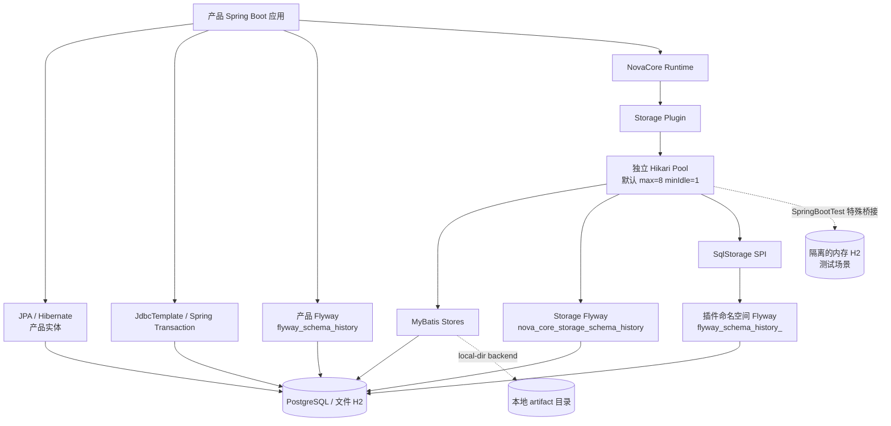
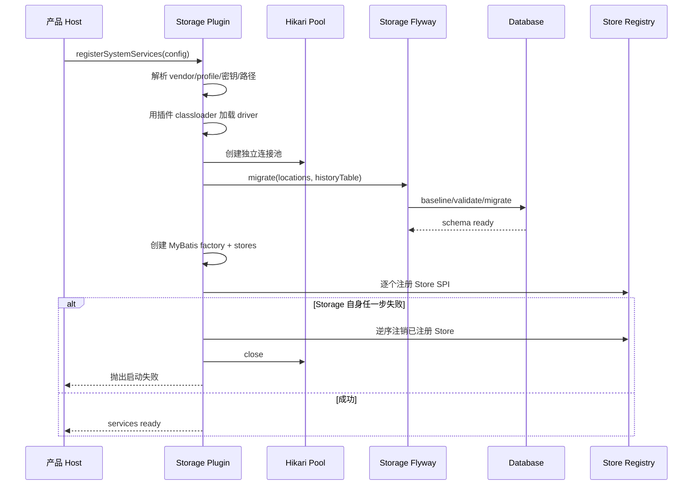
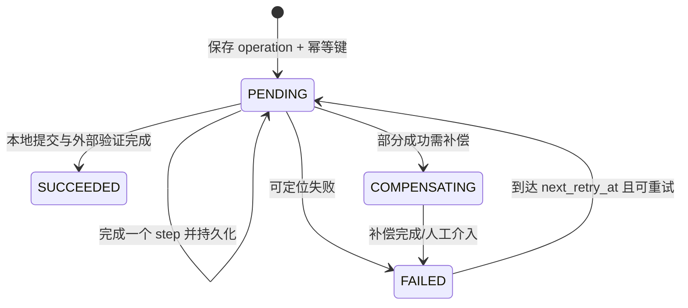
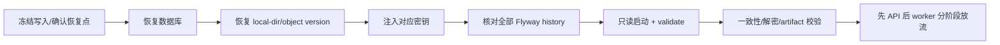

```
# T16：持久化、Flyway 与租户分区复刻说明

> 目标：读者在没有 Nova 源码、没有本会话上下文的情况下，能够复刻等价的持久化拓扑、迁移所有权、事务边界、租户隔离和灾备流程。
>
> 事实标记：`[I]` 为从当前实现静态确认的事实；`[A]` 为合理推断但未运行验证；`[K]` 为已知限制或风险；`[P]` 为已有规划或待实现能力；`[REQ]` 为当前必须保持的运行规则；`[F]` 为当前失败语义；`[D]` 为建议的生产级复刻设计。本文未启动服务、未连接真实数据库，也未执行迁移或测试。所有运维步骤另以 `CURRENT`（当前可执行）和 `HARDENED`（完成建议增强后才成立）闭合，不能把 `[REQ]` 或 `[D]` 当成当前工具已经提供的保证。

## 1. 边界与核心结论

本模块解决四类问题：

1. 为产品业务提供 PostgreSQL/H2 持久化，并让 Hibernate 只校验、不建表。
2. 为不依赖 Spring 的 Agent 内核和插件提供统一 Store SPI、JDBC、MyBatis 与独立迁移能力。
3. 在同一物理数据库中明确“谁拥有哪张表、哪组迁移、哪段事务”。
4. 用 `tenant_id + user_id + object scope` 组合表达租户、个人、项目和对象授权边界。

最重要的复刻结论如下：

- `[I]` Nova 不是“一个 DataSource、一个 Flyway、一个全局事务”。产品应用、NovaCore 存储插件、插件自有命名空间是三个迁移/事务域。
- `[I]` 产品域使用 Spring Data JPA/JdbcTemplate 和产品 Flyway；NovaCore 存储插件自己创建 Hikari 连接池，使用 MyBatis/JDBC 和独立 Flyway 历史表；业务插件通过 `SqlStorage` 再创建命名空间历史表。
- `[I]` PostgreSQL 与文件 H2 部署中，产品域和存储插件通常指向同一个物理库，但仍是两个连接池。Spring `@Transactional` 不会自动包住 MyBatis `SqlSession` 或插件直接取得的 JDBC `Connection`。
- `[I]` 产品 Flyway 开启 `validate-on-migrate` 和 `out-of-order`；存储插件主迁移开启 validate、未显式开启 out-of-order；插件命名空间迁移同时开启 validate 和 out-of-order。
- `[I]` 租户隔离主要由表字段、复合查询条件、复合唯一键/外键和服务层身份检查共同完成，不是数据库 Row Level Security。
- `[K]` 通用 JPA `TenantAwareEntity` 的监听器只在插入时补 tenant/user，既不做查询过滤，也不会在上下文缺失时拒绝写入；旧表部分 tenant/user 列仍可空。因此它不能被当作安全边界。
- `[D]` 生产复刻应把迁移所有权清单、事务域、租户谓词和备份单元当成显式契约，并用数据库约束与集成测试证明，而不是依赖约定。

### 1.1 输入、输出与依赖

| 类别 | 内容 |
|---|---|
| 输入 | JDBC vendor、连接 URL、账号密码、Hikari 参数、Flyway profile/history/baseline 开关、加密密钥、租户/用户身份、Store 请求、迁移包 |
| 输出 | 迁移后的 schema、产品实体数据、会话/消息、配置、artifact 元数据与内容、插件自有数据、审计与运行状态 |
| 依赖 | PostgreSQL 14+ 或 H2、HikariCP、Flyway、Spring Data JPA/Hibernate、MyBatis、JDBC、文件系统（可选 artifact backend） |
| 不负责 | 业务数据库的数据查询本身、对象存储服务实现、数据库账号生命周期、跨服务分布式事务、数据库 RLS 策略 |

## 2. 持久化拓扑



### 2.1 三个所有权域

| 域 | schema 所有者 | 数据访问 | 默认历史表 | out-of-order | 典型表 |
|---|---|---|---|---|---|
| 产品域 | 产品应用 | JPA、Repository、JdbcTemplate | `flyway_schema_history` | 开启 | project、task、capability、knowledge、datasource、share 等 |
| NovaCore 存储域 | Storage Plugin | MyBatis Store、JDBC | 独立部署默认 `flyway_schema_history`；产品集成默认 `nova_core_storage_schema_history` | 未显式开启 | conversation、message、config_kv、chat_artifact、compaction_checkpoint |
| 插件命名空间域 | 各业务插件 | `SqlStorage` 的 Connection/DataSource | `flyway_schema_history_<namespace>` | 开启 | 插件私有表 |

`[I]` 产品集成模式下会出现“产品 Flyway 创建会话基础表，存储插件 Flyway追加共享列/索引”的共同演进。它不是任意共享：基础表由产品迁移拥有，存储插件只扫描 shared migration 集合。

`[D]` 复刻时维护一份机器可检查的表所有权清单：每张表只能有一个基础 DDL 所有者；其他域若需扩展，必须登记扩展迁移、执行先后和兼容窗口。

## 3. 数据源与启动顺序

### 3.1 vendor 契约

当前支持：

- H2 文件库：`jdbc:h2:file:<absolute-path>;AUTO_SERVER=TRUE;MODE=PostgreSQL`
- H2 内存库：`jdbc:h2:mem:<name>;MODE=PostgreSQL;DB_CLOSE_DELAY=-1`
- PostgreSQL：调用方提供完整 `jdbc:postgresql://...` URL

`[I]` vendor 只接受 H2 和 PostgreSQL。存储插件会用自己的 classloader 显式加载 JDBC driver，以兼容隔离插件类加载器。

### 3.2 Storage Plugin 配置契约

```yaml
storage:
  vendor: postgresql                 # h2 | postgresql；默认 h2
  postgresql:
    jdbc-url: jdbc:postgresql://db:5432/nova
    username: nova                   # 默认 nova
    password: ${NOVA_DB_PASSWORD}    # 默认空，不应在生产使用
  h2:
    path: /var/lib/nova/storage      # 默认 ~/.nova/data/storage
    username: sa
    password: ""
  hikari:
    max-pool-size: 8
    min-idle: 1
  flyway:
    enabled: true
    profile: v1-aligned              # greenfield | v1-aligned
    history-table: nova_core_storage_schema_history
    baseline-on-migrate: true
    baseline-version: "0"
  artifact:
    default-storage-type: db         # db | local-dir
    max-size-bytes: 104857600        # 100 MiB
    local-dir:
      base-path: /var/lib/nova/artifacts
  conversation:
    encryption:
      enabled: false
      key: ${STORAGE_CONVERSATION_ENCRYPTION_KEY}
```

`[I]` Hikari 只显式设置 URL、账号、密码、最大池、最小空闲和 pool name；连接超时、idle timeout、max lifetime、leak detection 等采用 Hikari 默认值。

`[D]` 生产配置应显式给出 connection timeout、validation timeout、max lifetime（小于数据库/NAT 连接寿命）、leak detection、只读副本策略和连接预算。连接预算必须把 Spring pool、Storage pool、业务数据源 pool、后台 worker 一起计入。

### 3.3 启动管线



注册的核心服务包括 `ConversationStore`、`ConfigStore`、`SqlStorage`、`ArtifactStore`、`ScopedArtifactStore`、`CompactionStore`。`[I]` Storage 自身的 Store 注册循环发生异常时，会逆序注销已经登记的 Store，并关闭池；数据库已经提交的 Flyway migration 不会回滚。

`[I/K]` 这里存在两个不同的失败边界，不能合称“进程内 all-or-nothing”：

1. Storage 自身的 migration、MyBatis、加密抽样或 Store registration 失败，会进入它自己的清理逻辑。
2. Storage 已成功注册后，Core 继续调用后面的 SystemPlugin；若后续插件注册系统服务失败，Core 当前没有统一 rollback 已成功的前序插件。Storage 的池和 Registry 中指向 Store 的引用不会因为“另一个插件失败”自动清理。

`[K]` `registerSystemServices` 按插件契约本应更接近注册轻量服务，但 Storage 在该阶段执行 driver loading、创建连接池、数据库 migration、加密抽样和 MyBatis 构建等重 I/O。`start()` 反而为空。这让失败回滚、启动时序和“注册完成是否可用”的含义变得模糊。

真实当前时序是：

```text
产品 Flyway
-> Storage registerSystemServices 中迁移 storage/shared schema 并注册 Store
-> Core 完成 Router/Runtime assembly 和其他 SystemPlugin registration
-> 插件按顺序 start
-> Tasks/CAN/IM 等插件在各自 start/bind 阶段逐个调用 SqlStorage namespace migration
```

`[K]` 因此 namespace migration 不是一个先于所有插件 start 的原子批次。前几个 namespace 已迁移/插件已启动后，后一个失败时，当前 Core 没有完整的逆序 stop；数据库也会保持已提交的半套 migration，进程处于启动异常而非可继续服务状态。

`[D]` 加固版应拆成 `prepare()`（纯校验）、统一 migration phase、`register()`（无 I/O 或可回滚注册）、`start()`，并由 Core 保存 initialized/started 栈。任何后续失败都逆序 stop、unregister、close，同时承认 Flyway DDL 是持久事实，只能前向修复，不能假装事务回滚。

## 4. Flyway profile、历史表与版本策略

### 4.1 `greenfield` 与 `v1-aligned`

| profile | 扫描位置 | 使用场景 | baseline version |
|---|---|---|---|
| `greenfield` | storage greenfield + shared | 独立 NovaCore，或隔离的内存 H2 | 默认 1 |
| `v1-aligned` | 仅 storage shared | 产品 Flyway已拥有基础 chat schema | 产品桥接强制 0 |

`[I]` 产品桥接对 PostgreSQL和文件 H2 强制使用 `v1-aligned`；对测试用内存 H2 指向另一个隔离库并强制使用 `greenfield`。这样避免 Hibernate create-drop、产品 Flyway和 Storage Flyway争抢同一组基础表。

`[I]` 如果产品 Flyway整体关闭，桥接也会把 Storage Flyway关闭，假定 schema 已由外部系统管理。

### 4.2 为什么需要多张历史表

Flyway 的历史表只描述其扫描位置中的 migration。将不同所有者混入同一历史表会导致：

- 版本号碰撞；
- 插件卸载后校验失败；
- 不同 classloader 看不到对方 migration；
- 无法独立升级插件。

因此命名如下：

```text
flyway_schema_history                 产品域
nova_core_storage_schema_history     产品集成中的 Storage 域
flyway_schema_history_<namespace>     每个业务插件域
```

插件 namespace 必须匹配 `[a-z][a-z0-9_]{0,39}`；migration classpath 必须是相对路径且不能含 `..`。命名空间迁移固定 baseline version 0、validate true、out-of-order true。

### 4.3 版本命名

- 基线可以使用 `V1__baseline.sql`。
- 后续 migration 使用 UTC/团队统一时区的分钟时间戳：`VyyyyMMddHHmm__description.sql`。
- 已提交 migration 不允许修改；只能追加。
- PostgreSQL 与 H2 各写一份同版本文件。

`[K]` out-of-order 只解决并行分支中“较小版本晚到”的应用问题，不解决两个 migration 对同一列做不兼容修改的问题。

`[K]` `baseline-on-migrate=true` 可能让一个非空、未知来源的 schema 被标记为已基线，而不是证明其结构正确。Hibernate validate 只覆盖映射实体，也不覆盖全部索引、约束和 MyBatis 表。

`[D]` 新环境上线前先运行 schema fingerprint/preflight：校验数据库名、schema、历史表、关键表/列/约束和当前版本，匹配允许的来源后才准 baseline。

### 4.4 可复制的 migration 模板

PostgreSQL：

```sql
-- V202608131030__add_job_lease.sql
ALTER TABLE agent_job ADD COLUMN lease_token varchar(64);
ALTER TABLE agent_job ADD COLUMN lease_until timestamp(6);

CREATE INDEX idx_agent_job_claim
    ON agent_job (tenant_id, status, lease_until, created_at);

ALTER TABLE agent_job ADD CONSTRAINT ck_agent_job_status
    CHECK (status IN ('PENDING', 'RUNNING', 'SUCCEEDED', 'FAILED'));
```

H2：

```sql
-- 同版本、同语义；不要假设 PostgreSQL 的 DO $$、partial index、BYTEA 可直接执行
ALTER TABLE agent_job ADD COLUMN lease_token varchar(64);
ALTER TABLE agent_job ADD COLUMN lease_until timestamp(6);

CREATE INDEX idx_agent_job_claim
    ON agent_job (tenant_id, status, lease_until, created_at);

ALTER TABLE agent_job ADD CONSTRAINT ck_agent_job_status
    CHECK (status IN ('PENDING', 'RUNNING', 'SUCCEEDED', 'FAILED'));
```

对于大表/在线升级，采用 expand-migrate-contract：

1. 新增 nullable 列或带安全 default 的列。
2. 部署同时兼容旧列和新列的代码，必要时双写。
3. 分批回填，记录游标和失败行。
4. 校验空值、重复值、引用完整性。
5. 创建唯一索引/外键；PostgreSQL 大表可用在线索引策略。
6. 新代码切换只读新列。
7. 下一版本再收紧 `NOT NULL` 或删除旧列。

## 5. Store SPI 与持久化实现

### 5.1 Store Registry

内核通过稳定 SPI 取存储能力，而不是依赖产品 JPA：

```java
interface StoreRegistry {
  <T> void register(Class<T> contract, T implementation);
  <T> Optional<T> find(Class<T> contract);
  void unregister(Class<?> contract);
}
```

Store 应在插件初始化期注册、停止期释放；插件不能把 Hikari、Connection 或 SqlSession 放到 static 字段。

`[I/K]` 当前 `stop()` 只关闭 Hikari 并清空 StoragePlugin 自己的字段；它没有从 StoreRegistry 注销已发布 Store。Registry 仍可能持有指向已关闭 DataSource 的对象。NovaCore shutdown 后不支持在同一 Core 实例上重新 start；不要把 stop/start 当热重启协议。`[D]` Registry 应返回 registration handle，stop 时先原子撤销可见性再关资源，或由 Core 在销毁 Registry 时整体失效所有引用。

### 5.2 `SqlStorage` 契约

```java
interface SqlStorage {
  DatabaseDialect dialect();
  DataSource dataSource();
  SqlMigrationResult migrate(SqlMigrationRequest request);

  default <T> T withConnection(SqlFunction<Connection,T> action) { ... }
  default <T> T inTransaction(SqlFunction<Connection,T> action) { ... }
}
```

`inTransaction` 的语义：

```text
取得新连接 → 保存 autoCommit → autoCommit=false
→ 执行业务 callback
→ 成功 commit
→ 失败 rollback，rollback 异常作为 suppressed
→ 恢复 autoCommit → close
```

它只覆盖同一个 callback 使用的这个 Connection。业务插件如果在 callback 内调用另一个 Store，而那个 Store另开 MyBatis session，就已经跨出事务。

### 5.3 MyBatis Store 的提交语义

`[I]` 会话和配置 Store 的大部分公共方法都 `openSession(true)`。这不只表示“一个 Store 方法一个事务”：一个方法内部若依次执行多条 mapper statement，每条 statement 都可能在完成时提交。后续 statement 失败时，前面的 append/update/delete 已无法 rollback。artifact 的“更新可见性 + 删除旧 grant + 插入新 grant”显式使用 `openSession(false)`，成功 commit、失败 rollback。

这意味着典型边界为：

| 操作 | 当前原子范围 |
|---|---|
| config get/set/delete | 单个 Store 方法 |
| conversation/message 单次写 | 常见为单 statement；多 statement 方法在 auto-commit 下可部分提交 |
| artifact visibility 与 grant 列表 | 一个显式 MyBatis 事务 |
| artifact blob + metadata | 非全局原子；取决于 backend |
| Spring service 多个 JPA repository | 一个 Spring 事务（仅 Spring DataSource） |
| Spring service + NovaCore Store | 两个独立事务 |

`[K]` 典型危险操作包括“先插 message，再更新 conversation last-message/status”和“先软删/删关联，再更新聚合字段”。只要它们由一个 `openSession(true)` 方法里的多个 statement 完成，就可能留下半状态。

`[D]` 所有声明为原子的复合 Store 操作必须使用 `openSession(false)` 或 `SqlStorage.inTransaction` 并显式 commit/rollback；无法合并事务的流程应持久化 operation/run id、对每一步建立唯一键，并提供幂等 repair/reconciliation。

### 5.4 有身份与无身份 Store 表面

`[I]` 不能宣称所有 ConversationStore SQL 都包含 tenant 条件。公共 SPI 仍保留 `get(messageId)` 这种无 Identity 的兼容方法，MyBatis 实现会按 message 主键直接读取并解密；带身份的重载 `get(messageId, identity)` 才在 SQL 中使用 tenant/user owner 条件。存储扩展还提供 `inspectAccess(conversationId)`，它按会话 ID 返回 owner/deleted/type，供产品先做对象访问判定。

这些无 scope 方法属于 privileged surface，而不是普通 Controller 可调用的租户 API：

| 表面 | 当前用途/语义 | 风险 | 复刻约束 |
|---|---|---|---|
| `ConversationStore.get(id)` | 兼容、内部按主键取 message | 在授权前读取/解密跨租户内容 | 标 `@Privileged`; 禁止 Web/service 普通路径注入 |
| mapper `findById(id)` | Store 内部无 scope 查询 | 主键即成为跨租户能力 | 只允许受审计 maintenance port |
| `inspectAccess(conversationId)` | 返回 owner 和对象状态供上层授权 | 泄漏对象存在与 owner；若直接回传更严重 | 仅授权组件调用，结果不回显客户端 |
| tenant-admin inspection | 管理/修复能力 | 范围过宽 | 要求 tenant-admin authority + audit + tenant predicate |

`[REQ]` 普通产品读写必须选择显式 Identity 方法，并在 SQL 中授权后再解密 protected columns。`[D]` 下一版 SPI 应移除默认无身份读取，拆成 `TenantConversationStore` 与受审计的 `ConversationMaintenanceStore`。

## 6. 事务边界与跨域一致性

### 6.1 不能做的假设

下面的代码看似一个事务，实际不是：

```java
@Transactional
public void createProjectAndConfig(...) {
  projectRepository.save(project);       // Spring transaction
  configStore.set("project.x", id, cfg); // MyBatis auto-commit, independent pool
}
```

若第二步成功、Spring commit 失败，会留下孤立配置；反过来也可能只留下 project。

### 6.2 当前用于跨系统的模式

Project gateway operation 表体现了推荐的 saga/outbox 思路：持久化 `operation_id`、`tenant_id`、`idempotency_key`、请求哈希、状态、当前 step、前后 scope JSON、retry_count、last_error 和 next_retry_at。状态包括 PENDING、SUCCEEDED、FAILED、COMPENSATING；步骤包括 INIT、远端资源创建、scope 应用、验证、本地提交、补偿。



### 6.3 生产复刻规则

`[D]` 按优先级选择：

1. 同库且必须原子：让操作全部使用同一个 Spring DataSource/TransactionManager，或封装成单一 Store 方法共享一个 Connection。
2. 跨连接池但可最终一致：transactional outbox/saga，业务记录和 outbox 在本地同事务提交，worker 幂等执行另一个域。
3. 文件/对象存储 + DB：先写临时对象，DB 提交后 promote；失败清临时对象；后台扫孤儿和缺失对象。
4. 外部服务：保存 operation 状态机、幂等键和补偿信息，不持有数据库事务等待网络。

## 7. 租户、用户与对象分区模型

### 7.1 身份层级

```text
GLOBAL              tenant="", user=""，仅限系统默认配置
TENANT              tenant=<tenantId>, user=""
USER                tenant=<tenantId>, user=<userId>
PROJECT             tenant=<tenantId>, project=<projectId>，另检查成员关系
OBJECT              tenant=<tenantId>, objectId=<id>，另检查 owner/grant/visibility
```

`[I]` `config_kv` 使用空字符串作为 global/tenant 缺省 sentinel；其他业务表通常使用真实 tenantId，旧会话/任务表有 nullable 历史字段。不要把两种表示混用。

### 7.2 分区原则

| 数据类型 | 主分区键 | 次级作用域 | 写入规则 | 读取规则 |
|---|---|---|---|---|
| 全局默认配置 | `('', '')` | qualified key | 仅系统管理员/启动配置 | 最低优先级 fallback |
| 租户配置 | `(tenant, '')` | qualified key | 租户管理员 | 只能在同 tenant 解析 |
| 用户配置 | `(tenant, user)` | qualified key | 本人或授权管理员 | user → tenant → global |
| 会话/消息 | tenant + user | conversation_id | 身份必须来自受信上下文 | 所有查询同时带 tenant/user/object |
| Project | tenant | project_id + access_mode/member | tenant内唯一和成员授权 | 禁止只按 project_id 推导授权 |
| Artifact | tenant | owner/project/visibility/grant | owner或项目权限 | 复合 tenant+artifact FK 防跨租户 grant |
| Capability | nullable tenant | ownership_scope + owner_ref | 供应归属与安装分离 | 按安装 scope 与 enabled 过滤 |
| Task | tenant + owner key | project_id/execution | 定义和实例各保存身份投影 | claim/list/status 都带 tenant/owner |

`[D]` 所有 repository 方法命名和 SQL 都应显式出现 tenant 参数。仅凭全局唯一 UUID 查对象，仍要带 tenant 谓词，避免 ID 泄露后越权。

### 7.3 JPA tenant listener 的真实能力

`TenantAwareEntity` 提供不可更新的 `tenant_id` 和 `user_id`。`@PrePersist` 在字段为空时尝试从线程上下文补值；若上下文不存在，只记 warning。

因此：

- 它是写入便利机制，不是访问控制。
- 它不自动给 SELECT/UPDATE/DELETE 加 tenant 条件。
- 异步线程若未传播上下文，可能写入 null。
- 直接设置错误 tenantId 不会被监听器纠正。

`[D]` 生产复刻应在 service 边界建立不可伪造的 `TenantIdentity`；repository 强制 tenant 参数；新表 tenant 列默认 NOT NULL；异步消息显式携带 tenant/user；必要时在 PostgreSQL 增加 RLS 作为纵深防御。

## 8. 关键数据契约

### 8.1 `config_kv`

```sql
CREATE TABLE config_kv (
  qualified_key varchar(255) NOT NULL,
  scope_tenant  varchar(255) NOT NULL DEFAULT '',
  scope_user    varchar(255) NOT NULL DEFAULT '',
  value_json    text NOT NULL,
  updated_at    timestamp(6) NOT NULL,
  updated_by    varchar(255),
  PRIMARY KEY (qualified_key, scope_tenant, scope_user)
);
CREATE INDEX idx_config_kv_tenant_user
  ON config_kv(scope_tenant, scope_user);
```

值以 JSON text 保存。prefix listing 必须把 `%`、`_` 和反斜杠转义后再使用 `LIKE ... ESCAPE`，结果按 qualified key 稳定排序。

当前物理 Store 的 `get/put/delete/getAll` 都是 exact-scope；user→tenant→global 级联由 runtime decorator 在 `resolve` 时完成。精确算法为：

```pseudo
resolve(key, tenant, user):
  if user exists and row(key, tenant, user) exists: return it
  if tenant exists and row(key, tenant, "") exists: return it
  if row(key, "", "") exists: return it
  return empty
```

第一个存在的 raw value 即终止级联；如果它与调用方请求的 Java 类型不匹配，结果为空，不会继续回退到下一级。租户 scope 自身只执行 tenant→global；null/global identity 只读 global。带 runtime context 的高级解析由 backing store 一次性决定，decorator 不逐字段重做级联。

`[D]` 禁止接受任意用户输入作为 qualified key namespace；应由能力注册表拥有前缀，例如 `llm.provider.*`、`mcp.server.*`。

### 8.2 会话与消息

核心字段：

```text
conversation:
  id, tenant_id, user_id, title, type, created_at, updated_at,
  status, last_error_message, project_id, running lease, soft-delete flags

message:
  identity id, tenant_id, user_id, conversation_id, role, content,
  tool_calls, tool_call_id, process_data, image_refs, timeline,
  turn_index, state, token counters, feedback, created_at, soft-delete flag
```

基础索引包含 `(tenant_id,user_id)`、`(tenant_id,user_id,conversation_id)`、`(conversation_id,turn_index)`，后续还按 status、lease、pinned、project、feedback 等查询路径补索引。

`[K]` 早期基线中的 tenant/user 可空；conversation 到 message 的引用未在基线中全面依赖数据库外键。删除通常是软删除或 Store 维护，不能假设数据库自动级联。

### 8.3 Artifact、blob 与 grant

元数据表关键字段：

```text
artifact_id varchar(16) unique
tenant_id, owner_user_id, conversation_id
display_name, original_filename, file_type, mime_type, size_bytes
storage_type = db | local-dir
storage_ref, content_hash, source_tool, metadata(text JSON)
project_id, visibility = OWNER_ONLY | GRANTED | PROJECT
created_at timestamp(6)
```

DB backend 把 bytes 存入 `chat_artifact_blob(storage_ref, content, created_at)`；local-dir backend 只在数据库保存路径引用。

Grant：

```sql
UNIQUE (tenant_id, artifact_id, grantee_user_id)
FOREIGN KEY (tenant_id, artifact_id)
  REFERENCES chat_artifact(tenant_id, artifact_id)
  ON DELETE CASCADE
```

复合外键是必要的：只引用全局 `artifact_id` 会允许应用 bug 写入“tenant A grant 指向 tenant B artifact”。

创建流程当前为：先写 backend 内容，再 auto-commit 插入元数据；元数据插入失败则尽力删除内容。local-dir 和数据库之间没有 XA。删除流程先删 backend，再删元数据；中途失败可能形成缺失内容或残留行。

`[D]` 使用 `PENDING → READY → DELETING` 状态和异步修复器；内容写临时 key，元数据事务提交后原子 promote；定期校验 hash、孤儿 blob 和 dangling metadata。

### 8.4 Task、execution、step、artifact

```text
task: tenant/user owner, name, cron, enabled, type, pipeline JSON,
      max_concurrent, timeout_seconds, retry_policy JSON, timestamps, project_id
task_execution: task_definition_id, tenant/user owner projection, node_id,
                status, trigger_type, retry_attempt, start/end, result/error
task_step: execution_id, step_index, status, message range, result
task_artifact: execution_id, step_index, name/type/storage_path, metadata
```

`[I]` 后续 migration 为 task 和 execution 增加了 owner identity projection 与 claim 相关索引。复刻时不要只通过 task_definition 反查租户，因为执行记录会被异步 worker 独立 claim。

`[D]` claim 使用条件更新或 `SELECT ... FOR UPDATE SKIP LOCKED`，写入 node/lease token/lease until；完成更新必须同时匹配 execution id、node 和 lease token，防止过期 worker 覆盖新 owner。

### 8.5 Project

Project 保存 tenant、稳定 project_id、主题、名称、prompt、status、access_mode、config_version、审计字段和软删除字段。成员表唯一键是 `(tenant_id,project_id,user_id)`；gateway operation 唯一键是 `(tenant_id,idempotency_key)`。

`access_mode=ALL_TENANT` 表示租户可见，`RESTRICTED` 需要成员关系。Project ID 即使全局唯一，查询仍需 tenant 条件。

`config_version` 应作为乐观锁：

```sql
UPDATE project
SET name=?, config_version=config_version+1, updated_at=?
WHERE tenant_id=? AND project_id=? AND config_version=?;
```

受影响行数为 0 表示不存在或并发冲突，不能静默覆盖。

### 8.6 Capability asset 与 installation

供应与安装分离：

- `capability_asset` 表示平台/租户/项目/用户拥有的 Tool、MCP Server、Skill、Knowledge。
- `capability_installation` 表示某 tenant 的 TENANT/PROJECT/USER scope 是否安装并启用能力。
- `tool_installation_config` 为某次安装保存 text JSON 配置。

关键唯一键：

```text
asset: (kind, source_type, source_ref)
installation: (tenant_id, capability_id, scope_type, scope_id)
tool config: installation_id
```

`[K]` asset 来源唯一键未含 tenant；这要求 `source_ref` 在相同 kind/source_type 下全局稳定，否则不同租户会碰撞。复刻时应明确 source_ref 命名空间，或把 tenant/ownership 纳入唯一键。

## 9. JSON、时间、索引与约束标准

### 9.1 JSON

当前大量结构化数据用 `text` 存 JSON，例如 tool calls、pipeline、retry policy、metadata、config、operation request/scope。这提供 H2/PG 可移植性，但数据库无法验证 schema，也难以做 JSON path 索引。

`[D]` 规则：

- 高频过滤字段必须提升为独立列。
- JSON envelope 写 `schemaVersion`。
- 写入前应用层 schema validate。
- PostgreSQL-only 部署可用 JSONB，但需给 H2 测试提供等价序列化测试，不假装 H2 能验证 GIN 索引。

### 9.2 时间

多数核心表使用 `timestamp(6)`，数据源配置/审计部分使用 PostgreSQL `TIMESTAMP WITH TIME ZONE`。Java 侧常使用 `Instant` 并截断到微秒。

`[K]` `timestamp without time zone` 不携带时区，H2→PG migrator 也不做时区转换。若 JVM/数据库 session timezone 不一致，历史值可能漂移。

`[D]` 统一约定：数据库/session/JVM 都使用 UTC；接口使用 RFC3339；落库前截断到数据库精度；测试夏令时边界。新表优先 timestamptz 或明确的 UTC timestamp 约束。

### 9.3 索引

索引以真实访问模式为准：

```text
tenant first → scope/owner → status/visibility → time/cursor → stable id
```

例如 artifact 列表：`(tenant_id, project_id, visibility, created_at, artifact_id)`；配置：`(scope_tenant,scope_user)`；worker：`(status,next_retry_at)`；项目成员：`(tenant_id,user_id,status)`。

分页使用 `(created_at, stable_id)` 复合游标，而不是只按时间，避免同微秒数据丢失/重复。

### 9.4 约束

优先用：

- PK/unique 防重复；
- tenant-aware 复合 FK 防跨租户引用；
- CHECK 限制稳定状态枚举；
- NOT NULL 保证新数据完整；
- soft-delete 场景用 PostgreSQL partial unique index，H2 用等价的应用校验/结构方案。

## 10. 加密与密钥生命周期

### 10.1 产品凭据密钥

产品启动必须提供 `nova.security.credential-master-key` 或环境变量对应值：base64 解码后正好 32 bytes。算法 AES-256-GCM，随机 12-byte IV，128-bit tag；数据库存 `[IV][ciphertext+tag]`。

数据源密码使用 `password_encrypted BYTEA`。配置 Store 中的 secret 使用 JSON envelope：

```json
{
  "__secret": true,
  "alg": "AES-256-GCM",
  "keyVersion": 1,
  "ciphertextBase64": "<base64 of IV+ciphertext+tag>"
}
```

读取未知算法/版本时 fail-closed；非 envelope 的历史明文仍可读，用于滚动迁移。

### 10.2 会话加密密钥

会话使用独立密钥 `storage.conversation.encryption.key`，同样要求 32-byte base64。加密列包括 message 的 content、tool_calls、image_refs、process_data、timeline、error_message、feedback_reason、feedback_tags，以及 conversation.last_error_message；title 保持明文。

存储格式：

```text
ENC1:<base64(12-byte IV + ciphertext + GCM tag)>
```

关闭新写加密后，读取仍会识别并解密 ENC1。为避免普通文本刚好以保留前缀开头，明文会用带 magic 的 `PLN2:` envelope 转义。启动时会抽样检查每个受保护列中已加密行能否解密，错误 key 会阻止启动。

`[K]` 当前 envelope 只有固定 keyVersion=1，未提供完整在线轮换流程；会话 ENC1 也没有 key id。单次启动抽样不能证明所有行均可解密。

`[K]` 当前两套 AES-GCM 调用都没有提供 AAD（Additional Authenticated Data）。GCM 能检测 ciphertext/tag 被修改，但不能把密文绑定到“哪一租户、哪一行、哪一列、哪一用途”。若攻击者获得数据库写权限，把一个合法 ciphertext 整体复制到另一兼容字段，解密仍可能成功，形成跨 row/column 替换；JSON/text 兼容列尤其危险。

### 10.3 生产密钥设计

`[D]`：

1. 密钥放 KMS/secret manager，不进 yml、镜像、日志或数据库备份。
2. envelope 保存 `keyId + version + algorithm + ciphertext`。
3. 读支持 current + previous keys，写只用 current。
4. 后台按主键游标 re-encrypt，记录进度、失败和校验摘要。
5. 全量扫描确认旧版本为 0 后才撤销旧 key。
6. 数据库备份与密钥备份分开保管，但灾备演练必须验证二者能组合恢复。
7. 使用规范化 AAD，例如 `domain|tenantId|table|primaryKey|column|schemaVersion`；解密必须重建完全相同的 AAD。
8. AAD 上线不能原地假设旧 ENC1 已绑定。引入新 envelope 版本（如 ENC2），读取兼容 ENC1/ENC2，后台在持有行主键和 owner 时解密 ENC1、以 AAD 重加密为 ENC2；完成全量计数和抽样后再禁止旧格式写入。

## 11. H2 与 PostgreSQL 差异

H2 的 `MODE=PostgreSQL` 只提高 SQL 兼容度，不等于 PostgreSQL。必须分别覆盖：

| 能力 | PostgreSQL | H2 注意点 |
|---|---|---|
| binary | BYTEA | 通常 BLOB/VARBINARY 语法不同 |
| identity | `GENERATED BY DEFAULT AS IDENTITY` | 支持度/元数据行为不同 |
| partial unique index | 支持 `WHERE deleted_at IS NULL` | 不可假设等价 |
| procedural DDL | `DO $$ ... $$` | 不支持 |
| JSONB/GIN | 支持 | 不能等价验证 |
| locking | `SKIP LOCKED`、advisory lock | 语义和并发行为不同 |
| timestamp timezone | timestamptz | 类型/转换行为不同 |
| ALTER/constraint | 完整 | 部分语法和重复执行行为不同 |

`[D]` H2 单测覆盖快速逻辑，PostgreSQL 集成测试覆盖 migration、约束、锁、并发、索引 SQL和时区。不能用 H2 通过替代 PostgreSQL 验收。

`[I/K]` 当前跨 vendor 门禁是有限覆盖，不是完整 schema parity 证明：有测试校验 migration 文件名/位置、两份指定 migration 内容字节一致，以及一个已知 `chat_artifact_blob.content` 的 VARBINARY/BYTEA 差异；产品侧 H2/PG schema validation 和少量 blob/JPA 集成测试覆盖部分关键表。它们没有系统比较所有表、列类型、default、index、FK、CHECK、collation 和锁语义。

`[D]` 增加 schema-catalog diff：分别迁移空 H2/PG，导出规范化表/列/nullability/default/PK/FK/unique/index 清单，维护明确差异 allow-list；PG 并发、partial index、时区和执行计划仍需独立测试，不能被 catalog 相似替代。

## 12. H2 → PostgreSQL 搬迁工具

当前一次性 migrator 的契约：

1. 停服。默认由 `source-h2-path` 构造带 `ACCESS_MODE_DATA=r` 的只读 H2 URL。
2. 先让目标 PostgreSQL Flyway 建完整 schema，并确认 `flyway_schema_history` 存在。
3. 从目标 `information_schema` 动态发现业务表，按外键拓扑排序。
4. 排除所有名称包含 `schema_history` 的表。
5. source/target 都存在的表才复制；target-only 跳过；source-only 高亮告警。
6. 每表复制源/目标列名交集；源独有列忽略，目标独有列依赖 default/nullable。
7. 默认先按反向 FK 顺序 `TRUNCATE ... RESTART IDENTITY CASCADE`。
8. 每 1000 行 batch commit；复制后重置所有 identity/serial sequence。
9. 以逐表 row count 校验完成。

`[K]` 它不是单一全局事务：truncate 会提交，每个 batch 也会提交；失败时目标可能是部分数据。无断点续传，默认策略是再次 truncate 后重跑。

`[K]` “列交集”会有意忽略源独有列，source-only 表也只告警而不强制失败；row count 相同不能证明字段内容、关联、时区和 blob hash 相同。

`[K]` CLI 允许 `--source-h2-url` 完整覆盖默认 URL。当前不会验证自定义 URL 是否含只读参数，所以“源库只读”只是默认路径的属性，不是强制安全保证。

`[I/K]` source-only table 和 source-only column 当前只打印 warning；若 row count 无 mismatch，进程仍以成功码结束。也就是说“Migration completed successfully”可以和“部分源表/列未迁移”同时出现。运维脚本若只看 exit code 会产生假成功。

`[D]` 加固版应默认 strict：发现未在 allow-list 中的 source-only table/column、目标 required column 无 source/default、空列交集或 checksum mismatch 都非零退出。允许丢弃必须通过带原因、review owner 和到期版本的显式 allow-list；不要用任意 `--exclude-tables` 静默未知数据。搬迁验收至少增加：关键表 checksum、随机行字段对比、外键 orphan 检查、tenant 总量对比、最大 ID/sequence、加密解密抽样、artifact blob/hash、业务冒烟。源库备份保留到验收窗口结束。

## 13. 并发、锁与幂等

### 13.1 migration 锁

命名空间迁移在同一 JVM 内按 namespace 使用 `synchronized` 锁；多进程之间依赖 Flyway/数据库的 schema history 锁定。锁 map 会保留 namespace 条目，数量通常受插件集合限制。

`[D]` 多副本上线必须确保只有兼容版本并发迁移；推荐单独 migration job 或 leader gate。应用副本先等 migration 成功，再启动接流量。

### 13.2 业务写幂等

适用规则：

- config：复合主键 + upsert。
- capability install：scope 唯一键 + upsert/冲突读取。
- project gateway：tenant + idempotency key，同时校验 request hash，防同 key 不同请求。
- artifact grant：tenant + artifact + grantee 唯一键。
- task claim：lease token + conditional update。
- webhook/outbox：event id 唯一，consumer 保存 processed id。

### 13.3 隔离级别

当前未统一显式配置隔离级别，通常继承数据库/连接池默认（PostgreSQL 常为 READ COMMITTED）。

`[D]` 对余额/配额/并发上限不能采用“先 count 再 insert”的裸逻辑；使用行锁、唯一约束、原子 update 或 serializable retry。事务重试只针对可识别的 serialization/deadlock，且整个 callback 必须幂等。

## 14. 备份、恢复与灾备

### 14.1 备份单元

| backend | 必须一起保护的内容 |
|---|---|
| DB artifact | PostgreSQL 全库/相关 schema + 独立密钥 |
| local-dir artifact | 数据库一致性快照 + artifact 目录 + 独立密钥 |
| H2 | `.mv.db`，停服或使用 H2 官方在线备份机制；不要复制写入中的文件 |
| 索引/缓存 | 若可重建，备份源数据和重建版本即可；否则纳入同一恢复点 |

### 14.2 PostgreSQL 建议

- 每日 base backup + continuous WAL archive，定义 RPO/RTO。
- 备份前记录产品、storage、每个插件历史表的最新 success 版本。
- 定期在隔离环境做 PITR，而不是只验证备份文件存在。
- 恢复后先禁止 worker/外部写入，运行 schema/version/key/artifact 一致性检查，再开放流量。

### 14.3 恢复顺序



`[K]` 如果 DB 与 local-dir 分别在不同时间点恢复，会出现元数据引用不存在文件，或文件无元数据。必须有 reconciliation job 和可报告的差异清单。

## 15. 失败模式与恢复动作

| 失败 | 可见症状 | 当前行为 | 生产恢复 |
|---|---|---|---|
| DB 不可达 | pool 初始化/查询失败 | 插件启动失败或请求报错 | 不接流量；指数退避由编排层控制 |
| Flyway checksum/validate 失败 | 启动失败 | 不注册 Store | 禁止手改历史；确认包版本，必要时受控 repair |
| 错误 profile | 表已存在/缺表 | migration 失败或运行时报错 | 核对所有权清单，恢复正确 history/profile |
| wrong conversation key | 抽样解密失败 | 插件启动失败 | 恢复正确密钥；不要覆盖 ciphertext |
| 部分 ciphertext 损坏 | 特定会话读取失败 | 解密异常传播 | 隔离坏行、从备份恢复、记录审计 |
| artifact 内容写成、metadata 失败 | backend 孤儿 | 尽力清理 | 孤儿扫描器按时间/引用清理 |
| local-dir 删除成、DB 删除失败 | metadata dangling | 下次打开失败 | reconciliation 修复/标记 LOST |
| Spring commit 失败、Store已提交 | 跨域不一致 | 无全局回滚 | saga/outbox 补偿 |
| migrator 中途失败 | 目标部分表/部分 batch | 已有 commit | 默认 truncate 后全量重跑 |
| tenant context 缺失 | null tenant/user | listener 只 warning | 新写 fail-fast；隔离历史空 scope 数据 |
| 多副本同时升级 | DDL/启动竞争 | 依赖 Flyway锁 | 单独 migration job + rollout gate |

## 16. 可观测性与审计

必须至少暴露：

```text
db_pool_active / idle / pending / timeout_total
db_query_latency{store,operation,outcome}
db_transaction_rollback_total{domain,reason}
flyway_current_version{history_table}
flyway_migration_duration / failure_total
tenant_scope_missing_total{entity,operation}
artifact_orphan_total / missing_content_total / hash_mismatch_total
secret_decrypt_failure_total{domain,key_version}
outbox_pending / retry / dead_letter
migration_source_only_table_total / checksum_mismatch_total
```

日志字段应包括 traceId、tenantId（可散列/脱敏）、userId、objectId、store、operation、DB error code、migration version；绝不记录 JDBC password、master key、明文 secret、会话正文或完整 ciphertext。

审计事件应记录：管理员配置变更、数据源凭据变更、project/member/capability 安装、artifact grant、密钥版本切换、migration/repair、备份恢复和人工数据修复。

## 17. 最小生产级复刻设计

### 17.1 组件

```text
ProductDataSource + SpringTransactionManager
ProductFlyway(history=flyway_schema_history)
StorageDataSource + MyBatisStoreRegistry
StorageFlyway(history=nova_core_storage_schema_history)
PluginMigrationCoordinator(history per namespace)
TenantIdentityGuard + tenant-aware repositories
CredentialKeyring + ConversationKeyring
OutboxWorker + ReconciliationWorker
Backup/PITR + schema preflight + restore verifier
```

### 17.2 启动门禁伪代码

下面是 `HARDENED` 目标，不是当前启动器已经原子实现的流程：

```pseudo
startup():
  validateConfigAndKeyLengths()
  verifyJdbcVendorAndTargetDatabase()
  acquireDeploymentMigrationGate()
  migrateProduct()
  migrateStorage(profile = v1_aligned)
  for plugin in enabledPlugins.sortedById:
      migrateNamespace(plugin.namespace)
  validateHibernateMappings()
  validateCriticalTablesConstraintsAndIndexes()
  decryptSentinelForEveryActiveKeyVersion()
  registerStoresAtomicallyInProcess()
  markReadiness(true)
```

`CURRENT` 实际边界是：产品 Flyway先运行；Storage 在 system-service registration 中完成自身 migration/建池/注册；其余 namespace 随各插件逐个启动迁移；后续失败可能保留已提交 schema、已注册 Store 和打开资源，进程启动失败。`HARDENED` 才要求统一 migration gate、started-stack rollback、Registry 撤销和 readiness 原子切换。

### 17.3 repository 防越权模板

```sql
SELECT *
FROM chat_artifact a
WHERE a.tenant_id = :tenantId
  AND a.artifact_id = :artifactId
  AND (
    a.owner_user_id = :userId
    OR (a.visibility = 'PROJECT' AND a.project_id = ANY(:accessibleProjectIds))
    OR EXISTS (
      SELECT 1 FROM artifact_grant g
      WHERE g.tenant_id = a.tenant_id
        AND g.artifact_id = a.artifact_id
        AND g.grantee_user_id = :userId
    )
  );
```

服务层不能先按 artifactId 查到行再在内存判断 tenant，因为错误日志、计时和 side-channel 都可能泄露对象存在性。

## 18. 测试与验收

### 18.1 测试分层

| 层 | 目标 |
|---|---|
| 单元 | scope 分解、JSON envelope、key 校验、prefix escape、migration request validation |
| H2 integration | Store CRUD、MyBatis mapper、基础 migration、显式事务 rollback；不代表 PG parity |
| PostgreSQL integration | 全 migration、partial index、FK/check、SKIP LOCKED、并发、时区、BYTEA |
| 跨域 | Spring transaction 与 Storage transaction 故障注入、outbox补偿 |
| 安全 | tenant A 无法读写 tenant B；伪造 ID、grant、project membership |
| 灾备 | PITR、local-dir配套恢复、旧 key解密、schema history一致性 |
| 迁移 | H2→PG 行数+checksum+sequence；CURRENT 验证 warning，HARDENED 要求未知 source-only 非零退出 |

### 18.2 必测矩阵

1. 空 PostgreSQL：产品 migration → storage v1-aligned → 插件 namespace 全部成功。
2. 空独立 H2：storage greenfield 成功，全部 Store CRUD。
3. 非空未知 schema + baseline：preflight 必须拒绝。
4. migration checksum 被改：启动失败且 readiness=false。
5. 并行分支旧时间戳 migration 晚到：产品/namespace out-of-order 按设计应用。
6. Storage 主历史表旧版本晚到：明确验证不支持或制定开启策略。
7. Spring事务回滚而 ConfigStore 成功：测试能观察不一致，并由补偿修复。
8. tenant/user context 缺失：新设计写入拒绝，不能生成 null scope。
9. tenant A 使用 tenant B artifactId：返回不可见，不泄露存在性。
10. tenant A 创建指向 tenant B artifact 的 grant：复合 FK拒绝。
11. capability 相同 source_ref 的跨租户碰撞：按命名空间规则处理。
12. 错密钥、未知 keyVersion、tampered GCM tag：fail-closed，无明文日志。
13. 加密开关从开到关：历史 ENC1 仍可读，保留前缀明文可往返。
14. local-dir 内容写成功但 DB失败：最终无永久孤儿。
15. H2 migrator batch 中途断电：目标识别为不完整，truncate 重跑成功。
16. 恢复数据库早于文件快照：reconciliation 报告所有 dangling/orphan。
17. Storage 成功注册后，下一 SystemPlugin 注册失败：CURRENT 证明池/Registry 残留风险；HARDENED 证明逆序 unregister/close。
18. 插件 A namespace migration/start 成功、插件 B 失败：CURRENT 不得继续接流量；HARDENED 逆序 stop A，承认 migration 保留。
19. 一个 `openSession(true)` 方法中第二条 statement 故障：观察第一条已提交；加固实现用显式事务回滚或 repair 幂等修复。
20. 普通用户路径不得调用无身份 `get(id)`/`inspectAccess`；特权调用要求 authority、tenant 范围和审计。
21. 把合法密文复制到另一 row/column：ENC1 CURRENT 可能通过认证；ENC2+AAD 必须解密失败。
22. 自定义 `--source-h2-url` 未带 read-only：CURRENT preflight 应揭示未强制；HARDENED 必须拒绝。
23. 未 allow-list 的 source-only table/column：CURRENT warning+0；HARDENED 非零退出。

### 18.3 业务等价验收标准

复刻完成必须同时满足：

- 任意部署的 migration 所有权、history table 和执行顺序可审计。
- PostgreSQL 全新建库和最近两个已发布版本的滚动升级均成功。
- Hibernate validate、MyBatis CRUD 和插件私表查询全部通过。
- 所有普通产品对象读取/更新/删除都在 SQL 层包含 tenant 条件；无 scope maintenance surface 必须单独标识、授权、审计且不注入普通 Controller。
- 跨租户 grant/FK、并发 install 和 project config_version 有数据库级保护；不可预测 task lease token、owner CAS 与 heartbeat 是 `[D]` 加固目标，不能作为当前 user task 或 memory worker 的保证。
- 跨事务域失败可检测、可重试、可补偿，不依赖人工猜测。
- DB 与 local-dir/object 内容可在声明的 RPO/RTO 内恢复并校验。
- 备份不含可直接使用的明文密钥，持有 DB 备份者不能独立解密。

## 19. I/A/K/P/REQ/F/D 汇总

### I：已从静态实现确认

- 三套 Flyway 所有权与历史表模型。
- Storage Plugin自建 Hikari、MyBatis 和 Store Registry。
- 产品 PostgreSQL/文件 H2桥接为 v1-aligned；测试内存 H2隔离为 greenfield。
- 产品/命名空间 migration out-of-order，Storage主 migration未显式开启。
- Config scope 使用空字符串 sentinel和 JSON text。
- 会话与凭据使用两把独立 AES-256-GCM key。
- Artifact grant 具备 tenant+artifact 复合 FK。
- H2→PG migrator 动态发现表、复制列交集、batch commit、重置 sequence。
- Storage 在 system-service registration 阶段创建池并迁移；自身注册失败可注销本次 Store 并关池。
- 会话 SPI/实现保留无 Identity 的 message get 和 access inspection 特权表面。
- AES-GCM 调用没有 AAD；migrator 的自定义 source URL 不强制只读。

### A：未运行验证的推断

- 多副本迁移主要依赖 Flyway数据库锁保证同一 history table一致性。
- 默认数据库隔离级别由 driver/数据库配置决定，通常 PostgreSQL为 READ COMMITTED。
- 产品与 Storage 同物理库时，整体连接数是多个池的叠加。

### K：当前限制/风险

- 没有跨 Spring/MyBatis/插件连接的全局事务。
- Tenant listener 不是查询过滤器，缺上下文只 warning，旧 tenant列可空。
- baseline-on-migrate 可能掩盖未知非空 schema。
- H2不能证明 PostgreSQL锁、DDL、partial index和时区语义。
- JSON text缺少数据库 schema 校验。
- timestamp 类型并不统一，迁移器不转换时区。
- local-dir artifact 与 metadata非原子。
- 加密 envelope没有完整在线轮换实施。
- migrator batch级提交、只做 row count，列交集可能丢弃历史字段。
- capability source唯一键未含 tenant，需要全局 source_ref约定。
- 后续 SystemPlugin 或后续 namespace 插件失败时，前序 Storage/插件缺少完整统一 rollback；stop 不注销 Store，restart 不受支持。
- `openSession(true)` 的复合方法可能逐 statement 部分提交。
- 无身份 Store/mapper 表面可在 SQL 授权前读取或解密数据，必须视为 privileged。
- GCM ciphertext 未绑定 tenant/row/column，可被整体跨位置替换。
- H2/PG 当前门禁只是文件/指定 migration/少量 schema 与 blob 测试，不是全量 parity。
- migrator 自定义源 URL 可写；source-only table/column 只 warning 且仍可能 exit 0。

### P：规划/待实现能力

- 统一插件 prepare/migrate/register/start 阶段和失败 rollback 尚未完整实现。
- 结构化 privileged maintenance port、AES-GCM AAD/ENC2 和在线迁移尚未实现。
- strict migrator、完整 schema catalog parity 和 allow-list治理尚未实现。
- outbox/saga、blob状态机和 reconciliation 是推荐演进，不应当作所有当前写路径已有能力。

### REQ：运行期规则

- CURRENT：产品 Flyway 必须先于 Core Storage registration；启动异常时不得接流量。
- CURRENT：Store方法通常 auto-commit，跨 Store默认非原子；调用者不能假设 Spring事务覆盖它。
- CURRENT：migration失败不得自动改 checksum或删除 history；已提交 migration保留并前向修复。
- CURRENT：密钥、secret、会话正文不得进入日志；普通产品路径必须调用 identity-scoped Store 方法。
- HARDENED：worker claim/complete 应同时校验不可预测 lease token、owner 和有效期，并由 heartbeat 续租。CURRENT 的 user task 没有该 lease；memory worker 只有 `locked_by + TTL`，没有不可预测 token/heartbeat，不能据此宣称具备 fencing。

### F：失败语义

- CURRENT：schema、checksum、关键密钥错误使启动失败；后续插件失败可能留下前序资源和已提交 schema。
- CURRENT：单条坏密文读取产生可定位错误；启动抽样只覆盖每个受保护列的一行加密样本。
- CURRENT：外部/跨域失败是否有状态/补偿取决于具体业务，不能概括为全局保证。
- CURRENT：migrator JDBC/row-count失败非零；source-only table/column 只是 warning，默认清空目标后全量重跑。

### D：推荐增强

- schema preflight和机器可检查的 migration所有权清单。
- 统一 tenant identity guard、NOT NULL和可选 PostgreSQL RLS。
- keyring/版本化 envelope/在线重加密。
- AES-GCM AAD 绑定 domain/tenant/table/pk/column，并以新 envelope 迁移旧密文。
- migration job + rollout gate；完整连接池预算和指标。
- 插件 started-stack rollback、Store registration handle 和不可热重启的显式生命周期契约。
- artifact临时对象、状态机、hash reconciliation。
- strict migrator、只读 URL校验、source-only allow-list 与完整 schema catalog diff。
- PITR + 文件快照 + 恢复演练 + 业务 checksum。

## 20. 证据追溯附录

以下路径仅用于审计本文事实，不是理解本文的前提：

- Storage Plugin 启动、Flyway、Hikari 与注册：`nova-bundled-plugins/nova-ext-storage/src/main/java/com/aloudata/nova/ext/storage/StoragePlugin.java`
- vendor JDBC：`nova-bundled-plugins/nova-ext-storage/src/main/java/com/aloudata/nova/ext/storage/vendor/VendorConfigFactory.java`
- Store SPI：`nova-core/nova-core-spi/src/main/java/com/aloudata/nova/core/spi/store/`、`nova-core/nova-core-spi/src/main/java/com/aloudata/nova/core/spi/conversation/`、`nova-core/nova-core-spi/src/main/java/com/aloudata/nova/core/spi/artifact/`
- 命名空间 migration：`nova-bundled-plugins/nova-ext-storage/src/main/java/com/aloudata/nova/ext/storage/sql/JdbcSqlStorage.java`
- Storage migrations：`nova-bundled-plugins/nova-ext-storage/src/main/resources/com/aloudata/nova/ext/storage/db/`
- 产品桥接：`nova-app/src/main/java/com/aloudata/nova/config/NovaCoreConfig.java`
- 产品 migrations：`nova-app/src/main/resources/db/product-migration/{h2,postgresql}/`
- Tenant entity/listener：`nova-app/src/main/java/com/aloudata/nova/common/entity/`
- 凭据与配置 secret：`nova-app/src/main/java/com/aloudata/nova/security/`
- Artifact Store：`nova-bundled-plugins/nova-ext-storage/src/main/java/com/aloudata/nova/ext/storage/artifact/store/DefaultArtifactStore.java`
- H2→PG migrator：`tools/h2-to-pg-migrator/`

---

复刻者应把“同一个物理数据库”与“同一个事务/迁移所有者”严格区分。Nova 当前架构的可取之处是为产品、内核和插件保留独立演进空间；真正达到生产可复刻，则还需用 tenant-aware约束、跨域一致性协议、密钥轮换和灾备演练补齐这些边界。

```
