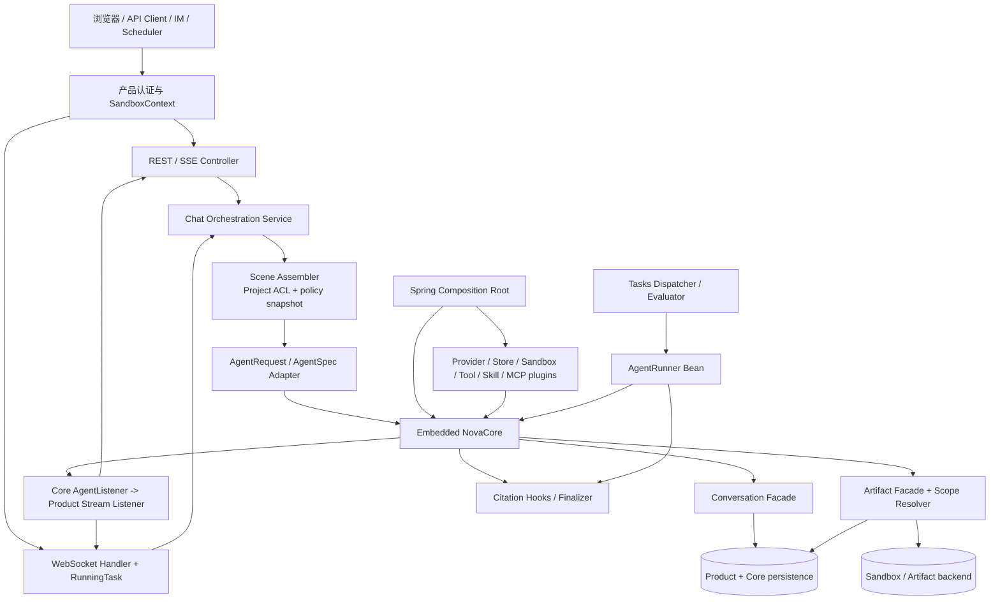
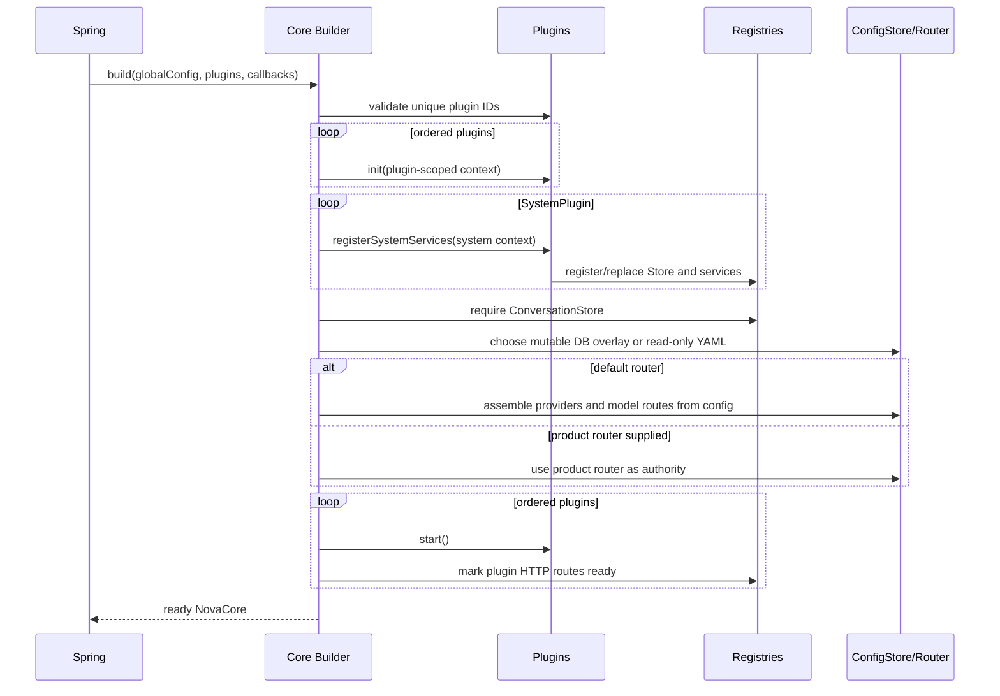
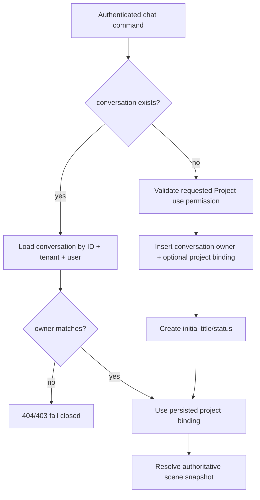
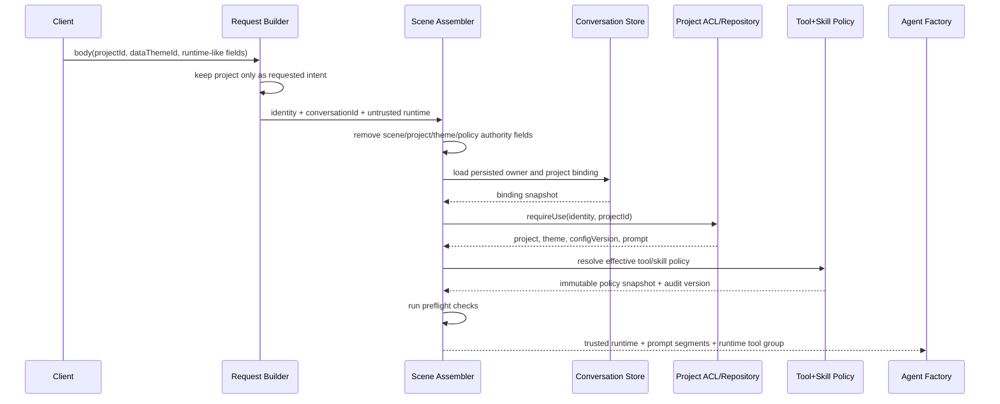
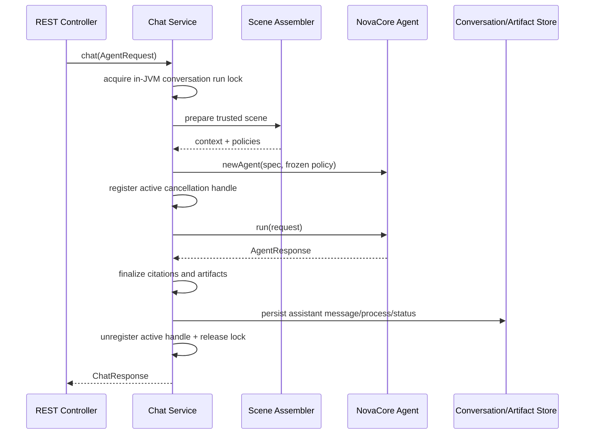
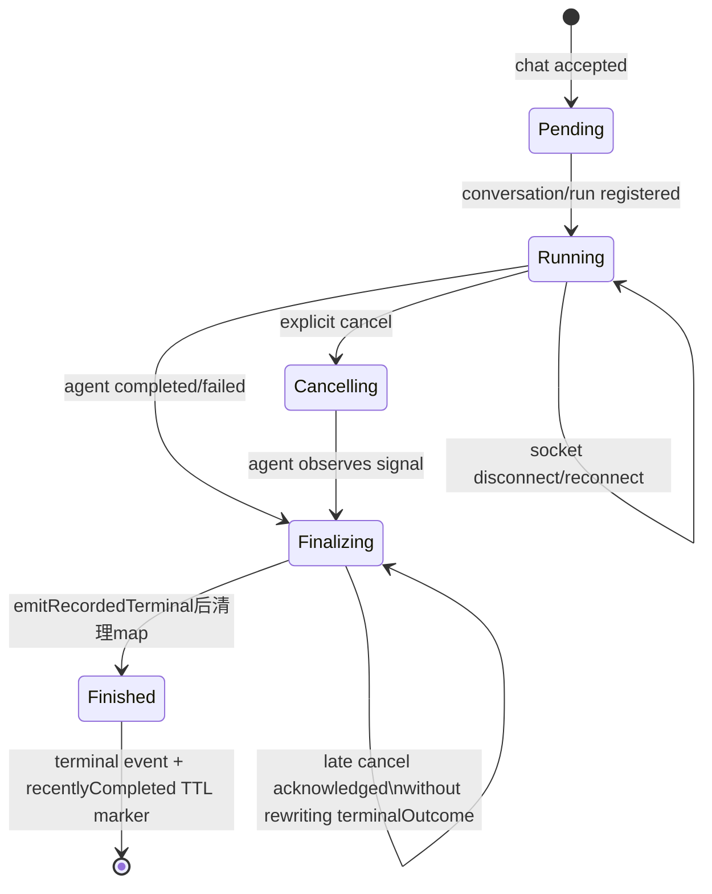
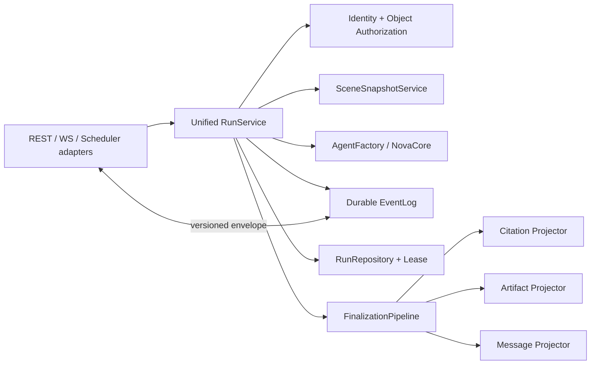

```
# T18：产品层与 NovaCore 桥接复刻说明

> 目标：读者在没有 Nova 源码、没有本会话上下文的情况下，能够复刻一个 Spring Boot 产品宿主如何装配框架无关的 Agent Runtime，并把身份、会话、项目、沙箱、模型、工具、技能、MCP、工件、引用和流式事件安全地映射到产品 API。
>
> 事实标记：`[I]` 当前源码可静态确认；`[A]` 基于静态链路的合理推断，未运行验证；`[K]` 当前已知限制或风险；`[P]` 已有规划/兼容意图但未形成完整当前能力；`[REQ]` 复刻时必须保持的业务规则；`[F]` 失败或降级语义；`[D]` 建议的生产级设计。本文没有启动服务、连接数据库、调用模型或运行测试。

## 1. 边界、术语与核心结论

本模块不是某个单独的“桥接类”，而是产品宿主和 Agent 内核之间的一组适配边界，解决以下问题：

1. 在 Spring 生命周期内创建、启动和关闭不依赖 Spring 的 NovaCore。
2. 把 HTTP/WebSocket 已认证身份转换成 Core 的 `Identity`，并贯穿会话、沙箱、工具和 Store。
3. 把产品的 Personal/Project 场景解析成服务端可信的运行快照。
4. 把产品配置、模型路由、工具组、Skill、MCP 和插件服务接入 Core 注册表。
5. 把 Core Agent 事件翻译成产品流式协议，同时持久化消息、过程数据、引用和工件。
6. 让定时任务、评测等无前端执行入口也能复用同一 Core Runner。

### 1.1 不应照抄的历史/概念名称

`[I]` 当前实现中没有名为 `ProductRuntime` 或 `CoreAgentBridge` 的具体类型。复刻时不能假设存在一个万能 Facade。与这些概念等价的职责实际分布如下：

| 概念职责 | 当前承担者 | 复刻含义 |
|---|---|---|
| Product Runtime composition root | Spring 的 NovaCore 装配配置 | 聚合配置、插件、Router、回调和生命周期 |
| 前台 Core Agent bridge | Chat 业务服务 | 组装请求、场景、AgentSpec、运行与持久化 |
| 无界面/后台运行 bridge | `AgentRunner` Bean | 任务等入口的统一 Runner，并追加结束处理 |
| Conversation bridge | 产品会话 Facade | 隔离 Core Store DTO 和产品 DTO |
| Artifact bridge | 产品工件 Facade + scoped store | 对象作用域、发布、元数据和访问控制 |
| Sandbox bridge | 产品沙箱执行 Facade | 仅暴露受控文件操作，不泄漏 Provider |
| HTTP plugin bridge | 插件 HTTP Gateway | Servlet 与框架无关插件 Handler 互转 |
| Tool/config bridge | 产品工具注册桥插件 | 把 Core 工具注册表和产品设置层接起来 |

`[D]` 新工程可以创建显式 `ProductRuntime` 聚合接口，但不要把权限、事务、协议适配全部塞进一个类；应保留组合根、运行编排、持久化 Facade、事件适配和策略解析的职责边界。

### 1.2 最重要的复刻结论

- `[I/REQ]` 产品层是可信边界：tenant/user、Project 归属、数据主题、Tool/Skill policy 都由服务端解析，不能直接信任聊天 body 或模型参数。
- `[I]` NovaCore 作为同进程嵌入式 Runtime 存在，不是通过 HTTP 调用的外部 Agent 服务。
- `[I]` 产品 Flyway 先完成，之后才构造 NovaCore；Core 构造过程会初始化并启动插件。
- `[I]` 前台聊天直接 `newAgent`，后台任务使用注入的 `AgentRunner`。两条执行路径并未完全收敛。
- `[I]` 会话、工件和部分元数据同时经过 Core Store 与产品 `JdbcTemplate`；它们不是自动共享的 Spring 事务。
- `[I]` WebSocket 的可取消、可订阅、可恢复执行状态保存在进程内 `RunningTask`；数据库 heartbeat/status 只提供跨进程可见的“运行中”证据，不是有 fencing token 的 lease，也不能迁移正在执行的 Agent。
- `[K]` REST、SSE、WebSocket 和后台任务的事件、取消、引用结束处理存在语义差异；生产复刻应尽量统一成一个 Run Service。
- `[K]` 一些桥接器通过字符串身份键或字符串 runtime-context key 协作，存在漂移和解析不一致风险。

### 1.3 输入、输出和非职责

| 类别 | 内容 |
|---|---|
| 输入 | Spring 配置、DataSource、已认证身份、聊天 JSON、会话 ID、Project 意图、附件、provider override、插件目录、工具/Skill/MCP 设置 |
| 输出 | Core `AgentRequest`/`AgentSpec`、运行事件、消息与过程数据、Conversation 状态、Artifact、Citation、HTTP/WS 响应 |
| 外部依赖 | LLM Provider、PostgreSQL/H2、文件或 Docker Sandbox、MCP Server、Knowledge/CAN Gateway、可选 IM 平台 |
| 不负责 | LLM Provider 内部推理、CAN Gateway 内部实现、浏览器 UI 渲染、数据库物理备份、跨节点 Run 迁移 |

## 2. 总体拓扑



依赖方向必须保持：产品应用可以依赖 Runtime 和已打包插件；Runtime 只依赖 SPI；插件只依赖 SPI；SPI 不依赖 Spring、Runtime 或产品业务词表。`[REQ]`

## 3. Spring Bean 与启动装配

### 3.1 Composition Root 的 Bean 契约

建议用下列接口理解当前装配；接口名是复刻用的抽象，不要求逐字一致：

```java
interface ProductRuntimeFactory {
  NovaCore create(ProductConfig config,
                  List<NovaPlugin> builtIns,
                  Optional<LlmRouter> productRouter,
                  HumanInputCallback humanInput,
                  ExternalIdentityResolver externalIdentity);
}

interface ProductRunService {
  RunResult run(AuthenticatedIdentity identity, ChatCommand command);
  void runStreaming(AuthenticatedIdentity identity,
                    ChatCommand command,
                    ProductEventListener listener,
                    CancellationSignal cancellation);
}
```

`[I]` 当前 Core Bean 具备以下生命周期特征：

- Bean 仅在宿主没有自行提供 NovaCore 时创建。
- Bean 显式依赖产品 Flyway 初始化完成。
- Bean destroy method 调用 Core shutdown。
- Builder 的 `build()` 不只构造对象，也执行插件 init、系统服务注册、配置 Store 装配、Provider 装配和插件 start。

### 3.2 Bean/组件拓扑清单

| Bean 或端口 | 创建时机 | 输入 | 输出/副作用 | 失败语义 |
|---|---|---|---|---|
| NovaCore | Flyway 后 | 归一化配置、插件、Router、回调 | 启动完整 Runtime | 任一关键依赖失败则应用启动失败 |
| Artifact scope bridge | Core 前注册、Spring 后绑定 | 会话归属、Project ACL | `ScopedArtifactStore` 的作用域解析 | 未绑定或身份不匹配时 fail-closed |
| AgentRunner | Core 后 | Core runner、citation finalizer | 后台统一执行入口 | Core 或结束处理异常向调用方传播 |
| ConfigStore | Core 后暴露 | Core StoreRegistry | 产品设置服务的唯一活动配置 Store | 未注册则启动失败 |
| MCP admin facade | Core 后绑定 | MCP plugin、secret sealer、scope resolver | 管理 server/connection/tool | Core 未就绪时不能使用 |
| Tasks repository/scheduler | Core 和 Storage 后 | `SqlStorage`、AgentRunner | 迁移 tasks namespace 并启动调度 | migration/bind 失败则启动失败 |
| Plugin HTTP dispatcher | Spring Web 层 | Core route registry | `/api/plugins/**` | 未 ready=503，超时=504 |

### 3.3 配置归一化和桥接

Spring Binder 可把 YAML 数组绑定成 `{"0":...,"1":...}` 形式的 map。`[I]` 当前装配在交给 Core 前递归把连续数字键恢复为 List，并移除仅由产品消费的键，避免 Core 把它们误当插件配置。

产品专属键至少包括：工作目录根、公共 Skill 目录、Skill 产品配置、插件目录和 Agent 产品设置。`[REQ]` 复刻时维护显式 allow-list 或 schema，不要把整个 Spring Environment 无差别传入插件。

示例配置：

```yaml
nova:
  work-dir-root: /var/lib/nova/work
  plugins-dir: /opt/nova/plugins
  config:
    mutable: true
  sandbox:
    backend: directory              # directory | docker；配置缺失时默认 directory
  agent:
    default-max-history: 10
    default-max-tool-rounds: 40
    default-max-tool-calls: 120
  storage:
    vendor: postgresql
    flyway:
      enabled: true
      profile: v1-aligned
      history-table: nova_core_storage_schema_history
  llm:
    # 仅当没有注入产品 LlmRouter 时，由 Core 默认路由消费
    default-provider: openai
```

`[I]` 当前桥接还会做以下变换：

1. 把 Spring DataSource 的 vendor、URL、用户名和密码映射到 Storage Plugin。
2. 产品 Flyway 被关闭时，同步关闭 Storage 的共享迁移，避免未知 schema 变更。
3. PostgreSQL 和文件 H2 使用与产品 v1 schema 对齐的 profile；隔离内存 H2 可使用 greenfield。
4. Storage 使用独立 migration history table。
5. 把产品的 legacy artifact 目录、CAN metric gateway、公共 Skill 目录映射到对应插件配置。
6. 把产品默认禁用的内置工具和 knowledge tool group 合并进 Core 配置。

### 3.4 沙箱后端选择

`[I/REQ]` 启动时只能注册一个沙箱 Provider：

```text
配置键缺失                     -> Directory Sandbox Plugin（默认值）
backend == "directory"          -> Directory Sandbox Plugin
backend == "docker"             -> Docker Sandbox Plugin
backend == blank/其他值           -> startup failure
```

不要同时注册两个默认 Provider 后依赖迭代顺序“碰巧选中”。后端切换会改变隔离、文件路径、依赖安装和生命周期语义，应作为部署级配置处理。

### 3.5 插件装配顺序

当前内置顺序可概括为：

```text
Sandbox
-> Default Context Reducer
-> Core Tools
-> OpenAI / Anthropic Providers
-> Storage
-> Product Artifact Scope
-> Knowledge
-> Tasks
-> MCP
-> Insight Recall / Product Prompt Policy
-> Memory Profile
-> Multitenant Skill Listing
-> DB Skill Source
-> CAN
-> IM
-> Product Data Tools
-> Tool Registry / Config Bridge
-> optional drop-in plugins
```

顺序不是装饰：后置插件可能在 init 或系统服务阶段查找前置 Store/Registry。`[REQ]` 新工程应让插件声明 required/provided capability 并做拓扑排序；若仍用列表，至少启动时验证依赖。

### 3.6 Core 内部生命周期



`[K]` 当前构造过程中若后面的插件 start 失败，已经 start 的插件没有完整的自动 rollback 保证。shutdown 会逆序 stop，单个 stop 失败只记录并继续。`[D]` 复刻应记录 `initialized`、`started` 栈，构造失败时立即逆序停止已启动插件、释放 classloader/线程池和连接池。

## 4. 配置优先级与动态设置

### 4.1 活动 ConfigStore

`[I]` 活动配置由以下规则产生：

```text
if nova.config.mutable != false and plugin registered database ConfigStore:
    active = OverlayConfigStore(
        primary = TenantCascadeConfigStore(database),
        fallback = YAML defaults)
else:
    active = ReadOnlyConfigStore(YAML defaults)
```

Tenant cascade 的读取优先级为：

```text
USER -> TENANT -> GLOBAL -> YAML DEFAULT
```

`[I/K]` 某一层只要找到原始值，即使类型不匹配，也不会继续向下回退。因此“用户层错误字符串”可能遮蔽正确的 tenant/global 值。复刻时应在写入时强 schema 校验，并在读取错误中报告命中的 scope 和 key。

### 4.2 产品 Router 与 Core 默认 Router

`[I]` 若产品注入 `LlmRouter`，Core 不再根据 YAML 自行装配默认 provider route；产品 Router 是模型、租户设置和 provider override 的权威。若不注入，Core 才从 Provider Registry 和配置创建默认 Router。

`[REQ]` 所有聊天、后台压缩、任务和评测都必须经过统一 Router。聊天 body 中的 provider 只能是“受控 override 请求”，Router 仍需验证该身份是否允许使用该 provider/model。

### 4.3 工具配置桥

工具桥插件在 init 阶段把 Core Tool Registry 的 lookup 放进产品 Holder；在系统服务阶段用装饰后的 ConfigStore 替换原活动 Store，使工具敏感配置的 sealing、scope key 解析和产品继承规则进入 Core。start 时重建延迟索引，以看见 init 后注册的工具。`[I]`

关键约束：

- Tool 注册不等于 Agent 可见。
- 工具 key、展示名和运行时 ID 必须有稳定映射。
- secret 只在执行边界解封，管理接口返回掩码。
- Registry 尚未绑定时应明确 unavailable，不能悄悄返回空清单造成误配置。

### 4.4 Skill 和 MCP 动态同步

`[I]` 数据库 Skill 源可在运行期 register/replace/unregister 到活动 Skill Registry；若 Holder 尚未 ready，当前同步会 fail-soft 跳过。`[K]` 这会产生“数据库已保存、当前进程未生效”的短暂或永久分歧，直到后续 backfill/restart。

`[I]` MCP Plugin 在 Core 构造前拿到产品 scope resolver 和 secret sealer；管理 Facade 在 Core Ready 后绑定。MCP 工具进入 Registry 后仍要经过产品场景的 allowed-tool 集合过滤。资源存在、连接成功或工具已发现都不自动授权 Agent 使用。

`[K]` 当前 MCP/Skill scope resolver 存在从 `Identity.key()` 解析 `t/<tenant>/u/<user>`、`u/<user>` 的实现。字符串协议分散在产品桥里，新增身份形态时容易漂移。`[D]` 应优先 `instanceof TenantIdentity` 或让 Core 传递结构化 `PrincipalScope`，opaque key 只用于日志/缓存键。

## 5. 产品入口与 HTTP 路由映射

### 5.1 入口总表

| 产品入口 | Core 入口 | 流式能力 | 取消/恢复 | 身份来源 |
|---|---|---|---|---|
| `POST /api/chat` | ChatService 直接 `newAgent().run()` | 否 | 仅内部活动 Agent 能力；无协议级 resume | HTTP 过滤器的 SandboxContext |
| `POST /api/chat/stream` | 直接 `runStreaming()` | SSE 仅 token/tool_call/complete；异常走 `completeWithError` | 无 WS RunningTask；断连不等价于取消 | HTTP 过滤器 |
| `/ws/chat` | 直接 `runStreaming()` | 完整产品事件 | cancel/resume/subscribe/query_running | 握手 session + 每消息复验 |
| Tasks/Evaluation | 注入的 `AgentRunner` | 调用方自定义 | 由调用方/任务框架决定 | 持久化任务 owner |
| `/api/plugins/**` | Core plugin HTTP route registry | 普通 HTTP | handler timeout 可中断 Future | PUBLIC 或 SandboxContext principal |

### 5.2 聊天请求契约

当前聊天 JSON 的核心形态可复刻为：

```json
{
  "conversationId": "optional-client-or-server-uuid",
  "message": "请分析本月销售异常",
  "files": [
    {"id": "optional-id", "name": "sales.csv", "path": "uploads/sales.csv", "size": 1234, "type": "text/csv"}
  ],
  "images": [
    {"name": "chart.png", "data": "iVBORw0KGgo...", "mediaType": "image/png"}
  ],
  "provider": "optional-provider-override",
  "projectId": "optional-project-intent",
  "dataThemeId": "legacy/client-intent-not-authority",
  "lang": "zh-CN"
}
```

身份字段不得出现在可接受契约中；即使客户端提交 `tenantId/userId` 也必须忽略。`[REQ]`

附件的现行边界必须原样理解：

- `files` 的真实字段是 `{id,name,path,size,type}`。`name` 或 `path` 缺失时，该元素被**静默忽略**；`id` 缺失时生成 UUID，`type/size` 可空。当前适配层只把 path/name 形成模型提示，并未在这里重新证明 path 属于当前沙箱，因此上传入口和 `read_file` 必须另做 scope 校验。
- `images.data` 必须是**纯 Base64**；`data:image/png;base64,...` data URI 会被 Base64 decoder 拒绝。`mediaType` 缺失默认 `image/png`，`name` 用于生成已清洗、带随机前缀的文件名。
- 图片会先解码、用 ImageIO 读取真实尺寸、要求宽高都大于 10 像素，再写入当前 identity/conversation 的 `uploads/`。声明的 `mediaType` 不是内容真实性证明；复刻时应校验 magic bytes、允许 MIME，并设置逐图、总请求和像素上限。现行主要依赖 HTTP/WS 总帧限制，没有独立图片字节上限。
- 纯文件消息可由文件提示构成用户文本；**纯图片且 message/files 都为空会在图片物化前触发 `message is required`**，因此并非支持 image-only。图片引用也不进入持久化消息 DTO，硬刷新后不能恢复。若目标产品要支持附件-only，需先定义 `hasText || validFiles || validImages`，并把附件 metadata 作为租户作用域实体持久化。

### 5.3 Plugin HTTP Gateway 契约

Core 插件可注册框架无关路由，产品统一挂载为：

```text
GET  /api/plugins
ANY  /api/plugins/{apiName}/{serviceName}/**
```

发现接口返回：

```json
[
  {
    "pluginId": "com.example.im",
    "pluginName": "IM",
    "pluginVersion": "1.0.0",
    "apiName": "im",
    "manifestUrl": "/api/plugins/im/management/manifest",
    "services": [{"serviceName": "management", "ready": true}]
  }
]
```

插件路由定义至少包含：method、相对 path、access、required authorities、max body bytes、timeout、handler。Host 全局上限为 10 MiB body 和 30 秒 timeout。`[I]`

Servlet 到插件请求的转换对象应为：

```java
record PluginRequest(
    Method method,
    String path,
    Map<String,List<String>> query,
    Map<String,List<String>> headers,
    Map<String,String> pathVariables,
    byte[] body,
    Principal principal,
    String correlationId,
    String remoteAddress) {}
```

安全和错误规则：

- api/service 名只接受小写字母开头的短 kebab-case；拒绝编码的 slash、backslash、dot。
- 一个 `apiName` 只能归属一个插件；同 method+模板冲突启动失败。
- 非 SystemPlugin 不能注册 PUBLIC 路由。
- AUTHENTICATED 路由从服务端上下文构造 `TenantIdentity`；tenant admin 追加 authority。
- plugin 未 start 返回 503；body 超限 413；authority 缺失 403；handler timeout 504；handler exception 502。
- 响应过滤 hop-by-hop、`Set-Cookie` 和含换行的 header，防止 header smuggling。
- correlation ID 只接受安全字符和长度，否则服务端生成 UUID。

## 6. AgentRequest 构造与可信字段

### 6.1 请求转换伪码

```java
AgentRequest build(ChatJson body, AuthContext auth) {
  require(auth.tenantId && auth.userId);
  conversationId = blank(body.conversationId) ? uuid() : body.conversationId;
  identity = new TenantIdentity(auth.userId, auth.tenantId);

  userText = trim(body.message);
  files = parseFiles(body.files);             // CURRENT: missing name/path -> silently skip
  require(!userText.isBlank() || !files.isEmpty()); // CURRENT: image-only is rejected here
  images = materializeImages(identity, conversationId, body.images);

  runtime = new HashMap();
  runtime.put("locale", trustedLocale(auth, body.lang));
  runtime.put("provider", body.provider);              // request only; router re-authorizes
  runtime.put("internal.requested-project-id", body.projectId); // intent only
  runtime.put("file-hint", buildModelOnlyFileHint(attachments));
  runtime.put("fiscalContext", trustedFiscalContext(auth));

  return new AgentRequest(
      conversationId,
      identity,
      userTextOrPureFileHint(userText, files),
      textAndImageBlocks(userText, images),
      runtime,
      tenantSettings.maxHistory,
      tenantSettings.maxToolRounds);
}
```

`[I]` 有文本时，文件提示保留在模型运行上下文，不污染持久化的用户原文；只有纯文件消息才把可读提示作为用户消息内容。图片先校验并物化到该 identity/conversation 沙箱，再形成模型 ContentBlock，但当前不会持久化图片引用。

### 6.2 runtime context 字段

当前产品与插件间最关键的字段如下：

| key | 类型 | 写入方 | 权威性 | 生命周期 |
|---|---|---|---|---|
| `nova.scene.mode` | `PERSONAL|PROJECT` | 场景解析器 | 服务端权威 | 单次 Run 快照 |
| `nova.project.id` | string | 场景解析器 | 服务端权威 | 单次 Run |
| `nova.project.config-version` | long | 场景解析器 | 服务端权威 | 单次 Run |
| `dataThemeId` | string/null | 场景解析器 | 服务端权威 | 单次 Run |
| `nova.fiscalContext` | object/map | 产品上下文 | 服务端权威 | 单次 Run |
| `locale` | string | 认证/请求适配 | 受控 | 单次 Run |
| `provider` | string/null | 请求适配 | 仅 override 请求 | 单次 Run |
| trace ID | UUID | stream adapter | 服务端权威 | 单次 Run |

`[K]` Map 本身无 schema，插件又可能因依赖边界在本地复制 key 字符串。生产复刻应定义版本化 `RuntimeEnvelope`，在 SPI 中只放稳定、opaque 的命名空间值，并在产品入口完成 schema 校验和敏感字段 allow-list。

## 7. Conversation、Identity 与 Sandbox 桥

### 7.1 身份构造

Core 的 tenant identity 构造参数语义是 `userId, tenantId`。`[REQ]` 这类同类型双字符串很容易颠倒，复刻时使用具名工厂：

```java
TenantIdentity identity = TenantIdentity.ofTenantUser(tenantId, userId);
```

HTTP 身份来自过滤器写入的 request attribute/ThreadLocal；WebSocket 身份来自握手 session，并在消息处理前恢复为执行上下文。异步/虚拟线程不能依赖 ThreadLocal 自动传播，必须把 `Identity` 显式放入 `AgentRequest`。`[REQ]`

### 7.2 会话准备



`[I]` 新会话可接受 projectId 作为创建意图，但必须在 insert 前通过 Project access guard。已有会话的场景以数据库 binding 为准，不能让后续聊天 body 切换到另一个项目。

产品会话 Facade 把 Core ConversationStore 和存储扩展接口的 DTO、时间、ID 转成产品 DTO。消息 ID 在边界上做 numeric String 和 Long 转换；伪造的非数字 ID 统一映射为 not found，避免泄漏内部解析错误。`[I]`

`[K]` Facade 同时依赖公共 Store 和 bundled-storage 专属扩展接口；替换第三方 Store 时，如果没有实现这些扩展，会在构造或使用时失败。这是产品对具体 Storage Plugin 的隐性锁定。

### 7.3 沙箱 Facade

产品文件操作通过 Core 的 SandboxProvider 获取 identity-scoped 沙箱，并只开放白名单读写/列举能力；没有 conversation 时使用约定的用户级工作目录。`[I]` 产品 Controller 不应拿到 Provider 或任意 command execution 权限。

复刻接口：

```java
interface ProductSandbox {
  byte[] read(Identity identity, String conversationId, RelativePath path, long maxBytes);
  void write(Identity identity, String conversationId, RelativePath path, byte[] content);
  List<FileEntry> list(Identity identity, String conversationId, RelativePath path);
}
```

`[REQ]` path 必须是归一化相对路径；Provider 负责最终 containment 检查。不要让产品层通过绝对路径或 shell 拼接越过沙箱。

## 8. Scene/Project 运行上下文

### 8.1 场景对象

```java
record SceneExecutionContext(
    SceneMode mode,             // PERSONAL | PROJECT
    String projectId,           // PROJECT 必填
    Long projectConfigVersion,  // PROJECT 快照版本
    String dataThemeId,         // 可空
    String projectPrompt,       // 单独的 system prompt segment
    ToolPolicy toolPolicy,
    SkillPolicy skillPolicy) {}
```

Personal 场景不能携带 projectId/configVersion；Project 场景必须有 projectId，数据主题当前允许为空。`[I/REQ]`

### 8.2 权威解析链



清洗器至少移除：scene mode、project ID、project config version、data theme、legacy theme keys、Agent tool policy bridge 字段、effective Skill policy 字段。`[I]`

`[REQ]` 必须先清洗再回填可信值。若先 merge 服务端 context 再 merge客户端 map，攻击者可覆盖权威字段。

### 8.3 快照与并发

场景解析可在短只读事务中加载 Project 和配置版本；Agent Run 发生在事务外。`[I]` 这样避免长时间持有数据库事务，但配置可能在运行中变化。`projectConfigVersion` 是可观察的快照版本，后续工具可以拒绝过期上下文或记录审计。

`[D]` 对必须一致的运行，持久化 `RunPolicySnapshot`：

```json
{
  "runId": "uuid",
  "scene": "PROJECT",
  "projectId": "p-1",
  "projectConfigVersion": 7,
  "toolPolicyVersion": "tp-42",
  "skillPolicyVersion": "sp-18",
  "modelBindingVersion": "m-9",
  "createdAt": "2026-08-13T10:00:00Z"
}
```

## 9. AgentSpec、工具、Skill、MCP 与模型映射

### 9.1 AgentSpec 构造

前台主 Agent 的构造等价于：

```java
AgentSpec spec = AgentSpec.builder("main")
    .providerOverride(request.providerOverride())
    .promptSegments(scene.projectPrompt(), localePrompt(), fiscalPrompt())
    .allowedToolIds(scene.toolPolicy().maximumToolNames())
    .build();

ToolGroupPolicy frozenPolicy = freezeAtRunStart(
    scene.toolPolicy(),
    RuntimeToolGroup.of(scene.runtimeExtensionToolNames()));

Agent agent = novaCore.newAgent(spec, frozenPolicy);
```

`[I/REQ]` 允许工具集合是场景 policy 的最大集合，不是客户端或 Prompt 提供的工具名。runtime extension 也必须经正式 policy resolver 计算。

### 9.2 工具可见性链

```text
Plugin/System registration
AND installed capability
AND scope config enabled
AND Agent tool group membership
AND Scene maximum allow-list
AND MCP/identity visibility
= tool visible to this Run
```

任一条件不满足，工具不可用是正确结果。知识库已挂载、MCP 已连接、Skill 已安装都不能旁路授权。`[REQ]`

### 9.3 Skill 激活

Skill listing 插件结合 global/tenant/user 安装和 enable override 生成可见 Skill。有效 Skill policy 由场景解析器放入服务端 runtime context。`[I]` ChatService 还会根据上一轮工具调用生成“继续打开某 Skill”的模型提示；这只是 continuation heuristic，不应被当作权限激活。

### 9.4 MCP 工具

MCP Server 按 scope 隔离配置和凭据，动态连接后把工具物化到 Core Registry。场景 resolver 随后将运行时工具名与 allowed tool IDs 取交集。`[I]` 如果产品工具组没有包含 MCP 工具，连接成功仍会得到不可见工具。

### 9.5 Provider 与模型角色

模型请求最终必须由 `LlmRouter.resolve(identity, modelRole, providerOverride)` 决定具体 Provider/Model/Options。`[REQ]` 不应在 ChatService 直接实例化 OpenAI/Anthropic client。后台压缩、标题、评测和文档任务也应明确 model role，避免默认角色漂移。

产品侧还有一个给标题、摘要、评测等非 Agent 调用使用的统一 Gateway，其现行解析算法是：

```java
TenantIdentity identity = explicitIdentity != null
    ? explicitIdentity
    : SandboxContextHolder.getOptional()
        .map(ctx -> new TenantIdentity(ctx.userId(), ctx.tenantId()))
        .orElse(new TenantIdentity("system", "system"));

LlmTier tier = switch (roleKey) {
  case null, "" -> null;
  case "simple" -> SIMPLE;
  case "document" -> DOCUMENT;
  case "vision" -> VISION;
  default -> COMPLEX;
};

binding = router.resolve(identity, tier, blankToNull(providerOverride));
options = merge(binding.options, requestOptions); // scalar request值覆盖binding默认值
vendorOptions = {...binding.vendorOptions, ...requestVendorOptions}; // request同名键覆盖
return binding.provider.call(LlmRequest(identity, messages, options));
```

`[K]` 无显式 identity 时读取 ThreadLocal `SandboxContext`，再退到共享 `system/system`。在虚拟线程、异步 job 或 scheduler 中上下文若未传播，调用会悄悄改走 system 路由，造成租户模型/密钥/配额漂移。生产复刻应让 identity 成为后台 Job payload 和 Gateway 必填参数；只有明确标注为平台系统任务的调用才允许 system identity，并为它配置独立路由和审计。未知 roleKey 当前降为 COMPLEX，不是输入错误；若角色影响费用或数据驻留，建议改成枚举和 fail-closed。`vendorOptions` 是浅合并，调用级同名值有最高优先级，必须按 provider schema allow-list，禁止任意覆盖代理、endpoint、credential 或数据治理选项。

## 10. 前台同步与流式运行链

### 10.1 同步 REST



`[K]` 同步路径的会话锁只在单 JVM 内有效。多节点同时请求同一 conversation 时需要数据库 lease/唯一运行记录或分布式锁。

### 10.2 流式 Adapter

Core `AgentListener` 到产品 listener 的主要映射如下：

| Core 事件 | 产品事件 | 说明 |
|---|---|---|
| run started | run start | 初始化 process collector |
| before LLM | LLM call start | 当前部分字段可为空 |
| stream reset | reset | 客户端清空本轮临时文本 |
| text delta | token | 实时答案增量 |
| thinking delta | 默认抑制 | 不直接向 UI 暴露内部思考 |
| round start/boundary | reasoning/answer/boundary | UI 阶段切换 |
| tool started | tool_call + tool_exec_start | 参数和工具名进入过程事件 |
| tool completed | tool result + tool_exec_end | 包含 success 和结果字节数 |
| compression | compression event | 上下文折叠可观察 |
| performance | perf event | token/latency 等 |
| completed | finalize/best-effort projection/complete | 基础消息由Core处理；产品补写失败可能warn后仍complete |
| cancelled | cancelled | 协作式取消终态 |
| failed | error | 错误穿透 UI 与持久化 |

`[I]` LLM timing hook 用 run trace ID 把 BEFORE/AFTER LLM 事件关联到当前 stream collector；必须在 finally 清除映射。Knowledge recall/用户交互桥也在运行期间按 conversation 注册 listener，结束后注销。

`[K]` 这些 listener map 主要以 conversationId 为键；若会话 ID 不是全局唯一，可能跨租户碰撞。建议统一键为 `(tenantId,userId,conversationId,runId)`。

#### 当前 transport wire contract（不要与第17节目标协议混写）

WebSocket 入站以 `type` 分派；缺失 `type` 时按 `chat`。除 chat 外有七类控制消息：

| 入站type | 必要payload | 效果 |
|---|---|---|
| `ping` | 无 | 返回 `pong` |
| `cancel` | `conversationId`，初始登记窗口可为空 | owner校验后发取消signal |
| `query_running` | 无 | 返回owner范围的运行/近期完成集合 |
| `resume` | `conversationId` | owner校验，替换origin session并订阅；不重放历史帧 |
| `subscribe` | `conversationId` | owner校验后加入fan-out集合 |
| `unsubscribe` | `conversationId` | 从fan-out集合移除 |
| `clarification_response` | `conversationId,response,remember?` | owner校验并应答等待中的交互；可触发记忆流程 |

`chat` 使用上一节的 ChatRequest 字段。当前 WS 出站有两种 envelope：

```json
{"type":"pong","content":"","conversationId":"optional"}
```

```json
{"type":"token","content":"增量文本","seq":12,"conversationId":"conv","messageId":123}
```

第一种用于若干直接控制回复，没有 `seq`；第二种用于 RunningTask subscriber fan-out，`seq` 由 ProcessDataCollector 递增，`messageId` 主要在错误终态可选提供。另有 object-content 版本，例如：

```json
{"type":"running_conversations_v2","content":[{"id":"conv","status":"RUNNING"}]}
```

运行查询同时保留旧版：`running_conversations.content` 是逗号拼接 ID；新版 `running_conversations_v2.content` 是对象数组。近期完成仍是旧的逗号串 `completed_conversations`。客户端复刻必须兼容两版，服务端演进应给 envelope 加显式 version，不能靠 content 类型猜版本。

主要出站事件包括 `conversation_id/token/llm_call_start/token_stats/tool_call/tool_exec_start/tool_exec_end/tool_call_result/agent_phase/task_plan/step_start/step_complete/critic_verdict/user_interaction/knowledge_recall/tool_loop_warning/context_compression_start/context_compression_end/context_compression_failed/digest_start/digest_progress/digest_end/reasoning_token/thinking/answer_start/stream_reset/round_boundary/complete/cancelled/error`，以及控制类 `pong/cancel_accepted/cancel_ignored/streaming_active/running_conversations/running_conversations_v2/completed_conversations/auth_expired`。

若 content 采用 pipe 编码，字段顺序是协议的一部分：

```text
token_stats       = inputTokens|cachedTokens|outputTokens|toolCalls
tool_exec_start   = callId|toolName|truncatedArguments|argumentBytes
tool_exec_end     = callId|toolName|resultBytes|success|durationMs|truncatedResult
tool_call_result  = toolName|success|resultBytes
agent_phase       = agentRole|description
step_start        = stepId|description
user_interaction  = interactionType|payload
tool_loop_warning = detectorName|reason
digest_start      = toolName|contentLength
digest_progress   = chunkIndex/totalChunks
round_boundary    = tool | final
```

`[K]` payload 自身若含 `|`，位置拆分容易歧义；大结果还经过截断。第17节的 `[D]` canonical JSON payload 是加固目标，不是现行协议。

SSE 只有三种正常事件：`token.data=文本`、`tool_call.data=toolName`（不含 callId/arguments）、`complete.data=扁平最终文本`。异常不发送名为 `error` 的业务事件，而是 `SseEmitter.completeWithError(error)`，由 Servlet/SSE 客户端看到连接错误。SSE 没有 WS 的 process、seq、cancel/resume、running 查询和结构化终态语义。

### 10.3 Citation 与 Artifact 结束处理

引用有两个时机：

1. Before-LLM hook 把可引用工具结果或文档映射成模型上下文。
2. Run 完成后 finalizer 把模型标记、来源和产品 citation DTO 对齐并持久化。

前台 ChatService 自己做 finalize；后台 `AgentRunner` 由 decorator 做 finalize。decorator 的真实失败语义是：delegate 抛异常时原样向上传播，不运行 finalizer；delegate 返回后，若响应/identity/messageId 不满足条件则原样返回；citation finalizer 抛 `RuntimeException` 时仅 warn 并返回未 finalize 的原响应，响应里没有 `degraded=true` 标记。`[I/K]` 双重实现可能造成修复只覆盖一条路径，也让调用者无法区分“没有引用”与“引用结束处理失败”。生产复刻应把 finalization 放进统一 Run Pipeline 的必经阶段，以 `(runId, finalizerName, version)` 幂等，并把失败记录为可查询的 projection 状态；是否阻断终态必须是显式策略。

Artifact scope resolver 会根据持久化 conversation owner/project 解析：个人会话为 PERSONAL/OWNER_ONLY，项目会话为 PROJECT/PROJECT，并再次执行项目访问检查。未绑定、会话不存在、owner 不匹配一律拒绝。`[I/REQ]`

## 11. WebSocket RunningTask

### 11.1 为什么不能只保存 Thread

一个可恢复的运行至少需要：

```java
record RunningTask(
    String conversationId, // CURRENT map key;目标版改为RunKey
    volatile Thread worker,
    CancellationSignal cancellation,
    AtomicReference<Session> currentSession,
    Set<Subscriber> subscribers,
    ProcessDataCollector collector,
    AtomicReference<RunPhase> phase,
    boolean agentStarted,
    TerminalOutcome terminalOutcome,
    String terminalContent,
    Throwable terminalError) {}

enum RunPhase { RUNNING, CANCELLING, FINALIZING }
enum TerminalOutcome { COMPLETE, CANCELLED, ERROR }
```

当前实现还维护 pending chat，覆盖“请求已接受但 conversationId 尚未完成登记”的窗口；使用序号、server ID 和 subscriber 集合支持断线后 resume/subscribe。`[I]`

### 11.2 状态机



核心规则：

- `[I]` WebSocket 断开不取消 Agent；任务继续并持久化，session 引用可被 resume 替换。
- `[I]` cancel 是协作式 signal，不直接 interrupt worker，以免 JDBC 驱动在中断下留下不确定状态。
- `[I]` CANCELLING 已赢得竞态时，终态应保持 cancelled；FINALIZING 阶段的晚到 cancel 可返回已受理，但不能改写已决定的数据库终态。
- `[I]` `recordTerminal` 先把 phase 置为 FINALIZING 并只写一次 `terminalOutcome/content/error`；随后 `emitRecordedTerminal` 尝试更新 conversation status、清理 RunningTask，再发 complete/cancel/error。当前枚举没有 TERMINATED，完成由 map 移除和 recentlyCompleted marker 表示。
- `[I]` query_running 只返回匹配 tenant+user 的任务；recently completed 也保留 owner 标签和 TTL。

`[K]` 当前主 map 以 conversationId 为键，再在操作时校验 owner。若客户端可选择 conversationId 且不保证全局唯一，另一身份可制造碰撞导致拒绝服务。生产键必须是结构化 `RunKey(tenant,user,conversation,run)`。

### 11.3 多节点语义

进程内 RunningTask 保存实时流；数据库侧是 conversation 的 running 状态/owner/heartbeat 证据，不是带不可预测 fencing token 的 durable run lease。节点宕机后别的节点不能继续原 Thread；列表读取可在“无本地 live task 且 heartbeat 过期”时修正遗留 RUNNING。`[I/K]`

生产有三种可选设计：

1. sticky WebSocket + 明确声明断线换节点只可读取最终结果；
2. Run Worker 独立服务 + durable event log，任意网关可重放；
3. 单节点部署，接受故障时 Run 丢失。

不能把当前 heartbeat/status 描述为 lease，更不能描述为分布式执行迁移。`[REQ]`

### 11.4 WebSocket 认证

握手必须绑定 tenant/user；每条消息可重新验证会话。确认 token/session 过期时发送 `auth_expired` 并关闭；当前对认证上游网络/5xx 的选择是 fail-open，以保证进行中的聊天可用。`[I/K]` 这是安全与可用性权衡，生产必须配置短 fail-open 窗口、审计和断路器，管理/写配置动作不应沿用聊天 fail-open。

## 12. 事务、线程和取消边界

### 12.1 事务边界

`[I]` Chat orchestration 不包长 Spring 事务。正确的原因是 Agent Run 可能持续数分钟并包含网络、模型、工具、沙箱和回调，不能持有数据库连接/锁。

但不能由此推导“当前终态是一次严格 commit”：Core Agent 先保存基础消息/状态，产品 bridge 再分别补 token usage、bridged content/process data、Skill 名和资产使用；这些补写有多处分支采用 catch+warn 的 best-effort。WebSocket 的 pre-stream error/cancel 持久化也是 best-effort，状态 `markIdle/markError/heartbeat` 失败会 warn 后继续发帧。complete 主路径通常在 bridge consumer 返回后记录并发送，但 consumer 内部吞掉的投影失败不会阻止 complete；error 路径查找 messageId 也允许为空。因此当前保证是“尽力刷新可读”，不是“所有消息、引用、process、status 已在同一事务提交后才发终态”。`[K]`

建议事务切分：

```text
Tx1: validate owner + create/mark conversation RUNNING + create run row
-- no database transaction during LLM/tool loop --
Tx2: append assistant message + process data + citation refs + terminal status
Tx3: optional artifact metadata reconciliation / post-complete enrichment
```

`[K]` 当前 Conversation/Artifact Facade 既调用 Core Store/MyBatis，也直接用 Spring `JdbcTemplate` 更新产品元数据。即便物理上是同一数据库，它们可能是不同连接池/事务管理器，不能假设原子提交。

`[D]` 跨域一致性使用 run/event/outbox/projection：先以 durable run terminal row 和 append-only event 为真相，再幂等补 message、citation、artifact/status projection；每一步按 `(runId, projectionName, version)` 去重。终态只有在 terminal row 与 terminal event 同事务提交后才可发布，投影失败显式暴露为 `DEGRADED`/待修复，而不是伪装完整成功。

### 12.2 虚拟线程与 ThreadLocal

REST SSE、WebSocket worker 和 Plugin HTTP handler 使用虚拟线程或独立 executor。`[I]` Request filter 中的 ThreadLocal 不会天然成为新线程的权威上下文。复刻规则：

- 身份、locale、trace、cancellation 显式成为 RunContext 字段。
- 若兼容旧 Tool 仍读 ThreadLocal，在 worker 入口 scoped install，finally 清除。
- listener、trace hook、knowledge bridge 的注册和注销必须在同一 try/finally。
- executor 必须在 Bean destroy 时关闭。

`[K]` Plugin HTTP dispatcher 有 `@PreDestroy` 关闭 executor；SSE Controller 和 WebSocket handler 的虚拟线程 executor 当前未见对应显式关闭钩子。复刻时统一托管为 Spring `Executor` Bean，并在 shutdown 先停止接入、等待宽限期、取消剩余任务、最后 close executor。

### 12.3 取消

取消是跨层协议：Client cancel -> RunningTask phase -> CancellationSignal -> Agent tool loop -> ToolExecutionContext -> 支持取消的工具。`[REQ]` 不支持取消的外部 HTTP 调用必须有 timeout；写操作需 idempotency key，不能依赖 interrupt 回滚副作用。

## 13. 权限与安全边界

| 边界 | 可信来源 | 禁止做法 | 失败方式 |
|---|---|---|---|
| tenant/user | HTTP filter / WS handshake | 从 JSON body 取身份 | 401/close |
| conversation owner | 持久化会话 + identity predicate | 只按 conversationId 查询 | 404/403 |
| Project | 持久化 binding + access guard | 每轮信任 body.projectId | 403 |
| data theme | Project/产品受控 context | 接受 forged runtime key | 清洗或拒绝 |
| tools | registry + installed capability + policy | 资源存在即自动授权 | Tool not visible |
| Skill | scope install/enable + scene policy | Prompt 名称激活权限 | Skill not visible |
| MCP | scoped server config + tool policy | 连接成功即给 main Agent | Tool not visible |
| Artifact | scoped store + conversation/project ACL | tenant-scoped lookup 后不做对象 ACL | 404/403 |
| provider | Router policy | 直接用 body provider 创建 client | 400/403 |
| plugin HTTP | route access + authority | 把全部 Servlet/Session 暴露给插件 | 401/403/413/504 |

### 13.1 最小安全要求

1. 任何 Store 查询都包含 tenant/user 或对象 ACL，不允许先全局查再靠 UI 隐藏。
2. runtime context 进入 Tool 前只保留 schema allow-list，secret 使用 reference，不传明文。
3. Project prompt/Skill 内容是受管理 system 内容；用户消息和附件文字不能拼接进 system 区域。
4. 插件 HTTP handler 只拿防御性复制的 body/headers/principal，不拿 HttpServletRequest、Spring BeanFactory 或数据库管理员连接。
5. 外部插件目录只加载受信签名/允许列表 JAR；重复 ID、冲突 namespace 和公共路由越权必须启动失败。
6. 日志记录 identity hash/scope、runId、conversationId、policy version、pluginId 和 correlationId，不记录密钥、Cookie、完整工具结果。

## 14. 重复实现、治理旁路与当前风险

| 问题 | 当前状态 | 影响 | 复刻治理 |
|---|---|---|---|
| 前台 direct Agent vs 后台 AgentRunner | `[I/K]` 两条路径 | citation/finalize/metrics 可能漂移 | 统一 RunPipeline，入口仅决定 transport |
| REST/SSE/WS 三套协议 | `[I/K]` SSE 只发子集 | 客户端能力和错误语义不一致 | 统一版本化 event envelope |
| Store + JdbcTemplate 混用 | `[I/K]` 无共享事务保证 | 部分成功、投影不一致 | run terminal 真相 + outbox/幂等投影 |
| Facade 依赖 Storage 扩展接口 | `[I/K]` 替换 Store 困难 | SPI 可替换性被削弱 | 把产品所需能力提升为稳定 port |
| Identity key 字符串解析 | `[I/K]` 多处解析 | 新格式漂移、匿名降级 | 结构化 principal scope |
| runtime key 字符串复制 | `[I/K]` 插件本地常量 | key/类型漂移 | 版本化 envelope + contract tests |
| listener map 仅 conversation key | `[I/K]` | 跨租户碰撞/串流风险 | composite RunKey |
| Skill live sync fail-soft | `[I/K]` | DB 和 registry 不一致 | 持久化 sync generation + retry queue |
| Core partial startup no rollback | `[I/K]` | 线程/连接泄漏 | started-stack rollback |
| 本地 per-conversation lock | `[I/K]` | 多节点并发双跑 | DB unique active-run lease |
| WS reauth upstream fail-open | `[I/K]` | 失效身份短期继续 | 时间窗、审计、只读/聊天限定 |
| client provider override | `[I/REQ]` 可请求 | 越权选贵模型 | Router 强授权/配额 |
| continuation Skill hint | `[I]` Prompt heuristic | 易被误解成正式能力 | 明确它不改变 policy |

## 15. 失败矩阵与恢复语义

| 阶段 | 失败 | 当前/要求的外显结果 | 状态与恢复 |
|---|---|---|---|
| 启动 | Product Flyway 失败 | Spring 启动失败 | 不创建 Core |
| 启动 | 重复 plugin ID/API namespace | 启动失败 | 不接受流量 |
| 启动 | plugin init/start 失败 | 启动失败 | `[K]` 当前 rollback 不完整；应逆序清理 |
| 启动 | 缺 ConversationStore/ConfigStore | 启动失败 | 修正插件顺序/配置 |
| 请求 | 缺身份 | 401/WS close | 不创建会话 |
| 请求 | 空文本且无有效附件 | 400 | 无副作用 |
| 请求 | 会话不属于身份 | 404/403 | 不泄漏是否存在 |
| 场景 | Project 不存在/无权 | 403/404 | 不运行 Agent |
| 场景 | forged project/theme/policy key | 清洗后用服务端值 | 记录安全审计可选 |
| 场景 | policy preflight 失败 | 可定位业务错误 | status 回 IDLE/FAILED |
| 模型 | Router 无可用模型 | 错误事件/REST error | 持久化 last error |
| 工具 | 工具未授权/未注册 | Tool not found/不可见 | 不自动注入替代工具 |
| 工具 | execution 失败 | `Error: <reason>` 给 LLM/UI | tool start/end 成对 |
| MCP | server 未连接 | 工具不可用或明确连接错误 | 不绕过 scope |
| Stream | 客户端断开 | WS Run 继续；SSE 行为不等价于取消 | 最终持久化仍应完成 |
| Cancel | agent 未观察 signal | 等待 timeout/工具返回 | 终态由状态机裁决 |
| Persist | message 成功、artifact 投影失败 | 完成可带降级警告 | 以 runId 重试投影 |
| Citation | finalizer 失败 | 不应伪造引用 | 答案可保留并标 citation degraded |
| Plugin HTTP | not ready/body/timeout/handler fail | 503/413/504/502 + correlationId | handler Future 取消；副作用不保证回滚 |
| Node crash | heartbeat 遗留 RUNNING | 重启后过期修正 | 原 Run 不可恢复 |

`[REQ]` 工具、模型和持久化异常必须带异常对象写日志，但返回客户端只暴露可定位且脱敏的错误。禁止 catch 后返回空成功。

## 16. 可观测性

### 16.1 必须关联的标识

```text
request/correlationId
runId / traceId
tenantId (脱敏或受控)
userId (脱敏或受控)
conversationId
taskExecutionId (若有)
scene mode + projectId + configVersion
provider/model binding version
toolCallId + toolName
pluginId/api/service
policy versions
```

### 16.2 指标建议

- Core build、plugin init/start/stop 时长与失败数。
- active runs、pending runs、cancel latency、resume count、stale lease reconciliation。
- LLM first-token/total latency、rounds、tokens、router miss、provider error。
- Tool queue/execution latency、success/failure/cancel、result bytes、retention class。
- listener backlog、WS send failure、SSE disconnect、terminal-before-persist violation。
- scene resolve/preflight latency、ACL deny、forged context key removal count。
- Skill/MCP registry generation、live sync lag、connection/tool discovery count。
- citation finalization/artifact projection failure和补偿重试。

### 16.3 审计事件

至少记录：Project 场景解析、Tool/Skill policy resolution、MCP 配置变更、provider override、plugin HTTP 管理写操作、取消请求和最终裁决。审计 sink 失败可对普通聊天 fail-soft，但权限解析本身不能 fail-open。`[REQ]`

## 17. 最小生产级复刻设计

### 17.1 推荐组件



### 17.2 统一 Run Service 伪码

```java
RunHandle start(AuthenticatedPrincipal principal, ChatCommand command, EventSink sink) {
  Identity identity = identityMapper.requireTenantUser(principal);
  PreparedConversation conv = conversations.prepare(identity, command);
  SceneSnapshot scene = scenes.resolveAndAuthorize(identity, conv.id(), command.intent());
  RunRecord run = runs.createUniqueActive(identity, conv.id(), scene.snapshotVersion());

  CancellationSignal cancel = new CancellationSignal();
  RunContext ctx = RunContext.of(run.id(), identity, conv.id(), scene, cancel);
  events.attach(run.id(), sink);

  executor.submit(() -> {
    try (ScopedContext ignored = scopedContext.install(ctx)) {
      AgentRequest request = requestMapper.map(command, ctx);
      Agent agent = agentFactory.create(scene.agentSpec(), scene.frozenToolPolicy());
      AgentResponse response = agent.runStreaming(request, coreToCanonicalEvents(run.id()));
      finalizer.finalizeIdempotently(run.id(), response);
      runs.complete(run.id(), response.status());
    } catch (CancelledException e) {
      finalizer.finalizeCancelled(run.id(), e);
    } catch (Throwable e) {
      finalizer.finalizeFailed(run.id(), sanitize(e));
    } finally {
      events.publishTerminalAfterCommit(run.id());
      events.detach(run.id(), sink);
      scopedContext.assertCleared();
    }
  });
  return new RunHandle(run.id(), conv.id());
}
```

### 17.3 Canonical 事件信封

```json
{
  "version": 2,
  "serverId": "node-a",
  "seq": 42,
  "runId": "run-uuid",
  "conversationId": "conv-uuid",
  "type": "tool_exec_end",
  "at": "2026-08-13T10:00:00Z",
  "payload": {
    "toolCallId": "call-1",
    "toolName": "query_metric",
    "success": true,
    "resultPreview": "...",
    "resultBytes": 1234
  }
}
```

REST sync 聚合此日志形成最终响应；SSE/WS 只是不同 transport，不再各自重新解释 Core listener。`[D]`

### 17.4 数据一致性

最低需要：

```sql
create table agent_run (
  run_id varchar(64) primary key,
  tenant_id varchar(128) not null,
  user_id varchar(128) not null,
  conversation_id varchar(64) not null,
  phase varchar(32) not null,
  scene_snapshot jsonb not null,
  lease_owner varchar(128),
  lease_token varchar(64),
  lease_expires_at timestamp,
  last_seq bigint not null default 0,
  terminal_outcome varchar(32),
  terminal_error_code varchar(64),
  version bigint not null default 0,
  created_at timestamp not null,
  updated_at timestamp not null
);

create unique index uq_agent_run_active
  on agent_run(tenant_id, user_id, conversation_id)
  where phase in ('PENDING','RUNNING','CANCELLING','FINALIZING');
```

若目标数据库不支持 partial unique index，用 active-slot 表或事务内 advisory lock 实现等价约束。

为实现可恢复、可重放而不是只保存一个状态字符串，还需要：

```sql
create table agent_run_event (
  run_id varchar(64) not null references agent_run(run_id),
  seq bigint not null,
  event_type varchar(64) not null,
  payload_json jsonb not null,
  created_at timestamp not null,
  primary key (run_id, seq)
);

create table agent_run_outbox (
  outbox_id varchar(64) primary key,
  run_id varchar(64) not null references agent_run(run_id),
  event_seq bigint not null,
  destination varchar(64) not null,
  status varchar(16) not null default 'PENDING',
  attempts int not null default 0,
  next_attempt_at timestamp not null,
  last_error text,
  unique (run_id, event_seq, destination)
);

create table agent_run_projection (
  run_id varchar(64) not null references agent_run(run_id),
  projection_name varchar(64) not null,
  projection_version int not null,
  applied_seq bigint not null default 0,
  status varchar(16) not null,
  last_error text,
  updated_at timestamp not null,
  primary key (run_id, projection_name, projection_version)
);

create table agent_run_finalizer (
  run_id varchar(64) not null references agent_run(run_id),
  finalizer_name varchar(64) not null,
  finalizer_version int not null,
  status varchar(16) not null,
  attempts int not null default 0,
  output_hash varchar(64),
  last_error text,
  updated_at timestamp not null,
  primary key (run_id, finalizer_name, finalizer_version)
);
```

写入算法：

1. 创建 run 时生成随机 `lease_token`，以唯一 active-run 约束占槽。
2. worker claim 使用条件更新：`where run_id=? and (lease_expires_at is null or lease_expires_at < now())`，同时写 owner、随机 token、expiry 并递增 version；只有 affectedRows=1 才取得执行权。
3. heartbeat/complete/cancel 都必须 `where run_id=? and lease_owner=? and lease_token=? and version=?`；旧 worker 的 affectedRows=0 即失去 fencing 权，禁止再写事件或终态。
4. 每批事件在事务中锁 run row，分配连续 seq，插入 `agent_run_event`，更新 `last_seq`，并为待广播的事件插入 outbox。不能用每节点内存计数器作为跨进程 seq。
5. 终态事务同时写 `terminal_outcome`、terminal event 和 outbox；dispatcher 只发布已提交 outbox，成功后标 SENT。客户端按 `(runId,seq)` 去重，resume 以 `afterSeq` 重放。
6. projection worker 按 seq 幂等更新消息、process、citation、artifact；finalizer 使用独立幂等键和 output hash。失败留 ERROR/RETRY 状态，指数退避并可人工重放。
7. 恢复器扫描过期 lease：若已有 terminal event只重放 outbox/projection；若无终态且工作可由持久 checkpoint 续跑则重新 claim；否则以 `WORKER_LOST` 写失败终态。绝不能仅把 RUNNING 改 IDLE 后丢失事实。

这套 `[D]` 协议与当前 `RunningTask + heartbeat + best-effort projection` 明确分层：前者是建议的新实现，后者才是已观察现状。

## 18. 三仓验证与测试矩阵

### 18.1 三个仓库的职责

| 仓库 | 验证层 | 应覆盖内容 |
|---|---|---|
| Nova 主仓 | 单元/集成/架构约束 | Bean 装配、桥接 DTO、scene 清洗、ACL、listener 映射、Store/插件生命周期 |
| `nova_auto_test` | 黑盒 API/WS/browser 三通道 | HTTP 契约、WS 帧、取消终态、错误穿透、刷新后持久化、artifact |
| `nova_ui_e2e` | 用户可见 UI + 精确接口/浏览器证据 | 停止生成、重连/刷新、工具卡片、设置持久化、RBAC、附件、作品和项目入口 |

`[I]` 自动化仓不是产品源码依赖；它们从部署地址验证协议和用户效果。测试数据必须使用唯一 marker，精确清理，不得把 demo/release 环境数据当固定夹具。

### 18.2 主仓测试清单

| 场景 | 层级 | 验收 |
|---|---|---|
| Core Bean waits for Flyway | Spring context | migration 前不构造 Core |
| directory/docker only one selected | config unit | 非法 backend 启动失败 |
| Binder indexed map normalization | config unit | 数字 map 恢复数组 |
| DB USER/TENANT/GLOBAL/YAML precedence | Store integration | 顺序和类型错误明确 |
| plugin duplicate ID/API route | Runtime unit | fail-fast |
| partial start rollback | Runtime lifecycle | 建议新增，证明已启动资源释放 |
| forged scene fields | service unit | 全部清洗并用 DB 快照回填 |
| cross-tenant conversation/project | service integration | 404/403，无工具执行 |
| AgentSpec allowed tools | service unit | 等于场景 policy，不含 payload 注入 |
| MCP tool visibility | integration | connected 但未授权仍不可见 |
| Core listener mapping | adapter unit | start/end/terminal 成对、thinking 不泄漏 |
| finalizer idempotence | integration | 重试不重复引用/工件/消息 |
| Facade with unsupported Store | contract | 启动时明确缺失能力，不在运行期 NPE |
| ThreadLocal cleanup | concurrency | 虚拟线程跨租户不串上下文 |
| composite RunKey collision | concurrency | 相同 conversation ID 不串租户 |

### 18.3 `nova_auto_test` 黑盒用例

该仓以 Playwright 的 api/ws/browser 三通道运行。当前已有 WS cancel 系列覆盖正常取消、幂等、竞态和跨账号拒绝，并保存帧证据。复刻建议至少包含：

1. `CHAT-BRIDGE-001`：REST 身份字段伪造不改变 owner。
2. `CHAT-BRIDGE-002`：已有会话 body.projectId 不能切换绑定。
3. `CHAT-BRIDGE-003`：WS token/tool/complete 序列单调，terminal 唯一。
4. `CHAT-CANCEL-*`：取消前、工具中、finalizing 竞态、重复取消、跨账号取消。
5. `CHAT-RESUME-001`：断开不取消，同账号 resume 接收后续/终态。
6. `CHAT-RESUME-002`：另一账号不能 resume/subscribe。
7. `PLUGIN-HTTP-001`：未认证、authority、body limit、timeout、correlation ID。
8. `RUN-PERSIST-001`：收到 complete 后立即查历史可见最终消息。

### 18.4 `nova_ui_e2e` 用户可见用例

1. 点击“停止生成”后 UI 进入确定终态，不显示内部异常。
2. 生成中刷新/返回会话，不出现空白；若 Run 仍在当前节点，展示运行状态或恢复事件。
3. 工具卡片与 `tool_exec_start/end` 对应，最终回答不是唯一成功证据。
4. 工具/Skill/MCP 设置保存后，新会话才消费新快照；关闭后同一能力不可再调用。
5. Project 会话只展示有权 Project，权限回收后不能继续运行或读取项目工件。
6. 附件上传、模型读取、Artifact 预览和删除会话后的级联清理形成完整闭环。

### 18.5 端到端验收矩阵

| 用例 | 前置 | 操作 | 预期可观察结果 | 标记 |
|---|---|---|---|---|
| Personal 正常聊天 | 有可用模型 | REST/WS 提问 | 会话、消息、终态、token 正常 | `[I]` 静态链路，需运行验收 |
| Project 正常聊天 | 有访问权和 binding | 提问 | runtime 含项目快照，工具按项目 scope | `[I]` |
| forged Project | body 注入他人 ID | 在个人/已有会话提问 | 注入被清洗，无跨项目工具/数据 | `[I/REQ]` |
| Tool 不在 policy | 工具已注册 | 诱导模型调用 | 不可见/Tool not found | `[REQ]` |
| MCP 已连未授权 | server connected | 诱导 MCP 工具 | 不可见 | `[I/REQ]` |
| Stream cancel | 长工具/模型 | cancel | 单一 cancelled 终态，DB 可读 | `[I]` |
| late cancel | 已 finalizing | cancel | 不改写已决定完成终态 | `[I]` |
| socket disconnect | 正在生成 | 断线再连 | Run 继续，同 owner 可 resume | `[I]` 单节点 |
| cross-user resume | 另一身份 | resume/subscribe | 拒绝且无事件泄漏 | `[I/REQ]` |
| node crash | active run | 杀进程/重启 | 原 run 不迁移；lease 过期后修正 | `[I/K]` |
| citation finalize retry | 人为注入投影失败 | 重试 finalizer | 不重复引用/消息 | `[D]` |
| plugin handler timeout | 慢 handler | 调 route | 504 + correlation ID | `[I]` |
| plugin public route abuse | 非系统插件注册 PUBLIC | 启动 | fail-fast | `[I]` |
| DB/runtime Skill 分歧 | registry 未 ready | 保存 Skill | 有告警/重试，不假成功 | 当前 `[K]`，目标 `[D]` |

## 19. 复刻完成定义

实现者只有同时满足以下条件，才能宣称“产品层—Agent Runtime 桥接等价”：

1. 应用启动顺序、插件依赖、配置优先级和 shutdown 均有可验证契约。
2. tenant/user 只来自认证边界，并显式进入每个 Run、Store、Sandbox 和 Tool 上下文。
3. 会话 Project/data theme/tool/Skill policy 从持久化状态重新解析，客户端伪造字段无效。
4. REST、SSE、WS、任务至少共享同一 AgentSpec/scene/policy/finalization 核心链。
5. 工具、Skill、MCP 和 Provider 的“存在、启用、授权、可见”是不同阶段，不能旁路。
6. CURRENT 验收：基础消息可在刷新后读取，产品投影失败有日志且不伪造数据库原子性；HARDENED 验收：complete/cancel/error 只在 terminal event/outbox 提交后发布，重复回调和重试幂等。
7. 断线、取消、late cancel、节点崩溃、plugin timeout 和持久化部分失败均有明确语义。
8. 主仓单元/集成、黑盒协议仓和 UI E2E 分别证明内部契约、部署协议和用户效果。
9. 日志、指标、审计能用 runId/correlationId 定位一次运行，同时不泄漏凭据和敏感工具结果。
10. 文档中 `[K]` 风险若未修复，必须转成部署限制或已知缺陷，不能当作已有保证。

## 20. I/A/K/P/REQ/F/D 汇总

### `[I]` 当前静态实现

- Spring 在产品 Flyway 后构造内嵌 NovaCore，并以 destroy method shutdown。
- Core build 执行插件 init、系统服务注册、配置/Router 装配和 start。
- 前台 ChatService 直接创建 Agent；任务等路径使用装饰后的 AgentRunner。
- 场景解析会清除客户端 authority 字段，再从会话/Project/策略服务回填。
- WebSocket 以进程内 RunningTask 实现取消、订阅、resume 和终态裁决。
- Plugin HTTP Gateway 提供 namespace、principal、body limit、timeout 和响应 header 过滤。

### `[A]` 未经运行验证的推断

- 当前配置组合在目标部署中是否实际选择预期 Storage profile、Router 和 sandbox。
- 真实模型、MCP、CAN/Knowledge 外部系统在超时和网络故障下的具体表现。
- 多 listener 抛异常、SSE 断连和部分投影失败在实际 Servlet/数据库驱动上的完整结果。

### `[K]` 已知风险

- 执行路径、事件协议、finalization 重复。
- Core partial start rollback 不完整。
- Store 与 JdbcTemplate 跨事务域。
- conversation-only map key 和本地锁的多租户/多节点风险。
- runtime/identity 字符串协议漂移。
- Skill live sync fail-soft、WS reauth 网络故障 fail-open、SSE executor 生命周期缺口。

### `[P]` 规划/兼容意图

- `ProductRuntime`、`CoreAgentBridge` 可作为未来收敛后的概念接口，但不是当前类。
- Durable Run/Event Log、跨节点恢复和统一 transport 事件属于生产演进方向，不是当前已实现保证。

### `[REQ]` 必须保持的规则

- 身份、对象 ACL、场景和能力策略服务端权威。
- LLM 必须经过 Router；动态工具必须经过正式注册和 policy。
- Agent 长运行不持有数据库事务；CURRENT 产品投影是 best-effort，HARDENED 才要求终态事件晚于 terminal/outbox 事务提交。
- 权限和对象作用域失败时 fail-closed。

### `[F]` 失败/降级语义

- 关键 Bean、Store、插件依赖缺失使启动失败。
- Tool/LLM/Plugin HTTP 错误向 LLM/UI 返回可定位且脱敏的失败。
- 普通审计/引用投影可设计为可观察降级；身份/ACL/policy 解析不可降级放行。

### `[D]` 推荐生产设计

- 统一 RunService、Canonical Event Envelope、composite RunKey、durable run row/event log。
- 结构化 PrincipalScope 和 RuntimeEnvelope。
- started-plugin rollback、幂等 Finalization Pipeline、outbox/projection 补偿。
- 三仓分层测试，并把并发、权限、取消和故障注入作为发布门禁。

## 21. 证据追溯附录

以下路径只用于审计当前结论；正文已经包含复刻所需契约，不要求实现者访问这些文件：

- Spring/Core 装配：`nova-app/src/main/java/com/aloudata/nova/config/NovaCoreConfig.java`、`nova-app/src/main/java/com/aloudata/nova/config/ProductMcpConfig.java`、`nova-app/src/main/java/com/aloudata/nova/config/ProductTasksConfig.java`
- Core 生命周期：`nova-core/nova-core-runtime/src/main/java/com/aloudata/nova/core/runtime/NovaCore.java`、`nova-core/nova-core-runtime/src/main/java/com/aloudata/nova/core/runtime/NovaCoreBuilder.java`
- 前台桥接：`nova-app/src/main/java/com/aloudata/nova/service/ChatService.java`
- REST/SSE/WS：`nova-app/src/main/java/com/aloudata/nova/controller/ChatController.java`、`nova-app/src/main/java/com/aloudata/nova/controller/ChatWebSocketHandler.java`
- Scene：`nova-app/src/main/java/com/aloudata/nova/project/service/AgentExecutionSceneAssembler.java`、`nova-app/src/main/java/com/aloudata/nova/project/service/SceneExecutionContextResolver.java`
- Facade：`nova-app/src/main/java/com/aloudata/nova/core/bridge/NovaCoreConversationFacade.java`、`nova-app/src/main/java/com/aloudata/nova/core/bridge/NovaCoreArtifactFacade.java`、`nova-app/src/main/java/com/aloudata/nova/core/bridge/sandbox/NovaCoreSandboxExecutor.java`
- 工具/MCP/Skill：`nova-app/src/main/java/com/aloudata/nova/tools/novacore/ToolRegistryBridgePlugin.java`、`nova-app/src/main/java/com/aloudata/nova/tools/novacore/ToolConfigBridgeConfigStore.java` 及对应产品配置桥
- Plugin HTTP：`nova-app/src/main/java/com/aloudata/nova/plugin/http/PluginHttpGatewayController.java`、`nova-app/src/main/java/com/aloudata/nova/plugin/http/PluginHttpDispatcher.java` 和 Core HTTP SPI/Registry
- 主仓测试：对应 `NovaCoreConfigTest`、ChatService/Scene/WS/Facade/Tool/MCP/Skill 测试
- 黑盒测试：`nova_auto_test/src/core`、`nova_auto_test/tests`、`nova_auto_test/cases`
- UI E2E：`nova_ui_e2e/src`、`nova_ui_e2e/tests` 及相关测试设计文档

```
