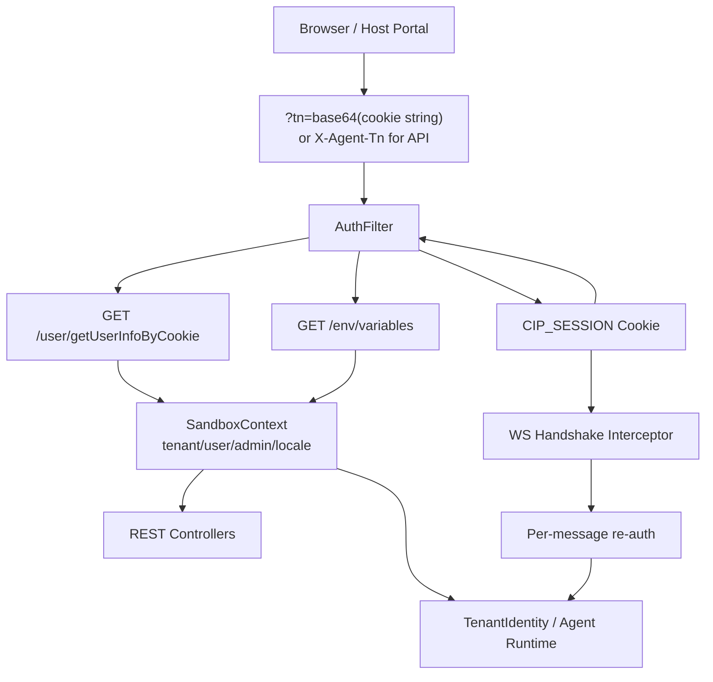
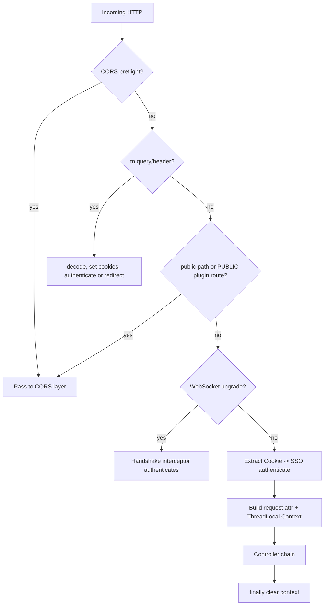
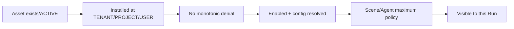
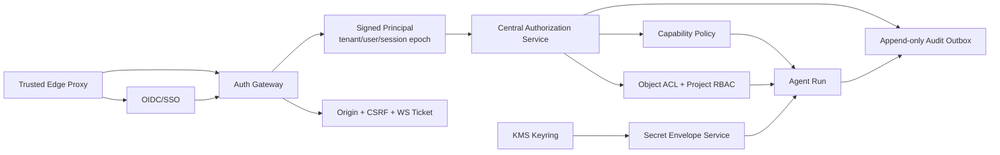

```
# T20：身份、授权、Secret 与审计复刻说明

> 目标：读者在没有 Nova 源码、没有本会话上下文的情况下，能够复刻等价的 SSO/Cookie 认证、多租户身份、管理员与 Project RBAC、对象作用域、能力治理、Secret 加密/掩码、公开分享和审计体系，并清楚区分当前实现、已退役能力和生产加固建议。
>
> 标记：`[I]` 当前源码静态确认；`[A]` 静态推断，未运行验证；`[K]` 当前风险/缺口；`[P]` 规划或已退役但未形成当前能力；`[REQ]` 复刻必须保持的安全规则；`[F]` 失败语义；`[D]` 推荐生产设计。本文未启动服务、访问 SSO 或运行测试。

## 1. 边界与核心结论

本模块回答四个问题：

1. 请求是谁发起的，当前处于哪个租户？
2. 该身份能对哪个对象执行什么动作？
3. API Key、密码和会话内容如何存储、展示和进入运行时？
4. 高风险读取、配置变化和能力解析如何留下可追溯证据？

### 1.1 当前身份形态

| 身份形态 | 表达 | 用途 | 是否可直接执行用户聊天 |
|---|---|---|---|
| tenant user | `tenantId + userId` | 普通请求、Agent、个人 Store、Sandbox | 是 |
| tenant scope | `tenantId + empty userId` | 租户默认配置、管理员写入 | 否，除非显式转换成用户身份 |
| user-only | `userId + null tenantId` | 兼容/非多租户插件 | 产品主路径不应使用 |
| global/system | Core global identity | 平台默认、系统插件 | 否 |
| anonymous | 无 identity | 健康检查、公开分享、受信 PUBLIC plugin route | 否 |

`[I]` 当前主要认证不是 OAuth/OIDC token 直连，而是浏览器 `CIP_SESSION` Cookie；Nova 把 Cookie 发给上游 CAN/Anymetrics SSO 接口换取 `tenantId/userId` 和租户权限。

### 1.2 核心安全结论

- `[I/REQ]` tenant/user 必须来自认证服务或受信外部身份 resolver，不能来自请求 JSON。
- `[I]` 管理员是“当前租户管理员”，判定同时检查 resource type、`canEdit=true` 和 resourceId 等于当前 tenant。
- `[I]` 管理员不是全局超级用户。会话跨用户读取限同租户且只读；Project use/admin 又有独立规则。
- `[I/REQ]` Tool、Skill、MCP 的存在、安装、启用、配置和 Run 可见性是不同判断，UI 的 readOnly 只用于展示，服务端 action guard 才是权威。
- `[I]` 凭据主密钥缺失或长度错误会使应用启动失败；ConfigStore secret使用AES-GCM JSON envelope，Data Source password使用裸二进制密文，会话内容使用另一独立key的ENC1/PLN2格式，三者不能混为一个契约。
- `[K]` Cookie 使用 SameSite=None 支持 iframe，HTTP CORS 默认允许任意 origin pattern 且 credentials=true，WebSocket allowed origins 也是 `*`；代码中未见通用 CSRF token/origin enforcement。这是高优先级生产缺口。
- `[K]` AES-GCM 当前没有 AAD 和完整 key rotation，不能绑定 tenant/row/field，也不能安全轮换为多版本 keyring。
- `[I/K]` 审计是分散的：share/IM/save-to-table 有表，管理员跨用户读和 capability run 主要写日志，不是统一不可篡改审计账本。

### 1.3 当前不存在的 Embed API Key 认证

`[I]` 当前 `/api/embed/session` 已从公共路径移除，且没有处理 Controller。没有“outer token 换 inner bearer token”的当前链路。嵌入门户实际仍通过 `tn` 携带 Cookie 串进入，再由 Nova 写入 `CIP_SESSION`。

`[P]` 设计/测试资料中存在 embed app、secret 生成、origin allow-list 和 HMAC exchange 规划，但不能描述为当前后端保证。新工程若复刻 token-based embed，应作为独立认证机制实现，不能把任意非空 token 降级成 Cookie 用户。

## 2. 认证拓扑



## 3. SSO 与 Cookie 线协议

### 3.1 配置契约

```yaml
nova:
  auth:
    enabled: true
    api-url: https://sso.internal.example       # server-to-server API base
    login-url: https://login.example            # browser-visible login base
    auth-url: https://legacy.example             # 两者的兼容 fallback
    timeout-seconds: 10
    cookie-name: CIP_SESSION
    mock-tenant-id: default-tenant
    mock-user-id: default-user
  cors:
    allowed-origin-patterns:
      - https://nova.example
```

`[I/K]` `nova.auth.enabled=false` 时使用 mock tenant/user，且 mock 用户总是 tenant admin，方便本地开发。这一模式不得进入对外生产环境，否则任何访问者都是管理员。

### 3.2 `tn` 入口

门户生成：

```text
base64("CIP_SESSION=<opaque>; other_cookie=<value>")
```

支持两种承载：

```http
GET /web/chat?tn=<base64>
X-Agent-Tn: <base64>          # 仅 /api/** 直接请求
```

处理算法：

```java
decoded = urlDecodeIfNeeded(tn);
decoded = base64Decode(withPadding(decoded));
cookies = parseSemicolonPairs(decoded);
if nonApi:
    set every parsed cookie;                 // CURRENT
    redirect to URL without tn;              // 不要求CIP_SESSION，不认证
else:
    require configured cookieName or CIP_SESSION;
    set every parsed cookie;                 // CURRENT，在认证之前写
    validate CIP_SESSION and continue request;
```

Cookie 属性：所有解析出的 cookie 都是 path `/`、max-age 24 小时；只有配置的 session cookie或字面 `CIP_SESSION` 为 HttpOnly。检测为 HTTPS 时所有 cookie 加 Secure、SameSite=None，session cookie再加 Partitioned。`[I]`

`[K]` 非 API token entry 不要求包含 CIP session，也不先认证；任何 `name=value;...` 对都会被写入浏览器后重定向。API entry虽要求 session字段，但同样会在 SSO验证前写入全部附带 cookie。该入口因此不仅是“登录票据兑换”，还是一个由 URL参数驱动的通用 Cookie setter；额外 cookie既不 allow-list，也不强制 HttpOnly，攻击者若能诱导访问可固定/覆盖应用域 Cookie。

`[D]` 先完整 decode 和 validate，再产生任何 `Set-Cookie`：只接受明确 allow-list（通常仅配置 session cookie），校验 cookie name/value字符、总长度和重复字段；调用 SSO成功后才写 session。其他门户状态使用服务端一次性 code换取，不从 tn 批量复制。失败路径必须零 `Set-Cookie`。

`[K]` token 包含整个 Cookie 字符串，可能进入浏览器历史、反向代理 access log、Referer 或监控。即使随后重定向清理 URL，也不能消除第一次请求泄漏。`[D]` 用一次性、短 TTL、绑定 redirect origin 的 authorization code，服务端后通道兑换 Cookie；禁止 URL 携带长期 session。

### 3.3 HTTPS 判定

当前会信任 servlet secure flag，也直接读取 `X-Forwarded-Proto`、`X-Forwarded-Ssl`、`X-Forwarded-Port` 和 `Forwarded`。`[I/K]` 若应用可被客户端绕过反向代理直连，攻击者可伪造 forwarded header 改变 Cookie 属性判断。部署必须只接受受信代理来源并在容器层统一处理 forwarded headers。

### 3.4 上游 SSO 调用

身份接口：

```http
GET {apiBase}/user/getUserInfoByCookie
Cookie: CIP_SESSION=<opaque>
Accept: application/json
```

成功响应的最低字段：

```json
{
  "success": true,
  "data": {
    "user": {"userId": "u-1", "username": "Alice", "account": "alice"},
    "tenant": {"tenantId": "t-1"}
  }
}
```

环境/权限接口：

```http
GET {apiBase}/env/variables
Cookie: CIP_SESSION=<opaque>
```

身份缓存按 CIP session，最大 10,000，TTL 10 秒；管理员缓存键包含 `session|currentTenantId`，避免切租户后复用旧管理员位。检测上游 session-expired code 会清理两个缓存。`[I]`

`[K]` 10 秒 stale window 内，服务端已撤销 session 仍可能由本地身份 cache 放行。高风险写操作应要求 live revalidation 或短期 signed principal with revocation epoch。

### 3.5 Filter 顺序与公开路径



公开前缀包括 health、logout、公开分享 JSON/附件、公开分享 SPA 静态资源；PUBLIC plugin route 需先由 Core route registry 判定。`[I/K]` 当前静态判断对每项直接使用 `uri.startsWith(prefix)`，因此 `/health-anything`、`/api/user/logout-extra` 等也可能命中，并非精确 path/segment 匹配。`[D]` 用路由模板或 `uri == exact || uri.startsWith(directoryPrefixEndingSlash)`，为每条白名单写邻近前缀负例；`/h2-console` 生产禁用或网络隔离。

### 3.6 认证失败

- `/api/**`、`/ws/**` 或 Accept JSON：401 JSON，包含 success=false、error、errorCode。
- 页面请求：若启用 SSO，302 到 `{loginUrl}/login?refer=...`；否则 401。
- 登录 return path 去除 Next.js RSC `.txt`/`_rsc` 标记，并双重编码进入 agent_redirect。

`[I/K]` malformed tn 当前返回 HTTP 400：`{"error":"Failed to decode token: <exception message>"}`，并把 `e.getMessage()` 写 ERROR日志。虽然不直接记录 tn原文，Base64/URL/cookie解析异常文字仍是不稳定的内部细节，未来异常实现可能带输入片段。

`[D/REQ]` 对外固定 `TN_TOKEN_INVALID` 和本地化通用文案；内部日志只记 correlationId、失败阶段和异常类型，异常对象进入受控内部日志但先做 token redaction。错误不得回显 Cookie、tn 原文或上游响应正文。

## 4. WebSocket 认证

握手 `/ws/chat?lang=...` 从配置 cookie 提取 session，调用同一 SSO authenticate，将 tenantId、userId、locale 和 cipSession 放入 WebSocket attributes。缺 Cookie或验证失败返回 401。`[I]`

连接建立后，每条消息再次验证 session；确认过期时发送 auth-expired 并关闭。上游网络/5xx 当前选择 fail-open 以避免运行中断。`[I/K]`

`[K]` WebSocket 注册为 `allowedOrigins("*")`，没有当前 Origin allow-list；配合浏览器自动携带 Cookie，存在 Cross-Site WebSocket Hijacking 风险。生产必须在握手前比较 canonical Origin allow-list，并要求 CSRF nonce 或受 SameSite 保护的 WS ticket。

建议握手：

```http
GET /api/ws-ticket
Cookie: CIP_SESSION=...
X-CSRF-Token: ...

HTTP/1.1 200
{"ticket":"one-time-signed-ticket","expiresIn":30}

GET /ws/chat?ticket=<one-time-ticket>
Origin: https://nova.example
Upgrade: websocket
```

ticket 绑定 tenant/user/origin、30 秒过期、一次消费，避免把长期 Cookie 当 WebSocket bearer。

### 4.1 插件外部身份解析契约

IM 等受信 System Plugin 不直接访问产品用户库，而通过 Host 注入的 `ExternalIdentityResolver`：

```java
record ExternalIdentityRequest(
    String source,                // required；CURRENT仅支持 "im"
    String provider,              // required；dingtalk/feishu/wecom
    String expectedTenantId,      // required，Host预期tenant
    String externalUserId,        // required，第三方用户ID
    String externalUserIdType,    // blank默认"unspecified"
    Map<String,String> attributes // defensive copy
) {}

record ExternalIdentityResolution(
    Identity identity,
    Map<String,String> profileAttributes
) {}
```

当前实现只接受 source=`im`（大小写不敏感）以及 `dingtalk/feishu/wecom` provider。成功结果按 `(provider,expectedTenantId,externalUserId,externalUserIdType)` 缓存，最大10,000，写后10分钟过期；只缓存成功，不缓存失败。`[I]`

Host调用 CAN 管理接口：

```http
POST <CAN-admin IM user resolve endpoint>
X-Tenant-Id: <expectedTenantId>
Content-Type: application/json

{"platform":"DINGTALK","thirdPartyUserId":"external-id"}
```

最低成功响应：

```json
{
  "success":true,
  "code":"OK",
  "traceId":"remote-trace",
  "data":{
    "tenantId":"expected-tenant",
    "userId":"nova-user",
    "ban":false,
    "nickname":"optional",
    "account":"optional",
    "email":"optional",
    "cloudAccount":"optional",
    "creationMode":"optional"
  }
}
```

解析必须确认 HTTP 2xx、`success=true`、`code/traceId/data`形状、响应 tenant严格等于 expected tenant、`ban`是 boolean且为 false、`userId`非空；否则 fail-closed。最终身份固定为 `TenantIdentity(result.userId, expectedTenantId)`，不能采用响应中的另一个 tenant。profile额外包含 externalUserId/type/provider。`[I/REQ]`

`[K]` 成功映射缓存10分钟，外部用户随后被 ban/解绑时存在 stale window；profile包含 email/account等PII，不能进入普通日志或 capability audit。生产应支持 revocation event/短高风险TTL，并把 provider+tenant验证保留在 resolver内部。

## 5. TenantIdentity 与上下文传播

```java
record TenantIdentity(String userId, String tenantId) {
  static TenantIdentity tenantScope(String tenantId);
  boolean isTenantScope();
  String key(); // t/<tenant>/u/<user>, t/<tenant>, or u/<user>
}
```

`[I/K]` 构造参数是 userId 在前、tenantId 在后；两个都是 String，容易颠倒。新工程应用具名工厂 `tenantUser(tenantId,userId)`。

产品 `SandboxContext` 包含 tenant、user、conversation、execution、tenantAdmin、dataTheme、locale，并校验路径相关 ID 不含 `/`、`\` 或 `..`。它同时进入 request attribute 和 ThreadLocal，finally 清除。异步/虚拟线程必须显式复制 principal，不依赖 ThreadLocal 自动传播。`[REQ]`

产品非 Agent LLM Gateway在调用方未显式传 `TenantIdentity` 时，会先读 ThreadLocal `SandboxContext`；若异步线程没有上下文，则静默退到 `TenantIdentity("system","system")`。`[I/K]` 这可能把租户标题/摘要/评测调用路由到 system模型、密钥和配额。生产要求 identity成为后台 job和Gateway调用的必填字段；只有显式声明的平台任务才能使用独立受审计的 system identity。

## 6. Tenant 切换与管理员判定

### 6.1 API

```http
GET  /api/user/tenants
POST /api/user/switchTenant
Content-Type: application/json

{"tenantId":"t-2"}
```

服务调用上游 GraphQL：

```graphql
query { queryTenantByCurrentUser { id displayName } }
mutation($tenantId:String) { switchTenant(tenantId:$tenantId) }
```

切换成功后 Cookie 不变，但上游 session 绑定 tenant 改变。Nova 立即清身份/admin cache，并最多 20 次、每次间隔 100ms 调 env endpoint 确认新 tenant 可见；失败则返回错误。`[I]`

`[K]` 切换修改的是共享 session 状态。同一 Cookie 在两个 tab 同时使用时，一个 tab 切租户会改变另一个 tab 后续身份。所有对象 SQL 仍需 tenant predicate，不能只靠 UI tab 状态。

### 6.2 管理员算法

```java
boolean isTenantAdmin(env, tenantId) {
  for (resource in env.userInfo.allAuthorityResource) {
    if (resource.resourceDTO.resourceType == "TENANT"
        && resource.resourceDTO.resourceId == tenantId
        && resource.canEdit == true) return true;
  }
  return false;
}
```

Controller 类或方法可标管理员注解，MVC interceptor 从 ThreadLocal/request attribute 读取 context；非 admin 返回 403。`[I]`

`[K]` 这是自定义注解，不是 Spring Security method authorization；漏标 endpoint 就不会自动保护。应建立 architecture test：所有 `/api/admin/**` 和 tenant-scope mutation 都必须声明 policy，或统一使用 deny-by-default authorization middleware。

## 7. 对象级授权

### 7.1 会话和文件

单一会话读取 resolver 规则：

```text
same tenant + same user -> read/write
same tenant + tenant admin + other user -> read-only
cross tenant -> deny
deleted or BACKGROUND conversation -> deny to everyone
```

管理员按该 resolver跨用户读 conversation/messages等会话资源时写专用 `AUDIT.admin-access` INFO 日志。owner判断必须比较 tenant+user，不能只比较userId；该结论不扩展到下一节的独立 Artifact resolver。`[I]`

`[K]` Storage SPI 仍有无身份 `get(messageId)`、mapper `findById` 和 `inspectAccess(conversationId)` 特权表面。它们可在 SQL 授权前读 owner甚至解密内容，只能由授权 resolver/maintenance 使用，不得注入普通 Controller。

### 7.2 Artifact

Artifact 当前只有三条读取授权路径：同 tenant的 owner、visibility=`GRANTED`且存在当前 user显式 grant、或同时满足 scopeType/visibility=`PROJECT`并通过 Project `requireView`。查不到或无权限统一 not found；管理 visibility/grant必须 `requireOwner`。`[I]`

**tenant admin没有 Artifact旁路，也没有“管理员跨用户读取 Artifact”的当前审计逻辑。** Project guard本身允许 tenant admin view Project，因此 admin只能经 Project visibility读项目 Artifact，不能读取任意 PERSONAL/GRANTED Artifact。tenant-scoped lookup不是最终授权。`[REQ]`

`[D]` 若法规/客服确需 privileged Artifact inspection，另建独立 maintenance port：平台安全角色、reason/ticket、时间限制、只读、字段水印和强制append-only audit；不要把它隐式塞进普通 `requireRead` 或 tenant-admin位。

### 7.3 Project RBAC

Project 维度：

- access mode：`ALL_TENANT` 或 `RESTRICTED`。
- member role：`ADMIN` 或 `MEMBER`。
- member status：`ACTIVE` 或 `REMOVED`。
- project status：`ACTIVE`、`DISABLED`、`DELETED`。

授权矩阵：

| 动作 | ALL_TENANT 普通用户 | RESTRICTED MEMBER | Project ADMIN | tenant admin |
|---|---:|---:|---:|---:|
| view | 是 | 是 | 是 | 是，可检查受限项目 |
| use/run | 项目 ACTIVE 时是 | ACTIVE 时是 | ACTIVE 时是 | 不是天然 use；需规则显式允许 |
| edit config | 否 | 否 | 是，deleted 禁止 | 是，deleted 禁止 |
| lifecycle admin | 否 | 否 | 是 | 是 |
| tenant governance | 否 | 否 | 否 | 是 |

`[I]` Project 查询总是先按 tenantId+projectId 加载；不存在/跨租户统一 not found。Project 运行还要求 ACTIVE；tenant admin 的 view 能力不自动转换成 execution 权限。

关键 DDL：

```sql
create table project_member (
  tenant_id varchar not null,
  project_id varchar not null,
  user_id varchar not null,
  role varchar not null check (role in ('ADMIN','MEMBER')),
  status varchar not null check (status in ('ACTIVE','REMOVED')),
  unique (tenant_id, project_id, user_id)
);
```

`[K]` 当前 FK 只引用全局唯一 project_id，未把 tenant_id 纳入复合 FK。应用按 tenant 查询提供边界，但数据库不能独立阻止错误 tenant_id 的 member row。`[D]` 使用 `(tenant_id,project_id)` 复合 unique/FK。

## 8. Share 与公开 token

### 8.1 管理面

`/api/shares` 要求登录身份；create/list/revoke 全部用当前 tenant+user，不接受 owner body。分享把选定会话内容做静态快照，不把公开访问转成原会话实时权限。`[I]`

### 8.2 公共面

```http
GET /api/public/shares/{token}
GET /api/public/shares/{token}/files/{fileToken}
```

公开 controller 是 AuthFilter 白名单，权限只来自高熵 token、ACTIVE 状态和 attachment 必须属于 share。不存在、已撤销、无 content 的 share 统一 410，降低存在性泄漏；附件未找到为 404。每 IP 限流，429 携 Retry-After。`[I]`

文件响应使用 MIME policy、Content-Disposition、nosniff，并过滤文件名 CR/LF/quote。公开下载还受该 share tenant 的 allowDownload 设置控制。

`[K]` share token 当前明文存数据库并按明文查询；数据库泄漏即可直接访问全部 active share。生产应只存 token hash：

```text
raw = random(32 bytes)
publicToken = base64url(raw)
tokenHash = HMAC-SHA256(serverPepper, publicToken)
lookup by tokenHash; constant-time compare where applicable
```

`[K]` rate limiter 的 client IP 直接信任首个 `X-Forwarded-For`。只有受信代理覆盖该 header 时才可靠，否则攻击者可伪造 IP 绕限流。

### 8.3 Share DDL

```sql
create table conversation_share (
  id varchar primary key,
  token varchar unique not null,              -- 推荐替换 token_hash
  tenant_id varchar not null,
  user_id varchar not null,
  source_conversation_id varchar not null,
  content_json text,
  selection_hash char(64) not null,
  active_selection_hash char(64),
  status varchar not null,
  created_at timestamp not null,
  revoked_at timestamp,
  unique (tenant_id,user_id,active_selection_hash)
);
```

撤销后 public token 立即不可用；历史 audit 可以保留，但 content/附件按 retention 清理。`[I]`

## 9. Tool、Skill、MCP 与 Capability Policy

### 9.1 五层模型



配置从不授予 availability；`tool_scope_config` 的注释也明确它只存参数。Capability denial 是单调 ceiling，不能被更低 scope 的 enable 绕过。`[I/REQ]`

### 9.2 数据模型

```sql
create table capability_asset (
  capability_id varchar primary key,
  tenant_id varchar,
  kind varchar not null,                 -- TOOL/MCP_SERVER/SKILL/KNOWLEDGE
  ownership_scope varchar not null,      -- PLATFORM/TENANT/PROJECT/USER
  owner_ref_id varchar,
  source_type varchar not null,
  source_ref varchar not null,
  status varchar not null
);

create table capability_installation (
  tenant_id varchar not null,
  capability_id varchar not null,
  scope_type varchar not null,           -- TENANT/PROJECT/USER
  scope_id varchar not null,
  enabled boolean not null,
  unique (tenant_id,capability_id,scope_type,scope_id)
);

create table capability_scope_denial (
  tenant_id varchar not null,
  capability_id varchar not null,
  tool_runtime_name varchar not null,
  scope_type varchar not null,
  scope_id varchar not null,
  unique (tenant_id,capability_id,tool_runtime_name,scope_type,scope_id)
);
```

`[K]` capability asset 的 source unique 当前不含 tenantId：`(kind,source_type,source_ref)` 全局唯一。若第三方 source_ref 只在租户内唯一，会跨租户碰撞。应把供应方 namespace/tenant 纳入稳定键。

### 9.3 Action authorization

管理视图返回 `readOnly + allowedActions + reasons`，动作包括 install/uninstall、edit/delete definition、set/unset required、set/unset context default。`[I/REQ]` 客户端只能用于禁用按钮；服务端 mutation guard 必须重新验证准确 action 和当前状态，防 TOCTOU。

### 9.4 Scope 规则

- tenant Tool 配置写入要求 tenant admin；个人配置由当前 user 写。
- Project Tool/Skill/MCP 管理要求 Project admin/edit authorization。
- tenant inherited 能力在 Project 可能只读，不能伪装成本地 installation。
- MCP 定义 scope 可为 personal/tenant/project；普通用户不能把 personal 写成 tenant。
- MCP per-tool enable 兼容层按 PERSONAL→TENANT→GLOBAL first-hit，默认 true；产品 capability denial/scene policy仍是上层 ceiling。

`[K]` 当前 MCP 同时维护 capability denial 和 legacy per-tool flag，处于兼容双写窗口；其中一个写成功另一个失败可能导致管理视图和 runtime 漂移。生产应单一治理源，旧字段只做可重建 projection。

### 9.5 Secret 进入能力运行时

MCP auth、Tool password、Model API Key 在存储时 seal；管理 list/get 只 mask；test connection/运行时才 unseal。`[REQ]` mutation audit、capability migration report 和 policy snapshot不得复制 config values/secret。

## 10. Credential Master Key、加密和掩码

### 10.1 主密钥

```yaml
nova:
  security:
    credential-master-key: ${NOVA_SECURITY_CREDENTIAL_MASTER_KEY}
```

必须是 Base64，解码正好 32 bytes。缺失/格式/长度错误启动失败。算法 AES/GCM/NoPadding，随机 12-byte IV、128-bit tag，物理格式 `[IV][ciphertext+tag]`。`[I]`

### 10.2 Config secret envelope

```json
{
  "__secret": true,
  "alg": "AES-256-GCM",
  "keyVersion": 1,
  "ciphertextBase64": "<base64 IV+ciphertext+tag>"
}
```

未知 alg/version fail-closed；非 envelope legacy 值会按明文兼容读取。`[I/K]` 这有利滚动迁移，也意味着旧明文可能长期留存，必须有 backfill 和剩余明文计数。

### 10.3 Mask/clear/preserve 语义

密码字段 canonical mask 为 `****`：

| 提交值 | 已有 secret | 存储动作 |
|---|---|---|
| `****` | 有 | 解封再重封，保持原值 |
| `****` | 无 | 忽略字段，不存空字符串 |
| `""` | 任意 | 明确清空，存空字符串 |
| 新非空值 | 任意 | 加密新值 |

REST 输出中非空 secret 统一 `****`，空值输出空字符串；运行时 apply map 从 unsealed plaintext 构造，永远不把 mask 当真实 key。`[I]`

一般 API Key UI helper 对长 key 可显示前4+`****`+后4；模型配置最终 effective view 使用 canonical `****`。`[I/K]` 显示前后缀可帮助识别，也增加少量信息泄漏；高敏租户可统一全掩码。

### 10.4 Conversation 内容独立密钥与格式

会话内容加密不使用产品 credential master key，而使用独立配置：

```yaml
storage:
  conversation:
    encryption:
      enabled: true
      key: ${STORAGE_CONVERSATION_ENCRYPTION_KEY} # 32-byte Base64
```

保护字段仅包括 message表的 `content/tool_calls/image_refs/process_data/timeline/error_message/feedback_reason/feedback_tags`，以及 conversation的 `last_error_message`。conversation `title`保持可搜索明文；role/state/turn index/skill name等metadata也不在该列表。`[I]`

存储格式：

```text
ENC1:<base64(12-byte IV | ciphertext | 16-byte GCM tag)>
```

关闭加密时普通新值原样明文；如果明文本身以保留的 `ENC1:` 或 `PLN2:` 开头，则写成：

```text
PLN2:<base64(binary magic | original plaintext)>
```

读取与 enabled开关无关：`ENC1`总是尝试解密，带正确 magic的 `PLN2`解包，其他值（包括历史 `PLN1:`）原样返回，因此一张表可混合历史明文、加密值和转义明文。enabled=true时缺/错密钥启动失败；Store注册前会对每个受保护列最多抽样一条 `LIKE 'ENC1:%'` 记录试解密。`[I]`

`[K]` 抽样不能证明全部密文可读；title和metadata仍泄漏主题/行为信息；ENC1没有 keyId/AAD，无法安全多key轮换，也不能阻止跨tenant/row/field搬移合法密文。`[D]` envelope加入 keyId和 AAD=`tenant|table|pk|column|schema`，全量后台校验/轮换并按坏行统计，而不是只抽样。

### 10.5 Data Source 密码

`data_source_config.password_encrypted` 是 PostgreSQL `BYTEA` / H2 `VARBINARY(2048)`，直接保存 credential service的二进制 `[12-byte IV][ciphertext+16-byte tag]`，没有 JSON envelope、mask或keyVersion。`[I]`

创建时 password直接加密且列 non-null。更新语义与 ConfigSecretSealer不同：

| update password | 动作 |
|---|---|
| `null`/字段缺失 | 保留旧密文 |
| `""` | 加密空字符串并覆盖 |
| `"****"` | **把字面 `****` 当新密码加密**，没有mask-preserve语义 |
| 其他 | 加密并覆盖 |

列表 DTO从不返回 password或username；返回 `urlMasked`。tenant admin看到完整 URL，普通成员通过正则隐藏 JDBC URL中的userinfo/host；因此 URL可能包含的敏感 query参数对 admin可见，且当前 masking不是通用 JDBC parser。运行/test connection边界才解密 password。`[I/K]`

`[REQ]` 前端不得把统一 `****` placeholder提交到 Data Source update；保留必须省略/null，清空必须是产品显式动作。生产建议 request使用 `{passwordAction:"PRESERVE|REPLACE|CLEAR",password?:...}`，URL/username按动作权限最小展示，JDBC URL用结构化 parser脱敏。

### 10.6 已知密码学缺口

- `[K]` AES-GCM 没有 AAD，合法 ciphertext 可在兼容字段/行之间整体替换而仍通过 tag。
- `[K]` keyVersion 固定 1，没有 current+previous keyring 或在线轮换。
- `[K]` decrypt exception 包装为 RuntimeException，调用链必须防止把底层消息和 ciphertext回显。
- `[K]` DB 备份与主密钥同时泄漏即可解密所有同 key domain secret。

`[D]` 新 envelope：

```json
{
  "v": 2,
  "alg": "A256GCM",
  "keyId": "kms-key-2026-08",
  "aadSchema": 1,
  "ciphertext": "..."
}
```

AAD=`domain|tenantId|table|rowId|field|schemaVersion`；KMS envelope encryption；读 current+previous、写 current；后台按主键迁移，审计进度，旧版本归零后撤销。

## 11. CORS、Origin、CSRF 与 Cookie

### 11.1 当前行为

- HTTP `/api/**` allowed origin patterns 默认 `*`。
- methods GET/POST/PUT/PATCH/DELETE/OPTIONS，headers `*`，credentials=true。
- CORS preflight 在 AuthFilter 中直接通过到 MVC CORS。
- WebSocket allowed origins `*`。
- HTTPS session Cookie 是 HttpOnly+Secure+SameSite=None+Partitioned。
- 未见通用 CSRF token/filter、Origin/Referer state-changing 校验。

`[K]` SameSite=None 是跨站 iframe 的必要条件，却也消除了 Cookie 自带的 CSRF 缓解；default wildcard origins + credentials 增加风险。即使浏览器 CORS 阻止读取响应，简单跨站请求仍可能产生写副作用。

### 11.2 生产规则

1. allowed origins 必须显式、规范化到 scheme+host+port；禁止生产 `*`。
2. 所有 Cookie-auth 写请求要求 synchronizer CSRF token 或 signed double-submit token。
3. state-changing 请求强校验 Origin；无 Origin 时按客户端类型决定拒绝或要求 API bearer。
4. WebSocket 强 Origin allow-list + one-time ticket。
5. embed 若需任意客户 origin，按 app 独立 allow-list，不得复用平台 Cookie；用 audience-bound短期 bearer。
6. Public share GET 只读，可不要求 CSRF；revoke/create 仍要求。
7. Cookie Domain 不设父域；Path 最小化；logout 清除与写入完全相同的 Secure/SameSite/Partitioned 属性。

`[K]` logout 当前只用 `request.isSecure()`，而写 Cookie 时还识别 forwarded HTTPS；代理场景可能导致清除 Cookie 属性不匹配。应共用同一 trusted-proxy scheme resolver。

## 12. 审计与日志脱敏

### 12.1 当前审计面

| 事件 | 载体 | 字段 | 局限 |
|---|---|---|---|
| tenant admin 跨用户读 | `AUDIT.admin-access` 日志 | actor/owner/conversation/resource/id | 无 DB、无签名、依赖日志保留 |
| capability run resolve/preflight | structured app log | tenant/user/project/agent/policy/tool/skill details | 默认 sink 非持久表 |
| share create/revoke/title | `share_audit_log` | share/tenant/user/action/metadata/time | 仅 share domain |
| IM 管理/事件 | `im_audit_log` | tenant/channel/action等 | 仅 IM domain |
| save-to-table | audit table | target/lifecycle等 | 仅工具 domain |

Capability audit viewer 会先要求同 tenant；tenant auditor 或本人可看 user-private details，Project admin 单独不足以看用户私有贡献。`[I]`

### 12.2 日志风险

认证/环境/GraphQL 上游异常当前会截断并记录最多 500 字符响应 body。`[I/K]` body 可能包含账号、资源权限或上游错误上下文，截断不是脱敏。生产只记录 status、errorCode、correlationId 和已知安全字段；未知 body 进入受控加密诊断存储而非普通日志。

公开 share JSON 解析错误当前日志包含 token。`[I/K]` token 是 bearer credential，不应记录；只记 share lookup hash prefix/correlationId。

### 12.3 统一审计表建议

```sql
create table security_audit_event (
  event_id uuid primary key,
  occurred_at timestamptz not null,
  tenant_id varchar,
  actor_user_id varchar,
  actor_type varchar not null,
  action varchar not null,
  resource_type varchar not null,
  resource_id_hash varchar,
  decision varchar not null,             -- ALLOW/DENY/ERROR
  reason_code varchar,
  policy_version varchar,
  request_id varchar,
  source_ip_hash varchar,
  metadata_json jsonb,
  previous_hash char(64),
  event_hash char(64) not null
);
```

metadata 使用 schema allow-list；不存 Cookie、token、secret、全文消息、工具完整结果。事件发送到 append-only/WORM sink，设置 retention、访问审计和导出字段级投影。

## 13. Threat Model

### 13.1 资产与攻击者

保护资产：CIP session、模型/MCP/API credentials、跨租户会话与 Artifact、Project 数据主题、工具执行权限、公开分享快照、审计证据。

攻击者：未认证互联网用户、同租户普通用户、恶意 Project member、被盗浏览器 session、恶意网页 origin、恶意/受损插件、只获得数据库写/读权限者、内部运维误操作。

### 13.2 威胁矩阵

| 威胁 | 当前控制 | 缺口 | 优先级 |
|---|---|---|---|
| body 伪造 tenant/user | AuthFilter 服务端 context | 少数 ThreadLocal旁路需审计 | P0 |
| 跨租户对象 IDOR | tenant predicates、access guards | privileged unscoped Store surface | P0 |
| CSRF/CSWSH | HttpOnly/Secure、SSO validation | SameSite=None、wildcard Origin、无 CSRF | P0 |
| tn/session URL 泄漏 | redirect 清 URL、HttpOnly | 首跳日志/history/Referer | P0 |
| 管理端漏标权限 | admin annotation/interceptor | 非 deny-by-default | P1 |
| Project tenant mismatch | service按 tenant load | FK 未复合 tenant | P1 |
| Secret DB 泄漏 | AES-GCM | key同机、无AAD/rotation | P1 |
| ciphertext relocation | GCM tag | 无AAD | P1 |
| share token DB泄漏 | random token/status/revoke | 明文 token | P1 |
| capability lower-scope override | denial ceiling/guards | MCP兼容双写漂移 | P1 |
| audit tampering/丢失 | structured logs/部分表 | 无统一 append-only ledger | P1 |
| auth upstream outage | REST fail-closed；WS部分 fail-open | fail-open窗口未统一 | P1 |
| malicious plugin | SPI边界、route limits | 同 JVM 可获较大进程权限 | P1 |

## 14. 失败语义

| 场景 | 响应 | 是否有副作用 | 审计 |
|---|---|---|---|
| 缺/坏 Cookie | 401 或页面登录跳转 | 无 | auth failure metric |
| SSO 网络失败 | REST 401/认证失败 | 无 | 不记 response body |
| WS confirmed expired | auth_expired + close | 已启动 Run按状态机处理 | security event |
| WS SSO 5xx | 当前可 fail-open | 连接继续 | 必须记录 degraded auth |
| 非 admin tenant mutation | 403 | 无 | deny event |
| cross-tenant object | 404/403 | 无 | hash object ID，避免泄漏 |
| Project disabled/deleted use | 409 conflict | 无 Run | policy/preflight event |
| capability mutation破坏 required/default | 409/403 | transaction rollback | mutation deny |
| secret mask无旧值 | 字段忽略或业务校验 | 不存假 secret | safe metadata only |
| unknown keyVersion/tampered tag | fail-closed | 不覆盖密文 | decrypt failure metric |
| revoked/missing share | 410 | 无 view content | aggregate counter |
| public rate limit | 429 Retry-After | 无 | counter，不记 token |

## 15. 最小生产级参考设计



### 15.1 Authorization API Stub

```java
interface AuthorizationService {
  Principal authenticate(SessionCredential credential);
  Decision authorize(Principal principal, Action action, ResourceRef resource);
  SceneGrant resolveRunGrant(Principal principal, ConversationRef conversation);
}

record Decision(boolean allowed, String reasonCode, String policyVersion) {}

record SceneGrant(
    TenantIdentity actor,
    String projectId,
    Set<String> maximumToolIds,
    Set<String> effectiveSkillIds,
    Set<String> visibleMcpServerIds,
    String snapshotVersion) {}
```

所有 Controller 只调用 action；Repository 方法要求 typed scope，不提供默认无 scope overload。维护操作使用独立 `PrivilegedMaintenancePort`，要求 service account、reason、ticket 和 audit event。

### 15.2 Filter 伪码

```java
doFilter(request) {
  if (publicRouteRegistry.matches(request)) return publicChain(request);
  validateCanonicalOriginForStateChange(request);
  validateCsrfIfCookieAuthenticated(request);
  Principal p = sessionVerifier.verify(extractCredential(request));
  require(p.tenantId != null && p.userId != null);
  try (ScopedPrincipal ignored = context.install(p)) {
    chain.doFilter(request);
  }
}
```

### 15.3 Key rotation

```text
add K2 as current; retain K1 for read
new writes -> envelope K2 + AAD
background scan by tenant/table/pk
decrypt K1 with old format -> encrypt K2 with AAD
verify per-key counts/checksums + canary decrypt
stop K1 writes -> grace period -> disable K1 read -> destroy
```

## 16. 三仓测试策略

### 16.1 Nova 主仓

当前已有 AuthFilter tn/cookie/login/plugin-public、SSO/admin cache、tenant switch、admin interceptor、conversation access、Project guard、CORS、secret codec/sealer、share public/revoke/sanitize、MCP/Tool scope 等单元/集成测试。`[I]`

必须补/保持：

- malformed Base64、cookie fixation、CRLF cookie name/value、tn 不进入日志。
- forwarded headers 仅受信 proxy 生效。
- same userId different tenant 永不视为 self。
- tenant switch 后 cache/admin 全失效，多 tab 行为明确。
- 所有 admin/tenant mutation endpoint 的 architecture coverage。
- Project composite tenant FK/schema test。
- Origin/CSRF/WS ticket 正反路径。
- unscoped Store 只能由 maintenance module 引用的 architecture rule。
- GCM ciphertext跨 row/field relocation 在 AAD v2 失败。
- mask preserve/clear/new、unknown key、legacy plaintext backfill。
- share token hash、revocation、IP spoof/trusted proxy、MIME nosniff。
- capability inherited/readOnly/action guard、denial ceiling、MCP projection failure。
- audit不含 Cookie/API key/token/正文并具备 outbox retry。

### 16.2 `nova_auto_test`

黑盒 API/WS 用例：

1. Cookie 缺失/过期返回 401；页面登录重定向不泄漏 tn。
2. tenant A token 无法读取 tenant B knowledge/conversation/artifact。
3. 非 admin 调所有 admin routes 返回 403，且状态不变。
4. tenant switch 后 `/api/user/env`、会话和设置全部进入新 tenant，不混旧 cache。
5. WS 跨账号 cancel/resume/subscribe 拒绝；session expiry 终止。
6. CSRF：evil Origin 的 cookie-auth POST/WS 被拒绝。
7. provider/data source/MCP secret API 只返回 mask，响应、帧、报告无 credential pattern。
8. Tool/Skill/MCP 关闭后新会话无 runtime event；模型文案不能代替事件证据。
9. public share 匿名可读，owner API 匿名不可读，revoke 后 410，附件跨 share token 拒绝。

当前该仓已有 cross-tenant knowledge、model key masking、data-source masked credentials、admin task reject、WS cross-account cancel等局部能力。`[I]`

### 16.3 `nova_ui_e2e`

当前有独立 non-admin RBAC profile、设置路由不可见/不可达、分享匿名/owner/revoke、工具/Skill/MCP设置和 secret UI helper。`[I]` Embed settings 用例不能证明当前 embed runtime token exchange，因为后端当前已退役。

UI 验收：

- admin 可见设置，non-admin 菜单隐藏且直接 URL/API 仍 403。
- 两个独立 storage state，不能让 admin cookie 污染 non-admin context。
- 密钥生成只显示一次；刷新后掩码；trace/video/report 不含 plaintext。
- 保存失败时 UI 不假成功，持久状态不变。
- Project MEMBER/ADMIN 的按钮与服务端 action一致；按钮隐藏不代替 API断言。
- 公开 share 用无 Cookie context，owner管理 API仍401；撤销后 viewer 410。
- 所有创建资源使用 `e2e_ + runMarker`，按精确 ID清理。

## 17. 安全验收矩阵

| ID | 场景 | 操作 | 预期 | 状态 |
|---|---|---|---|---|
| SEC-001 | 无 Cookie | GET protected API | 401 | `[I]` |
| SEC-002 | malformed tn | Base64/URL decode失败 | CURRENT 400并回显exception message；目标固定code且不写Cookie | `[I/K/D]` |
| SEC-002A | 非API tn无CIP | 任意`foo=bar` | CURRENT写foo后302；目标拒绝且零Set-Cookie | `[I/K/D]` |
| SEC-003 | tn 日志 | 发送 canary session | 日志无 token/value | 局部测试，需部署验证 |
| SEC-004 | session revoke | cache TTL 内请求 | 当前最多 stale 10s | `[I/K]` |
| SEC-005 | tenant switch | A→B | cache清除，确认B后成功 | `[I]` |
| SEC-006 | admin scope | A租户admin切B | 不成为B admin | `[I]` |
| SEC-007 | cross tenant | 同 userId不同tenant | 拒绝 | `[I/REQ]` |
| SEC-008 | admin conversation | 同租户读他人 | read-only + audit | `[I]` |
| SEC-009 | Project member | RESTRICTED非成员 | view/use拒绝 | `[I]` |
| SEC-010 | Project tenant FK | 错tenant member row | 当前DB未必拒绝 | `[K]` |
| SEC-011 | CSRF | evil origin Cookie POST | 当前缺通用防护 | `[K]` |
| SEC-012 | CSWSH | evil origin WS | 当前 origin `*` | `[K]` |
| SEC-013 | secret output | list provider/MCP/tool | 只mask | `[I]` |
| SEC-014 | mask preserve | PUT `****` | 原secret保持 | `[I]` |
| SEC-015 | explicit clear | PUT empty | secret清空 | `[I]` |
| SEC-016 | ciphertext tamper | 改tag | 解密失败 | `[I]` |
| SEC-017 | ciphertext relocation | 搬到另一字段 | 当前可能成功；AAD v2失败 | `[K/D]` |
| SEC-018 | share revoke | public GET | 410且不区分不存在 | `[I]` |
| SEC-019 | share DB leak | 取得明文 token | 当前可直接访问 | `[K]` |
| SEC-020 | capability denial | lower scope re-enable | 不越过 ceiling | `[I/REQ]` |
| SEC-021 | MCP dual write fail | 一侧失败 | 当前可能漂移；目标原子/投影重建 | `[K/D]` |
| SEC-022 | embed session | POST 无 Cookie | 401/无 Controller，不是当前能力 | `[I]` |

## 18. I/A/K/P/REQ/F/D 汇总

### `[I]`

- `tn`/Cookie、SSO身份、10秒 cache、current-tenant admin、tenant switch确认链已实现。
- ExternalIdentityResolver对IM三provider、expected tenant、ban/userId校验和10分钟成功cache已实现。
- REST request context、WS handshake和每消息复验已实现。
- Conversation admin同租户只读、Project独立 RBAC、公开 share token/status/rate/MIME控制已实现。
- Capability asset/install/denial、Tool/Skill/MCP scope和action view已实现。
- Credential master key fail-fast、Config secret envelope/mask语义、Data Source二进制密文、Conversation ENC1/PLN2混合读取已实现。
- 审计分散在 domain tables和结构化日志。

### `[A]`

- 真实反向代理是否只允许可信 forwarded header、真实 SSO 是否严格保护 Cookie、日志平台是否脱敏和WORM保留，本次未验证。
- 高熵 share token实际生成强度和所有外部插件日志行为需运行/供应链审计。

### `[K]`

- wildcard HTTP/WS origins、SameSite=None和缺少通用 CSRF/WS ticket。
- tn长期 session经URL携带、非API可批量写任意Cookie、malformed错误回显内部message；静态public startsWith边界过宽。
- SSO cache与ExternalIdentity成功cache撤销窗口；多tab tenant switch共享session；异步LLM identity缺失退到system/system。
- 注解授权漏标、privileged unscoped Store、Project FK未含 tenant。
- 明文 share token、X-Forwarded-For信任、日志可能记录上游 body/share token。
- 三套AES-GCM均无AAD/完善rotation；会话title明文；Data Source无mask-preserve；MCP治理双写；审计非统一不可篡改账本。

### `[P]`

- Embed outer/inner token、app secret和origin白名单是规划/退役设计，不是当前运行能力。
- OIDC signed principal、central policy service、durable audit ledger、KMS keyring属于目标设计。

### `[REQ]`

- 身份只来自受信认证边界；tenant/user成对比较；普通Repository/Store必须scope-first。
- 管理员权限绑定当前tenant，Project和对象动作再做独立授权。
- Artifact只有owner/grant/Project view，无tenant-admin万能旁路；外部身份响应tenant必须等于expected tenant且ban=false。
- UI governance view不替代服务端mutation guard；资源存在不自动授权能力。
- Secret只在执行边界解封，不进入响应、日志、审计或测试artifact。
- 公开token权限最小、可撤销、不可降级成登录用户。

### `[F]`

- 缺身份401、缺权限403、对象不可见404/410、状态冲突409、限流429。
- credential key/config错误启动失败；未知envelope或认证tag失败fail-closed。
- WS确认session过期关闭；当前上游临时故障可记录降级并继续已有连接。

### `[D]`

- 明确Origin allow-list、CSRF、one-time WS ticket和trusted proxy边界。
- tn改为一次性code或validate-before-write + cookie allow-list；public route精确匹配。
- action-based deny-by-default authorization、typed scoped repository、独立maintenance port。
- share token hash、KMS+AAD envelope、多版本keyring、在线轮换。
- transactional audit outbox、append-only ledger、字段级投影和三仓安全门禁。

## 19. 证据追溯附录

正文已自包含；以下仅供审计结论来源：

- 认证：`nova-app/src/main/java/com/aloudata/nova/auth/AuthFilter.java`、`nova-app/src/main/java/com/aloudata/nova/auth/CipSessionAuthService.java`、`nova-app/src/main/java/com/aloudata/nova/auth/WebSocketAuthInterceptor.java`
- tenant/admin：`TenantSwitchService.java`、`TenantAdminChecker.java`、`AdminAuthInterceptor.java`
- identity/context：Core `TenantIdentity.java`、产品 `SandboxContext.java`
- 对象授权：`ConversationAccessResolver.java`、`ProjectAccessGuard.java`、Artifact access service
- share：`share/controller`、`share/service`、`share/entity`
- capability：`capability/**`、Tool/Skill/MCP product services和MCP lookup filter
- secret：`CredentialEncryptionService.java`、`RuntimeSecretCodec.java`、`ConfigSecretSealer.java`
- CORS/WS：`CorsConfig.java`、`CorsProperties.java`、`WebSocketConfig.java`
- audit：`AdminAccessAuditLogger.java`、capability audit包和各domain audit migrations
- 黑盒测试：`nova_auto_test`；UI/RBAC：`nova_ui_e2e`

```
