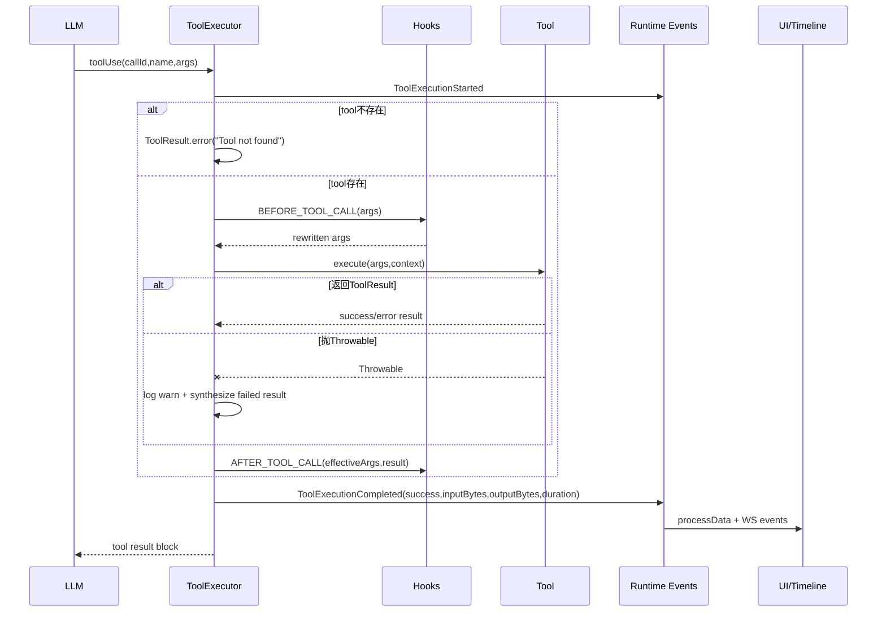
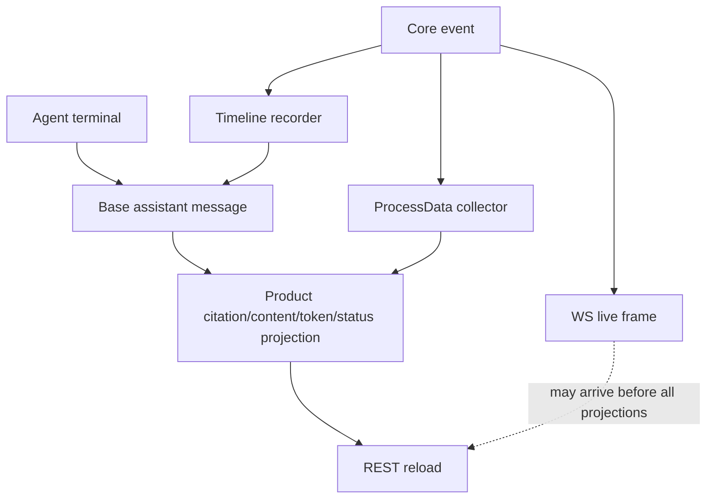

```
# T22：错误契约、日志、诊断与可观测性复刻说明

> 目标：读者在没有 Nova 源码、没有本会话上下文的情况下，能够复刻等价的错误分类、HTTP/Tool/LLM/MCP/CAN/流式错误传播、持久化诊断、日志检索、LLM 抓包、性能时间线、健康检查、指标与故障验收，并知道哪些现行行为不能被误写成生产保证。
>
> 标记：`[I]` 当前源码静态确认；`[A]` 静态推断，未运行验证；`[K]` 当前风险/缺口；`[P]` 规划或测试期望；`[REQ]` 复刻必须维持的规则；`[F]` 失败语义；`[D]` 推荐生产设计。本文未启动服务、未连接外部系统、未运行测试。

## 1. 边界与核心结论

本模块解决三个不同但关联的问题：

1. **错误契约**：调用方如何稳定区分参数、权限、资源、冲突、内部、上游、取消与暂时失败。
2. **可诊断性**：一次请求、Agent Run、LLM 调用和工具调用如何通过 ID、事件、日志和持久化数据关联。
3. **运行保障**：健康探针、指标、告警、SLO 和故障注入如何证明系统不是“返回了一个字符串就算可用”。

### 1.1 当前有四套错误载体

| 层 | 载体 | 权威失败位 | 面向谁 |
|---|---|---|---|
| REST 管理/业务 API | HTTP status + JSON body | status | 浏览器/API client |
| Agent 终态 | `AgentResponse.status/errorCode/errorMessage` | status | 产品 bridge、任务系统 |
| Tool loop | `ToolResult.success/output` | `success`，但部分 bridge 又读字符串前缀 | LLM、UI、timeline |
| WS/SSE | WS `type=error/cancelled/complete`；SSE transport error | terminal event/连接状态 | 实时客户端 |

`[K]` 它们尚未共享一个版本化 Error Envelope。HTTP 响应也至少有三种形状：业务异常使用 `message`，认证/plugin 使用 `error + errorCode`，特例再增加字段。客户端不能假设每个错误都有同样字段。

### 1.2 核心结论

- `[I/REQ]` 可恢复业务异常以语义类型表达，业务层不直接选择 HTTP status。
- `[I/K]` Tool runtime 会把工具抛出的任何 `Throwable` 转成失败 `ToolResult`，包括 JVM `Error`；这保持事件闭合，但捕获 OOM/StackOverflow 后继续运行有进程不可信风险。
- `[I/K]` `ToolResult.success` 是结构化真相，但部分 CAN 工具和 WS bridge仍用 `output.startsWith("Error: ")` 推断；两者不一致会造成 UI、LLM 与指标分裂。
- `[I]` LLM 失败有稳定 code，但分类器因 provider SPI 未暴露 HTTP status，主要匹配异常类、cause 和 message 文本，存在误分类。
- `[I/K]` Agent 致命错误会尽力持久化 ERROR assistant message；产品引用/process/token/status补写存在 best-effort 分支，实时终态不代表所有投影原子提交。
- `[I]` WebSocket 有丰富错误/过程事件；SSE 只有 token、tool_call、complete，异常使用 `completeWithError`，没有结构化 error event。
- `[I/K]` 本地日志检索和原始 LLM wire dump 都是 tenant-admin 能力。LLM dump故意保存完整 request/response/stack，权限和文件模式有限制，但内容未脱敏，是高敏诊断资产。
- `[I/K]` Actuator base path 为 `/`，健康详情隐藏；当前示例未定义 liveness/readiness groups，也未显式暴露 Prometheus/metrics endpoint。`nova_auto_test` 记录过发布环境 `/health` 返回 404 的 known failure，部署可达性必须单独验收。

## 2. 错误分类模型

### 2.1 产品业务异常

所有可恢复业务异常可继承一个抽象基类：

```java
abstract class BusinessException extends RuntimeException {
  ErrorType errorType;                 // non-null
  String message;                      // non-null，developer fallback
  String messageKey;                   // optional i18n key
  Object[] messageArgs;                // optional
  Map<String,Object> details;          // optional structured details
}

enum ErrorType {
  INVALID, FORBIDDEN, NOT_FOUND, CONFLICT, INTERNAL, UPSTREAM
}
```

映射表：

| ErrorType | HTTP | 语义 | 可否客户端直接重试 |
|---|---:|---|---|
| `INVALID` | 400 | 参数、格式、校验失败 | 修正请求后重试 |
| `FORBIDDEN` | 403 | 已认证但无动作权限 | 否，除非权限变化 |
| `NOT_FOUND` | 404 | 资源不存在或作用域内不可见 | 通常否 |
| `CONFLICT` | 409 | 重名、版本/状态/并发冲突 | 重新读取状态后可重试 |
| `INTERNAL` | 500 | 可预期的本地 IO/序列化/实现错误 | 仅幂等退避 |
| `UPSTREAM` | 502 | Gateway/外部服务失败 | 视下游状态退避 |

当前 handler 的通用 body：

```json
{
  "success": false,
  "message": "Project version conflict",
  "currentVersion": 12,
  "expectedVersion": 11
}
```

`details` 会铺平合并到顶层，只禁止覆盖 `success` 和 `message`。`[K]` 它仍可写入 `error`、`errorCode` 或任意大对象，并可能携 secret/PII。生产必须使用 detail schema allow-list、大小/深度限制和字段级 redactor。

### 2.2 特例 HTTP 映射

| 异常 | HTTP | body 关键字段 | 说明 |
|---|---:|---|---|
| controller 层认证失败 | 401 | `success,error,errorCode` | 兼容 AuthFilter envelope |
| multipart 超限 | 413 | `success,message,errorCode=UPLOAD_SIZE_EXCEEDED` | i18n message |
| 会话密文不可读 | 503 | `success,message,errorCode=CONVERSATION_DECRYPTION_FAILED` | 不回显 key/ciphertext/cause |
| 加密字段查询过宽 | 422 | `success,message,errorCode=CONVERSATION_QUERY_TOO_BROAD` | 防止无限解密扫描 |
| plugin route gateway | route-specific | `success,errorCode,error,correlationId` | 独立 envelope |

`[F]` 未被这些 handler 或 endpoint 局部 handler 捕获的异常由 Spring 默认异常机制处理；不能假设它们也具有上述 JSON 形状。新实现应补最后一道安全 handler，生成内部 ID、记录完整 cause、只返回通用消息。

当前 endpoint 局部错误目录至少还包括下列形状；它们说明“HTTP 码稳定”不等于“body envelope 统一”：

| 入口/错误 | HTTP | 当前 body 示例 | 客户端兼容要求 |
|---|---:|---|---|
| Task 不存在或不属于调用者 | 404 | `{"error":"Task not found","id":"task-id"}` | 不以 id 是否存在区分越权；读 `error` |
| Business `NOT_FOUND` | 404 | `{"success":false,"message":"..."}` | 读 `message` |
| Auth failure | 401 | `{"success":false,"error":"...","errorCode":"..."}` | 优先稳定 `errorCode` |
| Gateway controller failure | route-specific | 常见 `{"error":"...","traceId":"..."}` 或局部 map | 按 endpoint adapter解码 |
| Spring 未捕获错误 | framework-specific | 不能保证字段 | 退回 HTTP reason + 本地 correlation id |

`[I/REQ]` Task 404 对“从未存在”和“存在但归属他人”故意返回相同文案，防止 ID 枚举；虽然 body 回显请求中的 id，也不能据此确认资源存在。客户端当前安全解码优先级应为：`errorCode` → canonical `error.code` → `message` → 字符串 `error` → HTTP reason；`traceId/correlationId` 独立提取，未知字段保留给诊断但不直接展示。`[D]` 迁移统一 envelope 时保留一段双读窗口，不在同一版本突然停止输出旧 `message/error`。

### 2.3 推荐的统一错误码

错误码应是机器稳定 token，message 才做 i18n：

```text
<domain>.<category>.<specific>

auth.session.expired
project.version.conflict
tool.argument.invalid
llm.rate_limited
mcp.connect.timeout
can.gateway.unavailable
storage.conversation.decrypt_failed
runtime.worker_lost
```

错误码不能包含 tenant、对象 ID、provider 原文或可变自然语言。HTTP status、retryability、用户文案、告警级别由服务端 registry 映射。

## 3. HTTP Error Envelope

### 3.1 当前兼容契约

客户端读取顺序应为：

```java
message = body.message ?? body.error ?? httpReasonPhrase;
code = body.errorCode ?? inferOnlyForLegacy(status);
details = remove(body, success, message, error, errorCode);
```

不能以 `HTTP 200 + success=false` 代替错误 status；反向代理、浏览器重试和 SLO 需要 transport status。不能只看 `success`，因为部分普通 DTO 没有此字段。

### 3.2 目标 Envelope

```json
{
  "success": false,
  "error": {
    "code": "project.version.conflict",
    "category": "CONFLICT",
    "message": "项目配置已被其他人修改，请刷新后重试。",
    "retryable": true,
    "details": {"currentVersion": 12},
    "correlationId": "01J...",
    "occurredAt": "2026-08-13T10:00:00Z"
  }
}
```

规则：

- 4xx 不记录为服务故障，但 401/403/409按安全或并发指标计数。
- 5xx 日志带 exception object；响应不带类名、stack、SQL、路径和下游 raw body。
- `retryable=true` 只表示技术上可退避重试，不代表非幂等写可直接重放。
- correlationId 每个入口都返回；若接受客户端 ID，只允许安全字符和长度。
- field validation 用稳定 `violations:[{field,code,message}]`，不把 Java binding message原样暴露。

## 4. Tool 错误契约

### 4.1 结构化结果

```java
record ToolResult(
  boolean success,
  String output,
  ResultRetention retention,
  List<Artifact> artifacts) {}
```

便利构造 `ToolResult.error(reason)` 产生：

```json
{
  "success": false,
  "output": "Error: <reason>",
  "retention": "CONDENSABLE",
  "artifacts": []
}
```

工具必须区分：

```text
success=true, output="[]"                 -> 成功，零结果
success=false, output="Error: timeout"    -> 失败
success=true, output="Error: a book title"-> 合法但会触发旧前缀误判
```

### 4.2 执行链



当前不论 tool not found、工具返回失败还是抛异常，都会有 Started + Completed；`toolExecFailed` 在现行 executor 中不可达，保留给未来“沙箱崩溃、无法合成 ToolResult”的路径。`[I]`

### 4.3 双源风险

Core event 的 `success` 来自 `ToolResult.success`。但产品 WS collector 的部分路径根据 `resultContent != null && !resultContent.startsWith("Error: ")` 重新计算，CAN resource tools也从字符串前缀构造 success。`[K]`

必须选择唯一规则：

```java
record ToolFailure(String code, String safeMessage, boolean retryable, Map<String,Object> details) {}
record ToolResult(boolean success, String output, ToolFailure failure, ... ) {
  invariant(success == (failure == null));
}
```

`"Error: "` 只作为给 LLM 的兼容渲染，不参与 UI、指标、timeline 或重试判断。迁移期加入一致性指标：

```text
tool_result_contract_mismatch_total{
  structured_success="true", prefix_error="true", tool="..."
}
```

### 4.4 捕获 Throwable 的边界

`[I/K]` 当前 executor 捕获所有 `Throwable`，日志记录完整异常，再合成 `Error: <Class>: <message>`。生产应：

- 只把普通 Exception/受控 sandbox failure 转成 ToolResult。
- `VirtualMachineError`、`ThreadDeath`、`LinkageError` 等记录最小 emergency log 后重新抛出，由进程重启。
- 对外 safe message 走 redactor；类名只进入内部诊断。
- AFTER hook 抛错的语义也要明确定义；不得让“工具已产生外部副作用但 hook 失败”被自动重试。

## 5. LLM、Provider、MCP 与 CAN 错误

### 5.1 LLM failure code

| code | 识别信号 | transient | 建议动作 |
|---|---|---:|---|
| `llm.context_overflow` | context length/max tokens/413 文本 | 否 | 压缩上下文后有限重试 |
| `llm.rate_limited` | 429/quota/rate limit | 是 | 尊重 Retry-After，抖动退避 |
| `llm.auth` | 401/403/auth/key 文本 | 否 | 禁止自动重试，提示管理员 |
| `llm.timeout` | socket/interrupt IO timeout | 是 | 幂等重试 |
| `llm.network` | DNS/TCP/TLS/connection cause | 是 | 退避、熔断 |
| `llm.server` | 5xx 文本 | 是 | 退避/允许路由降级 |
| `llm.cancelled` | interrupt/cancel | 否 | CANCELLED，不当失败告警 |
| `llm.stream_incomplete` | 无 finish reason | 依策略 | 不把部分文本当完整成功 |
| `llm.protocol_error` | SSE/tool args协议冲突 | 通常否 | provider质量告警 |
| `llm.content_filter` | safety filter | 否 | 安全用户文案 |
| `llm.stop_sequence` | 显式停止序列 | 否 | 由业务判断是否完成 |
| `llm.unknown` | 未分类 | 未知 | 不盲重试 |

`[K]` 当前 classifier 没有 provider HTTP status 字段，扫描最多六层 cause/message。字符串可能把用户 prompt、代理 body 或本地文案中的 “403/timeout”误当类别。`[D]` Provider SPI 应抛 typed exception：status、providerCode、requestId、retryAfter、phase(connect/write/read/decode)、safeMessage 和 cause 分离。

### 5.2 用户可见 Chat 错误

Chat formatter 把 vision/model config/sandbox/LLM auth/rate/context/timeout/network/server/cancel 分类为本地化 title、原因、解决建议和技术详情。技术详情：

- 解包 CompletionException/ExecutionException。
- 掩码 `sk-...` 和 `Bearer ...` 模式。
- 最长 1,200 字符。
- 未知异常可包含简单类名。

`[K]` 正则只覆盖有限 key 格式，无法保证遮住任意厂商 token、Cookie、password、JSON secret、JDBC URL。它是末端补救，不是全局 DLP。

### 5.3 MCP

MCP plugin kind：`INVALID/FORBIDDEN/NOT_FOUND/CONFLICT/CONNECT/INTERNAL`。产品管理层把前四项映射同名 Business Error；`CONNECT` 和 `INTERNAL` 当前都映射为 `INTERNAL -> HTTP 500`，没有使用 `UPSTREAM/502`。`[I/K]`

运行时 MCP adapter 对 JSON-RPC error result或抛异常都返回 `success=false` 且 output 以 `Error: ` 开头。连接测试、管理 mutation 和 Agent tool call 是不同边界；不能让 tool-call error 变成整个 Agent 致命错误，也不能让配置保存的连接失败假成功。

生产分类建议：

```text
mcp.config.invalid         400
mcp.permission.denied      403
mcp.server.not_found       404
mcp.definition.conflict    409
mcp.connect.timeout        502/504 retryable
mcp.protocol.invalid       502 non-retryable per config version
mcp.remote.error           Tool failure, preserve remote requestId only
```

### 5.4 CAN Gateway

CAN 有两类客户端：插件内 Gateway client 和产品旧桥。核心线契约是把非 2xx 或 payload error 翻译成 `Error: ...`，而不是空成功。产品 HTTP bridge按 path 支持：

```json
{"error":"...","trace_id":"..."}       // resource
{"errorMsg":"...","traceId":"..."}     // /api/can
{"error":"..."}                           // legacy
```

HTTP 映射：401身份注册提示；400参数错；403权限；404资源；5xx/502/503/504默认暂时不可用，但若 raw error命中 MQL/client marker则呈现参数/语义错误。trace id附成新行 `trace_id: ...`。raw body截断后可能进入用户可见 tool result。`[I/K]`

复刻要求：

- Gateway contract应稳定返回 `{code,message,traceId,retryable,details}`，不要靠中英文 marker。
- 只把允许的 traceId字符返回给用户；日志同时记录 local correlationId 和 remote traceId。
- 不向 LLM 暴露 HTML、堆栈、SQL、内网 host 或认证响应。
- 超时分 connect/read/total；只对幂等 query重试，resource mutation需 idempotency key。

## 6. Agent、WebSocket、SSE 与持久化终态

### 6.1 Agent fatal

Core 捕获致命 Run 异常后构造：

```json
{
  "status": "ERROR",
  "conversationId": "conv",
  "messageId": "generated-id",
  "content": "Error: <described throwable>",
  "errorMessage": "<described throwable>",
  "errorCode": "llm.network",
  "timeline": {"events": []}
}
```

取消则 `status=CANCELLED`、content为空、errorMessage为空。状态映射到 message state：COMPLETED/TRUNCATED→COMPLETED，CANCELLED→CANCELLED，ERROR→ERROR。Fatal assistant持久化失败只 warn，不覆盖原终态。Fatal post-processor失败同样 warn并返回未处理响应。`[I/K]`

### 6.2 WS 当前协议

主要终态：

```json
{"type":"complete","content":"final text","seq":42,"conversationId":"conv"}
{"type":"cancelled","content":"","seq":42,"conversationId":"conv"}
{"type":"error","content":"localized safe diagnostic","seq":42,"conversationId":"conv","messageId":123}
```

error 的 `messageId` 会 best-effort查找最近 ERROR assistant row，可能为空。RunningTask先记录唯一 terminalOutcome，再尝试 markIdle/markError、清理并发 map、发送终态。状态持久化和产品投影失败可能仅写日志后继续发帧，因此“收到 error/complete”不等于所有数据库字段原子可读。刷新后应以持久化 message state为主，并允许投影降级。

工具失败不是 WS terminal error：它发 `tool_exec_end` 和 `tool_call_result` 的 `success=false`，Agent可让 LLM修正参数后继续，最后仍 complete。

### 6.3 live 与 persisted 的一致性



`[D]` 使用 durable run/event/outbox：terminal row、terminal event、outbox同事务；WS gateway只发布 committed event；projection独立幂等。客户端保存 `afterSeq`，重连从 event log重放，而不是仅收到 `streaming_active`。

### 6.4 SSE

当前 SSE：

```text
event: token      data: <text>
event: tool_call  data: <toolName only>
event: complete   data: <flattened final text>
```

onError/catch/发送 IOException调用 `SseEmitter.completeWithError(error)`，没有 `event:error` JSON、errorCode、conversationId、seq或 persisted messageId。SSE断开也不等价于取消。`[K]` 如果需要产品级等价，SSE/WS必须消费同一个 canonical event log。

### 6.5 异步 Worker 错误状态矩阵

异步系统不能只记一条 ERROR log；必须回答“输入是否已被接受、工作是否可能已经产生副作用、是否允许重跑、用户能否看到终态”。当前各域的失败语义并不相同：

| 域 | 触发/worker | 失败后的权威状态 | 当前恢复语义 | 关键观测与复刻要求 |
|---|---|---|---|---|
| Task | schedule/manual execution + Agent | execution/task runtime error | Task service把底层 not-found/validation/conflict/internal翻译为业务错误；项目生命周期/reconcile单项失败主要记日志并继续其他项 | execution必须持久化 terminal error、taskId/owner、attempt和runId；调度刷新失败不得伪造成 execution成功 |
| Memory | profile review scheduler/worker | job `FAILED`，达到最大 attempt 后 `BLOCKED` | job store保留 attempt/error；scheduler捕获异常避免线程死亡 | 区分可重试 FAILED 与人工/策略阻断 BLOCKED；metric含 pending/running/failed/blocked和 oldest age |
| Eval | run executor/question evaluator/startup recovery | question/result error或 run/job `FAILED` | 单题 timeout/execution/interruption被记录为结果错误；重启时无法恢复的 RUNNING run/job标 FAILED | 不把零答案当成功；保留已完成题结果，run聚合明确 partial；启动恢复失败可见且可删除 |
| Project lifecycle/reconcile | project event listener + periodic reconciliation | 各 task definition/execution依赖自己的状态；listener/reconcile故障主要日志化 | 单项目/单 task failure后继续扫描，禁止一项阻塞全批 | 需要 durable reconciliation cursor、per-item outcome、backlog/oldest和 dead-letter；否则只有日志不可审计 |
| IM ingress | inbox dispatch + Agent + reply outbox | delivery/outbox 双状态 | 见下方精确状态机 | Agent不确定结果绝不自动重跑；reply发送独立重试 |

IM 的当前语义是尤其重要的反例：输入 `RECEIVED` 通过条件更新被 claim 为 `DISPATCHING`，同时写 `processing_owner`、`processing_lease_until` 并增加 attempt。若 `DISPATCHING` lease 过期，恢复器原子写：

```text
delivery.status       = FAILED
agent_run_state       = UNKNOWN
last_error_code       = IM_AGENT_OUTCOME_UNKNOWN
processing_owner/lease= null
```

`[I/REQ]` 此时**不重新运行 Agent**，因为旧 worker 可能已完成外部工具副作用但未提交终态；盲目重跑会重复发邮件、建单或修改数据。

Agent 成功终态或可回复的 Agent 错误，会与 reply outbox insert 在**同一数据库事务**提交：delivery保存 agent run/message/result，outbox为 `PENDING`。发送 worker claim到 `SENDING`，带 owner、lease、attempt；失败按 5 秒指数退避、上限 300 秒重排为 PENDING；达到最大次数时 outbox=`FAILED`，delivery=`FAILED`、`last_error_code=IM_REPLY_FAILED`。因此 Agent 已成功而渠道回复失败是独立事实，不能把 Agent再跑一次。`[I]`

`[D]` 所有异步域复刻统一采用：accepted row → leased claim → heartbeat/lease → terminal result + event/outbox同事务 → 独立发布重试。只有能证明“副作用未开始”或具备业务 idempotency key 时才允许 lease过期重跑；否则进入 UNKNOWN/人工对账队列。

## 7. 日志与关联 ID

### 7.1 当前关联链

- WebSocket每条 chat worker生成 8位 UUID片段写 MDC `traceId`，conversation确定后写 `convId`，finally `MDC.clear()`。
- 日志格式可解析 thread、traceId、sessionId、level、logger和多行 stack。
- Plugin HTTP独立使用 `X-Correlation-Id`；安全候选则回显，否则生成 UUID，并进入 plugin error body/log。
- CAN remote `trace_id/traceId` 可进入 tool message。
- Core LLM timing hook使用完整随机 trace id关联一次 stream collector，但不等同全局 distributed trace。

`[K]` 这些 ID没有统一：WS短 traceId、plugin correlationId、CAN traceId、conversationId、LLM captureId和 runId可能无法自动 join。HTTP普通 controller也未见统一 correlation filter。

### 7.2 推荐 Context

```json
{
  "traceId":"32-hex",
  "spanId":"16-hex",
  "correlationId":"ulid",
  "runId":"run-uuid",
  "conversationIdHash":"hmac-prefix",
  "tenantIdHash":"hmac-prefix",
  "userIdHash":"hmac-prefix",
  "remoteRequestIds":{"llm":"...","can":"...","mcp":"..."}
}
```

规则：

- W3C `traceparent` 贯穿 HTTP、WS handshake、后台 worker、provider/Gateway；不信任客户端采样位。
- tenant/user/object ID默认 hash或内部受控 label，不进入公共 metrics tag。
- ThreadLocal/MDC在线程切换处显式安装并 finally恢复，不把上一次请求上下文泄给复用线程。
- log message使用固定模板和结构化字段；异常对象作为最后参数，不字符串拼 stack。
- correlationId可告诉用户和客服；traceId用于内部 telemetry，二者均不能成为授权凭据。

## 8. Timeline、processData、性能与分析

### 8.1 三种观测物的差异

| 载体 | 目的 | 生命周期 | 典型内容 |
|---|---|---|---|
| Core `RunTimeline` | 框架级持久运行事实 | 跟 assistant message | LLM/tool事件、总时长、summary |
| 产品 `processData` | UI重载/卡片/统计/citation | 跟 message，产品补写 | thinking、tool args/result、phase、perf、token、artifact |
| debug performance log | 运维临时分析 | 日志 retention | provider/model/finish/tokens/duration/tool OK/FAIL |

三者不是互相替代：timeline serializer失败会 warn并持久 null；读取坏 JSON返回 empty；processData读写也 fail-soft；debug trace只在 DEBUG且每 Run最多打印一次。

### 8.2 processData schema

```json
{
  "model":"provider/model",
  "totalDurationMs":12500,
  "tokenStats":{
    "inputTokens":3000,
    "totalTokens":3000,
    "cachedTokens":1200,
    "cacheHitRatio":0.4,
    "outputTokens":800,
    "toolCallCount":2
  },
  "events":[
    {
      "type":"tool_exec",
      "toolCallId":"call-1",
      "tool":"query_metric",
      "args":"{...}",
      "inputBytes":120,
      "outputBytes":2300,
      "result":"...",
      "success":true,
      "durationMs":640,
      "timestamp":...
    },
    {"type":"perf_span","stage":"request_assemble","durationMs":12,"timestamp":...}
  ]
}
```

args最多4,000字符、result最多4,000字符并加 truncated suffix；perf string attribute最多256字符。字节数来自 Core effective args/result UTF-8，bridge不应重新算。`[I]`

`[K]` 截断不是脱敏；tool args/result可能包含用户数据、SQL、文件内容和 token。processData既用于 UI又用于 citation evidence，过度清洗会破坏引用，完全保留又增加泄漏面。生产应把：

```text
public UI projection
internal evidence blob (encrypted, scoped)
operational telemetry (no content)
```

拆成三个存储和权限面。

### 8.3 Analytics

产品 Question stats、Asset adoption/usage/clarification、message token columns等属于业务分析；Micrometer属于运行指标。Message token backfill从 processData解析历史 token并补列，malformed返回 empty。`[I/K]` 这意味着统计是最终一致且可能缺失，不能用业务报表直接判定实时 SLO。

性能 DEBUG trace记录 requested/response model、provider type/name、raw/normalized finish reason、可见字符、tokens、tool count和时长；不记录 tool args，但其他 ToolExecutor DEBUG日志会记录截断后的 args/output（SKILL.md正文例外抑制）。生产默认不要开启含内容的 DEBUG。

## 9. Health、Readiness、Metrics

### 9.1 当前健康配置

```yaml
management:
  endpoints:
    web:
      base-path: /
  endpoint:
    health:
      show-details: never
  health:
    defaults:
      enabled: true
```

AuthFilter公开 `/health`。Spring Actuator依赖已引入。`show-details=never` 避免匿名探针看到数据库/磁盘组件细节。`[A]` 示例配置意图让 `/health` 供 Docker/LB，但具体环境是否启用/暴露由实际配置、Actuator exposure和部署路由决定。

`[K]` 没有明确 liveness/readiness group；默认 health若把外部 LLM/CAN/MCP纳入 DOWN，可能因非核心下游抖动摘除全部实例；若只检查进程，又会在数据库/Core未 ready时接流量。

建议：

```text
/live   = JVM event loop/critical thread alive；不访问外部网络
/ready  = Core built + required stores + schema + local executor accepting；可短缓存
/health/dependencies (admin) = DB、storage、optional LLM/CAN/MCP分项，脱敏
```

### 9.2 当前业务指标

已观察的有界 Micrometer 指标包括：

```text
project_create_total{result}
project_gateway_operation_total{type,result,step}
project_gateway_operation_duration_seconds{type}
project_access_denied_total{action}
project_context_resolve_total{mode,result}
project_chat_turn_total{mode,result}
project_gateway_reconcile_backlog{state}
nova_share_create_total{outcome}
nova_share_revoke_total{reason}
nova_share_view_total{outcome}
nova_share_attachment_cleanup_failed_total
```

`[K]` 示例没有显式 Prometheus endpoint exposure；注册 Meter不等于抓取端可访问。指标也尚未形成跨 Agent/LLM/tool/MCP/CAN 的统一 RED/USE 面。

### 9.3 最小指标集

```text
http_server_requests_total{route,method,status_class}
http_server_request_duration_seconds{route,method}
agent_runs_total{scene,outcome,error_code}
agent_run_duration_seconds{scene,outcome}
llm_calls_total{provider_role,outcome,error_code}
llm_call_duration_seconds{provider_role,outcome}
llm_tokens_total{provider_role,direction,cache}
tool_calls_total{tool_family,outcome,error_code}
tool_duration_seconds{tool_family,outcome}
mcp_connections{state,scope_type}
can_gateway_requests_total{operation,outcome,status_class}
ws_connections / ws_active_runs / ws_send_failures_total
projection_backlog / outbox_oldest_age_seconds
diagnostic_capture_active / diagnostic_capture_write_failures_total
```

禁止 tag：tenantId、userId、conversationId、runId、tool call id、raw URL、exception message。Tool name若可由租户动态创建也可能高基数，应映射 family/source或限 top-K。

上面是 RED（rate/error/duration），还必须补 USE（utilization/saturation/errors），否则“请求变慢”无法定位到资源瓶颈：

```text
jvm_memory_used_bytes / jvm_memory_max_bytes{area,pool}
jvm_gc_pause_seconds{action,cause} / jvm_gc_overhead_ratio
jvm_threads_live / jvm_threads_peak / jvm_threads_states{state}
process_cpu_usage / system_cpu_usage / process_open_fds
hikaricp_connections{state=active|idle|pending|max|min}
hikaricp_connection_acquire_seconds / hikaricp_connection_timeout_total
executor_active_threads{name} / executor_pool_size{name}
executor_queue_size{name} / executor_queue_capacity{name}
executor_rejected_total{name}
filesystem_free_bytes{volume_class} / filesystem_usage_ratio{volume_class}
log_file_bytes{class} / log_rotation_failures_total
diagnostic_dump_bytes / diagnostic_dump_quota_ratio / diagnostic_cleanup_backlog
ws_connections_active / ws_send_queue_depth / ws_send_rejected_total
worker_claimable_jobs{domain,state} / worker_oldest_claimable_age_seconds{domain}
```

`name/volume_class/domain` 必须是部署时有界枚举，不能用动态 bean、绝对路径或 tenant。告警应做因果组合，例如“HTTP p99高 + Hikari pending高”指向 DB pool saturation；“WS send queue高 + executor rejected”指向推送背压；“dump quota高 + disk free低”先停止诊断抓包而不是让业务磁盘写满。`[D]`

## 10. 管理日志检索与诊断文件

### 10.1 本地日志检索

tenant admin API：

```http
GET  /api/admin/logs/files
POST /api/admin/logs/search

{
  "traceId":"abc123",
  "sessionId":"optional",
  "keywordGroups":[["ERROR","WARN"],["gateway","tool"]],
  "fileName":"nova.log.1.gz",
  "limit":200
}
```

每个 keyword group内部 OR，group之间 AND；limit默认200、最大1000。服务扫描 `logging.file.path`（默认 `logs`）下目录第一层所有普通文件和 `.gz`，按修改时间倒序；把 stack多行合并成一条 entry，再按格式解析。响应含 items、totalMatches、truncated、scannedFiles、scannedLines。`[I]`

`[I/K]` 当前实现达到第 `limit+1` 个匹配后立即停止当前文件和后续文件。因此 `totalMatches` 不是全目录精确总数：未截断时是已扫描范围内精确值；`truncated=true` 时通常只是“至少 `limit+1`”的下界，`scannedFiles/scannedLines` 也只描述 partial scan。API 应将字段改名/补充为：

```json
{
  "items": ["...最多 limit 条..."],
  "matchedLowerBound": 201,
  "countExact": false,
  "truncated": true,
  "scanComplete": false,
  "scannedFiles": 2,
  "scannedLines": 18420
}
```

如果产品必须显示精确 total，应继续流式计数但停止保存 items，并设置独立 scan deadline/byte budget；不能让一个管理查询无界扫描全部 `.gz`。

`[K]` 它会把 raw log和 stack返回给当前租户管理员，但日志目录是整实例共享，未按 tenant预过滤；keyword/trace过滤不是权限隔离。如果日志含其他租户内容，任一 tenant admin可能读取。该 endpoint必须视为平台运维权限，不能仅用 tenant admin；或者日志写入时强制 tenant标记并在服务端不可绕过过滤。它还把每个文件全部读入内存后倒序，超大日志可造成内存/延迟问题。

`[I/K]` 文件枚举使用普通 `Files.list` 加 `Files.isRegularFile`，未显式使用 `NOFOLLOW_LINKS`、未比较 root/candidate `toRealPath`。Java 的 regular-file 判断默认可能跟随符号链接，因此 log 目录中的 symlink 有机会把任意可读文件带入检索；仅用返回的 basename 过滤不能阻止该问题。

`[D]` 安全文件选择算法：启动时取 `rootReal=logDir.toRealPath(NOFOLLOW_LINKS)`；枚举时读取不跟随链接的 attributes，拒绝 symbolic link和非 regular file；再以 `candidate.toRealPath(NOFOLLOW_LINKS)` 校验父目录/真实路径仍在 rootReal；只允许名称正则 `nova*.log(.N)?(.gz)?`；限制单文件/总扫描字节、文件数、压缩后解码字节和 compression ratio；打开文件后再次比对 file key 防 TOCTOU。容器中日志目录只读挂载，API 进程账户无权读取配置、secret和其他卷。

### 10.2 LLM raw wire dump

tenant admin API：

```text
GET    /api/admin/llm-dumps/users
GET    /api/admin/llm-dumps/sessions
POST   /api/admin/llm-dumps/sessions
POST   /api/admin/llm-dumps/sessions/{id}/stop
DELETE /api/admin/llm-dumps/sessions/{id}
GET    /api/admin/llm-dumps/sessions/{id}/records
GET    /api/admin/llm-dumps/sessions/{id}/records/{recordId}
```

启动请求：

```json
{"userId":"target-user","durationMinutes":30}
```

约束：duration 1..120分钟，默认30；同 tenant/user同时一个 active session；每 session默认最多200条；停止原因可为 MANUAL/EXPIRED/LIMIT_REACHED；默认停止后保留24小时。启动、停止、删除、读取写 `AUDIT.llm-dump-admin`。文件目录和文件尽力设置 owner-only权限；manifest/record用原子替换写。初始化、抓包落盘失败 fail-soft，不影响 provider响应。`[I]`

record 形态：

```json
{
  "id":"uuid",
  "sessionId":"uuid",
  "sequence":1,
  "providerName":"tenant-model",
  "providerType":"openai",
  "endpoint":"https://...",
  "streaming":true,
  "status":"ERROR",
  "startedAt":"...",
  "completedAt":"...",
  "durationMs":1234,
  "request":{"contentType":"application/json","rawBody":"...","body":{}},
  "response":{"statusCode":500,"contentType":"text/event-stream","rawBody":"...","body":"..."},
  "messageCount":3,
  "toolCount":12,
  "inputTokens":1000,
  "outputTokens":100,
  "error":{"type":"...","message":"...","stackTrace":"..."},
  "truncated":false
}
```

`[K]` rawBody完整保存 prompt、历史消息、tool schema/arguments、provider响应和异常 stack；没有内容 redaction，`truncated` 当前固定 false。Endpoint也可能暴露内网 host。它本质是高敏用户数据导出，不是普通日志。

生产要求：显式用户/安全审批、短 TTL、平台安全角色、reason/ticket、加密独立卷、不可下载或水印导出、读取审计、字段 redaction预览、硬字节上限、磁盘配额、KMS key、后台可靠清理和 session结束后吊销访问。默认关闭，不能只靠隐藏 UI。

## 11. Secret、PII 与内容脱敏

### 11.1 数据分级

| 数据 | 示例 | 默认日志 | metrics | debug capture |
|---|---|---|---|---|
| credential | Cookie/Bearer/API key/password | 禁止 | 禁止 | 也应删除 |
| user content | prompt/tool result/file text | 禁止或采样脱敏 | 禁止 | 审批后短期 |
| identity | tenant/user/account | hash/受控 | 禁止高基数 | tenant scope内可见 |
| object ID | conversation/project/share token | hash；token禁止 | 禁止 | 必要且scope验证 |
| operational | duration/status/errorCode/bytes | 允许 | 允许 | 允许 |
| stack/cause | Java stack、SQL/host | 内部 error log | 禁止 | 受控 |

### 11.2 Redactor 接口

```java
interface Redactor {
  SafeText logText(String raw, DataClass dataClass);
  JsonNode diagnosticPayload(JsonNode raw, DiagnosticPolicy policy);
  Map<String,Object> safeErrorDetails(Map<String,Object> details);
}
```

至少覆盖 header/cookie、JSON key (`apiKey`,`token`,`secret`,`password`,`authorization`)、URL query、JDBC credentials、PEM、常见 provider key和高熵字符串。采用 allow-list优先；规则必须作用于 exception message、stack附带 message、tool args/result、Gateway body和测试 artifact。

`[K]` 当前 ToolExecutor DEBUG会输出截断 args/output，CAN会回显截断下游错误，Auth/SSO部分日志会记录截断 body，raw LLM dump不脱敏。本地 log search再把这些原文提供给 admin，形成二次扩散链。

## 12. 已知故障与失败语义

| 故障 | 当前可见行为 | 风险 | 目标处理 |
|---|---|---|---|
| Business details含保留外字段 | 顶层铺平返回 | 泄密/契约碰撞 | typed details allow-list |
| Tool返回success=true但`Error:`开头 | Core成功、部分UI失败 | 双源分裂 | 只信结构化 success |
| Tool抛OOM等Error | 被转失败并继续 | JVM已不可信 | fatal重新抛/重启 |
| Provider 429/5xx | 文本分类 | 误分类/重试风暴 | typed status+Retry-After |
| MCP CONNECT | HTTP 500 | 上游语义丢失 | 502/504 typed code |
| CAN返回HTML错误 | 截断回显 | 内网/堆栈泄漏 | allow-listed safe detail |
| fatal message持久化失败 | warn，live error仍可发 | 刷新丢终态 | durable terminal/outbox |
| product projection失败 | warn后可能complete | live/persisted分裂 | projection status/backlog |
| SSE onError | transport断开 | 客户端无 code/seq | canonical error event |
| timeline/process malformed | empty/fail-soft | 统计静默缺失 | corruption metric+repair |
| `/health` 部署404 | 探针不可用 | LB错误判断 | deployment contract test |
| log search跨tenant文件 | admin可搜raw | 数据越权 | platform role/tenant index |
| raw dump磁盘写满 | capture fail-soft | 诊断缺失/主机风险 | 独立quota/metric/cleanup |

## 13. 最小生产级设计

### 13.1 统一错误对象

```java
record ServiceError(
  String code,
  ErrorCategory category,
  String safeMessageKey,
  Map<String,Object> safeDetails,
  boolean retryable,
  String correlationId,
  Throwable internalCause) {}
```

adapter规则：

```text
HTTP -> status + public envelope
Tool -> ToolFailure + LLM-compatible "Error: ..." rendering
Agent -> terminal errorCode + safe persisted message
WS/SSE -> canonical terminal event
Log -> internal cause + structured dimensions
Metric -> bounded code/category only
```

### 13.2 Observability event schema

```json
{
  "schemaVersion":1,
  "timestamp":"2026-08-13T10:00:00Z",
  "service":"nova-app",
  "environment":"prod",
  "event":"tool.completed",
  "traceId":"...",
  "spanId":"...",
  "correlationId":"...",
  "runId":"...",
  "scope":{"tenantHash":"...","scene":"PROJECT"},
  "component":{"type":"TOOL","name":"can.metric.query"},
  "outcome":"ERROR",
  "error":{"code":"can.gateway.unavailable","retryable":true},
  "measurements":{"durationMs":640,"inputBytes":120,"outputBytes":2300},
  "remote":{"system":"CAN","requestId":"safe-id"}
}
```

内容与测量分离。event schema注册版本；未知字段可忽略，字段改义必须升版本。

### 13.3 Durable error/run 表

```sql
create table agent_run_error (
  tenant_id varchar(64) not null,
  user_id varchar(64),
  run_id varchar(64) not null,
  error_seq bigint not null,
  error_code varchar(128) not null,
  category varchar(32) not null,
  retryable boolean not null,
  safe_message text,
  encrypted_diagnostic_ref_ciphertext text,
  diagnostic_key_id varchar(128),
  remote_request_id varchar(128),
  occurred_at timestamp not null,
  expires_at timestamp not null,
  primary key (tenant_id,run_id,error_seq),
  foreign key (tenant_id,run_id) references agent_run(tenant_id,id) on delete cascade
);

create table observability_outbox (
  event_id varchar(64) primary key,
  tenant_id varchar(64) not null,
  aggregate_type varchar(32) not null,
  aggregate_id varchar(64) not null,
  aggregate_seq bigint not null,
  event_type varchar(64) not null,
  event_version int not null,
  payload_json text not null,
  status varchar(16) not null,
  attempts int not null default 0,
  max_attempts int not null,
  next_attempt_at timestamp not null,
  processing_owner varchar(128),
  processing_token varchar(128),
  lease_until timestamp,
  row_version bigint not null default 0,
  last_error_code varchar(128),
  last_error_message_safe varchar(512),
  published_at timestamp,
  dead_lettered_at timestamp,
  created_at timestamp not null,
  updated_at timestamp not null,
  unique (tenant_id,aggregate_type,aggregate_id,aggregate_seq)
);
```

`agent_run_error` 不能只有裸 `run_id`：查询必须以当前 `tenant_id` 作为不可省略谓词，并通过 `(tenant_id,run_id)` FK 把错误绑定到 tenant-scoped run；`user_id` 用于 owner ACL，但管理员访问仍先校验 tenant。删除 run时错误级联清理，`expires_at` 驱动短 retention；encrypted diagnostic ref也按字段级密文 + key id保存，ref所指对象必须重复做 tenant/ACL校验，不能凭 opaque字符串越权。若合规要求保留审计而业务 run删除，应转移到独立不可变审计域，而不是取消 FK 后遗留孤儿。`[D]`

安全用户文案可以随 message持久化；完整 exception/capture使用独立加密诊断存储和短 retention，不写业务表。

#### 13.3.1 Outbox claim、顺序、重试与 DLQ

可靠 claim 不能只把 `status=PENDING` 查出后逐条无条件 update。推荐事务算法：

```text
1. SELECT due rows
   WHERE (status=PENDING
      OR (status=PROCESSING AND lease_until<=now))
     AND attempts<max_attempts
   ORDER BY next_attempt_at, created_at
   LIMIT batch
   FOR UPDATE SKIP LOCKED
2. 为每行生成不可猜 processing_token；写 owner/token/lease_until，
   attempts=attempts+1，status=PROCESSING，row_version=row_version+1
3. COMMIT；事务外发布
4. 成功 CAS：WHERE event_id=? AND processing_token=? AND row_version=?，
   写 PUBLISHED/published_at并清 lease
5. 失败 CAS：写 safe lastError；未耗尽则 PENDING+退避；
   耗尽则 DEAD_LETTER/dead_lettered_at并告警
```

publisher 的幂等键是 `event_id`。`aggregate_seq` 保证同一 aggregate的业务顺序；允许不同 aggregate并行。若 broker不保证分区顺序，以 `aggregate_id` 作为 partition key，consumer以 `(aggregate,event_version/aggregate_seq)` 去重和拒绝倒退。事件 schema的 `event_version` 表示 payload契约版本，`row_version` 只用于数据库 CAS，二者不可混用。

DLQ 必须保留 payload密文/引用、attempt、first/last error、首次/最后尝试时间和 replay审计。人工 replay创建新的 dispatch attempt但保持原 event idempotency key；不能把 DEAD_LETTER直接改 PENDING后丢失事故轨迹。`last_error_message_safe` 有长度和 redaction，完整 cause放受控诊断存储。

## 14. SLO 与告警

建议起始目标需按真实基线调整：

| SLI | 目标 | 窗口 | 排除项 |
|---|---:|---|---|
| authenticated API availability | 99.9% 非5xx | 28d | 客户端4xx |
| chat accepted→terminal | 99.0% 有终态 | 28d | 用户主动取消 |
| terminal persistence lag | p99 < 5s | 1h | 无 |
| LLM call success | 按 provider/role基线 | 1h/24h | content filter、cancel分开 |
| tool lifecycle closure | 99.99% Started有Completed/Failed | 1h | 进程hard crash |
| WS terminal delivery | 99.5% connected client | 24h | client network close |
| outbox/projection freshness | oldest < 60s | 15m | 维护窗口 |
| diagnostic deletion | 100%在retention+1h | daily | 法务hold |

告警：

- P0：跨租户诊断访问、credential pattern进入日志、active run无终态持续增长。
- P1：5分钟多窗口 burn rate、DB/Core readiness失败、outbox oldest > 5m、LLM auth激增。
- P2：单 provider rate/server错误升高、MCP reconnect风暴、CAN p99升高、dump写失败。
- ticket：known contract mismatch、timeline/process corruption、health route drift。

告警必须按 `errorCode/component/environment` 聚合，不按 exception message；取消、用户参数错和权限拒绝不能污染服务5xx告警。

## 15. 故障注入矩阵

| 注入 | 预期用户效果 | 预期持久化 | 预期观测 |
|---|---|---|---|
| Business INVALID | HTTP400稳定code | 无副作用 | 4xx counter，无error stack |
| DB unique conflict | HTTP409 | 原事务回滚 | conflict counter |
| LLM 429 + Retry-After | 安全限流提示/有限退避 | 一个Run，多attempt events | `llm.rate_limited`、retry count |
| LLM stream中途断 | 不发complete；ERROR/重试策略 | partial不标完整 | stream_incomplete metric |
| LLM auth 401 | 不重试 | ERROR row | P1 credential/config alert |
| Tool普通异常 | tool failed，Agent可继续 | timeline/process success=false | Started+Completed严格一对 |
| Tool返回空成功 | 零结果，不标错 | success=true | success metric |
| Tool contract mismatch | 客户端只信结构化位 | mismatch保留诊断 | mismatch counter |
| MCP handshake timeout | 管理API 502/504；run tool失败 | server状态/last error | connect timeout metric |
| CAN 503带traceId | 安全暂时失败 | tool failed | local+remote trace关联 |
| WS发帧失败 | Run继续 | terminal最终可刷新 | ws_send_failure，不改Run |
| 产品投影DB失败 | UI显示degraded/稍后修复 | base terminal+projection ERROR | backlog alert |
| timeline JSON损坏 | 对话仍可读，诊断缺失 | 标 corruption | repair metric |
| 日志目录不可读 | admin endpoint受控失败 | 无业务影响 | diagnostic failure metric |
| dump磁盘满 | provider不受影响 | capture ERROR/stop | quota alert |
| JVM OOM | readiness失败/重启 | durable event决定恢复 | crashloop/P0，不合成tool成功 |

## 16. 三仓测试与现有测试资产

### 16.1 Nova 主仓

已存在的静态测试资产覆盖：BusinessException null/fields、Global handler status/i18n/上传/密文/查询、ChatErrorFormatter分类与mask、ToolExecutor生命周期和失败转换、MCP adapter error、CAN Gateway映射、ProcessData schema/artifact/ordinal、PerformanceTrace、Project metrics、LogSearch、LLM Dump service/controller。`[I]`

必须补/保持：

- 每个 ErrorType→status和统一 envelope schema contract test。
- details保留键、secret字段、过大/嵌套值拒绝。
- Tool structured success与prefix四组合，bridge始终信结构化位。
- Tool普通异常闭合事件；VM fatal不吞。
- typed LLM status优先于 message；Retry-After/协议/stream incomplete。
- MCP CONNECT→upstream语义；CAN HTML/超长/恶意traceId脱敏。
- WS error live frame与persisted ERROR message关联；投影失败显式 degraded。
- SSE错误有目标协议测试，不把 socket close算complete。
- trace/MDC跨虚拟线程传播和finally清理。
- process/timeline truncation、corruption metric、PII redaction。
- `/live` `/ready`依赖组合；metrics tag cardinality gate。
- log search禁止跨tenant；dump权限、quota、加密、retention和内容扫描。

### 16.2 `nova_auto_test`

现有用例/设计覆盖 chat error-flow、tool error passthrough、WS process stats、LLM error handling、MCP error、CAN gateway、auth health等。仓内记录的有用 known failures包括：

- 发布环境 `/health` 曾返回404，但期望匿名200且不泄露详情。
- 某些工具在模型侧可见但 runtime `Tool not found`，表现为 `tool_exec_end success=false`。
- 部分 release 的 WS `tool_exec_end.outputBytes` 与 snapshot processData不一致。
- 可控真实 tool 4xx/exception fixture不足，使流式工具失败用例曾暂缓/known failure。

known failure必须仍执行并精确匹配预期故障，不能改成 skip或把错误现状写为正确契约。

建议黑盒断言：

1. 每次 chat最终恰好一个 complete/cancelled/error。
2. 每个 tool_exec_start有同 callId的 end，bytes/success与 process snapshot一致。
3. tool失败后 LLM可恢复，零结果不误判。
4. provider错误显示稳定类别，无 key/cookie/stack/internal host。
5. WS error后刷新仍有ERROR row和同一 safe message/code。
6. health/live/ready路由、匿名权限和详情隐藏。
7. correlationId可从响应关联到允许的日志字段。

### 16.3 `nova_ui_e2e`

UI仓已有 `failOnRuntimeError`、真实 `tool_exec_end`等待、上传超限 `UPLOAD_SIZE_EXCEEDED`、模型设置和聊天稳定性断言。UI验收应证明：

- HTTP message/error旧形状与新 envelope迁移期均能显示。
- tool card以结构化 success渲染红/绿，不解析自然语言。
- terminal error显示可操作文案和 correlationId，不显示 stack/token。
- 刷新后 ERROR/CANCELLED状态一致；live投影缺失显示“处理中/降级”而非空成功。
- 浏览器 console/pageerror/network 5xx作为 artifact收集，但 artifact先做 credential扫描。
- 管理员诊断页有显著高敏提示、时限/记录数、停止/删除和读取审计反馈。

## 17. 复刻验收矩阵

| ID | 场景 | 操作 | 预期 | 标签 |
|---|---|---|---|---|
| ERR-001 | INVALID | 非法body | 400 + safe message | `[I]` |
| ERR-002 | FORBIDDEN | 非admin mutation | 403，无副作用 | `[I]` |
| ERR-003 | conflict | stale version | 409 + currentVersion | `[I/REQ]` |
| ERR-004 | upload large | 超multipart limit | 413 + UPLOAD_SIZE_EXCEEDED | `[I]` |
| ERR-005 | decrypt fail | 错key/tag | 503，无ciphertext/cause | `[I]` |
| ERR-006 | detail injection | details写success/message | 不覆盖保留键 | `[I]` |
| ERR-007 | tool throws | RuntimeException | failed result + closed lifecycle | `[I]` |
| ERR-008 | tool zero rows | `success=true,"[]"` | 不误判失败 | `[REQ]` |
| ERR-009 | prefix collision | success=true且文本`Error:` | CURRENT可能误判；目标以success为准 | `[K/D]` |
| ERR-010 | VM fatal | OOM/StackOverflow | CURRENT吞成tool error；目标重启 | `[K/D]` |
| ERR-011 | LLM 429 | provider限流 | llm.rate_limited，有限退避 | `[I/REQ]` |
| ERR-012 | LLM malformed stream | 无finish | stream_incomplete/protocol error | `[I]` |
| ERR-013 | MCP connect | timeout | CURRENT管理面500；目标502/504 | `[I/K/D]` |
| ERR-014 | CAN trace | 503带trace | safe error含remote trace，无raw secret | `[I/REQ]` |
| ERR-015 | WS fatal | provider失败 | 唯一error帧，可能messageId | `[I]` |
| ERR-016 | SSE fatal | provider失败 | CURRENT completeWithError，无业务error event | `[I/K]` |
| ERR-017 | projection failure | terminal后补写失败 | CURRENT warn；目标DEGRADED+retry | `[K/D]` |
| ERR-018 | timeline corrupt | 坏JSON | empty/fail-soft + 目标corruption metric | `[I/D]` |
| ERR-019 | health | anonymous GET /health | 配置目标200；release曾known failure | `[A/P]` |
| ERR-020 | log tenant | tenant admin搜实例日志 | CURRENT可能跨tenant；目标拒绝 | `[K/D]` |
| ERR-021 | raw dump | active target user | 完整wire，owner-only文件，限时限量 | `[I]` |
| ERR-022 | dump secret | key in prompt/header | CURRENT raw可保存；目标redact/encrypt/approval | `[K/D]` |
| ERR-023 | cardinality | 动态tool/user IDs | metrics无高基数tag | `[REQ]` |
| ERR-024 | correlation | plugin error | response/log同correlationId | `[I]` |

## 18. I/A/K/P/REQ/F/D 汇总

### `[I]`

- Business ErrorType到400/403/404/409/500/502映射已实现，另有401/413/422/503特例。
- ToolResult有结构化success；异常转失败结果并发完整tool lifecycle事件。
- LLM稳定 failure code、Chat本地化错误、MCP kind和CAN错误/trace映射已实现。
- WS rich events、SSE最小事件、ERROR/CANCELLED message state和timeline/processData已实现。
- 本地日志检索、tenant-admin LLM raw dump、部分Micrometer指标和Actuator health配置存在。

### `[A]`

- `/health`、Actuator exposure、日志格式/目录权限、Prometheus抓取和真实代理路由需部署验证。
- 实际日志sink、备份、磁盘加密和LLM dump定时清理是否满足运维策略未运行验证。

### `[K]`

- 多套HTTP envelope；Business details铺平；普通未捕获异常形状不统一。
- Tool success与`Error:`前缀双源；捕获全部Throwable；LLM按message分类。
- MCP CONNECT映射500；CAN raw错误回显；SSE无结构化error。
- live/persisted best-effort分裂；trace/correlation体系不统一。
- processData/log可能含内容；log search实例级跨tenant风险；raw dump完整未脱敏。
- health无明确live/ready，metrics未形成统一面且抓取暴露未确认。

### `[P]`

- 自动化仓中 `/health` 200、可控tool 4xx、部分process bytes一致性是期望/known-failure资产，不是已运行保证。
- 统一 canonical event、durable outbox、typed provider errors和OTel链路属于目标能力。

### `[REQ]`

- HTTP status与业务code稳定；用户文案和内部cause分离。
- Tool失败不能伪装零结果；唯一信任结构化success。
- terminal恰好一次；取消不计系统错误；外部写重试需幂等。
- 日志/指标不含credential、全文或高基数身份；异常日志必须带cause对象。
- 诊断读取必须比普通tenant admin更严格，tenant作用域不可由搜索条件替代。

### `[F]`

- 4xx反映调用/权限/状态；5xx本地；502/503/504上游/可用性；422安全查询边界。
- Tool普通错误回到LLM并可继续；Agent fatal形成ERROR；cancel形成CANCELLED。
- 诊断采集失败fail-soft，不影响LLM；但必须产生独立failure metric。
- timeline/process读取坏数据fail-soft，目标同时记录corruption并可修复。

### `[D]`

- 统一ServiceError和版本化transport envelope；typed ToolFailure/ProviderException。
- OTel trace + canonical run event + terminal/outbox/projection状态。
- 分离UI projection、加密evidence与无内容telemetry。
- `/live` `/ready`/admin dependency health、统一RED指标、SLO burn-rate告警。
- 诊断平台角色、审批、KMS、quota、redaction、短retention和跨租户硬隔离。

## 19. 证据追溯附录

正文已自包含；以下只用于审计结论来源，不能替代正文：

- HTTP异常：`common/exception/NovaBusinessException`、`GlobalExceptionHandler`
- chat错误：`ChatErrorFormatter`、`ClassifiedAgentException`
- tool契约：Core SPI `ToolResult`、runtime `ToolExecutor`
- LLM：`LlmFailure`、`LlmFailureClassifier`、provider plugins
- MCP：`McpException`、`McpToolAdapter`、产品MCP application service
- CAN：plugin `CanGatewayClient`、产品 `CanGatewayHttpClient`
- 流式/持久化：Core `Agent`、产品 `ChatWebSocketHandler`、`ChatController`
- 过程观测：`ProcessDataCollector`、`PerformanceTraceListener`、`TimelineCodec`
- 运维诊断：`LogSearchService`、`LlmDumpCaptureService`及admin controllers
- metrics/health：`ProjectMetrics`、share metrics、`application.yml.example`
- 黑盒资产：`nova_auto_test`；UI资产：`nova_ui_e2e`

```
