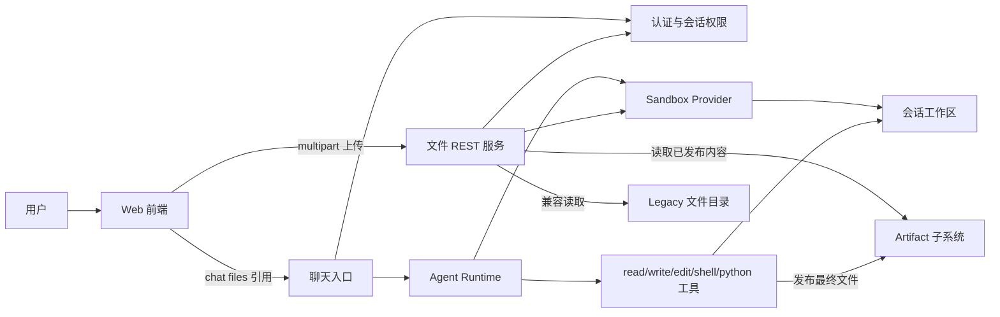
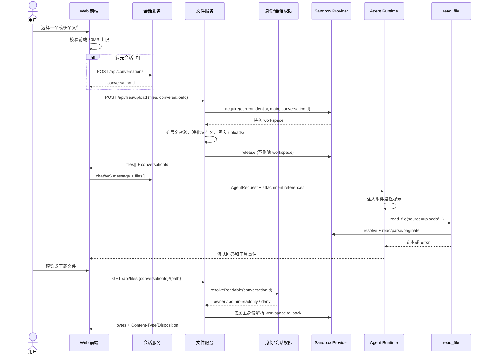
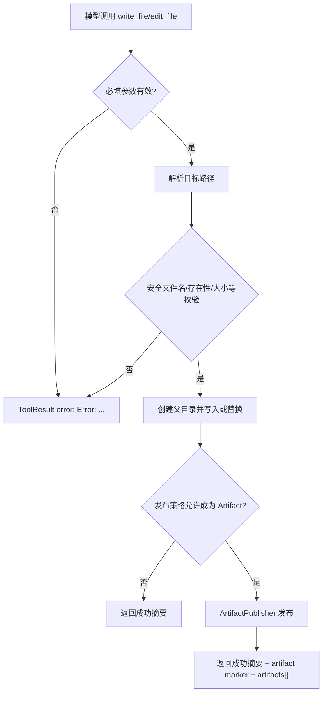
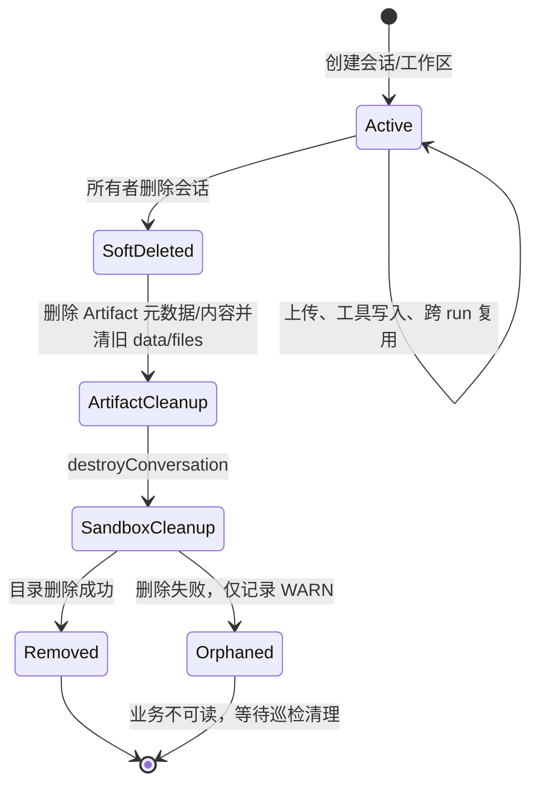

```
# 会话工作区、文件管理和沙箱操作复刻文档

## 1. 结论与边界

### 1.1 模块解决的问题

本模块为每一次 Agent 会话提供一个可持续使用、受身份约束的文件工作区，使用户上传的附件、Agent 生成的中间文件、工具产生的最终文件和超大工具结果能够在同一轮及后续轮次中被读取或继续加工，同时通过 HTTP 向授权用户提供预览或下载能力。

它同时承担四种不同职责：

1. **附件进入工作区**：浏览器将 PDF、Office、文本、CSV 等文件上传到某个会话的 `uploads/` 目录，随后把返回的相对路径随聊天请求交给 Agent。
2. **Agent 文件操作**：`read_file`、`write_file`、`edit_file`、Shell 和 Python 等工具以沙箱工作区作为默认工作目录，共享文件。
3. **文件对外读取**：已认证用户通过会话 ID 和工作区相对路径预览或下载文件；租户下载开关只禁止显式下载，不禁止预览。
4. **工作区生命周期**：同一身份和会话的工作区跨 Agent run 持久存在；删除会话时软删除会话记录，并尽力删除 Artifact、旧文件目录和沙箱会话目录。

### 1.2 目标用户和调用方

| 参与方 | 目的 |
|---|---|
| 最终用户 | 上传资料、查看附件卡片、让 Agent 读取资料、预览或下载结果 |
| Web 前端 | 建立会话、上传 multipart 文件、保存附件草稿、发送文件引用、展示错误 |
| 产品服务 | 解析身份和会话权限，把文件落入正确的身份/会话工作区，提供读取路由 |
| Agent Runtime | 为一轮运行取得沙箱，将附件路径和文件提示注入模型上下文，记录文件工具事件 |
| 文件工具 | 在工作区内读、写、编辑或通过命令生成文件 |
| 沙箱 Provider | 将 `(identity, agentName, sandboxKey)` 映射到目录或容器执行环境 |
| Artifact 子系统 | 将值得长期展示、授权或分享的最终文件复制/写入耐久存储并建立元数据 |

### 1.3 输入、输出与用户可见结果

核心输入包括：认证身份、`conversationId`、multipart 文件、文件相对路径、工具参数、下载标志和租户设置。核心输出包括：

- 上传响应中的附件引用：`id/name/path/size/type`；
- 文件工具的成功或 `Error: <原因>` 结果；
- 大结果的前若干行预览和 `offloaded/<sha256>.txt` 回读句柄；
- 带 `Content-Type`、`Content-Disposition` 和缓存/安全头的文件字节流；
- 删除会话后不可访问的文件和尽力清理的物理目录。

### 1.4 明确包含与不包含

本文包含会话普通文件、附件、目录/Docker 沙箱、文件工具、大结果 offload、文件读取路由和删除清理。以下能力只说明边界，不展开其完整业务：

- Artifact 的版本、授权、项目作用域和作品库 UI；
- 图表、报告、PPT 的业务生成流程；
- Skill 包、知识库导入、平台 Logo 等各自独立的上传入口；
- 图片直接送入视觉模型的模型适配细节；
- 文件全文索引。当前测试仓虽保留 `/api/index/**` 与 Lucene 的规划用例，但当前产品实现中没有对应入口，不能把它列为既有能力。

### 1.5 当前能力结论

| 结论 | 证据等级 | 说明 |
|---|---:|---|
| 上传文件落入当前身份和会话的持久沙箱 `uploads/` | I/A | 源码和 active API 用例均定义该行为；本次未运行 |
| 工作区按租户、用户、会话隔离，主 Agent 名不进入默认路径 | I | 身份键与工作区布局可静态确认 |
| 当前只有普通文件上传和读取，没有普通工作区文件的 REST 列表、单文件删除、移动或重命名接口 | I | 路由和工具注册静态盘点结论 |
| `write_file` 和 `edit_file` 支持写入/编辑，`read_file` 支持多格式与分页 | I/A | 实现存在，append/edit/read active 黑盒契约存在 |
| 空 multipart 文件会被跳过 | I/K | 代码明确跳过；`FILE-IO-008` 为 known failure |
| 非图片文件附件元数据只在当前浏览器内存中保留，硬刷新后不能从消息存储恢复 | I | 服务端消息只持久化图片引用，前端有显式兼容注释 |
| 目录 Provider 的路径解析可阻止常规 `..` 和已存在目标的 symlink 逃逸 | I | 静态实现及单测存在 |
| 聊天请求中的 `files[].path` 没有和上传记录、属主、会话或物理文件绑定，可把绝对路径直接带入模型提示 | I | 当前只要求 `path/name` 非空，然后执行 `Path.of(path)` |
| 会话文件 REST 的 legacy、tmp 和 sandbox fallback 只做词法 containment，读取时可跟随指向根外的 symlink | I | Controller 没有使用 `toRealPath`、`NOFOLLOW_LINKS` 或 `Sandbox.resolve` |
| 现有 `write_file`/`edit_file` 接受绝对路径和 `~`，可绕过沙箱相对路径边界 | I | 工具代码明确直接解析绝对路径；这是生产安全风险，不是推荐行为 |
| Directory 模式只清理环境变量和工作目录，不构成 OS 进程隔离 | I | 命令直接作为宿主进程启动 |
| Docker 模式使用只读根文件系统、非 root、资源限制、cap-drop 和 no-new-privileges | I | 容器 HostConfig 静态确认 |
| Docker 容器按身份共享，并 bind 整个身份目录；容器内命令理论上可访问该身份的其他会话目录 | I/F | bind 范围和 cwd 可确认；未做运行攻击验证 |
| 大于 8192 UTF-8 字节的普通工具结果会写入 `offloaded/<sha256>.txt`，时间线保留前 10 行及句柄 | I | Runtime 静态实现；未运行 |
| 删除会话会清理 Artifact、旧文件目录和沙箱目录，但沙箱清理失败只记日志，不回滚删除 | I | 服务链路与测试静态确认 |

## 2. 术语与参与方

### 2.1 术语

| 术语 | 定义 |
|---|---|
| 身份 `identity` | 至少含 `userId`，可含 `tenantId`。租户用户键编码为 `t/<tenantId>/u/<userId>` |
| 会话工作区 | 一个身份下、一个会话或 sandbox key 对应的持久目录 |
| `sandboxKey` | 主聊天通常等于 `conversationId`；独立 SubAgent 使用带 `subagent/.../<runId>` 的隔离键 |
| 上传附件 | 用户提供并落入 `uploads/` 的文件；它不是 Artifact |
| 普通工作区文件 | 工具直接写在工作区根或子目录下的文件，可能只是中间材料 |
| Artifact | 已发布的用户可见成果，具有独立 ID、元数据、内容后端和 ACL |
| offload 文件 | Runtime 为避免超大工具结果占满时间线而写入 `offloaded/` 的内部文本文件 |
| legacy 文件 | 历史版本遗留在 `data/files`、`data/tmp`、`data/python`、`data/downloads` 的文件 |
| Directory 沙箱 | 以宿主目录为工作区并在宿主直接执行进程的 Provider |
| Docker 沙箱 | 宿主目录 bind 到容器、命令在容器执行的 Provider；文件操作工具本身仍运行在 JVM 宿主进程 |

### 2.2 组件关系



## 3. 业务规则

### 3.1 身份与目录规则

1. 工作区必须至少按 `tenantId + userId + conversationId` 隔离；用户 ID 只在租户内唯一，不能只用 `userId` 做目录或权限键。
2. 当前默认布局为：

   ```text
   <sandbox-root>/t/<tenantId>/u/<userId>/conversations/<sandboxKey>/workspace/
   ```

   用户无租户时身份键为 `u/<userId>`。身份键自身可以包含安全的多级相对段。
3. 默认布局接受 `agentName` 参数但不把它放入路径，因此主 Agent 名称变化不会改变主会话目录。
4. 主聊天的 `sandboxKey` 是会话 ID。独立 SubAgent 使用形如：

   ```text
   subagent/<escaped-identity-key>/<parent-conversation-or-ephemeral>/<agent-name>/<run-id>
   ```

   因而当前默认 SubAgent 并不自动共享主会话上传目录；如果委派任务需要文件，复刻实现必须显式复制、只读挂载或传递受控句柄。
5. SubAgent 的 run ID 每轮唯一。执行结束的 `finally` 只调用 `release`，不会调用 `destroyConversation`；删除父会话时又只销毁主会话 ID 对应的 sandbox key，不会枚举 `subagent/.../<parent-conversation>/...`。因此 SubAgent 工作区可能成为长期孤儿，并继续占用磁盘；Docker 又挂载整个身份根，存活容器理论上仍能读取这些残留目录。
6. `acquire`/`release` 不是创建/删除语义。同一三元组再次 `acquire` 必须看见之前写入的字节；只有显式销毁相应 sandbox key 才删除目录。生产版必须维护 `parentConversationId -> sandboxKeys` 索引，对 run workspace 设置 TTL，并在父会话删除时级联销毁全部子键。

### 3.2 上传规则

当前实现规则如下：

- 请求是 `multipart/form-data`，字段名为 `files`，可选文本字段为 `conversationId`。
- 未提供会话 ID 时后端生成 UUID 并回传；当前 Web 前端会优先调用会话创建接口，再带真实会话 ID 上传。
- 单文件大小由 Spring multipart 配置限制，示例默认 `50MB`；单请求默认 `100MB`。
- 前端也按 `50MB` 做预检查，但客户端检查不是安全边界。
- 允许扩展名：`pdf/docx/xlsx/xls/pptx/txt/csv/json/xml/yml/yaml/md/log/conf`。
- 后端按扩展名判断，不检查真实 magic bytes；响应 MIME 优先使用客户端声明。
- 空文件当前被静默跳过，不会产生附件记录。
- 原文件名保留在响应 `name`；物理文件名为 `<8位十六进制ID>_<净化名>`。
- 净化名只保留 ASCII 字母数字、点、下划线、连字符和中日韩统一表意文字，其余字符替换成 `_`。
- 每批文件顺序写入；当前没有事务。若前一个文件已写入、后一个类型非法或写入失败，请求会报错但前一个文件不会回滚。
- 当前上传入口不验证传入的会话是否存在或属于当前用户，只是将文件写到“当前身份 + 该字符串”对应目录。伪造他人会话 ID不能越权写入他人身份目录，但可能创建当前用户自己的孤儿工作区。
- 返回的 `path` 由 `workspace.relativize(destination).toString()` 产生。在 Unix 上是 `uploads/...`，在 Windows 上会是 `uploads\\...`；这和 active 自动化契约要求的 `^uploads/` 冲突，也不应被称为跨平台路径。生产接口应返回 opaque `fileId`；若内部仍需相对句柄，必须显式编码为 `/` 分隔的 URI path，而不是操作系统路径字符串。

### 3.3 附件进入 Agent 的规则

上传成功返回的附件对象随聊天请求再次发送。Agent 侧使用的语义如下：

```json
{
  "conversationId": "7fe6d0d4-4458-4ee6-b09c-31d16a26d347",
  "message": "分析附件中的 SQL",
  "files": [
    {
      "id": "a1b2c3d4",
      "name": "query.sql.txt",
      "path": "uploads/a1b2c3d4_query.sql.txt",
      "size": 1280,
      "type": "text/plain"
    }
  ]
}
```

- 正常 Web 流程发送的是上传响应中的工作区相对路径，模型提示使用 `read_file(source="uploads/...")`。
- 但聊天入口实际只检查 `files[]` 每项的 `path` 和 `name` 是否为非空文本；它不验证该路径来自上传、不查文件是否存在，也不核对 tenant、owner、conversation 或 message。`id/type/size` 也由客户端自报。随后代码直接执行 `Path.of(path)`，并把这个路径原样写进模型可见提示。
- 这和 `read_file` 接受绝对路径、`~` 的行为组合成完整攻击链：恶意已认证调用方可以绕过上传，直接提交 `path: "/etc/passwd"`，或提交已知/猜中的其他工作区绝对路径；模型看到“用户附件路径”后若按提示调用 `read_file`，工具会在宿主权限允许时读取该文件。攻击是否成功取决于模型是否调用工具和服务账号是否可读，但授权边界已经缺失，不能把“模型可能不调用”当作防护。
- 生产版聊天请求的 `files[]` 只能接受 `fileId`，不能接受路径。服务端必须反查文件状态为 `READY`，且 tenant、owner、conversation 一致；消息落库时还要把该文件原子绑定到当前 `messageId`，拒绝已绑定其他消息、未知 ID、绝对路径、URI 和任何客户端路径字段。通过校验后，由服务端生成只对本轮有效的 opaque/signed handle，再由 Runtime 将 handle 解析为当前工作区内的安全相对路径。
- 有用户正文时，附件提示作为仅模型可见的 runtime prompt suffix 注入，不污染用户消息气泡、标题和持久化正文。
- 只有附件、没有正文时，系统用附件提示补成用户文本，避免空消息。
- 普通文件不会自动读入 LLM 上下文；模型必须调用 `read_file`。
- 图片是另一条链路：聊天请求携带 base64，服务校验图片、写入工作区，再把路径型 Image content block 交给视觉模型。图片引用会持久化到消息；普通文件元数据当前不会。

### 3.4 文件与 Artifact 的边界

| 对象 | 存放位置 | 是否必须有 DB 元数据 | 是否有独立 ACL | 生命周期 | 典型用途 |
|---|---|---:|---:|---|---|
| 上传附件 | 工作区 `uploads/` | 否 | 继承会话读权限 | 删除会话时清理 | 用户输入 |
| 工具中间文件 | 工作区根/子目录 | 否 | 继承会话读权限 | 删除会话时清理 | 脚本、中间 CSV |
| offload 文件 | 工作区 `offloaded/` | 否 | 继承工作区边界 | 删除会话时清理 | 超大工具结果回读 |
| Artifact | Artifact 内容后端 + 元数据库 | 是 | 是，可按 owner/project/grant | 独立删除或随会话清理 | 最终报告、文档、图表 |
| legacy 文件 | `data/files|tmp|python|downloads` | 不一定 | 各兼容路由不一致 | 兼容期清理 | 历史版本文件 |

`write_file` 和 `edit_file` 对显式目标会依据发布策略把文件登记为 Artifact，除非文件位于硬排除目录，例如 `outputs`、`.git`、`node_modules`、缓存或构建目录。Shell/Python 会扫描运行前后的工作区差异，只发布允许扩展名的新增/更新文件。发布是“让成果可展示”的动作，不应等同于“文件写入成功”。

### 3.5 普通文件列表与删除的当前边界

当前产品没有以下正式能力：

- 列出工作区所有普通文件；
- 单独删除上传附件或工具中间文件；
- 对工作区文件重命名、移动、复制；
- 用户在发送前从附件草稿中移除时同步删除服务端已上传字节。

前端“移除附件”只从本地草稿数组移除引用，文件仍留在会话工作区，直至删除会话。Artifact 列表/删除接口不能用来代替普通文件管理。

复刻最小兼容版可以保留这一限制；生产版应实现第 7.4 节的受控文件目录 API。

## 4. 完整执行链路

### 4.1 上传、发送、读取与下载



关键顺序：先创建会话再上传可避免孤儿目录；上传结束 `release` 必须保留字节；聊天运行重新 `acquire` 同一身份和会话后必须能读取；同租户管理员读取他人会话时，文件服务必须用会话属主身份解析目录，而不是管理员身份。

### 4.2 文件工具写入与 Artifact 发布



当前 `write_file` 的 `append=false` 会截断覆盖，`append=true` 会追加；DOCX/XLSX 使用结构化生成逻辑而不是简单文本字节。`edit_file` 先尝试精确匹配；未命中时尝试逐行去首尾空白的容错匹配；默认必须唯一，`replace_all=true` 才替换全部。

### 4.3 大结果 offload

1. 工具完成时 Runtime 取得原始文本结果。
2. Skill 指令结果先被时间线省略，不进入 offload。
3. 普通结果 UTF-8 字节数不超过 8192，时间线原样保存。
4. 超过阈值时计算完整内容 SHA-256，目标为 `offloaded/<64位hex>.txt`。
5. 通过沙箱 `writeFile` 写入完整字节；相同内容产生相同路径，写入具有内容级幂等性。
6. 时间线只保存前 10 行、总字节数和“使用 `read_file` 回读”的句柄；事件的 `artifactRefs` 也保存句柄。
7. 若 offload 写入失败，不中断工具事件：只保存有界预览和“完整结果未持久化”说明，不产生句柄。

```text
<前 10 行预览>
[offloaded 23142 bytes to offloaded/86f7...c9.txt; read full via read_file]
```

offload 文件不是正式 Artifact，不具备独立授权、版本或长期保留保证。

### 4.4 删除会话与清理



删除入口先验证会话可写：本人可删除，同租户管理员对他人会话只有只读权限，也返回不透明 404。会话记录与消息被软删除；Artifact 和文件清理随后执行。沙箱删除失败是 fail-soft，不会恢复会话，因此生产版必须有孤儿目录扫描和重试队列。

## 5. 对外契约

### 5.1 REST：上传文件

```http
POST /api/files/upload
Content-Type: multipart/form-data; boundary=...
Authorization: <session or bearer credential>

--...
Content-Disposition: form-data; name="conversationId"

7fe6d0d4-4458-4ee6-b09c-31d16a26d347
--...
Content-Disposition: form-data; name="files"; filename="销售 数据.csv"
Content-Type: text/csv

date,amount
2026-08-01,100
--...--
```

字段：

| 字段 | 类型 | 必填 | 默认 | 语义 |
|---|---|---:|---|---|
| `files` | multipart file[] | 是 | 无 | 可重复字段；空项当前被跳过 |
| `conversationId` | string | 否 | 服务生成 UUID | 工作区键；生产版应要求已存在且归当前用户 |

成功 `200`：

```json
{
  "conversationId": "7fe6d0d4-4458-4ee6-b09c-31d16a26d347",
  "files": [
    {
      "id": "5e7a8f10",
      "name": "销售 数据.csv",
      "path": "uploads/5e7a8f10_销售_数据.csv",
      "size": 29,
      "type": "text/csv"
    }
  ]
}
```

已观察错误：

| 状态 | 条件 | 当前响应 |
|---:|---|---|
| 400 | 扩展名不允许 | `{"error":"Unsupported file type: ... (allowed: ...)"}` |
| 413 | Spring multipart 大小超限 | `{"success":false,"message":"本地化提示","errorCode":"UPLOAD_SIZE_EXCEEDED"}` |
| 500 | 创建目录或写入失败 | `{"error":"Failed to create upload directory"}` 或 `{"error":"Failed to save file: ..."}` |
| 500 | 没有注册 Sandbox Provider | 非受控服务异常，生产版应翻译为 503 |

当前批上传非原子；复刻生产版应增加 `uploadId` 幂等键、批次临时目录、完整校验后原子提交。

跨平台约束：当前 `path` 使用 Java/操作系统原生分隔符，Windows 会返回 `uploads\\...`，不满足现有 active 用例的 `^uploads/`。兼容修复至少要在序列化前把 `\\` 转为 `/`；推荐契约不再返回可执行路径，只返回 `fileId` 和展示元数据。

### 5.2 REST：读取会话文件

```http
GET /api/files/{conversationId}/{relativePath}?download=false
```

解析顺序：

1. 校验调用者可读会话。本人可读；同租户管理员可只读并记录管理员审计；其他调用者、会话不存在、已删除会话和后台会话均返回不透明 404。
2. 在 legacy `data/files/{conversationId}` 查找。
3. 未命中则查 legacy `data/tmp/{conversationId}`。
4. 再以会话属主身份取得 NovaCore 沙箱，查找工作区相对路径。
5. 当前仅要求路径 normalize 后仍在词法基目录内，目标存在且 `Files.isRegularFile` 为真。

这里存在独立于 Directory Sandbox 的 symlink 漏洞。legacy `data/files`、fallback `data/tmp`、独立 tmp 路由以及 sandbox workspace fallback 都直接执行 `base.resolve(userPath).normalize()` 和词法 `startsWith(base)`；之后的 `exists/isRegularFile` 默认跟随符号链接，最终 `FileSystemResource` 也会读取链接目标。它们没有对 base/target 调用 `toRealPath`，没有使用 `NOFOLLOW_LINKS`，sandbox fallback 也没有调用 `Sandbox.resolve`。因此，只要攻击者能让基目录内出现 `link -> /outside`，请求 `link/secret.txt` 就可越界读取。

Directory Sandbox 自身对“已经存在的完整目标”另有 real-path containment 保护，但 Controller 绕开该抽象并自行拼接路径，所以 Provider 的保护不能覆盖 REST 读取；两者必须作为不同入口分别测试。生产实现应统一走 descriptor-based no-follow resolver，并在打开文件后验证 descriptor 对应对象仍位于真实根下，避免检查与读取之间的 TOCTOU。

响应规则：

- `download=true`：必须通过租户 `allowDownload` 开关，使用 `attachment`。
- `download=false`：图片、SVG、HTML、CSS、JavaScript 等少数类型使用 `inline`，其他类型仍使用 `attachment`。
- 普通文件设置 `Cache-Control: max-age=3600`。
- 仅 `text/html` 当前附加 CSP；其策略允许 inline/eval script 和若干 CDN。
- 缺失文件返回 404；路径穿越返回 400。

示例：

```http
HTTP/1.1 200 OK
Content-Type: text/csv
Content-Disposition: attachment; filename*=UTF-8''sales.csv
Cache-Control: max-age=3600

date,amount
2026-08-01,100
```

### 5.3 Legacy 读取路由

| 路由 | 权限/作用域 | 说明 |
|---|---|---|
| `GET /api/files/python/{conversationId}/{filename}` | 会话可读 | 读取固定 `data/python/{conversationId}`，保留兼容 |
| `GET /api/files/tmp/{conversationId}/{path}` | 会话可读 | 读取 `data/tmp/{conversationId}`，保留兼容 |
| `GET /api/files/{conversationId}/artifacts/{path}` | 优先 Artifact ACL；legacy disk 仅 owner | 先 ID 前缀、再文件名、最后旧磁盘路径 |
| `GET /api/files/downloads/{filename}` | 当前未绑定会话/owner | 读取全局 `data/downloads`，存在对象级授权缺口 |
| `POST /api/files/open` | 已认证但当前未限制路径 | 调宿主系统默认应用打开任意存在路径 |
| `POST /api/files/reveal` | 已认证但当前未限制路径 | 在宿主文件管理器显示任意存在路径 |

`open`、`reveal` 和全局 `downloads` 不适合多租户服务部署。生产版应默认禁用；若桌面单用户产品确实需要，应放入本机可信进程、绑定明确 capability，并只接受已签名文件句柄，不能接受任意字符串路径。

### 5.4 REST：删除会话触发工作区清理

```http
DELETE /api/conversations/{conversationId}
```

- 成功：`200`，无响应体。
- 不存在、不可读、管理员只读：不透明 `404`。
- 删除对业务层是幂等目标，但当前入口再次删除已隐藏会话会返回 404。
- 物理沙箱删除失败不会改变 HTTP 成功结果。

当前没有 `DELETE /api/files/{conversationId}/{path}`。

### 5.5 Tool：`read_file`

参数契约：

```json
{
  "type": "object",
  "properties": {
    "source": {"type": "string"},
    "start_page": {"type": "integer"},
    "end_page": {"type": "integer"},
    "sheet": {"type": "integer"},
    "start_row": {"type": "integer"},
    "end_row": {"type": "integer"}
  },
  "required": ["source"]
}
```

兼容别名：`path` 可替代 `source`；`start_line/from_line/line_start` 可替代 `start_page`；`end_line/to_line/line_end` 可替代 `end_page`。新调用必须使用标准名。

`start_page/end_page` 的单位随格式变化：文本是 1-based 行，PDF 是页，PPTX 是幻灯片，DOCX 是正文元素，XLS/XLSX 是 sheet。Excel 还可用 `sheet/start_row/end_row` 做行范围读取。

支持来源：工作区相对路径、`write_file` 返回的 `/api/files/...` 路径、HTTP(S) URL、`skill://` 虚拟资源；当前实现也接受宿主绝对路径和 `~`，并直接 normalize 后读取，不要求位于当前 sandbox。结合聊天 `files[].path` 未绑定上传记录的事实，调用方可构造 `/etc/passwd` 或其他工作区路径作为“附件”，诱导模型发起越权读取。生产版必须关闭这两类输入。

主要输出约束：普通内容预算约 15000 字符；单个超长文本行最多保留约 3000 字符；Skill 单资源最大 200KiB；空文件、图片或二进制返回说明性结果；失败使用 `ToolResult.error`，对 LLM 呈现 `Error: ...`。

### 5.6 Tool：`write_file`

```json
{
  "type": "object",
  "properties": {
    "path": {"type": "string"},
    "content": {"type": "string"},
    "append": {"type": "boolean", "default": false}
  },
  "required": ["path", "content"]
}
```

行为：

- 相对路径以工作区根为基准，自动创建父目录。
- 普通文本采用 UTF-8；HTML 写入前做内容净化。
- `.docx` 把简化 Markdown 标题、列表、表格转为 Word；append 时打开已有文档后追加。
- `.xlsx` 把 CSV 或 Markdown 表格写入工作簿；支持 `## Sheet: <name>` 切换 sheet；append 时追加已有工作簿。
- 安全黑名单仅按 basename 禁止 `.env`、常见私钥名和凭据 JSON。
- 返回文本示例：

  ```text
  Successfully written to /api/files/<conversationId>/reports/summary.md (1024 bytes)

  [artifact:{"id":"...","filename":"summary.md","url":"...","type":"DOCUMENT","size":1024}]
  ```

- 工具声明的默认 retention 是 `EPHEMERAL`。成功结果的便捷构造最初产生 `CONDENSABLE`，但 Runtime 的 `applyDefaultRetention` 会在记录时间线前把该默认值改写为工具声明的 `EPHEMERAL`，所以外部 Timeline 最终语义一致。复刻时必须保留这层默认值归一化；不要仅根据工具方法内部临时对象误判最终 retention。

### 5.7 Tool：`edit_file`

```json
{
  "type": "object",
  "properties": {
    "path": {"type": "string"},
    "old_string": {"type": "string"},
    "new_string": {"type": "string"},
    "replace_all": {"type": "boolean", "default": false}
  },
  "required": ["path", "old_string", "new_string"]
}
```

兼容别名：`file_path`、`old_text`、`new_text`。约束：文件必须存在、为普通 UTF-8 文本、大小不超过 10MiB；`old_string` 不能为空；新旧内容不能相同；默认精确或容错匹配必须唯一。错误必须不修改文件。

### 5.8 沙箱 SPI

等价复刻所需的最小稳定接口：

```java
interface SandboxProvider {
  String name();
  Sandbox acquire(Identity identity, String agentName, String sandboxKey);
  void release(Sandbox sandbox);
  void destroyConversation(Identity identity, String agentName, String sandboxKey);
}

interface Sandbox {
  Path resolve(String relativePath);       // 不允许绝对路径或逃逸
  Path root();                             // path-backed provider
  Path sharedRoot();                       // 身份级共享根，可选
  String writeFile(String suggestedRelativePath, byte[] content);
  byte[] readFile(String relativePath);
  ExecutionResult exec(String[] argv, int timeoutSeconds);
}

record ExecutionResult(int exitCode, String stdout, String stderr) {}
```

`writeFile` 允许实现为避免冲突而改写文件名，调用者必须使用其返回路径，不能假定建议路径即实际路径。

### 5.9 配置契约

```yaml
spring:
  servlet:
    multipart:
      max-file-size: 50MB
      max-request-size: 100MB

nova:
  sandbox:
    backend: directory # directory | docker
    directory:
      base-dir: data/sandboxes
    docker:
      image: nova-sandbox:latest
      base-dir: data/sandboxes
      work-dir: /sandbox
      network-mode: bridge
      network-name: nova-sandbox-net
      memory-limit: 512m
      cpu-limit: 1.0
      pids-limit: 100
      idle-timeout-minutes: 120
      cleanup-interval-ms: 300000
      tmpfs-size: 64m
      user-id: 1000
      cap-add: []
      docker-host: ""
    readable-dirs: []
```

下载开关是租户级设置，缺省开启，并以约 30 秒 TTL 缓存。设置更新应立即刷新缓存。

## 6. 数据模型与生命周期

### 6.1 附件引用

当前普通文件没有独立数据库表。等价 DTO：

```typescript
interface FileAttachment {
  id: string;       // 当前为 UUID 前 8 个十六进制字符
  name: string;     // 用户原始文件名，用于展示
  path: string;     // 工作区相对路径，当前固定 uploads/<id>_<safeName>
  size: number;     // 字节数
  type: string;     // 客户端 MIME 或 application/octet-stream
}
```

这个 DTO 是当前兼容形态，不是可信授权对象。尤其 `path` 不能从浏览器回传后直接执行。生产消息 DTO 应收敛为 `{ "fileId": "..." }`；响应可包含 name/size/mime 供展示，但所有定位和授权字段必须由服务端反查。

当前生命周期：

```text
选择文件
  -> 上传字节并返回临时附件引用
  -> 前端草稿持有引用
  -> 发送聊天时引用进入本轮 AgentRequest
  -> 工作区字节持续存在
  -> 普通文件元数据不随消息持久化
  -> 删除会话时物理清理
```

因此当前实现无法回答“这个会话历史上上传过哪些普通文件”，也无法在硬刷新后完整重建非图片附件卡片。

### 6.2 推荐生产数据表

生产版应将普通文件变成受控资源，但仍与 Artifact 分表：

```sql
CREATE TABLE conversation_file (
    file_id           VARCHAR(64) PRIMARY KEY,
    tenant_id         VARCHAR(128) NOT NULL,
    owner_user_id     VARCHAR(128) NOT NULL,
    conversation_id   VARCHAR(64) NOT NULL,
    message_id        BIGINT NULL,
    category          VARCHAR(24) NOT NULL, -- UPLOAD, WORKSPACE, OFFLOAD, TEMP
    relative_path     VARCHAR(1024) NOT NULL,
    original_name     VARCHAR(512) NOT NULL,
    safe_name         VARCHAR(512) NOT NULL,
    declared_mime     VARCHAR(255) NULL,
    detected_mime     VARCHAR(255) NOT NULL,
    size_bytes        BIGINT NOT NULL,
    sha256            CHAR(64) NOT NULL,
    status            VARCHAR(24) NOT NULL, -- STAGING, READY, QUARANTINED, DELETING, DELETED, FAILED
    storage_backend    VARCHAR(32) NOT NULL,
    storage_ref       VARCHAR(1024) NOT NULL,
    created_at        TIMESTAMP NOT NULL,
    updated_at        TIMESTAMP NOT NULL,
    expires_at        TIMESTAMP NULL,
    deleted_at        TIMESTAMP NULL,
    version            BIGINT NOT NULL DEFAULT 0,
    UNIQUE (tenant_id, owner_user_id, conversation_id, relative_path)
);

CREATE INDEX idx_conversation_file_scope
  ON conversation_file(tenant_id, owner_user_id, conversation_id, status, created_at);
CREATE INDEX idx_conversation_file_hash
  ON conversation_file(tenant_id, owner_user_id, sha256);
```

必要规则：

- `tenant_id + owner_user_id + conversation_id` 是访问和清理的最小对象作用域。
- `relative_path` 只能由服务端产生并经过规范化，不能直接信任客户端。
- `message_id` 在消息落库后绑定，以支持刷新恢复附件卡片；未发送草稿可设置短 TTL。
- `sha256` 支持完整性、幂等上传和恶意文件扫描缓存，但不能跨租户暴露去重命中。
- 删除先进入 `DELETING`，成功移除内容后改 `DELETED`；失败可重试，不能只写日志。

### 6.3 目录布局

兼容布局：

```text
<sandbox-root>/
└── t/<tenant>/u/<user>/
    ├── conversations/<conversation-id>/
    │   └── workspace/
    │       ├── uploads/
    │       ├── offloaded/
    │       ├── outputs/<conversation-id>/
    │       ├── skills/
    │       └── <tool-created files>
    ├── conversations/subagent/.../<run-id>/workspace/
    └── python-venv/                  # 可重建身份级缓存
```

当前父会话删除只销毁 `<conversation-id>` 主键，不会匹配或枚举 `subagent/.../<conversation-id>/...`，而 SubAgent 完成时只 release，因此上图的 SubAgent run 目录可能成为孤儿。生产布局可把耐久字节放对象存储，只给一轮执行物化临时目录。无论后端如何变化，外部契约仍只暴露 opaque `fileId` 或内部受控句柄，不暴露宿主绝对路径。

## 7. 核心实现设计

### 7.1 最小兼容实现

最小兼容版需要以下组件：

1. `IdentityResolver`：从认证上下文得到租户、用户和管理员标志。
2. `ConversationAccessService`：返回 owner 和 readOnly；所有拒绝统一 404。
3. `SandboxProviderRegistry`：启动时只激活一个 Provider。
4. `DirectorySandboxProvider`：按身份和会话创建持久目录。
5. `FileUploadService`：扩展名、大小、净化名、multipart 写入。
6. `ConversationFileController`：上传、按会话读取、下载开关和 legacy 兼容。
7. 三个文件工具：`read_file/write_file/edit_file`。
8. `ResultOffloader`：超阈值文本写入内容哈希路径。
9. `ConversationDeletionCoordinator`：会话软删除、Artifact 清理、工作区清理。

安全解析伪代码：

```text
resolveExistingForRead(root, relative):
  reject null/blank
  raw = parsePath(relative)
  reject raw.absolute or raw contains '..' or backslash
  lexical = normalize(root / raw)
  require lexical startsWith normalize(root)
  realRoot = realpath(root)
  realFile = realpath(lexical)
  require realFile startsWith realRoot
  require regular-file(realFile, no-follow-final-link)
  return realFile
```

写入不能只对“最终文件存在时”调用 `realpath`，因为恶意 symlink 父目录可指向工作区外。最小正确做法：逐级检查所有已存在父目录不为 symlink，最终使用 `CREATE_NEW` 或原子临时文件 + rename；更稳健的 Linux 实现使用 `openat2(RESOLVE_BENEATH | RESOLVE_NO_SYMLINKS)`。

### 7.2 上传事务伪代码

```text
upload(identity, conversationId, parts, idempotencyKey):
  conversation = requireWritableConversation(identity, conversationId)
  require conversation.owner == identity
  require parts not empty and count <= configuredMaxCount
  reserve total quota
  staging = createPrivateBatchDir(identity, conversationId, randomBatchId)
  rows = []
  try:
    for part in parts:
      require 0 <= size <= maxSingleFile
      original = canonicalDisplayFilename(part.originalName)
      detected = sniffMimeAndMagic(part.stream)
      require extensionCompatible(original, detected)
      require malwareScan(part) == CLEAN
      fileId = uuidV7()
      relative = "uploads/" + fileId + "_" + safeBasename(original)
      writeNoFollow(staging, relative, part.stream, maxSingleFile)
      rows += STAGING metadata with sha256
    transaction:
      insert rows
      atomicallyMoveBatch(staging, liveWorkspace)
      mark rows READY
    return attachment DTOs
  catch:
    delete staging
    release quota
    throw controlled error
```

序列化响应时不得使用 `Path.toString()` 表达 API 路径。最小兼容版使用 `relative.iterator()` 逐段以 `/` 拼接；生产版只回传 `fileId`，避免 Windows 反斜杠、URL 编码和路径语义进入客户端契约。

### 7.3 Directory 与 Docker 的选择

| 维度 | Directory 当前形态 | Docker 当前形态 | 生产建议 |
|---|---|---|---|
| 文件持久化 | 宿主目录 | 宿主目录 bind | 对象存储耐久 + 执行期物化 |
| 命令位置 | 宿主进程 | 容器进程 | 不可信命令必须容器/微虚机 |
| 根文件系统 | 宿主可见 | 容器 rootfs 只读 | 只读镜像 |
| 用户 | 启动服务账号 | 默认 UID 1000 | 每任务非 root、不可复用特权 |
| 资源限制 | 无 | 512MiB/1CPU/100 pids | 按任务限额和全局配额 |
| 网络 | 宿主网络 | bridge 或 host | 默认无网，按工具域名 egress allowlist |
| 容器复用 | 不适用 | 每身份一个容器 | 安全优先使用每会话/每 run 容器；复用需强隔离 |
| 会话可见范围 | 进程可读宿主 | bind 身份根，含多个会话 | 只挂载当前会话目录 |
| 超时 | 强杀当前进程 | 容器内 `timeout -s KILL` | 同时杀进程组并回收 cgroup |
| 输出上限 | 读取完整 stdout/stderr 后返回 | 每流最多 300KB | 流式限额并明确标注截断 |

Directory 模式只能用于受信任开发任务。清空环境变量并不能阻止命令读取宿主 `/etc`、服务源码、同账号文件或访问网络。生产模式不得允许模型控制的 Shell/Python 在 Directory Provider 上执行。

SubAgent 还需要独立的生命周期账本。每次 acquire 前写入 `(tenantId, ownerId, parentConversationId, sandboxKey, runId, expiresAt, status)`；finally release 后标记 `RELEASED` 并进入短 TTL 清理。父会话删除时按索引枚举所有子 sandbox key 逐个 `destroyConversation`，失败进入重试队列。不能用目录前缀扫描代替索引，因为对象存储后端未必有目录语义，且扫描容易漏掉转义后的身份段。

### 7.4 生产级普通文件 API

建议新增以下契约，解决当前列表/删除缺口：

```http
GET    /api/conversations/{conversationId}/files?category=UPLOAD&cursor=...&limit=50
GET    /api/conversations/{conversationId}/files/{fileId}/content?disposition=inline
DELETE /api/conversations/{conversationId}/files/{fileId}
POST   /api/conversations/{conversationId}/files/{fileId}:rename
POST   /api/conversations/{conversationId}/uploads:initiate
PUT    <pre-signed-part-url>
POST   /api/conversations/{conversationId}/uploads/{uploadId}:complete
```

列表响应示例：

```json
{
  "items": [
    {
      "fileId": "0198...",
      "category": "UPLOAD",
      "name": "sales.csv",
      "mimeType": "text/csv",
      "sizeBytes": 48291,
      "sha256": "...",
      "status": "READY",
      "createdAt": "2026-08-07T02:00:00Z",
      "messageId": 4102,
      "downloadAllowed": true
    }
  ],
  "nextCursor": null
}
```

删除必须按 `fileId` 和对象 owner 校验，不能让客户端提交任意路径。若文件仍被消息、运行、Artifact 或定时任务引用，返回 `409 FILE_IN_USE`，或采用引用计数/延迟删除。

聊天绑定契约建议为：

```json
{
  "conversationId": "conv-1",
  "message": "分析附件",
  "files": [{"fileId": "0198..."}]
}
```

服务端解析伪代码：

```text
bindFilesToMessage(identity, conversationId, messageId, fileIds):
  reject any legacy path/source/url field
  for fileId in distinct(fileIds):
    row = select conversation_file for update where file_id = fileId
    require row exists and row.status == READY
    require row.tenant_id == identity.tenantId
    require row.owner_user_id == identity.userId
    require row.conversation_id == conversationId
    require row.message_id is null or row.message_id == messageId
    row.message_id = messageId
    handle = mintRunScopedHandle(fileId, conversationId, messageId, expiresAt)
  commit message and bindings atomically
  return handles to Runtime only; never return resolved host paths to the browser
```

Runtime 的 handle resolver 必须校验签名/随机 token、有效期、run、conversation 和 message，再从 READY 元数据取得服务端路径；unknown/expired handle、绝对路径、`file:`/`http:` 等 URI、裸相对路径一律拒绝。这样即使调用方伪造附件 JSON，也不能把任意路径注入 `read_file`。

### 7.5 文件读取与 URL 安全

当前 `read_file` 可抓取任意 HTTP(S) URL、自动跟随重定向并将完整响应读入内存，存在 SSRF、重定向到内网、压缩炸弹和内存耗尽风险。生产设计必须：

- 只允许 HTTP(S)，每次重定向重新做 DNS/IP 校验；
- 拒绝 loopback、link-local、RFC1918、元数据服务和解析漂移；
- 设下载字节、解压后字节、页数、行数和耗时上限；
- 使用统一出站网关和域名策略，不直接继承用户代理环境；
- 临时文件写入当前 run 私有目录并在 finally 清理；
- Office/PDF 解析放入低权限隔离进程，防止解析器漏洞影响主服务。

### 7.6 Artifact 发布的一致性

写文件和发布 Artifact 是两个资源系统，必须区分失败：

- 写入失败：工具整体失败，不产生 Artifact。
- 写入成功、发布失败：当前工具可能把发布异常翻译为工具失败，但工作区文件已经存在。生产版响应应明确 `fileWritten=true, artifactPublished=false`，避免重试导致重复覆盖。
- 发布成功、事件发送失败：Artifact 已存在，应通过 idempotency key 或 `(runId, toolCallId, outputPath)` 唯一键恢复，而不是重复发布。
- 同名多次输出应产生新 Artifact 版本或新 ID，不能静默覆盖历史成果。

## 8. 并发与非正常路径

### 8.1 并发模型

- 产品聊天服务对同一 `conversationId` 的主对话运行加锁，正常情况下同一会话的两个主 turn 串行执行。
- 上传不使用该运行锁，可与 Agent 读文件并发。
- 工作区布局对主 Agent 忽略 `agentName`，因此同会话内若另有并发执行者共享目录，文件名冲突会产生最后写入者获胜。
- `write_file` 覆盖和 `edit_file` 的读-改-写不是原子的；`append` 也没有业务级互斥。复刻生产版应提供 per-file 乐观版本或锁，并用临时文件原子替换。
- offload 使用内容哈希路径；相同内容并发写同一路径结果一致，但底层当前是普通覆盖写，不具备跨进程原子性。应先写临时文件再原子 rename。
- 黑盒文件工具 fixture 要求单 worker，说明测试本身避免共享环境并发，不能据此声称产品已解决并发。

### 8.2 取消

- 用户取消 Agent run 不会回滚已完成的文件写入或已发布 Artifact。
- 尚未完成的工具事件在时间线最终化时会记录为失败/取消占位。
- Directory 超时只强杀直接进程，未证明会清理整个进程树。
- Docker 使用容器内 `timeout -s KILL` 包装命令，并有额外 5 秒等待兜底；仍需清理命令退出前已写入的半成品。
- 上传选择器取消发生在请求发出前，不应产生附件。上传请求发出后浏览器取消网络，不代表服务器没有落盘；生产版需 staging + TTL 清理。

### 8.3 失败表

| 场景 | 当前行为 | 生产期望 |
|---|---|---|
| 无 Sandbox Provider | 上传/运行抛服务异常 | 503 `SANDBOX_UNAVAILABLE`，无部分写入 |
| 批内非法扩展名 | 400，但前序文件可能已写 | 批次原子失败或逐文件结果明确 |
| 空文件 | 静默忽略 | 明确允许并往返，或 422 明确拒绝 |
| 损坏 PDF/Office | 上传可成功，读取阶段受控错误 | ingest 扫描可选；读取错误不影响后续消息 |
| 文件超过 multipart 限制 | 413 统一错误信封 | 保持，并确保客户端/服务端上限一致 |
| 文件名过长 | 可能写入时报 500 | 422 `FILENAME_TOO_LONG` |
| MIME 与扩展名不符 | 当前可能接受 | 415 或隔离扫描 |
| 路径不存在 | 文件路由 404；read_file `Error:` | 保持，不泄露绝对路径 |
| 路径穿越 | 普通读取 400；工具相对路径由 Sandbox 拒绝 | 所有入口一致拒绝；无双重解码旁路 |
| 伪造聊天附件路径 | `path/name` 非空即进入提示，可与绝对路径 `read_file` 组成越权读取链 | 只收 fileId；反查 READY + tenant/owner/conversation/message；生成 run handle |
| REST symlink 读取逃逸 | legacy/tmp/sandbox fallback 的 lexical containment 会跟随 symlink | 所有读取入口统一 no-follow descriptor resolver |
| symlink 父目录写逃逸 | 当前写入路径可能存在缺口 | no-follow 逐级解析/openat2 |
| Artifact 内容缺失 | 404 | 保持，并告警元数据/内容不一致 |
| 删除沙箱失败 | WARN，删除业务仍成功 | 记录 cleanup job，重试和告警 |
| 父会话删除后 SubAgent workspace | 只销毁主 sandbox key，子 run 只 release，可能残留 | parent→sandboxKeys 索引、TTL、级联销毁和孤儿巡检 |
| offload 写失败 | 保留预览，无句柄 | 保持 fail-soft，并计数告警 |
| Docker daemon 不可用 | 选择 docker 时可能无 Provider | 启动失败或明确降级策略；不能悄悄降为不安全执行 |

## 9. 安全、权限和审计

### 9.1 必须保持的权限规则

1. 所有带会话 ID 的读取必须先查会话属主，禁止仅依赖路径中的会话 ID。
2. 本人读写；同租户管理员只读他人会话并产生管理员审计；跨租户和普通他人访问统一 404。
3. 已删除和后台会话不可通过文件入口重新读取。
4. Artifact 内容必须走 Artifact ACL，不能因为管理员可读会话就自动扩大 Artifact 权限。
5. 下载开关只控制 `attachment` 下载是否符合当前产品语义；如果租户要求数据不可导出，还必须限制 inline 读取、复制、分享和 API 字节访问，不能只改响应 disposition。

### 9.2 当前必须修复的安全风险

| 风险 | 当前事实 | 修复要求 |
|---|---|---|
| 绝对路径读写 | 文件工具接受 `/...` 和 `~` | 所有 LLM 工具只接受 opaque handle 或相对路径 |
| 伪造附件到绝对路径 | chat `files[].path` 不查上传/owner/conversation/existence，并原样提示模型 | Chat 只收 fileId，事务绑定 message，Runtime 只收短期 handle |
| Directory 命令逃逸 | 命令在宿主直接运行 | 生产禁止；用容器/微虚机/受限系统调用 |
| Docker 跨会话读取 | 整个身份根 bind 到共享容器 | 只挂当前会话；共享缓存单独只读挂载 |
| REST symlink/TOCTOU | Controller 词法检查后 `isRegularFile`/资源读取跟随链接，并绕过 DirectorySandbox 保护 | `openat2`/no-follow descriptor traversal，所有路由复用同一 resolver |
| SubAgent 孤儿目录 | 每 run 独立 key，finally 只 release，父删除只 destroy 主 key | 父子 key 索引 + run TTL + 级联销毁 + orphan sweeper |
| 任意宿主 open/reveal | API 接受任意存在路径 | 默认删除或仅桌面可信 IPC + capability handle |
| 全局 downloads | 无 conversation/owner scope | 迁移到 fileId + owner ACL，旧路由下线 |
| MIME/XSS | MIME 可由客户端影响；SVG/JS 可 inline；HTML CSP 较宽 | 内容嗅探；不可信内容独立域名；强 CSP；禁 sniff |
| SSRF | read_file 可抓任意 URL和重定向 | 出站策略、IP 阻断、大小限制 |
| 文件名与日志 | 日志记录目标路径和原名 | 清洗控制字符，日志只记 fileId/相对路径哈希 |
| 恶意文档 | 主 JVM 解析 PDF/Office | 隔离解析进程、限时限内存、补丁治理 |

### 9.3 审计事件

生产版至少记录：

```json
{
  "event": "conversation_file.read",
  "requestId": "req-...",
  "tenantId": "tenant-a",
  "actorUserId": "admin-1",
  "ownerUserId": "user-7",
  "conversationId": "conv-1",
  "fileId": "file-1",
  "action": "PREVIEW",
  "adminRead": true,
  "result": "ALLOWED",
  "bytes": 48291,
  "timestamp": "2026-08-07T02:00:00Z"
}
```

禁止记录文件正文、base64、Cookie、Token、绝对宿主路径和未脱敏工具参数。

## 10. 外部依赖对端设计

本模块没有类似 CAN Gateway 的业务对端，但依赖四类外部能力。

### 10.1 文件/对象存储

当前兼容接口仅需：`persist(storageRef, stream)`、`open`、`delete`、`exists`。本地目录实现将 `storageRef` resolve 到配置根并检查 normalize 后仍在根下。

最小 Stub：

```text
Map<String, byte[]> objects
persist(ref, bytes): require safeRef; objects[ref] = copy(bytes)
open(ref): if absent -> NotFound; return copy(objects[ref])
delete(ref): objects.remove(ref)
exists(ref): objects.contains(ref)
```

生产对端应使用 S3/OSS 等对象存储：服务端加密、租户级 key prefix、内容校验、版本/保留策略、病毒扫描事件、短时签名 URL。签名 URL 只能在通过对象 ACL 后生成，不能把可预测 storageRef 直接暴露为授权凭证。

### 10.2 Docker daemon

对端必须支持 image inspect/pull、container create/start/inspect/stop/remove、exec 和 label 查询。当前容器关键参数：只读 rootfs、`/tmp` tmpfs、非 root UID、drop all capabilities、可选 allowlist、no-new-privileges、内存/CPU/pids、bridge/host 网络、身份目录 bind、只读技能目录 bind。

最小兼容 Stub 只需记录 create/exec/stop 调用并在临时目录模拟文件；生产必须处理 daemon 重启、旧容器恢复、镜像 ID 变化淘汰、名称冲突、空闲 reaper 和应用停止清理。

### 10.3 操作系统文件打开器

当前对端是 macOS `open`、Windows `cmd /c start`/Explorer、Linux `xdg-open`。这只适合本地桌面部署。服务器部署应返回“功能不可用”，不能在服务器桌面执行。

### 10.4 文档解析库

PDF、DOCX、XLS/XLSX、PPTX 解析器只需输出受预算约束的文本片段。生产对端或隔离服务应提供：格式检测、页/表/行范围、最大解压比、最大实体数、超时、受控错误码和无网络解析环境。

## 11. 可观察性

### 11.1 日志

建议结构化字段：`requestId/tenantId/actorId/ownerId/conversationId/sandboxBackend/fileId/relativePathHash/operation/bytes/durationMs/outcome/errorCode`。管理员跨用户读取必须单独审计。

错误日志必须带异常对象，但用户响应只给可定位的稳定错误码。不要把 Java 类名、stack trace、Docker socket、宿主路径或解析库内部错误直接返回。

### 11.2 指标

- `file_upload_total{result,type}`、`file_upload_bytes_total`、上传 P95/P99；
- `workspace_bytes{tenant}`、`workspace_file_count{category}`、配额拒绝数；
- `sandbox_acquire_duration`、`sandbox_exec_duration`、timeout/kill/reaper 计数；
- `file_tool_total{tool,result}`、read 分页次数、binary/encoding 拒绝数；
- `tool_result_offload_total{result}`、offload bytes、回读次数；
- `workspace_cleanup_total{result}`、孤儿目录数和最老年龄；
- 路径穿越、symlink、跨租户、SSRF 拒绝安全指标。

### 11.3 Trace 与诊断附件

Trace 应串联上传、聊天 turn、工具调用、Artifact 发布和下载。测试失败可保留请求状态、脱敏 JSON、截图和视频，但不得附带真实文件正文、认证状态或密钥。二进制夹具使用无业务价值 canary。

## 12. 复刻实施顺序

1. **身份和会话 ACL**：先实现 owner/readOnly/opaque-404。静态验收：所有会话文件入口只调用统一裁决器。
2. **安全路径库**：实现 read/write 两套 no-follow 解析和目录布局。静态验收：业务代码不自行 `root.resolve(userInput)`。
3. **Directory Provider 仅用于开发**：实现持久 acquire/release/destroy。静态验收：同三元组重取可见、删除仅目标会话。
4. **上传和读取 API**：大小、数量、真实 MIME、批次 staging、错误信封、下载开关。静态验收：没有部分提交和任意 conversationId 孤儿目录。
5. **附件消息模型**：持久化 `fileId`/message 关系并支持刷新恢复。静态验收：服务端消息 DTO 能返回普通附件。
6. **文件工具**：只接受相对路径或 fileId；实现分页、append、唯一 edit 和 `Error:` 传播。
7. **大结果 offload**：内容哈希、原子写、预览、句柄和失败降级。
8. **Artifact 发布桥**：写入与发布分阶段、幂等键和部分成功语义。
9. **Docker/微虚机 Provider**：当前会话单独挂载、资源/网络限制、进程树回收。
10. **生命周期与配额**：删除重试、草稿 TTL、孤儿扫描、租户配额和审计。
11. **Legacy 迁移**：把 `data/files/tmp/python/downloads` 映射为 owner-scoped rows，迁完关闭危险路由。

## 13. 验收标准

### 13.1 正向

1. 用户创建会话并上传 TXT/PDF/DOCX/XLSX/PPTX/CSV；响应原名、大小、MIME 和安全相对路径正确。
2. 新一轮 Agent 重新 acquire 同一工作区后，`read_file` 能读取上传内容。
3. 文本分页为 1-based inclusive 范围，连续两页无重叠、无遗漏。
4. `write_file` 覆盖和 append 顺序正确；`edit_file` 只替换唯一目标。
5. 工作区文件通过授权会话路由返回正确字节和 Content-Type。
6. 下载开关关闭时 `download=true` 返回 403；预览行为符合产品策略。
7. 超 8192 UTF-8 bytes 工具结果产生 SHA-256 offload 句柄，`read_file` 可回读完整内容。
8. 删除会话后文件路由不可读，工作区最终物理删除。

### 13.2 反向与安全

1. 普通用户、跨租户管理员读取他人会话文件均得到不透明 404。
2. 同租户管理员可只读并产生审计，不可删除他人工作区。
3. `../`、双重编码、绝对路径、反斜杠、symlink 父目录和 TOCTOU 尝试全部受控拒绝。
4. 非法扩展名、MIME 欺骗、超大文件、文件数过多、文件名过长返回 4xx，不产生残留。
5. 空文件要么精确往返，要么明确 422；不得返回成功空数组。
6. 损坏文档产生受控解析错误，不使聊天输入永久禁用，后续普通消息可成功。
7. HTML/SVG/JS 不可在 Nova 主域执行任意脚本；下载响应不能 CRLF 注入。
8. `read_file` URL 不能访问本机、内网、云元数据或借重定向绕过。
9. Directory 生产配置被启动门禁拒绝；Docker 内不能读取同身份其他会话。
10. 聊天 `files[]` 提交 `/etc/passwd`、`~/...`、`file:` URI、裸相对路径、未知 fileId、他人/他会话 fileId 均在进入模型前失败；只有 READY 且绑定当前 tenant/owner/conversation/message 的 fileId 能换取本轮 handle。
11. legacy files、tmp 和 sandbox fallback 内放置指向根外文件/目录的 symlink 后，REST 读取必须受控拒绝；DirectorySandbox 自身测试和 Controller 测试必须分开。

### 13.3 并发与恢复

1. 同文件带相同版本的两个 edit 只能一个成功，另一个返回 409/工具冲突错误。
2. 上传中断不会产生 READY 行；staging 文件按 TTL 删除。
3. 工具取消后已提交文件状态明确，半文件不作为 Artifact 发布。
4. 删除物理内容失败会进入重试队列，业务不可读，告警可定位。
5. 服务重启后工作区/对象元数据一致；Docker 旧容器恢复或淘汰不丢耐久文件。
6. SubAgent 正常完成、失败和取消后 run workspace 均按 TTL 回收；删除父会话会级联清理所有已登记子 key，失败项可重试且不可再被 Docker 容器访问。

## 14. 测试矩阵

> `A` 表示 active 自动化契约，本次未运行；`K` 为 known failure；`P` 为 planned；`I` 为静态实现事实；`D` 为复刻建议。

| 场景 | 通道 | 前置条件 | 操作 | 预期结果 | 当前证据等级 |
|---|---|---|---|---|---:|
| 上传文本往返 | API | 已认证、自有会话 | 上传后按返回 path GET | 字节、原名、size、路径正确；删除会话成功 | A/I `FILE-IO-001` |
| Artifact 下载往返 | API | 自建成果 | 读内容并删除 | 字节和 HTML MIME 正确，删除后 404 | A/I `FILE-IO-002` |
| 会话 Artifact legacy 路径 | API | 同一 Artifact canonical 可读 | 按 conv/path 读取 | 期望 200；release 现为 404 | K `FILE-IO-003` |
| 非法扩展名 | API | 已认证 | 上传 `.exe` | 400/413/415，无后端泄露 | A/I `FILE-IO-004` |
| 双重编码路径穿越 | API | 已认证 | 请求 `%252e%252e%252f` | 400，无后端泄露 | A/I `FILE-IO-005` |
| REST legacy symlink 逃逸 | API | `data/files/<conv>/link` 指向根外 | GET `link/secret` | 生产必须拒绝；当前词法检查会跟随链接 | I/D |
| REST tmp symlink 逃逸 | API | `data/tmp/<conv>/link` 指向根外 | GET tmp 与 fallback 路由 | 两入口都必须拒绝；当前存在同类风险 | I/D |
| REST sandbox symlink 逃逸 | API | workspace 内链接指向根外 | GET 会话文件 fallback | 必须拒绝；单测证明 Controller 不可绕过 Sandbox resolver | I/D |
| 跨租户文件/Artifact | API | 两个不同租户账号 | 第二账号读取第一账号资源 | 403/404；owner 仍可读 | A/I `FILE-IO-006` |
| 不存在内容 | API | 随机不存在 ID | GET content | 404，不是 500 | A/I `FILE-IO-007` |
| 特殊名和空文件 | API | 自有会话 | 上传特殊名、零字节 | 特殊名安全；零字节当前失败 | K/I `FILE-IO-008` |
| append 顺序 | WS/Tool | 上传 fixture | write(false), write(true), read | 两段各一次且顺序正确 | A/I `TOOL-FILE-002` |
| 唯一 edit | WS/Tool | 唯一旧片段 | edit 后 read | 只替换目标，前后内容保留 | A/I `TOOL-FILE-003` |
| edit 未命中/多命中 | WS/Tool | 缺失与重复片段 | 两次 edit 后 read | 两次失败，文件未改 | A/I `TOOL-FILE-006` |
| 精确分页 | WS/Tool | 多行文本 | read 3..6 | 只返回对应带行号范围 | A/I `FILE-READ-001` |
| 连续分页 | WS/Tool | 长文本 | 连续两次 read | 不重叠、不遗漏 | A/I `FILE-READ-002` |
| 缺失文件 | WS/Tool | 隔离会话 | read 随机路径 | `Error:` 且无内部泄露 | A/I `FILE-READ-003` |
| 越过 EOF | WS/Tool | 短文本 | 超大 end、start 超尾 | 截止 EOF 或安全空结果 | A/I `FILE-READ-004` |
| 二进制/非 UTF-8 | WS/Tool | 二进制 fixture | read | 明确拒绝或受控提示 | A/I `FILE-READ-006` |
| UI TXT/PDF/Office 多附件 | Browser | 可用模型 | 上传并发送 | 卡片可见、回答完成、无严重解析错误 | A/I `ATTACH-PW-01/03/04/05` |
| UI 图片附件 | Browser | 视觉模型 | 上传图片并发送 | 图片可见且回答完成 | A/I `ATTACH-PW-02` |
| UI 大文件 | Browser | 128MB fixture | 上传 | 期望 413 和 `UPLOAD_SIZE_EXCEEDED`；浏览器实跑待授权 | A/I |
| UI 损坏文件恢复 | Browser | 损坏 PDF | 读取失败后新会话发普通消息 | 有失败信号且后续可用 | A |
| UI 取消文件选择 | Browser | 打开选择器 | 不选择文件 | 无附件残留，可继续发送 | A |
| 普通文件刷新恢复 | Browser/API | 已发送非图片附件 | 硬刷新会话 | 生产应恢复卡片；当前元数据未持久化 | I/D |
| 伪造绝对附件路径 | WS/API | 已认证、未上传文件 | `files[].path=/etc/passwd` 并诱导读取 | 必须在 Agent 启动前 400/403；当前存在攻击链 | I/D |
| 伪造跨工作区附件 | WS/API | 同用户另会话或他用户路径已知 | 提交其绝对路径 | 必须不透明拒绝且不把路径写入 prompt | I/D |
| fileId 绑定校验 | WS/API | READY/unknown/他租户/他 owner/他 conversation/他 message 多组文件 | 只提交 fileId | 仅当前作用域 READY 文件成功并产生短期 handle | D |
| 拒绝 legacy 定位字段 | WS/API | 生产 fileId 模式 | 提交 absolute、`~`、URI、裸 relative path | 统一 400，不调用 Path.of，不进入模型提示 | D |
| Windows 上传路径 | API | Windows 文件系统 | 上传并检查响应 | 不出现反斜杠；推荐只返回 fileId | I/D |
| 单普通文件删除 | API | READY 文件 | DELETE fileId | 当前无接口；生产应删除或报引用冲突 | I/D |
| symlink 父目录逃逸 | Tool | 工作区内恶意 link | 写 `link/new.txt` | 生产必须拒绝；当前存在风险 | I/D |
| Docker 跨会话隔离 | Tool | 同身份两会话 | 会话 A 尝试读 B | 生产必须拒绝；当前 bind 设计需补强 | I/F/D |
| 大结果 offload | Runtime/Tool | 输出 >8192 bytes | 工具完成并回读 handle | 完整内容在 sandbox；时间线有预览 | I |
| offload 写失败 | Runtime | Sandbox write 抛错 | 完成工具事件 | 有界预览，无 handle，事件不丢 | I |
| 删除清理失败 | API/Job | 模拟目录不可删 | 删除会话 | 业务不可读；生产有重试和告警 | I/D |
| SubAgent 父删除级联 | Runtime/Job | 父会话下创建多个成功/失败/取消 run | 删除父会话 | 全部登记 key 进入销毁；失败重试；无孤儿 | I/D |
| SubAgent TTL 清理 | Runtime/Job | run 完成只 release | TTL 到期触发清理 | workspace 删除，索引状态可审计 | I/D |
| 文件全文索引 | API/WS | 索引 fixture | `/api/index`/搜索工具 | 当前仅 planned，不作为验收现状 | P `FILE-INDEX-*` |

## 15. 当前能力与建议汇总

### I：已实现事实

- 目录和 Docker 两种 Provider 二选一注册，默认 directory。
- 工作区按身份和会话持久化，上传目录为 `uploads/`。
- 上传扩展名白名单、文件名净化、multipart 50/100MB 示例限制。
- Chat 普通附件只检查 path/name 后直接 `Path.of`；没有上传记录、文件存在性或对象作用域校验。
- 会话文件 owner/self/tenant-admin read-only 裁决和不透明 404。
- 会话文件 Controller 的 legacy/tmp/sandbox 路径是词法 containment，读取会跟随 symlink；DirectorySandbox 的既有目标保护不覆盖该 Controller 旁路。
- 文件读取、写入、追加、唯一编辑、多格式解析、分页和 Artifact 发布桥。
- write_file 的成功结果虽先由便捷构造得到 CONDENSABLE，但 Runtime 会按工具默认值归一为 EPHEMERAL 后再进入 Timeline。
- 8192-byte 大工具结果 offload、SHA-256 路径、10 行预览和 fail-soft。
- 删除会话时清 Artifact、legacy files 和主会话沙箱目录；沙箱失败不阻断，SubAgent 独立 key 当前不在级联范围。

### A：Active 测试契约

- 上传/下载往返、非法类型、路径穿越、跨租户、缺失内容。
- append、唯一 edit、edit 错误不修改、read 分页/边界/二进制。
- UI TXT、图片、PDF、Office、多文件、大文件、损坏文件和取消选择。
- 本次分析没有执行这些用例，不能声称当前环境已通过。

### K：Known Failure

- `FILE-IO-003`：release 的会话 Artifact legacy 路径返回 404，canonical Artifact 内容仍可读。
- `FILE-IO-008`：零字节 multipart 被跳过，不能往返。
- 文件工具测试还登记了与本模块邻接的 `grep` 注册/执行不一致；不是普通文件读写主能力，但复刻工具注册时应防止“模型可见却执行器找不到”。

### P：规划能力

- 直接文件工具 API 的若干边界夹具、超大写入、更多编码场景。
- 文件全文索引和 `/api/index/**` 全部仍是 planned，当前无实现证据。

### F：强推断

- Docker 挂载整个身份目录且容器按身份复用，使容器命令可能横向读取同身份其他会话；未做运行攻击验证。
- 当前文件名 32-bit 随机前缀碰撞概率低但非零，且普通覆盖写可能覆盖碰撞目标。

### D：复刻建议

- Chat 生产契约只接受 fileId，反查 READY + tenant/owner/conversation/message 后生成短期 run handle；拒绝所有客户端 path/URI。
- 工具只解析受控 handle，彻底关闭绝对路径、`~` 和未知相对路径。
- 普通附件元数据持久化，新增列表/删除/重命名和 draft TTL。
- 上传使用真实 MIME、恶意文件扫描、批次 staging、配额和幂等键。
- 上传响应使用 opaque fileId；兼容相对路径也必须固定 URI `/` 分隔符，不能用 `Path.toString()`。
- 不可信命令采用每会话/每 run 隔离，只挂当前工作区，默认无网。
- Controller 与工具统一使用 descriptor-based no-follow 路径访问，解决 symlink 和 TOCTOU；不能依赖 DirectorySandbox 的局部保护。
- 维护 parentConversationId 到全部 SubAgent sandbox keys 的索引，实施 TTL、删除级联与孤儿巡检。
- 将 legacy 全局 downloads、open/reveal 迁移或下线。
- 物理清理采用状态机、重试队列和孤儿巡检，而不是仅日志。

## 16. 证据附录

以下路径仅用于追溯；正文不依赖读者访问这些文件。

### 16.1 Nova 产品与 Runtime

- `nova-app/src/main/java/com/aloudata/nova/controller/FileController.java`
- `nova-app/src/main/java/com/aloudata/nova/common/exception/GlobalExceptionHandler.java`
- `nova-app/src/main/java/com/aloudata/nova/service/ChatService.java`
- `nova-app/src/main/java/com/aloudata/nova/service/ArtifactCleanupService.java`
- `nova-app/src/main/java/com/aloudata/nova/auth/ConversationAccessResolver.java`
- `nova-app/src/main/java/com/aloudata/nova/context/SandboxContext.java`
- `nova-app/src/main/java/com/aloudata/nova/core/bridge/sandbox/NovaCoreSandboxExecutor.java`
- `nova-app/src/main/java/com/aloudata/nova/core/bridge/sandbox/SandboxPathUtils.java`
- `nova-app/src/main/java/com/aloudata/nova/datasource/SandboxPathResolver.java`
- `nova-app/src/main/java/com/aloudata/nova/storage/FileStorage.java`
- `nova-app/src/main/java/com/aloudata/nova/storage/LocalDirFileStorage.java`
- `nova-core/nova-core-spi/src/main/java/com/aloudata/nova/core/spi/sandbox/Sandbox.java`
- `nova-core/nova-core-spi/src/main/java/com/aloudata/nova/core/spi/sandbox/SandboxProvider.java`
- `nova-core/nova-core-spi/src/main/java/com/aloudata/nova/core/spi/sandbox/SandboxWorkspaceLayout.java`
- `nova-core/nova-core-spi/src/main/java/com/aloudata/nova/core/spi/agent/AgentAttachment.java`
- `nova-core/nova-core-runtime/src/main/java/com/aloudata/nova/core/runtime/agent/Attachment.java`
- `nova-core/nova-core-runtime/src/main/java/com/aloudata/nova/core/runtime/agent/ResultOffloader.java`
- `nova-core/nova-core-runtime/src/main/java/com/aloudata/nova/core/runtime/agent/TimelineRecorder.java`
- `nova-core/nova-core-runtime/src/main/java/com/aloudata/nova/core/runtime/agent/subagent/SubAgentContextFactory.java`
- `nova-bundled-plugins/nova-ext-core-tools/src/main/java/com/aloudata/nova/ext/core/tools/fs/ReadFileTool.java`
- `nova-bundled-plugins/nova-ext-core-tools/src/main/java/com/aloudata/nova/ext/core/tools/fs/WriteFileTool.java`
- `nova-bundled-plugins/nova-ext-core-tools/src/main/java/com/aloudata/nova/ext/core/tools/fs/EditFileTool.java`
- `nova-bundled-plugins/nova-ext-core-tools/src/main/java/com/aloudata/nova/ext/core/tools/artifact/ArtifactOutputPolicy.java`
- `nova-bundled-plugins/nova-ext-sandbox-directory/src/main/java/com/aloudata/nova/ext/sandbox/directory/DirectorySandbox.java`
- `nova-bundled-plugins/nova-ext-sandbox-directory/src/main/java/com/aloudata/nova/ext/sandbox/directory/DirectorySandboxProvider.java`
- `nova-bundled-plugins/nova-ext-sandbox-docker/src/main/java/com/aloudata/nova/ext/sandbox/docker/DockerSandbox.java`
- `nova-bundled-plugins/nova-ext-sandbox-docker/src/main/java/com/aloudata/nova/ext/sandbox/docker/DockerSandboxProvider.java`
- `nova-bundled-plugins/nova-ext-sandbox-docker/src/main/java/com/aloudata/nova/ext/sandbox/docker/DockerContainerEngine.java`
- `web/lib/api/files.ts`
- `web/lib/attachmentValidation.ts`
- `web/components/chat/ChatInput.tsx`
- `web/stores/chatStore.ts`

### 16.2 Nova 静态测试

- `nova-app/src/test/java/com/aloudata/nova/controller/FileControllerAccessTest.java`
- `nova-app/src/test/java/com/aloudata/nova/controller/FileControllerLegacyDownloadTest.java`
- `nova-app/src/test/java/com/aloudata/nova/service/ChatServiceDeleteConversationTest.java`
- `nova-bundled-plugins/nova-ext-core-tools/src/test/java/com/aloudata/nova/ext/core/tools/fs/ReadFileToolTest.java`
- `nova-bundled-plugins/nova-ext-core-tools/src/test/java/com/aloudata/nova/ext/core/tools/fs/WriteFileToolTest.java`
- `nova-bundled-plugins/nova-ext-core-tools/src/test/java/com/aloudata/nova/ext/core/tools/fs/EditFileToolTest.java`
- `nova-bundled-plugins/nova-ext-sandbox-directory/src/test/java/com/aloudata/nova/ext/sandbox/directory/DirectorySandboxTest.java`
- `nova-bundled-plugins/nova-ext-sandbox-docker/src/test/java/com/aloudata/nova/ext/sandbox/docker/DockerHostConfigTest.java`
- `nova-core/nova-core-runtime/src/test/java/com/aloudata/nova/core/runtime/agent/TimelineRecorderTest.java`

### 16.3 nova_auto_test

- `nova_auto_test/src/features/files/client.ts`
- `nova_auto_test/src/features/files/runner.ts`
- `nova_auto_test/src/features/files/conversationWorkspace.ts`
- `nova_auto_test/src/features/files/readRunner.ts`
- `nova_auto_test/src/features/files/toolRunner.ts`
- `nova_auto_test/cases/12-files-artifacts/file-io/*.yaml`
- `nova_auto_test/cases/12-files-artifacts/read-paging/*.yaml`
- `nova_auto_test/cases/02-tool-execution/builtin-file/*.yaml`
- `nova_auto_test/cases/12-files-artifacts/file-index/*.yaml`

### 16.4 nova_ui_e2e

- `nova_ui_e2e/tests/agent-attachments.spec.ts`
- `nova_ui_e2e/tests/agent-attachments.midscene.spec.ts`
- `nova_ui_e2e/src/agent-page.ts`
- `nova_ui_e2e/src/test-data-cleanup.ts`
- `nova_ui_e2e/docs/agent-gap-playwright-test-design.md`

### 16.5 验证声明

本文基于 2026-08-07 的三仓静态分析编写。遵循任务约束，本次没有启动 Nova、没有连接测试环境，也没有运行 Maven、Playwright 或任何自动化用例，因此全文没有使用 `R`（Runtime Verified）等级。

```
