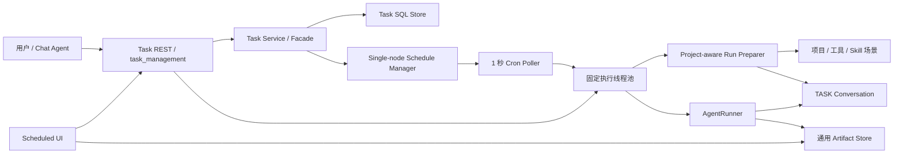
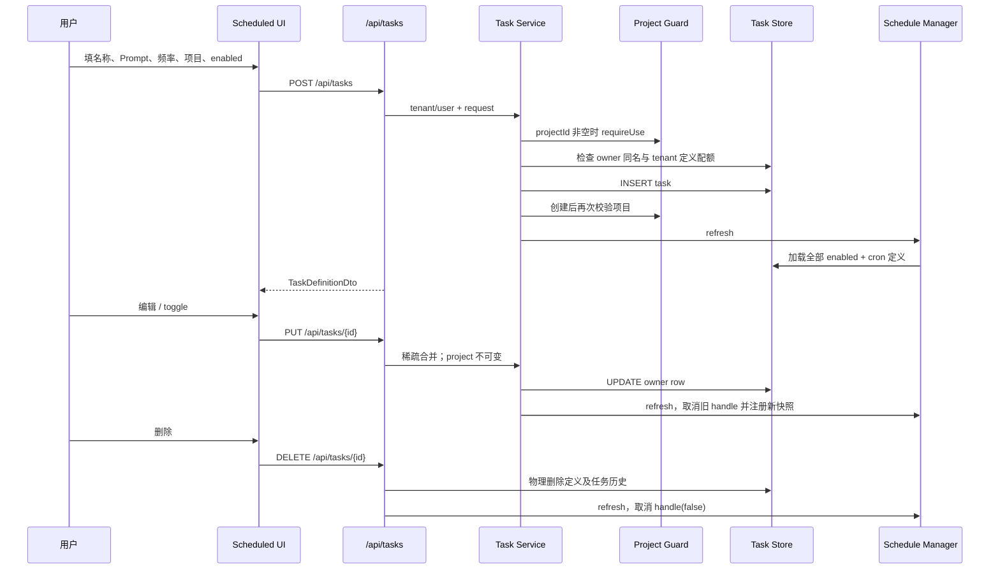
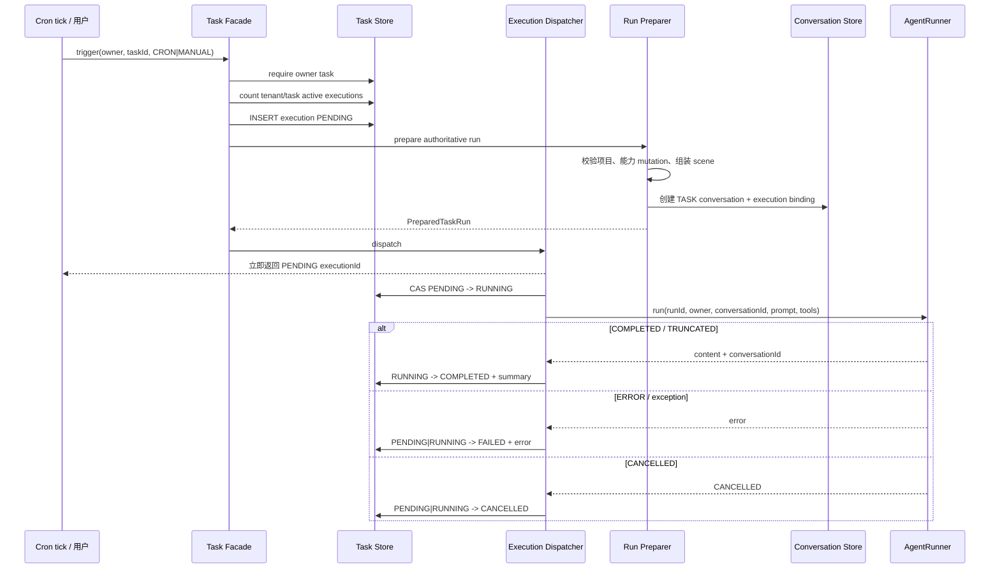
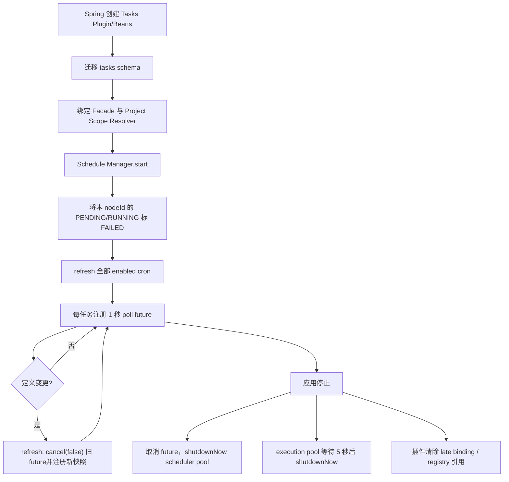
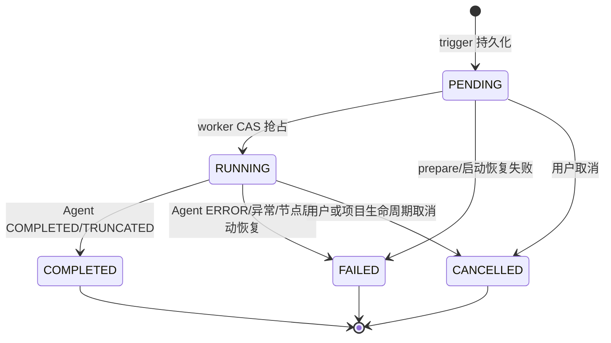

```
# 定时任务、执行历史、失败与重试能力复刻说明

## 1. 结论与边界

### 1.1 能力结论

Nova 的定时任务能力把一段自包含的 Agent 指令保存为任务定义，并允许用户手动执行或按 Cron 周期执行。每次触发都会创建独立执行记录和独立 TASK 会话，Agent 的消息、Citation 和通用 Artifact 可以在执行详情中回看。产品同时支持个人任务和项目任务、简单任务和顺序 Pipeline、启停、复制、物理删除、执行取消以及管理员配额查询。

当前实现不是分布式工作流平台，而是一个随包任务插件加产品桥接：单节点调度管理器把所有已启用 Cron 注册到本机固定线程池，每秒对部署级时区求值；到点后先持久化 `PENDING` 执行，再异步准备项目/工具场景并调用通用 AgentRunner。任务页没有任务专属 WebSocket，使用 REST 读取并每 3 秒轮询选中任务的活动执行。

以下限制决定了复刻时不能只照着字段建表：

- `timeoutSeconds` 和 `retryPolicy` 已保存、返回和展示，但当前执行层没有按它们做超时或自动重试；`retryAttempt` 始终没有实际递增链路。
- 调度器停机期间错过的触发不会补跑；启动时只把本节点遗留的 `PENDING/RUNNING` 标为 `FAILED`。
- 并发配额采用“先 count、后 insert”，不是数据库原子占位；多请求或多节点下可能超限。
- 管理员接口只有“已认证且当前会话为租户管理员”的门禁，没有把调用者 tenant 约束到查询和更新：不传 `tenantId` 可读全租户定义/执行/配额，传任意 `tenantId` 可读其他租户，`PUT /quotas/{tenantId}` 可改任意租户配额。这是当前已实现路径上的跨租户读写缺陷，不是生产建议。`I/K`
- Cron 的校验语法和实际匹配并不完全一致：DOM 与 DOW 同时受限时按 AND；`1/2` 可通过校验但匹配器忽略数值起点后的 step；step 没有字段范围上限，`*/300` 秒可绕过 300 秒最小间隔校验却实际每分钟触发。`I/K`
- `task_artifact` 表存在，但 Agent 生成的通用 Artifact 尚未自动关联进去；UI 改从执行会话查询通用 Artifact。
- Chat 侧 `scheduled-report` Skill 宣称可 update/delete/启停，但当前 `task_management` Tool 只支持 `list/get/create/execute/cancel/list_executions`，因此对话式全生命周期管理并不成立。
- 删除定义会物理删除执行、步骤和 task_artifact 历史，但不会同步删除已生成的 TASK 会话；对运行中任务也没有先取消再删的事务门禁。
- Agent 抛 RuntimeException 时，执行器把 Java fully-qualified class name 拼入持久化 `errorMessage`；该字段经执行 DTO 返回并由 UI 展示，形成内部实现信息泄露。`I/K`
- Pipeline 收到 Agent `CANCELLED` 时只把当前 step 记 `FAILED` 并把 execution 记 `CANCELLED`，不会为后续步骤补 `SKIPPED`；这与普通失败分支不同。`I/K`

### 1.2 用户、输入、输出

| 项目 | 内容 |
|---|---|
| 目标用户 | 创建周期巡检/报告的普通用户；按产品意图只管理本租户库存与配额的租户管理员（当前实现错误地可跨租户） |
| 定义输入 | 名称、Agent prompt、SIMPLE/PIPELINE、Cron、启用状态、项目、并发上限、超时、重试策略 |
| 触发输入 | 手动 REST/Tool 调用或 Cron tick；实际 Agent 输入默认取 description，空时取 name |
| 执行上下文 | owner tenant/user、任务 projectId、当前有效项目资源、工具能力快照、独立 conversationId |
| 持久输出 | 任务定义、执行状态、摘要/错误、Pipeline steps、TASK 会话；task_artifact 当前通常为空 |
| 用户可见效果 | 任务列表/搜索/编辑/复制/启停/删除；运行历史；结果对话、Citation、通用 Artifact 预览 |

### 1.3 范围边界

本文包含任务定义、Cron 调度、手动执行、执行历史、失败/取消/重试语义、项目资源上下文、REST/Tool/UI、配额和生命周期。本文不把 Agent 内部 LLM 单次调用重试等同于任务重试，也不展开通用会话、Citation、Artifact 的全部实现。

`scheduled-report` 是把当前对话分析录制为自包含 description 的编排 Skill；任务调度器并不理解“周报”的业务语义，只会把 description 当作新会话的用户输入。任务定义没有对原会话历史的引用，未来执行不能依赖“刚才”“上面的数据”。

### 1.4 证据总览

| 结论 | 等级 | 说明 |
|---|---|---|
| REST 支持定义 CRUD、copy、execute、历史、详情、会话和取消 | `I/A` | Active API Case 覆盖主要路径，本次未运行 |
| 每次执行有独立 ID 和 `scheduled-task-{taskId}-execution-{executionId}` 会话 | `I/A` | 重复执行 Active Case 与 UI E2E 明确要求 |
| 调度为单节点、部署级时区、每秒轮询 | `I/A` | 管理端 rebalance 只返回 `single-node scheduler active` |
| timeout 字段未执行 | `K` | TASK-EXEC-004 known_failure |
| Agent Artifact 未写入 task_artifact | `K` | TASK-EXEC-002 known_failure |
| release 主 Agent 缺少 task_management | `K` | TASK-MGMT-001 known_failure，仅 release 环境 |
| 非法 type 错误泄露 Java 类型名 | `K` | TASK-ERR-003 known_failure |
| Agent 异常类名进入历史/API/UI | `I/K` | 执行器直接拼接 exception class，DTO/UI 原样消费 |
| admin API 可跨租户读写 | `I/K` | 管理员门禁不绑定调用者 tenant；尚无反向隔离 Active Case |
| Cron step/DOM-DOW 语义缺陷 | `I/K` | validator 与 matcher 静态实现可直接复现 |
| Pipeline cancel 不补后续 SKIPPED | `I/K` | CANCELLED 分支在返回前未调用 skipped-step 补齐逻辑 |
| UI E2E 覆盖创建、编辑、启停、执行、删除和历史 | `A` | 部分失败/重试/并发/运行中删除用例使用路由 Mock，只证明 UI 合约 |
| 自动任务重试、misfire 补跑、分布式抢占 | `I-risk/D` | 枚举/表字段存在不等于实现；生产复刻需补作业控制面 |

本次只做三仓静态分析；文中的 `D` 修复和反测是复刻要求，不表示当前实现已具备。`R` 只用于本次实际运行验证，而本次没有运行服务、构建或测试，因此本文没有 `R` 结论。

## 2. 术语与参与方

| 术语 | 含义 |
|---|---|
| Task Definition | 可重复执行的定义；description 同时是人类说明和默认 Agent prompt |
| Execution | 一次触发实例；拥有独立状态、triggerType、nodeId、会话和历史 |
| Trigger Type | `MANUAL/CRON/RETRY/RECOVERY`；当前实际创建链路使用前两种 |
| Scheduler | 单节点内存注册表 + 每秒 Cron 匹配器 |
| Run Preparer | 每次执行前按当前 owner/project 重新组装可用工具、提示和运行上下文 |
| TASK Conversation | 执行专属会话，绑定 taskExecutionId，用于回看完整 Agent 结果 |
| Pipeline Step | PIPELINE 中顺序执行的一项 Agent prompt；失败后剩余步骤为 SKIPPED |
| Misfire | 服务停机、线程饥饿或时钟跳变导致预定 tick 未执行 |



## 3. 业务规则

### 3.1 定义与编辑

1. 普通接口只按认证上下文中的 tenant/user 读写 owner 自己的任务；外部 ID 不属于 owner 时按不存在处理。
2. 新建默认 `type=SIMPLE`、`maxConcurrent=1`、`timeoutSeconds=600`。REST 请求若不传 `enabled`，当前会保存为 false；UI 明确传 true。
3. `name` 必须非空。产品服务在 owner 最近最多 100 条定义中检查精确同名，但数据库没有唯一约束，并发创建仍可能撞名。
4. `description` 可空；执行时空 description 回退到 name。录制定时报告时 description 必须完全自包含。
5. 更新是稀疏合并：未出现字段保持原值；显式 null 可以清除 description、cron、pipelineConfig、retryPolicy。
6. projectId 创建后不可修改；要换项目只能 copy。复制继承源定义，并允许选择另一个当前可用项目。
7. enabled 只决定 Cron 是否注册，不阻止用户手动 execute；当前手动触发路径没有 enabled 检查。
8. 删除是不可恢复的物理删除：task_artifact → task_step → task_execution → task。当前不会删除对应 conversation。

### 3.2 Cron 与时区

- 接受 Unix 5 字段或含秒的 6 字段表达式，统一为 6 字段。
- 数值、`*`、`?`、逗号、范围和步长可用；不支持 MON/TUE、L、W、# 等高级语法。
- DOW 为 ISO 风格：1=周一，7 或 0=周日。
- DOM 与 DOW 没有标准 Cron 的“二者择一/OR”处理：两个字段若都不是 `*`/`?`，匹配器分别求值后用 `&&` 合并。例如 `0 0 9 13 * 5` 只在“13 号且周五”触发。`I/K`
- step 语法存在不一致：`1/2` 会被校验器接受，但匹配器解析出 step 后，对纯数值 base 仍只判断 `value == 1`，因此不会从 1 起每 2 单位匹配；只有 `*/N` 和 `A-B/N` 真正使用 step。`I/K`
- step 只校验为正整数，没有限制到对应字段范围。秒字段 `*/300` 会被最小间隔推导成 300 秒而通过默认 quota；实际秒值只有 0..59，匹配公式只在 second=0 成立，因而每分钟触发一次，绕过 300 秒最小间隔。`I/K`
- UI 只编辑 manual/hourly/daily/weekly/monthly 五种模板；复杂合法 Cron 会显示“自定义调度”，再编辑可能被简化。
- 调度匹配时区是 `nova.tasks.zone` 的部署级 IANA ZoneId，默认 `Asia/Shanghai`；任务行没有 user/task timezone。但 API DTO 把数据库 `Instant` 转成无 offset 的 `LocalDateTime` 时使用 JVM `ZoneId.systemDefault()`，不是 `nova.tasks.zone`。两者配置不一致时，“Cron 在哪个时区触发”和“API/UI 显示的 createdAt/startedAt/completedAt”会分离。`I/K`
- 默认租户最小间隔 300 秒。校验器只能推导 `*/N` 秒/分钟/小时等简单间隔，复杂表达式未必能证明最小间隔。
- 每秒轮询只匹配当前整秒，并用内存 `lastTriggered` 防止同一 ZonedDateTime 重复；没有持久化 fire key、nextFireAt 或 misfire policy。

### 3.3 执行、并发与结果

1. 触发先检查租户活动执行数和任务活动执行数，再插入 PENDING；活动态为 PENDING/RUNNING。
2. 产品异步线程池默认 4 worker；Scheduler poll pool 默认 2；两个池都属于单 JVM。
3. 执行器以 `PENDING -> RUNNING` 条件更新抢占；只有成功更新者调用 Agent。
4. SIMPLE 调一次 Agent；PIPELINE 按数组顺序逐项调用同一 runId/会话，每步 prompt 为 step.description。
5. Agent `COMPLETED/TRUNCATED` 映射任务 COMPLETED，`ERROR` 映射 FAILED，`CANCELLED` 映射 CANCELLED。
6. resultSummary 保存最终 Agent content；Pipeline step 摘要截断到 500 字符，最终摘要为最后一步结果。
7. 执行历史按 `created_at DESC,id DESC` 最多返回 100 条，无分页 cursor。
8. UI 对选中任务只要存在 PENDING/RUNNING，就每 3 秒轮询；没有 push 事件。
9. PIPELINE 普通 ERROR/异常会把当前 step 记 FAILED 并为剩余 step 插入 SKIPPED；Agent 返回 CANCELLED 时仅把当前 step 记 FAILED、execution 条件更新为 CANCELLED 并立即返回，剩余步骤没有持久化行。`I/K`

### 3.4 失败、取消和所谓“重试”

- 当前任务级自动重试未实现。`retryPolicy`、`retryAttempt`、`RETRY/RECOVERY` 只是模型/存储字段。
- UI 的“失败后重试”实际上再次调用 `POST /api/tasks/{id}/execute`，创建全新 executionId；它不链接原 execution，也不会增加原行 retryAttempt。
- 取消先 best-effort 调 `AgentRunner.cancel(task-execution-{executionId})`，再把 PENDING/RUNNING 条件更新为 CANCELLED。晚到 complete/fail 的条件更新不会覆盖 CANCELLED。
- 插件启动将本 nodeId 遗留 PENDING/RUNNING 直接标 FAILED，错误为“进程在完成前停止”；不会 RECOVERY 重跑。
- 调度 tick 抛配额、准备或执行异常时只记日志；准备失败会持久化 FAILED，某些项目/能力策略错误还会自动 disable 定义。
- `TaskQuotaExceededException` 没有专用 HTTP 映射；产品 service 把它归入 `TaskException(INTERNAL)`，统一 handler 返回 500，而不是 409/429/422 等稳定 quota 错误。管理员 quota 更新又完全不校验五个整数为非负，因此可持久化负 quota。`I/K`
- Agent 调用抛异常时，执行器持久化 `<异常类全名>: <message>`；执行详情 API 原样返回 `errorMessage`，UI 失败卡片原样展示。即使 message 安全，类名仍暴露服务端实现。`I/K`
- 没有补偿工作流。工具已经向外部系统产生的副作用不会因任务失败自动撤销。

### 3.5 项目与能力边界

项目任务创建时验证 owner 可使用项目；每次执行前重新组装当前项目场景和工具能力，而不是重放创建时的权限快照。任务管理工具会从可信 scene runtimeContext 推导 PERSONAL/PROJECT，LLM 不能直接指定 projectId。

项目被 DISABLED/DELETED、成员被移除或访问模式变化导致 owner 不再可用时，事务后监听器与每分钟 reconcile job 会 fail-closed：disable 定义、取消活动执行、刷新调度。恢复权限不会自动重新启用任务。

任务执行时强制排除 `task_management`，避免定时任务递归创建/触发任务；工具能力仍必须经过正式场景和 policy 解析。

## 4. 完整执行链路

### 4.1 创建、编辑、启停与删除



UI 启停没有独立 endpoint，而是 PUT 整体提交 name/description/cron/enabled。复制使用 `POST /api/tasks/{id}/copy`，可改变 project；普通 update 不可。

### 4.2 Cron/手动触发到 Agent 终态



准备发生在执行行创建之后、异步 dispatch 之前。项目/策略准备失败会留下可查询的 FAILED execution，而不是让触发请求完全没有记录。

### 4.3 Pipeline

Pipeline config 的最小格式：

```json
{
  "steps": [
    {"name":"取数","description":"查询昨日核心指标并说明口径"},
    {"name":"分析","description":"根据当前可见上下文分析异常"},
    {"name":"交付","description":"生成简短总结"}
  ]
}
```

当前 executor 只读取 `name/description`，不读取 Skill 文档示例中的 `depends_on`，也不把 `lastResult` 拼进下一步 prompt；所谓 output propagation 主要依赖各步共享同一 TASK 会话，让 Agent 从会话历史读取前一步结果。普通 ERROR 或异常会把当前步记录为 FAILED、后续插入 SKIPPED、execution 置 FAILED；CANCELLED 是例外：当前步仍记 FAILED，execution 置 CANCELLED，但后续 step 不补 SKIPPED，步骤数组因此不完整。`I/K`

### 4.4 启动、停止和恢复



当前启动处理只按本 `nodeId` 把遗留 PENDING/RUNNING 标 FAILED；它不是 claim/认领，不接管其他 nodeId，不使用 `scheduler_node/user_shard` 表，也不重建错过的 fire。管理员 rebalance endpoint 也不执行迁移。

## 5. 对外契约

### 5.1 用户 REST API

所有接口依赖认证 Cookie/会话，owner 从认证上下文取得。

| 方法与路径 | 作用 | 响应 |
|---|---|---|
| `GET /api/tasks` | owner 最近 100 个定义 | `TaskDefinitionDto[]` |
| `GET /api/tasks/{id}` | 定义详情 | DTO / 404 |
| `POST /api/tasks` | 创建 | DTO；默认 HTTP 200 |
| `PUT /api/tasks/{id}` | 稀疏更新/启停 | DTO |
| `POST /api/tasks/{id}/copy` | 复制，可换项目 | 新 DTO |
| `DELETE /api/tasks/{id}` | 物理删除定义及任务历史 | 空 200 |
| `POST /api/tasks/{id}/execute` | 新建手动执行 | `{"executionId":123}` |
| `GET /api/tasks/{id}/executions` | 最近 100 次执行 | Execution DTO 数组 |
| `GET /api/tasks/executions/{execId}` | 执行详情 | DTO |
| `GET /api/tasks/executions/{execId}/conversation` | TASK 会话消息 | MessageDto 数组；无会话返回空数组 |
| `POST /api/tasks/executions/{execId}/cancel` | 取消活动执行 | 空 200；非活动/不可见当前映射为 404 |
| `GET /api/tasks/executions/running` | owner 最近 100 个 RUNNING | DTO 数组，不含 PENDING |
| `GET /api/tasks/running` | 同上兼容别名 | DTO 数组 |

创建请求：

```json
{
  "name": "每日经营巡检",
  "description": "每天查询昨日销售额和订单量；发现异常时说明证据；输出 Markdown 摘要。",
  "type": "SIMPLE",
  "cronExpression": "0 0 9 * * ?",
  "enabled": true,
  "pipelineConfig": null,
  "maxConcurrent": 1,
  "timeoutSeconds": 600,
  "retryPolicy": null,
  "projectId": "project_sales"
}
```

字段规则：

| 字段 | 类型 | 创建默认 | 说明 |
|---|---|---|---|
| name | string | 无 | 非空，owner 层同名软校验 |
| description | string/null | null | 默认 Agent userInput；空则用 name |
| type | SIMPLE/PIPELINE | SIMPLE | 非法值当前错误可能泄露 Java 类型名 |
| cronExpression | string/null | null | null=手动任务；enabled 可仍为 true |
| enabled | boolean | false | 只控制 Cron 注册 |
| pipelineConfig | JSON string/null | null | PIPELINE 必须含非空 steps 数组，否则执行失败 |
| maxConcurrent | positive int | 1 | 每任务活动执行上限；REST 非正数会静默回默认 1 |
| timeoutSeconds | positive int | 600 | 当前只保存/展示，未强制 |
| retryPolicy | string/null | null | opaque 文本，当前未解析 |
| projectId | string/null | personal | 更新不可改变，复制可变 |

定义响应示例：

```json
{
  "id": 42,
  "name": "每日经营巡检",
  "description": "每天查询昨日销售额和订单量……",
  "cronExpression": "0 0 9 * * ?",
  "enabled": true,
  "type": "SIMPLE",
  "pipelineConfig": null,
  "maxConcurrent": 1,
  "timeoutSeconds": 600,
  "retryPolicy": null,
  "projectId": "project_sales",
  "projectName": "销售项目",
  "projectStatus": "ACTIVE",
  "createdAt": "2026-08-13T09:00:00",
  "updatedAt": "2026-08-13T09:00:00"
}
```

### 5.2 Execution DTO 与状态

```json
{
  "id": 8801,
  "taskDefinitionId": 42,
  "status": "COMPLETED",
  "triggerType": "CRON",
  "nodeId": "nova-product-local",
  "retryAttempt": 0,
  "startedAt": "2026-08-14T09:00:00",
  "completedAt": "2026-08-14T09:00:12",
  "resultSummary": "昨日销售额……",
  "errorMessage": null,
  "conversationId": "scheduled-task-42-execution-8801",
  "createdAt": "2026-08-14T09:00:00",
  "steps": [],
  "artifacts": []
}
```



没有 `RETRYING/TIMED_OUT/REJECTED` 持久状态。重跑是新的 PENDING 行。

### 5.3 错误契约

业务异常由统一 handler 映射：INVALID=400、FORBIDDEN=403、NOT_FOUND=404、CONFLICT=409、INTERNAL=500。Task 专用 missing body 为：

```json
{"error":"Task not found","id":42}
```

不存在与不属于 owner 使用相同 404。其他业务错误通常为统一 `{success:false,message,...details}`。当前非法 type 可能把 Java enum 类型信息带入 message，是已知缺陷。`TaskQuotaExceededException` 不在 INVALID/CONFLICT 翻译分支中，而是落入 INTERNAL，因此定义数、租户并发或任务并发 quota 超限经产品 REST 返回 500；这不是可依赖的稳定配额错误契约。`I/K`

Agent 执行异常还有另一条泄露链：执行器生成 `java.package.ExceptionClass: message` → 写入 `task_execution.error_message`（Pipeline 当前步还写入 step summary）→ `TaskExecutionDto.errorMessage` 原样返回 → Scheduled UI 原样显示。复刻兼容测试应记录当前行为，安全实现必须改成稳定 error code + 脱敏用户消息，并把异常类和堆栈仅写服务端日志。`I/K`

REST execute 没有 Idempotency-Key；重复 POST 合法地创建独立执行。列表只有固定 limit，无 cursor、before、page 参数。

### 5.4 管理员 API

这些接口只要求“当前认证会话为租户管理员”；当前没有租户作用域授权。具体已实现行为是：`I/K`

- `GET /api/admin/tasks/definitions` 不传 `tenantId` 时查询全租户最多 100 条；传任意 tenantId 时查询该租户，即使不是调用者租户。
- `GET /api/admin/tasks/executions` 同样可无 tenantId 读全租户，或以任意 tenantId 读其他租户；status 直接按执行枚举解析。
- `GET /api/admin/tasks/quotas` 返回最多 100 个租户的已持久化配额，没有调用者 tenant 过滤。
- `PUT /api/admin/tasks/quotas/{tenantId}` 信任路径 tenantId，可整体替换任意租户五项配额；请求 body 的 tenantId 被忽略。五项整数没有非负/上下界校验，负数会进入 repository update/insert。
- `POST /api/admin/tasks/scheduler/rebalance`：当前只返回 `{"status":"single-node scheduler active"}`，无实际 rebalance。

因此这些 admin inventory/quota API 当前构成跨租户读取和跨租户 quota 写入缺陷。修复必须从认证上下文取得 callerTenantId：普通租户管理员不接收任意 tenant filter，查询强制 caller tenant，quota path tenant 必须相等；若产品需要平台级全租户运维，应建立与 tenant admin 分离的 platform-admin 权限。修复后的反向测试必须由 tenant-A admin 尝试无 filter 全量读取、显式 tenant-B 读取和 PUT tenant-B quota，均得到 403/404 且 tenant-B 数据不变。`D`

默认配额：定义 50、租户并发 5、最小 Cron 间隔 300 秒、每日执行 100、Artifact 500MB。当前只静态确认定义数、租户活动并发、每任务并发、简单 Cron 最小间隔被检查；每日执行和 Artifact 存储配额没有执行引用。`*/300` 秒还能利用 step 范围缺失绕过最小间隔并实际每分钟执行。`I/K`

### 5.5 `task_management` Tool 与 Skill

Tool 当前 schema：

```json
{
  "name": "task_management",
  "retention": "EPHEMERAL",
  "actions": ["list","get","create","execute","cancel","list_executions"]
}
```

创建使用 snake_case：`name,description,type,cron_expression,enabled,max_concurrent,timeout_seconds,pipeline_config,retry_policy`。execute 还接受 `user_input,provider_name,agent_name`，其中当前实现事实上要求非空 user_input；Tool schema 没把它声明为 action 条件必填。

`scheduled-report` Skill 要求：从已完成对话忠实提取查询步骤；绝对日期改成 NOW() 相对时间；先让用户确认；组装不依赖当前会话的 description；再调用 create。它还写了 update/delete/启停速查，但 Tool 不支持这些 action。这是静态契约冲突；REST/UI 能做不代表 Chat Tool 能做。

release 自动化明确记录主 Agent 可能完全看不到 `task_management`。复刻时必须通过正式能力安装/可见性解决，不能旁路硬塞工具。

### 5.6 UI、轮询与结果呈现

Scheduled 页面为左右分栏：任务列表支持前端名称/description/projectName 搜索；右侧显示元数据、prompt、Pipeline、执行历史。Editor 支持 personal/project、manual/hourly/daily/weekly/monthly、时间和 enabled；不编辑 maxConcurrent、timeoutSeconds、retryPolicy 或任意复杂 Cron。

前端还保留三处不能当成后端契约的残留/错配：

- API helper/store 暴露未被页面使用的 `cancelTask(taskId)`，请求错误路径 `POST /api/tasks/{id}/cancel`；真实后端和页面使用的是 `cancelExecution(execId)` → `POST /api/tasks/executions/{execId}/cancel`。这是未使用死路径，不是“取消整个定义”的隐藏能力。`I/K`
- `TaskDto.description` 和 `TaskCreateRequest.description` 在 TypeScript 中声明为非 null `string`，后端字段、创建默认和 DTO 都允许 null；这是静态类型契约错误。复刻时响应类型至少应为 `string | null`，表单层再归一化为空串。`I/K`
- `REJECTED` 是一条跨组件前端残留链，而不只存在于详情组件：`ExecutionDetail` 把它映射为 destructive badge 并显示拒绝文案；`ExecutionList` 为它保留红色 Ban 图标和拒绝标签；`taskStore.hasActiveExecutions` 的独立测试把它固定为会停止轮询的 terminal；中英文资源仍保留 `scheduled.statusRejected`。与此同时，后端持久 execution enum 只有 PENDING/RUNNING/COMPLETED/FAILED/CANCELLED，不会产生 REJECTED。前端 DTO 又把 status 宽泛声明为 string，因而这些不可达分支不会被类型检查揭示。复刻时应删除整条残留链，或先正式扩展后端状态机、数据库约束、API schema、轮询语义和测试，再把它作为真实状态交付。`I/K`

执行后 UI 调 `GET /api/tasks/{id}/executions`；发现 PENDING/RUNNING 后每 3 秒轮询，离开页面停止。点击历史并行获取 execution detail 和 conversation，以请求序号防止快速切换时旧响应覆盖新选择。

结果对话被临时装入 Chat Store，使 Citation 和内联卡片复用普通 Chat 展示。UI 另外按 execution.conversationId 查询通用 Artifact；因此即使 `execution.artifacts=[]`，仍可能展示文件。这是对 known failure 的产品降级，不代表 task_artifact 已修复。

当前没有任务专属 WS/SSE 事件。通过 Chat 创建任务时，仍走普通 `/ws/chat` 的 tool_call/tool_exec/complete 事件，但这只描述创建对话，不推送未来 Cron execution 状态。

### 5.7 配置契约

```yaml
nova:
  tasks:
    node-id: nova-product-local
    scheduler-pool-size: 2
    execution-pool-size: 4
    zone: Asia/Shanghai
  project:
    task-reconcile-delay: PT1M
```

zone 必须是合法 IANA ID；pool size 必须正数，否则 Bean 创建失败。`nova.tasks.zone` 只控制 Cron matching；DTO 时间使用 JVM `systemDefault` 转成无 offset LocalDateTime，部署必须显式保持两者一致或改成带 offset 的时间契约。nodeId 只用于写 execution worker 标识，并在启动时把同 nodeId 遗留活动行 fail 掉；它不认领、不接管，也没有集群租约。`I/K`

## 6. 数据模型与生命周期

### 6.1 当前 DDL

```sql
CREATE TABLE task (
  id BIGINT GENERATED BY DEFAULT AS IDENTITY PRIMARY KEY,
  owner_identity_type VARCHAR(32) NOT NULL,
  owner_identity_key VARCHAR(512) NOT NULL,
  tenant_id VARCHAR(255) NOT NULL DEFAULT '',
  user_id VARCHAR(255) NOT NULL,
  project_id VARCHAR(64),
  name VARCHAR(255) NOT NULL,
  description TEXT,
  cron_expression VARCHAR(255),
  enabled BOOLEAN NOT NULL DEFAULT TRUE,
  type VARCHAR(32) NOT NULL DEFAULT 'SIMPLE',
  pipeline_config TEXT,
  max_concurrent INTEGER NOT NULL DEFAULT 1,
  timeout_seconds INTEGER NOT NULL DEFAULT 600,
  retry_policy TEXT,
  created_at TIMESTAMP NOT NULL,
  updated_at TIMESTAMP
);

CREATE TABLE task_execution (
  id BIGINT GENERATED BY DEFAULT AS IDENTITY PRIMARY KEY,
  owner_identity_type VARCHAR(32) NOT NULL,
  owner_identity_key VARCHAR(512) NOT NULL,
  tenant_id VARCHAR(255) NOT NULL DEFAULT '',
  user_id VARCHAR(255) NOT NULL,
  task_definition_id BIGINT NOT NULL,
  conversation_id VARCHAR(255),
  node_id VARCHAR(255),
  status VARCHAR(32) NOT NULL DEFAULT 'PENDING',
  trigger_type VARCHAR(32) NOT NULL,
  retry_attempt INTEGER NOT NULL DEFAULT 0,
  started_at TIMESTAMP,
  completed_at TIMESTAMP,
  result_summary TEXT,
  error_message TEXT,
  created_at TIMESTAMP NOT NULL
);

CREATE TABLE task_step (
  id BIGINT GENERATED BY DEFAULT AS IDENTITY PRIMARY KEY,
  execution_id BIGINT NOT NULL,
  step_index INTEGER NOT NULL,
  name VARCHAR(255) NOT NULL,
  description TEXT,
  status VARCHAR(32) NOT NULL DEFAULT 'PENDING',
  message_start_index INTEGER NOT NULL DEFAULT 0,
  started_at TIMESTAMP,
  completed_at TIMESTAMP,
  result_summary TEXT
);

CREATE TABLE task_artifact (
  id BIGINT GENERATED BY DEFAULT AS IDENTITY PRIMARY KEY,
  execution_id BIGINT NOT NULL,
  step_index INTEGER,
  name VARCHAR(255) NOT NULL,
  type VARCHAR(32) NOT NULL,
  storage_path VARCHAR(1024) NOT NULL,
  metadata TEXT,
  created_at TIMESTAMP NOT NULL
);

CREATE TABLE tenant_quota (
  tenant_id VARCHAR(255) PRIMARY KEY,
  max_task_definitions INTEGER NOT NULL DEFAULT 50,
  max_concurrent_executions INTEGER NOT NULL DEFAULT 5,
  min_cron_interval_seconds INTEGER NOT NULL DEFAULT 300,
  max_executions_per_day INTEGER NOT NULL DEFAULT 100,
  max_artifact_storage_mb INTEGER NOT NULL DEFAULT 500
);
```

还存在 `scheduler_node` 和 `user_shard` 表，但当前调度主链没有读写它们，不能把它们当成集群调度实现。

同一 V1 schema 还提供 H2 migration，字段和五张核心表用于测试/本地兼容；因此复刻不能只交付 PostgreSQL DDL。PostgreSQL 与 H2 migration 都应随 schema 变更同步新增版本，不能修改已发布 migration。`I`

当前表没有外键、同 owner name 唯一约束、fire 唯一键或 execution 幂等键。主要索引是 owner、tenant/user、taskDefinitionId、status/startedAt、node/status、execution/stepIndex。

### 6.2 生命周期与删除

- task create/update/delete 与子表清理各自在数据库事务中。
- 更新没有 version/If-Match，两个编辑者最后写入者获胜。
- 删除先查询所有 executionId，再批量删 artifact/step/execution，最后删 task；运行中的 Agent 不在同一事务中取消。
- TASK conversation 和通用 Artifact 属于其他存储，删除 task 不清理它们；执行详情入口随 task_execution 删除而消失，但会话可能仍存在。
- 没有历史保留期限、归档、软删除或 GDPR erase 编排。

### 6.3 生产推荐补强 DDL

```sql
ALTER TABLE task ADD COLUMN version BIGINT NOT NULL DEFAULT 0;
ALTER TABLE task ADD COLUMN timezone VARCHAR(64) NOT NULL DEFAULT 'Asia/Shanghai';
ALTER TABLE task ADD COLUMN misfire_policy VARCHAR(24) NOT NULL DEFAULT 'SKIP';

CREATE TABLE task_fire (
  fire_id VARCHAR(64) PRIMARY KEY,
  tenant_id VARCHAR(255) NOT NULL,
  owner_user_id VARCHAR(255) NOT NULL,
  task_id BIGINT NOT NULL,
  scheduled_at TIMESTAMPTZ NOT NULL,
  schedule_version BIGINT NOT NULL,
  status VARCHAR(24) NOT NULL,
  claimed_by VARCHAR(255),
  lease_until TIMESTAMPTZ,
  execution_id BIGINT,
  created_at TIMESTAMPTZ NOT NULL,
  UNIQUE(task_id, scheduled_at, schedule_version)
);

CREATE TABLE task_retry_link (
  execution_id BIGINT PRIMARY KEY,
  root_execution_id BIGINT NOT NULL,
  previous_execution_id BIGINT,
  attempt INTEGER NOT NULL,
  retry_reason VARCHAR(64),
  next_attempt_at TIMESTAMPTZ
);
```

生产表应补真正 FK 或受控软删除、owner/project 复合索引、状态 lease 索引、Artifact manifest 关联和审计/outbox。Cron fire 唯一键提供集群幂等；execution 不应直接充当计划 fire。

## 7. 核心实现设计

### 7.1 最小兼容实现

最小版可复刻当前形态：

```text
Task REST + task_management
├── owner/project authorization
├── JDBC definitions/executions/steps
├── single-node cron poller
├── fixed execution pool
├── authoritative run preparer
├── AgentRunner adapter
└── Scheduled UI + REST polling
```

关键伪代码：

```java
long trigger(Identity owner, long taskId, TriggerType trigger) {
  Task task = requireOwned(owner, taskId);
  // 当前兼容行为；生产版必须改为原子 admission。
  requireTenantActiveBelowQuota(owner.tenantId());
  requireTaskActiveBelow(task.maxConcurrent());
  Execution pending = insertPending(owner, task, trigger, nodeId);
  try {
    PreparedRun run = prepareCurrentScene(owner, task, pending);
    workers.submit(() -> executeClaimed(pending.id(), run));
  } catch (PreparationException e) {
    fail(pending.id(), e.code());
    if (e.suspendTask()) disable(task.id());
  }
  return pending.id();
}

void executeClaimed(long id, PreparedRun run) {
  if (!casStatus(id, PENDING, RUNNING)) return;
  AgentResponse result = agentRunner.run(run);
  persistTerminalIfRunning(id, result);
}
```

### 7.2 生产级架构

```text
Task Control API
├── Definition Service + optimistic version
├── Cron Calculator + timezone/misfire policy
├── Fire Materializer / DB Outbox
├── Distributed Claimer + lease/heartbeat
├── Admission Controller (atomic tenant/task quotas)
├── Execution Worker
│   ├── Scene Preparer
│   ├── Agent Adapter with deadline/cancellation
│   ├── Retry Classifier
│   └── Artifact/Conversation Manifest
├── Reconciler / Dead-letter Queue
└── Event Stream + History Query API
```

推荐规则：

1. 调度器预先物化未来 fire，使用 `(taskId,scheduledAt,scheduleVersion)` 唯一键。
2. worker 用 `SELECT ... FOR UPDATE SKIP LOCKED` 或消息队列唯一 key 抢占，lease 超时后 RECOVERY。
3. admission 与 execution insert 同事务；租户/任务并发用计数器行或 semaphore lease。
4. timeout 形成 Agent deadline，并在超时后 cancel；终态用 CAS 防晚到覆盖。
5. retryPolicy 解析为受版本化 JSON，只重试明确的 transient 类；每次重试新 execution 或新 attempt 行并链回 root。
6. 外部副作用要求 Tool 幂等键 `executionId/stepIndex/attempt`；不可补偿时明确 at-least-once 风险。
7. 删除定义先 disable，等待/取消活动执行，再软删除；历史/会话/Artifact 依保留策略异步清理。

### 7.3 重试策略参考

```json
{
  "version": 1,
  "maxAttempts": 3,
  "backoff": {"type":"EXPONENTIAL","initialSeconds":30,"multiplier":2,"maxSeconds":600,"jitter":true},
  "retryOn": ["LLM_429","LLM_5XX","UPSTREAM_TIMEOUT"],
  "doNotRetryOn": ["AUTH","PERMISSION","INVALID_INPUT","CANCELLED"],
  "deadlineSeconds": 600
}
```

任务重试与 LLM 内部 retry 必须分别记账。任务 attempt 的 observable result、Artifact 和副作用要可区分；用户手动重跑 triggerType 仍应是 MANUAL，可用 `replayOfExecutionId` 表达来源。

## 8. 并发与非正常路径

| 场景 | 当前行为 | 风险/生产处理 |
|---|---|---|
| 同一 tick 重复轮询 | 进程内 lastTriggered 去重 | 重启/多节点无效；用持久 fire unique key |
| DOM 与 DOW 同时受限 | 当前用 AND | 明确产品语义；若采用常见 Cron OR/互斥规则需版本迁移和回归测试 |
| 数值起点 step `1/2` | 校验通过，匹配时忽略 `/2` | validator 与 matcher 共用同一 AST/求值器 |
| 超范围 step `*/300` 秒 | quota 推导 300 秒，实际每分钟触发 | step 上限不超过字段域；以未来 fire 差值验证最小间隔 |
| 同任务并发 trigger | count 后 insert | 竞态超上限；原子 admission |
| 线程池满 | 无有界队列，PENDING 可持续堆积 | 有界队列、拒绝状态和 backpressure |
| Scheduler 停机 | 错过即丢失 | 明确 SKIP/FIRE_ONCE/CATCH_UP policy |
| 节点重启 | 本 nodeId 活动态标 FAILED | lease + recovery attempt；不要误伤仍活 worker |
| 取消与完成竞态 | terminal update 仅接受 RUNNING，CANCELLED 不被覆盖 | 保持 CAS，并记录 cancelRequestedAt |
| 运行中删除 | 直接删执行行，runner 可能继续并在持久化时报找不到 | 禁删/先取消/软删除 + fence token |
| 更新 Cron 时正在触发 | refresh cancel(false)，已进入 runnable 不取消 | scheduleVersion 标记 fire，定义快照持久化 |
| 项目权限撤销 | disable + best-effort cancel，失败聚合/后续 reconcile | fail-closed + 可重试 outbox |
| timeout | 字段存在但不执行 | `K`；deadline/cancel/FAILED(TIMEOUT) |
| retry | 只能用户再次 execute | 自动 classifier + attempt link |
| Agent 产物 | task_artifact 不自动关联 | `K`；transactional manifest/outbox |
| Pipeline 中间普通失败 | 当前步 FAILED，后续 SKIPPED | 补 step retry/checkpoint 或明确整链重跑 |
| Pipeline 中间 CANCELLED | 当前步 FAILED、execution CANCELLED，后续无 step 行 | 为后续补 SKIPPED 或定义单独 CANCELLED step 状态并保持数组完整 |
| Agent 抛异常 | Java 类名写入 errorMessage 并向 API/UI 暴露 | 持久稳定 error code/安全消息，类名仅服务端日志 |
| quota 超限 | TaskQuotaExceededException → INTERNAL/500 | 映射稳定 4xx，并带 quota key/current/limit 的安全 details |
| 管理员 quota 负值 | 无校验并持久化 | DTO/service/DB CHECK 三层校验非负且设置合理上限 |
| DB 成功、dispatch 提交失败 | PENDING 可能残留到重启才失败 | outbox worker 扫描 PENDING，提交可重入 |
| DST 重复/缺失本地时间 | 依 ZoneId 当前秒匹配，无 policy | 以 Instant fire 物化并记录 timezone/version |

## 9. 安全、权限和审计

1. tenant/user 只来自认证上下文；Task Tool 使用 ToolExecutionContext identity。
2. ownerIdentityKey 是对象级边界；repository 查询必须同时保护 owner。跨 owner 管理也只能发生在调用者被授权的 tenant 内。
3. 当前管理接口只检查 `isTenantAdmin`，未把调用者 tenant 传给 controller/facade：无 filter 可全量读，任意 filter/path 可读写其他 tenant。这是 P0 跨租户漏洞。修复时 tenant admin 强制绑定 caller tenant；真正跨租户能力必须使用独立 platform-admin role、显式审计和最小权限 API。`I/K/D`
4. projectId 创建、复制和每次运行均校验 use 权限；项目上下文由服务端组装。
5. description/pipelineConfig 是未来 prompt，属于持久化 Prompt Injection 面。执行时仍需能力白名单、工具参数授权和敏感动作确认策略。
6. task_management 被从任务执行工具集中排除，防递归和自修改。
7. 取消、删除、配额更新、管理员 inventory、重试和项目自动暂停都应产审计事件。当前表没有审计主体/理由字段。
8. resultSummary/error/step 摘要可能含业务数据；日志和管理端响应需脱敏。错误不得泄露类名、SQL、路径或凭据。
9. 任务会话和通用 Artifact 必须沿用 owner/project ACL；仅有 executionId 不能授权读取。

推荐审计事件：

```json
{
  "eventType":"TASK_EXECUTION_TERMINATED",
  "tenantId":"tenant_a",
  "actorUserId":"user_9",
  "taskId":42,
  "executionId":8801,
  "triggerType":"CRON",
  "from":"RUNNING",
  "to":"FAILED",
  "errorCode":"UPSTREAM_TIMEOUT",
  "nodeId":"worker-2",
  "traceId":"tr_01JX"
}
```

## 10. 外部依赖与对端设计

定时任务没有独立远程 Scheduler 对端；关键对端是宿主提供的 AgentRunner、会话存储、项目场景组装器、工具/Skill 注册表和 Artifact Store。

最小 Agent 契约：

```java
interface AgentRunner {
  AgentRunResponse run(AgentRunRequest request);
  boolean cancel(String runId);
}

record AgentRunRequest(
  String runId, Identity owner, String agentName, String providerName,
  String conversationId, String userInput, Map<String,Object> runtimeContext,
  Set<String> allowedTools, Set<String> excludedTools,
  ConversationCreateOptions conversationOptions,
  Integer maxHistoryRounds, Integer maxToolLoopRounds,
  List<PromptSegment> promptSegments) {}
```

Stub 必须支持 COMPLETED/TRUNCATED/ERROR/CANCELLED、阻塞直到取消、抛异常、晚到成功、生成会话消息和生成 Artifact。Nova 无法从这个调用方证明 LLM Provider 的内部 retry、计费和副作用 exactly-once。

生产 Agent adapter 还应支持 deadline、heartbeat、structured error code、artifact manifest 和幂等 execution context。项目场景服务必须按执行时权限返回不可变工具快照，不能信任任务 prompt 自报项目或工具。

## 11. 可观察性

建议指标：

- `task_definitions_total{enabled,type,scope}`
- `task_fires_total{trigger,status,misfire_policy}`
- `task_execution_duration_seconds{status,type}`
- `task_execution_queue_delay_seconds`
- `task_active_executions{tenant,task}`（tenant 使用脱敏标签）
- `task_retry_attempts_total{reason}`
- `task_timeouts_total`
- `task_scheduler_lag_seconds`
- `task_orphan_conversations_total`
- `task_artifact_link_failures_total`
- `task_project_reconcile_failures_total`

Trace：definition mutation → schedule refresh/fire → admission → pending row → prepare scene → create conversation → Agent/tool/LLM → terminal CAS → UI poll。日志至少带 taskId、executionId、trigger、nodeId、scheduleVersion、attempt、状态和错误码，不记录完整 prompt、Cookie、API Key 或数据集。

告警：Cron lag、PENDING 超队列 SLA、RUNNING 超 timeout、同 task 同 fire 多执行、worker node 无 heartbeat、reconcile 连续失败、Artifact/Conversation manifest 不一致。

## 12. 复刻实施顺序

1. 建 owner/project 鉴权与 Definition CRUD；验证跨 owner 统一 404、project 不可变。
2. 建 Execution 状态机和原子 CAS；验证重复 worker 只一人从 PENDING 进入 RUNNING。
3. 接 AgentRunner 和独立 TASK 会话；验证每次执行独立 ID/会话及失败穿透。
4. 实现单节点 Cron 兼容层、5/6 字段与部署时区；验证启停/编辑 refresh。
5. 实现 UI 列表、Editor、历史详情和 3 秒 polling；验证快速切换不串详情。
6. 接项目场景和能力 policy；验证权限撤销后自动暂停/取消。
7. 建 Artifact/Conversation Manifest，替代 UI 双源拼接。
8. 实施 timeout、retry classifier、attempt link、幂等 Tool key。
9. 物化 task_fire、lease、misfire 和分布式 worker；再开放真实 rebalance。
10. 加软删除、保留/清理、审计和管理员分页。

## 13. 验收标准

验收分成两个档位：13.1 和 13.2 是“当前产品行为等价”的兼容基线；13.3 和 13.4 是生产补强目标，不能用于声称当前 Nova 已经具备对应能力。

### 13.1 当前等价：正向

1. 创建 disabled 手动任务后可 list/get/update/delete，期间不会 Cron 执行。
2. 创建 `0 0 9 * * 2` 后在配置时区的周二 09:00 生成且只生成一个 CRON execution。
3. 编辑 Cron/启停立即 refresh；刷新页面后定义保持。
4. 手动执行立即返回 executionId，最终 COMPLETED，拥有确定性 TASK conversation 和结果摘要。
5. PIPELINE 1/3/5 步顺序完整；普通 ERROR/异常失败步的后续为 SKIPPED，CANCELLED 使用 13.2 所述缺陷基线。
6. 连续手动执行产生不同 executionId，并都出现在历史。
7. 项目任务使用执行时当前项目工具能力；撤销权限会 disable 并取消活动执行。
8. 当前 Cron 兼容基线必须记录而非隐藏：DOM+DOW 同时受限按 AND；`1/2` 只匹配数值 1；`*/300` 秒通过 300 秒 quota 后实际在每分钟 second=0 匹配。这三项均标为 `K`，安全复刻不能把它们作为目标语义。`I/K`
9. 调度 tick 使用 `nova.tasks.zone`，API 时间 DTO 使用 JVM systemDefault；测试以两个不同 ZoneId 构造环境时应观察到显示时间偏移，以证明当前双时区事实。`I/K`

### 13.2 当前等价：反向和失败

1. 无认证/跨 owner 不能 read/update/delete/execute/cancel。
2. 空 name、非法 Cron/time、不可用 project 返回 4xx。非法 type 也返回 4xx，但当前会泄露 Java enum 类型名；兼容测试应把它记录为 `K`，安全复刻应修正为稳定错误码。
3. 项目失效或成员权限撤销后，任务被 disable、活动执行收到 best-effort cancel，后续 reconcile 能再次收敛。
4. 用户取消后终态保持 CANCELLED；晚到的完成/失败写入不能覆盖它。
5. Pipeline 第二步返回 CANCELLED 时，当前第二步为 FAILED、execution 为 CANCELLED，第三步没有 SKIPPED 行；把它记录为 `I/K`，不能沿用普通失败断言。
6. AgentRunner 抛一个自定义 RuntimeException 时，当前执行历史/API/UI 会出现异常类名；安全回归目标应反断言任何 Java 类名、包名或堆栈都不可见。
7. quota 超限当前落为 INTERNAL/500；quota PUT 负值当前被接受。两者是 `I/K`，不应写成受控 4xx 和输入验证已存在。
8. 当前不要求自动 retry、timeout 强制、task_artifact 关联或运行中安全删除通过；这些应分别稳定复现为已知缺口，而不能伪装为成功。

### 13.3 生产补强：失败、重试和数据一致性

1. tenant/task 并发上限在 100 个并发请求下仍不超配。
2. timeout 到期取消 Agent 并进入明确的超时终态，不允许晚到成功覆盖。
3. transient 上游失败按 policy 重试；权限/参数错误不重试；attempt 链完整。
4. Artifact 能从 execution 反向定位，删除/保留遵循显式策略。
5. 删除运行中任务必须被拒绝或先取消完成，不产生游离 runner。
6. Cron parser/validator/matcher 共用语义：拒绝超字段范围 step；数值/range/wildcard step 一致；以连续 fire Instant 校验最小间隔，`*/300` 秒不得绕过 300 秒 quota。
7. quota 超限返回稳定 4xx 和结构化错误；五项 quota 均拒绝负数，并由数据库 CHECK 兜底。
8. Agent 异常只对外返回稳定 code 和安全消息；服务端日志保留 cause，持久历史/API/UI 不含类名。
9. Pipeline CANCELLED 后，所有后续步骤有确定终态（推荐 SKIPPED），execution 仍为 CANCELLED。

### 13.4 生产补强：调度与恢复

- 服务停机跨过一个触发点后按配置的 misfire policy 得到确定结果。
- 两节点同时扫描同一 fire 仅一个 execution。
- worker 崩溃、lease 过期后产生 RECOVERY attempt，不重复已提交的幂等副作用。
- DST 跳过/重复小时按文档政策执行并记录 scheduledAt Instant。
- scheduler stop 和 execution dispatcher stop 能释放线程、停止新任务并处理在途任务。
- tenant-A 管理员调用 admin definitions/executions 不传 tenantId 时只能看到 tenant-A；显式 tenant-B filter 及 `PUT /quotas/tenant-B` 被 403/404 拒绝，tenant-B quota 前后完全不变。该安全反测是修复目标，目前无 Active Case，等级 `D`。
- 如需 platform admin，全租户读写只对独立 platform role 开放，并记录 actor、target tenant、before/after 和 reason。

## 14. 测试矩阵

| 场景 | 通道 | 预期 | 等级 |
|---|---|---|---|
| disabled CRUD | API | 创建/读/改/删且一直 disabled | `A` TASK-MGMT-002 |
| 手动执行 | API | execution 可列出 | `A` TASK-MGMT-003 |
| 跨账号隔离 | API | foreign read/update/delete 均拒绝 | `A` TASK-MGMT-008 |
| missing 任务 | API | 404 `{error,id}` | `A` TASK-ERR-001 |
| 非法 type 安全错误 | API | 400 且无内部类型名 | `K` TASK-ERR-003 |
| 执行完成/失败/取消 | API | 对应终态和会话/错误 | `A` TASK-EXEC-001/003/005 |
| timeout | API | deadline 后 FAILED | `K` TASK-EXEC-004 |
| Artifact 关联 | API | task execution artifacts 含产物 | `K` TASK-EXEC-002 |
| 并发执行隔离 | API | execution 与 task 关联正确 | `A` TASK-EXEC-006 |
| 重复执行 | API | 独立记录且都可列出 | `A` TASK-EXEC-007 |
| Pipeline | API | 1/3/5 步顺序和共享上下文 | `A` TASK-PIPE-001/005/006 |
| Pipeline CANCELLED 步骤完整性 | unit/API | 当前 step FAILED、execution CANCELLED、后续无 SKIPPED（缺陷基线）；修复后后续均有终态 | `I/K`；修复反测 `D` |
| 管理 inventory/quotas 正向 | API | 当前 admin 可读取返回结构 | `A` TASK-SCHED-002、TASK-QUOTA-002；不证明租户隔离 |
| admin 无 tenantId 全量读取 | API 双租户 | 当前可读全租户是缺陷；修复后只返回 caller tenant | `I/K`；修复反测 `D` |
| admin 显式他租户读取 | API 双租户 | 当前可传 tenant-B；修复后 403/404 且不泄露 | `I/K`；修复反测 `D` |
| admin 修改他租户 quota | API 双租户 | 当前可写 tenant-B；修复后拒绝且 before=after | `I/K`；修复反测 `D` |
| quota 负值 | API/DB | 当前可持久化；修复后 4xx 且 DB CHECK 拒绝 | `I/K`；修复反测 `D` |
| quota 超限错误 | API | 当前 INTERNAL/500；修复后稳定 4xx/errorCode | `I/K`；修复反测 `D` |
| Cron DOM+DOW | unit | 当前 AND；目标语义必须明确并版本化 | `I/K`；修复反测 `D` |
| Cron 数值 step `1/2` | unit | 当前忽略 step；修复后与语法定义一致 | `I/K`；修复反测 `D` |
| Cron `*/300` 最小间隔 | unit/API | 当前绕过并每分钟匹配；修复后拒绝 | `I/K`；修复反测 `D` |
| 调度/DTO 时区分离 | unit/API | tasks.zone 与 JVM zone 不同时显示偏移可复现；目标统一或带 offset | `I/K`；修复反测 `D` |
| Agent 异常类名泄露 | API/UI | 当前 errorMessage 暴露类名；修复后不含包名/类名/stack | `I/K`；修复反测 `D` |
| 单节点 rebalance | API | 固定状态文本 | `A` TASK-SCHED-003 |
| admin 未认证 | API | 全部拒绝且错误安全 | `A` TASK-SCHED-005 |
| Chat 创建任务 | WS | tool 调用且 REST 可见 | `K` TASK-MGMT-001（release 不可用） |
| UI CRUD/搜索/启停/执行/删除 | UI | 完整操作链 | `A` SCHED-PW-01 |
| Weekly 与刷新保持 | UI | Cron 文本和任务保持 | `A` SCHED-PW-02/04 |
| 非法时间 | UI | 不发 POST | `A` SCHED-PW-03 |
| 失败详情 | UI Mock | 历史显示 FAILED/error | `A` SCHED-PW-05；不证明后端故障生成 |
| 失败后再执行 | UI Mock | 两个历史，第二个成功 | `A` SCHED-PW-06；是手动重跑，不是自动 retry |
| 运行中防重复 | UI Mock | run button 不再二次请求 | `A` SCHED-PW-07；不证明后端原子并发 |
| 连续真实执行与会话 | UI/API | 两次 COMPLETED、独立 conversation | `A` SCHED-PW-08 |
| 运行中删除 | UI Mock | 列表不再显示 | `A` SCHED-PW-09；不证明安全取消/清理 |
| 未使用 cancelTask helper | frontend static | 当前错误请求 `/api/tasks/{id}/cancel` 且无页面调用；真实取消走 execution path | `I/K` |
| description nullable 契约 | API/type static | 后端可 null，TS 应声明 `string | null` 并在表单归一化 | `I/K`；修复反测 `D` |
| REJECTED 状态 | frontend/backend static | Detail/List 保留图标文案，轮询测试视为 terminal，中英文 key 保留；后端持久 enum 不产生 | `I/K` |
| misfire/集群抢占/自动 retry | 无 active 用例 | 生产补测 | `D` |

上述 Active/Known 用例本次均未运行。

## 15. 当前能力与建议汇总

### `I` 已实现事实

- owner-scoped REST CRUD/copy/manual execute/history/cancel；管理员 inventory/quota API 也已实现，但当前缺少 tenant scope 约束，可跨租户读写。
- SIMPLE/PIPELINE、独立执行会话、状态和步骤持久化。
- 单节点每秒 Cron poll、部署级时区、定义变更 refresh 和插件线程生命周期。
- 项目创建/执行权限重检、权限撤销后的 disable/cancel/reconcile。
- UI REST polling、结果会话/Citation 和通用 Artifact 降级展示。

### `A` Active 测试契约

- API 主生命周期、状态、Pipeline、隔离、管理员端和 UI CRUD/历史用户旅程。
- 某些 UI 用例使用 Mock；只把其断言范围作为 A。

### `K` 已知缺陷

- timeoutSeconds 未执行。
- Agent Artifact 未进入 task execution artifacts。
- release 主 Agent 缺 task_management。
- 非法 task type 错误泄露 Java 内部细节。
- admin API 无 tenantId 可读全租户、任意 tenantId 可读他租户并写他租户 quota。
- Cron DOM+DOW 使用 AND，数值起点 step 被忽略，超范围 step 可绕最小间隔。
- `nova.tasks.zone` 与 DTO `systemDefault` 是两个时区来源。
- quota 超限被翻译为 INTERNAL/500，quota 更新允许负数。
- Agent runtime exception 类名进入持久历史、API 与 UI。
- Pipeline CANCELLED 不为后续 step 补 SKIPPED。
- 前端未使用 cancelTask 指向不存在路径、description nullability 错配；REJECTED 在 Detail/List、轮询测试和中英文资源中形成完整残留链，但后端不产生该状态。

### `P` 规划能力

当前 13-task-scheduling YAML 没有 planned 状态。Skill 中超出真实 Tool action 的 update/delete 不能按 P 处理；它是契约冲突。

### `F` 强推断 / `I-risk`

- Chat Skill 的全生命周期管理无法由当前 Tool schema完成。
- 同名、租户并发、任务并发均缺数据库原子唯一/占位保证。
- 运行中删除可能留下继续运行的 Agent 和孤立 TASK conversation。
- `scheduler_node/user_shard`、RETRY/RECOVERY 枚举和 retry 字段不证明分布式/重试能力；nodeId 启动处理只是 fail 本节点遗留活动行，不是认领。

### `D` 复刻建议

- 增加 task_fire 唯一键、lease、misfire、时区和 scheduleVersion。
- 原子 admission；有界队列与 outbox 扫描 PENDING。
- 执行 timeout、结构化 retry policy、attempt lineage 和 Tool 幂等键。
- 定义乐观锁与软删除；先停调度、取消运行，再按策略清理历史/会话/Artifact。
- 让 Skill 与 Tool action 对齐；要么实现 update/delete/enable，要么删掉虚假承诺。
- 用统一 Execution Manifest 关联会话、步骤、Citation 和 Artifact。
- tenant admin 强制绑定认证 tenant；另设 platform-admin 才允许全租户访问，并增加双租户反测。
- Cron 统一 parser/validator/matcher AST，限制 step 范围并按未来 fire 间隔检查 quota。
- quota 建非负/上限校验和稳定 4xx；脱敏 Agent 错误；补齐 Pipeline cancel 后续步骤状态。

## 16. 证据附录

### Nova

- `nova-bundled-plugins/nova-ext-tasks/src/main/java/com/aloudata/nova/ext/tasks/TasksPlugin.java`
- `nova-bundled-plugins/nova-ext-tasks/src/main/java/com/aloudata/nova/ext/tasks/TaskManagementTool.java`
- `nova-bundled-plugins/nova-ext-tasks/src/main/java/com/aloudata/nova/ext/tasks/facade/DefaultTaskFacade.java`
- `nova-bundled-plugins/nova-ext-tasks/src/main/java/com/aloudata/nova/ext/tasks/execution/AgentTaskExecutor.java`
- `nova-bundled-plugins/nova-ext-tasks/src/main/java/com/aloudata/nova/ext/tasks/execution/TaskExecutionDispatcher.java`
- `nova-bundled-plugins/nova-ext-tasks/src/main/java/com/aloudata/nova/ext/tasks/scheduler/SingleNodeTaskScheduleManager.java`
- `nova-bundled-plugins/nova-ext-tasks/src/main/java/com/aloudata/nova/ext/tasks/scheduler/PollingCronTaskScheduler.java`
- `nova-bundled-plugins/nova-ext-tasks/src/main/java/com/aloudata/nova/ext/tasks/scheduler/CronExpressionValidator.java`
- `nova-bundled-plugins/nova-ext-tasks/src/main/java/com/aloudata/nova/ext/tasks/domain/TaskExecutionStatus.java`
- `nova-bundled-plugins/nova-ext-tasks/src/main/java/com/aloudata/nova/ext/tasks/domain/TaskStepStatus.java`
- `nova-bundled-plugins/nova-ext-tasks/src/main/java/com/aloudata/nova/ext/tasks/domain/TenantQuotaDto.java`
- `nova-bundled-plugins/nova-ext-tasks/src/main/java/com/aloudata/nova/ext/tasks/repository/JdbcTaskRepository.java`
- `nova-bundled-plugins/nova-ext-tasks/src/main/resources/db/migration/tasks/postgresql/V1__tasks.sql`
- `nova-bundled-plugins/nova-ext-tasks/src/main/resources/db/migration/tasks/postgresql/V2__add_task_project_id.sql`
- `nova-bundled-plugins/nova-ext-tasks/src/main/resources/db/migration/tasks/h2/V1__tasks.sql`
- `nova-bundled-plugins/nova-ext-tasks/src/main/resources/db/migration/tasks/h2/V2__add_task_project_id.sql`
- `nova-bundled-plugins/nova-ext-tasks/src/main/resources/skills/scheduled-report/SKILL.md`
- `nova-app/src/main/java/com/aloudata/nova/controller/TaskController.java`
- `nova-app/src/main/java/com/aloudata/nova/controller/AdminTaskController.java`
- `nova-app/src/main/java/com/aloudata/nova/auth/AdminAuthInterceptor.java`
- `nova-app/src/main/java/com/aloudata/nova/controller/TaskExceptionHandler.java`
- `nova-app/src/main/java/com/aloudata/nova/common/exception/GlobalExceptionHandler.java`
- `nova-app/src/main/java/com/aloudata/nova/service/tasks/TaskService.java`
- `nova-app/src/main/java/com/aloudata/nova/service/tasks/TaskExecutionService.java`
- `nova-app/src/main/java/com/aloudata/nova/service/tasks/ProjectAwareTaskRunPreparer.java`
- `nova-app/src/main/java/com/aloudata/nova/service/tasks/ProjectTaskLifecycleListener.java`
- `nova-app/src/main/java/com/aloudata/nova/service/tasks/ProjectTaskReconciliationJob.java`
- `nova-app/src/main/java/com/aloudata/nova/config/ProductTasksConfig.java`
- `nova-app/src/main/java/com/aloudata/nova/config/TasksProperties.java`
- `nova-app/src/main/java/com/aloudata/nova/service/tasks/TaskDtoMapper.java`
- `web/lib/api/task.ts`
- `web/lib/cron.ts`
- `web/stores/taskStore.ts`
- `web/components/scheduled/TaskEditor.tsx`
- `web/components/scheduled/ExecutionDetail.tsx`
- `web/components/scheduled/ExecutionList.tsx`
- `web/stores/__tests__/taskStore.hasActiveExecutions.test.ts`
- `web/lib/i18n/locales/zh.json`
- `web/lib/i18n/locales/en.json`

### nova_auto_test

- `nova_auto_test/cases/13-task-scheduling/**`
- `nova_auto_test/src/features/tasks/runner.ts`
- `nova_auto_test/src/features/tasks/managementRunner.ts`
- `nova_auto_test/src/features/tasks/client.ts`

### nova_ui_e2e

- `nova_ui_e2e/tests/agent-scheduled-task.spec.ts`
- `nova_ui_e2e/tests/agent-scheduled-task.midscene.spec.ts`
- `nova_ui_e2e/src/agent-scheduled-page.ts`
- `nova_ui_e2e/flows/02-scheduled/*.yaml`

本文正文不依赖这些路径才能实施；附录只用于追溯静态证据。

```
