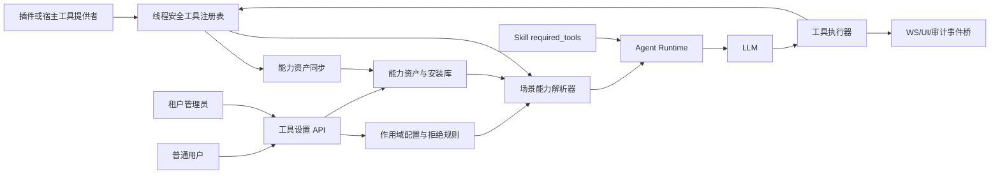
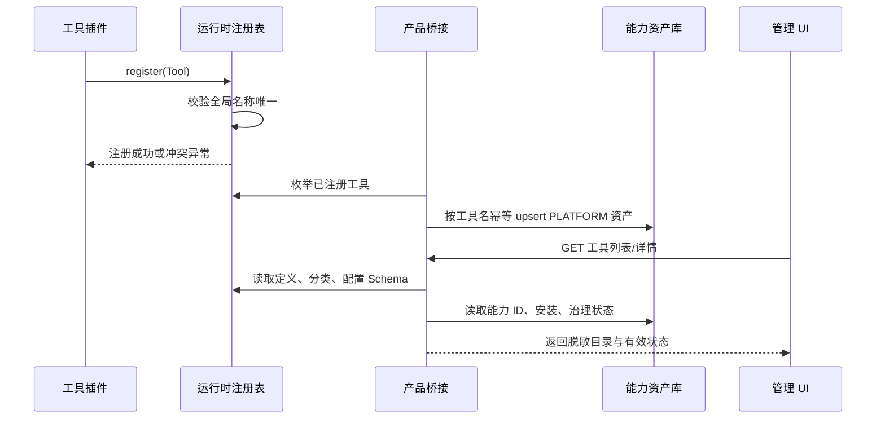
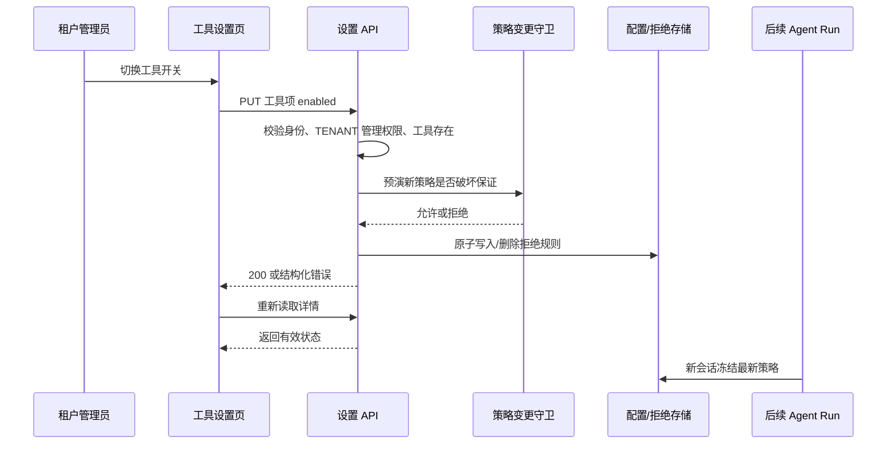
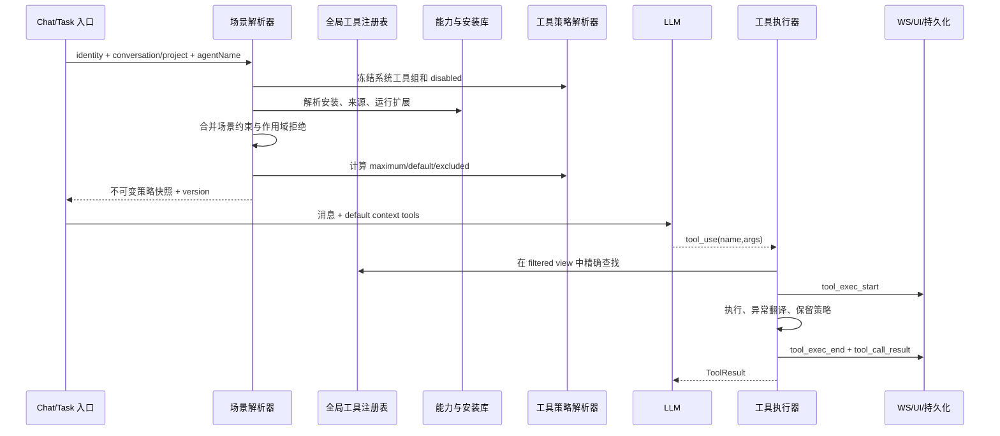
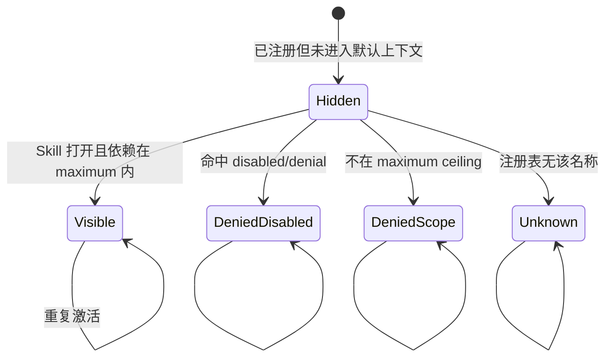

```
# 工具目录、工具开关和运行时可用性

## 1. 结论与边界

### 1.1 业务问题

Agent 平台不能把“进程中存在的所有工具”直接交给任意模型、租户和会话。一个工具从代码进入产品，到最终能够被某次 Agent 调用，至少要经过以下相互独立的判断：

1. 工具实现是否注册到运行时容器。
2. 工具是否同步成可治理的能力资产。
3. 当前租户、项目或用户是否能看见并安装该能力。
4. 当前作用域是否通过开关或拒绝策略允许该工具。
5. 当前 Agent 的工具组和运行约束是否允许它。
6. 工具是否默认进入本轮 LLM 上下文，或只能由 Skill 延迟激活。
7. 动态工具的执行源是否在线，且名称和执行源是否唯一。
8. 工具执行所需配置是否完整、兼容且能按身份解析。

本能力为平台管理员、租户管理员、普通用户、项目管理员和 Agent Runtime 提供同一套工具治理事实，使管理页面中的“可见、启用、继承、只读、默认使用”和运行时的“模型能否看到、能否执行”保持可解释的一致性。

### 1.2 输入、输出和最终效果

输入包括：

- 插件或宿主注册的工具定义与实现。
- SYSTEM、TENANT、PROJECT、USER 四类能力归属信息。
- TENANT、PROJECT、USER 三类安装关系。
- 租户或个人工具开关、配置和上级拒绝规则。
- 系统工具组、租户覆盖、Agent 到工具组的绑定。
- 项目或用户对 Agent 默认工具集合的扩展。
- 单次运行的 allow-list、exclude-list 和场景身份。
- Skill 的 `required_tools` 声明。
- MCP 等动态工具的连接状态和发现结果。

输出包括：

- 工具连接/容器列表及详情。
- 每个工具的精确运行时名称、能力 ID、配置字段、脱敏配置值。
- 当前作用域是否安装、是否继承、是否有效可用、可执行哪些管理动作。
- 工具是否默认进入 Agent 上下文及其来源。
- 每次 Agent 运行冻结后的最大工具集合、默认上下文集合、排除集合和策略版本。
- 工具执行开始、结束、成功、失败、耗时、输入输出大小等可观察事件。

用户最终看到的效果是：管理员开关或配置工具后，页面能可靠回显；新建会话时，Agent 只获得正式授权链允许的工具；被禁用或不在能力边界内的工具不会因为知识库、项目资源、Skill 或 MCP 已存在而被旁路注入。

### 1.3 本文包含与不包含

本文包含：

- 静态工具、插件工具和 MCP 动态工具在统一工具目录中的关系。
- 工具定义、注册容器、能力资产、安装、开关、配置、工具组、Agent allow-list、Skill 延迟激活与实际调用之间的区别。
- TENANT 与 USER 设置页面的列表、详情、继承、覆盖和恢复。
- 配置保存与运行时生效分离、密钥保护、参数容错、结果保留和错误传播。
- REST、运行时接口、持久化模型、实现算法、最小实现、生产实现和验收矩阵。

本文不展开：

- 工具组嵌套、循环检测和 Agent 策略 CRUD 的完整产品设计；它们有独立能力文档。本文只描述它们如何影响单个工具可用性。
- MCP Server 的创建、握手、传输协议和连接恢复细节；本文只描述 MCP 子工具如何进入统一目录和授权链。
- Skill 的上传、覆盖和内容发现；本文只描述 `required_tools` 对工具可见性的影响。
- 单个业务工具的领域参数与返回语义。

### 1.4 当前结论

- `I`：当前实现已经形成“注册供给、能力安装、治理拒绝、默认上下文、运行最大集合”分层模型。配置行本身不会授予工具可用性。
- `I`：运行时工具名是 LLM 调用和策略过滤的权威键；能力 ID 只用于资产、来源与安装治理，不能直接塞进运行时 allow-list。
- `I`：SYSTEM 工具组选择的工具和显式安装的工具共同形成场景可用候选集，再叠加拒绝、场景约束和 Agent 策略形成最终最大集合。
- `I`：Skill 的 `required_tools` 只能在本次运行最大集合内延迟放开工具；未知、已禁用或越权工具仍保持不可见。
- `I`：mandatory Skill 与 mandatory Tool 不是同一概念。mandatory Skill 只保证 Skill 的发现/只读治理；声明 mandatory 本身不会自动扩大工具权限。
- `I`：工具设置保存和真实 Agent 生效是两个独立结论。运行时在新 Agent run 创建时冻结工具策略；测试应使用新会话验证变更。
- `K`：黑盒测试记录过两个发布环境缺陷：保存 main Agent 工具组后运行时仍可能调用组外工具；未知内置工具配置曾被错误接受。这些是版本/环境事实，不应覆盖当前源码的静态设计结论。
- `K`：UI 在工具开关 PUT 失败时，持久化状态未改变，但缺少明确用户错误提示。
- `K`：当前三仓对 USER 工具目录存在版本冲突：产品源码的 USER 列表/详情路径只接受个人 MCP，并明确拒绝 `builtin` 详情；UI E2E 则要求个人扩展页能从同一路径读取系统内置工具和继承项。复刻时必须先选定统一契约，本文推荐 USER 目录返回“个人项 + 可见继承项”，继承项只读。
- `K`：个人恢复链路未统一：单项 V2 删除不清 USER denial，批量恢复仍只清 legacy ConfigStore；PTOOL-03/PTOOL-11 应作为目标契约验收。
- `I/K`：NovaCore SPI 的 ConfigParam 契约完整，但当前 `/api/settings/tools` 仍返回 V1 配置 DTO：NUMBER 被降级成 STRING；非空 allowedValues 被映射为 SELECT/options；pattern、minLength、minimum、maximum 丢失。因此不能把 SPI 完整性等同于设置 API Schema 保真。
- `P`：结果保留三态的长上下文行为、注册并发等大量用例仍是 planned，不能声称已做运行验证。
- `R`：本文未启动 Nova、未执行 API、Playwright 或构建命令，因此没有运行验证结论。

## 2. 术语与参与方

### 2.1 关键术语

| 术语 | 定义 |
|---|---|
| 工具定义 | 面向 LLM 和运营侧的不可变元数据，包括运行时名称、描述、调用参数 JSON Schema、配置参数和展示分类。 |
| 工具实现 | 可并发执行的代码对象，接收 LLM 参数和每次调用上下文，返回成功或错误结果。 |
| 运行时名称 | LLM `tool_use`、工具组、allow-list、事件和执行查找共同使用的全局精确名称，大小写敏感。 |
| binding fingerprint | 非密钥的执行源指纹。用于发现同名工具是否指向不同实现或不同 MCP Server。 |
| 工具容器 | 保存工具实现的线程安全注册表。容器中存在只代表“有供给”，不代表任意用户可用。 |
| 能力资产 | 可治理的工具、MCP Server、Skill 或知识资产记录，包含归属、来源、状态和稳定能力 ID。 |
| 安装 | 将能力资产授权给 TENANT、PROJECT 或 USER 作用域的关系。安装与运行配置相互独立。 |
| 拒绝/禁用 | 作用域上的单调收窄规则。上级拒绝不能被下级开关或 Skill 重新放开。 |
| 可用集合 | 当前场景由合法安装或系统策略提供、且来源可见的工具候选集合。 |
| 最大集合 | 可用集合进一步应用 disabled、excluded、场景 allow-list 和 Agent ceiling 后，本次运行绝不可超出的工具集合。 |
| 默认上下文集合 | Agent 首次调用 LLM 时立即提供给模型的工具集合，是最大集合的子集。 |
| 延迟激活 | LLM 打开 Skill 指令后，将该 Skill 声明的工具加入当前 Agent 可见集合，但不能超过最大集合。 |
| 配置 Schema | 运营或用户设置的运行配置定义；与 LLM 每次调用参数 Schema 严格分离。 |
| 结果保留 | 工具结果在长上下文压缩中的策略：短暂、可摘要、必须原样保留。 |

### 2.2 参与方



职责分工：

- 工具提供者只负责定义、实现、注册和释放资源，不决定某个租户能否使用。
- 工具注册表负责名称唯一性、并发读写和确定性枚举。
- 产品设置层负责目录展示、作用域配置、安装与治理动作。
- 场景解析器负责把身份、项目、安装、工具组和拒绝规则冻结为本次运行策略。
- Agent Runtime 只消费冻结后的最大集合和默认集合，不重新推断产品权限。
- Skill 只能在冻结的最大集合内延迟激活依赖。
- 工具执行器负责最终按名查找、执行、异常翻译和事件发布。

## 3. 业务规则

### 3.1 工具定义规则

工具定义应采用以下稳定契约：

```java
record ToolDefinition(
    String name,                       // 全局唯一、非空、大小写敏感
    String description,                // LLM 消费，非空，默认英文
    Map<String, Object> parametersSchema, // LLM 每次调用参数 JSON Schema
    List<ConfigParam> configParams,    // 用户/管理员设置，不发送给 LLM
    String category                    // UI 展示元数据，不进入模型协议
) {}
```

核心规则：

1. `parametersSchema` 只描述模型本次调用可以生成的参数。
2. `configParams` 只描述管理员或用户配置，例如 API Key、代理、默认搜索数量。
3. 密码、Token、Cookie 等敏感值只能进入 `configParams` 并由执行上下文解析，绝不能作为模型调用参数。
4. `category` 是不透明展示字符串。框架 SPI 不固化业务分类枚举；前端负责本地化映射。
5. 同一个运行时名称只能有一个执行源。重复注册应明确冲突，不能“先删除后覆盖”。
6. 工具对象会被多个会话并发调用，必须线程安全；每次调用数据只能放在调用参数或执行上下文中。

一个推荐定义示例：

```json
{
  "name": "web_search",
  "description": "Search the web for current information.",
  "parametersSchema": {
    "type": "object",
    "properties": {
      "query": {"type": "string", "description": "Search query"},
      "limit": {"type": "integer", "minimum": 1, "maximum": 20}
    },
    "required": ["query"],
    "additionalProperties": false
  },
  "configParams": [
    {
      "key": "web-search.api-key",
      "label": "API Key",
      "description": "Provider credential",
      "type": "PASSWORD",
      "defaultValue": "",
      "required": true,
      "allowedValues": [],
      "pattern": null,
      "minLength": 1,
      "minimum": null,
      "maximum": null,
      "group": "Connection"
    },
    {
      "key": "web-search.max-results",
      "label": "Max results",
      "description": "Default result limit",
      "type": "INTEGER",
      "defaultValue": "5",
      "required": false,
      "allowedValues": [],
      "pattern": null,
      "minLength": null,
      "minimum": 1,
      "maximum": 20,
      "group": "Defaults"
    }
  ],
  "category": "Web"
}
```

`ConfigParam` 的完整稳定字段为：`key`、`label`、`description`、`type`、`required`、`defaultValue`、`allowedValues`、`pattern`、`minLength`、`minimum`、`maximum`、`group`。`type` 当前精确枚举为 STRING、PASSWORD、INTEGER、NUMBER、BOOLEAN；`allowedValues` 缺省为空数组，其他约束缺省为 `null`。复刻端必须同时用这些约束生成 UI 控件和校验写请求，不能只展示 label/required。

当前产品设置 API 还有一层有损 V2→V1 DTO 映射：STRING/PASSWORD/INTEGER/BOOLEAN 保持类型；NUMBER 因 V1 无对应类型而降级为 STRING；只要 `allowedValues` 非空，无论原类型是什么都改成 SELECT，并生成 `options=[{label:value,value:value}]`；V2 没有选项独立 label。`pattern`、`minLength`、`minimum`、`maximum` 因 V1 DTO 无字段而直接丢弃。故当前 `/api/settings/tools` 的 configParams 不能保证复现 V2 的全部输入约束，前端仅凭该响应可能把数值渲染成文本，也无法执行正则、长度和范围校验。这是当前兼容层缺口 `K`，不是 SPI 缺失。

`D`：新版设置 API 应直接暴露上述完整 ConfigParam Schema，并为响应做显式版本；在 V1 兼容端点继续保留旧 DTO，但不能把它作为新客户端的权威校验源。服务端写入仍必须按完整 V2 Schema 校验，避免旧客户端漏校验成为绕过路径。

配置键使用“限定键”和“裸键”两种形态。例如 ToolDefinition 声明 `web-search.api-key`，V2 Tool 通过限定键解析；产品配置 blob 中保存裸键 `api-key`。桥接层只有在如下条件全部满足时才认领限定键：键包含 `.`；第一个点之前的 namespace 由恰好一个已注册 V2 Tool 声明；namespace 不属于共享前缀 `can`、`nova`、`metric`。多工具共用 namespace 或共享前缀必须落回通用 ConfigStore，不能任意归属。`tool:<name>:enabled` 始终属于对应工具。注册表变化后必须使键归属索引失效并重建。

### 3.2 工具状态不能合并成一个 enabled 字段

复刻系统至少应分别保存或计算以下状态：

| 状态 | 回答的问题 | 是否直接授权执行 |
|---|---|---|
| registered | 当前进程是否有该工具实现 | 否 |
| assetActive | 能力目录中是否为 ACTIVE | 否 |
| sourceVisible | 资产归属是否对当前身份可见 | 否 |
| installedAtScope | 当前作用域是否显式安装 | 是，可成为可用来源之一 |
| effectiveAvailable | 系统策略或任一合法安装是否提供该工具 | 是，但仍受后续收窄 |
| denied/disabled | 上级或当前作用域是否拒绝 | 是，拒绝优先 |
| maximumAllowed | 是否进入本次运行权限上限 | 是 |
| defaultInContext | 是否在首轮直接暴露给 LLM | 是 |
| skillActivatable | Skill 是否可在本轮从 maximum 中放开 | 是 |
| executableNow | 当前 filtered registry 是否能按精确名称取到 | 是，最终调用条件 |

### 3.3 运行时可调用判定

建议把最终判定实现为可解释的交集，而不是散落的 `if`：

```text
sourceRegistered
AND assetActive
AND sourceVisibleToIdentity
AND (selectedBySystemPolicy OR installedAtTenantProjectOrUser)
AND NOT deniedByTenantProjectOrUser
AND insideRequestAllowedCeiling
AND NOT explicitlyExcluded
AND sourceHealthyForDynamicTool
AND exactRuntimeNameHasSingleBinding
AND (
      selectedInDefaultContext
      OR activatedByVisibleSkillWithinSameCeiling
    )
= executableNow
```

其中“安装”和“默认进入上下文”是两件事：某工具可以合法可用但不默认暴露，只在用户将其加入项目/个人扩展，或某个 Skill 延迟激活后进入上下文。

### 3.4 作用域与继承规则

能力资产归属可为 PLATFORM、TENANT、PROJECT、USER；安装关系只能写入 TENANT、PROJECT、USER。

- PLATFORM 表示共享供给池，不表示默认对所有用户可用。
- TENANT 安装是租户内 Personal 与 Project 场景的共同来源。
- PROJECT 安装只在对应项目场景生效。
- USER 安装只对对应用户生效。
- PERSONAL 场景不读取 PROJECT 安装。
- 用户页面可以展示继承的系统或租户连接，但继承项必须只读。
- 配置不是统一的 `PLATFORM → TENANT → PROJECT → USER` 层级。当前精确顺序是：PERSONAL 为定义默认值 → PLATFORM → TENANT → USER；PROJECT 为定义默认值 → PLATFORM → USER → TENANT → PROJECT。PROJECT 场景故意让租户和项目治理覆盖用户凭据层。
- USER 层不是任意字段覆盖。当前仅允许：`send_email` 的 `from`、`smtp-username`、`smtp-password`；`receive_email` 的 `imap-username`、`imap-password`；`send_im_message` 的 `platform`、`webhook`、`secret`；`web_search` 的 `api-key`、`max-results`、`search-depth`。其他工具或字段的 USER 可写集合为空。
- 配置按原子组替换，而不是逐键浅合并。组名取 `ConfigParam.group`，空组归入 `__default__`；某一高层只要提供组内任一字段，就先删除结果中该组全部低层字段，再写入高层整层数据。USER 凭据层则先删除该工具全部 USER 可写字段，再写入本层获准字段。因此部分提交同组字段可能使未提交字段回退/缺失，写接口必须校验组内 required 字段完整性。
- 配置删除表示“恢复继承”，不是写入空配置替代上级。
- 配置不能创建安装、不能解除拒绝、不能自动把工具加入工具组。

### 3.5 工具开关规则

静态工具的产品开关应转译为治理拒绝规则，而不是卸载工具实现：

- 默认开启工具：没有显式拒绝时可由系统策略或安装提供。
- 默认关闭工具：在平台默认 disabled 集合中，必须显式允许后才能进入运行时。
- TENANT 拒绝影响租户下所有项目和用户。
- USER 拒绝只能进一步收窄，不得覆盖 TENANT 拒绝。
- MCP Server 总开关、MCP 子工具开关、能力安装和作用域拒绝必须同时满足。

当前实现有一组默认关闭的资源目录工具，以避免它们在没有明确授权时进入上下文。复刻时具体名单应放在产品配置或插件本地，不应进入公共 SPI。

### 3.6 工具组、Agent 策略和 allow-list

- 系统配置提供命名工具组，条目可以是精确工具名、`@group` 引用或包含 `*` 的 glob。
- Agent policy 将 `agentName` 绑定到一个基础工具组。
- 没有任何 Agent policy 时，兼容行为可以回退为 `*`；生产环境建议显式配置 main Agent 基础组。
- 单次 `allowedToolIds` 实际承载的是运行时工具名，是不可突破的 hard ceiling。
- `excludedToolIds` 始终优先于工具组、运行扩展和 Skill 激活。
- 项目/个人运行扩展只能向默认上下文加入已经在最大集合中的工具。
- 子代理只能继承并继续收窄调用者的有效工具集合，不能扩大权限。
- `callerAllowedToolNames` 是运行时元数据，不是 LLM 参数；非空时是调用者本轮实际有效集合，子代理只能取其子集。空集合的兼容语义是“宿主未报告/不额外限制”，不是“禁止所有工具”。

### 3.7 Skill required_tools 与 mandatory

Skill 依赖声明示例：

```yaml
---
name: research
required_tools:
  - web_search
  - read_file
---
```

规则如下：

1. `required_tools` 必须是字符串列表；标量、空项和非字符串不能被当作有效工具名。
2. LLM 通过 `read_file` 打开该 Skill 的 `SKILL.md` 后，运行时尝试将依赖加入当前 filtered registry。
3. 已注册且在最大集合内的工具被加入；未知、disabled、excluded 或越权工具分别记录诊断并保持不可见。
4. 任一依赖缺失时，Skill 指令仍可加载，Agent 可以降级执行，不应默认为整个对话失败。
5. mandatory Skill 表示租户强制发现或导入的 Skill，不是 mandatory Tool。仅声明 mandatory 不应自动激活其全部工具依赖。
6. 即使 mandatory Skill 被自动导入，依赖工具也仍必须通过正式最大集合边界。

绝对禁止为了保证某个 Skill、知识库或项目“好用”，在场景解析器中硬编码自动放开基础工具。业务资源存在不等于其依赖工具可用；未授权时不可用是正确结果。

### 3.8 配置保存与运行时生效

配置管理必须分成两个验证结论：

- `persisted=true`：写请求成功，页面回显、跨页面返回、刷新和详情 API 都显示新值。
- `runtimeEffective=true`：新 Agent run 中，工具从执行上下文读取到新配置，并改变真实下游请求或行为。

配置保存后应新建对话或新建 Agent run 验证。旧会话可能持有冻结的工具策略、模型上下文或连接快照，不能用旧会话得出配置未生效的结论。

### 3.9 参数解析与错误规则

- JSON Schema 与 Java/业务解析必须同时容错，因为模型经常把整数、布尔值输出为字符串。
- 必填字段、未知字段、范围、枚举、别名冲突必须在工具边界明确处理。
- 规范字段与别名同时存在时，规范字段优先。
- 无效整数不能导致 NPE 或进程异常，应返回可定位验证错误。
- 业务“零结果”必须是成功结果；网络失败、HTTP 非 2xx、解析失败和未知异常必须是错误结果。
- 错误输出统一以 `Error: ` 开头，但成功内容恰好以该文本开头时，仍以结构化 `success` 字段为准，不能仅凭字符串判错。

## 4. 完整执行链路

### 4.1 注册与目录生成



详细步骤：

1. 插件在初始化阶段构造工具并注册。
2. 注册表以 `definition.name` 为键执行 `put-if-absent`；冲突时明确失败。
3. 静态和插件初始化工具排在动态发现工具之前，同一阶段按名称排序，保证 LLM 工具列表稳定。
4. 产品桥接在插件加载完成后持有注册表只读引用。
5. 应用就绪后，把每个已注册工具同步成 PLATFORM/ACTIVE 能力资产；能力 ID由工具名确定性生成，重复启动不会产生重复资产。
6. 设置详情从运行时定义读取描述、分类和配置参数，从能力库读取能力 ID、作用域、安装和治理状态。
7. UI 严格校验 effective-state schema 版本、`runtimeName` 和 `capabilityId`，遇到不兼容响应应失败提示，而非默默用旧语义展示。

当前工程处于两代工具栈并存期，复刻时不能把二者误写成同一注册表：

| 维度 | Spring 产品 V1 | NovaCore V2 |
|---|---|---|
| Tool | `getDefinition()` + `String execute(Map)`，身份/沙箱部分依赖产品上下文 | `definition()` + `ToolResult execute(args, ToolExecutionContext)`，显式身份、配置、取消、Skill、Artifact |
| Registry | Spring Bean 启动收集，动态 `registerTool` 会覆盖同名项 | 框架注册表，重复名称抛冲突；按注册阶段确定性枚举 |
| Executor | 产品执行器把字符串包装成 ChatMessage，主要以 `Error:` 文本识别失败 | NovaCore 执行器使用结构化 `ToolResult.success` 和 retention |
| 设置读取 | 历史 `config_kv` 的 `tool:<name>:config` blob | V2 `tool_scope_config`/`tool_platform_config`，并经 ConfigStore 桥接 |

桥接启动顺序是：存储插件必须先注册原始 ConfigStore；工具注册桥在 `init` 阶段把 V2 ToolRegistry 放进 `ToolLookupHolder` 并使键索引失效；系统服务阶段取出原 ConfigStore，先 unregister，再用支持限定键解析、密钥解封和 V2 作用域配置的包装器重新 register；`start` 时再次使索引失效，以纳入后续系统插件注册的工具。若存储尚未注册，启动应失败，而不是退化成无配置运行。

V1→V2 适配不是通用自动转换。当前明确存在 JDBC 适配器：把 V1 definition 的 JSON Schema 转为 V2 ToolDefinition；从 V2 context 取租户、会话、locale、dataTheme，临时建立 V1 所需沙箱上下文；调用 V1 `String execute`；把结果翻译成结构化成功/失败，其中命中 `Error:` 前缀时 `success=false`，否则为 true；含 computable dataset handle 时升级为 DURABLE，否则 CONDENSABLE。其他 V1 Tool 只有被显式适配或重写为 V2 后才属于 V2 runtime。

迁移边界：V2 限定配置键优先解析 V2 作用域表；没有 V2 贡献层时，才回退旧 config_kv/YAML，再回退 ToolDefinition 默认值。工具组与 agent policy 在执行时强制按 TENANT scope 读取，忽略旧 USER 行，避免用户旁路覆盖管理端策略。目标态应是 V2 Tool/Registry/Executor/作用域配置单栈；V1 仅留在边界适配器后，并最终移除覆盖式 V1 Registry 与字符串判错。

### 4.2 租户管理员切换内置工具



失败时 UI 不应先永久改变本地状态。若采用乐观更新，应在请求失败时回滚，并显示用户可见错误；跨页面和刷新后必须仍是服务端原值。

### 4.3 个人配置覆盖与恢复

1. USER 设置页只列个人 MCP 与允许展示的继承项；继承的 SYSTEM/TENANT 项只读。
2. 对允许个人配置的内置工具，PERSONAL 读取按默认值 → PLATFORM → TENANT → USER 低到高合并，并返回 `configInherited`；PROJECT 则按默认值 → PLATFORM → USER → TENANT → PROJECT。
3. 保存个人配置前校验工具已注册、在合法共享来源中可用、未被上级拒绝、字段属于该工具、字段允许 USER 写入、必填字段原子完整。
4. PASSWORD 新值加密保存；输入 `****` 表示保留原密钥；空字符串表示显式清空。
5. 目标“恢复租户配置”应事务性删除 USER 作用域的 V2 config、V2 denial 及迁移期 legacy 键，不修改租户配置、个人 MCP 或个人 Skill；当前实现尚未完整做到这一点。
6. 批量恢复属于高风险操作，应先证明待删除覆盖均属于当前操作范围，并二次确认。

### 4.4 Agent 场景解析与运行时调用



解析顺序：

1. 根据会话归属确定 PERSONAL 或 PROJECT 场景，不能信任客户端自行声明的项目 ID。
2. 用租户身份读取 Agent 的系统工具组并冻结为快照。
3. 解析 TENANT、可选 PROJECT、可选 USER 安装，映射为精确运行时名称。
4. 将系统组工具并入可用集合；对 MCP 必须同时验证可见 Server 和动态工具绑定。
5. 合并项目模式固定排除、请求约束排除和有效作用域拒绝。
6. 将可用集合交给策略解析器，得到 maximum、default、disabled、excluded 和 source fingerprints。
7. 项目/个人默认扩展只保留仍在 maximum 中的工具。
8. 将 maximum 写入 Agent hard ceiling，将默认扩展作为可信 runtime group 传入。
9. LLM 仅收到 filtered registry 当前可见工具定义。
10. 每次工具调用再次在同一个 filtered registry 查找，防止模型伪造未授权名称。

### 4.5 Skill 延迟激活状态图



批量激活若用于需要原子依赖的场景，应先检查所有名称，任一个失败则全部不放开。当前按单工具 best-effort 激活适合可降级 Skill；生产系统可同时提供原子和 best-effort 两种显式 API。

## 5. 对外契约

### 5.1 认证和作用域通则

- 所有 `/api/settings/**` 接口需要已认证身份。
- 服务端从认证上下文获得 `tenantId`、`userId` 和 `isTenantAdmin`，不能接受客户端传入这些权威字段。
- 查询参数 `scope` 取值为 `USER` 或 `TENANT`，默认 `USER`。
- TENANT 查询和写入要求租户管理员；非管理员返回 403。
- USER 页面不得返回其他用户的个人 MCP 或个人配置。
- 统一业务错误体：

```json
{
  "success": false,
  "message": "只有租户管理员可以管理租户级工具设置"
}
```

HTTP 映射：参数错误 400、未授权操作 403、对象不可见/不存在 404、状态冲突 409、内部错误 500、上游错误 502。

### 5.2 查询工具连接列表

`GET /api/settings/tools?scope=USER|TENANT`

响应：

```json
{
  "items": [
    {
      "id": "builtin",
      "type": "builtin",
      "name": "builtin",
      "description": "System built-in tools",
      "scope": "SYSTEM",
      "toolCount": 18,
      "status": null,
      "transport": null
    },
    {
      "id": "srv_8b9c",
      "type": "mcp",
      "name": "docs",
      "description": "Documentation connector",
      "scope": "PERSONAL",
      "toolCount": 2,
      "status": "CONNECTED",
      "transport": "streamable_http"
    }
  ],
  "total": 2
}
```

当前产品源码规则是：TENANT 列表包含内置工具集合，并展示 SYSTEM/TENANT MCP；USER 列表只展示个人 MCP。与此冲突的是 UI E2E 契约：个人扩展页要求 USER 列表按 PERSONAL/TENANT/SYSTEM 分组，并要求 `GET .../builtin?scope=USER` 返回可配置的继承内置工具。该冲突未在本文运行验证。

复刻建议采用 UI E2E 所表达的完整个人目录契约：USER 查询返回当前用户个人资产以及对其可见的 TENANT/SYSTEM 继承资产；继承项通过 `governance.readOnly=true` 禁止编辑定义和删除，但允许的个人配置覆盖动作应由 `writableFields` 精确声明。若选择保持源码的分离式 API，则必须另设明确的“继承内置工具”接口，不能让前端依赖一个服务端明确 404 的路径。

### 5.3 查询工具详情

`GET /api/settings/tools/{id}?scope=USER|TENANT`

内置工具固定使用 `id=builtin`。详情必须携带有效状态 Schema 版本：

```json
{
  "effectiveStateSchemaVersion": 2,
  "id": "builtin",
  "type": "builtin",
  "name": "builtin",
  "description": "System built-in tools",
  "scope": "SYSTEM",
  "toolCount": 1,
  "tools": [
    {
      "name": "web_search",
      "runtimeName": "web_search",
      "capabilityId": "cap_tool_9d2f0b13c6ac4c11",
      "description": "Search the web for current information.",
      "category": "Web",
      "enabled": true,
      "configInherited": false,
      "configParams": [
        {
          "key": "api-key",
          "label": "API Key",
          "description": "Provider credential",
          "type": "PASSWORD",
          "defaultValue": "",
          "required": true,
          "group": "Connection",
          "options": null
        }
      ],
      "configValues": {"api-key": "****"},
      "availability": {
        "installedAtScope": false,
        "effectiveAvailable": true,
        "inherited": true,
        "sources": ["SYSTEM"]
      },
      "defaultBinding": {
        "boundAtScope": false,
        "defaultInContext": false,
        "inherited": false,
        "editable": false,
        "primarySource": null,
        "sources": []
      },
      "governance": {
        "readOnly": true,
        "allowedActions": [],
        "readOnlyReasons": ["SYSTEM_MANAGED"]
      }
    }
  ],
  "createdAt": null,
  "updatedAt": null,
  "mcpInfo": null
}
```

`availability`、`defaultBinding` 和 `governance` 不得互相替代。例如 `effectiveAvailable=true` 但 `defaultInContext=false` 是合法状态。

### 5.4 更新单个工具项

`PUT /api/settings/tools/{containerId}/items/{itemName}?scope=USER|TENANT`

请求：

```json
{
  "enabled": true,
  "configValues": {
    "api-key": "****",
    "max-results": "10"
  },
  "scope": "PERSONAL"
}
```

字段语义：

| 字段 | 类型 | 必填 | 语义 |
|---|---|---:|---|
| enabled | boolean/null | 否 | 修改可用性；省略表示不修改。 |
| configValues | string map/null | 否 | 内置工具运行配置，字段使用去掉工具命名空间后的 bare key。 |
| scope | `PERSONAL`/`TENANT` | 否 | 缺省由查询 scope 推导；USER 对应 PERSONAL，TENANT 对应 TENANT。 |

成功返回 HTTP 200、空响应体。推荐生产设计返回更新后的详情和 `policyVersion`，减少前端二次请求竞态。

特殊恢复语义：USER 请求中 `enabled=null` 且 `configValues` 为空或省略，应删除该工具个人覆盖，使其继承租户值。未知 `itemName` 必须返回受控 4xx，不能写入孤儿配置。

### 5.5 查询配置诊断

`GET /api/settings/tools/builtin/items/{itemName}/config?scope=USER|TENANT`

```json
{
  "capabilityId": "cap_tool_9d2f0b13c6ac4c11",
  "runtimeName": "web_search",
  "scopeType": "USER",
  "scopeId": "user-42",
  "configParams": [],
  "localValues": {"api-key": "****"},
  "effectiveValues": {"api-key": "****", "max-results": "10"},
  "inherited": false,
  "effectiveSource": "USER",
  "contributingLayers": ["USER", "TENANT"],
  "writableFields": ["api-key", "max-results"],
  "missingRequiredFields": [],
  "schemaFingerprint": "sha256:...",
  "schemaStatus": "COMPATIBLE",
  "registered": true,
  "available": true,
  "availabilitySources": ["SYSTEM_POLICY"],
  "denied": false,
  "denialSources": [],
  "toolGroupSelected": true,
  "toolGroupSources": ["SYSTEM_POLICY"],
  "readOnly": false,
  "readOnlyReason": null
}
```

该接口是定位“为什么页面能看到但运行时不能用”的关键诊断面。未注册工具应返回 `registered=false`、`schemaStatus=UNREGISTERED`、`readOnlyReason=TOOL_NOT_REGISTERED`，写接口则必须拒绝。

### 5.6 恢复个人内置工具覆盖

`DELETE /api/settings/tools/builtin/overrides?scope=USER`

```json
{"deleted": 3}
```

仅允许 USER；传 TENANT 返回 400。该操作只删除当前用户的内置工具开关和配置覆盖，不应影响 MCP、Skill、租户设置或其他用户。生产实现建议增加 dry-run 响应与幂等操作 ID。

这里必须区分当前实现与目标契约：

- `deletePersonalConfig(tenant,user,tool)` 在 V2 服务存在时只删除 USER `tool_scope_config`；它不删除同一用户、同一工具的 `capability_scope_denial`。因此“删除个人配置”不能保证恢复个人开关/拒绝。
- 批量 `deleteBuiltinToolOverrides` 当前只枚举内置 V2 Tool 名称并删除旧 ConfigStore 的 `tool:<name>:enabled` 与 `tool:<name>:config` 两类键；它既不删 V2 `tool_scope_config`，也不删 V2 `capability_scope_denial`。
- 因此上面的 `{"deleted":3}` 在当前实现只表示“成功删除的旧 ConfigStore 键数量”，不是工具数，也不是所有 V2 覆盖总数。PTOOL-03/PTOOL-11 的完整恢复目前应视为 K/目标验收，而不是 I。

复刻目标 `D`：在同一事务内，按当前 tenant/user 和内置工具集合删除 USER `tool_scope_config`、USER `capability_scope_denial`，迁移窗口内再删除两类 legacy ConfigStore key；任一步失败整笔回滚。`deleted` 必须定义为实际删除的持久化记录/键总数，并另返 `affectedTools` 去重工具数，避免调用者把两者混淆。重复调用返回 `deleted=0`，保持幂等；不得删除 TENANT/PROJECT 行或 MCP/Skill 数据。

### 5.7 个人默认上下文扩展

`GET /api/settings/tool-group-extensions/main`

```json
{
  "agentName": "main",
  "entries": [
    {
      "capabilityId": "cap_mcp_123",
      "runtimeName": "mcp__docs__query"
    }
  ]
}
```

`PUT /api/settings/tool-group-extensions/main`

```json
{
  "entries": [
    {
      "capabilityId": "cap_mcp_123",
      "runtimeName": "mcp__docs__query"
    }
  ]
}
```

PUT 为原子全量替换，只能写当前用户自己的扩展。服务端必须验证能力 ID 与运行时名称确实对应、当前用户合法可用、来源指纹无冲突。删除条目表示不再默认进入上下文，不等于卸载或删除 MCP。

### 5.8 运行时 Tool SPI

```java
interface Tool {
  ToolDefinition definition();
  default String bindingFingerprint();
  ToolResult execute(Map<String,Object> arguments, ToolExecutionContext ctx);
  default ResultRetention defaultRetention();
}

interface ToolExecutionContext {
  Identity identity();
  Sandbox sandbox();
  boolean isCancelled();
  <T> Optional<T> resolveConfig(String qualifiedKey, Class<T> type);
  Optional<String> conversationId();
  Optional<String> messageId();
  Optional<String> agentName();
  Optional<String> providerName();
  Map<String,Object> runtimeContext();
  int callerSubAgentDepth();
  Set<String> callerAllowedToolNames();
  Optional<SkillLookup> skills();
  Optional<ArtifactPublisher> artifactPublisher();
}
```

工具不能从 ThreadLocal 猜身份，也不能从 LLM 参数读取密钥。长任务必须周期性检查 `isCancelled()`。委派工具必须用 `callerAllowedToolNames` 继续收窄子代理权限。

### 5.9 工具结果和事件

```java
record ToolResult(
    boolean success,
    String output,
    ResultRetention retention,
    List<Artifact> artifacts
) {}

enum ResultRetention { EPHEMERAL, CONDENSABLE, DURABLE }
```

- `EPHEMERAL`：下一轮后可丢弃，例如一次性探测状态。
- `CONDENSABLE`：可在上下文压力下摘要，默认值。
- `DURABLE`：必须原样保留，例如生成文件路径、UUID、后续步骤需要的精确值。
- Artifact 不进入 LLM 文本流，由宿主的 Artifact 通道消费。

WS 侧可观察事件采用以下逻辑字段：

```json
{"type":"tool_exec_start","content":"call-1|web_search|{\"query\":\"nova\"}|24"}
{"type":"tool_exec_end","content":"call-1|web_search|128|true|452|{...result...}"}
{"type":"tool_call_result","content":"web_search|true|128"}
```

语义：一次已开始执行必须恰好对应一次完成；工具不存在、工具返回错误或抛异常，都转换成失败结果。只有完全无法形成 ToolResult 的基础设施灾难才需要独立 failed 事件。

当前 WebSocket 桥存在两套 success 派生：`tool_exec_end` 从结果正文非空且不以精确前缀 `Error: ` 开头来推断；稍后的 `tool_call_result` 则来自 NovaCore `ToolResult.success`。二者可能冲突，例如结构化成功但正文以 `Error: ` 开头，或者结构化失败正文没有该前缀。自动化执行拼装器按 toolName 维护等待队列，先接收 end，再由后到的 `tool_call_result` 覆盖 success/outputBytes；持久化 `processData.events[].success` 又会在断言层覆盖 WS 拼装值。因此当前观测优先级是：持久化 processData > `tool_call_result` > `tool_exec_end` 文本推断。

复刻契约应直接让两个 WS 事件都消费同一个结构化 ToolResult，不再从正文判错；在迁移期发生冲突时，以持久化 processData 作为最终权威，并记录 `TOOL_SUCCESS_SIGNAL_CONFLICT` 指标/日志。事件关联最好让 `tool_call_result` 也携带 callId；当前仅按 toolName FIFO 匹配，在同名并发/交错执行时存在错配风险。

### 5.10 项目工具安装与配置

项目工具是本能力的 PROJECT 作用域入口，认证身份仍由服务端解析：

| 方法 | 路径 | 权限 | 语义 |
|---|---|---|---|
| GET | `/api/v1/projects/{projectId}/tools` | 项目查看权限 | 返回可供项目使用的工具及安装状态。 |
| POST | `/api/v1/projects/{projectId}/tools/install` | 项目编辑权限 | 按能力 ID 安装到项目。 |
| DELETE | `/api/v1/projects/{projectId}/tools/{capabilityId}` | 项目编辑权限 | 卸载项目安装，不删除资产。 |
| GET | `/api/v1/projects/{projectId}/tools/{capabilityId}/config` | 项目查看权限 | 返回 PROJECT 层配置诊断。 |
| PUT | `/api/v1/projects/{projectId}/tools/{capabilityId}/config` | 项目编辑权限 | 写 PROJECT 层配置；配置不能自动安装。 |
| DELETE | `/api/v1/projects/{projectId}/tools/{capabilityId}/config` | 项目编辑权限 | 删除项目配置并回退租户/平台层。 |

安装请求：

```json
{"capabilityId":"cap_tool_9d2f0b13c6ac4c11"}
```

项目配置请求：

```json
{
  "configValues": {
    "endpoint": "https://search.example.invalid",
    "max-results": "20"
  }
}
```

安装与卸载必须校验项目属于当前租户、操作者有编辑权限、资产对项目可见且为 ACTIVE。配置 PUT 必须再次校验该能力由系统策略、租户安装或项目安装合法提供，不能把“能写项目配置”当作“已安装”。

项目列表同时携带新版 `availability/defaultBinding/governance` 和旧前端兼容字段。旧字段的精确映射是 `installed = availability.effectiveAvailable`，`mandatory`（源码内部命名 legacyLocked）`= availability.effectiveAvailable && availability.inherited`。因此旧 `installed=true` 不代表项目存在显式 installation，旧 `mandatory=true` 也不代表“强制工具”或独立 mandatory policy；它只表示该工具当前有效且来源继承、项目不能把它当作本地安装自由卸载。新实现不得用这两个旧布尔值反推安装记录。

## 6. 数据模型与生命周期

### 6.1 能力资产与安装

```sql
CREATE TABLE capability_asset (
  capability_id        varchar(64) PRIMARY KEY,
  tenant_id            varchar(64),
  kind                 varchar(32) NOT NULL,
  logical_name         varchar(255) NOT NULL,
  runtime_name         varchar(255),
  display_name         varchar(255),
  display_description  varchar(1000),
  ownership_scope      varchar(32) NOT NULL,
  owner_ref_id         varchar(64),
  source_type          varchar(32) NOT NULL,
  source_ref           varchar(255) NOT NULL,
  status               varchar(32) NOT NULL DEFAULT 'ACTIVE',
  version              bigint DEFAULT 1,
  created_by           varchar(64),
  created_at           timestamp NOT NULL,
  updated_at           timestamp NOT NULL,
  deleted_at           timestamp,
  UNIQUE(kind, source_type, source_ref),
  UNIQUE(tenant_id, kind, runtime_name)
);

CREATE TABLE capability_installation (
  id              bigint PRIMARY KEY,
  tenant_id       varchar(64) NOT NULL,
  capability_id   varchar(64) NOT NULL REFERENCES capability_asset(capability_id),
  scope_type      varchar(32) NOT NULL,
  scope_id        varchar(64) NOT NULL,
  enabled         boolean NOT NULL DEFAULT true,
  installed_by    varchar(64),
  installed_at    timestamp NOT NULL,
  updated_at      timestamp NOT NULL,
  UNIQUE(tenant_id, capability_id, scope_type, scope_id)
);
```

约束：

- `kind=TOOL` 的 PLATFORM 工具用运行时名称作为稳定 sourceRef。
- MCP 子工具不必每个建立独立资产；可以由 MCP_SERVER 资产作为来源，通过动态 binding 映射到多个运行时名称。
- `runtime_name` 必须完成回填；迁移期可临时回退 `logical_name`，但生产完成后不应长期保留双义性。
- 当前 runtime name 唯一索引精确为 `(tenant_id, kind, runtime_name)`；PostgreSQL 中 PLATFORM 行的 `tenant_id=NULL` 彼此不冲突，所以平台工具同名仍主要由进程注册表拦截。`D` 级加固应使用 `NULLS NOT DISTINCT`、表达式索引 `COALESCE(tenant_id,'')` 或拆分 PLATFORM/租户索引，使数据库也能拒绝平台同名。
- 软删除资产不应继续参与运行时解析；安装外键和清理策略要明确。

### 6.2 作用域配置

```sql
CREATE TABLE tool_scope_config (
  id                  bigint PRIMARY KEY,
  tenant_id           varchar(64) NOT NULL,
  capability_id       varchar(64) NOT NULL REFERENCES capability_asset(capability_id),
  scope_type          varchar(32) NOT NULL,
  scope_id            varchar(64) NOT NULL,
  config_json         text,
  schema_fingerprint  varchar(64) NOT NULL,
  schema_version      integer NOT NULL DEFAULT 1,
  status              varchar(32) NOT NULL DEFAULT 'ACTIVE',
  dormant_reason      varchar(255),
  migration_source    varchar(64),
  created_by          varchar(64),
  updated_by          varchar(64),
  created_at          timestamp NOT NULL,
  updated_at          timestamp NOT NULL,
  UNIQUE(tenant_id, capability_id, scope_type, scope_id)
);

CREATE TABLE tool_platform_config (
  capability_id       varchar(64) PRIMARY KEY REFERENCES capability_asset(capability_id),
  config_json         text,
  schema_fingerprint  varchar(64) NOT NULL,
  schema_version      integer NOT NULL DEFAULT 1,
  status              varchar(32) NOT NULL DEFAULT 'ACTIVE',
  dormant_reason      varchar(255),
  migration_source    varchar(64),
  updated_by          varchar(64),
  updated_at          timestamp NOT NULL
);
```

配置行与安装行禁止建立“写配置自动安装”的副作用。Schema 指纹变化后，不兼容旧配置应标记 DORMANT 或忽略该层，并在诊断接口显示原因，不能把未知字段静默交给工具。

### 6.3 作用域拒绝

```sql
CREATE TABLE capability_scope_denial (
  id                 bigint PRIMARY KEY,
  tenant_id          varchar(64) NOT NULL,
  capability_id      varchar(64) NOT NULL REFERENCES capability_asset(capability_id),
  tool_runtime_name  varchar(255) NOT NULL,
  scope_type         varchar(32) NOT NULL,
  scope_id           varchar(64) NOT NULL,
  reason             varchar(255),
  created_by         varchar(64),
  created_at         timestamp NOT NULL,
  UNIQUE(tenant_id, capability_id, tool_runtime_name, scope_type, scope_id)
);
```

拒绝是单调权限上限：TENANT、PROJECT、USER 任一有效拒绝都进入 `excludedToolNames`。删除当前层拒绝只表示回退上级治理，不保证工具立即可用。

### 6.4 默认上下文扩展

```sql
CREATE TABLE tool_group_extension_member (
  id                    bigint PRIMARY KEY,
  tenant_id             varchar(64) NOT NULL,
  scope_type            varchar(32) NOT NULL,
  scope_id              varchar(64) NOT NULL,
  agent_name             varchar(128) NOT NULL,
  tool_runtime_name      varchar(255) NOT NULL,
  source_capability_id   varchar(64),
  enabled                boolean NOT NULL,
  created_by             varchar(64),
  created_at             timestamp NOT NULL,
  updated_at             timestamp NOT NULL,
  UNIQUE(tenant_id, scope_type, scope_id, agent_name, tool_runtime_name)
);
```

只允许 PROJECT 与 USER 扩展。当前 `source_capability_id` 可空，用于承接无法无歧义映射来源的旧 USER 工具组成员；`created_by` 也可空。读取非空来源时必须重新验证它仍是该运行时名称的有效来源，避免 MCP 重建或同名来源变化后旧绑定劫持执行；空来源只能按只读迁移/诊断策略处理，不能直接扩大权限。`D` 级收紧是在迁移报告清零、所有活跃成员补齐来源后，对新写入强制非空并补外键，同时保留历史隔离区而不是原地猜测来源。

### 6.5 兼容配置键

迁移期系统可能仍使用通用配置 KV：

```text
tool:<runtimeName>:enabled
tool:<runtimeName>:config
tool-group:<groupName>
agent-policy:<agentName>:tool-group
```

生产复刻建议只保留一个写入权威源。若必须兼容旧 KV，应建立明确桥接层：工具执行解析 `toolName.subKey` 时，可从工具配置 blob 的 bare key 读取，但不能让用户级旧工具组键覆盖租户管理页面展示的策略。

### 6.6 敏感数据

- PASSWORD 字段持久化为加密信封，不保存明文。
- REST 永远返回 `****` 或不返回字段。
- 用户提交 `****` 时复用原加密值，不能把四个星号当新密码。
- 无历史密钥时提交 `****` 应忽略该字段或报错，不能制造虚假凭据。
- 显式空字符串代表清除，应与“未提交字段”区分。
- 日志、WS、审计、截图、Trace 和诊断附件不得出现明文密钥或密钥信封。

## 7. 核心实现设计

### 7.1 建议模块划分

| 模块 | 职责 |
|---|---|
| Tool SPI | 稳定定义、执行上下文、结果和注册接口。 |
| Runtime Registry | 工具注册、冲突检测、确定性枚举、动态注销。 |
| Catalog Sync | 将注册工具同步为能力资产。 |
| Capability Store | 资产、安装、拒绝、作用域配置、默认扩展。 |
| Settings Application Service | REST DTO、权限校验、密钥处理、变更守卫。 |
| Scene Capability Resolver | 解析 available、maximum、default、excluded 并产生版本。 |
| Filtered Registry | 每次 Agent run 的只读可见窗口。 |
| Skill Activator | 受 maximum ceiling 限制的延迟工具激活。 |
| Tool Executor | 最终查找、执行、取消、错误翻译和事件。 |
| Audit/Diagnostics | 记录策略来源、版本、结果和拒绝原因。 |

### 7.2 注册表伪代码

```java
register(tool):
  require tool.definition.name nonblank
  previous = concurrentMap.putIfAbsent(name, Registered(tool, phase))
  if previous != null:
    throw RegistryConflict(name)

all():
  return immutableList(
    values.sortedBy(phase ASC, definition.name ASC)
  )

unregister(name):
  concurrentMap.remove(name)
```

动态 MCP 工具必须提供包含 Server 身份的稳定 fingerprint；同名但 fingerprint 不同应 fail closed，并要求管理员消除冲突。

### 7.3 场景工具策略算法

```java
resolveScene(identity, mode, projectId, agentName, constraints):
  registered = identityFilteredRegistry(identity, mode, projectId)
  frozenGroup = inspectConfiguredSystemGroup(registered, agentName, tenantIdentity)

  installedBindings = union(
      enabledTenantInstallations(identity.tenantId),
      mode == PROJECT ? enabledProjectInstallations(projectId) : empty,
      identity.hasUser ? enabledUserInstallations(identity.userId) : empty
  )
  installedNames = mapAssetsAndDynamicBindings(installedBindings)
  assertNoRuntimeNameSourceConflict(installedNames)

  available = installedNames U frozenGroup.effectiveNames
  if constraints.allowed not empty:
      available = available INTERSECT constraints.allowed

  excluded = projectModeDefaults(mode)
           U constraints.excluded
           U effectiveScopeDenials(identity, projectId, available)

  maximum = registered.names
          INTERSECT available
          MINUS frozenGroup.disabled
          MINUS excluded

  defaultNames = frozenGroup.names INTERSECT maximum
  extensions = validProjectAndUserExtensions(identity, projectId)
             INTERSECT maximum
  defaultNames = defaultNames U extensions

  return immutableSnapshot(
      available, maximum, defaultNames, excluded,
      sourceFingerprints, provenance, hashVersion(...)
  )
```

策略解析必须只执行一次并冻结。管理页预演、审计、实际执行应复用同一算法或同一不可变快照，避免“页面显示的最大集合”和 Agent 实际集合漂移。

### 7.4 Filtered Registry

```java
get(name):
  if name in disabled or name not in visibleNames: return empty
  return source.get(name)

allowDetailed(name):
  if name in disabled: return DENIED_DISABLED
  if name in visibleNames: return ALREADY_ALLOWED
  if source.get(name) empty: return DENIED_UNKNOWN
  if maximum != null and name not in maximum: return DENIED_OUT_OF_SCOPE
  visibleNames.add(name)
  return ALLOWED
```

该对象是每次 Agent run 独占的策略视图，不承载工具实现，不允许注册或注销。全局工具实现存放在 source registry。

### 7.5 配置解析算法

```java
resolveConfig(toolName, identity, runtimeContext):
  capability = findVisibleActiveCapability(toolName, identity, runtimeContext)
  if capability missing: return UNREGISTERED
  if effectiveDenial exists: return DENIED

  values = ToolDefinition.defaults
  if PERSONAL scene: layers = [PLATFORM, TENANT, USER]
  if PROJECT scene:  layers = [PLATFORM, USER, TENANT, PROJECT]

  compatible = filter rows by ACTIVE + schemaVersion + schemaFingerprint
  for layer in compatible:
      if layer == USER:
          assert keys subset of USER_WRITABLE_FIELDS[toolName]
          remove all USER-writable keys from values
          put all allowed fields from layer into values
      else:
          touchedGroups = groups containing any incoming key
          remove every declared key belonging to touchedGroups from values
          put entire layer into values
  return unsealForExecution(values)
```

组名为空时统一按 `__default__`。非 ACTIVE、schemaVersion 非 1 或 schemaFingerprint 不匹配的层不参与合并，并返回 `INCOMPATIBLE_LAYER_IGNORED` 诊断；无作用域贡献层时为 `DEFAULT_ONLY`，兼容层生效为 `COMPATIBLE`，拒绝为 `DENIED`。设置接口返回 mask 后的值，执行接口返回解密值。配置解析发生在每次工具执行上下文，不应把用户配置写进共享 singleton 工具对象，否则会产生跨用户 last-write-wins 泄漏。

### 7.6 工具执行伪代码

```java
execute(use, identity, runContext):
  publishStart(use)
  tool = filteredRegistry.get(use.toolName)
  if tool missing:
      result = error("Tool not found: " + use.toolName)
      publishEnd(result, success=false)
      return result

  args = beforeHooks(tool, use.arguments)
  ctx = perInvocationContext(identity, sandbox, configResolver,
                             cancellation, conversationId,
                             callerAllowedToolNames)
  try:
      result = requireNonNull(tool.execute(args, ctx))
  catch Throwable e:
      logWithThrowable(e)
      result = error(e.class + ": " + safeMessage(e))

  result = applyToolDefaultRetentionIfNeeded(result)
  afterHooks(tool, args, result)
  publishEnd(result, success=result.success)
  return result
```

### 7.7 最小可用版本

最小版本可实现：

- 单进程线程安全注册表，名称冲突拒绝。
- 静态工具定义和 TENANT/USER 开关。
- 一个显式 main Agent 工具组。
- 每次新会话生成 `maximum/default/excluded` 快照。
- PASSWORD 加密和 REST 掩码。
- `ToolResult(success, output)` 与 start/end 事件。
- 配置保存后新会话生效。

即使是最小版本，也不能用“配置表有一行”代替安装/授权，也不能把全部已注册工具交给 LLM。

### 7.8 生产级版本

生产版增加：

- 能力资产、安装、PROJECT/USER 默认扩展和来源 provenance。
- MCP 动态注册、指纹冲突检测、连接状态和 fail-closed。
- Schema 指纹、配置层兼容诊断、DORMANT 迁移状态。
- 变更前策略预演与 mutation guard。
- 策略快照版本、审计事件和管理诊断 API。
- Skill 延迟激活、子代理继承收窄。
- 幂等写入、乐观锁、批量恢复 dry-run 和审计。
- 结果保留与长上下文 reducer 集成。
- 跨节点注册表/连接状态一致性及缓存失效机制。

## 8. 并发与非正常路径

### 8.1 注册并发

- 同名并发注册只能一个成功，其余收到冲突。
- 当前全局 `DefaultToolRegistry` 用 put-if-absent 拒绝重复；但每 Agent 的 `CompositeToolRegistry(primary, extras)` 明确让 extras 在同名时遮蔽 primary，`get/all` 都只暴露 extra。策略 fingerprint 若仅遍历 composite `all()`，只能看到遮蔽后的绑定，无法发现 primary 与 extra 实际存在两个同名来源。这是来源唯一性盲点。
- `D`：构建 composite 前先比较 primary 与 extras 的全部名称，任何交集直接以 `RUNTIME_TOOL_SOURCE_CONFLICT` 拒绝创建 Agent；extras 内部也必须唯一。fingerprint 应基于未经遮蔽的 `(name, sourceId, sourceVersion)` 多重集合计算，冲突检测先于 filtered view，不能用“最终只剩一个”证明安全。
- 运行时读取可以与动态注册/注销并发，不得抛并发修改异常。
- 已冻结的 Agent filtered view 若 source 工具被注销，后续 `get` 返回空并形成明确 Tool not found；不能保留悬空实现引用继续执行。
- 插件停止时注销自有工具并释放线程池、连接池；不得用 static 保存运行资源。

### 8.2 设置并发

- 单工具配置建议使用版本号或 `If-Match`，避免两个管理员互相覆盖。
- 当前全量替换个人默认扩展时，应在一个事务内校验所有条目并替换，不能出现半成功。
- 工具组和 Agent policy 修改前应预演所有受影响 Agent，若破坏保证则整笔拒绝。
- UI 自动化对共享租户状态必须串行，测试结束恢复真实初值。

### 8.3 动态 MCP 失败

- MCP 插件缺失或连接失败时，仅排除 MCP 工具，不应清空静态工具可用集合。
- MCP 可见性解析异常应记录 warning，并对 MCP fail closed。
- Server 已安装但未连接、子工具未发现或已关闭时，不得将名称加入 maximum。
- 同一个 runtimeName 来自不同 Server 或能力来源时，应返回 `RUNTIME_TOOL_SOURCE_CONFLICT`，不能按加载顺序任选一个。

### 8.4 配置异常

- 未注册工具：400/404，禁止脏写。
- 工具不可用但尝试写配置：409 或 400，并说明无合法共享来源。
- 命中上级拒绝：只读，说明拒绝来源。
- 未知字段：400，列出字段名但不回显敏感值。
- USER 修改锁定字段：403/409。
- 必填字段缺失：400，整笔不写。
- Schema 不兼容：忽略不兼容层并显示诊断，不把旧 JSON 直接传给工具。
- 密钥解密失败：不回显信封或密文，工具返回可定位但脱敏的配置错误。

### 8.5 工具执行异常

- filtered registry 找不到：`Error: Tool not found: <name>`，完成事件 `success=false`。
- 工具抛异常：捕获并记录 Throwable，对模型返回脱敏异常类型和原因。
- HTTP 4xx/5xx：保留状态码和截断响应摘要。
- JSON/参数错误：明确错误，不能返回空成功。
- 零业务结果：成功，输出合法空集合或“未找到结果”。
- 取消：长任务尽快终止；若取消与依赖错误同时发生，面向用户优先归类为取消。

### 8.6 当前已知缺陷与冲突

| 主题 | 证据 | 当前判断 | 复刻要求 |
|---|---|---|---|
| 工具开关失败提示 | UI E2E 台账 `NOVA-BUG-001` | 持久化未改变，但用户缺少明确失败反馈 | 回滚/保持原状态并显示错误 |
| 未知工具配置 | 黑盒 `TOOL-CONF-006` 为 known_failure | 某 release 曾返回 2xx；当前源码已有“未注册能力”校验路径，但本文未运行确认 | 必须受控 4xx 且无脏数据 |
| Agent policy 运行时限制 | 黑盒 `TOOL-CONF-005` 为 known_failure | 某 release 持久化成功但仍执行组外工具；当前源码静态存在 hard ceiling | 用实时事件和持久化事件共同验证组外工具不执行 |
| USER 目录与 builtin 详情 | 产品源码与 UI E2E 不一致 | 源码仅列个人 MCP 且拒绝 USER builtin；E2E 要求继承工具与个人覆盖 | 统一为一个可执行契约，并用只读治理字段表达继承 |
| 个人恢复覆盖 | 源码静态确认与 PTOOL-03/11 目标冲突 | 单项不删 USER denial；批量只删 legacy ConfigStore，不删 V2 config/denial | 同事务删除 V2 config + V2 denial，并定义 deleted 计数；PTOOL-03/11 按 K/目标验收 |
| 配置 Schema API 保真 | V2ConfigParamMapper 静态确认 | NUMBER→STRING；allowedValues→SELECT/options；pattern/minLength/minimum/maximum 丢失 | 新版设置 API 直接返回带版本的完整 V2 ConfigParam；服务端按完整 Schema 校验 |
| 结果保留行为 | Auto 用例多数 planned | SPI 有三态定义，不代表所有长上下文行为已运行验证 | 作为生产验收补齐 |

## 9. 安全、权限和审计

### 9.1 授权

- TENANT 设置只允许租户管理员。
- USER 设置只能操作当前用户所有的个人配置和个人 MCP。
- 继承的 SYSTEM/TENANT 资产在 USER 页面只读；隐藏编辑、删除和子工具开关只是 UX，服务端仍必须鉴权。
- 服务端必须同时校验 tenantId 和 ownerRefId，不能只凭资源 ID 查询。
- 项目场景的项目 ID来自会话归属或服务端授权解析，不接受未经验证的 runtimeContext。
- 作用域越低只能继续收窄，不能覆盖上级拒绝。

### 9.2 工具和提示词注入防护

- LLM 只能看到 filtered registry 产生的 ToolDefinition。
- 用户文本、项目挂载资源和 Skill 内容不能直接调用注册接口或修改 allow-list ceiling。
- Skill 激活必须通过结构化 `skill://.../SKILL.md` 读取结果与正式 `required_tools` 解析，不能从任意模型文本提取工具名。
- 工具执行时再次按名查找，防止模型构造未授权 `tool_use`。
- 动态工具名称应规范化并带 Server 命名空间，例如 `mcp__<server>__<tool>`。

### 9.3 审计

每次场景解析至少记录：

```json
{
  "phase": "RESOLVED",
  "outcome": "SUCCEEDED",
  "sceneMode": "PERSONAL",
  "tenantId": "tenant-1",
  "userId": "user-42",
  "agentName": "main",
  "policyVersion": "sha256:...",
  "toolDetails": {
    "systemGroupName": "core-tools",
    "maximumToolNames": ["ask_human", "read_file"],
    "excludedToolNames": ["write_file"],
    "effectiveRuntimeExtensionToolNames": [],
    "toolAvailabilitySourcesByRuntimeName": {
      "read_file": ["SYSTEM_POLICY"]
    }
  }
}
```

完整用户私有工具名集合应进入受限审计详情，普通租户级日志只记录数量、版本和错误码。配置变更审计包含操作者、作用域、目标能力、变更字段名、前后策略版本和结果，不记录值。

## 10. 外部依赖对端设计

### 10.1 外部依赖

本模块本身不要求一个独立外部工具目录服务，但动态 MCP Server、外部数据库、Web Search、邮件等工具会依赖外部系统。统一契约是：外部系统只影响工具执行或动态来源健康，不能自行决定 Nova 内部授权。

### 10.2 最小 MCP 动态来源契约

最小对端必须提供：

- 稳定 Server ID 和非敏感 Server 名称。
- 连接状态：CONNECTED、DISCONNECTED、ERROR。
- 工具列表：原始工具名、描述、调用 Schema、是否启用。
- 稳定协议版本和 Server 信息。
- 调用接口：tool name + arguments → content/error。
- 可配置超时和认证，但密钥不出现在目录响应。

Nova 侧的运行名算法必须字节级复刻，否则配置、安装和历史扩展都会失联：

```java
sanitize(s) = (s == null ? "" : s.replaceAll("[^A-Za-z0-9_-]", "_"))
raw = "mcp__" + sanitize(serverName) + "__" + sanitize(originalToolName)
if (raw.length() <= 64) return raw
hash = base36(raw.hashCode() & Integer.MAX_VALUE) // Java String.hashCode，非负十进制转小写 base36
keep = 64 - length("mcp__") - 1 - length(hash)
return "mcp__" + raw.substring(5, 5 + keep) + "_" + hash
```

注意截断保留的是已经包含 server 分隔符和 tool 前缀的 `raw` 主体；hash 也对完整、已 sanitize 的 raw 计算。测试向量：`github/create_issue → mcp__github__create_issue`；`My Server!/do/it → mcp__My_Server___do_it`；40 个 `s` / 40 个 `t` → `mcp__ssssssssssssssssssssssssssssssssssssssss__tttttttttt_p2vowq`（总长 64）。Java `String.hashCode` 不是加密 hash，也不是跨语言默认字符串 hash；其他语言必须显式实现其 31 倍累加和 32 位有符号溢出语义。

binding fingerprint 与运行名是两个概念：前者还应覆盖 serverId、transport/protocol、端点/来源版本和 externalName，用来检测同名绑定变化；不得只对 `serverId + protocol + originalToolName` 做无分隔拼接。

### 10.3 生产级外部来源设计

- 连接管理器负责健康检查、指数退避、工具清单刷新和连接隔离。
- 工具清单变化形成新 source version，正在运行的场景继续使用冻结版本或明确失败。
- 删除/重建同名 Server 时，旧 capability ID 和默认扩展不能静默绑定新来源。
- 外部调用错误标准化为可定位 `ToolResult.error`，但去除凭据、内部栈和完整敏感响应。
- 外部依赖健康不得成为扩大权限的理由；断线恢复后仍需重新通过安装、拒绝和工具组链路。

Nova 无法从调用侧证明 MCP Server 内部如何调度、隔离租户或保存凭据，因此复刻时必须在对端单独实现身份隔离、请求审计、速率限制和密钥托管。

## 11. 可观察性

### 11.1 日志

建议结构化字段：

- 注册：`toolName`、`registrationPhase`、`bindingFingerprintHash`、结果。
- 场景解析：`tenantIdHash`、`userIdHash`、`sceneMode`、`agentName`、策略版本、各集合数量。
- 配置：能力 ID、作用域、字段名集合、Schema 指纹、结果；禁止字段值。
- 执行：conversationId、messageId、callId、toolName、toolOrdinal、inputBytes、outputBytes、durationMs、success。
- 冲突：`RUNTIME_TOOL_SOURCE_CONFLICT`、名称和两侧非密钥指纹。

### 11.2 指标

- `tool_registry_size{sourceType}`
- `tool_policy_resolution_total{outcome,sceneMode}`
- `tool_policy_resolution_duration_ms`
- `tool_policy_maximum_size`、`tool_policy_default_size`
- `tool_activation_total{result}`
- `tool_execution_total{toolName,outcome}`
- `tool_execution_duration_ms{toolName}`
- `tool_config_write_total{scope,outcome}`
- `tool_config_schema_incompatible_total`
- `tool_dynamic_source_conflict_total`

工具名可能是高基数或租户自定义值，生产指标应映射到受控类别或使用 top-N，完整名称留在受限 Trace。

### 11.3 用户诊断

管理页应能解释：

- 工具未注册。
- 工具没有合法安装或系统策略来源。
- 被 TENANT/PROJECT/USER 哪一层拒绝。
- 可用但未加入默认上下文。
- 已加入默认上下文但动态来源未连接。
- 配置继承自哪一层、缺哪些必填字段、Schema 是否兼容。
- 设置保存成功但只对新会话生效。

## 12. 复刻实施顺序

1. 实现 Tool SPI、不可变 ToolDefinition、ToolResult 和线程安全 Registry。静态验收：同名冲突、确定性顺序、空注册表均有明确行为。
2. 实现 LLM 参数 Schema 与 operator config Schema 分离。静态验收：敏感字段无法进入 LLM Schema。
3. 建能力资产、安装、作用域拒绝和配置表。静态验收：配置表没有授予安装的外键副作用。
4. 实现插件注册到能力资产的幂等同步。静态验收：重复启动不会生成重复 capability。
5. 实现 TENANT/USER 设置查询、详情、开关、配置与恢复。静态验收：所有返回密钥被 mask。
6. 实现命名工具组和 Agent policy，并把运行时名称作为唯一过滤键。
7. 实现场景解析器，输出不可变 `available/maximum/default/excluded/version`。
8. 实现 Filtered Registry，使 LLM 列表和最终执行共享同一可见窗口。
9. 实现 Skill 延迟激活，但严格限制在 maximum ceiling 内。
10. 接入 MCP 动态来源、source fingerprint 和 fail-closed 冲突处理。
11. 实现每次执行配置解析、取消、错误翻译、结果保留和 Artifact 通道。
12. 增加变更预演、审计、诊断 API、指标和完整三通道测试。

## 13. 验收标准

### 13.1 正向场景

1. 新注册静态工具出现在 TENANT 工具目录，名称、描述、分类和配置字段与定义一致。
2. 工具被系统工具组选中且无拒绝时，新会话 LLM 工具列表包含其精确运行时名称。
3. 租户管理员关闭工具后，页面、刷新、详情 API 一致；新会话不再出现该工具。
4. 重新开启后，新会话可调用并产生成功 start/end 事件。
5. USER 保存允许覆盖的配置后，个人详情显示非继承；新会话真实下游请求使用新值。
6. 删除个人覆盖后回退租户值，其他工具和个人 MCP 不受影响。
7. Skill 打开后，其合法依赖在同一 run 后续轮次可见；越权依赖仍不可见。

### 13.2 反向场景

1. 普通用户请求 TENANT 管理接口返回 403。
2. 用户不能读取、修改或删除其他用户个人 MCP。
3. 未注册工具配置返回受控 4xx，存储无新增行。
4. 被 TENANT 拒绝的工具不能被 USER 开关、工具组、Skill 或项目资源恢复。
5. 同名不同来源工具使策略解析失败，不选择任意实现。
6. 必填配置缺失、未知字段和 USER 锁定字段整笔拒绝。
7. API、UI、日志、事件和 Trace 均无明文密钥或加密信封。

### 13.3 并发与恢复场景

1. 并发注册同名工具仅一个成功。
2. 管理员并发配置写入可通过版本冲突检测，不静默覆盖。
3. MCP 连接失败只移除 MCP 工具，不清空静态工具。
4. 保存请求 500 时页面不显示成功，状态回滚或保持，刷新后服务端未改变。
5. 动态工具在场景冻结后注销，调用返回明确 Tool not found，不执行旧对象。
6. 工具执行中取消能产生可识别终态，且不泄漏底层异常。

### 13.4 数据生命周期场景

1. 注册同步幂等。
2. 卸载能力后配置可以按策略保留为 dormant 或清理，但不得继续授权执行。
3. 删除 MCP Server 清理其孤儿工具配置和默认扩展；不触碰同名不同 ID 资源。
4. 配置 Schema 升级后不兼容行可诊断、可迁移，不直接生效。
5. 批量恢复只删除当前用户目标覆盖，失败时报告精确对象 ID。

## 14. 测试矩阵

> `A` 表示自动化仓库中的 active 验收契约，不表示本文执行过；`K` 表示已知失败；`P` 表示 planned；`I` 表示源码静态确认。

| 场景 | 通道 | 前置条件 | 操作 | 预期结果 | 当前证据等级 |
|---|---|---|---|---|---|
| USER 工具列表与详情一致 | API | 已登录用户 | 列表后逐项取详情 | 数量、ID、状态和详情一致 | A: SET-TOOL-001 |
| 密钥字段脱敏 | API | 至少一个配置型工具/MCP | 读取详情 | 密码 masked/absent，无密钥信封 | A: SET-TOOL-005 |
| 注册表无重复 | API/单元 | 多个静态工具 | 枚举定义 | 名称唯一 | A: TOOL-REG-001；I |
| 动态注册/注销 | API/单元 | 动态工具 | 注册后查询，再注销 | 可见性随容器变化 | P：需要真实 mutation 用例；现有 TOOL-REG-004/005 仅 GET 占位；注册表机制 I |
| 重复动态注册 | API/单元 | 已存在同名工具 | 再注册 | 明确冲突，无歧义 | P: TOOL-REG-008；I |
| 工具开关关闭 | UI+API | ask_human 初始开启 | UI 关闭、跨页、刷新 | PUT 成功且持续关闭 | UI 契约 TOOL-05 |
| 工具开关开启 | UI+API | ask_human 初始关闭 | UI 开启、跨页、刷新 | PUT 成功且持续开启 | UI 契约 TOOL-06 |
| 保存失败回滚 | UI | 拦截 PUT 为 500 | 切换开关 | 无误成功、状态不变、有错误提示 | K: TOOL-07/NOVA-BUG-001 |
| 配置字段渲染 | UI | web_search 等配置工具 | 打开配置弹窗 | 控件类型、必填、说明正确 | UI 契约 TOOL-08/09 |
| 必填字段拦截 | UI | 清空必填 API Key | 保存 | 不发 PUT，字段报错，弹窗保留 | UI 契约 TOOL-10 |
| 配置持久化 | UI+API | 非敏感可配置工具 | 保存、跨页、刷新 | 五层状态一致 | UI 契约 TOOL-11 |
| 配置保存失败 | UI+API | PUT 500 | 保存 | 输入保留、服务端原值、明确错误 | UI 契约 TOOL-12 |
| 个人覆盖与恢复 | UI+API | 可个人配置工具 | 保存 USER 配置后恢复 | 同事务删除 V2 config/denial 并回退租户；旁项不变 | K/目标：PTOOL-03、PTOOL-11；当前恢复链不完整 |
| 个人保存 500 | UI+API | 无原覆盖 | 拦截保存 | 不产生覆盖，输入保留 | UI 契约 PTOOL-04 |
| 继承工具只读 | UI+API | SYSTEM/TENANT 继承项 | 打开详情 | 无编辑删除和可写开关，密钥不明文 | UI 契约 PTOOL-02 |
| 默认开启工具继承 | API | 无 USER 覆盖 | 查询详情与可用项 | `configInherited=true` 且可用 | A: TOOL-CONF-009 |
| disabled 排除候选 | API | 临时关闭已启用工具 | 查询 available-tools | 目标不在集合，恢复后回来 | A: TOOL-CONF-002 |
| 跨租户隔离 | API | 两个租户 | A 关闭工具，B 查询 | B 集合不变 | A: TOOL-CONF-007 |
| 未知工具配置 | API | 随机不存在名称 | PUT 配置 | 受控 4xx、无脏写 | K: TOOL-CONF-006 |
| Agent policy hard ceiling | API+WS | main 绑定仅含 read_file 的组 | 诱导 write_file | 组外工具无执行事件 | K: TOOL-CONF-005；I |
| MCP 子工具开关生效 | UI+WS | 已连接 MCP | 开启/关闭后各建新会话 | 开启有成功事件，关闭无事件 | UI 契约 MCP-15/16、PTOOL-07/09 |
| 工具异常穿透 | WS | 可执行失败夹具 | 工具抛错 | end success=false，结果含可定位错误 | A: TOOL-ERR-001 |
| 正常成功 | WS | 稳定业务问题 | 调用工具 | 至少一次成功 lifecycle | A: TOOL-ERR-002 |
| 零结果不是错误 | WS | 合法无命中 | 调用工具 | success=true | A: TOOL-ERR-007 |
| 成功文本以 Error 开头 | WS | 特殊成功夹具 | 调用工具 | 仍按结构化 success 判定 | A: TOOL-ERR-009 |
| 字符串整数/非法整数容错 | API/WS | 模型风格参数 | 执行工具 | 转换或明确错误，无崩溃 | A: TOOL-PARAM-005/006；其余 P |
| EPHEMERAL/CONDENSABLE/DURABLE | WS | 长上下文夹具 | 多轮压缩 | 按策略丢弃、摘要或保留 | P: TOOL-RETAIN-001..007；I 为 SPI 定义 |

## 15. 当前能力与建议汇总

### `I` 已实现事实

- NovaCore 有稳定 Tool SPI、线程安全注册表、每 Agent filtered registry 和 hard ceiling。
- 工具定义区分 LLM 参数 Schema 与运营配置 Schema。
- 产品桥接可从运行时注册表构建设置目录并同步能力资产。
- 能力资产、安装、作用域配置、作用域拒绝和默认上下文扩展已形成独立模型。
- 场景解析会冻结系统工具组、可用集合、最大集合、拒绝集合、扩展集合和版本。
- MCP 解析失败对 MCP fail closed，不清空静态工具集合。
- Skill 延迟激活不能越过 disabled、unknown 和 maximum ceiling。
- 工具执行异常会转换成结构化失败结果，并发布完整生命周期事件。
- PASSWORD 支持加密存储、REST 掩码和掩码保留语义。

### `A` Active 测试契约

- 工具目录与详情一致、敏感字段脱敏。
- 关闭后不在可选集合、默认继承、跨租户隔离。
- 名为 TOOL-REG-004/005 的 active YAML 只对 `/api/settings/tools` 执行 GET，并断言 MCP item 非空或某断开 fixture 的 `toolCount=0`；它们没有调用 register/unregister，也没有比较 mutation 前后，因此只是弱目录占位，不能作为动态注册/注销证明。
- 工具内部异常、正常成功、零结果与“Error 前缀成功文本”的结构化区分。
- UI 对开关、配置持久化、个人覆盖、继承只读和真实运行时工具事件有精细回归设计。

### `K` Known Failure

- 工具开关保存失败缺少用户可见错误提示。
- 某 release 的未知工具配置被接受。
- 某 release 的 main Agent policy 保存后，运行时仍执行组外工具。
- 当前产品源码与 UI E2E 对 USER 工具列表和 USER builtin 详情的契约不一致。
- PTOOL-03/PTOOL-11 要求的完整个人恢复尚未被当前双写/双存储删除链满足。

### `P` Planned Requirement

- 结果保留三态的完整长上下文行为。
- 动态注册/注销并发、空注册表和部分未知名称查询等更多黑盒边界。
- 真实动态注册/注销验收：通过受控 fixture/API 产生 registry mutation，按同一 runtimeName 比较前后 get/all/执行结果，而不是只做 GET items 非空。
- 更多参数别名、浮点整数和范围处理用例。

### `F` 强推断

- 三仓共同表明设置变更在新会话验证是产品契约；旧会话是否即时重建工具快照没有被承诺。
- 当前存在新作用域配置表与旧 ConfigStore 桥接的迁移窗口；生产复刻应尽快收敛为一个权威写源。

### `D` 复刻建议

- 将“目录供给、可用、默认上下文、实际可执行”做成显式字段和诊断，而不是单一 enabled。
- 所有管理变更先用同一个策略解析器预演，再持久化。
- 对设置写入增加乐观锁、策略版本和更新后详情响应。
- 新版设置 API 直接暴露完整、版本化的 V2 ConfigParam Schema，不再经 V1 DTO 有损映射。
- 对批量恢复增加 dry-run、精确对象清单和操作审计。
- 批量恢复在一个事务内同时删除 USER V2 配置与 USER V2 拒绝；迁移期再清 legacy keys，并把 `deleted` 定义为实际删除记录/键数。
- 对动态来源使用 source fingerprint、版本冻结和冲突 fail closed。
- 禁止 Composite extras 与 primary 或 extras 彼此同名；fingerprint 在遮蔽前对全部来源计算。
- 严禁由项目资源、知识库或 Skill 旁路自动注入工具。

## 16. 证据附录

本附录仅用于当前工程追溯；删除本附录不影响正文的实现和验收信息。

### 16.1 Nova 实现证据

- Tool SPI 与结果：`nova-core/nova-core-spi/src/main/java/com/aloudata/nova/core/spi/tool/`
- 注册表和 filtered view：`nova-core/nova-core-runtime/src/main/java/com/aloudata/nova/core/runtime/registry/`
- 工具策略解析：`nova-core/nova-core-runtime/src/main/java/com/aloudata/nova/core/runtime/tool/ToolPolicyResolver.java`
- Skill 激活：`nova-core/nova-core-runtime/src/main/java/com/aloudata/nova/core/runtime/agent/SkillActivator.java`
- 工具执行：`nova-core/nova-core-runtime/src/main/java/com/aloudata/nova/core/runtime/agent/ToolExecutor.java`
- 产品工具 REST：`nova-app/src/main/java/com/aloudata/nova/controller/ToolSettingsController.java`
- 设置门面与配置：`nova-app/src/main/java/com/aloudata/nova/tools/ToolManager.java`、`ToolConfigService.java`、`ToolScopeConfigService.java`
- 双栈与注册表桥：`nova-app/src/main/java/com/aloudata/nova/tools/Tool.java`、`ToolRegistry.java`、`ToolExecutor.java`、`nova-app/src/main/java/com/aloudata/nova/tools/novacore/ToolRegistryBridgePlugin.java`、`ToolLookupHolder.java`、`ToolConfigBridgeConfigStore.java`、`V2JdbcQueryTool.java`
- 配置层级与键归属：`nova-app/src/main/java/com/aloudata/nova/tools/ToolScopeConfigResolutionSupport.java`、`nova-app/src/main/java/com/aloudata/nova/tools/novacore/ToolKeyResolver.java`
- WS 事件成功语义：`nova-app/src/main/java/com/aloudata/nova/controller/ChatWebSocketHandler.java`
- MCP 运行名：`nova-bundled-plugins/nova-ext-mcp/src/main/java/com/aloudata/nova/ext/mcp/McpToolNaming.java`
- 能力解析：`nova-app/src/main/java/com/aloudata/nova/capability/ToolCapabilityResolver.java`、`EffectiveToolCapabilityResolver.java`
- 场景策略：`nova-app/src/main/java/com/aloudata/nova/project/service/FoundationSceneToolPolicyProvider.java`
- 场景装配与审计：`nova-app/src/main/java/com/aloudata/nova/project/service/AgentExecutionSceneAssembler.java`
- 数据迁移：`nova-app/src/main/resources/db/product-migration/postgresql/V202607221500__add_capability_tables.sql`、`V202607231000__add_capability_runtime_name.sql`、`V202607292350__add_tool_group_extension_member.sql`、`V202607301000__add_tool_scope_config.sql`
- 前端 API 与页面：`web/lib/api/toolSettings.ts`、`web/components/settings/ToolSettings.tsx`
- 配置示例：`nova-app/src/main/resources/application.yml.example`

### 16.2 nova_auto_test 证据

- 设置工具 Runner：`nova_auto_test/src/features/settings/toolSettingsClient.ts`、`toolSettingsRunner.ts`
- 工具设置用例：`nova_auto_test/cases/15-settings/tool-settings/`
- 注册表：`nova_auto_test/cases/02-tool-execution/registry/`
- 配置与 Agent policy：`nova_auto_test/cases/02-tool-execution/tool-config/`
- 参数容错：`nova_auto_test/cases/02-tool-execution/param-robustness/`
- 错误穿透：`nova_auto_test/cases/02-tool-execution/error-passthrough/`
- 结果保留：`nova_auto_test/cases/02-tool-execution/result-retention/`
- WS 工具事件解析：`nova_auto_test/src/core/wsToolEvents.ts`

### 16.3 nova_ui_e2e 证据

- 系统工具 UI：`nova_ui_e2e/tests/settings-tools.spec.ts`
- 工具运行时：`nova_ui_e2e/tests/agent-tool-runtime.spec.ts`
- 个人工具与 MCP：`nova_ui_e2e/tests/personal-extensions-tools.spec.ts`
- 页面 helper：`nova_ui_e2e/src/system-settings-tools.ts`
- 回归设计：`nova_ui_e2e/docs/system-settings-tools-skills-ui-regression-test-design.md`
- 个人扩展设计：`nova_ui_e2e/docs/personal-extensions-tools-skills-test-design.md`
- 已知缺陷：`nova_ui_e2e/docs/known-product-issues.md`

```
