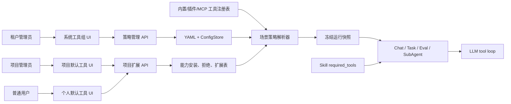
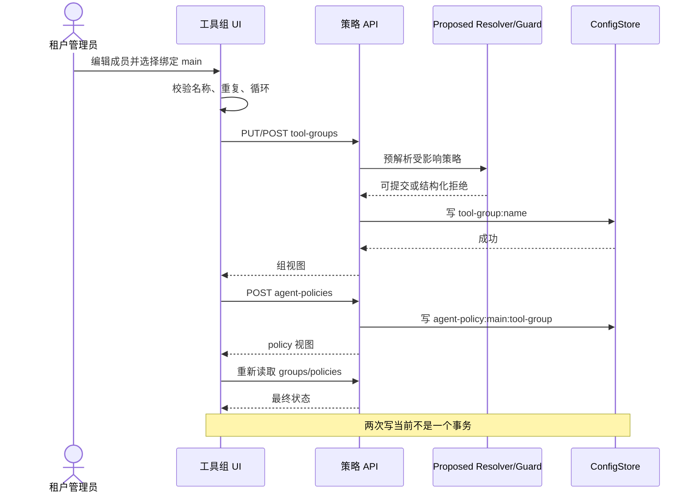
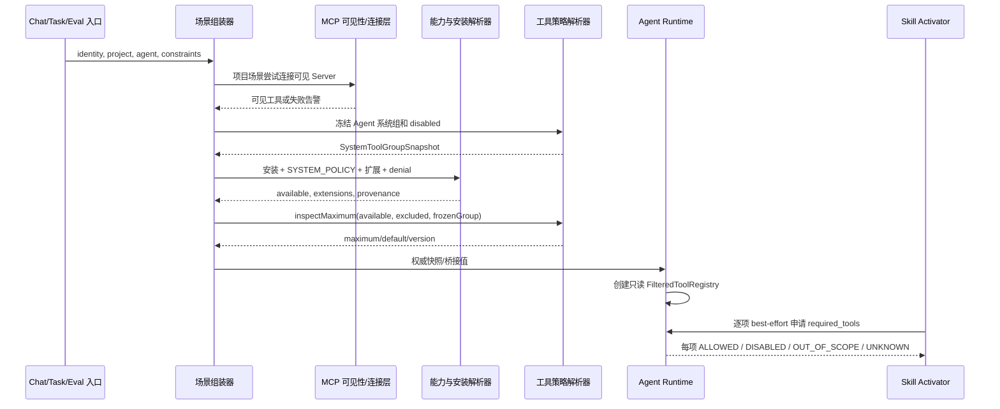
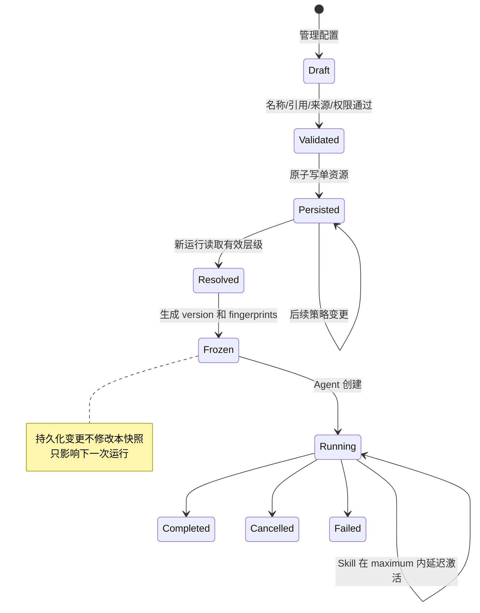

```
# 工具组、Agent 工具策略与继承治理

## 1. 结论与边界

### 1.1 解决的业务问题

工具已经注册、已被租户或项目安装，不等于它应立即出现在每个 Agent 的提示上下文中，更不等于模型可以在任意运行中调用它。本能力用“工具组 + Agent 绑定 + 场景可用性 + 单调拒绝 + 单次运行快照”回答四个不同问题：

1. 哪些工具是某类 Agent 的系统默认工具。
2. 哪些项目或用户已合法安装的工具可以额外默认进入上下文。
3. 本次运行绝不能越过的工具硬上限是什么。
4. 管理员修改策略后，旧运行与新运行分别采用哪个版本。

目标用户包括平台运维、租户管理员、项目管理员、普通用户、Agent 编排层和工具运行时。输入是工具注册表、能力资产与安装、系统 YAML、租户覆盖、项目/用户默认扩展、作用域拒绝、任务约束及 Agent 名称；输出是管理页面可读的工具组和绑定，以及每次运行冻结的 `defaultContextToolNames`、`maximumToolNames`、排除原因、执行源指纹和策略版本。

最终产品效果应是：系统组可查看且只能通过租户覆盖调整；租户管理员可创建嵌套组并绑定 Agent；项目或用户只能从自己合法获得的能力中选择“默认工具”；运行时首次只向模型暴露默认集合，Skill 后续也只能在硬上限内延迟放开工具。

### 1.2 包含与不包含

本文包含：

- SYSTEM/TENANT 工具组、Agent→工具组绑定、USER/PROJECT 默认扩展的产品语义。
- `enable/disable`、覆盖、继承、任务 allow/exclude、能力安装与拒绝的精确优先级。
- 内置工具、插件工具、MCP 子工具、Skill `required_tools` 的边界。
- 管理 REST、配置、数据库、解析算法、快照桥、UI、并发、失败与验收。

本文不展开工具实现参数、MCP 传输协议、Skill 包生命周期和能力市场安装 UI；这些只作为策略输入说明。工具调用事件和聊天流式协议也不是本能力的新协议。

### 1.3 状态结论

- `I`：源码具有 SYSTEM YAML 基线、TENANT ConfigStore 全量覆盖、嵌套组/通配符解析、Agent 绑定、PROJECT/USER 精确默认扩展、单调拒绝、运行快照和 Skill 不越硬上限的完整静态链路。
- `I`：策略的权威键是工具运行时名称；能力 ID 仅绑定安装来源。同一次当前注册表解析中，相同运行时名称若同时出现不同能力或 fingerprint 会按冲突失败，不能任选一个。
- `I`：当前没有“不可移除 mandatory Tool”字段。租户安装是可用性基线，仍可被拒绝、任务约束或 Agent ceiling 收窄；mandatory Skill 也不会授予其 `required_tools`。
- `I-risk/K`：已经冻结的系统组在真正创建 Agent 时若发现同名工具已换成另一执行源，当前实现接受新源并把快照 fingerprint 刷新为当前值，没有拒绝 source drift。该行为破坏“冻结来源”的安全直觉；生产复刻应把拒绝 drift 作为 `D` 目标。
- `K`：黑盒回归记录发布环境曾在保存 main 工具组后仍执行组外 `write_file`。因此不能仅凭静态链路声称运行已正确收口。
- `K`：`TOOL-CONF-006` 记录发布环境会接受并持久化不存在的内置工具配置，而不是返回受控 4xx；这与工具组中“未知精确成员仅告警跳过”是不同写入口，但共同说明未知工具写入尚未统一 fail-closed。
- `K`：删除被其他工具组 `@引用` 的子组会留下悬空引用；UI 用例把该行为标成稳定预期失败。运行时下一次展开父组可能报 `Unknown tool group`。
- `K`：缺少 Agent 策略时，当前框架兼容逻辑可能回退为“全部工具”；生产复刻不应采用这个 fail-open 默认值。
- `K`：工具组和 Agent 绑定是两个独立请求，UI 的“一次保存并绑定 main”不是跨资源事务。
- `A`：三仓已有工具组 CRUD、嵌套/覆盖、租户隔离、删除级联、客户端循环预检、校验和 UI 错误保持等 Active 契约；GROUP-09 不提供服务端全图循环校验证据。本次没有执行它们。
- `R`：本次未启动服务、未运行 API、Playwright、构建或测试，故无运行验证结论。
- `D`：推荐采用文末“D 设计”：策略修订号 + 条件写 + 引用图事务 + 安全默认组 + 统一预览/解释 API，并让所有 Chat/Task/Eval/SubAgent 入口强制消费同一份冻结策略。

## 2. 术语与参与方

| 术语 | 精确定义 |
|---|---|
| 运行时名称 | LLM tool call、工具组成员、allow/exclude 和执行查找共同使用的大小写敏感名称，如 `read_file` 或 `mcp__docs__search`。 |
| 工具组 | 有序成员列表；成员可以是精确名称、`@其他组` 或含 `*` 的 glob。重复展开后去重。 |
| SYSTEM 组 | 随应用配置发布的只读基线。 |
| TENANT 覆盖 | 租户以同名组写入完整替代值；是 replace，不是 merge。删除覆盖后恢复 SYSTEM 基线。 |
| Agent policy | `agentName -> groupName` 的基线绑定。当前管理面主要是租户级。 |
| 可用集合 | 由系统策略或合法安装提供，且对当前租户/项目/用户可见的工具。 |
| 默认上下文集合 | 本轮第一次 LLM 调用即能看到的工具，必须是硬上限子集。 |
| 硬上限/maximum | 本轮任何时刻都不可越过的集合；Skill 延迟激活也受它限制。 |
| 默认扩展 | PROJECT/USER 从本作用域有效安装中选择、额外进入默认上下文的精确工具；不是新授权。 |
| source fingerprint | 不含凭据的执行源指纹，用于检测同名工具是否来自不同实现或 MCP Server。 |
| 冻结快照 | Agent 创建前一次性解析并携带到运行时的不可变策略及版本。 |
| mandatory | 本领域没有 mandatory Tool。Skill 的 mandatory 只保证 Skill 发现信息，不改变工具组或 maximum。 |



职责边界：管理 API 只维护策略事实；能力目录决定某工具是否有合法来源；解析器负责交集、差集和来源校验；Agent Runtime 只消费快照，不能根据“项目挂载了知识库”等业务资源自行补入 `search_knowledge`、`read_knowledge` 或其他工具。

## 3. 业务规则

### 3.1 分层与精确优先级

配置读取必须区分三个不同层次，不能把它们压成一条“取第一个有效值”的链：

| 层次 | 当前顺序 | 类型不匹配时的真实行为 |
|---|---|---|
| 持久化 DB 作用域级联 | USER 身份为 `USER -> TENANT -> GLOBAL`；租户身份为 `TENANT -> GLOBAL` | 第一个原始值命中后才做类型过滤；若类型不匹配，DB 级联立即返回空，不再读取下一个 DB scope。【I】 |
| `OverlayConfigStore` | primary 为上述持久化级联，defaults 为只读 deployment defaults | primary 返回空时会继续读 deployment defaults；因此“DB 内不继续级联”不等于“最终没有 YAML/default fallback”。类型错误的 USER 值可能跳过 TENANT/GLOBAL DB 值，却最终落到部署默认。【I-risk】 |
| `ToolPolicyConfig` | 从启动配置解析 `groups`、`agent-policies`、`disabled` | 这是工具策略解析器持有的 immutable YAML 基线，不是 DB 级联中的 GLOBAL 行；同名 DB group/policy 缺失时，resolver 才按工具策略规则使用该基线。【I】 |

复刻时应明确选择是否保留这个“wrong-typed DB value 跳过较低 DB scope、但 Overlay 仍可落到 deployment default”的兼容语义；生产版更推荐在写入时拒绝错误类型并告警，而不是依赖读取时回退。【D】

对一次运行，推荐用下列顺序理解当前算法：

1. 按身份、场景和 MCP 可见性过滤注册工具，并为每个名称确定唯一执行源。
2. 选择 Agent 的组：该 Agent 的有效持久化绑定优先，其次 YAML 同名绑定；未知 Agent 在存在其他策略时继承 `main`；完全无策略或无可继承 `main` 时当前实现回退 `*`。
3. 读取组：有效 ConfigStore 同名组完整替代 YAML 同名组；不存在才读 YAML。
4. 递归展开 `@group`，对 glob 在本轮已过滤注册名称上匹配，对精确未知名称告警并跳过；未知组或循环引用失败。
5. 读取系统禁用：有效 `tool:<runtimeName>:enabled=false` 优先于 YAML disabled；产品侧的作用域 denial 再单调加入排除。
6. 计算可用集合：合法 TENANT/PROJECT/USER 安装的工具并集，加上明确属于系统组的默认工具。SYSTEM_POLICY 是正式策略来源，不是根据业务资源猜出的旁路。
7. 若任务给出非空 allow-list，则对可用集合做交集；再减项目模式固定排除、任务 exclude、租户/项目/用户 denial 和 disabled。
8. 得到 `maximum`。系统组展开结果与 `maximum` 取交集，形成系统默认上下文。
9. PROJECT 和 USER 默认扩展做并集，但每一项必须由同作用域合法安装的唯一能力来源提供；再与 `maximum` 取交集后加入默认上下文。
10. 生成快照和版本。运行开始后策略修改只影响新运行。
11. Skill 读取后逐项 best-effort 申请把 `required_tools` 加入当前可见集合：允许的项立即放开，未知、disabled 或不在 `maximum` 的项保持隐藏并分别进入诊断；部分失败不会回滚已放开的项，也不会使 Skill 激活失败。【I】若业务要求依赖完整性，批量 all-or-none 只能作为 `D` 设计。

可用集合和默认集合不能混为一谈：一个已安装工具可以处于 `maximum` 内但不在首次上下文，等待 Skill 激活；一个默认扩展若对应安装被移除，则列表返回时过滤该项并报告 `staleDefaultExtension=true`，运行时不再采用它。

### 3.2 工具组成员规则

- 精确成员：`read_file`；仅注册表存在时展开。
- 组引用：`@runtime-tools`；允许多层递归。
- glob：`mcp__*`；匹配本轮身份过滤后的工具名称，因此新连接 MCP 可能在下一次运行自动进入该组。
- 保序去重：直接成员和嵌套成员重复时只保留第一次遇到的位置。
- 空组合法，表示首次默认集合为空；若 `maximum` 非空，Skill 仍可按需激活其中工具。
- 组名必须非空且不能含 `:`；当前接口允许重复创建同名租户组并覆盖原 entries，这是显式 overwrite 语义。
- 当前更新请求缺少 `entries` 时会返回成功但不写；生产版应改为 400。
- 当前精确未知工具仅告警并跳过；生产保存应给出错误或显式 `allowUnresolved=true`，避免拼写错误静默收窄。

### 3.3 override、继承与删除

- TENANT 同名组对 SYSTEM 组是全量替代。UI 应同时显示 `systemEntries`，并标注“租户覆盖”。
- 删除 TENANT 覆盖后，SYSTEM 组和 SYSTEM Agent 绑定重新显现。
- 保存 TENANT Agent 绑定会覆盖同 Agent 的 SYSTEM 绑定；删除后恢复 SYSTEM 绑定。
- 删除租户组会删除直接指向它的租户 Agent policy；不会删除 SYSTEM policy。
- `K`：当前删除不会检查其他组中的 `@child`。生产必须在同一事务中拒绝删除并返回所有父组，或显式级联改写父组；默认应拒绝。

### 3.4 Agent、项目和用户的职责边界

- Agent policy 选择一个系统基线组；PROJECT/USER 不能用扩展替换该绑定，只能把已授权工具追加到默认上下文。
- PROJECT 扩展只读取/写入项目行，不混入当前用户私有行；运行时再把项目与用户两类扩展合并。
- USER 扩展只属于当前用户。响应不返回 tenantId/userId，身份只能来自认证上下文。
- 项目 GET 需要 USE 权限，PUT 需要 EDIT 或租户管理员；TENANT 工具组变更仅租户管理员；USER 扩展只需已认证租户用户。
- 项目扩展写成功后递增项目 `configVersion`；所有扩展 replace 在一个数据库事务内先删后插。

### 3.5 enable、disable、denial 和 mandatory

`enabled=true` 不是授权。正式判定必须同时满足：有注册执行源、能力资产有效、安装/系统策略提供可用性、未被 denial/disabled/exclude 收窄、位于 Agent maximum。

旧式 `tool:<name>:enabled` 使用级联覆盖；新式 `capability_scope_denial` 是单调拒绝，任何上层拒绝都不能被下层 `true` 抵消。复刻时应以 denial 为治理权威，旧 enabled 仅作兼容输入。

当前没有 Tool 级 mandatory。TENANT 安装常被代码注释称为 baseline，但仍可被组、拒绝和任务约束移除。mandatory Skill 的声明不会：

- 把 `required_tools` 自动加入工具组；
- 改变首次 Tool Schema；
- 绕过 maximum、denial 或 MCP 可见性；
- 注册反向保护阻止管理员修改工具策略。

### 3.6 内置、MCP 与 Skill 边界

- 内置/插件工具从运行时注册表进入可选目录。
- MCP 设置目录只列出当前作用域可见、Server enabled 且子工具 enabled 的外部工具；TENANT 视图排除 PERSONAL MCP。
- MCP 目录加载失败时当前接口保留内置选项并记录告警，是部分成功；运行场景中项目 MCP 连接失败也 fail-soft，相关工具自然缺席。
- 同一次当前来源枚举中，同名工具的 `sourceCapabilityId` 或 fingerprint 不同必须返回 `RUNTIME_TOOL_SOURCE_CONFLICT`，禁止按列表顺序覆盖；跨“冻结组→Agent 创建”的后续换源当前不会触发该冲突，见 6.4 的 source-drift 风险。
- USER/PROJECT 扩展只接受精确名称，不接受 `@` 或 `*`；SYSTEM 默认工具不可重复写成扩展。
- Skill 只做 maximum 内的延迟激活，不是权限来源。

### 3.7 默认绑定 provenance 与 primary 选择

`runtimeBindings` 保存的是“为什么该工具默认进入上下文”，与“为什么该工具可用”和“实际执行源是谁”是三个不同维度：

| 维度 | 可同时保留的来源 | primary/冲突规则 |
|---|---|---|
| availability provenance | SYSTEM policy、TENANT/PROJECT/USER installation 等可并存 | 用于解释 `available`，不以 default primary 覆盖其他可用来源。 |
| default-binding provenance | `SYSTEM_POLICY`、`USER_RUNTIME_GROUP`、`PROJECT_RUNTIME_GROUP` 可并存 | primary 固定为 `SYSTEM_POLICY > USER_RUNTIME_GROUP > PROJECT_RUNTIME_GROUP`；这是展示和稳定 hash 的确定性优先级，不代表 USER 可以覆盖 SYSTEM 权限，也不代表 PROJECT 比 USER 更弱授权。【I】 |
| execution-source provenance | runtimeName、sourceCapabilityId、source fingerprint | 同一次解析中同名不同源直接 `RUNTIME_TOOL_SOURCE_CONFLICT`；不能用上述 primary 顺序挑选执行实现。【I】 |

例如同一工具同时是 SYSTEM 默认、USER 扩展和 PROJECT 扩展时，`sources` 保留三项，`primarySource=SYSTEM_POLICY`；若没有 SYSTEM 但 USER 与 PROJECT 都存在，则 primary 为 `USER_RUNTIME_GROUP`。primary 只消除审计展示歧义，最终仍须经过 `maximum` 和 denial。

## 4. 完整执行链路

### 4.1 管理员创建并绑定工具组

1. UI 并行读取工具组、Agent policy 和可选工具。
2. 服务端从认证上下文解析 tenant/user，TENANT 管理校验租户管理员。
3. UI 允许勾选精确工具或 `@组`；继承工具显示为选中且只读。
4. UI 本地 DFS 检测循环并显示完整路径；生产服务端仍必须用同一算法对完整 proposed graph 重验【D】。
5. 当前写服务会构造 proposed state 并预解析已知受影响 Agent；这能复用运行时展开器发现部分循环，但不能证明每次 API 写入都验证租户完整引用图。全图写时校验、稳定 4xx 和无绑定组也必检属于 `D` 目标。
6. 持久化 `tool-group:<name>` JSON 数组。
7. 如勾选绑定 main，UI 再调用 Agent policy POST；若已有 main 绑定，先确认替换。
8. UI 重新加载列表并展示作用域、覆盖、条目数和 boundAgents。

`I/K`：代码有 mutation guard 扩展点，但静态搜索未发现具体 guard 实现；空链不会提供额外反向依赖保护。运行时递归展开会拒绝循环【I】；UI 的 GROUP-09 在浏览器侧发现 A→B→A 后不发送 PUT【A，未运行】；服务端对任意 proposed 全图执行同等写时校验仍是【D】。组写和 policy 写是两个请求，第二步失败时组仍已保存。



### 4.2 项目/用户修改默认工具

1. UI 从工具详情读取 `defaultBinding` 和允许动作。
2. 用户切换某工具后，客户端读取当前 scope 全量 entries，按 runtimeName 增删并 PUT 整个数组。
3. 服务端确认 USER 身份或项目权限，规范化空 Agent 名为 `main`。
4. 校验 entry 非空、精确名称、无重复；查本作用域有效安装及工具实际来源。
5. 校验名称由请求的 capabilityId 唯一提供，且不是系统默认工具。
6. 一个事务内删除该 scope/agent 原行并批量插入新行；项目写额外 bump configVersion。
7. 返回本作用域自己的有效 entries；历史失效行不回显，设置 `staleDefaultExtension`。

### 4.3 新运行解析与执行



Chat 直接用冻结 group 与 scene version 创建 Agent；Task/Evaluation 把同一字段封装成内部 `AgentRunToolPolicy` 放入 runtimeContext，Runner 创建 Agent 前取出并删除保留键。保留键不能传给 Tool、Skill 或 prompt。快照存在时，空 `maximum` 表示“零工具”，绝不能解释为“不限制”。

### 4.4 快照状态



## 5. 对外契约

所有 REST 都使用已有登录态，由服务端认证中间件把 `tenantId`、`userId`、`tenantAdmin` 放入请求上下文；客户端不得提交身份字段。当前接口无分页，列表以稳定规则排序。响应版本未显式声明；`D` 建议统一增加 `schemaVersion: 2` 和 ETag/revision。

### 5.1 工具组 API

#### 列表

`GET /api/settings/tool-groups?scope=TENANT`

- 认证：已登录；`scope=TENANT` 要求租户管理员。默认 TENANT。
- 响应：数组；租户组排在 SYSTEM 前，各自按 name；`boundAgents` 来自有效 policy。

```json
[
  {
    "id": "core-tools",
    "name": "core-tools",
    "entries": ["@runtime-tools", "ask_human", "mcp__*"],
    "scope": "SYSTEM",
    "readOnly": true,
    "overridden": false,
    "boundAgents": ["main"]
  },
  {
    "id": "core-tools",
    "name": "core-tools",
    "entries": ["read_file"],
    "scope": "TENANT",
    "readOnly": false,
    "overridden": true,
    "systemEntries": ["@runtime-tools", "ask_human", "mcp__*"],
    "boundAgents": ["main"]
  }
]
```

同名 SYSTEM 和 TENANT 在最终 map 中只返回有效 TENANT 行，并用 `systemEntries` 保留基线说明；上例为说明字段全集，实际同一响应不会同时含两行同名有效项。

#### 可选工具

`GET /api/settings/tool-groups/available-tools?scope=TENANT`

```json
[
  {
    "name": "read_file",
    "description": "Read a file from the workspace.",
    "category": "File",
    "source": "BUILTIN"
  },
  {
    "name": "mcp__docs__search",
    "description": "Search documentation.",
    "category": "MCP",
    "source": "MCP"
  }
]
```

只列 enabled 注册工具和可见 enabled MCP 子工具。MCP 枚举失败时当前返回内置部分，不把整个请求置为失败。

#### 创建、更新、删除

```http
POST /api/settings/tool-groups
Content-Type: application/json

{"name":"readonly-main","entries":["read_file","@web-tools"]}
```

成功 `200` 返回完整 group row。`entries` 当前可缺省并按空数组处理。重复 name 是 overwrite，不是 409。

```http
PUT /api/settings/tool-groups/readonly-main
Content-Type: application/json

{"entries":["read_file"]}
```

成功 `200 {"success":true}`。path 中 id 就是 name，不支持改名。

```http
DELETE /api/settings/tool-groups/readonly-main
```

成功 `200 {"success":true}`，并删除直接绑定该组的 TENANT Agent policy。SYSTEM 组只能通过删除同名 TENANT 覆盖恢复，不能删 YAML 本体。

当前错误类型由全局异常翻译为 4xx/5xx；稳定业务码至少应包含：`FORBIDDEN`、`INVALID_PARAM`、`UNKNOWN_TOOL_GROUP`、`CIRCULAR_TOOL_GROUP_REFERENCE`、`RUNTIME_TOOL_SOURCE_CONFLICT`、`TOOL_GROUP_REFERENCED`。`D` 错误体：

```json
{
  "code": "TOOL_GROUP_REFERENCED",
  "message": "Tool group 'child' is referenced by other groups.",
  "details": {"referencedBy": ["parent-a", "parent-b"]},
  "traceId": "..."
}
```

当前写请求没有 idempotency key、revision 或条件写；相同 body 重试结果幂等，但并发更新是后写覆盖。

### 5.2 Agent policy API

`GET /api/settings/agent-policies?scope=TENANT`

```json
[
  {
    "agentId": "main",
    "groupName": "core-tools",
    "scope": "SYSTEM",
    "readOnly": true,
    "overridden": false
  }
]
```

失效地引用不存在 group 的持久化 policy 会被告警并从列表忽略。

`POST /api/settings/agent-policies`

```json
{"agentId":"main","groupName":"readonly-main"}
```

要求租户管理员；group 必须在 SYSTEM、TENANT 或 GLOBAL 有效层存在。成功返回 policy row。当前 `agentId` 没有独立非空校验，生产应限制为 `[A-Za-z0-9._-]{1,128}`。

`DELETE /api/settings/agent-policies/{agentId}` 返回 `{"success":true}`；删除 TENANT override 后恢复 SYSTEM 绑定。接口无 PUT，POST 是 upsert。

### 5.3 USER/PROJECT 默认扩展 API

USER：

- `GET /api/settings/tool-group-extensions/{agentName}`
- `PUT /api/settings/tool-group-extensions/{agentName}`

PROJECT：

- `GET /api/v1/projects/{projectId}/tool-group-extensions/{agentName}`，要求项目 USE。
- `PUT /api/v1/projects/{projectId}/tool-group-extensions/{agentName}`，要求项目 EDIT 或租户管理员。

PUT 是全量原子 replace；`entries` 必填，当前 DTO 若把 null 归一为空则表示清空。建议客户端明确发送数组。

```json
{
  "entries": [
    {"capabilityId": "cap-tool-mail", "runtimeName": "send_email"}
  ]
}
```

```json
{
  "agentName": "main",
  "entries": [
    {"capabilityId": "cap-tool-mail", "runtimeName": "send_email"}
  ],
  "staleDefaultExtension": false
}
```

错误：空 capabilityId/runtimeName、`@`/glob、重复 runtimeName、来源不属于有效安装、同名多来源、重复加入 SYSTEM 默认，分别返回 INVALID 或 CONFLICT。响应不合并另一作用域的私有行。

### 5.4 配置契约

```yaml
nova:
  tools:
    groups:
      runtime-tools:
        - read_file
        - write_file
        - edit_file
        - bash
        - execute_python
      web-tools:
        - web_search
        - web_fetch
      knowledge-tools:
        - search_knowledge
        - read_knowledge
      core-tools:
        - "@web-tools"
        - "@runtime-tools"
        - "@knowledge-tools"
        - memory
        - ask_human
        - "mcp__*"
    agent-policies:
      main: core-tools
    disabled: []
```

解析兼容 `agent-policies`/`agentPolicies` 和 `disabled`/`disabled-tools`/`disabledTools`。数组也可由逗号字符串或索引 map 载入，但新工程应只公开 YAML 数组，避免隐式转换。

持久化键：

| 键 | JSON 值 | 语义 |
|---|---|---|
| `tool-group:<name>` | string array | 当前 scope 对同名 YAML 组的完整替代。 |
| `agent-policy:<agent>:tool-group` | string | 当前 scope 的 Agent 绑定。 |
| `tool:<runtime>:enabled` | boolean | 旧式有效开关；false 进入 disabled。 |

### 5.5 运行时内部契约

```json
{
  "agentName": "main",
  "systemGroupName": "core-tools",
  "allAvailableFallback": false,
  "effectiveSystemToolNames": ["read_file", "web_search"],
  "runtimeExtensionToolNames": ["send_email"],
  "defaultContextToolNames": ["read_file", "web_search", "send_email"],
  "maximumToolNames": ["read_file", "web_search", "send_email", "read_knowledge"],
  "disabledToolNames": ["write_file"],
  "excludedToolNames": ["bash"],
  "sourceFingerprints": {
    "read_file": "plugin:core-tools:v1",
    "send_email": "cap:cap-tool-mail:rev7"
  },
  "diagnostics": [],
  "version": "sha256:..."
}
```

不对外新增 Tool/MCP/WS 事件。Chat、Task、Evaluation 和 SubAgent 的创建 API 必须内部携带等价快照。内部桥字段必须是受信类型对象，取出后从普通 runtime context 删除；畸形桥值应在执行前失败。

## 6. 数据模型与生命周期

### 6.1 ConfigStore

```sql
CREATE TABLE config_kv (
  qualified_key varchar(255) NOT NULL,
  scope_tenant  varchar(255) NOT NULL DEFAULT '',
  scope_user    varchar(255) NOT NULL DEFAULT '',
  value_json    text NOT NULL,
  updated_at    timestamp(6) NOT NULL,
  updated_by    varchar(255),
  PRIMARY KEY (qualified_key, scope_tenant, scope_user)
);
CREATE INDEX idx_config_kv_tenant_user
  ON config_kv(scope_tenant, scope_user);
```

空 scope 表示 GLOBAL。SYSTEM YAML 不写入表。租户组的 `scope_user=''`；当前管理 API 不创建 PROJECT policy key，项目与用户默认使用独立扩展表。删除为物理删除；恢复依赖下层配置。历史 `tool_group`/`agent_policy` 表只用于迁移输入，迁移后不应双写或参与权威解析。

### 6.2 能力与安装

复刻至少需要：

```sql
CREATE TABLE capability_asset (
  capability_id varchar(64) PRIMARY KEY,
  tenant_id varchar(64),
  kind varchar(32) NOT NULL,
  logical_name varchar(255) NOT NULL,
  ownership_scope varchar(32) NOT NULL,
  owner_ref_id varchar(64),
  source_type varchar(32) NOT NULL,
  source_ref varchar(255) NOT NULL,
  status varchar(32) NOT NULL DEFAULT 'ACTIVE',
  version bigint DEFAULT 1,
  created_at timestamp(6) NOT NULL,
  updated_at timestamp(6) NOT NULL,
  deleted_at timestamp(6),
  UNIQUE(kind, source_type, source_ref)
);

CREATE TABLE capability_installation (
  id bigint GENERATED BY DEFAULT AS IDENTITY PRIMARY KEY,
  tenant_id varchar(64) NOT NULL,
  capability_id varchar(64) NOT NULL REFERENCES capability_asset(capability_id),
  scope_type varchar(32) NOT NULL,
  scope_id varchar(64) NOT NULL,
  enabled boolean NOT NULL DEFAULT true,
  installed_by varchar(64),
  installed_at timestamp(6) NOT NULL,
  updated_at timestamp(6) NOT NULL,
  UNIQUE(tenant_id, capability_id, scope_type, scope_id)
);
```

`scope_type` 为 TENANT/PROJECT/USER。资产必须 ACTIVE、未删除、归属可见；仅有 PLATFORM 资产不自动授权，SYSTEM policy 明确列入时才作为系统来源进入可用集合。

### 6.3 默认扩展与拒绝

```sql
CREATE TABLE tool_group_extension_member (
  id bigint GENERATED BY DEFAULT AS IDENTITY PRIMARY KEY,
  tenant_id varchar(64) NOT NULL,
  scope_type varchar(32) NOT NULL CHECK (scope_type IN ('PROJECT','USER')),
  scope_id varchar(64) NOT NULL,
  agent_name varchar(128) NOT NULL DEFAULT 'main',
  tool_runtime_name varchar(255) NOT NULL,
  source_capability_id varchar(64),
  enabled boolean NOT NULL DEFAULT true,
  created_by varchar(64),
  created_at timestamp(6) NOT NULL,
  updated_at timestamp(6) NOT NULL,
  UNIQUE(tenant_id, scope_type, scope_id, agent_name, tool_runtime_name)
);
CREATE INDEX idx_tool_group_extension_scope
  ON tool_group_extension_member(tenant_id,scope_type,scope_id,agent_name,enabled);
CREATE INDEX idx_tool_group_extension_source
  ON tool_group_extension_member(tenant_id,source_capability_id);

CREATE TABLE capability_scope_denial (
  id bigint GENERATED BY DEFAULT AS IDENTITY PRIMARY KEY,
  tenant_id varchar(64) NOT NULL DEFAULT '',
  capability_id varchar(64) NOT NULL REFERENCES capability_asset(capability_id),
  tool_runtime_name varchar(255) NOT NULL,
  scope_type varchar(32) NOT NULL,
  scope_id varchar(64) NOT NULL,
  reason varchar(255),
  created_by varchar(64),
  created_at timestamp(6) NOT NULL,
  UNIQUE(tenant_id, capability_id, tool_runtime_name, scope_type, scope_id)
);
```

卸载或删除能力时应同步删除同 scope、同 sourceCapabilityId 的扩展；资产全局退休时清理所有租户扩展。若因并发或历史数据残留，读取时过滤并报告 stale。`D` 建议为 `source_capability_id` 增加外键并定义删除策略；当前迁移未声明该外键。

### 6.4 快照与版本

当前运行快照在内存和运行审计中存在，不单独建策略历史表。版本应对以下排序规范后的数据做确定性 hash：Agent、组名、all-tools 标志、展开成员、disabled、available、maximum、extension、exclude、source fingerprints、诊断。相同事实必须得到相同版本。

但当前“冻结”只冻结名称集合和上一阶段携带的 fingerprint 记录，不冻结工具实例绑定：`RESOLVED_SNAPSHOT` 在 Agent 创建时会重新枚举当前 registry；若同名工具已从 fingerprint A 换成 B，解析仍成功，最终 `ToolPolicySnapshot.sourceFingerprints` 写入 B。【I-risk/K】只有同一次枚举同时看到同名 A/B 才冲突。生产版应逐名比较冻结 fingerprint 与当前 fingerprint，任何不一致返回 `RUNTIME_TOOL_SOURCE_DRIFT` 或等价稳定错误，禁止静默换源。【D】

`D` 生产表：

```sql
CREATE TABLE tool_policy_revision (
  tenant_id varchar(64) NOT NULL,
  revision bigint NOT NULL,
  policy_hash varchar(128) NOT NULL,
  changed_by varchar(64) NOT NULL,
  change_json text NOT NULL,
  created_at timestamp(6) NOT NULL,
  PRIMARY KEY(tenant_id, revision)
);
```

每个租户策略事务递增 revision；运行审计保存 revision/hash，不保存凭据或工具参数。

## 7. 核心实现设计

### 7.1 模块划分

最小可用版本：

1. `ToolCatalog`：按身份返回唯一的 `runtimeName -> ToolBinding`。
2. `PolicyStore`：读取 YAML 基线和租户覆盖。
3. `GroupExpander`：递归、glob、循环检测、保序去重。
4. `CapabilityResolver`：安装、系统来源和 denial。
5. `ScenePolicyResolver`：计算 default/maximum/version。
6. `FilteredToolRegistry`：只读视图及 maximum 内延迟激活。
7. `PolicyAdminService`：验证、CRUD、引用完整性。

生产级再增加 revision/ETag、引用图索引、审计、变更预览、缓存失效总线、多入口一致性测试和策略回滚。

### 7.2 解析伪代码

```text
resolveRun(identity, projectId, agentName, taskAllow, taskExclude):
  sources = catalog.identityFilteredBindings(identity, projectId)
  assertUnique(runtimeName, capabilityId, fingerprint, sources)

  groupName = resolveAgentBinding(agentName, identity)
  if groupName absent:
      groupName = resolveAgentBinding("main", identity)
  if groupName absent:
      groupName = SAFE_BASELINE        // D；Nova 当前为 "*"

  group = resolveEffectiveGroup(groupName, identity) // store replaces YAML
  expanded = expand(group, sources.names, stack=[])
  disabled = resolveLegacyDisabled(identity) union monotonicDenials(identity, projectId)

  installedBindings = legalInstallations(identity, projectId)
  systemDefaults = expanded intersect sources.names
  available = names(installedBindings) union systemDefaults
  if taskAllow not empty: available = available intersect taskAllow

  excluded = disabled union taskExclude union projectModeExcludes
  maximum = available - excluded

  projectExt = exactSourceBoundExtensions(PROJECT, projectId, agentName, installedBindings)
  userExt = exactSourceBoundExtensions(USER, identity.userId, agentName, installedBindings)
  runtimeExt = (projectExt union userExt) intersect maximum
  defaultContext = (systemDefaults union runtimeExt) intersect maximum

  assert defaultContext subset maximum
  snapshot = immutable(all fields + sourceFingerprints)
  snapshot.version = stableHash(snapshot canonical form)
  return snapshot
```

`expand`：

```text
expand(groupName, registeredNames, stack):
  if groupName in stack: error CIRCULAR(path = stack + groupName)
  entries = effectiveStoreGroup(groupName) ?? yamlGroup(groupName)
  if entries absent: error UNKNOWN_GROUP
  push groupName
  for entry in entries:
    if entry starts "@": append expand(entry without @)
    else if entry contains "*": append registeredNames matching anchored glob
    else if entry in registeredNames: append entry
    else: diagnostic UNKNOWN_TOOL_MEMBER(entry)
  pop
  return orderedDistinct(result)
```

禁止在 resolver 增加如下逻辑：

```text
if project.hasKnowledgeBase then allow(search_knowledge, read_knowledge)  // 禁止
if skill.isMandatory then allow(skill.requiredTools)                      // 禁止
if mcpServer.exists then allow(allChildren)                               // 禁止
```

正确做法是让这些工具通过注册、资产/安装、明确 SYSTEM group 或显式 extension，再统一接受 denial 与 maximum。

### 7.3 运行时只读视图

运行视图保存 `allowedNow`、不可变 `maximum` 和不可变 `disabled`。`get/all` 只能返回 `allowedNow - disabled`；禁止通过该视图注册/卸载工具。单工具延迟激活结果至少包含：`ALLOWED`、`ALREADY_ALLOWED`、`DENIED_DISABLED`、`DENIED_OUT_OF_SCOPE`、`DENIED_UNKNOWN`。

当前 Skill 激活器对规范化、去重后的 `required_tools` 顺序循环调用单工具 allow：成功项立即进入 `allowedNow`，拒绝项分别累计到 `missing/disabled/outOfScope`，最后 Skill 状态仍为 `ACTIVATED`。【I】因此 `{read_file, unknown_tool}` 可以得到“read_file 已放开 + unknown_tool 诊断”的部分成功。若要求所有依赖共同可用，应新增只读预检后一次提交的批量 API；任一项拒绝则零修改，这种 all-or-none 语义当前仅为【D】。

### 7.4 缓存

当前策略主要按运行实时解析，并以快照隔离变更。生产可缓存：

- YAML 解析结果：进程生命周期。
- 租户 group/policy 引用图：key 为 tenant+revision。
- capability/extension 快照：key 为 tenant+project+user+agent+projectConfigVersion+policyRevision。

任何组、Agent policy、安装、denial、MCP discovery、extension 或工具注册变化都必须使相关 key 失效。缓存不能跨租户；失效失败时允许多读数据库，不允许继续扩大权限。

## 8. 并发与非正常路径

| 情形 | 当前/目标行为 |
|---|---|
| 两个管理员并发改同组 | 当前后写覆盖；`D` 用 `If-Match: revision`，冲突 409。 |
| UI 保存组成功、绑定 Agent 失败 | 当前部分成功，重载后可见未绑定组；`D` 提供事务型 `PUT /tool-policy-bundles/{agent}`。 |
| 删除被父组引用的子组 | `K` 当前会留下悬空引用；目标 409 并列出父组。 |
| 删除直接绑定组 | 当前组删除后级联删除该租户直接 Agent policy；新运行回退下层绑定。 |
| 运行中管理员改策略 | 旧运行继续冻结快照，新运行取新版本。不能热扩权。 |
| 冻结组中的工具在 Agent 创建前卸载/同名换源 | 当前会按名称重新读取 registry：缺席工具从 maximum 消失；同名新源会被接受并刷新 fingerprint【I-risk/K】。`D` 应比较冻结 fingerprint，缺席或漂移均 fail-closed，绝不静默换源。 |
| 同名执行源冲突 | 场景组装失败 `RUNTIME_TOOL_SOURCE_CONFLICT`，不任选来源。 |
| 未知精确成员 | 当前告警跳过；推荐保存时拒绝，兼容迁移可显式允许 unresolved。 |
| 未知组/循环 | 运行时展开解析失败且不回退全部工具【I】；GROUP-09 只证明 UI 本地阻止循环写请求【A，未运行】；API 对完整引用图写时拒绝并保持 DB 不变是【D】。 |
| MCP 列举失败 | 管理目录部分成功；运行时相关 MCP 工具缺席，其他工具继续。 |
| extension 来源失效 | GET 过滤并标 stale；运行忽略；后台可清理。 |
| replace extension 中途失败 | 数据库事务回滚，保留旧集合。 |
| 重复 PUT extension | 全量替换，结果幂等；建议配 revision 防覆盖他人更新。 |
| 取消 Agent | 停止执行但不改变快照或持久策略。 |
| 进程重启 | YAML/DB 重建策略；进行中的内存运行不可恢复，持久 Task 应携带原 snapshot/version 或明确重解析策略。 |
| 缺少 Agent policy | 当前可能 fail-open `*`；生产应拒绝启动或使用显式最小安全组。 |

## 9. 安全、权限和审计

1. tenant/user/project ID 一律来自认证上下文或经过对象级授权的 path，不能信任 body。
2. TENANT group/policy 写只允许租户管理员；项目扩展 PUT 要 EDIT；项目 GET 要 USE；USER 只能读写本人。
3. 所有查询必须带 tenant 条件。`scope_id` 相同但 tenant 不同不能互见。
4. 运行时内部桥必须使用保留键和强类型对象；从不受信 runtimeContext 删除同名键，防止用户伪造 maximum。
5. glob 只匹配身份过滤后的工具，不能先对全局注册表展开再做租户过滤。
6. MCP 名称和描述是不受信输入，只作为工具元数据；不能让 MCP 返回值修改 group/policy。
7. 审计每次变更：actor、tenant、scope、对象、旧/新 hash、受影响 Agent、结果、traceId；不要记录工具配置密钥。
8. 运行审计公开层仅含 policyVersion、groupName、诊断码；maximum、排除和来源明细属于用户私有/管理员可见数据。
9. 拒绝是单调边界。下层开关、extension、Skill 或业务资源不能消除上层 denial。
10. 变更预检与真实运行必须调用同一个 canonical resolver，防止 UI 预览与执行漂移。

## 10. 外部依赖对端设计

本模块唯一实质外部依赖是 MCP Server；数据库和配置存储属于平台基础设施。

### 10.1 已观察到的 MCP 交互契约

- 管理目录通过 MCP 管理 facade 列 Server，再按 Server 读取已发现 tools。
- 只消费 Server scope、enabled、name/id，以及 Tool name、description、enabled。
- 对外运行时名称由 Server 名和原工具名规范化为 `mcp__<server>__<tool>` 形式。
- 项目场景组装前尝试连接项目 Server；异常被记录，场景继续。
- 策略只接受身份可见的 MCP 工具，并对名称/执行源 fingerprint 做唯一性校验。

Nova 无法仅凭本模块证明 MCP Server 内部的进程模型、重连算法、会话复用、鉴权轮换和 tool list 缓存实现。

### 10.2 最小兼容 Stub

```json
{
  "server": {
    "serverId": "srv-docs",
    "name": "docs",
    "scope": "TENANT",
    "enabled": true
  },
  "tools": [
    {"name": "search", "description": "Search docs", "enabled": true}
  ],
  "bindingFingerprint": "mcp:srv-docs:search:v1"
}
```

Stub 必须支持按身份列可见 Server、按 Server 列工具、连接失败和同名冲突注入。生产对端应增加协议版本、超时、断路器、健康状态、tool-list revision、credential vault 和按 tenant/project/user 的连接隔离。MCP 暂时离线不能让 resolver 改用另一个同名工具。

## 11. 可观察性

结构化日志：

- `tool_policy_mutation`：tenant、actor、objectType、objectName、old/new revision、outcome。
- `tool_policy_resolved`：runId、agent、scene、group、policyVersion、defaultCount、maximumCount、excludedCount。
- `tool_group_expand_failed`：group、errorCode、referencePath；不记录工具调用参数。
- `runtime_tool_source_conflict`：runtimeName、两个脱敏 fingerprint。
- `tool_extension_stale`：scopeType、scopeId hash、agent、runtimeName、reason。

指标：解析耗时、缓存命中率、各错误码计数、all-tools fallback 次数、空 maximum 次数、stale extension 数、同名冲突数、策略版本漂移、MCP 目录部分失败率。`all-tools fallback > 0` 在生产应告警。

Trace 应覆盖 Settings API → preflight → ConfigStore，以及 Scene assembly → MCP → capability → core resolver → Agent creation。运行诊断附件至少保存 policyVersion、groupName、default/maximum 的计数和诊断码；详细名称按权限展示。

用户错误必须可定位，例如“工具组 `parent` 引用了不存在的 `child`”，不能只返回 500。审计 sink 失败应 fail-soft，不阻断 Agent，但记录告警；策略解析失败应 fail-closed。

## 12. 复刻实施顺序

1. 定义运行时名称、ToolBinding、fingerprint 和身份过滤接口；静态验收：同名不同源必冲突。
2. 实现 YAML `groups/agent-policies/disabled` 和 ConfigStore 精确/级联读；验收：同名 tenant replace、删除恢复 YAML。
3. 实现 GroupExpander；验收：多层引用、glob、保序去重、完整循环路径。
4. 建能力资产、安装和 denial；验收：配置行本身不授予 availability。
5. 建 PROJECT/USER extension 表与原子 replace；验收：只允许同作用域有效安装、精确名、唯一来源。
6. 实现场景 resolver 和稳定 hash；验收：`default ⊆ maximum ⊆ available`，deny 单调。
7. 实现只读运行 registry 和 lazy activation；先复刻当前逐项 best-effort，再按产品需要增加 `D` 的 all-or-none 批量激活；两种模式都不得越 maximum。
8. 把 Chat、Task、Evaluation、SubAgent 全部接入同一快照桥；验收：空 maximum 保持零工具，桥键不下传。
9. 实现管理 API/UI、覆盖说明、绑定确认、错误保持和 stale 提示。
10. 加引用图事务、revision/ETag、解释 API、审计和缓存失效。
11. 迁移旧表：按 scope 导入 ConfigStore；USER 历史组只迁移能确认能力来源的精确扩展，其余写只读迁移报告。
12. 先跑单元/契约，再跑黑盒 API 和 Playwright，最后用真实新会话验证组外工具无法执行。

每一步都不得通过硬编码“基础工具”来让用例通过。

## 13. 验收标准

1. SYSTEM 组只读；创建同名 TENANT 组后完整替代，删除后恢复基线。
2. `@` 三层引用正确展开，直接与嵌套重复只出现一次；当前运行时循环展开失败，UI 可在发送前阻止。生产验收再要求服务端对完整 proposed 引用图拒绝循环、返回完整路径且数据库无变化。【D】
3. main 从包含 `write_file` 的组切换到仅含 `read_file` 的组后，新会话 Tool Schema 和真实执行都不含 `write_file`；旧运行仍保持原快照。
4. 不存在 Agent 专属 policy 时只按明确 `main` 继承；生产配置完全缺失时使用安全组或拒绝启动，不暴露全部工具。
5. USER/PROJECT 不能把未安装、已拒绝、个人不可见 MCP 或 SYSTEM 默认工具写成 extension。
6. 项目与用户扩展合并后都进入 default；若同名不同源则整个场景失败。
7. 上层 denial 后，下层 enabled、extension 和 Skill 均不能恢复工具。
8. mandatory Skill 的 required tool 不在 maximum 时，该工具保持不可见并产生可诊断拒绝，不自动注入；同批其他合法 required tools 当前仍可成功放开。若选择生产 all-or-none 模式，则任一依赖拒绝时整批零修改。【I/D】
9. 删除被父组引用的子组返回 409 且列出父组；数据库无变化。
10. 并发带相同 revision 更新时仅一个成功，另一个 409；无静默覆盖。
11. MCP 枚举失败时内置目录可用且有部分失败诊断；Agent 不获得离线 MCP 工具。
12. tenant A 不能读取、绑定、扩展或审计 tenant B 的任何策略。
13. API 失败时 UI 保留弹窗和输入、无成功 toast；重载显示持久化真值。
14. 每次运行审计可用 policyVersion 复原 default、maximum、exclude 和来源，不含密钥。

## 14. 测试矩阵

| 场景 | 通道 | 前置条件 | 操作 | 预期结果 | 当前证据等级 |
|---|---|---|---|---|---|
| 工具组 CRUD | API | 租户管理员 | 创建、更新、删除唯一组 | entries 持久化，删除后缺席 | `A` TOOL-CONF-004、SET-TOOL-003，未运行 |
| 重复/空组 | API | 同名组已存在 | 重复 POST、创建空组 | 重复覆盖 entries；空组合法；非法名拒绝 | `A` TOOL-CONF-011，未运行 |
| main 运行限制 | API+Agent | 组仅含 read_file | 绑定 main，新会话诱导 write_file | policy 持久化且 write_file 不执行 | `K` TOOL-CONF-005 |
| 未知工具配置写入 | API | 不存在的内置工具名 | 提交配置 | 目标为受控 4xx 且不落脏配置；发布环境曾接受并持久化 | `K` TOOL-CONF-006 |
| 租户隔离 | API | 两租户 | A 写组，B 列表 | B 不可见 | `A` TOOL-CONF-007，未运行 |
| 删除直接绑定组 | API | policy 直接指向组 | 删除组 | 组删除，policy 级联删除 | `A` TOOL-CONF-008，未运行 |
| SYSTEM 只读展示 | UI | 有 YAML 组 | 打开详情 | 条目、只读、Agent 绑定正确 | `A` GROUP-02，未运行 |
| 单层/多层引用 | UI | 有父子组 | 保存并重开 | `@name` 持久化，继承项只读且递归完整 | `A` GROUP-07/08，未运行 |
| 循环引用 UI 预检 | UI | A 引 B | 令 B 引 A | 浏览器显示完整 A→B→A，且不发送 PUT | `A` GROUP-09，未运行 |
| 循环引用运行时展开 | Runtime | 持久状态或冻结组含 A→B→A | 解析工具组 | 展开失败且不回退全部工具 | `I` 静态实现/单元结构，未运行 |
| 循环引用 API 全图校验 | API | proposed graph 含 A→B→A，包括未绑定组 | 保存任一受影响组 | 服务端 4xx、返回完整路径、数据库无变化 | `D` |
| main 重绑定 | UI | main 已绑定 | 绑定新组并取消/确认 | 取消不变，确认替换 | `A` GROUP-10/11，未运行 |
| SYSTEM 覆盖恢复 | UI | 有 SYSTEM 组 | 同名 override 后删除 | override replace；删除恢复 SYSTEM | `A` GROUP-12/13，未运行 |
| 删除绑定组 UI | UI | 租户组绑定 Agent | 删除 | 绑定同步消失 | `A` GROUP-14，未运行 |
| 失败保持 | UI | 拦截 load/save/delete | 操作 | 错误提示、输入/旧状态保留 | `A` GROUP-15，未运行 |
| 去重与空组 | UI | 直接和嵌套含同工具 | 保存 | 展开后无重复；空组可保存 | `A` GROUP-16/17，未运行 |
| 名称校验 | UI | 新建弹窗 | 空白或含冒号 | 不发写请求并提示 | `A` GROUP-18，未运行 |
| 删除被引用子组 | UI/API | parent 含 @child | 删除 child | 应拒绝并列 parent | `K` GROUP-19 / NOVA-BUG-006 |
| USER extension 来源校验 | API | 用户安装 capability | PUT 精确 entry | 原子替换并回显 | `I` 静态测试/实现，未运行 |
| PROJECT extension 权限 | API | USE 与 EDIT 用户 | GET/PUT | USE 可读；仅 EDIT/admin 可写 | `I` 静态实现，未运行 |
| extension stale | API | 保存后卸载来源 | GET | entry 被过滤，stale=true | `I` 静态实现，未运行 |
| 同名多源 | Scene | 两能力供给同名 | 新运行 | `RUNTIME_TOOL_SOURCE_CONFLICT` fail-closed | `I` 单元契约，未运行 |
| Skill 部分激活 | Runtime | required tools 一项合法、一项不在 maximum | 激活 Skill | 合法项放开，越界项进入 outOfScope，Skill 仍 ACTIVATED | `I` 单元/实现契约，未运行 |
| Skill 原子激活 | Runtime | required tools 一项合法、一项被拒绝 | 激活 Skill | 任一拒绝则整批零修改 | `D` |
| 策略快照 | Runtime | 运行已创建 | 管理员改组 | 旧运行不变，新运行版本变化 | `I` 静态实现，未运行 |
| 冻结来源漂移 | Runtime | 冻结 fingerprint=A，Agent 创建前同名源变为 B | 创建运行 | 当前接受 B 并刷新 fingerprint；目标为稳定错误且不执行 B | `I-risk/K` 当前契约；拒绝为 `D` |
| MCP 部分失败 | API/Scene | MCP facade 抛错 | 列目录/新运行 | 内置继续；MCP 缺席并告警 | `I` 静态实现，未运行 |
| 条件并发写 | API | 两客户端同 revision | 并发更新 | 一个成功，一个 409 | `D` |
| 引用图完整性 | API/DB | parent 引 child | 删除 child | 事务拒绝，无悬空引用 | `D`，用于修复 `K` |

## 15. 当前能力与建议汇总

### `I` 已实现事实

- SYSTEM YAML 与 ConfigStore 级联覆盖；同名组 replace，不 merge。
- 精确成员、`@group`、glob、保序去重、循环和未知组失败。
- Agent 专属绑定、未知 Agent 继承 main、旧兼容 all-tools fallback。
- 工具注册/身份可见性、能力安装、系统策略、denial、task allow/exclude 的交并差。
- PROJECT/USER 精确来源绑定 extension、原子 replace、stale 标志和项目版本递增。
- default/maximum/fingerprint/version 快照、内部桥清理和只读运行 registry；但冻结组复用时当前允许同名源 rebinding 并刷新 fingerprint，见 K 风险。
- Skill 只能在 maximum 内逐项 best-effort 延迟激活；部分依赖失败不回滚已放开的合法项。
- 工具组 UI 的只读、覆盖、搜索、嵌套、绑定、确认和错误保持交互。

### `A` Active 契约

- auto_test 的 TOOL-CONF-004/007/008/011、SET-TOOL-003。
- UI E2E 的 GROUP-01～18；其中 GROUP-09 的 A 证据只覆盖浏览器本地阻止循环并不发送 PUT，不证明 API 全图校验。写型用例可能受环境权限门禁跳过。
- 这些是验收目标，本次没有执行，不能写成已通过。

### `K` 已知失败/缺口

- TOOL-CONF-005：发布环境 main 策略持久化后仍执行组外 `write_file`。
- TOOL-CONF-006：发布环境接受并持久化不存在的内置工具配置；该缺陷与工具组未知成员、执行注册表来源校验是相邻但不同的入口。
- GROUP-19/NOVA-BUG-006：删除被引用子组留下悬空引用。
- 冻结系统组到 Agent 创建之间，同名执行源可换绑且最终 fingerprint 被刷新；当前单元契约明确接受该行为，生产语义应视为 source-drift 缺口。
- 无 policy 时 fail-open 全工具。
- group 与 Agent policy 保存非事务；无 revision/ETag。
- 精确未知工具保存时可静默跳过；mutation guard 当前可能为空链。
- 当前管理 controller 使用原始 Map 强转，错误 body 与字段校验不够稳定。

### `P` 规划能力

- 未运行或仅设计文档中的压测、跨节点缓存失效、完整策略回放，不能视为当前保证。

### `R` 本次运行验证

- 无。本次按要求只做静态取证和文档编写。

### `F` 强推断

- 历史发布缺陷与当前源码可能处于不同版本；当前源码意图已把场景 maximum 冻结到 Chat/Task/Eval，但未运行三入口，不能断言缺陷已修复。
- MCP 对端内部实现不可见；本文只复原 Nova 实际消费的可见性、发现结果和 fingerprint 契约。

### `D` 复刻建议

- 缺少策略时使用显式最小安全组或启动失败，移除生产 `*` fallback。
- 所有策略写带 revision/ETag；组+Agent 绑定提供事务 bundle API。
- 维护 group reference graph，删除被引用组默认 409。
- 提供 `POST /api/settings/tool-policy/preview`，返回展开成员、来源、排除原因、受影响 Agent 与新 hash；提交复用同一 resolver。
- 将未知精确成员作为保存错误；只有迁移接口可显式容忍 unresolved。
- 用事件总线按 tenant revision 失效缓存；审计保留 revision/hash。
- 将 Chat、Task、Evaluation、SubAgent 的“同一快照”作为架构门禁和黑盒测试，不允许入口自行解析或补工具。
- 冻结快照与当前 registry 的执行源 fingerprint 不一致时 fail-closed，禁止同名换源；并按业务完整性需要提供 required_tools 的 all-or-none 批量激活模式。
- API 写工具组时对租户完整 proposed 引用图做循环校验；不要用 GROUP-09 的客户端预检替代服务端约束。

## 16. 证据附录

### 16.1 Nova 实现证据

- 配置与解析：`nova-core/nova-core-runtime/src/main/java/com/aloudata/nova/core/runtime/tool/ToolPolicyConfig.java`、`nova-core/nova-core-runtime/src/main/java/com/aloudata/nova/core/runtime/tool/ToolPolicyResolver.java`、`nova-core/nova-core-runtime/src/main/java/com/aloudata/nova/core/runtime/tool/SystemToolGroupSnapshot.java`、`nova-core/nova-core-runtime/src/main/java/com/aloudata/nova/core/runtime/tool/ToolPolicySnapshot.java`、`nova-core/nova-core-runtime/src/main/java/com/aloudata/nova/core/runtime/tool/ToolPolicyVersions.java`。
- 配置层语义：`nova-core/nova-core-runtime/src/main/java/com/aloudata/nova/core/runtime/config/TenantCascadeConfigStore.java`、`nova-core/nova-core-runtime/src/main/java/com/aloudata/nova/core/runtime/config/OverlayConfigStore.java`、`nova-core/nova-core-runtime/src/main/java/com/aloudata/nova/core/runtime/config/DefaultConfigStore.java`；前者在首个 DB 原始值类型错配时停止 DB scope 级联，后者仍会在 primary 为空时读取 deployment defaults。
- 运行时边界：`nova-core/nova-core-runtime/src/main/java/com/aloudata/nova/core/runtime/registry/FilteredToolRegistry.java`、`nova-core/nova-core-runtime/src/main/java/com/aloudata/nova/core/runtime/agent/DefaultAgentRunner.java`、`nova-core/nova-core-runtime/src/main/java/com/aloudata/nova/core/runtime/agent/SkillActivator.java`。
- 稳定桥契约：`nova-core/nova-core-spi/src/main/java/com/aloudata/nova/core/spi/agent/AgentRunToolPolicy.java`、`nova-core/nova-core-spi/src/main/java/com/aloudata/nova/core/spi/agent/AgentRunToolPolicyBridge.java`。
- 产品场景：`nova-app/src/main/java/com/aloudata/nova/project/service/FoundationSceneToolPolicyProvider.java`、`nova-app/src/main/java/com/aloudata/nova/project/service/AgentExecutionSceneAssembler.java`、`nova-app/src/main/java/com/aloudata/nova/project/service/SceneToolPolicy.java`、`nova-app/src/main/java/com/aloudata/nova/project/service/SceneToolAuditDetails.java`。
- 可用性与扩展：`nova-app/src/main/java/com/aloudata/nova/capability/EffectiveToolCapabilityResolver.java`、`nova-app/src/main/java/com/aloudata/nova/capability/ToolCapabilityResolver.java`、`nova-app/src/main/java/com/aloudata/nova/capability/ToolGroupExtensionService.java`、`nova-app/src/main/java/com/aloudata/nova/tools/ToolScopeConfigService.java`。
- 管理入口：`nova-app/src/main/java/com/aloudata/nova/controller/ToolSettingsController.java`、`nova-app/src/main/java/com/aloudata/nova/controller/ProjectToolGroupExtensionController.java`、`nova-app/src/main/java/com/aloudata/nova/tools/ToolConfigService.java`。
- 运行入口：`nova-app/src/main/java/com/aloudata/nova/service/ChatService.java`、`nova-app/src/main/java/com/aloudata/nova/service/tasks/ProjectAwareTaskRunPreparer.java`、`nova-app/src/main/java/com/aloudata/nova/evaluation/runtime/SingleQuestionEvaluator.java`。
- 配置示例：`nova-app/src/main/resources/application.yml.example`。
- 数据迁移：storage plugin 的 `V2__add_config_kv.sql`；product migration 的 `V202607221500__add_capability_tables.sql`、`V202607292350__add_tool_group_extension_member.sql`、`V202607301000__add_tool_scope_config.sql`。
- UI：`web/components/settings/ToolGroupSettings.tsx`、`ToolSettings.tsx`、`web/components/projects/ProjectToolsAndMcpSection.tsx` 及对应 API 模块。
- 静态单元契约：`ToolPolicyResolverTest`（含“resolved snapshot accepts the current binding when a same-named tool changes”）、`FilteredToolRegistryTest`、`FoundationSceneToolPolicyProviderTest`、`EffectiveToolCapabilityResolverTest`（含 primary provenance 优先级）、`ToolGroupExtensionServiceTest`、`AgentRunToolPolicyBridgeTest`、`DefaultAgentRunnerTest`、`SkillActivatorTest`（逐工具 best-effort 结果）。

### 16.2 nova_auto_test 证据

- `TOOL-CONF-004`：Active，工具组 CRUD。
- `TOOL-CONF-005`：Known Failure，main 仅含 `read_file` 仍执行 `write_file`。
- `TOOL-CONF-006`：Known Failure，不存在的内置工具配置被接受并持久化，而不是受控 4xx 且不写入。
- `TOOL-CONF-007`：Active，跨租户隔离。
- `TOOL-CONF-008`：Active，删除直接引用组并级联 policy。
- `TOOL-CONF-011`：Active，重复覆盖、空组和名称校验。
- `SET-TOOL-003`：Active，租户工具组安全 CRUD。
- 用例状态和 runner 契约位于 `nova_auto_test/cases/02-tool-execution/tool-config/`、`cases/15-settings/tool-settings/` 与 `tests/unit/features/settings/`。本次未执行。

### 16.3 nova_ui_e2e 证据

- `nova_ui_e2e/tests/settings-tool-groups.spec.ts` 定义 GROUP-01～19，覆盖列表、SYSTEM 只读、覆盖、CRUD、搜索、嵌套、循环、main 绑定、删除、错误保持、去重、空组和名称校验；GROUP-09 的断言是 UI 显示循环路径且不发 PUT，不是服务端循环拒绝契约。
- `GROUP-19` 使用 `test.fail()` 明确记录删除被引用子组的现有缺陷。
- `nova_ui_e2e/docs/system-settings-tools-skills-ui-regression-test-design.md` 声明 GROUP-01～18 目标通过、GROUP-19 为已知缺口。
- `nova_ui_e2e/docs/known-product-issues.md` 以 `NOVA-BUG-006` 登记悬空 `@引用` 风险。
- `web/components/projects/ProjectToolsAndMcpSection.test.tsx` 静态覆盖项目默认 extension 的成功与失败 UI 行为；本次未执行。

```
