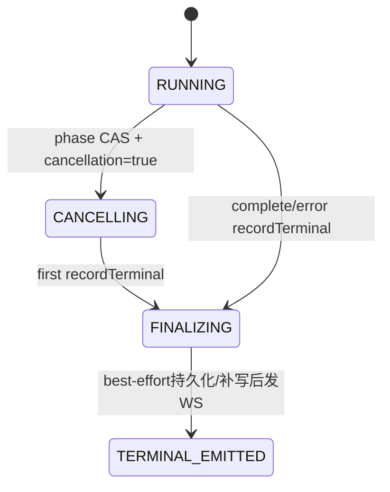
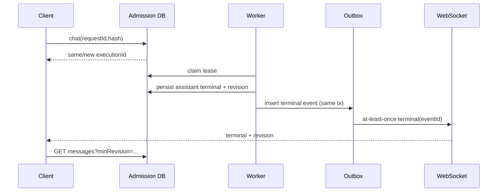
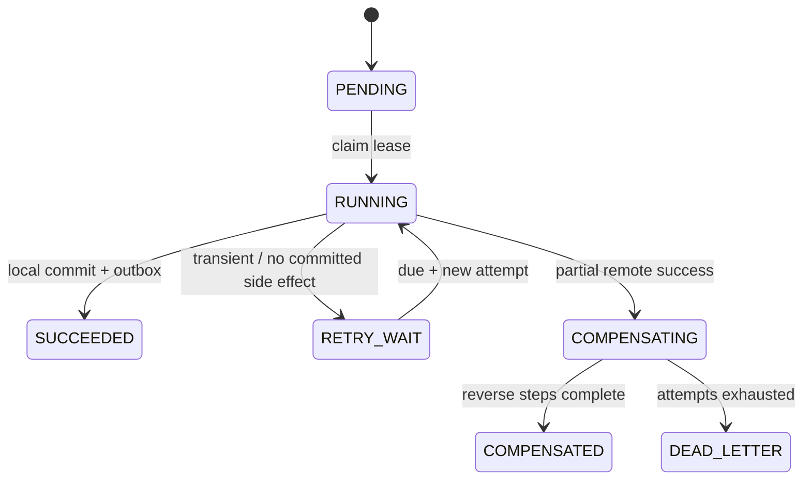
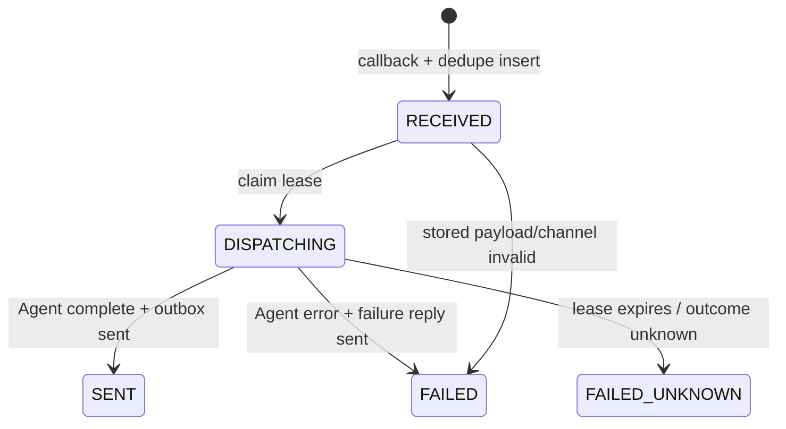
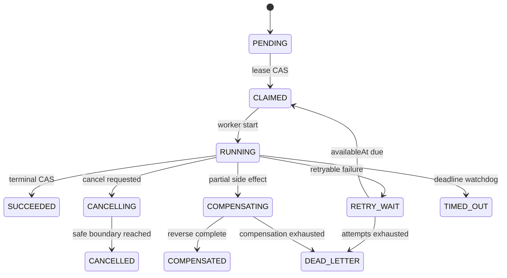
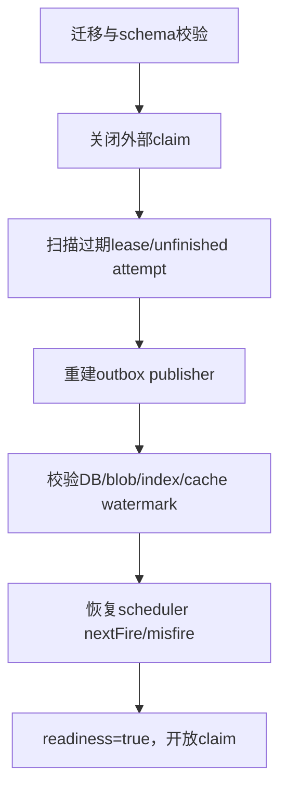

```
# 幂等、并发、超时、重试与恢复：横切一致性复刻设计

> 技术轴 T21。本章不是某个单一模块的实现说明，而是 Nova 各执行链的一致性语义审计与统一设计。读者无需访问原工程，即可据此实现聊天、LLM、工具、子代理、调度、记忆、Project Saga、MCP、知识、Artifact、分享和配置的故障安全版本。

## 0. 证据标记与结论边界

| 标记 | 含义 |
|---|---|
| **I（Implemented）** | 静态代码可确认的当前行为 |
| **A（Assumption）** | 为形成独立设计而明确采用的假设 |
| **K（Known issue）** | 当前缺口、竞态或保证强度限制 |
| **P（Planned）** | 结构/测试体现的演进意图，不能当成现状 |
| **REQ（Requirement）** | 等价复刻必须满足的要求 |
| **F（Fallback）** | 当前或推荐的失败降级路径 |
| **D（Design）** | 推荐的最小生产级统一设计 |

结论来自静态代码、迁移和三个测试工程的资产；本次没有启动服务、连接外部系统或执行测试。故“测试目录中存在用例”不表示当前分支已运行通过。

## 1. 先给结论：当前不是一套一致性模型

Nova 已经有不少正确的局部机制，但它们的强度不同：

- **I**：产品 `ChatService` 的 JVM `activeAgents` 以 conversationId 统一约束同步、流式和 WebSocket Agent run；WebSocket 另有 `conversationId -> RunningTask` gate 管传输生命周期。同步 Chat 还有 JVM 公平锁，但它不是唯一 admission。
- **I**：LLM 网络调用默认对 408、429、5xx 和无 HTTP status 的 `LlmCallException` 最多重试 3 次，指数退避并带 jitter；流式重试会先发 reset，避免把失败前缀和新 attempt 拼接。
- **I**：并行工具有 JVM 共享有界线程池、取消轮询和 `Future.cancel(true)`；但工具已经产生的外部副作用不会自动回滚，也没有通用 toolCall 幂等账本。
- **I**：Project Gateway 操作有请求幂等键、请求 hash、持久步骤、补偿和重试时间；但多节点 reconcile 没有 owner lease/heartbeat。
- **I**：Memory Review 有弱 CAS 锁和过期时间；User Task/Cron 主要是单节点本地调度；MCP 每 server 客户端串行；Knowledge 主要是 DB + 进程内快照。
- **I**：Share 创建以 selection hash 和数据库唯一索引去重；并发败者复用赢家并仅记录已复制引用、WARN，不在冲突路径删除字节，因此可能 orphan。
- **K**：这些机制不能合并理解成“平台已经 exactly-once”。聊天锁、MCP 锁、知识缓存、Memory lease、Saga retry 各自只覆盖局部进程或局部步骤。
- **D**：生产复刻应统一 `Request -> Execution -> Attempt -> Step -> Outbox`，以数据库唯一键、版本 CAS、owner lease、绝对 deadline、typed retry、补偿和 reconciliation 提供 at-least-once 执行 + 幂等副作用；不要宣称 exactly-once。

### 1.1 五个必须区分的概念

1. **请求去重**：同一个客户端动作只创建一个逻辑 execution。
2. **并发互斥**：同一资源同一时刻最多一个 owner 修改。
3. **attempt 重试**：一个 execution 可因瞬时失败执行多次。
4. **副作用幂等**：attempt 重做不会重复扣费、建资源、发消息或写结果。
5. **状态恢复**：进程崩溃后能判断谁拥有、执行到哪里以及下一步是什么。

唯一索引只解决第 1 项的一部分；`synchronized` 只解决单进程第 2 项；HTTP timeout 也不意味着第 4 项副作用没有发生。

## 2. 统一词汇与保证等级

### 2.1 对象层次

```text
Request
└── Execution（一次业务意图；幂等键稳定）
    ├── Attempt 1（worker-A + lease）
    │   ├── Step A
    │   └── Step B
    └── Attempt 2（worker-B 接管）
        ├── Step A（幂等复用）
        └── Step B
```

| 对象 | 必须稳定的身份 | 生命周期 |
|---|---|---|
| Request | tenant + actor + operation + idempotency key + request hash | API 重试窗口 |
| Execution | executionId/rootExecutionId | 业务意图完整历史 |
| Attempt | executionId + attemptNo + leaseToken | 一次 worker 所有权 |
| Step | executionId + semantic step key | 可恢复检查点/副作用 |
| Event | eventId + aggregateVersion | outbox/consumer 去重 |

### 2.2 可承诺的交付语义

| 表述 | 是否推荐 | 原因 |
|---|---|---|
| exactly once execution | 否 | 崩溃可能发生在外部副作用成功、DB ack 之前 |
| at most once | 只适合不可重试展示动作 | 丢失时不能恢复 |
| at least once + idempotent side effect | 是 | 可由 lease、retry、幂等键和 reconciliation 验证 |
| effectively once outcome | 是，但需定义边界 | 多 attempt 可存在，业务最终结果唯一 |

**REQ**：文档、API 和 UI 必须写明是“请求已接收”“取消已请求”“最终已取消”还是“副作用已补偿”，不可统一显示为 success。

## 3. 当前机制总览

| 子系统 | 幂等/唯一 | 并发控制 | Timeout/Retry | 恢复 | 当前保证边界 |
|---|---|---|---|---|---|
| Chat run | ChatService activeAgents；WS 另有 RunningTask | 单节点、conversationId 粒度一 run | cooperative cancel；LLM 自重试 | reconnect snapshot/seq；DB 历史 reload | key 不含 tenant/user；多节点可重复 |
| Chat turn | `turnIndex=max+1` | 主要依赖上层 run gate | pre-stream 持久化 best-effort | reload | max+1 非跨节点原子 |
| WS terminal | 内存 synchronized first-wins + phase CAS | RUNNING/CANCELLING/FINALIZING | DB terminal/补写 best-effort 后 emit | recently-completed TTL、前端 reload | DB 不是 terminal 决定者；无 durable event id |
| IM ingress/outbox | delivery dedupe unique；outbox per delivery unique | inbox/send lease；route 串行器 | send retry；expired Agent dispatch→UNKNOWN | RECEIVED 重扫、outbox 重领 | UNKNOWN 不重跑 Agent；channel 长连接 owner 非 durable lease |
| LLM | 同一 request 内 attempt | 每次同步调用 | 默认 3 retry，200ms×2，cap10s+jitter | 流式 reset | 无 provider-side request id guarantee |
| parallel tools | tool ordinal/call id 用于关联 | bounded JVM pool；不同 tool 并行 | cancel polling；工具自有 timeout | 填错误结果 | 无通用幂等/补偿 |
| SubAgent | runId/sandbox namespace | 同步子 run；深度 1 | 继承 LLM retry/round limit | 无 durable background | child cancellation 非统一 durable lineage |
| User Task/Cron | definition/execution id | 单节点 scheduler；count-then-insert quota | timeout/retry 字段未兑现 | node 启动标旧 active 失败 | 多节点重复、停机 misfire 丢失 |
| Memory Review | scope unique row | select + id/lock 弱 CAS，2m lock | 3 次，失败延迟，BLOCKED | 过期 lock 可重领 | 无 heartbeat；due/status 未二次 CAS |
| Project Saga | tenant+idempotencyKey+requestHash | 行锁/短事务 | 默认最多5，指数退避，补偿 | 周期 reconcile | 无 owner lease，多节点重复外调 |
| MCP | serverId snapshot | per-server connect lock；call 锁 client | init/request timeout；无统一 retry | reconnect 重建 cache | close-vs-call 不同锁；无 session 恢复 |
| Knowledge | DB row，scope name 软/DB unique | create JVM lock；快照替换 | 同步 CRUD，无 ingest job | 启动全量 load | DB/cache 非事务，多实例失效缺失 |
| Artifact | artifactId；少数 producer dedup 缺失 | DB unique/局部 scope | bridge 多为 fail-soft | cleanup/GC 局部 | 外部字节与 DB 非原子 |
| Share | active selection hash unique | unique conflict winner | 单附件 fail-soft | revoke cleanup retry/审计 | 冲突败者可能留下 orphan bytes |
| Config/cache | project `@Version` 等局部版本 | 行锁或 last-writer-wins 混合 | 通常 UI 重拉 | restart/reload | 没有统一 invalidation bus |

## 4. Chat：run、turn、取消和 terminal

### 4.1 请求进入和 run gate

WebSocket 收到 chat 后先注册 `PendingChat`，再提交虚拟线程。在 request 解析和真实 conversationId 建立前，pending cancellation signal 保证 Stop 不会落入“尚无 RunningTask”的窗口。真实 ID 确定后：

```java
existing = conversationTasks.putIfAbsent(conversationId, task);
if (existing != null) reject("already running");
```

**I**：这只是 WebSocket 额外的单 JVM transport gate。真正跨同步、流式和 WS Agent 调用共享的 admission 是产品 ChatService 的 `activeAgents.putIfAbsent(conversationId)`；WS 在调用它之前/之外维护 RunningTask，以支持 stop、heartbeat、订阅和 terminal emit。断开 WS 不取消任务；任务继续，用户可重连订阅或 reload。

**K**：

- 没有客户端 requestId/idempotency key；浏览器离线队列重放同一 chat 可能创建重复 turn。
- 两层 map 都不跨实例；负载均衡把同 conversation 发到不同节点时两个 run 都可进入。
- 两层权威 key 都只有 conversationId。读取/取消接口会额外核对 tenant/user，但 admission key 自身不编码身份；若 conversationId 的全局唯一或访问校验被破坏，存在跨身份互相阻塞/取消风险。
- 活动 registry 在进程崩溃时消失；DB status/heartbeat 与内存 run 并非完整 lease 所有权模型。

同步 REST Chat 使用按 conversationId 的 JVM 公平 `ReentrantLock`，并用 retain/release 回收 lock entry；但同步/stream/WS 最终还会共同注册 activeAgents。因此当前单节点不同入口的 Agent run 有共享互斥，不能描述成两条完全独立的锁链。**K**：公平锁覆盖范围与 activeAgents 生命周期不同，且二者均不能解决跨节点。

**D**：创建 durable `chat_execution`，以 `(tenant_id,conversation_id,active_slot)` 唯一约束或 lease row 原子占位；REST/WS 都调用同一 admission service。客户端每次发送生成 UUIDv7 requestId，服务端以 `(tenant,user,operation,requestId)` 去重并校验 requestHash。

### 4.2 turnIndex 与消息持久化

正常 Agent 存储以及 pre-stream error/cancel fallback 需要把 USER/ASSISTANT 绑定为同一 turn。fallback 当前计算：

```text
turnIndex = maxTurnIndex(conversation, tenant, user) + 1
append USER(turnIndex)
append ASSISTANT(turnIndex, ERROR|CANCELLED)
```

pre-stream 持久化失败会记录 WARN 并继续发送 live terminal，属于 best-effort。

- **K**：`max+1` 与两次 append 若没有跨节点锁/唯一约束，可出现重复 turnIndex、只有 USER 或只有 ASSISTANT。
- **K**：pre-stream fallback 和已经进入 Agent 的正常持久化必须靠 `agentStarted` 分支避免双写，仍是进程内判断。
- **D**：conversation row 保存 `next_turn_index`，用原子 `UPDATE ... SET next_turn_index=next_turn_index+1 RETURNING` 分配；一次事务插入 turn header 和初始 USER/ASSISTANT placeholder。唯一键 `(conversation_id,turn_index,role,attempt_no)`。

### 4.3 取消状态机



`CancellationSignal` 是单向 AtomicBoolean。取消不直接 interrupt JDBC-capable worker，Agent 在 LLM/工具/循环边界检查。若已经 FINALIZING，取消返回 accepted 但不改 recorded terminal，避免 DB 已 complete 而 WS 宣称 cancelled。

`recordTerminal` synchronized，内存中只有第一次生效；若之前 phase 为 CANCELLING，后来上报 complete/error 也被转换为 CANCELLED。没有 terminal 的异常退出被强制记 ERROR。**I/K**：这次 first-wins 是当前节点 RunningTask 的决定，不是数据库事务 CAS；随后消息持久化或 pre-stream terminal 补写是 best-effort，失败仍可能 emit live terminal。因此不能写成“DB terminal 已确定后才发 WS”。

**REQ**：取消 API 必须区分：

```json
{"state":"CANCEL_REQUESTED","executionId":"ce-1","acceptedAt":"..."}
```

与：

```json
{"state":"CANCELLED","executionId":"ce-1","terminalRevision":18}
```

### 4.4 WS seq、重连和 terminal 一致性

当前每个运行 collector 分配单调 seq，前端按 conversation lastSeq 丢弃旧/重复事件；snapshot 带 lastSeq，重连后从水位订阅。terminal 先本地收敛，再 REST 重载权威消息。

- **K**：seq 在内存 collector 中，进程重启不能继续；客户端遇到 gap 没有严格补洞。
- **K**：terminal frame 没有 durable eventId/outbox；DB commit 后节点在发送前崩溃，只能靠 completed discovery/reload。
- **D**：每次 chat execution 有 durable `event_seq`，重要状态事件与消息事务同写 outbox。token delta 可留 transient，但定期 checkpoint；terminal 必须带 `executionId,turnId,terminalRevision,eventId,lastSeq`。



## 5. LLM 调用：瞬时重试与语义重采样

### 5.1 网络 retry

默认策略：初次调用之外最多 3 次 retry；延迟为 `min(10s,200ms*2^(n-1)) + [0,25%] jitter`。408、429、5xx 和无 status 的 `LlmCallException` 可重试；其他 4xx 不重试。每次 call 前、call 后、backoff 后检查 cancellation；backoff 被 interrupt 转 CANCELLED。

流式 attempt 可能已经发出 token。重试前调用 `onRetryReset(nextAttempt,cause)`，传输层发 stream reset，前端清除失败前缀；成功 attempt 从干净可见状态开始。

**K**：

- provider 已经计费/生成但响应丢失时，重试会产生另一份完成；LLM API 通常没有业务 exactly-once。
- 总时长是“每 attempt provider timeout + 多次 backoff”，没有统一 turn absolute deadline 时可远超用户预期。
- hook/listener failure 有自己的 fail-soft 处理，不应改变 provider attempt 所有权。

### 5.2 不是网络 retry 的重采样

Tool loop 还会因以下语义问题再次调用 LLM：

| 原因 | 当前界限 | 是否同 attempt |
|---|---|---|
| 空 final text | 最多 2 次重采样 | 新 LLM call，业务同 round |
| tool protocol mismatch | 最多 1 次 | 新 LLM call |
| MAX_TOKENS continuation | 有界 continuation | 新 call，拼接答案 |
| context overflow recover | snapshot rollback/压缩后再试 | 新 call/loop round |
| stagnation recovery | detector 与 rollback budget | 新策略尝试 |
| OpenAI 图像不支持 | provider 内文本-only 再试一次 | 新 wire attempt |

**REQ**：指标必须分别记录 `transport_retry`、`semantic_resample`、`continuation`、`context_recovery`，否则成本和失败率不可解释。

### 5.3 统一 deadline 预算

```text
turnDeadline
├── admission + context preparation
├── LLM call attempt(s)
├── tool round(s)
├── user interaction wait
├── artifact/citation finalization
└── terminal persistence
```

每个下游 timeout 取 `min(componentConfiguredTimeout, remainingTurnBudget)`。deadline 是绝对时间而非每层重新开始计时。若剩余预算不足以完成最小安全 finalization，停止新工作并持久化 `TIMED_OUT/TRUNCATED`。

## 6. 并行工具与副作用

### 6.1 当前并行执行

并行工具共享 JVM 静态 pool：core=`CPU*2`、max=`CPU*8`、队列 500、空闲 60s；满载使用 CallerRunsPolicy，不丢任务而是由 Agent 线程同步执行。结果按 LLM 原始 dispatch 顺序放回数组，不按完成顺序；tool ordinal/dispatch seq 用于过程重建。

等待 Future 时短周期 poll，以便看到 cancellation。取消/interrupt 时取消未完成 future，并为未填槽生成错误 ToolResult。单工具路径在执行前后检查 cancellation。

### 6.2 当前边界

- **K**：Future cancel/interrupt 不保证 HTTP、数据库、shell、MCP 或外部 Gateway 停止。
- **K**：已完成工具的副作用不会因本轮另一个工具失败/取消而回滚。
- **K**：公共 runner 没有统一 per-tool absolute timeout；依赖各 Tool 自己的 HTTP/process timeout。
- **K**：并行执行两个互相冲突的副作用工具，仅靠 LLM 顺序无法保证串行。
- **K**：toolCallId 主要用于关联事件，并非所有工具的 producer idempotency key。

### 6.3 Tool 执行契约

```java
interface DurableTool {
  ToolPolicy policy(); // READ_ONLY | IDEMPOTENT_WRITE | COMPENSATABLE | NON_RETRYABLE
  ToolResult execute(ToolContext ctx, JsonNode args);
  CompensationResult compensate(ToolContext ctx, JsonNode committedResult);
}

record ToolContext(
  String tenantId,
  String conversationId,
  String executionId,
  String turnId,
  String toolCallId,
  int attemptNo,
  Instant deadline,
  CancellationToken cancellation
) {}
```

**D**：相同 `toolCallId + canonicalArgsHash` 返回既有结果；相同 ID 不同 hash 失败关闭。READ_ONLY 可按 retry policy 重试；IDEMPOTENT_WRITE 需下游支持 operation key；COMPENSATABLE 先写 step checkpoint；NON_RETRYABLE 在响应不确定时进入 `UNKNOWN_REQUIRES_RECONCILIATION`，不能盲重试。

并行调度器按 `resourceKey` 建冲突图：只读可并行，写同一 project/file/datasource 的 tool 串行；用户可配置的 `parallelSafe` 不能覆盖工具声明的最小约束。

## 7. SubAgent

当前 SubAgent 是同步嵌套运行，递归深度最大 1，并排除 `call_sub_agent` 避免递归；有独立 sandbox namespace、过滤后的工具和 runtime context，继承 LLM retry/loop round。Background profile 明确未启用，因为缺 durable task store。

**K**：SubAgentRunner 内部创建自己的 CancellationSignal；父工具 future 被取消或线程 interrupt，不等于有一条 durable parent→child cancel lineage。进程崩溃后没有 child attempt 可恢复；重复父 round 可能重新执行 child 工具副作用。

**D**：

```text
parentExecutionId
└── childExecutionId = deterministic(parentExecutionId, parentToolCallId)
    ├── parentLeaseToken snapshot
    ├── inherited deadline = min(parent deadline, child max)
    └── cancel lineage
```

父取消写 durable flag，child heartbeat 每次检查父状态。child 结果以 `childExecutionId` 幂等提交；父 attempt 重做先查询已有 child terminal。父 lease 丢失时 child 可继续到安全 checkpoint，但不得向旧父发布终态。

## 8. User Task、Memory 与 Background Job

### 8.1 User Task/Cron

当前 Cron 每节点加载定义、每秒匹配六字段表达式，进程内 lastTriggered 防同秒重复。execution pool 固定线程但队列无界；并发额度是 count-active 后 insert，不原子。timeout/retry 字段存在但主执行器未兑现；停机期间没有 nextFire/misfire 补跑；节点启动会把本 nodeId 遗留 active 标失败。

**K**：多副本重复触发；同 nodeId 配错会互相判失败；dispatcher 拒绝后 PENDING 可遗留。

### 8.2 Memory Review

唯一键 `(tenant,user,conversation)` 把新消息 debounce 到同一 row。claim 先查 due candidates，再 UPDATE `WHERE id AND lock absent/expired`；UPDATE 没重验 status、due time、version。2 分钟 lock 无 heartbeat；完成/失败只校验 RUNNING + lockedBy。默认失败延迟 5 分钟，最多 3 次后 BLOCKED。

**K**：新消息可清旧 worker 锁，旧 worker仍可能写画像；处理超过 2 分钟会重领；工具副作用即使旧 worker不能提交 job terminal也可能已生效。

### 8.3 统一升级

User Task、Memory、Context Compression、Evaluation、Ingestion 应共用 durable execution/attempt 表和 handler registry。差异只放 policy：

| Handler | overlap | deadline | retry | compensation |
|---|---|---|---|---|
| user-task | FORBID/ALLOW | definition timeout | transient only | 通常无，tool自行声明 |
| memory-review | COALESCE latest watermark | 2–5min | 3 | 画像 mutation 幂等 upsert |
| compression | COALESCE sealed-prefix hash | 短 deadline | 1–2 | fail-soft trim |
| evaluation | one run + question step | per question | selective | 保留已完成题 |
| ingestion | one source version | 长 job | per stage | staging 删除/active pointer 回滚 |

## 9. Project Gateway Saga

### 9.1 当前强项

操作表保存 `operationId, tenantId, idempotencyKey, requestHash, requestJson, state, step, previousScope, targetScope, retryCount, nextRetryAt, errors`。`(tenant,idempotencyKey)` 唯一；同 key 不同 request hash/operation type 冲突。外部 Gateway 不放数据库长事务，本地步骤短事务，失败尽力恢复 previous scope。reconcile 扫 FAILED/COMPENSATING/stale PENDING，默认最多 5 次、退避封顶 1 小时。

### 9.2 当前缺口

- **K**：多节点都扫描，行锁仅保护短事务，没有 owner lease/heartbeat；外调超过 stale 窗口可被另一节点重复。
- **K**：外部 add/remove/update 必须自身幂等，否则 compensation/retry 可能重复改资源。
- **K**：DB commit 后对其他子系统的通知主要靠 AFTER_COMMIT listener + 周期 reconcile，没有统一 outbox。
- **K**：Project 的 `@Version` 和 pessimistic lock 保护局部实体，不等于整个 Gateway operation 串行。

### 9.3 推荐 Saga 规则

每一步都存 `inputHash, remoteOperationKey, committedOutput, state, attempt`。调用 Gateway 时传 `operationId:stepKey`。补偿有独立 attempt/lease，而不是把 operation 从 COMPENSATING 直接改回 PENDING 混用。



## 10. MCP：连接锁、调用串行与恢复

当前每 serverId 有 connect/disconnect/reconnect `ReentrantLock`；连接完成后将不可变 snapshot 原子放入 ConcurrentHashMap。每个 server 对 `tools/call` 在同步 client 对象上 `synchronized`，所以同 server 串行、不同 server 可并行。这避免 STDIO stdin 并发写串帧。

timeout 语义并不直观：用户配置 1–300 秒；初始化用该值，但 JSON-RPC request 实际至少 120 秒；SSE probe 5 秒，read timeout 被视为流可达。Nova 不持久 MCP sessionId 或 resume token，重连会建新会话并重新 list tools。

- **K**：reconnect 用 server lock，call 用旧 client lock；close-vs-call 没有共同 fence。
- **K**：per-server 调用队列没有显式上限/tenant bulkhead/circuit breaker。
- **K**：tool catalog 缓存在 snapshot，server 自行变化不会被看到，需 reconnect/refresh。
- **K**：对有副作用的 remote tool 自动 retry 不安全，除非 MCP server 接受 toolCallId 幂等键。

**D**：连接 snapshot 带 generation。call 获取 `(generation,client,lease)`；reconnect 先发布 DRAINING，停止新 call，等待或截止旧 generation，再 swap。连接 owner 在多节点用 lease；catalog 用 digest/version 触发 capability invalidation。远端 Tool 契约包含 `idempotencyKey,deadline,tenantPrincipal`。

## 11. 企业 IM：inbox、Agent outcome 与发送 outbox

### 11.1 当前 delivery 状态和去重

平台 callback 规范化后先写 `im_message_delivery`，`dedupe_key` 有唯一索引；重复 webhook 返回已有 delivery，不再次调 Agent。新记录状态为 RECEIVED，claim 使用单条条件 UPDATE：只有 RECEIVED 能变 DISPATCHING，并写 processing owner、15 分钟 lease、attempt+1。相同 `channelId:externalUserId` 的本机任务还经串行执行器排序；会话 binding 对 `(channel_id,platform_user_id)` 唯一。



**I**：启动恢复只重扫 RECEIVED；过期 DISPATCHING 不重跑 Agent，而是写 delivery FAILED、`agent_run_state=UNKNOWN` 和 `IM_AGENT_OUTCOME_UNKNOWN`。这避免工具副作用已发生但节点在确认前崩溃时重复运行整个 Agent。

**K**：UNKNOWN 是安全隔离，不是业务完成；当前没有按 agentRunId 查询既有 terminal 后自动 reconcile 的通用能力。15 分钟 dispatch lease 也没有持续 heartbeat，长 Agent run 可能被误判 UNKNOWN。

### 11.2 Agent terminal 与发送 outbox

正常 Agent terminal 和一条 `im_outbox(PENDING)` 在同一数据库事务写入；失败也写 ERROR outcome + 用户可见失败回复 outbox。每个 delivery 至多一条 outbox 的唯一约束防止重复创建回复。发送 worker 每 2 秒批量 claim due row：PENDING 或 lease 已过期的 SENDING → SENDING，使用 2 分钟 send lease。

```text
inbox: RECEIVED -> DISPATCHING -> agent_run_state COMPLETED|ERROR|UNKNOWN
outbox: PENDING -> SENDING -> SENT
                     \-> PENDING(nextAttemptAt)
                     \-> FAILED(max attempts)
delivery after send: agent ERROR ? FAILED : SENT
```

**I**：平台发送失败只重试 outbox，不重跑 Agent；退避约为 5 秒指数增长、最高 300 秒，耗尽后 FAILED。成功发送后在同一事务把 outbox 标 SENT，并把 delivery 标 SENT 或 FAILED。

**K**：平台可能已经收消息但 HTTP ack 丢失，outbox 会重发；没有跨平台通用 idempotency key/远端 message lookup，因此仍是 at-least-once send。

**D**：为出站消息使用稳定 `clientMessageId=deliveryId:revision`，优先调用支持幂等键的平台；不支持时保存 platformMessageId 并提供查单/reconcile。Agent UNKNOWN 只允许按 runId/terminal message 查询，不允许直接重新 dispatch。

### 11.3 长连接与 channel owner

**I/K**：callback ingress 可多节点依赖 DB dedupe；长连接 channel 的本机 connector 生命周期和 channel 状态主要是进程内所有权，不能据此宣称集群单 owner。两个节点同时建立同一 channel 长连接可能产生重复事件，最终虽由 delivery dedupe 抑制 Agent 重跑，仍浪费连接和接收资源。

**D**：建立 `im_channel_owner(channel_id,owner_id,lease_token,lease_until,generation)`；CLAIM 后才 connect，每 lease/3 heartbeat。丢 lease 立即停止消费；事件写 inbox 时携带 generation 仅用于审计，dedupe 仍以平台 message identity 为准。callback、long connection、outbox sender 分别有独立 lease，不能共用一个“channel active”布尔值。

## 12. Knowledge、Artifact、Share 与配置缓存

### 12.1 Knowledge

当前同步 CRUD：DB 提交后更新进程内不可变 registry；搜索读快照。创建有 JVM createLock 和数据库唯一约束，更新无 If-Match/rowVersion 时最后写赢；多实例无 invalidation，DB 成功但 registry 更新失败会读旧数据。

**D**：knowledge document 带 `row_version/active_version/tombstone`；正文更新构建新 version，chunk/embed/index 写 staging，READY 后 CAS 切 active。DB 与 outbox 同事务；indexer 以 `(knowledgeId,version,eventType)` 去重。删除先 tombstone 使权限读取立即 404，再异步清 blob/vector/index/cache。

### 12.2 Artifact

Artifact 可能来自 Directory publisher、产品 Bridge、文件上传或分享快照。当前局部有 unique artifactId、同轮已有 IDs 差集和 filename 认领，但缺统一 producer idempotency key。字节存储与 DB metadata 失败时多为补删/best-effort cleanup；崩溃可产生 orphan 或 dangling row。

**D**：`producer_key=(tenant,runId,toolCallId,ordinal,payloadHash)` unique。字节先写 staging 并实测 hash/size，DB 插 PENDING+outbox，promoter 幂等移动到 immutable key，再 CAS READY。删除先 TOMBSTONED，outbox 异步删 bytes，GC/reconciler 比对 DB 与 object listing。

### 12.3 Share

当前以 `(tenant,user,activeSelectionHash)` 的条件唯一索引去重 active share。并发 insert 败者捕获 unique conflict 并读取赢家；对败者已经复制的 snapshot refs 仅记录 WARN，不在冲突路径删除字节，因此这些 bytes 会成为待回收 orphan。单附件失败可用占位继续，其余快照成功；撤销后 viewer 410，字节删除失败留审计 ref 重试。

**D**：先抢 selection build lease 或把所有复制写入 `shareBuildId` staging namespace；只有赢家 promote。token 只存 hash；revoke、conversation delete cascade 与 byte cleanup 用 outbox，consumer 以 shareId+revision 幂等。

### 12.4 配置与 cache invalidation

Project entity 有 JPA `@Version/config_version`，工具/MCP/skill 变更会 bump，使下一 turn 重解析能力。其他设置存在 last-writer-wins、UI 保存后重拉、provider cache 和进程内 registry；draft provider cache 按 key/baseUrl/model 等组合缓存且当前缺统一 bound/eviction。

**K**：一个模块 bump version 不代表所有派生 cache 已失效；多实例没有共同 watermark 时可出现“设置成功但某节点继续用旧 provider/tool/knowledge”。

**D**：所有配置聚合有 `aggregateVersion`。写事务产生 `config.changed.v1` outbox；缓存条目 key 包含 tenant/scope/id/version，消费者只接受比当前大的版本。事件丢失时每实例轮询全局 watermark；安全敏感撤权使用 DB authoritative check 或短 TTL fail-closed，不等待异步 cache。

## 13. 风险矩阵

| 风险 | 触发窗口 | 当前可能结果 | 生产控制 |
|---|---|---|---|
| 浏览器 chat 重发 | WS 未 ack/重连 flush | 重复 turn/重复成本 | requestId+hash unique |
| 双节点同 conversation | JVM gate 不共享 | 两个 Agent 并发写 max+1 | durable active slot/lease |
| terminal DB commit 后 WS 崩 | 无 outbox | UI 长时间 RUNNING | terminal outbox+revision reload |
| LLM 流中断 | 已显示 partial | 重试前缀重复 | reset attempt+attemptId |
| LLM 响应丢失 | provider 已计费 | 再生成一份 | 接受多 attempt，业务只提交赢家 |
| parallel tool cancel | 下游已执行 | UI cancelled但副作用存在 | step ledger+reconcile/compensate |
| lease 过期旧 worker返回 | 新 worker已接管 | 双终态/覆盖 | lease token+version CAS |
| Memory新消息重置锁 | 旧 review在跑 | 旧/新画像交错 | watermark/version/lease |
| Cron双节点 | 每节点本地 handle | 重复 execution | `(definition,scheduledAt)` unique |
| Saga stale 重领 | 外调慢于 stale | 重复远端 mutation | heartbeat+remote operation key |
| MCP reconnect与call | 旧 client正在用 | close中调用失败/未知 | generation drain fence |
| IM Agent lease过期 | Agent可能已有工具副作用 | UNKNOWN；不自动重跑 | run terminal query/reconcile |
| IM send ack丢失 | 平台已收回复 | outbox重发、用户见重复 | stable clientMessageId/查单 |
| IM 长连接双 owner | 两节点同时 connect | 重复 ingress/资源浪费 | channel owner lease+generation |
| Knowledge DB/cache gap | commit后cache update失败 | 旧搜索/已删仍可见 | outbox+version+tombstone |
| Artifact DB/blob gap | 任一侧先成功 | dangling/orphan | staging state machine+GC |
| Share dedup race | copy bytes后unique冲突 | orphan snapshot bytes | build lease/staging winner promote |
| Config多实例旧缓存 | 无 invalidation | 权限/模型不一致 | versioned event+authoritative gate |
| timeout只停止等待 | 下游继续执行 | 后到结果覆盖/副作用 | deadline+late CAS+reconcile |

## 14. 统一状态模型



终态：`SUCCEEDED,CANCELLED,COMPENSATED,TIMED_OUT,DEAD_LETTER`。`FAILED` 可作为不可重试普通终态，但不能掩盖“外部可能成功”的 UNKNOWN；后者进入 reconciliation/compensation。

## 15. 最小统一 DDL

以下为 PostgreSQL 设计；H2 必须维护独立 migration 和并发 SQL，不能只替换 JSON/时间类型后宣称等价。

```sql
CREATE TABLE operation_request (
  id varchar(64) PRIMARY KEY,
  tenant_id varchar(64) NOT NULL,
  actor_id varchar(64) NOT NULL,
  operation varchar(128) NOT NULL,
  idempotency_key varchar(256) NOT NULL,
  canonical_version varchar(32) NOT NULL,
  request_content_type varchar(128) NOT NULL,
  request_hash char(64) NOT NULL,
  execution_id varchar(64) NOT NULL,
  response_snapshot jsonb,
  expires_at timestamptz,
  created_at timestamptz NOT NULL,
  UNIQUE(tenant_id, actor_id, operation, idempotency_key)
);

CREATE TABLE durable_execution (
  id varchar(64) PRIMARY KEY,
  tenant_id varchar(64) NOT NULL,
  owner_id varchar(64),
  handler varchar(128) NOT NULL,
  resource_key varchar(256),
  root_execution_id varchar(64),
  parent_execution_id varchar(64),
  retry_of_execution_id varchar(64),
  status varchar(32) NOT NULL,
  payload jsonb NOT NULL,
  result jsonb,
  available_at timestamptz NOT NULL,
  deadline_at timestamptz,
  cancel_requested_at timestamptz,
  attempt_count integer NOT NULL DEFAULT 0,
  max_attempts integer NOT NULL DEFAULT 1,
  version bigint NOT NULL DEFAULT 0,
  error_code varchar(128),
  error_message text,
  created_at timestamptz NOT NULL,
  started_at timestamptz,
  finished_at timestamptz
);
CREATE INDEX idx_execution_due
  ON durable_execution(status,available_at,handler,created_at);

CREATE TABLE active_resource_slot (
  tenant_id varchar(64) NOT NULL,
  resource_key varchar(256) NOT NULL,
  execution_id varchar(64) NOT NULL UNIQUE REFERENCES durable_execution(id),
  acquired_at timestamptz NOT NULL,
  PRIMARY KEY(tenant_id,resource_key)
);
-- 终态事务只能删除自己仍拥有的 slot：
-- DELETE FROM active_resource_slot
-- WHERE tenant_id=? AND resource_key=? AND execution_id=?;

CREATE TABLE execution_attempt (
  id varchar(64) PRIMARY KEY,
  execution_id varchar(64) NOT NULL REFERENCES durable_execution(id),
  attempt_no integer NOT NULL,
  worker_id varchar(128) NOT NULL,
  lease_token varchar(128) NOT NULL UNIQUE,
  lease_expires_at timestamptz NOT NULL,
  heartbeat_at timestamptz NOT NULL,
  status varchar(32) NOT NULL,
  started_at timestamptz NOT NULL,
  finished_at timestamptz,
  error_code varchar(128),
  error_message text,
  UNIQUE(execution_id,attempt_no)
);

CREATE TABLE execution_step (
  id varchar(64) PRIMARY KEY,
  execution_id varchar(64) NOT NULL REFERENCES durable_execution(id),
  step_key varchar(192) NOT NULL,
  input_hash char(64) NOT NULL,
  state varchar(32) NOT NULL,
  external_operation_key varchar(256),
  checkpoint jsonb,
  committed_result jsonb,
  version bigint NOT NULL DEFAULT 0,
  UNIQUE(execution_id,step_key),
  UNIQUE(execution_id,external_operation_key)
);

CREATE TABLE transactional_outbox (
  id varchar(64) PRIMARY KEY,
  tenant_id varchar(64) NOT NULL,
  aggregate_type varchar(64) NOT NULL,
  aggregate_id varchar(64) NOT NULL,
  aggregate_version bigint NOT NULL,
  event_type varchar(128) NOT NULL,
  payload jsonb NOT NULL,
  status varchar(24) NOT NULL DEFAULT 'PENDING',
  available_at timestamptz NOT NULL,
  attempt_count integer NOT NULL DEFAULT 0,
  max_attempts integer NOT NULL DEFAULT 20,
  claim_token varchar(128),
  claim_expires_at timestamptz,
  published_at timestamptz,
  last_error text,
  created_at timestamptz NOT NULL,
  UNIQUE(aggregate_type,aggregate_id,aggregate_version,event_type)
);
```

敏感 payload 不存 API key、Cookie 或 bearer；worker 用 tenant/owner/scope 重新解析短期凭据。

## 16. 关键算法

### 16.1 API admission

```text
admit(tenant,actor,operation,key,request):
  canonical = canonicalJsonV1(request, contentType)
  hash = SHA256(canonical)
  begin tx
    existing = SELECT request by unique tuple FOR UPDATE
    if existing:
      if existing.expiresAt <= now:
        if old execution is non-terminal: return 409 KEY_EXPIRED_BUT_OPERATION_ACTIVE
        DELETE expired request row by id+expiresAt; continue insertion
      if existing.requestHash != hash: return 409 IDEMPOTENCY_CONFLICT
      return existing.executionId + responseSnapshot
    execution = INSERT PENDING
    INSERT request(key,hash,executionId)
    if overlap=FORBID:
      INSERT active_resource_slot; if conflict -> rollback/OVERLAP
  commit
  return 202 execution
```

客户端 key 有明确 TTL，但 execution/history 不随 dedup row 立即删除。服务端不接受空 key 的高风险 mutation；只读 GET 不需要 key。

**REQ**：未过期的相同 key + 相同 hash 复用原 execution/response；相同 key + 不同 hash 返回 409。到期只代表 dedupe 承诺窗口结束，不代表旧 operation 可安全重复：旧 execution 仍非终态时拒绝复用。旧 execution 已终态才允许条件删除到期 request row，再插入同 key 的新 request。并发清理必须 `DELETE ... WHERE id=? AND expires_at<=?`，插入遇 unique conflict 后重读，不可先无条件删再写。

后台清理按 `expires_at < now - safetyLag` 分页、`FOR UPDATE SKIP LOCKED` 删除 operation_request；不级联删 execution、attempt、step 或审计。若 responseSnapshot 受法规要求需更短保留，可先置 null，dedupe row 保留到 TTL。

#### 16.1.1 canonical JSON v1

Hash 输入必须版本化，建议前缀：

```text
nova-idempotency-json-v1\napplication/json\n<canonical-json-utf8>
```

规则必须同时由客户端 SDK、服务端与测试 fixture 固定：

1. object key 按 Unicode code point 升序；递归应用；
2. array 保持原顺序，绝不排序；
3. number 使用无指数最短十进制、去无意义尾零，`-0` 归一为 `0`；拒绝 NaN/Infinity；
4. string 先验证合法 Unicode，采用 NFC；JSON escape 只做规范要求的引号、反斜杠和控制字符，不能把可见非 ASCII 任意改成 `\uXXXX` 后形成另一个 hash；
5. 显式 null 是否等于缺失字段不能猜。先由 API schema 做 default expansion：只对声明“缺失等同默认”的字段补默认；其余保留“缺失”和 `null` 的差异；
6. 时间字段按 schema 解析为 instant 后输出 UTC RFC3339，固定微秒精度，例如 `2026-08-13T02:31:00.123456Z`；普通字符串即使长得像时间也不转换；
7. Content-Type 去参数并小写；`application/json; charset=UTF-8` 归一为 `application/json`。不同语义 media type 不共享 hash；
8. canonicalizer 版本是 hash domain 的一部分。升级为 v2 时旧 request row 仍按其 canonical_version 比较，不能原地重算。

示例：

```json
{"b":1.0,"a":"é","items":[2,1],"optional":null,"at":"2026-08-13T10:31:00+08:00"}
```

在 schema 声明 `at` 为 instant、`optional` 保留 null 后规范为：

```json
{"a":"é","at":"2026-08-13T02:31:00.000000Z","b":1,"items":[2,1],"optional":null}
```

DDL 应额外保存 `canonical_version varchar(32) NOT NULL` 和 `request_content_type varchar(128) NOT NULL`，避免未来无法解释历史 request_hash。

### 16.2 claim、heartbeat 与 late result

```sql
WITH c AS (
  SELECT id FROM durable_execution
  WHERE status IN ('PENDING','RETRY_WAIT')
    AND available_at<=now()
    AND attempt_count<max_attempts
    AND (deadline_at IS NULL OR deadline_at>now())
  ORDER BY available_at,created_at
  FOR UPDATE SKIP LOCKED LIMIT :n
)
UPDATE durable_execution e
SET status='CLAIMED',attempt_count=attempt_count+1,version=version+1
FROM c WHERE e.id=c.id
RETURNING e.*;
```

同事务插 status=CLAIMED 的 attempt 和随机 leaseToken。claim 只是“已分配”，worker 真正开始执行前还必须做第二次双 CAS：attempt `CLAIMED→RUNNING` 校验 token/未过期，execution `CLAIMED→RUNNING` 校验 execution version；两者和 started_at 在同一短事务提交。CAS 失败不得调用 handler。

```sql
UPDATE execution_attempt
SET status='RUNNING', started_at=now()
WHERE id=:attemptId AND status='CLAIMED'
  AND lease_token=:token AND lease_expires_at>now();

UPDATE durable_execution
SET status='RUNNING', started_at=COALESCE(started_at,now()), version=version+1
WHERE id=:executionId AND status='CLAIMED' AND version=:claimedVersion;
```

**K/D**：进程可能在 claim commit 后、worker start 前崩溃。sweeper 必须扫描 lease 过期的 CLAIMED attempt，以 token/version CAS 将 execution 转 RETRY_WAIT 或 DEAD_LETTER，并关闭 attempt 为 LEASE_EXPIRED；否则 execution 永久卡 CLAIMED。每 `leaseDuration/3` 心跳：

```sql
UPDATE execution_attempt
SET heartbeat_at=now(),lease_expires_at=:newExpiry
WHERE id=:attemptId AND lease_token=:token
  AND status='RUNNING' AND lease_expires_at>now();
```

终态更新必须同时验证 execution status/version 和 attempt token/expiry。影响 0 行即 lease 已丢；晚结果只能进入审计，不得写业务结果、outbox 或 cache。

`active_resource_slot` 的生命周期由 overlap policy 决定。默认 FORBID_OVERLAP 下，PENDING、CLAIMED、RUNNING、RETRY_WAIT、CANCELLING 都持槽，只有终态事务用 `execution_id` owner 条件删除；retry 不释放，避免 backoff 期间另一个 execution 越过。若业务选择 RELEASE_DURING_RETRY，必须显式记录 policy，并接受新 execution 抢占后旧 retry 无法继续。orphan reconciler 删除“slot 指向终态 execution”的行，修复“非终态 execution 缺 slot”时不得盲补：先按 resource/version 判断是否已有新 owner，冲突则把孤儿 execution 隔离为 BLOCKED。

### 16.3 retry/backoff

```text
delay = min(maxDelay, base * factor^(attemptNo-1)) + random(0,jitter)
```

claim 时 attempt_count 已加一，失败路径不能再加。若 `attempt_count < max_attempts` 写 RETRY_WAIT+availableAt；否则 DEAD_LETTER。取消不消耗 retry；人为 retry 创建新 execution 并记录 retry lineage，旧终态不改。

### 16.4 deadline 与 watchdog

claim 过滤 deadline 不能处理已经过期的 PENDING，也不能停止 RUNNING。至少三个 sweeper：

1. PENDING/RETRY_WAIT deadline 到期：CAS `TIMED_OUT` + terminal outbox；
2. CLAIMED lease 到期：处理 claim-before-start 崩溃，关闭 attempt 并 retry/dead-letter；
3. RUNNING deadline 到期：写 cancel_requested，给 grace；仍未停则关闭 attempt 为 TIMED_OUT/LEASE_EXPIRED，旧 worker晚返回被 CAS 拒绝。

外部调用使用 `remaining = deadline-now`；socket timeout 不大于 remaining。若调用不可中断，状态先隔离为 UNKNOWN，后续 reconcile 查询远端 operation key。

### 16.5 Outbox

publisher claim due row并写随机 token/expiry；成功 CAS PUBLISHED；失败递增 attempt、退避或 DEAD_LETTER。崩溃后 claim expiry 可接管。消费者建立 processed-event ledger，应用 `(aggregateId,aggregateVersion)` 单调更新；重复 event ack，无序旧 event 忽略，版本 gap 触发权威 reload。

### 16.6 Compensation

compensation 只针对已记录 committedResult 的步骤，按逆序执行。每个 compensation step 有独立 attempt/lease/idempotency key `executionId:compensate:stepKey`。补偿失败不回到普通 FAILED，而是 COMPENSATING retry 或 DEAD_LETTER 告警。

## 17. 统一 API 契约

```http
POST /api/operations/{operation}
Idempotency-Key: 0198...
X-Request-Deadline: 2026-08-13T10:31:00Z

GET  /api/executions/{id}
POST /api/executions/{id}:cancel
POST /api/executions/{id}:retry
GET  /api/executions/{id}/attempts
GET  /api/executions/{id}/events?afterSeq=
```

```json
{
  "executionId":"exec-01",
  "rootExecutionId":"exec-01",
  "status":"RETRY_WAIT",
  "attemptCount":2,
  "maxAttempts":4,
  "availableAt":"2026-08-13T10:30:12Z",
  "deadlineAt":"2026-08-13T10:35:00Z",
  "cancelRequestedAt":null,
  "version":8,
  "error":{"code":"UPSTREAM_503","retryable":true},
  "links":{"events":"/api/executions/exec-01/events"}
}
```

409 幂等冲突必须返回原 requestHash fingerprint 和新 fingerprint 的安全摘要，不返回请求正文。取消终态 execution 返回当前状态；retry 请求也必须带新 Idempotency-Key。

## 18. Retry 分类表

| 失败 | 默认 | 理由 |
|---|---|---|
| connect/reset/read timeout | retry | 未确认下游结果时，写操作需 operation key |
| HTTP 408/429 | retry + Retry-After | 限次并 jitter |
| HTTP 500/502/503/504 | retry | circuit breaker/bulkhead |
| 400/schema | permanent | 改参数才能成功 |
| 401/403 | permanent | 刷凭据可另建特例，禁止热循环 |
| 404 | 读通常 permanent | eventual create 后 read 可短期 retry |
| DB deadlock/serialization | whole tx retry | callback 必须幂等 |
| DB unique idempotency conflict | read winner | hash 不同则 409 |
| cancellation | no retry | 按安全边界收敛/补偿 |
| deadline | no automatic retry | 用户/调度策略明确新 execution |
| parse/protocol mismatch | 有界 semantic resample | 不和网络 retry 混计 |
| permission denied CAN/MCP | permanent | 提示 stop retrying |
| external side effect unknown | reconcile | 先查 operation key，不盲重做 |

所有 retry policy 均需 `maxAttempts,maxElapsed,base,maxDelay,jitter,retryableCodes`，不能只有次数。

## 19. Cache invalidation 与 read consistency

### 19.1 三种读一致性

1. **权限/撤权读**：DB authoritative 或极短 TTL，fail closed；
2. **会话 terminal 读**：按 revision read-your-write；
3. **目录/描述缓存**：eventual consistency，可 outbox + watermark。

cache key 必须包含 tenant、scope、aggregate ID 和 version。负缓存也有版本/短 TTL。写成功响应返回 `aggregateVersion`，客户端后续读取可传 `If-None-Match` 或 `minVersion`。

```text
event(version=12) -> cache currently 10: reload/apply
event(version=10) -> ignore duplicate/old
event(version=14) -> gap detected; authoritative reload
```

**REQ**：撤销 Project member/MCP/knowledge/artifact grant 后，Agent 下一次实际执行工具必须重新验证；只从旧 prompt/registry 看到工具不构成授权。

## 20. 恢复与 reconciliation

### 20.1 启动顺序



### 20.2 Reconciler 清单

- chat：DB active execution 无有效 lease；terminal message 无 terminal event；turn role 不完整；
- IM：RECEIVED backlog、过期 DISPATCHING/UNKNOWN 与 Agent terminal、SENDING 过期 lease、outbox/delivery terminal 不一致、channel owner 过期；
- tasks/memory：due 但 attempts 耗尽、过期 lease、BLOCKED backlog；
- saga：remote operation 与 local step 不一致；COMPENSATING 超时；
- MCP：definition enabled 但无连接 owner；catalog digest 与 capability projection 不同；
- knowledge：DB activeVersion、blob、lexical/vector index 和 cache watermark；
- artifact/share：metadata dangling、object orphan、tombstone 未清、share revoke 未完成；
- config：outbox max version 与各实例 consumer watermark。

repair 必须 dry-run 输出差异，再用 repairId 幂等执行。人工“强制成功/跳过/重放”都写审计。

### 20.3 灾备

数据库、object/local files、索引和密钥需同一恢复点或有重建计划。恢复后先冻结 worker，验证 schema、key、dangling/orphan 和 outbox offset，再开放写。只恢复 DB 不恢复 artifact bytes 会产生合法 metadata 指向空内容；只恢复 bytes 会产生不可归属数据。

## 21. 可观测性

### 21.1 指标

```text
operation_dedup_total{operation,outcome=same|conflict}
execution_admission_total{handler,outcome}
execution_queue_depth{handler,status,tenantBucket}
execution_attempt_total{handler,outcome,errorCode}
execution_retry_total{handler,reason}
execution_lease_lost_total{handler,worker}
execution_deadline_total{handler,phase}
execution_cancel_latency_seconds{handler}
tool_side_effect_unknown_total{tool}
outbox_lag_seconds{eventType}
outbox_dead_letter_total{eventType}
im_delivery_unknown_total{platform,channel}
im_outbox_retry_total{platform,status}
im_channel_owner_conflict_total{platform}
cache_version_gap_total{aggregateType}
reconciliation_diff_total{resourceType,kind}
compensation_total{handler,step,outcome}
```

LLM 单独记录 providerAttempt、transportRetry、semanticResample、resetCount、tokens/cost。不要把 cancelled 计为 provider error。

### 21.2 Trace 和日志

统一字段：`requestId,executionId,rootExecutionId,parentExecutionId,attemptId,attemptNo,leaseTokenHash,stepKey,toolCallId,tenantIdHash,conversationId,turnId,eventId,aggregateVersion,deadline,workerId,traceId`。

日志不写 prompt 全文、Tool 完整结果、API key、MCP auth、share token、用户画像或文件内容。lease token 只写 hash 前缀。

### 21.3 告警

- lease lost 持续非零；
- queue age/pending deadline 增长；
- DEAD_LETTER/COMPENSATING 超 SLA；
- outbox lag 或 claim 过期；
- chat terminal message/event mismatch；
- cache version gap/knowledge index lag；
- artifact dangling/orphan 增长；
- 同一 tool operation key 产生不同 result hash。

## 22. 故障注入矩阵

| 编号 | 注入点 | 操作 | 预期 |
|---|---|---|---|
| FI-01 | API response 丢失 | request commit 后断连接 | 同 key重试返回同 execution |
| FI-02 | key reuse | 同 key改 payload | 409，不覆盖旧执行 |
| FI-03 | chat 双节点 | 同时发同 conversation | 只有一个 active slot，另一个 409/attach |
| FI-04 | turn 分配后崩溃 | USER 前 kill | placeholder 可恢复，不复用 turnIndex |
| FI-05 | terminal commit 后崩溃 | outbox publish 前 kill | 重启后补发同 eventId |
| FI-06 | WS 乱序/重复/gap | 重排 seq | 重复忽略，gap触发 snapshot |
| FI-07 | LLM partial 后 503 | 首 attempt 发 token 后失败 | reset 后只显示成功 attempt |
| FI-08 | LLM backoff cancel | sleep 中 Stop | 立即 CANCELLED，无下一 call |
| FI-09 | parallel tool cancel | 一个成功一个阻塞 | 已成功 step可审计，阻塞取消，按 policy补偿/未知 |
| FI-10 | worker kill | 外部调用成功后 DB ack 前 | lease接管；用 operation key查既有结果 |
| FI-11 | old worker late return | 新 attempt 已成功 | 旧 CAS 0 行，不发事件 |
| FI-12 | Memory 超2分钟 | 停 heartbeat | 新 owner接管；旧画像写由step key去重 |
| FI-13 | Cron双实例 | 同 scheduledAt poll | unique execution，FORBID slot原子 |
| FI-14 | Saga补偿失败 | Gateway restore 503 | COMPENSATING retry，耗尽 dead-letter |
| FI-15 | MCP reconnect race | 慢 call 中更新 server | old generation drain/timeout，无跨client串帧 |
| FI-16 | Knowledge cache update失败 | DB commit 后抛异常 | outbox修复，多实例达到version |
| FI-17 | Artifact promote失败 | PENDING DB 已提交 | retry/GC，无 READY dangling |
| FI-18 | Share dedup race | 20并发相同选择 | 1 active share，无败者永久 bytes |
| FI-19 | Outbox broker down | terminal事务成功 | backlog可见，恢复后至少一次+消费去重 |
| FI-20 | deadline race | handler在deadline后返回成功 | late success CAS拒绝，按UNKNOWN reconcile |
| FI-21 | cache撤权延迟 | revoke后打旧节点 | 执行点权威鉴权拒绝 |
| FI-22 | DB/文件不同恢复点 | 模拟PITR差异 | reconciler列出dangling/orphan，未静默丢失 |

## 23. 分阶段复刻

1. **身份统一**：所有 mutation 接 requestId/hash；建立 execution/attempt/event ID 词汇。
2. **聊天收敛**：跨节点 active slot、原子 turn 分配、terminal revision/outbox、seq gap recovery。
3. **worker 基础设施**：claim/lease/heartbeat/deadline/retry/dead-letter、bounded pool。
4. **Tool 副作用**：policy、step ledger、operation key、UNKNOWN/reconcile/compensation。
5. **任务迁移**：User Task、Memory、Evaluation、Compression、Ingestion 接统一 worker。
6. **跨域一致性**：Project/MCP/Knowledge/Artifact/Share outbox 与 versioned cache。
7. **运维恢复**：reconciler、dry-run repair、灾备演练、故障注入门禁。

迁移期同一 Cron/chat resource 不能由 legacy/unified 两套 owner 同时生产。用 resource owner flag 一次事务切换，unique slot 作为最后防线。

## 24. 验收标准

### 24.1 当前行为等价

- WS 单实例同 conversation 并发被拒绝，pending window 可取消，断开不取消后台任务；
- terminal 第一次决定生效，FINALIZING 后取消不篡改 DB 已确定结果；
- LLM 408/429/5xx 按默认策略重试，4xx 鉴权不重试，stream retry 发 reset；
- 并行工具保持 LLM dispatch 顺序，取消未完成 future，不把异常泄漏为无终态；
- SubAgent 深度最多 1，background 明确不可用；
- Memory debounce、过期锁重领、三次后 BLOCKED；
- Project 相同幂等键同请求复用，不同 hash 冲突；
- MCP 同 server call 串行、不同 server 可并行，reconnect 更新 snapshot；
- Knowledge DB 与 registry 的现有同步 CRUD、Share selection dedup、Artifact fail-soft 边界按文档表现。

### 24.2 最小生产验收

1. 所有高风险 mutation 必须提供 request idempotency key，hash 冲突 409；
2. chat/cron/resource overlap 以数据库 unique/slot 原子执行，双节点压测不重复；
3. 每个 durable attempt 有不可预测 lease token、heartbeat 和 late CAS；
4. retry 同时受次数和总 elapsed/deadline 约束，错误分类可审计；
5. cancel request 与 terminal 分开，在途/不可中断副作用可见；
6. Tool 外部写有 operation key 或明确 NON_RETRYABLE/UNKNOWN 策略；
7. terminal/config/knowledge/artifact/share 跨事务事件用 outbox，consumer 去重；
8. cache 有 aggregate version、gap reload，权限撤销执行点 fail closed；
9. compensation 有独立 attempt/lease，耗尽 dead-letter；
10. sweeper 能处理 due耗尽、过期lease、deadline、slot遗留和outbox claim；
11. DB/blob/index/cache 灾备后有一致性报告与幂等 repair；
12. FI-01 至 FI-22 在 PostgreSQL 多实例环境达到预期。

## 25. 证据追溯附录

仅供仍可访问原仓库时审计，不作为理解前提：

- Chat admission/cancel/terminal/WS seq：产品 WebSocket handler、Chat service、conversation facade/store；
- LLM retry/tool parallel/subagent：NovaCore LLM caller、retry policy、tool loop、subagent runtime；
- User Task/Memory/Project：任务插件、memory-profile job store、Project operation/orchestrator；
- MCP：server manager、tool adapter、transport、server service/store；
- Knowledge/Artifact/Share/config：产品 facade/registry、artifact bridge/store、share service/snapshot、project config version与 provider cache；
- 失败协议验证：`nova_auto_test` 的 WS/cancel/reconnect/files/settings case；
- 浏览器恢复验证：`nova_ui_e2e` 的 stop/chat stability/artifact/share/settings/security specs；
- 单元与并发验证：各模块 JUnit 与 `web` Vitest。

复刻实现者应以正文的身份层次、状态机、DDL、算法、风险矩阵、故障注入和验收标准为准，而不是依赖上述源码路径。

```
