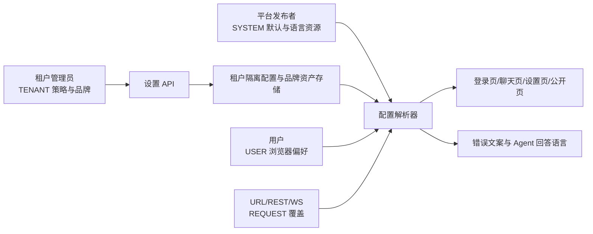
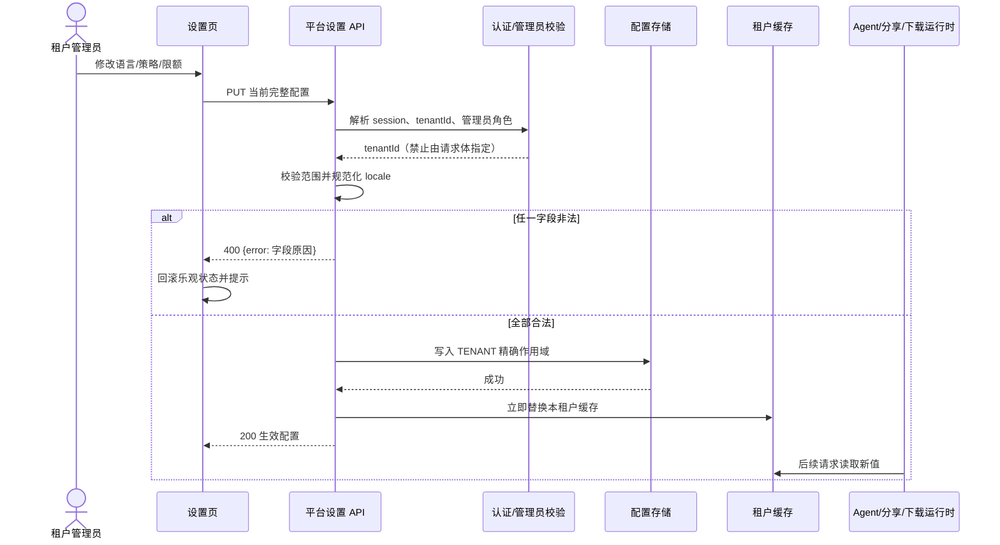
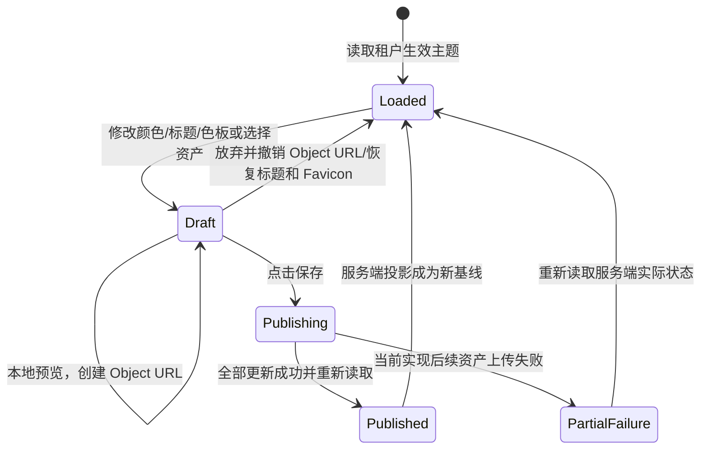
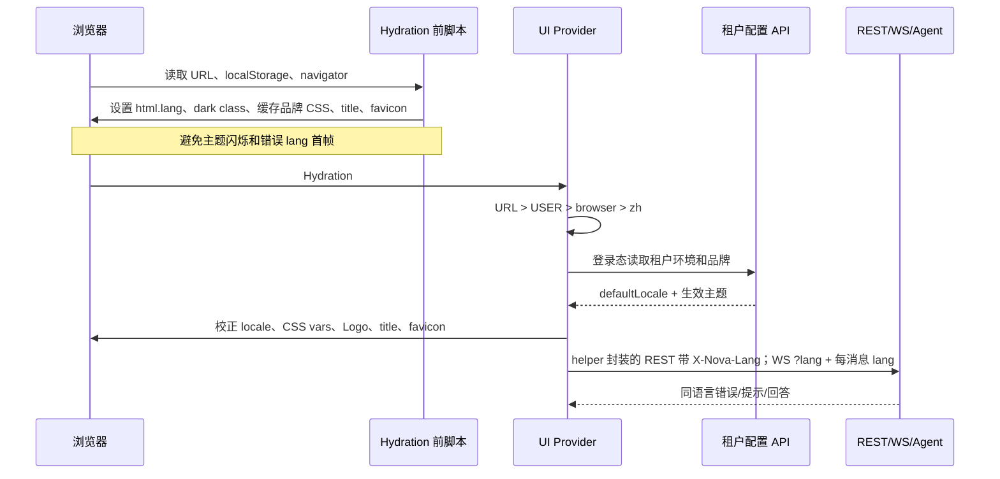
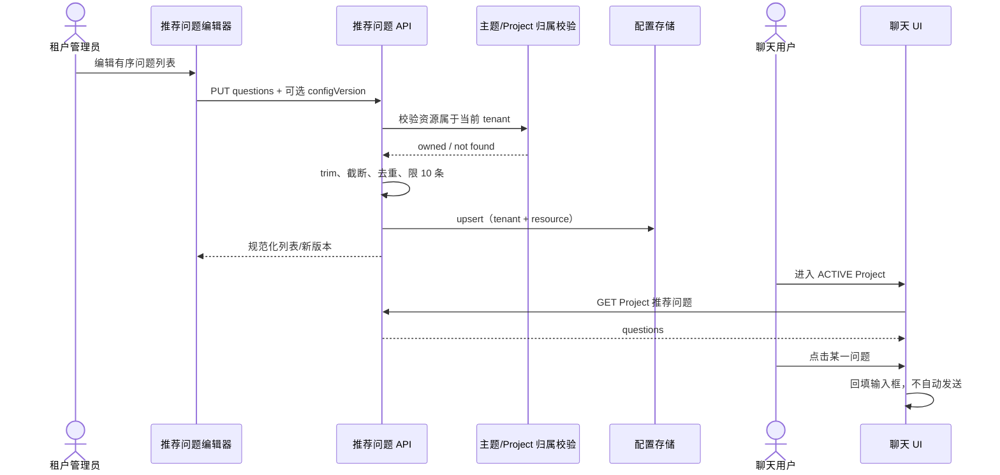

```
# 平台设置、主题品牌、国际化与无障碍复刻说明

> 本文是一份可脱离 Nova 源码独立使用的产品与实现规格。它同时描述当前可静态确认的行为、黑盒测试契约、已知缺陷，以及在新 Agent 工程中应采用的生产级设计。本次未启动服务、未运行 API、WebSocket、浏览器或 Axe 测试，因此全文没有 `R`（运行验证）结论。

## 1. 结论与边界

### 1.1 该能力解决什么问题

平台设置模块让同一套 Agent 产品可以按租户控制产品策略、品牌外观和默认语言，并让最终用户在浏览器中选择自己的语言和明暗模式。它还规定固定文案、语义化视觉 token、键盘访问、可访问名称和颜色对比度，使管理页、聊天页和公开页面保持一致、可识别、可操作。

这一能力面向四类角色：

| 角色 | 能力 |
|---|---|
| 平台发布者 | 提供全局默认值、中文和英文资源、设计 token、默认 Logo/Favicon/产品名 |
| 租户管理员 | 修改本租户分享/下载策略、默认语言、Agent 限额、品牌主色、图表色板、Logo、浏览器标题和推荐问题；这是产品目标权限 |
| 租户普通用户 | 读取本租户生效配置，在自己浏览器选择语言和明暗模式。当前主题控制器没有管理员校验，因此任意已认证的同租户用户均可读写主题；“普通用户修改返回 403”只是待实现目标 |
| 匿名分享访问者 | 查看公开快照；只能获得快照明确携带的公开策略，不能访问租户设置接口 |

### 1.2 输入、输出和最终效果

主要输入包括：租户身份和管理员身份、平台设置 JSON、主题 JSON、Logo/Favicon 文件、推荐问题数组、URL 中的 `lang`/`theme` 参数、浏览器语言和浏览器本地偏好。

主要输出包括：

- 租户级平台策略及 Agent 限额；
- 可在首屏绘制前应用的品牌 CSS 变量和明暗模式；
- 亮色 Logo、暗色 Logo、Favicon、浏览器标签标题和八色图表色板；
- `zh`/`en` 两套 UI 文案、正确的 `<html lang>`，以及 WS/Agent 与已迁移至统一 fetch helper 的 REST 请求语言；
- 按 Project 或数据主题展示的有序推荐问题；
- 键盘可达、具有可访问名称的页面；“无 critical/serious Axe 违规”是生产目标，当前存在已登记缺陷。

### 1.3 明确边界

本文包含平台设置、白标品牌、主题模式、国际化传递、推荐问题展示规范、语义视觉系统和基础无障碍。模型 Provider、分享业务、Project、数据主题、聊天协议的完整生命周期分别属于其他模块；本文只描述它们与平台设置的连接契约。

“主题”在本文特指 UI/品牌主题，不是“数据主题”。推荐问题可能挂在 Project 或数据主题上，但它不是品牌配置的一部分。

### 1.4 当前实现与推荐目标的差异

| 主题 | 当前静态实现 | 生产级复刻目标 |
|---|---|---|
| 配置层级 | 平台策略和品牌主要是 TENANT；语言与明暗模式的 USER 层仅存浏览器；代码提供全局默认 | 建立明确的 SYSTEM → TENANT → USER → REQUEST 合并模型，并为每字段声明是否允许覆盖 |
| 品牌接口权限 | 主题接口要求登录并从认证上下文取租户；控制器无管理员注解，所以当前任意已认证的同租户用户都可读、改、重置和上传/删除资产 | 所有租户品牌写接口强制管理员权限；读取接口按页面需要区分登录态与公开快照 |
| 品牌色校验 | UI 校验 hex；服务端会原样接受非法 `primaryColor` | 服务端执行同等或更严格的颜色、对比度和长度校验，非法请求原子拒绝 |
| 保存原子性 | UI 依次保存 JSON、Logo、暗色 Logo、Favicon，后续失败会形成部分成功 | 使用版本化草稿 + 一次发布，或返回逐项结果并允许安全补偿 |
| 语言优先级 | URL > 浏览器手动选择 > 浏览器语言 > 租户默认仅作最后兜底 > 中文 | 明确定义且测试每一层；是否让租户默认压过浏览器语言须由产品决策，不得含糊 |
| 公开页品牌 | 根布局会尝试加载登录态主题接口；匿名请求失败后使用本地缓存或默认品牌；分享快照只明确携带下载策略 | 公开快照携带不可变的品牌投影，或提供 token 限定的公开品牌接口，避免品牌泄漏/错租户 |
| 无障碍 | 具有基础语义与 Axe 测试；聊天页、模型页仍有 serious 对比度缺陷；设置按钮键盘循环有缺陷 | WCAG 2.1 AA：critical/serious 为零，核心路径全键盘可用，焦点可见且不丢失 |
| 推荐问题隔离 | 服务按 `(tenantId, themeId)` 查询，但没有先校验 `themeId` 属于当前租户；已知跨租户读取缺陷 | 读取和写入前执行资源归属校验，外租户对象统一返回 404 或 403 |

## 2. 术语与参与方

| 术语 | 定义 |
|---|---|
| SYSTEM | 产品部署级默认配置，不绑定租户；当前很多默认值直接固化在代码/静态资源中 |
| TENANT | 租户共享配置，影响该租户所有用户 |
| USER | 用户个人偏好；当前语言和明暗模式主要保存在浏览器 localStorage，而非服务端用户配置 |
| REQUEST | URL 参数或单次 REST/WS 请求携带的语言/主题覆盖，不持久化 |
| 品牌主色 | 管理员输入的单个 hex 色，系统据此生成完整品牌色阶和交互语义色 |
| 主题模式 | `light`、`dark` 或 `system`，只决定明暗映射，不等于租户品牌主色 |
| 推荐问题 | 管理员配置的有序问题模板，点击后回填聊天输入框，不应自动提交 |
| 生效配置 | 多层配置合并、校验并补齐默认值后的只读投影 |
| 语义 token | 以用途命名的颜色、排版、间距、圆角变量，例如 `text-primary`、`action-primary` |



## 3. 业务规则

### 3.1 平台策略

1. 无租户配置时，分享与下载默认开启，默认 UI 语言为 `zh`。
2. `maxHistoryTurns=null` 表示使用部署默认值；小于等于 0 表示不限制历史轮数；正数最大为 100。
3. `maxToolRounds=null` 表示使用部署默认值；非空时范围为 1 到 200。
4. 当前租户更新不得影响第二租户；读写都必须从认证上下文取得租户 ID，不能接受请求体中的租户 ID。
5. 更新限额校验失败时，所有字段保持原值，响应为 400 且错误体指出字段名。
6. 管理 UI 可乐观显示开关，但写失败必须恢复原值并显示用户可定位错误。
7. 当前读取使用 30 秒、最多 10,000 租户的进程内缓存；写成功立即刷新本节点缓存。

### 3.2 品牌与主题

1. 默认主色为 `#ff7d00`，默认浏览器标题为 `Aloudata Agent`，默认图表色板模式为 `default`。
2. 主色只影响品牌强调层：主动作、焦点、链接、品牌边框和强选中态；导航、菜单、列表和面板的结构选中态仍使用稳定的 Warm Neutral。
3. 亮色 Logo、暗色 Logo、Favicon 每租户每种资产最多一份。暗色 Logo 缺失时，UI 可回退到亮色 Logo，再回退到内置默认 Logo。
4. Logo 最大 5 MiB，允许 PNG/JPEG/GIF/SVG/WebP；Favicon 最大 1 MiB，允许 PNG/JPEG/SVG/WebP/ICO。文件为空、超限或格式不支持时返回 400。
5. 仅依赖客户端上报的 MIME 类型不足以防御伪造。生产实现必须检测文件魔数，对 SVG 进行安全清洗，拒绝脚本、外部引用和危险数据 URI。
6. 浏览器标题去首尾空白，空值回退默认值，最长 40 个字符。推荐按 Unicode code point/grapheme 截断，避免切断代理对或组合字符。
7. 当前图表色板处理是宽松兼容：非 `preset/custom` 的 mode 回退 `default`；`custom` 会丢弃非法色、只取前 8 个，最终少于 8 个则存 null；重复色不会被拒绝；`preset` ID 仅 trim，不校验是否属于预设集。生产目标才是 mode 枚举严格校验、preset ID 白名单，以及 custom 恰好 8 个合法且不重复的 hex 色；预设可包括 `business`、`soft`、`high-contrast`。
8. 三种主题资产对所有租户使用相同 URL，例如 `/api/settings/theme/logo`；服务端依据当前认证上下文选择租户内容。当前响应仅设 `Cache-Control: max-age=3600`，没有 `private`、`no-store` 或 `Vary`，共享缓存可能用同一 URL 向其他租户返回已缓存资产。生产必须使用 `private/no-store`，或使用包含租户与版本的不可猜测签名 URL。
9. 删除单个资产只恢复该资产默认值；“恢复默认”应同时恢复主色、标题、色板和全部品牌资产。
10. 设置页的“恢复默认”当前先修改前端草稿，必须再次点击保存才真正持久化；生产 UI 应明确文案，避免用户误认为已经提交。

### 3.3 国际化

1. 内部只支持 `zh` 和 `en`。任意以 `zh` 开头的 BCP-47 标签归一为 `zh`，任意以 `en` 开头的标签归一为 `en`，未知或空值回退 `zh`。
2. 当前浏览器初始语言优先级为：URL `lang` > 手动保存的用户偏好 > `navigator.language` > 硬默认 `zh`。只有前三者都无法识别时，异步读取租户默认语言并替换硬默认，且不把它写成用户手动偏好。
3. 当前该优先级意味着：英语浏览器进入默认中文租户时仍显示英语。复刻者不得把“租户默认”误读为强制语言。
4. 用户手动选择语言后写入 `nova.locale`，刷新和导航保持；URL `lang` 只覆盖当前 URL，不应覆盖手动偏好。
5. `<html lang>` 必须与生效 UI 语言同步：中文为 `zh-CN`，英文为 `en`。
6. 当前只能对通过 `jsonFetch` / `voidFetch` / `rawFetch` 的 REST 请求结构性保证 `X-Nova-Lang: zh|en`。仍有裸 `fetch` 站点，包括 save-artifact、Artifact open/reveal、部分 Knowledge 和外部下载/预览链路，不能声称“所有 REST”已覆盖。WebSocket 握手带 `?lang=`，每条 chat 消息也带 `lang`，消息字段是回答语言的权威来源。
7. 后端错误、停止提示、截断提示和 Agent 回答语言使用同一请求 locale。缺失翻译 key 时返回 key 本身，以便测试暴露资源缺口。
8. 固定 UI 文案中文优先、英文兼容。英文按钮、菜单、提示默认 sentence case；AI、API、MCP、LLM、SQL、JSON、WebSocket 等缩写保持官方大小写。
9. 新增翻译 key 必须同时添加中英文资源，并保证占位符集合一致。用户生成内容、文件名、模型名、租户名不得被自动翻译或改大小写。

### 3.4 SYSTEM/TENANT/USER/REQUEST 优先级矩阵

当前产品不是所有字段都走同一套继承算法。下表是准确复刻所需的字段级规则：

| 字段 | SYSTEM | TENANT | USER | REQUEST | 当前生效顺序 |
|---|---|---|---|---|---|
| 分享/下载 | 代码默认 `true` | 可覆盖 | 不允许 | 不允许 | TENANT > SYSTEM |
| Agent 限额 | 部署配置 | 可覆盖 | 不允许 | 不允许 | TENANT > SYSTEM |
| 默认语言 | 硬默认 `zh` | 可配置 | 浏览器手动偏好 | URL/每请求 `lang` | REQUEST > USER > 浏览器语言 > TENANT（仅最后兜底）> SYSTEM |
| 品牌主色/Logo/标题/图表色板 | 静态默认 | 可覆盖 | 不允许 | 不允许 | TENANT > SYSTEM |
| 明暗模式 | 默认 `light` | 当前无 | 浏览器 `light|dark|system` | URL `theme=light|dark` | REQUEST > USER > SYSTEM |
| 推荐问题 | 空列表 | 数据主题或 Project 配置 | 不允许 | 嵌入 URL 可提供移动端问题列表 | REQUEST > Project；数据主题配置主要用于管理/兼容链路 |

生产级配置解析器应把该矩阵声明为数据，而不是在多个组件里各写一套条件：

```text
FieldPolicy {
  key,
  allowedScopes: Set<SYSTEM|TENANT|USER|REQUEST>,
  precedence: ordered scopes,
  defaultValue,
  validator,
  publicExposure: NONE|SNAPSHOT|PUBLIC_READ
}
```

### 3.5 推荐问题

1. 原始数组依次执行：去除 null、trim、删除空字符串、单条截断到 200 字符、按首次出现顺序去重、截取前 10 条。
2. 空数组是合法值，表示不展示推荐问题，不表示继承旧值。
3. 主题级配置以 `(tenantId, dataThemeId)` 唯一；Project 级配置还应携带配置版本，写冲突返回 409。
4. 前端聊天主链路优先读取当前 ACTIVE Project 的问题；URL 携带的嵌入问题优先；未选 Project、Project 非 ACTIVE、加载失败均返回空列表。
5. 欢迎态和输入框工具栏必须共用同一问题源。点击问题只回填输入框并关闭菜单，由用户确认后发送。
6. 读取和写入前必须确认主题或 Project 属于当前租户。不能仅依赖查询条件中的 `tenantId`，否则使用外租户资源 ID 会被误当作一个新/空配置。

### 3.6 语义视觉与无障碍

1. 业务组件只消费 semantic token，不直接使用 primitive palette；稳定规则进入共享组件默认值。
2. 颜色分为 `bg-*`、`text-*`、`border-*`、`action-*`、`status-*`、`data-*`；状态色只表达真实 success/warning/error/info。
3. 文本与背景常规对比度至少 4.5:1；主色上的大/图标内容至少要通过产品设定的对比阈值，生产实现建议统一按 WCAG AA 计算。
4. 自定义品牌主色应生成完整 `brand-0..950` 色阶；前景色根据对比度选择白色或深色。当前实现以输入色与白色/深前景线性混合生成色阶。
5. 中文正文和说明保持舒展行高；产品 UI 主体 14px，聊天输入和正文 16px；12px 仅用于 meta/caption/badge/table header。
6. 英文长文本不得依赖固定宽高；按钮和 Tab 通常不换行，列表标题可截断且提供上下文，说明文字允许换行。
7. 交互元素使用语义 HTML 和稳定角色；只有图标的按钮必须有非空 `aria-label`；表单错误使用 `aria-invalid` 并关联错误描述。
8. 页面标题、区域标题保持 h1/h2/h3 层级；导航使用 `nav` 和可访问名称。
9. 所有核心动作可通过 Tab/Shift+Tab 到达，Enter/Space 激活；弹层关闭后焦点回到触发器；焦点环使用 `border-focus`/`control-focus-ring`，不能只改变颜色且难以察觉。
10. 移动端触控命中区域至少 44px，安全区不能遮挡底部输入区。

### 3.7 各产品表面的展示责任

| 表面 | 当前应展示/消费的内容 | 当前边界与复刻要求 |
|---|---|---|
| 登录页 | Nova 只返回/跳转外部认证地址 | 当前没有证据证明外部登录页消费租户 Logo、产品名或主色。若要求白标登录，必须与身份平台定义独立品牌同步契约，不能假设 Nova CSS 会影响外部页面 |
| 登录后应用外壳 | 亮/暗 Logo、主色、明暗模式、产品文案、locale | 租户切换后必须清除上一租户的权威品牌状态，再加载新租户；本地缓存只能用于首屏临时绘制 |
| 聊天页 | Logo、语义 token、推荐问题、locale、分享/下载开关 | 推荐问题取当前 ACTIVE Project；WS/每消息 locale 有明确契约，REST 只对统一 fetch helper 覆盖的请求保证语言 Header |
| 设置页 | 平台策略、品牌草稿/预览、语言化字段和错误提示 | 管理入口只对管理员可见，服务端仍必须再次授权；保存失败不得把草稿当成已生效配置 |
| 匿名分享页 | 产品名、可公开的品牌投影、locale、快照下载开关 | 当前匿名页不能认证读取主题配置。生产实现必须从分享快照或 token 限定品牌端点获取所属租户品牌，不能使用访问者浏览器残留品牌 |
| 嵌入页 | URL `lang`、URL `theme`、可选 URL 推荐问题、嵌入应用绑定的租户/Project | REQUEST 覆盖只作用当前嵌入 URL；嵌入密钥/配置决定资源边界，不能由查询参数伪造租户 |

## 4. 完整执行链路

### 4.1 管理员修改平台配置



当前多键 ConfigStore 写入不是本文证据能证明的数据库事务。生产实现应在一个事务中写完整聚合，或使用单条版本化 JSON，避免部分键成功。

### 4.2 管理员预览并发布品牌



当前 UI 保存顺序是：主题 JSON → 亮色 Logo → 暗色 Logo → Favicon → 重新读取。生产级做法：

1. 创建 `theme_draft`，上传资产到临时对象键；
2. 服务端验证颜色、标题、色板、图片魔数、SVG；
3. 使用 `If-Match`/版本号发布；
4. 单事务切换主题版本和资产引用；
5. 提交后发送缓存失效事件；
6. 异步清理未发布对象。

### 4.3 首屏主题和语言初始化



匿名分享页不能依赖认证主题 API。生产方案应把 `publicBrandProjection` 固化进分享快照：`productName`、资源的签名公开 URL、主色/安全 token 子集、快照时的 locale 和下载策略。撤销分享后这些 URL 也应失效。

### 4.4 推荐问题管理和展示



## 5. 对外契约

### 5.1 通用约定

- `/api/settings/**` 使用 cookie/session 认证，租户 ID 只能来自服务端认证上下文。
- 平台和管理端推荐问题接口有租户管理员边界。当前主题 GET/PUT/reset/资产增删读控制器没有管理员注解，任意已认证的同租户用户都能调用。生产实现应将主题写入限定为管理员，并为普通用户提供独立的“生效主题只读投影”。
- JSON 请求使用 UTF-8 和 `Content-Type: application/json`；图片上传使用 `multipart/form-data`。
- `jsonFetch` / `voidFetch` / `rawFetch` 统一携带 `X-Nova-Lang: zh|en`；裸 `fetch` 不在当前结构保证内。认证失败返回 401，已实现管理员边界的接口在权限不足时返回 403，资源不属于租户建议返回 404 以降低枚举风险。
- 错误体最小形式为 `{"error":"reason"}`。生产建议扩展为稳定的 `errorCode`、本地化 `message`、`fieldErrors`、`requestId`。

### 5.2 平台设置

#### GET `/api/settings/platform`

返回本租户配置：

```json
{
  "allowShare": true,
  "allowDownload": true,
  "defaultLocale": "zh",
  "maxHistoryTurns": null,
  "maxToolRounds": null,
  "fiscalCalendarName": null
}
```

| 字段 | 类型 | 必填 | 语义 |
|---|---|---:|---|
| `allowShare` | boolean | 是 | 是否允许创建/访问公开分享 |
| `allowDownload` | boolean | 是 | 是否允许下载文件和 Artifact |
| `defaultLocale` | string | 是 | `zh` 或 `en`；当前服务对任意非空值缺少白名单校验，复刻时应拒绝其他值 |
| `maxHistoryTurns` | integer/null | 是 | null=系统默认，<=0=不限，1..100=最多历史轮数 |
| `maxToolRounds` | integer/null | 是 | null=系统默认，1..200=工具循环上限 |
| `fiscalCalendarName` | string/null | 是 | 财务日历名；空白规范化为 null |

#### PUT `/api/settings/platform`

请求体与响应体同上。两个 boolean 在当前 Java DTO 中是原始类型，字段缺失会被解析为 `false`，因此客户端必须提交完整对象。生产实现应使用 nullable DTO + 显式必填校验，避免缺字段意外关闭能力。

非法示例：

```http
HTTP/1.1 400 Bad Request
Content-Type: application/json

{"error":"maxToolRounds must be between 1 and 200, got 201"}
```

#### GET `/api/settings/platform/fiscal-calendars`

返回外部指标平台可用的财务日历：

```json
{
  "calendars": [
    {
      "name": "retail_445",
      "displayName": "Retail 4-4-5",
      "granularities": ["fiscal_year", "fiscal_month", "fiscal_week"]
    }
  ]
}
```

加载失败不阻止其他平台设置使用；UI 显示失败状态和重试。若已保存的日历不再出现在列表中，仍保留当前值并标记“不可用”，不能静默清空。

### 5.3 主题配置

#### GET `/api/settings/theme`

```json
{
  "primaryColor": "#ff7d00",
  "logoUrl": "/api/settings/theme/logo?v=2026-08-13T10:20:30",
  "darkLogoUrl": null,
  "faviconUrl": "/api/settings/theme/favicon?v=2026-08-13T10:20:30",
  "browserTabTitle": "Acme Copilot",
  "chartPaletteMode": "custom",
  "chartPalettePresetId": null,
  "chartPaletteColors": [
    "#2563eb", "#16a34a", "#f59e0b", "#7c3aed",
    "#dc2626", "#0891b2", "#db2777", "#64748b"
  ],
  "logoStatus": "active",
  "darkLogoStatus": "default",
  "faviconStatus": "active"
}
```

资产状态：

- `default`：未配置，使用内置资产；
- `active`：持久资产或仍可读的历史文件存在；
- `unavailable`：历史路径存在但文件丢失，URL 为 null，设置页应警告管理员修复。

#### PUT `/api/settings/theme`

当前是部分更新接口，只处理存在且类型正确的字段：

```json
{
  "primaryColor": "#2e6bdc",
  "browserTabTitle": "Acme Copilot",
  "chartPaletteMode": "preset",
  "chartPalettePresetId": "business",
  "chartPaletteColors": null
}
```

当前与生产目标必须分开：

| 字段 | `I` 当前实现 | `K` 已知缺陷 | `D` 生产复刻契约 |
|---|---|---|---|
| `primaryColor` | 存在且类型为 string 时原样保存 | 非法值如 `not-a-color` 被 HTTP 200 接受 | 仅允许 `^#([0-9a-fA-F]{3}|[0-9a-fA-F]{6})$`，规范成六位小写，再检查可用性和对比度；失败原子拒绝 |
| `browserTabTitle` | trim；空字符串恢复默认；按 Java UTF-16 长度截到 40 | 无本主题 known failure | 按 grapheme/code point 处理 1..40 个用户可感知字符 |
| `chartPaletteMode` | trim/lowercase 后只保留 `preset/custom`，其他值回退 `default` 并清空 preset/colors | 无已登记 known failure | 严格接受 `default/preset/custom`，非法值返回 400 |
| `chartPalettePresetId` | mode=preset 时只 trim，空串转 null；未校验预设合法性 | 无已登记 known failure | mode=preset 时必须是受支持的预设 ID；其他模式必须为空 |
| `chartPaletteColors` | mode=custom 时丢弃非法色，限前 8 个；最终恰好 8 个才序列化，否则为 null；重复色可保存 | 无已登记 known failure | mode=custom 时请求必须恰好 8 个合法、规范化后不重复的 hex；不得静默丢弃或截断 |

只有非法主色已被黑盒用例登记为 `K`。mode/preset/colors 的宽松处理是 `I`，严格拒绝规则是 `D`，不得将后者写成当前已有保证。

#### 资产接口

| 方法 | 路径 | 请求/响应 |
|---|---|---|
| POST | `/api/settings/theme/logo` | multipart 字段 `file`；返回完整主题 DTO |
| GET | `/api/settings/theme/logo` | 原始二进制；`Content-Type`、inline filename、`Cache-Control: max-age=3600`；租户内容由认证上下文解析，URL 本身不含租户 |
| DELETE | `/api/settings/theme/logo` | 删除亮色 Logo，返回完整主题 DTO |
| POST/GET/DELETE | `/api/settings/theme/logo/dark` | 暗色 Logo，同上 |
| POST/GET/DELETE | `/api/settings/theme/favicon` | Favicon，同上，大小上限不同 |
| POST | `/api/settings/theme/reset` | 清除三种资产并恢复主色、标题、图表色板；返回完整主题 DTO |

当前应用层会验证身份并按其 tenantId 取资产，但响应没有 `private`、`no-store` 或租户化 `Vary`；认证代理/CDN 若共享缓存，可能绕过应用层的租户解析而串用响应。生产版本应使用 `Cache-Control: private`/`no-store`，或使用包含 tenant/version 且不可猜测的签名对象 URL；不要用无租户键的共享 CDN 路径。

### 5.4 普通用户启动投影

管理员读取 `/api/settings/platform`；普通用户不应因此获得管理员设置接口权限。当前应用通过已有的用户环境接口，把少量公开运行时字段合并进身份平台返回值：

```http
GET /api/user/env
```

```json
{
  "authUrl": "https://identity.example/login",
  "gatewayUrl": "https://metrics.example",
  "allowShare": true,
  "allowDownload": true,
  "defaultLocale": "zh"
}
```

对端身份平台的其他字段保持透传；Nova 只追加自己的公开字段。生产实现建议拆成结构稳定的 `GET /api/runtime-config`，只返回当前用户有权消费的生效投影，并明确禁止返回 Agent 限额、内部存储路径、管理员审计数据和任何密钥。

### 5.5 推荐问题

#### 管理端主题级接口

```http
GET /api/settings/recommended-questions/{themeId}
PUT /api/settings/recommended-questions/{themeId}
```

请求与响应：

```json
{
  "questions": [
    "本月销售额同比变化如何？",
    "哪些区域贡献了主要增长？"
  ]
}
```

`PUT` 是整组覆盖，不是追加。响应返回规范化后的最终数组。跨租户资源必须返回 403 或 404；当前黑盒用例记录了跨租户读取返回 200 的已知缺陷。

#### 用户态接口

```http
GET /api/data-themes/{themeId}/recommended-questions
GET /api/projects/{projectId}/recommended-questions
PUT /api/projects/{projectId}/recommended-questions
```

Project 写入推荐使用乐观并发：

```json
{
  "configVersion": 7,
  "questions": ["问题一", "问题二"]
}
```

成功返回新 `configVersion`；版本冲突返回：

```json
{
  "errorCode": "PROJECT_VERSION_CONFLICT",
  "message": "Project configuration has changed; reload and retry"
}
```

### 5.6 Locale 的 REST、WebSocket 和前端契约

REST 统一 helper 契约：

```http
X-Nova-Lang: en
```

`jsonFetch`、`voidFetch` 和 `rawFetch` 会在一个共享函数中注入该 Header，且调用方显式 Header 可覆盖默认值。这是当前唯一结构性保证。仍直接使用裸 `fetch` 的 save-artifact、Artifact open/reveal、部分 Knowledge 导入/导出以及外部文件下载/预览请求可能缺失 `X-Nova-Lang`。复刻时应用 lint/静态扫描禁止新裸 `fetch`，并逐一迁移现有站点；跨域外部下载还应考虑 CORS 与避免向第三方泄露产品自定义 Header。

WebSocket：

```text
wss://agent.example/ws/chat?lang=en
```

每条聊天消息必须再次携带：

```json
{
  "type": "chat",
  "conversationId": "conv_123",
  "message": "Explain this metric",
  "lang": "en"
}
```

语言在用户切换后的下一条消息立即生效，不要求断开 WebSocket。后端把归一化语言写入请求上下文，用于系统语言指令、错误格式化和持久化错误消息。

### 5.7 缓存与并发契约

当前设置 API 没有 ETag 或配置版本。黑盒测试为防止覆盖他人修改，会执行“读取原值 → 写入前再次读取 → 只在仍等于预期时写 → 恢复前再次比对”。这是测试端保护，不是服务端并发保证。

生产 API 应返回：

```json
{
  "version": 12,
  "updatedAt": "2026-08-13T10:20:30Z",
  "updatedBy": "user_42",
  "settings": { "...": "..." }
}
```

写入携带 `If-Match: "12"` 或 body.version；不匹配返回 409，不得覆盖。多节点缓存通过 `tenant-settings.changed` 事件按 `(tenantId, domain, version)` 失效。

## 6. 数据模型与生命周期

### 6.1 当前数据模型

平台设置当前从旧的单表迁移到通用 ConfigStore。兼容实现可以使用：

```sql
CREATE TABLE config_kv (
  qualified_key VARCHAR(255) NOT NULL,
  scope_tenant  VARCHAR(255) NOT NULL DEFAULT '',
  scope_user    VARCHAR(255) NOT NULL DEFAULT '',
  value_json    TEXT NOT NULL,
  updated_at    TIMESTAMP NOT NULL,
  updated_by    VARCHAR(255),
  PRIMARY KEY (qualified_key, scope_tenant, scope_user)
);
CREATE INDEX idx_config_kv_tenant_user
  ON config_kv(scope_tenant, scope_user);
```

平台键为：

```text
platform:allow-share             Boolean
platform:allow-download          Boolean
platform:default-locale          String
platform:max-history-turns       Integer
platform:max-tool-rounds         Integer
platform:fiscal-calendar-name    String
```

平台设置读取必须使用精确 TENANT scope，不使用会向 GLOBAL 回退的通用 `resolve()`，以免迁移错误造成跨租户继承。

当前 PostgreSQL 品牌表结构保留了旧的 user 维度，不能改写成已收敛的纯租户模型。将 baseline 和后续增列合并后，等价 DDL 如下：

```sql
CREATE TABLE theme_config (
  id BIGINT GENERATED BY DEFAULT AS IDENTITY PRIMARY KEY,
  tenant_id VARCHAR(255),
  user_id VARCHAR(255),
  primary_color VARCHAR(255),
  browser_tab_title VARCHAR(255),
  chart_palette_mode VARCHAR(32),
  chart_palette_preset_id VARCHAR(64),
  chart_palette_colors VARCHAR(512),
  logo_path VARCHAR(255),
  dark_logo_path VARCHAR(255),
  favicon_path VARCHAR(255),
  created_at TIMESTAMP NOT NULL,
  updated_at TIMESTAMP,
  CONSTRAINT uk_theme_config_tenant UNIQUE (tenant_id)
);

CREATE TABLE theme_asset (
  id BIGINT GENERATED BY DEFAULT AS IDENTITY PRIMARY KEY,
  tenant_id VARCHAR(255) NOT NULL,
  user_id VARCHAR(255),
  asset_kind VARCHAR(32) NOT NULL,
  content_type VARCHAR(128) NOT NULL,
  original_filename VARCHAR(255) NOT NULL,
  content BYTEA NOT NULL,
  created_at TIMESTAMP NOT NULL,
  updated_at TIMESTAMP NOT NULL,
  CONSTRAINT uk_theme_asset_tenant_kind UNIQUE (tenant_id, asset_kind)
);
```

`theme_config.tenant_id` 当前可空且表中存在 `user_id`；`theme_asset.tenant_id` 当前非空，但同样保留 `user_id`。当前也没有 `content_sha256` 或 asset kind CHECK。运行服务按 tenantId 查询，不等于 DDL 已在数据库边界强制纯 TENANT 归属。

生产收敛应使用新 migration：先盘点/归并 `tenant_id IS NULL` 或 user 维度历史行，再将 `theme_config.tenant_id` 改为 NOT NULL；若产品只允许租户品牌，删除两表 `user_id`；增加 asset kind CHECK、`content_sha256`、租户外键/删除策略。不得直接套用 NOT NULL 而不处理历史 null 数据。

推荐问题：

```sql
CREATE TABLE recommended_question_set (
  id BIGINT GENERATED BY DEFAULT AS IDENTITY PRIMARY KEY,
  tenant_id VARCHAR(255) NOT NULL,
  owner_type VARCHAR(16) NOT NULL,
  owner_id VARCHAR(255) NOT NULL,
  questions_json TEXT NOT NULL,
  config_version BIGINT NOT NULL DEFAULT 1,
  created_at TIMESTAMP NOT NULL,
  updated_at TIMESTAMP NOT NULL,
  updated_by VARCHAR(255) NOT NULL,
  CONSTRAINT ck_recq_owner_type CHECK
    (owner_type IN ('DATA_THEME','PROJECT')),
  CONSTRAINT uk_recq_owner UNIQUE (tenant_id, owner_type, owner_id)
);
```

### 6.2 生产级聚合模型

建议用三个聚合根：

```typescript
type PlatformPolicy = {
  tenantId: string;
  allowShare: boolean;
  allowDownload: boolean;
  defaultLocale: "zh" | "en";
  maxHistoryTurns: number | null;
  maxToolRounds: number | null;
  fiscalCalendarName: string | null;
  version: number;
};

type BrandTheme = {
  tenantId: string;
  primaryColor: string;
  browserTabTitle: string;
  chartPalette: { mode: "default" | "preset" | "custom"; presetId?: string; colors?: string[] };
  assets: Partial<Record<"logo" | "darkLogo" | "favicon", AssetRef>>;
  version: number;
};

type UserAppearancePreference = {
  tenantId: string;
  userId: string;
  locale: "zh" | "en" | null;
  themeMode: "light" | "dark" | "system" | null;
  version: number;
};
```

浏览器 localStorage 可作为首屏缓存，但不能作为跨设备 USER 配置的唯一事实源。登录后按服务端用户偏好校正，并更新本地缓存。

### 6.3 生命周期

- 平台策略与主题配置为租户长期数据，租户删除时级联清理或进入合规保留期。
- 主题资产替换采用 upsert；旧对象在新版本提交后异步删除。任何时候先写新对象，再切引用，避免短暂 404。
- 历史本地文件迁移到数据库/对象存储时，只迁移位于允许数据目录内的规范化路径；越界路径拒绝。缺失文件保留 `unavailable` 状态供管理员修复。
- 当前启动时和每天 03:00 执行历史主题资产完整性迁移；生产任务应输出迁移数量、失败数量和租户维度告警，但日志不输出资产内容。
- 用户语言/主题本地缓存应在退出登录或切换账号/租户时重新解析；不应把上一租户品牌作为新租户的生效配置。

## 7. 核心实现设计

### 7.1 模块划分

```text
settings-domain/
  PlatformPolicyService       校验、版本、租户精确读取
  BrandThemeService           品牌聚合、发布、重置
  BrandAssetService           文件识别、清洗、存储、签名读取
  RecommendedQuestionService  所有者校验、规范化、版本控制
  EffectiveSettingsResolver   字段级 scope 合并
i18n/
  LocaleResolver              URL/用户/浏览器/租户/系统解析
  TranslationCatalog          key 集合、插值、缺失报告
  RequestLocaleBridge         REST Header、WS payload、Agent context
design-system/
  semantic-tokens             颜色/间距/圆角/排版单一事实源
  ThemeBootstrap              hydration 前首屏注入
  AccessibilityPrimitives     Button/Input/Dialog/Nav 等共享语义
```

### 7.2 生效配置解析伪代码

```java
EffectiveSettings resolve(RequestContext ctx) {
  SystemDefaults system = systemDefaults.load();
  TenantSettings tenant = tenantStore.find(ctx.tenantId()).orElse(emptyTenant());
  UserPreference user = userStore.find(ctx.tenantId(), ctx.userId()).orElse(emptyUser());

  Locale locale = firstSupported(
      ctx.requestLang(), user.locale(), ctx.browserLocale(),
      tenant.defaultLocale(), system.defaultLocale());

  ThemeMode mode = firstAllowed(ctx.requestTheme(), user.themeMode(), system.themeMode());
  BrandTheme brand = mergeBrand(system.brand(), tenant.brand());

  return validateAndFreeze(system, tenant, user, locale, mode, brand);
}
```

若要严格复刻 Nova 当前 locale 行为，只有浏览器语言无法识别时才考虑 `tenant.defaultLocale()`；若采用上面更常见的 USER > browser > TENANT 模型，必须作为有意识的产品变更登记。

### 7.3 品牌色生成

最小兼容算法：

1. 将三位 hex 扩展为六位并转 RGB；
2. 以白色分别混合 98%、96%、90%、78%、58%、38%、18%，得到 `0..400`；
3. 原色为 `500`；
4. 以深前景 `#1b1815` 分别混合 12%、28%、44%、60%、74%，得到 `600..950`；
5. 计算相对亮度和对比度，选择白色或 `#1b1815` 作为品牌前景；普通文本与表面至少 4.5:1；
6. 将结果映射到 `action-primary`、hover、pressed、focus、brand border；不要改写 neutral 结构 token。

生产建议改用 OKLCH 生成感知均匀色阶，并对过亮、过暗、低饱和、接近 neutral 的输入做校正或拒绝。每次发布对 light/dark 两种表面运行自动对比度检查。

### 7.4 首屏无闪烁

服务端静态导出无法读取 localStorage。解决方式是把一段无依赖、同步、可失败降级的 bootstrap 脚本放在 React hydration 之前：

```javascript
try {
  const lang = resolveUrlStoredBrowserLanguage();
  document.documentElement.lang = lang === "en" ? "en" : "zh-CN";
  const mode = resolveUrlStoredThemeMode();
  applyHtmlClassAndColorScheme(mode);
  applyCachedBrandCssVariables();
  applyCachedTitleAndFavicon();
} catch (_) {
  // 默认中文、亮色、系统品牌；绝不阻塞页面
}
```

Hydration 后拉取权威租户配置并校正。缓存只能包含公开展示值，不能包含密钥或管理员配置。

### 7.5 最小可用版与生产级版

| 能力 | 最小可用版 | 生产级版 |
|---|---|---|
| 平台策略 | 单租户行 + 管理员 PUT | 版本、审计、多节点失效、字段策略 |
| 品牌 | 数据库二进制 + 主题行 | 对象存储、签名 URL、草稿发布、病毒/SVG 清洗 |
| i18n | zh/en JSON + localStorage | 服务端用户偏好、资源一致性门禁、遥测缺失 key |
| 推荐问题 | JSON 数组 upsert | owner 归属、乐观锁、审计、Project/主题统一模型 |
| a11y | 语义 HTML + 核心键盘路径 | WCAG 2.1 AA 门禁、多主题/多语言/缩放/屏幕阅读器矩阵 |

## 8. 并发与非正常路径

| 情况 | 必须行为 |
|---|---|
| 两个管理员同时保存 | 通过 version/ETag 检测，后写者收到 409；不能静默覆盖 |
| 主题 JSON 成功、资产失败 | 当前可能部分成功；生产发布事务不切换版本，或返回逐项状态并允许重试 |
| 上传中断 | 临时对象过期清理；旧品牌仍可用 |
| 旧 Logo 文件丢失 | 返回 `unavailable`，UI 警告并回退默认，不因读取 Logo 使整页失败 |
| 配置 API 失败 | 前端使用安全默认/最后缓存；设置页显示错误，不能把加载失败伪装成默认值后覆盖保存 |
| localStorage 禁用/超额 | 忽略缓存异常，使用内存态和系统默认，页面继续工作 |
| 用户切换语言时 WS 已连接 | 下一条消息携带新 `lang`，服务端以消息字段为准 |
| 翻译 key 缺失 | UI/后端显示 key 并记录指标，CI 检查两套 key 集一致 |
| 图表自定义色非法 | 400 且旧配置不变；不能存 null 后仍宣称 custom 保存成功 |
| 跨租户主题 ID | 404/403，既不返回空数组也不创建本租户同 ID 配置 |
| 推荐问题保存空数组 | 成功写空列表，聊天页隐藏/显示空态 |
| Project 配置版本过期 | 409，重新加载最新问题，不自动重放覆盖 |
| 租户配置缓存过期 | 单请求加载并回填；多节点通过事件失效，允许短暂旧读时必须定义上限 |
| 公开分享主题加载失败 | 使用快照品牌或公开默认；不得读取访问者上次登录其他租户的品牌缓存 |

## 9. 安全、权限和审计

### 9.1 当前权限与目标权限

| 操作 | 当前 `I` | 生产 `D` |
|---|---|---|
| 读取平台开关 | 管理接口有管理员边界；普通用户通过 `/api/user/env` 读有限运行投影 | 继续分离管理聚合与普通用户只读投影 |
| 读取品牌主题/资产 | 任意已认证用户按自身 tenantId 可读；匿名者不可读认证接口 | 登录用户只读生效投影；公开页仅读 token/快照限定投影 |
| 修改平台策略 | 租户管理员 | 租户管理员 |
| 修改/重置品牌、上传/删除资产 | 任意已认证的同租户用户 | 仅租户管理员；普通用户应返回 403 |
| 修改推荐问题 | 管理端接口限租户管理员；Project 接口按 Project 权限 | 保持管理员或 Project 明确角色，且先校验 owner 租户归属 |
| 设置个人 locale/themeMode | 已认证用户在浏览器 localStorage 保存；匿名为浏览器会话级 | 可增服务端 USER 偏好并保留本地首屏缓存 |

所有授权在服务端执行。隐藏设置导航不能替代 API 授权。

### 9.2 资产安全

- 不信任文件名、扩展名或 multipart MIME；读取魔数，重新编码位图。
- SVG 采用允许列表清洗：删除 script、事件属性、foreignObject、外部 URL、危险 data URI。
- `Content-Disposition: inline` 仅对已清洗图片；增加 `X-Content-Type-Options: nosniff` 和严格 CSP。
- 原文件名只用于下载显示，必须去路径并限制长度；日志不记录二进制或完整用户路径。
- 每个资产按租户做对象级授权；公开品牌使用专门的只读投影/签名，而不是开放管理接口。

### 9.3 审计事件

至少记录：

```json
{
  "eventType": "TENANT_THEME_PUBLISHED",
  "tenantId": "tenant_1",
  "actorUserId": "user_42",
  "requestId": "req_abc",
  "beforeVersion": 11,
  "afterVersion": 12,
  "changedFields": ["primaryColor", "logo", "browserTabTitle"],
  "occurredAt": "2026-08-13T10:20:30Z"
}
```

不记录图片内容、用户 cookie、Authorization、完整翻译入参中的敏感业务数据。资产只记录种类、大小、SHA-256 和检测结果。

### 9.4 当前风险

- `K`：服务端接受非法品牌色并返回 200，可能把恶意/不可解析字符串带到 CSS 或造成品牌不可用。
- `I`：主题控制器没有管理员注解，并直接使用已认证请求上的 tenantId；因此任意已认证的同租户用户都可修改、重置品牌和增删资产。`D`：写入方法必须服务端强制管理员，普通用户返回 403。
- `K`：推荐问题跨租户读取未被拒绝。
- `I`：公开页无法认证读取主题，若继续使用同一全局主题初始化器，会退到浏览器旧缓存或默认值；需要租户绑定公开投影。
- `I/F`：主题资产路径在租户间相同，应用依赖认证上下文取内容；当前 `Cache-Control: max-age=3600` 无 `private`/`Vary`。若部署链路的共享缓存不区分 cookie/授权上下文，存在跨租户品牌资产泄露风险。

## 10. 外部依赖对端设计

本模块唯一直接外部配置依赖是财务日历目录。观察到的对端最小语义：按当前租户和用户列举日历，每项包含稳定 `name`、可选 `displayName` 和粒度数组。平台保存的是 `name`，不是外部 ID。

最小 Stub：

```http
GET /fiscal-calendars
X-Tenant-Id: tenant_1
X-User-Id: user_42

200
{"calendars":[{"name":"retail_445","displayName":"Retail 4-4-5","granularities":["fiscal_month"]}]}
```

生产对端应支持租户鉴权、稳定名称、分页或合理上限、超时、可观测 request ID，并明确日历被删除/重命名时的兼容策略。Nova 当前只保存名字且允许显示“已保存但目录不存在”的值，因此对端改名应视为破坏性变更。

## 11. 可观察性

### 11.1 日志

- 平台策略更新：tenantId、actor、版本、字段名；当前实现会记录字段值，生产环境对未来可能敏感字段应只记摘要。
- 主题发布：资产种类、字节数、SHA-256、检测结果、版本；不记录内容。
- locale：只在调试采样中记录来源层（REQUEST/USER/BROWSER/TENANT/SYSTEM）和归一化结果。
- 推荐问题：记录数量、owner 类型和版本，不记录完整问题正文。

### 11.2 指标

```text
settings_read_total{domain,result}
settings_write_total{domain,result,error_code}
settings_cache_hit_ratio{domain}
settings_cache_stale_seconds{domain}
theme_asset_upload_bytes{kind}
theme_asset_validation_failure_total{kind,reason}
theme_publish_partial_failure_total
i18n_missing_key_total{locale,key_group}
locale_resolution_total{source,locale}
a11y_blocking_violations{page,locale,theme_mode,impact}
```

### 11.3 用户可见诊断

- 保存失败提示必须说明是验证失败、权限不足、版本冲突还是网络失败。
- 品牌资产不可用用 `role=alert` 警告，并列出具体资产类型。
- 财务日历目录失败保留已保存值、显示失败和重试入口。
- UI 自动化失败保留 screenshot、trace、video（仅失败）和 Axe 摘要；附件不得包含 cookie、密钥或完整敏感响应。

## 12. 复刻实施顺序

1. 定义 scope、字段策略、租户身份和管理员授权；静态验收：每个设置字段都有允许 scope 和优先级。
2. 建立版本化平台设置和品牌数据模型；静态验收：所有唯一键包含 tenantId，迁移有 H2/PostgreSQL 等价版本。
3. 实现平台设置 GET/PUT、事务校验和缓存失效；静态验收：非法任一字段不会写入任何键。
4. 实现品牌 JSON、资产清洗/存储和一次发布；静态验收：主题写入口全部有管理员校验，读投影不泄漏内部路径。
5. 建立 semantic token 和主色生成器；静态验收：业务组件不使用品牌 primitive 或任意 hex 表达可复用状态。
6. 实现 hydration 前 bootstrap 与权威配置校正；静态验收：脚本 localStorage 异常 fail-soft，无密钥。
7. 实现 zh/en 资源、locale 解析器、REST/WS/Agent bridge；静态验收：两套 key 和占位符集合一致。
8. 实现 Project/主题推荐问题及 owner 校验；静态验收：跨租户 ID 先校验资源归属再读写。
9. 建立共享可访问组件和键盘焦点规范；静态验收：图标按钮有名称，Dialog 有焦点圈闭和回焦。
10. 建立 API、浏览器、Axe 三层验收；静态验收：known failure 被转成必须通过的防回归用例。

## 13. 验收标准

### 13.1 正向场景

1. 管理员切换分享/下载、默认语言及两个 Agent 限额，GET 返回精确值；刷新设置页不丢失，第二租户不变。
2. 管理员设置合法主色和标题，Logo/Favicon/图表色板不被未提交字段清空；刷新聊天页和设置页品牌一致。
3. 亮/暗 Logo 在对应模式显示，暗色 Logo 缺失时按规则回退；Favicon 和标签标题在刷新前后保持。
4. `zh-CN` 浏览器显示中文，`en-US` 浏览器显示英文；英文跨设置页导航和刷新保持，`html.lang` 正确。
5. 用户在已连接 WS 中切换语言，下一条消息、错误和停止提示使用新语言。
6. 推荐问题保序、支持 Unicode、trim/去重/截断/限量；聊天欢迎态和菜单内容一致，点击只回填。

### 13.2 反向与恢复场景

1. 非管理员调用平台和管理端推荐问题写接口应返回 403。主题写接口当前会允许任意已认证的同租户用户（`I`）；将其改为非管理员 403 是生产复刻验收目标（`D`）。
2. `primaryColor="not-a-color"` 返回 400，生效主题、缓存、CSS 不变。这是必须修复的当前 known failure。
3. 作为 `D` 验收，超过 8 个、少于 8 个、含非法色或重复色的 custom 色板都返回 400；非法 mode/preset ID 也返回 400；过近色给明确警告或按产品策略拒绝。当前实现会回退、丢弃、截断或保留重复色，不满足该目标。
4. 101 历史轮、0 或 201 工具轮均返回 400，错误指出字段且全部配置不变。
5. 外租户 themeId 的推荐问题读写返回 403/404，owner 数据不变。这是必须修复的当前 known failure。
6. 第二管理员在测试/编辑期间更新配置，旧编辑器保存返回 409，不覆盖新值。
7. 资产上传中断、格式伪造、带脚本 SVG 被拒绝；旧 Logo 继续可用。
8. 主题 API 不可用时，聊天页用安全默认或同租户最后缓存，无白屏；设置页不允许在未知基线下保存。
9. localStorage 抛异常时页面可用、语言为可预测默认、没有 hydration 崩溃。
10. 匿名分享打开时不请求管理员 API，不使用其他租户残留品牌；撤销后快照与品牌资产一起不可访问。

### 13.3 无障碍场景

1. 当前 Axe 用例只明确覆盖 zh/en，未建立 light/dark 两个主题模式的显式交叉矩阵。生产 `D` 验收应对 zh/en × light/dark × 聊天页/设置页运行 WCAG 2.1 A/AA Axe，critical 和 serious 均为零。
2. 仅键盘从聊天页设置按钮进入设置，再返回聊天；200 次 Tab/Shift+Tab 内可到达，焦点始终可见。
3. 设置导航、返回按钮、聊天输入、上传 Logo、颜色选择器、图表色板 Select 都有稳定角色和非空可访问名称。
4. 200% 缩放和英文长文本下无水平页面溢出、按钮文字遮挡和不可操作控件。
5. 错误不只用红色表达；错误文本与字段建立程序化关联。

## 14. 测试矩阵

| 场景 | 通道 | 前置条件 | 操作 | 预期结果 | 证据等级 |
|---|---|---|---|---|---|
| 平台设置持久化/恢复 | API | 租户管理员、串行 | 总计 6 个平台字段中修改 5 个，读回后再恢复 | `changedFieldCount=5`，精确持久化且恢复 | `A` SET-GEN-002 active，未运行 |
| 平台非法限额 | API | 管理员 | 101/0/201 | 各自 400，字段可定位，配置不变 | `I/A` |
| 平台跨租户隔离 | API | 两个不同租户账号 | 修改 owner 后读 second | second 不变，owner 恢复 | `A` active，未运行 |
| 标题和主色部分更新 | API | 管理员 | 分别更新标题/合法主色 | 其他资产和色板保持 | `A` active，未运行 |
| 非法主色 | API | 管理员 | PUT 非 hex | 应 400 且不变；当前接受 200 | `K` |
| 主题普通用户写入 | API | 已认证非管理员 | PUT/reset/资产写入 | 当前按同租户身份可执行；生产应 403 且不变 | 当前权限是 `I`；403 是 `D`；当前无对应 active 黑盒用例 |
| 主题第二账号隔离 | API | 两个账号；租户关系需环境数据确认 | owner 更新/恢复 | second account 观察到的主题始终不变 | `A` SET-THEME-005 只证明账号名不同与 second 不变；“租户不同”需额外环境前提，仅 `F` |
| 主题资产共享缓存 | HTTP/cache | 两租户不同资产、受控共享缓存 | 两个身份请求同一 asset URL | 不得命中另一租户内容；生产响应必须不可共享缓存或 URL 绑定 tenant/version | 当前 Header/URL 是 `I`，实际泄露取决于部署为 `F`，防回归为 `D` |
| 资产类型/大小 | API | 管理员 | 空、超限、伪 MIME、危险 SVG | 400，旧资产不变 | 前三项 `I`；深度内容检测 `D` |
| 推荐问题规范化 | API | 管理员、有主题 | 空、重复、超长、超过 10 | 有序结果，10 条、单条 200、支持空 | `I/A` |
| 推荐问题跨租户 | API | 两租户 | foreign 读写 owner theme | 应 403/404；当前 foreign read 200 | `K` |
| REST 显式语言 | API | 认证用户 | chat body/lang=`en` | 200，英文响应，无后端泄漏 | `A` active，未运行 |
| 中英文 UI | Browser | 浏览器 locale 各一 | 打开 chat/models | 文案、navigator、html.lang 匹配 | `A` UI E2E，未运行 |
| 英文持久化 | Browser | en-US | 导航、刷新、返回、再刷新 | 始终英文 | `A` UI E2E，未运行 |
| Axe 聊天页 | Browser/Axe | zh/en；未显式枚举 light/dark | 扫 WCAG 2.1 AA | 应无 serious；当前侧栏对比度缺陷 | zh/en 契约与 `K` NOVA-BUG-031；light/dark 交叉矩阵是 `D` |
| Axe 模型页 | Browser/Axe | zh/en；未显式枚举 light/dark | 扫 WCAG 2.1 AA | 应无 serious；当前文字对比度缺陷 | zh/en 契约与 `K` NOVA-BUG-029；light/dark 交叉矩阵是 `D` |
| 键盘核心路径 | Browser | 中文 | Shift+Tab 设置、Enter、Tab 返回 | 全程可达；当前设置按钮脱离顺序焦点 | `K` NOVA-BUG-030 |
| UI mock 契约 | Browser mock | 拦截设置 GET/PUT | 驱动组件和错误态 | 验证确定性渲染、回滚、a11y | `D` |
| UI live 契约 | Browser live | 专用租户、管理员授权 | 真实保存、刷新、恢复 | 验证持久化与实际 CSS/标题/Logo | `D`；当前 UI 仓无专门品牌 live spec 证据 |

### 14.1 UI mock/live/skip 分级

| 等级 | 用途 | 是否能证明后端生效 |
|---|---|---:|
| 组件/route mock | 稳定验证字段渲染、长文本、错误回滚、ARIA、主题预览 | 否 |
| live read-only | 读取实际生效主题、语言、公开页展示，不产生持久副作用 | 只能证明读取和显示 |
| live mutation | 专用租户真实保存、刷新、跨租户检查并安全恢复 | 是 |
| explicit skip | 环境没有管理员授权或没有专用租户时，带明确原因跳过写用例 | 否；不得报告通过 |

所有远程租户写用例必须由显式环境授权开启，使用单 worker，保存原值，写入前检测并发变化，结束时按版本恢复；恢复失败必须让测试失败。

## 15. 当前能力与建议汇总

### `I` 已实现事实（静态确认）

- 平台设置按租户精确作用域持久化，默认分享/下载开启、默认语言中文，并有 30 秒本地缓存。
- 品牌支持主色、亮/暗 Logo、Favicon、标题、三种图表色板模式和资产状态。
- 主题控制器只从已认证上下文取 tenantId，没有管理员校验；当前任意已认证的同租户用户都可读写主题。
- 品牌缓存通过 hydration 前脚本减少主题闪烁；明暗模式支持 light/dark/system 和 URL 强制。
- 国际化支持 zh/en；`jsonFetch`/`voidFetch`/`rawFetch` 统一注入 REST Header，WS 握手/消息携带 locale，后端错误和 Agent 语言可共享该上下文。裸 `fetch` 仍是未覆盖缺口。
- 推荐问题按顺序 trim、截断至 200、去重并限制 10 条。
- 前端已有 semantic color/spacing/radius/typography 规范和基础 ARIA 处理。

### `A` Active 测试契约（本次未运行）

- 平台和主题持久化、恢复、第二账号观察值不变；非法 Agent 限额被拒绝。SET-THEME-005 只显式证明账号标识不同，需环境保证两账号属于不同租户后才能上升为跨租户契约。
- 推荐问题支持 Unicode、规范化、空数组、读取和恢复。
- zh-CN/en-US 页面契约、英文跨导航/刷新保持、核心控件角色和名称。

### `K` 已知缺陷

- 非法主色被服务端 HTTP 200 接受。
- 外租户推荐问题读取返回 200。
- 聊天侧栏和模型设置页存在 serious 级文字对比度违规。
- 聊天页设置按钮不在顺序键盘焦点循环中。

### `F` 强推断

- SET-THEME-005 的两账号若由环境配置保证分属两租户，则“second 不变”可用作跨租户隔离证据；用例文件本身仅证明账号名不同。
- 匿名分享不能读取认证主题接口，因此无法可靠得到分享所属租户的实时品牌，只能使用默认/本地缓存；公开品牌应进入快照契约。
- 若链路上的共享缓存仅以资产 URL 为 key，同路径加 `max-age=3600` 可导致跨租户品牌资产串用；实际影响取决于部署缓存配置。

### `D` 复刻建议

- 服务端统一字段策略、版本、事务、管理员授权和多节点缓存失效。
- 品牌采用草稿发布、对象存储、内容检测、公开投影，杜绝部分成功与 SVG 风险。
- 主题资产使用 `private/no-store` 或 tenant/version 绑定的签名 URL，禁止共享缓存串租户。
- 严格校验主色、palette mode、preset ID 和恰好 8 个不重复自定义色；非法请求原子返回 400。
- 清除全部裸 `fetch` 的 locale Header 缺口，并建立 zh/en × light/dark 的 Axe 显式矩阵。
- USER locale/themeMode 进入服务端偏好，localStorage 只做首屏缓存。
- 将上述 known failure 直接升级为发布门禁，不按旧缺陷兼容。

## 16. 证据附录

以下路径只用于追溯，不承担正文理解责任。

### 16.1 Nova 后端与数据库

- `nova-app/src/main/java/com/aloudata/nova/platform/PlatformSettingsController.java`
- `nova-app/src/main/java/com/aloudata/nova/platform/PlatformSettingsView.java`
- `nova-app/src/main/java/com/aloudata/nova/platform/TenantPlatformSettingsService.java`
- `nova-app/src/main/java/com/aloudata/nova/platform/PlatformSettingsBackfillStep.java`
- `nova-app/src/main/java/com/aloudata/nova/controller/ThemeSettingsController.java`
- `nova-app/src/main/java/com/aloudata/nova/config/ThemeConfigService.java`
- `nova-app/src/main/java/com/aloudata/nova/config/ThemeAssetService.java`
- `nova-app/src/main/java/com/aloudata/nova/config/ThemeAssetIntegrityTask.java`
- `nova-app/src/main/java/com/aloudata/nova/controller/RecommendedQuestionSettingsController.java`
- `nova-app/src/main/java/com/aloudata/nova/datatheme/recommend/ThemeRecommendedQuestionService.java`
- `nova-app/src/main/java/com/aloudata/nova/recommend/RecommendedQuestionNormalizer.java`
- `nova-app/src/main/java/com/aloudata/nova/i18n/LocaleNormalizer.java`
- `nova-app/src/main/java/com/aloudata/nova/config/I18nConfig.java`
- `nova-app/src/main/java/com/aloudata/nova/controller/ChatWebSocketHandler.java`
- `nova-app/src/main/resources/db/product-migration/postgresql/V1__baseline.sql`
- `nova-app/src/main/resources/db/product-migration/postgresql/V202607211500__add_theme_asset_storage.sql`
- `nova-bundled-plugins/nova-ext-storage/src/main/resources/com/aloudata/nova/ext/storage/db/migration-shared/postgresql/V2__add_config_kv.sql`

### 16.2 Nova 前端与设计规范

- `web/components/settings/PlatformSettings.tsx`
- `web/components/settings/ThemeSettings.tsx`
- `web/stores/themeStore.ts`
- `web/lib/themeBootstrap.ts`
- `web/lib/themeMode.ts`
- `web/lib/themeColors.ts`
- `web/lib/chartPalette.ts`
- `web/lib/i18n/locale.ts`
- `web/lib/i18n/localeBootstrap.ts`
- `web/lib/i18n/I18nProvider.tsx`
- `web/components/layout/LocaleInitializer.tsx`
- `web/lib/websocket.ts`
- `web/components/chat/useRecommendedQuestions.ts`
- `web/components/chat/RecommendedQuestionsPanel.tsx`
- `docs/design/design-system.md`
- `docs/design/color-tokens.md`
- `docs/design/spacing-tokens.md`
- `docs/design/radius-tokens.md`
- `docs/design/typography-tokens.md`
- `docs/design/i18n-copywriting.md`

### 16.3 API/WS 黑盒测试仓

- `nova_auto_test/cases/15-settings/general-settings/SET-GEN-002.yaml`
- `nova_auto_test/cases/15-settings/general-settings/SET-GEN-004.yaml`
- `nova_auto_test/cases/15-settings/general-settings/SET-GEN-005.yaml`
- `nova_auto_test/cases/15-settings/theme-settings/SET-THEME-001.yaml` 至 `SET-THEME-005.yaml`
- `nova_auto_test/cases/15-settings/recommended-question/SET-RECQ-001.yaml`
- `nova_auto_test/cases/15-settings/recommended-question/SET-RECQ-003.yaml` 至 `SET-RECQ-005.yaml`
- `nova_auto_test/cases/01-chat-streaming/sync-chat/CHAT-SYNC-011.yaml`
- `nova_auto_test/src/features/settings/platformSettingsRunner.ts`
- `nova_auto_test/src/features/settings/themeSettingsRunner.ts`
- `nova_auto_test/src/features/settings/recommendedQuestionRunner.ts`

### 16.4 浏览器端到端测试仓

- `nova_ui_e2e/tests/agent-i18n-a11y.spec.ts`
- `nova_ui_e2e/src/i18n-a11y.ts`
- Known failure：`NOVA-BUG-029`、`NOVA-BUG-030`、`NOVA-BUG-031`

```
