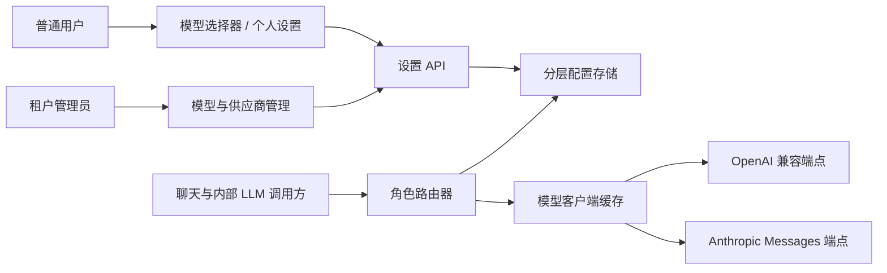
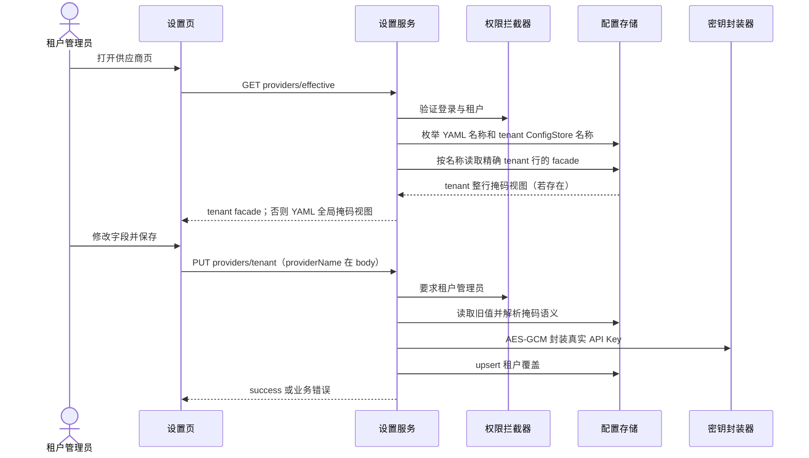
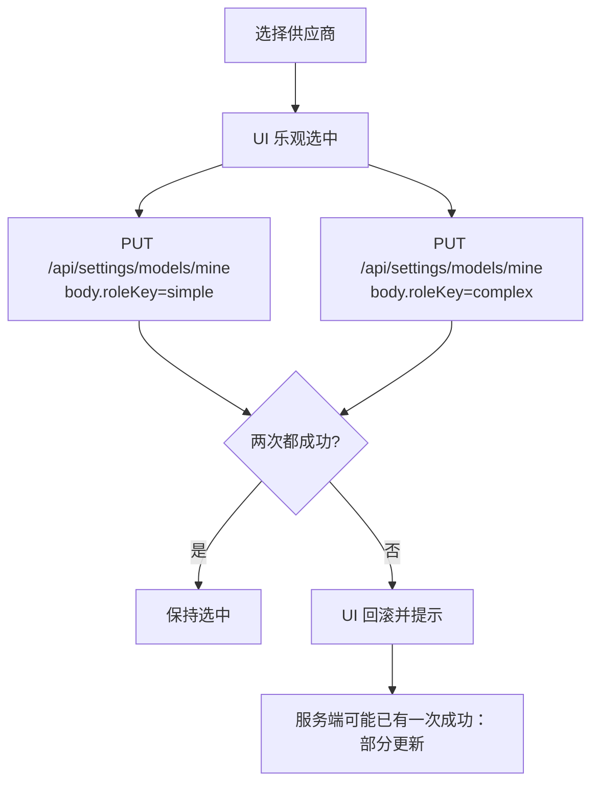
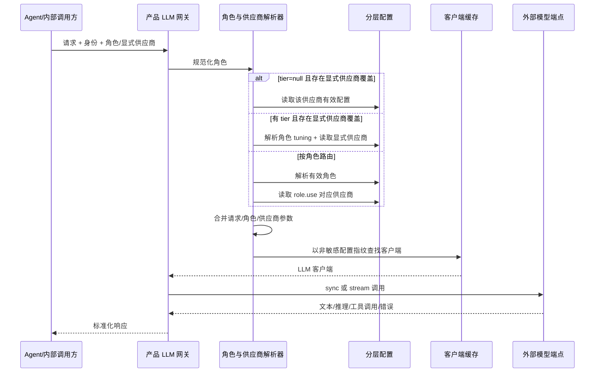

```
# 模型供应商、角色路由与访问控制

> 本文是可脱离 Nova 源码独立使用的复刻规格。证据标记遵循：`I` 已实现、`A` Active 自动化契约、`K` 已知缺陷、`P` 规划、`F` 强推断、`D` 复刻建议。本文未执行应用、编译或自动化测试，因此没有 `R` 结论。

## 1. 结论与边界

本能力解决三个问题：管理员如何登记可调用的大模型供应商；租户或用户如何把“简单任务/复杂任务”等稳定业务角色绑定到供应商；Agent 如何在运行时按身份、角色和显式覆盖选择最终模型，同时不泄露 API Key。

目标用户包括租户管理员、普通用户、主 Agent、文档/视觉等内部调用方，以及兼容 OpenAI 或 Anthropic 协议的外部模型网关。输入是供应商连接参数、角色设置、当前租户/用户身份和一次 LLM 请求；输出是有效设置视图、连接测试结果，以及一个带确定模型参数的 LLM 调用。

当前实现的核心结论如下：

- `I` 供应商配置是租户管理能力；普通用户只能覆盖自己的角色绑定。系统支持全局、租户、用户三级配置，但供应商的产品入口只有全局基线和租户覆盖。
- `I` 面向设置页开放的角色只有 `simple` 和 `complex`；`document`、`vision` 是平台内部角色；历史 `thinking` 被存储层归一为 `complex`，不再是公开设置角色。
- `I` 运行时存储解析与设置页投影不是同一种“有效值”：运行时按字段执行用户 → 租户 → ConfigStore GLOBAL → YAML 覆盖；设置 API 则选择整行 user/tenant/YAML winner，不用父层补齐该行中的 null。
- `I` 运行时可通过请求中的供应商名直接覆盖角色路由；主聊天前端同时更新 simple/complex 用户绑定并在聊天请求中携带该供应商名。
- `I` API Key 加密后持久化，对 UI 和 API 始终掩码；掩码值回写表示“保留旧密钥”。
- `I` 当前路由器只装配 OpenAI 与 Anthropic 工厂。设置 UI 还允许选择 Ollama，形成可保存但运行时不可解析的契约冲突。
- `K` 普通用户会话失效后，供应商保存返回 401 时，当前管理页不会按预期跳转登录页。
- `D` 复刻时应增加强校验、引用完整性、乐观锁、原子批量角色更新、供应商能力探测、SSRF 防护、审计与缓存上限。

本章不负责聊天消息生命周期、工具循环、模型供应商内部计费，也不声明模型厂商服务的 SLA。它只定义从配置到“得到可调用模型客户端”的边界。

## 2. 术语与参与方

| 术语 | 含义 |
|---|---|
| 供应商实例 | 一个命名连接配置，例如 `corp-openai`，包含协议类型、模型 ID、地址、凭据与采样默认值。名称是租户内被角色引用的稳定键。 |
| 角色 | 面向业务意图的逻辑模型槽位，而不是厂商模型名。公开角色为 simple/complex。 |
| 有效值 | 对每个字段按作用域优先级合并后得到的运行配置。不是简单选择整条记录。 |
| 显式覆盖 | 单次请求直接指定供应商实例，绕过角色到供应商的选择，但仍读取供应商连接参数。 |
| 全局基线 | 部署配置/YAML 或全局配置存储提供的默认设置。 |
| 租户覆盖 | 管理员对本租户设置的差异值。 |
| 用户覆盖 | 用户对自身 simple/complex 角色设置的差异值。 |
| 掩码密钥 | API 输出中的占位表示，例如 `****...****`，不能作为真实凭据调用。 |



## 3. 业务规则

### 3.1 身份、角色和作用域

1. 每次读取或写入都必须先取得已认证用户和租户；不能用请求参数替代服务端身份上下文。`I`
2. 供应商租户配置的增删改和测试入口只允许租户管理员。`I`
3. 普通用户可读个人有效角色，可写/删自己的 simple、complex 覆盖；管理员可写/删租户 simple、complex 覆盖。`I`
4. 设置 API 拒绝 `thinking`、`document`、`vision` 等非公开角色；历史 thinking 在内部读取时等价于 complex。`I`
5. 管理员调用普通“effective”接口时看到租户 → 全局，不叠加管理员自己的用户覆盖；调用“mine/effective”才看到用户 → 租户 → 全局。普通用户两者均按个人优先级解析。`I`

### 3.2 两套不可混同的覆盖语义

角色建议抽象为：

```json
{
  "roleKey": "complex",
  "use": "corp-openai",
  "maxTokens": 8192,
  "topP": 0.9
}
```

供应商建议抽象为：

```json
{
  "providerName": "corp-openai",
  "providerType": "openai",
  "modelName": "gpt-example",
  "apiKey": "****",
  "baseUrl": "https://gateway.example.com/v1",
  "maxTokens": 4096,
  "contextLengthTokens": 128000,
  "temperature": 0.2,
  "topP": 0.95,
  "proxy": null,
  "wireApi": "chat",
  "authStyle": "bearer",
  "parseInlineThink": false,
  "supportsVision": true,
  "visionProxy": null
}
```

Agent 运行时的存储解析器对角色和供应商的每个字段独立执行：

```text
effective(field) = overlayByPresence(
  yaml,
  configStoreGlobal,
  tenant,
  user
)
```

这里是“字段存在即覆盖”：显式 null 也会清除父层字段。ConfigStore GLOBAL 优先于 YAML。公共写接口不会把空的 `maxTokens/topP` 写进 map，因此通过当前 REST 写入的缺失字段通常会继承。上下文长度为空或小于等于 0 时回退为 128000。`I`

设置控制器的 `/models/effective` 与 `/models/mine/effective` 不调用上述逐字段结果，而是选择第一条存在的整行：user（若适用）→ tenant → YAML。选中 user/tenant 行后，`use/maxTokens/topP` 原样返回，null 不再由父行补齐。供应商设置投影同样优先返回“精确 tenant 行的掩码视图”，不把缺失字段与 global/YAML 合并。`I`

此外，设置 API 枚举角色和供应商名称时以 YAML 名称集合加 tenant ConfigStore 名称为基础，却不枚举 ConfigStore GLOBAL 名称；而运行时会优先读取 ConfigStore GLOBAL。由此可能出现“运行时能解析、设置页未列出”或设置页投影与运行时参数不同的漂移。复刻时应共享同一个来源枚举器，或明确把管理投影与运行时投影分成两个有名称的 API。`I/D`

### 3.3 路由与参数优先级

运行时解析规则：

1. 若底层路由请求的 tier 为 null 且存在 `providerOverride`，直接使用该供应商及其 tuning，完全绕过角色。`I`
2. 若请求有 DEFAULT_CHAT/complex 等 tier（主聊天属于此路径），显式供应商只替换 `role.use`，仍会把 complex 角色的 `maxTokens/topP` 叠加到该供应商；不能把主聊天 provider 字段描述为完全绕过角色 tuning。`I`
3. 否则把调用方模型层级映射为角色：简单→simple，复杂/默认聊天→complex，文档→document，视觉→vision；产品网关遇到未知非空角色字符串回退 complex。`I`
4. 按调用身份解析角色有效值，取得 `use` 指向的供应商名；缺失供应商或未知类型必须产生可定位的受控错误。`I`
5. 合并采样参数时，单次请求参数优先于角色参数，角色 `maxTokens/topP` 优先于供应商默认值；temperature 没有角色层覆盖，来自供应商，仍可被请求覆盖。`I`
6. 不进行跨供应商自动降级。Agent tool-loop 的 LlmCaller 链具有同供应商重试，但产品网关直调和设置连接测试不因此获得相同重试保证。`I`
7. `supportsVision` 未配置时当前按 true 处理。`I` 复刻建议改为显式能力探测或保守 false。`D`

### 3.4 名称和模型 ID

供应商 `name` 是系统内部路由键和显示名；`model` 是发送到厂商的上游模型 ID。两者不得混淆。主聊天的部分过程事件展示的是供应商名，而请求体的 model 字段必须是上游模型 ID。`I`

### 3.5 密钥规则

- API Key 只能在写入请求中接受明文，持久化前必须使用认证加密；读取时只返回掩码。`I`
- 编辑已有供应商时，只有包含 `****` 的 key 表示保留已有密钥；保存请求中的空字符串会被显式存为空值并清除该层密钥，不能描述为保留。null 会从 incoming map 省略，按运行时字段覆盖语义可能继续继承父层。只有“测试未保存草稿”时，空白或掩码 key 才回退已保存/全局真实 key。`I`
- 新建租户覆盖并提交掩码时，可继承全局同名供应商的真实密钥；若既无旧值也无全局值，则不应凭空生成密钥。`I`
- 无法解密的旧密钥不能回显。当前代码在部分情况下可用全局密钥修复，否则保存失败。`I`
- 掩码 `****` 只证明输出经过脱敏，不证明该供应商一定配置了可用凭据；当前 DTO 没有独立 `credentialConfigured` 字段。`I`
- 连接失败不会自动删除或阻止保存供应商。`I/A`

## 4. 完整执行链路

### 4.1 管理员加载和保存供应商



当前服务端仅强制名称和 model 非空，未完整验证 type、URL、数值范围和供应商引用。`I` 复刻时应在保存前完成第 7 节的强校验。`D`

### 4.2 个人模型选择器

主聊天模型选择器先读个人设置投影和有效供应商，以 complex 的 `use` 作为当前选项。用户选择新供应商后，前端乐观更新 UI，并并行写入 simple 与 complex 两个个人角色。随后发消息时又把供应商名作为显式覆盖放入聊天请求；主聊天路由仍处于 DEFAULT_CHAT/complex tier，因此会继续叠加 complex 角色的 `maxTokens/topP`。`I`



这两个写请求不是原子事务；一个成功一个失败时，UI 虽回滚，服务端仍可能处于部分更新状态。`I/F` 复刻应提供批量原子接口，或使用补偿写和版本校验。`D`

### 4.3 连接测试

模型测试和供应商测试均要求租户管理员。供应商测试有两种模式：

- 仅传 `{providerName}`：读取已保存有效配置后测试。
- 传完整供应商 DTO：测试未保存草稿；空白或掩码 key 从已保存/全局配置补齐。

测试向模型发送用户消息 `hi`。成功响应的 `message` 是模型返回正文，不是固定的 “Connection successful”；失败 `message` 直接拼接顶层异常和最深 root-cause 消息。无论成功失败，当前 HTTP 通常返回 200，以 `{success,message}` 表示业务结果。`I`

当前测试成功日志会记录模型返回正文，失败日志和响应会记录拼接后的异常消息。更关键的是，OpenAI 适配器遇到任意非 2xx 响应时，常规 WARN 日志就会同时记录截断后的响应体和序列化请求体；请求片段包含测试 prompt，正式聊天则可能包含用户 prompt，这一风险不依赖 wire dump 是否开启。另有 wire capture/dump 链可保存完整序列化请求与原始响应，泄露面更大。`I` 复刻时必须对常规错误日志和诊断抓包分别设置脱敏门禁：默认不记录 prompt/正文，诊断能力默认关闭、限权、加密并设置短保留期。`D`

角色测试仅传 `{roleKey}`，测试的是已保存角色而不是设置页未保存草稿。当前 UI 在草稿页触发该接口，视觉上容易误导用户以为测试了草稿。`I/F` 复刻应先保存，或提交完整草稿解析快照。`D`

### 4.4 运行时路由



无显式请求身份的系统后台任务使用系统身份上下文；复刻时必须明确系统身份可读取哪些全局/租户配置，不得默认模拟普通用户。`I/D`

## 5. 对外契约

以下路径均位于 `/api/settings`，要求登录。JSON 字段使用 camelCase。当前代码的普通业务失败可能仍为 HTTP 200；复刻建议对认证授权使用 401/403，对校验使用 400/422，对冲突使用 409，对上游不可用使用 502/504，同时保留机器可读错误码。

### 5.1 读取有效角色

`GET /models/effective`

- 管理员：租户整行 → YAML 整行。
- 普通用户：用户整行 → 租户整行 → YAML 整行。

`GET /models/mine/effective`

- 所有人：用户整行 → 租户整行 → YAML 整行。

响应示例：

```json
{
  "roles": {
    "simple": {
      "roleKey": "simple",
      "use": "corp-openai",
      "maxTokens": 2048,
      "topP": 0.9,
      "inheritedFrom": "user",
      "canResetToParent": true
    }
  },
  "isAdmin": false
}
```

`/models/mine/effective` 的响应只有 `roles`，没有 `isAdmin`；两个 GET 都没有 `success`。`ConfigScope` 的稳定 JSON 值是小写字符串 `user|tenant|global`，不能把 Java 枚举常量名 `USER|TENANT|GLOBAL` 暴露为线协议。如上节所述，每个 role 对象是整行 winner，不保证字段级运行时合并。

### 5.2 写删角色覆盖

```text
PUT    /models/mine              普通用户或管理员；roleKey 在 JSON body
DELETE /models/mine/{role}       删除当前用户覆盖，恢复继承
PUT    /models/tenant            仅租户管理员；roleKey 在 JSON body
DELETE /models/tenant/{role}     仅租户管理员；删除租户覆盖
```

请求：

```json
{"roleKey":"complex","use":"corp-openai","maxTokens":8192,"topP":0.9}
```

`role` 只能是 simple/complex，`use` 必须非空。PUT 是同作用域同角色的 upsert；DELETE 应具备幂等语义。当前实现未阻止角色引用不存在的供应商。`I`

### 5.3 读取供应商

`GET /providers/effective`

返回 YAML 全局名称与 tenant ConfigStore 名称的并集；同名 tenant 行存在时返回该精确行的掩码视图，不以全局字段补齐。密钥只能返回掩码，并带上 UI 判断是否可编辑/删除所需的管理标识。真实响应是以供应商名为 key 的对象而不是数组：

```json
{
  "providers": {
    "corp-openai": {
      "providerName": "corp-openai",
      "providerType": "openai",
      "modelName": "gpt-example",
      "apiKey": "****",
      "baseUrl": "https://gateway.example.com/v1",
      "wireApi": "chat",
      "authStyle": "bearer",
      "proxy": null,
      "parseInlineThink": false,
      "supportsVision": true,
      "visionProxy": null,
      "maxTokens": 4096,
      "contextLengthTokens": 128000,
      "temperature": 0.2,
      "topP": 0.95,
      "inheritedFrom": "tenant",
      "canReset": true,
      "canDelete": false
    }
  },
  "isAdmin": true
}
```

该响应没有 `success`、`source` 或 `canEdit` 字段。精确 tenant 行只要存在非空密钥，投影就统一返回 canonical sentinel `****`，不泄露首尾字符；YAML 全局行才使用 `ApiKeyMasker` 的展示形式：长度大于 8 时为“前 4 字符 + `****` + 后 4 字符”，长度不超过 8 或 null 时为 `****`。`apiKey` 的掩码也不能当作“凭据已正确配置”的布尔证据。`inheritedFrom` 同样使用小写 `tenant` 或 `global`。

### 5.4 写删供应商

```text
PUT    /providers/tenant         仅租户管理员；providerName 在 JSON body
DELETE /providers/tenant/{name}  仅租户管理员
```

PUT 请求使用 `providerName/providerType/modelName`，而不是 `name/type/model`。DELETE 的路径名是业务唯一键。删除租户覆盖后，同名 YAML 全局供应商会重新显现。当前实现删除前不检查角色引用，也没有级联或阻断。`I`

```json
{
  "providerName": "corp-openai",
  "providerType": "openai",
  "modelName": "gpt-example",
  "apiKey": "****",
  "baseUrl": "https://gateway.example.com/v1",
  "wireApi": "chat",
  "authStyle": "bearer",
  "proxy": null,
  "parseInlineThink": false,
  "supportsVision": true,
  "visionProxy": null,
  "maxTokens": 4096,
  "contextLengthTokens": 128000,
  "temperature": 0.2,
  "topP": 0.95
}
```

### 5.5 测试契约

`POST /models/test`

```json
{"roleKey":"complex"}
```

`POST /providers/test`

```json
{"providerName":"corp-openai"}
```

或提交完整草稿对象。两者响应：

```json
{"success":true,"message":"<模型对 hi 的实际文本回复>"}
```

失败示例：

```json
{"success":false,"message":"Authentication failed or upstream rejected the request"}
```

当前失败响应的 `message` 可能包含顶层异常和 root-cause 文本，不能视为已经满足稳定错误码或严格脱敏；这是复刻时必须收敛的风险。测试不是健康检查承诺，也不保存草稿，且产品设置测试直调不保证经过 Agent LlmCaller 重试。

### 5.6 主聊天中的覆盖字段

主聊天请求可携带：

```json
{
  "message": "分析这份数据",
  "provider": "corp-openai"
}
```

`provider` 是供应商实例名，不是 `type` 或上游模型 ID。缺省时使用 Agent 默认 complex 路由；提供该字段时替换供应商选择，但主聊天 DEFAULT_CHAT/complex tier 仍提供 complex 的 `maxTokens/topP`。只有底层 tier=null 的显式 provider 调用才完全绕过角色 tuning。服务端必须重新做租户可见性校验，不能信任前端选项。`I`

### 5.7 内部路由接口

一个可复刻的内部接口如下：

```java
interface ModelRouter {
  ResolvedModel resolve(
      Principal principal,
      ModelRole role,
      String providerOverride,
      RequestSampling overrides);
}

record ResolvedModel(
    String providerName,
    String providerType,
    String upstreamModelId,
    URI baseUrl,
    SecretRef credential,
    int contextLengthTokens,
    boolean supportsVision,
    Sampling sampling,
    LlmClient client) {}
```

SecretRef 只允许调用适配器解密，不应出现在日志、DTO、缓存键明文或事件中。

## 6. 数据模型与生命周期

### 6.1 当前统一键值存储

当前配置最终进入一个按键、租户、用户复合定位的 JSON 存储：

```sql
CREATE TABLE config_kv (
  qualified_key VARCHAR(255) NOT NULL,
  scope_tenant VARCHAR(255) NOT NULL DEFAULT '',
  scope_user VARCHAR(255) NOT NULL DEFAULT '',
  value_json TEXT NOT NULL,
  updated_at TIMESTAMP NOT NULL,
  updated_by VARCHAR(255),
  PRIMARY KEY (qualified_key, scope_tenant, scope_user)
);

CREATE INDEX idx_config_kv_tenant_user
  ON config_kv (scope_tenant, scope_user);
```

键命名：

```text
llm-role:<roleKey>
llm-provider:<providerName>
```

作用域编码：全局为空租户/空用户；租户为 tenant/non-user；用户为 tenant/user。记录是覆盖层而非完整快照。删除覆盖是物理删除对应复合键，不删除更低层记录。当前 `updated_by` 写入链路没有形成可靠操作者审计。`I`

### 6.2 密钥信封

真实 API Key 被替换为下列 JSON 信封后再嵌入 provider JSON：

```json
{
  "__secret": true,
  "alg": "AES-256-GCM",
  "keyVersion": 1,
  "ciphertextBase64": "<iv+ciphertext+tag>"
}
```

当前使用 32 字节、Base64 编码的 master key，环境变量名为 `NOVA_SECURITY_CREDENTIAL_MASTER_KEY`；GCM 使用 12 字节随机 IV 和 128 位认证标签。当前没有完整轮换流程，部署说明要求 master key 不可随意更换。`I`

生产复刻建议使用 KMS envelope encryption：数据库保存 key-id、加密数据密钥、nonce、ciphertext、tag；支持版本轮换、逐条重加密和撤销。`D`

### 6.3 历史数据迁移

旧实现存在租户角色、用户角色、租户供应商三类规范表。迁移会把它们转换为上述 qualified key，并在迁移时封装供应商密钥。复刻已有系统时需满足：

1. 先验证 master key 可用；
2. 按租户/用户生成覆盖记录；
3. thinking 映射 complex，并记录冲突处理；
4. 明文 key 加密后再落新表；
5. 双读核对数量与抽样有效值；
6. 切换读取后再停止旧表写入；
7. 不要在同一不可回滚步骤中删除旧表。

### 6.4 推荐生产表

若无需通用 ConfigStore，推荐使用显式表以获得外键和乐观锁：

```sql
CREATE TABLE llm_provider_override (
  tenant_id VARCHAR(128) NOT NULL,
  provider_name VARCHAR(128) NOT NULL,
  provider_type VARCHAR(32) NOT NULL,
  upstream_model_id VARCHAR(255) NOT NULL,
  base_url VARCHAR(1024) NOT NULL,
  credential_envelope TEXT,
  settings_json TEXT NOT NULL,
  version BIGINT NOT NULL DEFAULT 0,
  updated_by VARCHAR(128) NOT NULL,
  updated_at TIMESTAMP NOT NULL,
  PRIMARY KEY (tenant_id, provider_name)
);

CREATE TABLE llm_role_override (
  tenant_id VARCHAR(128) NOT NULL,
  user_id VARCHAR(128) NOT NULL DEFAULT '',
  role_key VARCHAR(32) NOT NULL,
  provider_name VARCHAR(128),
  max_tokens INTEGER,
  top_p DECIMAL(5,4),
  version BIGINT NOT NULL DEFAULT 0,
  updated_by VARCHAR(128) NOT NULL,
  updated_at TIMESTAMP NOT NULL,
  PRIMARY KEY (tenant_id, user_id, role_key)
);
```

全局供应商可放单独表或保留特殊 system tenant，但不要用用户可伪造的空字符串决定权限。

## 7. 核心实现设计

### 7.1 模块拆分

建议最少拆为：

1. `Settings API`：DTO、认证、授权、校验、掩码。
2. `Layered Resolver`：按身份进行字段级覆盖和来源追踪。
3. `Secret Vault`：加密、解密、掩码、轮换。
4. `Provider Registry`：type → 工厂，声明协议能力。
5. `Model Router`：角色映射、显式覆盖、参数优先级。
6. `Client Cache`：按安全指纹复用客户端，支持上限和失效。
7. `Connectivity Tester`：对保存值或草稿创建一次性客户端。
8. `Audit/Telemetry`：变更事件、路由指标、脱敏错误。

### 7.2 解析伪代码

```text
resolve(principal, tier, explicitProvider, requestParams):
  assertAuthenticated(principal)

  if tier is null and explicitProvider is not blank:
    providerName = explicitProvider
    roleConfig = empty
  else:
    canonicalRole = canonicalize(tierToRole(tier or DEFAULT_CHAT))
    roleConfig = mergeFields(
      globalRole(canonicalRole),
      tenantRole(principal.tenant, canonicalRole),
      userRoleIfAllowed(principal, canonicalRole))
    providerName = explicitProvider if present else requireNonBlank(roleConfig.use)

  provider = resolveProviderVisibleToTenant(principal.tenant, providerName)
  validateProviderTypeRegistered(provider.type)
  sampling = requestParams
      .fallback(roleConfig.maxTokens, roleConfig.topP)
      .fallback(provider.maxTokens, provider.topP, provider.temperature)
  validateSampling(sampling, provider.contextLength)
  client = cache.getOrCreate(fingerprint(provider), factory(provider.type))
  return ResolvedModel(provider, sampling, client)
```

### 7.3 客户端缓存

当前缓存指纹包含供应商名、类型、上游模型 ID、API Key 的 SHA-256、地址、wireApi、authStyle、代理、think 解析、视觉能力、上下文长度和 temperature，避免把明文密钥作为键。它不包含 `maxTokens/topP`；这两项通过每次解析得到的 binding options 传递，不要求重建 provider 客户端。缓存当前无明确容量上限。`I`

复刻建议使用最大容量 + 空闲过期；配置变更后主动失效该租户/供应商的旧客户端；关闭被淘汰客户端的连接池；指标只记录短指纹。`D`

### 7.4 校验

生产实现至少验证：

- provider name 格式、长度、租户内唯一；角色 use 必须引用可见供应商。
- provider type 必须已注册；不要让 UI 枚举和后端工厂分离维护。
- baseUrl 必须为允许的 HTTPS 地址；本地开发例外显式配置。
- maxTokens > 0 且不超过 contextLengthTokens；temperature 建议 0..2，topP 0..1。
- authStyle、wireApi 必须属于该 provider type 的能力集合。
- 视觉角色只能绑定明确支持视觉的供应商。
- 删除供应商时若仍被角色引用，返回 409 并列出引用，或在同一事务中迁移绑定。

### 7.5 MVP 与生产级差异

| 方面 | 最小可用 | 生产级 |
|---|---|---|
| 存储 | JSON 覆盖记录 | 规范表/JSON schema、乐观锁、审计 |
| 密钥 | 单 master key AES-GCM | KMS 信封、轮换和访问审计 |
| 路由 | simple/complex + 显式覆盖 | 能力约束、灰度、预算、熔断，但行为可解释 |
| 测试 | 发一条 `hi` | 协议握手、能力探测、分类诊断、限流 |
| 一致性 | 两次独立角色 PUT | 原子批量更新 |
| 缓存 | 配置指纹 Map | 有界缓存、主动失效、连接回收 |

## 8. 并发与非正常路径

| 情况 | 当前行为 | 复刻要求 |
|---|---|---|
| 两管理员同时编辑 | 后写覆盖先写，缺少可见版本冲突 `I` | version/ETag + `If-Match`，冲突返回 409 `D` |
| simple/complex 并行更新部分失败 | 可能只成功一个，UI 回滚不等于服务端回滚 `I/F` | 批量事务或补偿 + 重读 `D` |
| 删除被引用供应商 | 当前无依赖检查 `I` | 阻断并返回引用，或事务迁移 `D` |
| 上游 401/403 | 返回连接失败，不删除配置 `I` | 分类为凭据/权限错误且脱敏 |
| Agent LlmCaller 遇到 408/429/5xx | 同一供应商重试 `I` | 尊重 Retry-After，限制总时限与幂等范围 |
| Agent LlmCaller 遇到其他 4xx | 不重试 `I` | 暴露稳定错误码，不透传敏感响应 |
| 产品网关直调/设置测试失败 | 没有同等重试保证 `I` | 如需重试，应在该调用边界显式声明 |
| 用户取消流式请求 | 由调用链取消能力决定 `F` | 取消 HTTP body、连接和重试 |
| 配置变更后旧缓存 | 新指纹产生新客户端，旧项可能滞留 `I` | 主动失效并回收 |
| 进程重启 | 配置仍在库，内存缓存重建 `I` | master key 必须一致；启动检查密钥可解密性 |

Agent runtime 的 LlmCaller 重试默认是首次调用之外最多 3 次，起始退避约 200ms、倍数 2、上限 10s，并加入最多约 25% 抖动；可重试条件包括未知状态、408、429 和 5xx。`I` 这不是所有 `LlmProvider.call()` 的通用装饰器：产品网关直调、草稿测试和已保存配置测试均不能据此宣称会重试。

## 9. 安全、权限和审计

### 9.1 权限矩阵

| 操作 | 普通用户 | 租户管理员 | 平台系统 |
|---|---:|---:|---:|
| 读个人有效角色 | 是 | 是 | 按内部身份 |
| 写个人 simple/complex | 是 | 是 | 否/不适用 |
| 读租户有效管理视图 | 否 | 是 | 可配置 |
| 写租户角色 | 否 | 是 | 初始化可用专门通道 |
| 读有效供应商掩码 | 登录后可用于选择 | 是 | 是 |
| 写删/草稿测试供应商 | 否 | 是 | 专门运维权限 |
| 获取明文 API Key | 否 | 否 | 仅调用适配器瞬时解密 |

非管理员管理深链应被服务端拒绝；前端也应隐藏入口并导航回聊天，但 UI 隐藏不能替代后端鉴权。自动化契约要求未认证访问供应商有效配置返回 401 或 403。`A`

### 9.2 SSRF 与出站控制

管理员可填写 baseUrl/proxy，因此连接测试和真实调用都是 SSRF 面。生产复刻必须：只允许 http/https；默认要求 https；解析后阻止 loopback、link-local、云元数据和私网地址（除明确 allowlist）；DNS 重绑定时在连接阶段复核目标 IP；限制重定向；按租户设置域名 allowlist；代理凭据单独加密；限制响应体和错误体大小。`D`

### 9.3 审计事件

至少记录：provider.created/updated/deleted/tested、role.updated/deleted、secret.rotated、route.resolve_failed。字段包括 tenantId、actorId、对象名、作用域、版本、变化字段名、结果、错误码、traceId、时间；严禁记录 API Key、Authorization header、完整 prompt 或模型响应。当前存储虽然有 `updated_by` 字段，但写入链路不足以构成完整审计。`I/D`

### 9.4 UI 安全缺口

`K` 已知 UI 缺陷：供应商保存遭遇 401 时没有跳转登录页，而停留在管理页面。复刻验收必须覆盖所有设置 mutation 的统一 401 拦截。另有 Active 安全用例要求 500 响应中的 key、请求内容、堆栈和内部路径不出现在 UI，显示通用错误且保留未保存草稿。`A`

## 10. 外部依赖对端设计

### 10.1 OpenAI 兼容端点

已观察客户端使用 `{baseUrl}/chat/completions`，支持普通和流式响应。认证样式至少包括：

```http
Authorization: Bearer <api-key>
```

或配置为：

```http
x-api-key: <api-key>
```

请求最小形态：

```json
{
  "model": "gpt-example",
  "messages": [{"role":"user","content":"hi"}],
  "stream": false,
  "max_tokens": 128,
  "temperature": 0.2,
  "top_p": 0.95
}
```

若包含工具，还需兼容 `tools[].function.{name,description,parameters}`、assistant tool_calls 和 tool role 消息；流式响应需允许 tool call arguments 分片累积。非 2xx 响应可被客户端转为异常，但对端不应假设响应原文会直接展示。`I`

产品配置的 `wireApi` 实际可见值是 null、空字符串、`chat` 或 `responses`；`chat` 是默认语义。`responses` 会被识别并产生提示，但实际调用仍走 `/chat/completions`，并未真正实现 Responses API。`chat-completions` 不是工厂声明的合法值。`I` 复刻时应删除无效选项，或实现独立适配器，不能仅保存标志。`D`

可选 `parseInlineThink` 会把响应中的内联思考标记拆分为标准化推理与正文。该能力依赖非标准文本约定，不应作为所有 OpenAI 兼容端点的保证。`I/F`

### 10.2 Anthropic Messages 端点

已观察调用 `{baseUrl}/v1/messages`，请求头至少为：

```http
x-api-key: <api-key>
anthropic-version: 2023-06-01
content-type: application/json
```

产品设置到运行路由的 vendor-config 映射只传 api-key、base-url、model、wire-api、auth-style、proxy、temperature、parse-inline-think 和 context-length；没有透传 `anthropic-version`、`anthropic-beta`、默认 thinking budget 或默认 cache-control。因此这条产品链固定使用插件默认 `anthropic-version: 2023-06-01`，不发送 beta，也不会仅凭产品 Provider DTO 开启默认 thinking/cache。`I`

插件本身的通用 YAML/注册链另行支持 `anthropic-version`、`anthropic-beta`、`default-thinking-budget` 和 `default-cache-control`，但不能把插件工厂能力写成产品设置链已开放能力。最小请求：

```json
{
  "model": "claude-example",
  "max_tokens": 128,
  "messages": [{"role":"user","content":"hi"}]
}
```

系统提示、工具定义、tool_use/tool_result 需按 Anthropic Messages 语义转换。调用方若另行提供 per-request vendorOptions，插件可处理 thinking/cache 语义；本文的产品 Provider 表单并不配置这些字段。`I`

### 10.3 超时和失败

观察到 OpenAI 非流式默认超时约 300 秒，Anthropic 非流式约 120 秒，流式调用也设置分钟级读取窗口。`I` 这些是客户端默认值，不是服务端契约。生产实现应给连接、首字节、相邻 chunk、总时长分别设限，并允许请求级 deadline 收紧但不放宽平台上限。`D`

### 10.4 最小兼容 Stub

用于验收的 Stub 至少实现：

1. 根据 header 返回 200 或 401；
2. 验证 model 和 messages；
3. OpenAI 普通响应返回 `choices[0].message.content`；
4. OpenAI SSE 返回 `data: {delta...}` 并以 `[DONE]` 结束；
5. Anthropic 普通响应返回 content block；流式返回 message/content block 事件；
6. 可配置 408、429、500、慢首字节、流中断和分片 tool arguments；
7. 记录请求结构但自动擦除 Authorization/x-api-key 和消息正文。

### 10.5 生产级对端

如果自行设计企业 Model Gateway，应包含租户凭据映射、供应商适配器、模型 allowlist、配额/速率限制、并发控制、审计、成本标签、流式反压、标准错误码、健康探测和熔断。Nova 侧 observed contract 无法证明第三方网关内部如何路由、计费、保存提示词或保证数据驻留；这些必须通过部署方合同和独立安全评审确认。`F/D`

## 11. 可观察性

建议结构化日志：

```json
{
  "event": "llm.route",
  "tenantIdHash": "...",
  "userIdHash": "...",
  "role": "complex",
  "provider": "corp-openai",
  "providerType": "openai",
  "model": "gpt-example",
  "explicitOverride": false,
  "configVersion": 7,
  "traceId": "...",
  "result": "success",
  "latencyMs": 842
}
```

指标至少包括：路由成功/失败数（role、type、稳定错误码）、连接测试延迟、上游首 token/总延迟、重试次数、429/5xx、流取消、客户端缓存命中/大小/淘汰、配置冲突、密钥解密失败。providerName 和 model 若基数不可控，应散列或白名单化，不能作为无限标签。

用户可见错误应区分：未配置角色、供应商不存在、类型未安装、凭据无效、地址不可达、限流、上游超时、内部错误；消息包含可操作建议，但不含密钥、堆栈、内部路径和上游完整 body。

## 12. 复刻实施顺序

1. 定义公开角色、供应商 DTO、错误码与权限矩阵；静态验收：OpenAPI/JSON schema 完整且 UI/后端共享 type 枚举。
2. 实现租户/用户身份上下文和管理员守卫；验收：对象级测试设计覆盖跨账户与跨租户。
3. 建表和迁移，接入 Secret Vault；验收：数据库扫描不出现明文 key，错误日志脱敏。
4. 实现字段级 Layered Resolver，并返回字段来源；验收：用户、租户、全局组合表可确定唯一结果。
5. 实现 provider registry、OpenAI/Anthropic 适配器及有界缓存；验收：未知类型受控失败。
6. 实现路由与参数优先级；验收：显式覆盖、角色默认、document/vision 能力约束均有规格测试。
7. 实现设置 API 和原子批量角色更新；验收：ETag 冲突、引用完整性、掩码回写语义明确。
8. 实现管理 UI 和主聊天选择器；验收：401 统一跳转、500 不泄密且保留草稿。
9. 使用可控 Stub 做协议、重试、超时、流取消测试；最后再做真实供应商冒烟，避免把外网不稳定当功能回归。

## 13. 验收标准

1. 用户覆盖 complex 后，个人有效值取用户值；删除后回退租户，再删除租户后回退全局。
2. 普通用户不能写租户角色或供应商；跨账户读取不会看到另一用户覆盖。
3. 管理员管理视图不被自己的个人覆盖污染；mine 视图会包含个人覆盖。
4. API Key 在数据库中为认证加密信封，在任何 GET/UI 中不出现明文；包含 `****` 的回写保留旧值，保存空字符串会清空该层；日志和 wire dump 必须经过额外脱敏门禁。
5. 保存 OpenAI/Anthropic 草稿后，连接测试分别发往正确路径和认证头；401、429、5xx、超时得到稳定分类。
6. 未知 provider、缺失 provider、未知 type 均返回受控错误，不泄露堆栈或密钥。
7. 单次 provider 覆盖优先于角色，且只能访问当前租户可见供应商。
8. 请求采样参数 > 角色参数 > 供应商参数的优先级可逐项证明。
9. 两个角色同时切换要么全部成功，要么全部不变；并发旧版本写返回 409。
10. 删除仍被引用供应商返回 409；删除租户覆盖后全局同名配置恢复可见。
11. 管理端 mutation 遭遇 401 时跳转登录；500 时保留草稿并隐藏 key、请求、堆栈、内部路径。
12. 进程重启后仍可解密配置并重建客户端；错误 master key 在启动或首次访问时产生清晰运维告警。

## 14. 测试矩阵

| 场景 | 通道 | 前置条件 | 操作 | 预期结果 | 当前证据等级 |
|---|---|---|---|---|---|
| 用户覆盖优先 | API | 全局/租户/用户值不同 | 读 mine effective | 返回用户值 | `A` LLM-RESOLVE-001，未运行 |
| 租户回退 | API | 无用户覆盖 | 读 mine effective | 返回租户值 | `A` LLM-RESOLVE-002，未运行 |
| 有效角色/供应商 DTO 契约 | API | 有至少一项配置 | 读取两个 effective GET | DTO 字段、scope 枚举、引用关系完整；不证明一次真实运行时路由 | `A` LLM-RESOLVE-003，未运行 |
| 跨账户隔离 | API | 同租户两账号 | 写 A、读 B | B 看不到 A 覆盖 | `A` LLM-RESOLVE-005，未运行 |
| 未认证读取供应商 | API | 无会话 | GET effective | 401 或 403 | `A` LLM-KEY-004，未运行 |
| 密钥只读掩码 | API | 已存在至少一个 provider | GET provider | 返回 canonical mask，不证明真实 key 可用或写入保留 | `A` LLM-KEY-007，未运行 |
| 不存在供应商测试 | API | 构造不存在 providerName | POST providers/test | HTTP 请求受控完成且 body `{success:false,message}` 安全指出名称 | `A` LLM-ERR-005，未运行 |
| 真实 OpenAI 连接 | API/外网 | 有有效凭据 | 测试已保存 provider | 成功或可诊断失败 | `A` LLM-PROV-001，未运行 |
| 供应商 CRUD 持久化 | UI E2E | 管理员 | 新建/编辑/删除/刷新 | 状态持久且可恢复 | `A` PROVIDER-PW-01..03，未运行 |
| 无效连接仍可保存 | UI E2E | 管理员 | 保存后测试失败 | 配置保留，测试失败 | `A` PROVIDER-PW-04，未运行 |
| CRUD 500 恢复 | UI E2E | 注入 500 | 创建/编辑/删除 | 提示且 UI 可恢复 | `A` PROVIDER-PW-05..07，未运行 |
| 角色设置保存恢复 | UI E2E | 管理员 | simple/complex 测试、保存、刷新、恢复 | 设置持久 | `A` MODEL-PW-01/02，未运行；测试草稿语义有缺口 `F` |
| 非管理员深链 | UI E2E | 普通用户 | 打开模型设置 URL | 隐藏入口并回聊天 | `A` RBAC 用例，未运行 |
| 保存 401 | UI E2E | 会话失效 | 保存 provider | 当前未跳登录 | `K` NOVA-BUG-032 |
| 500 信息泄露 | UI E2E | 响应含敏感串 | 保存 provider | 通用提示、草稿保留、敏感串不可见 | `A` SEC-UI-03，未运行 |
| 原子双角色切换 | API/UI | 注入一次失败 | 切换模型 | 全成或全败 | 当前缺失 `D` |
| SSRF 阻断 | API | baseUrl 指向元数据地址 | 测试连接 | 保存/调用被拒 | 当前未证明 `D` |

自动测试中的写操作采用单 worker，测试前记录基线、结束恢复，并在发现并发外部修改时拒绝覆盖。这是值得保留的测试隔离策略，但不代表生产接口本身具备并发控制。`A/F`

## 15. 当前能力与建议汇总

### `I` 已实现事实

- 运行时按字段覆盖 YAML、ConfigStore GLOBAL、tenant、user；设置 API 使用整行 winner，且 provider tenant 投影不补 global 字段，两者存在明确语义差异。
- simple/complex 公共设置，document/vision 内部角色，thinking 兼容 complex。
- 管理员供应商管理、个人/租户角色管理、保存值与草稿连接测试。
- AES-256-GCM 密钥信封与 API 掩码。
- OpenAI Chat Completions 和 Anthropic Messages 适配；有限重试属于 Agent LlmCaller 链，不覆盖所有直调和设置测试。
- 显式供应商覆盖、参数分层、配置指纹客户端缓存；主聊天显式 provider 仍叠加 complex tuning。

### `A` Active 自动化契约

- LLM-RESOLVE-001/002/005 分别验证用户优先、租户回退和跨账户隔离；LLM-RESOLVE-003 只验证 effective DTO 与引用契约，不证明真实 LLM 路由。
- LLM-KEY-004 验证未认证读取被拒，LLM-KEY-007 只验证 GET 输出掩码；LLM-ERR-005 调用不存在 `providerName` 的 provider test 并验证安全业务错误；LLM-PROV-001 测试已保存 OpenAI provider 的真实连接。这些 Active 用例本次均未运行。
- 管理 UI CRUD/持久化/错误恢复、RBAC 和敏感信息隐藏。
- 本次分析没有运行这些用例，不能声称通过。

### `K` 已知缺陷

- 供应商保存返回 401 时，UI 不会按期望跳转登录。

其余模型/供应商 Playwright CRUD、持久化、失败恢复与角色设置用例属于 `A`（Active 契约，本次未运行），不能因存在测试文件升级为 `K` 或 `R`。角色“测试草稿”的语义偏差是静态实现与 UI 意图冲突，本文标为 `F`；当前没有对应 known-failure 登记。

### `P` 规划能力

- 本次证据未发现可安全声明为已规划且未实现的独立主链路；未来能力不能从 UI 选项单独推定。

### `F` 强推断与冲突

- simple/complex 并行写存在服务端部分成功窗口。
- 角色测试 UI 看似测试草稿，实际接口只按 roleKey 测试已保存值。
- UI 可选 Ollama，但运行路由器只注册 OpenAI/Anthropic，因此配置可能可保存却不可调用。
- `wireApi=responses` 可配置但当前 OpenAI 调用仍是 Chat Completions；合法默认值名是 `chat`，不是 `chat-completions`。
- 产品 Anthropic Provider 表单链不透传 version/beta/default-thinking/default-cache 字段；插件通用配置链支持这些字段，二者不可混写。

### `D` 复刻建议

- 共享 provider 能力注册表、强 schema 校验、引用完整性、原子批量更新与 ETag。
- KMS 密钥轮换、有界缓存、主动失效、完整审计和 SSRF 防护。
- 明确连接/首字节/chunk/总时限，分类错误与统一 401 UI 处理。

## 16. 证据附录

> 以下仅用于追溯；正文不依赖这些符号才能实现。

### Nova 实现证据

- `nova-app/src/main/java/com/aloudata/nova/config/ModelProperties.java`
- `nova-app/src/main/java/com/aloudata/nova/config/ModelRoles.java`
- `nova-app/src/main/java/com/aloudata/nova/config/ModelSettingsStore.java`
- `nova-app/src/main/java/com/aloudata/nova/controller/SettingsController.java`
- `nova-app/src/main/java/com/aloudata/nova/config/ProductModelSettingsLlmRouter.java`
- `nova-app/src/main/java/com/aloudata/nova/service/ProductLlmGateway.java`
- `nova-app/src/main/java/com/aloudata/nova/service/ChatService.java`
- `nova-app/src/main/java/com/aloudata/nova/auth/AdminAuthInterceptor.java`
- `nova-app/src/main/java/com/aloudata/nova/security/ConfigSecretSealer.java`
- `nova-app/src/main/java/com/aloudata/nova/config/backfill/` 中旧模型配置回填步骤
- `nova-app/src/main/resources/db/product-migration/` 中产品表迁移
- `nova-bundled-plugins/nova-ext-storage/src/main/resources/com/aloudata/nova/ext/storage/db/migration-shared/` 中 `config_kv` 的 H2/PostgreSQL 迁移
- `nova-bundled-plugins/nova-ext-llm-openai/`
- `nova-bundled-plugins/nova-ext-llm-anthropic/`
- `web/` 中模型设置、供应商设置、聊天模型选择器与聊天请求实现

### nova_auto_test 契约

- `nova_auto_test/src/features/modelAccess/client.ts`
- `nova_auto_test/src/features/modelAccess/runner.ts`
- 用例：`LLM-RESOLVE-001/002/003/005`、`LLM-KEY-004/007`、`LLM-ERR-005`、`LLM-PROV-001`

### nova_ui_e2e 契约

- `nova_ui_e2e/tests/agent-model-providers.spec.ts`
- `nova_ui_e2e/tests/agent-model-settings.spec.ts`
- `nova_ui_e2e/tests/agent-rbac.spec.ts`
- `nova_ui_e2e/tests/agent-security-ui.spec.ts`
- 用例：`PROVIDER-PW-01..07`、`MODEL-PW-01/02`、`NOVA-BUG-032`、`SEC-UI-03`

### 本次验证声明

本章结论来自三仓静态代码、迁移、测试规格和 UI 调用链分析。本次没有启动 Nova、没有连接真实供应商，也没有运行 Maven、前端构建或自动化测试，因此全文没有 `R` 级结论。

```
