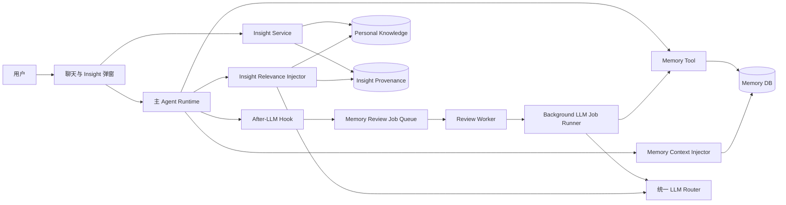
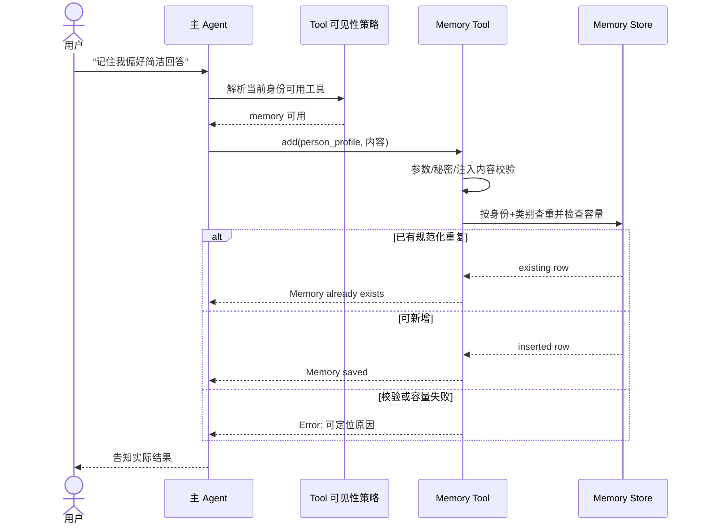
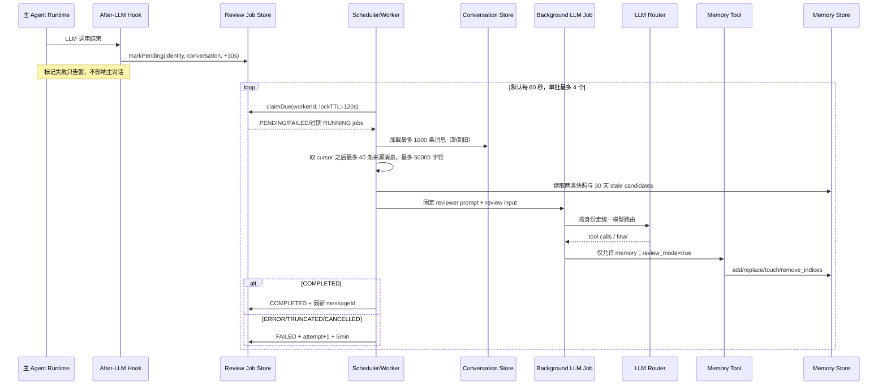
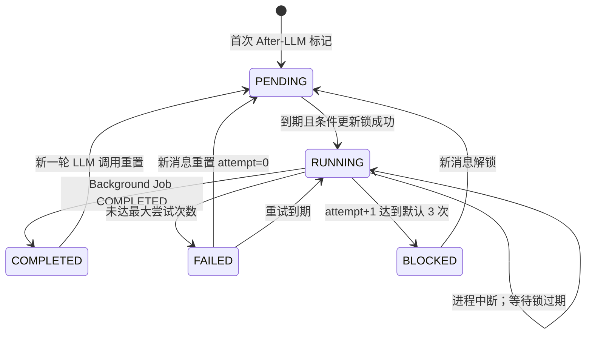
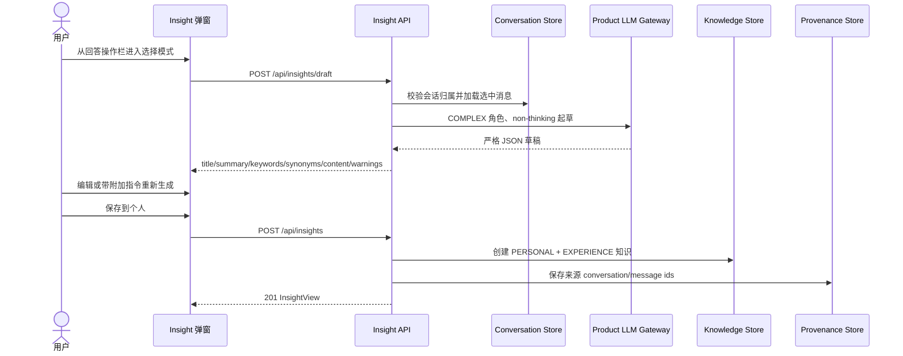
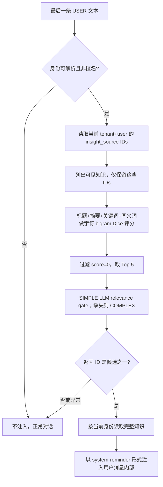

```
# 用户记忆、画像、后台 Review Job 与 Insight Recall 复刻说明

## 1. 结论与边界

本能力解决两个相邻但不同的问题：

1. 让 Agent 跨会话记住用户明确确认的稳定事实、偏好和工作环境规则，并在以后的每一轮对话中作为非特权上下文使用。
2. 让用户把一段高质量对话提炼成可复用的“分析思路”，保存为个人知识；未来遇到相似问题时，系统先做廉价词法召回，再由小模型判断是否真正适用，最后把完整方法论注入当前轮。

复刻时必须保留以下边界：

- **会话消息历史不是持久画像。** 它是按会话保存的 USER/ASSISTANT 消息，用于当前会话连续性。当前删除会话并不会级联删除已从该会话派生的 `memory_entry`、`insight_source` 或 PERSONAL/EXPERIENCE 知识；这些派生记忆仍可能在后续对话生效。“删除会话后同时停止使用派生记忆”只能作为需要另行实现和向用户说明的隐私策略，不能写成当前保证。
- **持久记忆只有两个真实业务分类。** `person_profile` 表示与人本身有关、换项目或换工作后仍成立的事实；`work_context` 表示项目、工作区、团队、环境、工具和业务规则。数据库兼容值分别是 `USER` 和 `MEMORY`。
- **Insight 不是第三种 MemoryKind。** Insight 是个人作用域的知识条目，类别为 `EXPERIENCE`，另有一张来源侧表记录其来源对话和消息。它使用独立的候选召回和相关性判断链路。
- **后台 Review 不是主对话的子代理。** 它是系统拥有的后台 LLM Job，只接收固定 SYSTEM + USER 两条消息，只允许调用 `memory` 工具，不装配正常会话上下文，也不把输出发给用户。
- **当前没有画像管理 REST API 或 Review Job 查询 API。** 用户可见的画像增删改查入口是对话中的 `memory` 工具；后台状态只能从数据库和日志观察。
- **当前没有统一的隐私删除能力。** Tool 可逐条物理删除记忆，知识库可删除 Insight 对应的知识条目，但缺少“删除用户全部记忆、Review Job、来源侧表和孤儿数据”的产品接口。

### 1.1 输入、输出与最终效果

| 子能力 | 输入 | 输出 | 用户可见效果 |
|---|---|---|---|
| 显式记忆 | 用户要求记住、列出、更正或忘记稳定事实 | `memory` ToolResult | 当前轮显示保存/重复/替换/删除结果；以后新会话可利用该事实 |
| 澄清后记住 | `ask_human` 问题、用户答案、`remember=true` | 一条 `work_context` | 用户勾选“记住”后，确认答案跨会话可用；写入失败不影响原对话继续 |
| 自动 Review | 已完成的会话消息 | 0..N 次受限 `memory` 工具调用 | 静默提炼、替换、触碰或淘汰持久记忆；不显示后台文本 |
| 每轮画像注入 | 当前租户/用户身份、已有画像 | 合成 USER 角色运行时上下文 | 模型无需主动 list 即可使用跨会话画像 |
| Insight 草稿 | 当前用户选中的本会话消息、可选附加指令 | 可编辑的标题、场景、关键词、同义词、正文、警告 | 弹窗展示 AI 起草结果，可重新生成和编辑 |
| Insight 保存 | 用户确认后的草稿 | 个人知识条目及来源记录 | “我的知识库”可见；重名时返回可判别的冲突 |
| Insight Recall | 当前轮最后一条用户文本 | 0 或 1 条完整方法论注入 | 相关问题按用户沉淀的分析主线执行；不相关或召回失败时正常对话 |

### 1.2 当前实现、测试契约与推荐设计

- `I`：持久记忆、Review Job、每轮注入、Insight 起草/保存/召回均有静态实现。
- `A`：`nova_auto_test` 的 active YAML 黑盒契约覆盖跨会话画像注入、显式替换和跨账号隔离，本次未运行。
- UI E2E 仓存在覆盖 Insight 起草、重新生成、保存到个人知识库和删除知识条目的确定性 Playwright spec；它受远程租户写授权门禁控制，未授权时会 skip，本次也未运行，因此不标记为 `A` active 或 `R`。
- `K`：Review 游标在切片超过 40 条或游标不在最近 1000 条时会跳过/重审历史；首次并发标记和 claim 存在竞态；禁用 Insight 仍可能被召回；Insight submit 不重验来源归属。这些均应在复刻时修复。
- `P`：自动画像提取、无可提取事实、后台 LLM 故障等场景只在测试设计中列出，因缺少 Job 查询和故障注入能力尚未稳定自动化。
- `D`：生产复刻应增加 Memory 管理 API、统一能力开关、全量隐私删除、Job 可观察性、数据库级去重、Insight 事务补偿和显式 token 预算。

## 2. 术语与参与方

| 术语/参与方 | 定义与职责 |
|---|---|
| 会话记忆 | 某一 conversation 的持久化消息历史。不是跨会话画像分类。 |
| Person Profile | 人的稳定属性或偏好，例如语言偏好、沟通风格、长期习惯。Tool 值 `person_profile`，存储兼容值 `USER`。 |
| Work Context | 项目、团队、环境、工具或业务规则，例如“该项目使用 Maven”。Tool 值 `work_context`，存储兼容值 `MEMORY`。 |
| Memory Tool | 持久记忆唯一读写边界；负责身份约束、校验、去重、字符容量和错误翻译。 |
| Context Injector | 每轮读取两类记忆，在 token 预算内生成非特权 USER 上下文。 |
| Review Marker | 每次主 Agent LLM 调用后，把所属会话标记为待复查；失败必须 fail-soft。 |
| Review Scheduler/Worker | 周期性领取到期任务、抽取未复查消息、通过后台 LLM Job 调用 Memory Tool。 |
| Background LLM Job | 使用统一 LLM Router 的隔离执行环境；固定 prompt、受限工具、独立沙箱、不保存对话。 |
| Insight | 用户从对话沉淀的分析方法论；物理上是个人知识条目 + 来源侧表，不是 MemoryEntry。 |
| Lexical Candidate Finder | 用字符 bigram 重叠从当前用户的 Insight 中取最多 5 个候选。 |
| Relevance Gate | 使用 SIMPLE 模型判断候选是否真正适用于当前问题；未配置则回退 COMPLEX。 |
| Insight Injector | 读取被选中的完整知识正文，以用户角色的运行时提醒注入当前轮。 |



## 3. 真实分类与业务规则

### 3.1 三层信息不能混存

| 层次 | 当前真实载体 | 作用域 | 生命周期 | 是否自动注入新会话 |
|---|---|---|---|---|
| 会话消息历史 | Conversation/Message Store | tenant + user + conversation | 随会话保存和删除 | 否，只装配当前会话历史 |
| 持久画像/工作记忆 | `memory_entry` | tenant + user + kind | 物理删除前长期存在 | 是，每轮尝试注入 |
| 分析思路 Insight | Personal Knowledge + `insight_source` | tenant + user | 随个人知识生命周期 | 有条件：召回通过后才注入 |

因此，不应把“短期记忆”“长期记忆”“Insight”设计成同一张表上的三个枚举。推荐抽象是：

```text
ConversationHistoryStore    // 对话连续性
DurableMemoryStore          // person_profile / work_context
KnowledgeStore              // 文档、经验、Insight 等知识
InsightProvenanceStore      // 只标记哪些知识是 Insight 及其来源
```

### 3.2 可保存与不可保存的内容

必须保存或允许保存：

- 用户明确要求记住、忘记、列出或更新的稳定事实。
- 用户明确确认的长期偏好。
- 后台 Review 从 USER 消息或已完成的最终 ASSISTANT 回复中识别出的明确、耐久事实或决定。
- 用户在 `ask_human` 交互中主动勾选“记住”的澄清问答，固定存入 `work_context`。

不得保存：

- API Key、密码、Token、凭据、一次性链接。
- 当前任务进度、临时 TODO、会话 ID、当前日期时间。
- 工具结果或仅由工具发现、未经用户确认的事实。
- 未来提醒和计划任务；它们应进入任务/自动化系统。
- 临时纠错，除非明确可泛化到未来会话。
- 应沉淀到 Skill 或项目文档的操作步骤。
- 作用域不清或很可能短期变化的事实。

写入内容应使用陈述句，例如“用户偏好简洁回答”，而不是“始终简洁回答”。这是为了降低把历史数据当作高优先级指令的风险。

### 3.3 分类规则

```text
若事实描述的是“这个人”，并且换工作、公司或项目后仍大概率成立：
    person_profile
否则若事实描述项目、工作区、团队、环境、工具、业务口径或工作流：
    work_context
否则：
    不进入持久记忆
```

兼容输入：`target=user` 映射 `person_profile`，`target=memory` 映射 `work_context`；新实现应输出规范值，不应继续向外暴露含糊的 `USER/MEMORY`。

来源枚举与当前真实使用情况：

| 逻辑来源 | 数据库值 | 当前写入方 | 说明 |
|---|---|---|---|
| `USER_DIRECT` | `USER_MANUAL` | 主 Agent 显式 Tool、澄清确认写入 | 运行时名称与旧库值不同，读取旧值时映射为 `USER_MANUAL` |
| `USER_MANUAL` | `USER_MANUAL` | 兼容读取 | 当前 Tool 不直接以该枚举发起新增 |
| `BACKGROUND_REVIEW` | `BACKGROUND_REVIEW` | Review Worker 中的 LLM Tool call | 依靠私有 review marker 判定 |
| `LLM_ACTIVE` | `LLM_ACTIVE` | 当前没有明确写入路径 | 枚举兼容能力，不能写成现有自动主动记忆链路 |
| `MIGRATION` | `MIGRATION` | 迁移或无法识别旧 source 时的读取回退 | 防止未知旧值使读取失败 |

### 3.4 记忆容量、排序和重复规则

- 默认 Person Profile 总容量为 800 字符。
- 默认 Work Context 总容量为 1500 字符。
- 多条记忆之间按逻辑分隔符 `\n§\n` 计 3 个字符；新增容量检查包含分隔符。
- 精确去重的规范化规则：使用根 Locale 转小写、连续空白折叠为单空格、trim、反复去掉结尾的中英文常用标点，再做 SHA-256。
- 去重作用域为 `(tenant_id, user_id, kind, normalized_content_hash)`。
- 用户 list 按 `last_relevant_at DESC, updated_at DESC, id DESC` 返回，默认 20，最大 100。
- Review 快照和当前注入实际按 `created_at ASC, id ASC`，每类默认最多 20 条。也就是说，当前注入优先较早创建的 Person Profile，再处理较早创建的 Work Context，并不按最近相关性排序。
- `touch` 只更新时间相关性；`replace` 同时更新正文、字符数、更新时间和最近相关时间。
- `replace/remove/touch` 使用 `old_content` 时是**包含匹配**；若匹配到多个不同正文则报“请更具体”，不能任意选择。

### 3.5 可用性开关的当前真实语义

当前“是否可记住澄清”由该身份下内置工具 `memory` 是否启用决定。它只影响澄清 UI 是否显示 `canRemember` 以及写入前复核。

当前 Context Injector 没有检查该工具开关，因此：

- 禁用 `memory` Tool 会阻止或隐藏显式管理能力；
- 已保存的记忆仍可能被每轮注入；
- Review Job 仍被标记，后台受限 Tool 经能力策略过滤后可能无法写入；
- 禁用不等于删除，也不等于停止使用既有数据。

这是当前实现边界，不应把它描述为完整的“关闭记忆”产品能力。生产复刻建议增加独立 `memory.enabled` 用户能力，统一约束 Tool 可见性、Review 标记、后台写入、Context 注入和 UI，并为“暂停使用”和“删除数据”提供不同操作。

## 4. 完整执行链路

### 4.1 显式保存、读取、更正和删除



执行细节：

1. Tool 从执行上下文取得身份。租户身份转换为 `(tenantId, userId)`；非租户身份使用空 tenantId 和 identity key 作为 userId。
2. `add`、`replace` 的新正文先经过秘密、硬标记、控制语句和威胁模式扫描。
3. `add` 先按规范化 hash 查重，再检查类别总容量，最后插入。
4. 普通 Agent 的写入来源是 `USER_DIRECT`，落库兼容值为 `USER_MANUAL`；后台 Review 写入来源为 `BACKGROUND_REVIEW`。
5. 主 Agent 和 Background Job 经 ToolExecutor 执行时，Memory Tool 的默认策略会把原始 `CONDENSABLE` 结果改写为 `EPHEMERAL`，保存确认和错误都不长期保留在后续 LLM 上下文。产品代码若直接调用 `MemoryTool.execute` 则不会经过这一步。
6. Tool 层捕获参数错误并返回干净错误；数据库或其他运行时错误记录异常栈，并把异常类型和原因翻译到 ToolResult。

### 4.2 Ask Human 的“确认并记住”

1. Agent 产生 `clarification_request`，内部 payload 必须带 `rememberable` 标记。
2. 服务端移除内部标记，检查该 owner 身份的 memory Tool 是否启用。
3. 服务端签发只保存在待交互状态中的 Remember Capability：`ownerTenantId`、`ownerUserId`、`canRemember`、原问题。
4. 发给前端并持久化到 pending interaction 的 payload 增加 `canRemember`；重连后重发内容必须一致。
5. 用户提交答案和 `remember` 意图后，主 Agent 先解除阻塞，再处理记忆写入。
6. 服务端不能信任客户端的 `remember=true`，必须重新验证：存在 Capability、确实允许记忆、响应 session 与 owner 完全相同、写入时 Tool 仍可用、答案非空。
7. 合格时直接调用 Memory Tool：

```json
{
  "action": "add",
  "kind": "work_context",
  "content": "用户澄清确认 — 问：<服务端保存的问题>；答：<用户答案>"
}
```

8. Tool 不存在、返回失败或抛异常时只记录警告，不得使澄清响应失败或重新阻塞 Agent。

### 4.3 后台 Review Job



#### Review 来源过滤

- 只读取未删除且状态为 `COMPLETED` 的消息。
- USER 文本允许进入。
- ASSISTANT 只有在消息中不含 ToolUse 或 ToolResult block 时才允许进入；因此最终纯文本回复可作为“明确的耐久结论”来源，中间工具活动不能成为事实来源。
- 运行时上下文块和 system-reminder 块在进入 reviewer 前被剥离，防止把已注入的旧记忆再次捕获形成反馈环。
- 消息从最新向旧扫描，来源消息最多 40 条；构造 prompt 前反转成时间正序。
- 单条超长消息采用“保留头尾、中间标记截断”，整个来源切片硬限制默认 50,000 字符。
- 快照只用于去重、替换、触碰和淘汰，不能当作新增事实来源。

`K` 当前游标算法存在丢消息和重审风险：Conversation Store 只加载最近 1000 条，Worker 又从“最新消息”开始最多选择 40 条，成功后却把 cursor 直接推进到加载结果中的最新 messageId。若 cursor 之后累计了 41 条以上合格来源，最新 40 条会被 Review，而更旧的未 Review 消息将因 cursor 已跳到最新而永久略过。若旧 cursor 已落在最近 1000 条之外或对应消息被删除，算法找不到 cursor，会把这 1000 条都当成未 Review，再只选最新 40 条；结果既可能重审历史，又会跳过其余较旧历史。

生产复刻必须改为“从最旧未处理位置向前分页”：Conversation Store 提供稳定的 `afterCursor` 升序分页，Worker 每次取得最旧的一页并只把 cursor 推进到**本次实际处理的最后一条消息**。若 cursor 不存在，必须进入显式恢复分支，例如依据持久化时间水位或审计过的 reset policy 重新定位，不能静默把最新消息当作新 cursor。

#### Job 状态机



`markPending` 的业务意图是以 `(tenant, user, conversation)` upsert。已有任务被重置为 PENDING、attempt=0、清除锁，并把 `next_review_at` 推迟到新消息后的 review delay。`last_message_id` 在标记时传 null，因此保留上次成功 cursor；当前成功路径把它更新为本次加载列表的最新消息 ID，这正是超过 40 条时发生游标跃迁的原因，而不是可照搬的正确规则。

`K` 当前并不是真正的数据库原子 upsert：它先 SELECT，再决定 INSERT 或 UPDATE。两个首次标记并发时都可能观察为不存在，其中一个 INSERT 触发唯一约束；异常被 Hook fail-soft 吞掉，导致该次标记丢失。已有行更新也可能与 claim 互相覆盖。

领取当前同样是“先查候选、再逐行条件 UPDATE”。UPDATE 只重验锁为空/过期，没有重验 `status IN (...)` 和 `next_review_at <= now`。候选 SELECT 与 UPDATE 之间若新消息把 Job 重置到未来，旧 claimant 仍可能把它改成 RUNNING 并提前执行。多个纯 claimant 竞争时锁条件通常只允许一个成功，但不能据此宣称完整原子领取。

生产实现应使用数据库原生原子 upsert；claim 使用单事务 `SELECT ... FOR UPDATE SKIP LOCKED`，或 `UPDATE ... WHERE status IN (...) AND next_review_at <= now AND lock条件 RETURNING ...`，在写入时重验全部领取条件。每次 Store 查询最多返回 10，当前 Worker 固定请求 4。

#### Background LLM Job 隔离契约

```json
{
  "identity": {"tenantId": "tenant-a", "userId": "user-7"},
  "jobName": "memory-reviewer",
  "systemPrompt": "<固定的安静后台 reviewer 规则>",
  "userInput": "Conversation slice: ...\n\n[Current person_profile ...]...",
  "providerName": null,
  "allowedToolIds": ["memory"],
  "runtimeContext": {"nova.memory.review_mode": true},
  "runtimeContextKeys": ["nova.memory.review_mode"],
  "maxToolRounds": 0,
  "eventMode": "INTERNAL_METRICS",
  "llmOptions": {"maxTokens": 4096}
}
```

它必须通过宿主的 `LlmRouter`，继承租户/用户模型绑定和统一重试，不得直接实例化 provider 客户端。它只装配一个 SYSTEM 和一个 USER，不运行 Context Injector、不读取或写入会话历史；工具策略仍按身份过滤，运行时 map 仅把 allow-list 中的 review marker 暴露给 Tool。`maxToolRounds=0` 是“使用宿主默认最大工具轮数”的哨兵，不表示禁止 Tool 或只允许零轮。每次执行获取独立沙箱并在 finally 释放。

### 4.4 每轮持久记忆注入

1. Context Injector 从当前身份构造 `(tenant, user)` scope。
2. 分别加载 Person Profile、Work Context，按创建时间升序，每类截到默认 20 条。
3. 使用当前模型 provider 自己的 TokenEstimator 逐项试装；先 Person Profile，后 Work Context。
4. 生成内容：

```text
Person profile:
1. User prefers concise answers.
2. User usually communicates in Chinese.

Work context:
1. Project uses Maven and JUnit 5.
3 omitted.
```

5. 该内容是 `ChatMessage.user`，插入点为真实用户消息之前。宿主运行时再把各 Injector 的内容包进带 source 的 runtime-context envelope，并统一转义保留标记和角色标记。
6. 默认预算 1024 tokens。若连标题和 omitted 统计都放不下则完全不注入。
7. 注入不持久化为真实用户消息，不能在下次 Review 时成为记忆来源。

当前策略存在两个值得在生产复刻中改进的点：它从创建时间最早的条目开始选，且 Person Profile 总是优先于 Work Context；建议按 `last_relevant_at`、查询相关性和类别保底配额综合排序，避免早期低价值条目永久挤占预算。

### 4.5 Insight 起草和保存



草稿规则：

- messageIds 不能为空；会话必须属于当前 tenant/user；至少一个 ID 必须属于该会话。
- 选中消息按会话原顺序送给 LLM。正文正常传入，processData 每条最多 800 字符。
- 被用户标记 `NEGATIVE` 的助手回复会携带“不要把错误路径写进方法论”的 note。
- 使用 `COMPLEX` 模型角色，但请求级关闭 OpenAI/Anthropic thinking；最大 token 不在服务中写死，继承模型绑定。
- finish reason 为 `MAX_TOKENS` 时判定草稿不完整，不重试，提示减少所选消息。
- 429/quota/throttle 翻译为额度或限流提示，其他调用失败翻译为服务繁忙。
- 解析允许 LLM 在 JSON 前后附加文本，但必须能抓到首个 `{` 至最后 `}` 并解析六个字段。
- 用户可修改标题、适用场景、关键词和正文；关键词至少一个，因为它直接驱动召回。

保存规则：

- `K` 当前 `POST /api/insights` 不会像 draft 接口那样重新读取会话并校验 messageIds。调用者可以跳过 draft，提交任意 `conversationId/messageIds`；知识正文仍保存到调用者自己的 PERSONAL scope，不会借此直接读取别人的消息，但 provenance 可以被伪造成其他会话/消息，破坏血缘、审计和后续删除判断。生产 submit 必须以当前 tenant/user 重新验证 conversation 存在且所有来源 messageId 均属于该会话，不能信任 draft 曾经执行或前端隐藏字段。
- 标题转换为最多 64 字符的 slug：小写，非 ASCII 字母数字或 CJK 字符替换为 `-`，裁掉首尾 `-`；空标题退化为带毫秒时间的名称。
- 在当前身份的 PERSONAL 知识中检查同 slug 标题。若冲突，用正文 token-set Jaccard 判断内容是否相近，阈值 `>= 0.6`。
- 冲突不自动覆盖：相似时建议替换或重命名；差异大时要求改标题。
- 知识条目固定 `scope=PERSONAL`、`category=EXPERIENCE`、`enabled=true`。
- 来源侧表记录 knowledgeId、tenantId、userId、conversationId、messageIds JSON、createdAt。

### 4.6 Insight Recall



词法分数为 Sørensen–Dice：

```text
score = 2 * |query_bigrams ∩ candidate_bigrams|
        / (|query_bigrams| + |candidate_bigrams|)
```

文本先小写，以空白和标点切 token；每个 token 生成字符 bigram，单字符 token 原样保留。候选文本由标题、摘要、关键词和同义词拼接，不包含完整正文。这样候选阶段便宜且对中文友好。

`K` 当前 Candidate Finder 使用未指定 `enabled` 条件的知识列表，后续按 ID 读取完整知识时也没有再次拒绝 `enabled=false`。因此用户在知识管理中“禁用”一条 Insight 后，它仍可能进入候选并被注入。生产语义必须明确：disabled 表示不参与召回；候选查询显式 `enabled=true`，最终 read 后在注入前再次校验 enabled，避免查询和读取之间的状态竞态。

Gate 只输出：

```json
{"relevantId":"<候选 knowledgeId>"}
```

或：

```json
{"relevantId":null}
```

即使 LLM 返回了非候选 ID，也必须视为无结果。SIMPLE 模型未配置时回退 COMPLEX；任意异常、非法 JSON、知识已删除、匿名身份或无候选均 fail-soft，不影响主对话。

通过 Gate 后注入完整正文及指令：“以该分析思路为主线，Skill 只补充未覆盖环节，但不得违反租户结构化归因配置”。当前插入点是 `INSIDE_USER_MESSAGE`，上下文统计记录耗时、1 条注入、估算 tokens 和 1 hit。当前没有专属 Insight token 上限，生产实现必须增加截断或摘要策略。

## 5. 对外契约

### 5.1 Memory Tool

工具名：`memory`；类别：`Memory`。Tool 声明的默认保留策略和显式成功结果均为 `EPHEMERAL`。失败由通用 `ToolResult.error(...)` 构造，raw 结果自动带 `Error: ` 前缀且 retention 为 `CONDENSABLE`；主 Agent 和 Background Job 的 ToolExecutor 随后调用 `applyDefaultRetention`，因该 Tool 默认值为 `EPHEMERAL`，把运行时最终结果改写为 `EPHEMERAL`。澄清确认写入等直接调用 `MemoryTool.execute` 的产品路径拿到的仍是 raw `CONDENSABLE` 错误（该路径只检查 success/output，不把结果送入 LLM 上下文）。

```json
{
  "type": "object",
  "required": ["action"],
  "properties": {
    "action": {
      "type": "string",
      "enum": ["add", "list", "replace", "remove", "touch", "remove_indices"]
    },
    "kind": {"type": "string", "description": "Use person_profile or work_context"},
    "target": {"type": "string", "description": "legacy alias: user|memory"},
    "content": {"type": "string"},
    "new_content": {"type": "string"},
    "memory_id": {"type": "integer"},
    "old_content": {"type": "string"},
    "old_text": {"type": "string", "description": "legacy alias for old_content"},
    "indices": {"type": "array", "items": {"type": "integer"}},
    "limit": {"type": "integer", "description": "Max entries to return (1-100, default 20)"}
  }
}
```

上面按当前 ToolDefinition 的约束强度表达：`kind` 的 JSON Schema **没有** `enum`，`limit` 也没有 `default/minimum/maximum` 关键字；允许值、默认值和范围只写在 description 并由 Java 解析器执行。复刻时如果改为严格 Schema，需要先确认所有 provider 对 enum/default 的兼容性。

解析器读取 kind 时依次接受字段 `kind`、`target`、`profile_type`、`type`、`scope`；Schema 只公开 `kind` 和 legacy `target`，后三者属于未声明的容错别名。值层面接受规范值、枚举名以及 `user`/`memory` 映射。

动作约束：

| action | 必填 | 可用方 | 成功结果语义 |
|---|---|---|---|
| add | kind, content | 主 Agent / reviewer | 新增返回 `Memory saved`；重复返回 `Memory already exists` |
| list | kind | 主 Agent / reviewer | 按相关性列出 `#id [kind] content`；空时明确 No entries |
| replace | memory_id 或 kind+old_content，new_content | 主 Agent / reviewer | 原地替换；找不到报错 |
| remove | memory_id 或 kind+old_content | 主 Agent / reviewer | 物理删除；找不到报错 |
| touch | memory_id 或 kind+old_content | 仅 review_mode | 刷新 `last_relevant_at` |
| remove_indices | kind, indices | 仅 review_mode | 按创建顺序快照的 1-based 位置删除 |

`limit` 还容忍 `page_size`、`num_results`、`max_results`、`count`、`n`、`size`、`top_k`、`k`、`results` 等模型常见误写，并记录 WARN；规范调用仍应使用 `limit`。

典型响应是 ToolResult，而非 REST：

```json
{
  "success": true,
  "output": "Memory saved: #42 [person_profile] User prefers concise answers.",
  "retention": "EPHEMERAL"
}
```

```json
{
  "success": false,
  "output": "Error: memory content appears to contain a secret",
  "retention": "EPHEMERAL"
}
```

以上失败示例是面向主 Agent/Background ToolExecutor 的最终运行时结果。若测试或产品组件直接调用 `MemoryTool.execute`，同一错误的 raw retention 是 `CONDENSABLE`。

### 5.2 Insight REST API

所有接口使用当前登录 session，服务端从认证上下文取得 tenantId/userId；客户端不得提交作用域字段。

#### `POST /api/insights/draft`

```json
{
  "conversationId": "conv-01",
  "messageIds": [12, 15, 18],
  "instruction": "重点提炼诊断顺序"
}
```

```json
{
  "title": "销售额波动归因",
  "summary": "适用于销售额出现同比或环比波动、需要定位根因时",
  "keywords": ["销售额", "波动", "同比", "环比", "归因"],
  "synonyms": ["GMV"],
  "content": "1. 先确认口径……",
  "warnings": []
}
```

错误：无选择、会话不存在/无权、消息不属于会话均为业务 INVALID；LLM 截断、解析失败、限流或服务失败使用统一错误体 `{"success":false,"message":"..."}`。

#### `POST /api/insights`

```json
{
  "conversationId": "conv-01",
  "messageIds": [12, 15, 18],
  "title": "销售额波动归因",
  "summary": "适用于销售额波动且需要定位根因时",
  "keywords": ["销售额", "波动", "归因"],
  "synonyms": ["GMV"],
  "content": "1. 确认指标口径……"
}
```

成功：HTTP 201。

```json
{
  "knowledgeId": "sales-revenue-analysis",
  "title": "销售额波动归因",
  "summary": "适用于销售额波动且需要定位根因时",
  "keywords": ["销售额", "波动", "归因"],
  "conversationId": "conv-01",
  "messageIds": [12, 15, 18]
}
```

关键词为空：HTTP 400。重名：HTTP 409。

当前接口只用认证身份限定新建知识的 PERSONAL scope，但**不验证请求中的 conversationId/messageIds 是否属于该身份**。以下请求在当前实现中可能创建带伪造来源的 Insight，复刻实现必须返回 400/403，且不得创建知识或 provenance：

```json
{
  "conversationId": "another-users-conversation",
  "messageIds": [999999],
  "title": "伪造来源",
  "summary": "不应保存",
  "keywords": ["test"],
  "synonyms": [],
  "content": "调用者自填正文"
}
```

```json
{
  "error": "当前范围已有一篇内容相近的分析思路，请选择替换或重命名",
  "existingKnowledgeId": "existing-id",
  "similar": true
}
```

#### `GET /api/insights`

返回当前 tenant/user 的 InsightView 数组，只列出同时存在来源侧表和知识条目的记录。没有分页。知识已删除但来源仍在时，孤儿来源行不返回，只记 debug 日志。

当前没有 Insight 专属 PUT/DELETE。UI 删除实际走个人知识库的删除能力，因此可能留下 `insight_source` 孤儿行。

### 5.3 Clarification 事件增量字段

服务端发给 UI 的 `clarification_request` payload 可增加：

```json
{
  "question": "本项目默认使用哪个时区？",
  "options": ["UTC", "Asia/Shanghai"],
  "canRemember": true
}
```

UI 回复意图：

```json
{
  "response": "Asia/Shanghai",
  "remember": true
}
```

`remember` 只是客户端意图，不能当授权凭证。批量问题时，服务端把非空 question 用换行合并为来源问题。

### 5.4 配置契约

```yaml
memory:
  profile:
    max-injected-tokens: 1024
    per-kind-limit: 20
    review-interval-ms: 60000
    review-initial-delay-ms: 30000
    review-delay-ms: 30000
    review-retry-delay-ms: 300000
    review-lock-ttl-ms: 120000
    review-max-slice-chars: 50000
    review-max-output-tokens: 4096
    review-max-attempts: 3
    user-char-limit: 800
    memory-char-limit: 1500
    stale-days: 30
```

所有时间配置在运行时下限保护：调度间隔、锁 TTL、重试延迟至少 1000ms；初始延迟和 review delay 至少 0；字符/token/attempt 至少 1。插件配置也兼容 `memory-profile` 嵌套 namespace 和 `memory.profile.*` 全键形式。

## 6. 数据模型与生命周期

### 6.1 当前兼容数据表

```sql
CREATE TABLE memory_entry (
  id BIGINT GENERATED BY DEFAULT AS IDENTITY PRIMARY KEY,
  tenant_id VARCHAR(64) NOT NULL,
  user_id VARCHAR(64) NOT NULL,
  profile_type VARCHAR(8) NOT NULL,       -- USER | MEMORY
  content TEXT NOT NULL,
  char_count INT NOT NULL,
  created_at TIMESTAMP WITH TIME ZONE NOT NULL,
  updated_at TIMESTAMP WITH TIME ZONE NOT NULL,
  last_relevant_at TIMESTAMP WITH TIME ZONE NOT NULL,
  source VARCHAR(32) NOT NULL,
  source_conversation_id VARCHAR(64),
  source_prompt_version VARCHAR(8)
);
CREATE INDEX idx_memory_target
  ON memory_entry(tenant_id, user_id, profile_type);
CREATE INDEX idx_memory_relevance
  ON memory_entry(tenant_id, user_id, last_relevant_at);

CREATE TABLE memory_review_cursor (
  id BIGINT GENERATED BY DEFAULT AS IDENTITY PRIMARY KEY,
  tenant_id VARCHAR(64) NOT NULL,
  user_id VARCHAR(64) NOT NULL,
  conversation_id VARCHAR(64) NOT NULL,
  last_reviewed_message_idx INT NOT NULL,
  last_reviewed_at TIMESTAMP WITH TIME ZONE NOT NULL,
  failure_count INT NOT NULL DEFAULT 0,
  last_failure_at TIMESTAMP WITH TIME ZONE,
  UNIQUE (tenant_id, user_id, conversation_id)
);

CREATE TABLE memory_review_job (
  id BIGINT GENERATED BY DEFAULT AS IDENTITY PRIMARY KEY,
  tenant_id VARCHAR(64) NOT NULL,
  user_id VARCHAR(64) NOT NULL,
  conversation_id VARCHAR(128) NOT NULL,
  status VARCHAR(24) NOT NULL,
  next_review_at TIMESTAMP WITH TIME ZONE NOT NULL,
  last_message_id VARCHAR(128),
  attempt_count INT NOT NULL DEFAULT 0,
  locked_by VARCHAR(128),
  locked_at TIMESTAMP WITH TIME ZONE,
  lock_expires_at TIMESTAMP WITH TIME ZONE,
  created_at TIMESTAMP WITH TIME ZONE NOT NULL,
  updated_at TIMESTAMP WITH TIME ZONE NOT NULL,
  UNIQUE (tenant_id, user_id, conversation_id)
);
CREATE INDEX idx_memory_review_job_due
  ON memory_review_job(status, next_review_at);
```

当前运行代码把 cursor 保存在 `memory_review_job.last_message_id`，没有使用旧 `memory_review_cursor` 表。MemoryEntry 的 `contentHash` 是读取时从 content 计算，不是数据库列；`sourceMessageId` 和 `metadataJson` 当前始终为空。传给 Store 的 sourceMessageId 也没有落库。这些是兼容旧表的有意取舍或待补能力，复刻时不能凭 DTO 字段误判数据库已经存储。

Store 对外的逻辑对象可表示为：

```json
{
  "id": 42,
  "tenantId": "tenant-a",
  "userId": "user-7",
  "memoryKind": "PERSON_PROFILE",
  "content": "User prefers concise answers.",
  "contentHash": "<读取时计算的 SHA-256>",
  "charCount": 29,
  "createdAt": "2026-08-07T00:00:00Z",
  "updatedAt": "2026-08-07T00:00:00Z",
  "lastRelevantAt": "2026-08-07T00:00:00Z",
  "source": "USER_MANUAL",
  "sourceConversationId": "conv-01",
  "sourceMessageId": null,
  "sourcePromptVersion": "v2",
  "metadataJson": null
}
```

### 6.2 Insight 来源表

```sql
CREATE TABLE insight_source (
  knowledge_id VARCHAR(64) PRIMARY KEY,
  tenant_id VARCHAR(64) NOT NULL,
  user_id VARCHAR(64) NOT NULL,
  conversation_id VARCHAR(64) NOT NULL,
  message_ids TEXT NOT NULL,              -- JSON number array
  created_at TIMESTAMP WITH TIME ZONE NOT NULL
);
CREATE INDEX idx_insight_source_tenant_user
  ON insight_source(tenant_id, user_id);
```

`knowledge_id` 是到 Knowledge Store 的逻辑引用，不设跨存储外键。当前 entity 的 tenant/user 由服务端持久化监听器从认证上下文补齐。来源对话或消息后来删除时，来源行不级联删除；知识删除时也不级联来源行。

### 6.3 推荐生产 DDL 补强

```sql
ALTER TABLE memory_entry ADD COLUMN content_hash VARCHAR(64);
ALTER TABLE memory_entry ADD COLUMN source_message_id VARCHAR(128);
ALTER TABLE memory_entry ADD COLUMN metadata_json JSONB;

-- 回填 hash 后建立数据库级幂等约束
CREATE UNIQUE INDEX uq_memory_entry_dedup
  ON memory_entry(tenant_id, user_id, profile_type, content_hash);

CREATE INDEX idx_memory_injection
  ON memory_entry(tenant_id, user_id, profile_type, last_relevant_at DESC);

ALTER TABLE insight_source ADD COLUMN deleted_at TIMESTAMP WITH TIME ZONE;
CREATE INDEX idx_insight_source_lookup
  ON insight_source(tenant_id, user_id, created_at DESC);
```

若 Knowledge 和产品表在同一事务数据库，可加 FK 和级联；若跨插件/跨库，则使用 transactional outbox 或补偿任务维护孤儿。不要让一个本地 `@Transactional` 注解制造跨存储原子性的错觉。

### 6.4 生命周期与删除

| 数据 | 创建 | 更新 | 删除/过期 |
|---|---|---|---|
| memory_entry | Tool add / Review add / clarification opt-in | replace、touch | Tool remove/remove_indices 物理删除；无 TTL |
| review_job | 每次 After-LLM upsert | claim、complete、fail、新消息重置 | 当前不自动删除 |
| review_cursor 旧表 | 兼容迁移存在 | 当前运行不使用 | 当前不清理 |
| Insight knowledge | 用户提交 Insight | 通过知识管理更新 | 知识管理删除 |
| insight_source | Insight 保存后创建 | 当前不更新 | 当前无专属删除，可能成为孤儿 |

删除 conversation 当前只处理会话及其直接资产，不会按 `source_conversation_id` 清理 Memory，也不会删除 Insight provenance 或 PERSONAL/EXPERIENCE Knowledge。因此派生记忆可以在原会话消失后继续注入。是否保留应由产品给出显式策略：可以允许“删除对话但保留用户另行确认的记忆/方法论”，也可以提供“连同派生数据删除”；无论选择哪一种，都必须在确认弹窗、API 参数和审计结果中可见，不能让用户误以为普通会话删除已经完成隐私清除。

生产隐私删除必须按 `(tenantId,userId)` 在一个可审计工作流中：暂停注入和 Review → 删除/匿名化会话（按产品政策）→ 删除 memory_entry → 删除/取消 review jobs 和旧 cursor → 删除 PERSONAL Insight knowledge → 删除 insight_source → 清理索引与缓存 → 记录不含正文的审计结果。失败应可重试且步骤幂等。

## 7. 核心实现设计

### 7.1 最小可用模块

```text
MemoryCapabilityPolicy
MemoryTool
DurableMemoryStore
MemoryContextInjector
ReviewJobMarker
ReviewJobStore
ReviewScheduler
ReviewWorker
BackgroundLlmJobRunner (host service)
InsightDraftService
InsightService
InsightCandidateFinder
InsightRelevanceGate
InsightContextInjector
KnowledgeFacade
```

核心接口：

```java
interface DurableMemoryStore {
  AddResult add(IdentityScope scope, MemoryKind kind, String content,
                MemorySource source, SourceRef sourceRef);
  List<MemoryEntry> list(IdentityScope scope, MemoryKind kind, Sort sort, int limit);
  Optional<MemoryEntry> replace(IdentityScope scope, long id, String newContent);
  boolean remove(IdentityScope scope, long id);
  Optional<MemoryEntry> touch(IdentityScope scope, long id);
  List<MemoryEntry> stale(IdentityScope scope, Instant cutoff);
}

interface ReviewJobStore {
  void markPending(IdentityScope scope, String conversationId, Instant dueAt);
  List<ReviewJob> claimDue(String workerId, int limit, Duration lockTtl);
  void complete(Claim claim, String cursorMessageId);
  void fail(Claim claim, Instant retryAt, int maxAttempts);
}
```

后台 Job 伪代码：

```text
onAfterLlmCall(event):
  if event.conversationId is null: return
  try upsertPending(event.identity, event.conversationId, now + reviewDelay)
  catch: log warning and return original event

review(job):
  page = conversationStore.loadAfter(job.scope, job.conversationId,
                                     cursor=job.lastMessageId,
                                     order=oldestFirst, limit=40)
  slice = eligible(page).fitChars(maxSliceChars)
  if slice empty:
      complete(job, newestMessageIdOrOldCursor)
      return
  snapshot = load person + work + stale entries
  response = backgroundRunner.run(
      identity=job.scope,
      system=REVIEW_PROMPT,
      user=render(slice, snapshot),
      allowedTools={memory},
      privateRuntime={review_mode:true},
      maxOutputTokens=configuredLimit)
  if response.status == COMPLETED:
      complete(job, lastActuallyProcessedMessageId)
  else:
      failWithBackoffOrBlock(job)
```

### 7.2 生产级设计

在最小版上增加：

- 独立 `MemoryCapabilityPolicy`，区分 enabled、paused、delete-requested，并统一控制 Tool、Review、Injector、UI。
- 数据库唯一 hash、事务内原子容量检查，或对 `(tenant,user,kind)` 使用行级/advisory lock。
- Review 使用稳定的 oldest-first `afterCursor` 分页，只推进到实际处理的最后消息；cursor 丢失进入显式恢复流程。
- Marker 使用数据库原生 upsert；Claim 使用 `SELECT ... FOR UPDATE SKIP LOCKED` 或带完整状态/到期条件的单条原子 UPDATE RETURNING。
- Job 管理 API：按身份查看最近 Review、attempt、错误分类和 cursor，但不得返回完整敏感 prompt 给管理员。
- Review 版本号、prompt 版本、模型路由快照、实际 toolCallCount 和每次变更审计。
- Memory 管理 UI/API：分页查看、编辑、删除、导出、暂停使用、清空，并展示来源与最近使用时间。
- 注入相关性排序和全局上下文预算协调；Insight 正文也必须纳入预算。
- Insight 保存使用 Saga/outbox：知识创建成功而 provenance 失败时补写或删除知识；反之亦然。
- Insight 来源采用稳定 message UUID，而非仅依赖数据库 Long。
- 删除会话时保留/删除 Insight 来源的产品政策显式化；若保留方法论，应只保留最小 provenance，不保留被删除消息正文。
- 敏感信息检测采用规则 + 数据分类服务，规则命中记录 pattern ID 而非明文内容。

## 8. 并发与非正常路径

### 8.1 当前行为

| 情况 | 当前行为 | 风险/建议 |
|---|---|---|
| 同一内容并发 add | 应用先查后插，无数据库唯一 hash | 可能产生重复；生产加唯一索引并捕获冲突返回 existing |
| 同类别并发 add/replace | 容量检查和写入非同一显式事务锁 | 两请求可能同时通过容量检查；生产串行化同 scope+kind |
| 首次并发 markPending | SELECT 后 INSERT/UPDATE | 唯一冲突可被 fail-soft 吞掉并丢一次标记；改原子 upsert |
| markPending 与 claim 竞态 | claim UPDATE 不重验 status/nextReviewAt | 已被推迟的 Job 仍可能提前 RUNNING；原子 claim 重验完整谓词 |
| 多节点领取 Job | 候选查询后逐行条件 UPDATE | 纯 claim 竞争通常仅一方获锁，但不是完整原子领取 |
| cursor 后超过 40 条 | 从最新取 40，成功后跳到最新 | 较旧未 Review 消息永久略过；改最旧优先分页 |
| cursor 不在最近 1000 条 | 最近 1000 条全被视为未 Review | 可能重审最新历史并跳过更旧历史；显式 cursor 恢复 |
| Worker 崩溃 | RUNNING 锁到期可被重领 | Tool 调用可能已写入但 Job 未 complete；依赖 add 去重，replace/remove 需可重放 |
| Worker 线程中断 | 不记失败，保留 RUNNING 等锁过期 | 避免关机把任务错误计数；延迟由锁 TTL 决定 |
| 连续 Review 失败 | 5 分钟后重试，默认第 3 次转 BLOCKED | 新 LLM 调用会重置为 PENDING 并 attempt=0 |
| Background Runner 不存在 | Scheduler 禁用并告警；Tool/Injector 仍注册 | 显式记忆仍可用，自动提炼不可用 |
| Conversation Store 不存在 | Scheduler 禁用并告警 | 同上 |
| Hook 标记 DB 失败 | 日志 WARN，主对话继续 | 符合 fail-soft，但需告警指标 |
| Background status 非 COMPLETED | fail 或 BLOCKED | `Nothing to save` 的完成文本可正常 complete |
| Tool 在后台不可见 | 模型无法真正修改记忆，Job 仍可能以文本完成 | 应在 Job 启动前校验允许工具解析结果，否则标失败 |
| 记忆正文含攻击内容 | 写前扫描并返回失败 | 规则不是完备 DLP；注入时仍必须按不可信数据包裹 |
| Insight Gate 失败 | 不注入，主对话继续 | 正确 fail-soft；需区分“无匹配”和“依赖失败”指标 |
| Insight 被 disabled | Candidate/list/read 不过滤 enabled | 仍可能召回；候选和最终 read 双重检查 enabled=true |
| Insight 知识创建成功、来源保存失败 | 事务只覆盖产品 JPA 边界，跨 store 原子性不能保证 | 可能产生未标记知识；生产用 Saga/outbox |
| 删除 Insight 知识 | 来源行可能残留 | list 隐藏孤儿但不清理；补偿删除 |
| Insight 正文超上下文 | 当前无独立硬限制 | 生产截断、摘要或拒绝超限 |

### 8.2 失败传播原则

- 主对话显式 Tool 调用失败：以 `Error: <原因>` 进入 Agent 和 UI，不能伪造成功。
- Hook、澄清记忆写入、Memory Injector、Insight Recall：失败均不得中断主对话，但必须有日志、指标和可定位 reason code。
- Insight 草稿/提交是用户同步请求：失败必须直接反馈 UI，不能 fail-soft 成空草稿或成功 toast。
- 后台 Review：只有状态 `COMPLETED` 才推进 cursor；ERROR、TRUNCATED、CANCELLED 均重试。进程中断例外是等待锁过期。

## 9. 安全、权限和审计

### 9.1 身份隔离

所有 Memory SQL 的读取、更新和删除条件必须包含 tenantId + userId；仅凭自增 id 不允许访问。Insight 候选集合先按来源表 tenant/user 过滤，再经当前 Identity 读取 Knowledge；草稿会验证 conversation 归属。当前 submit 只限制新建知识属于调用者，却不验证 provenance 指向的 conversation/message 归属，这是血缘完整性漏洞。复刻实现必须在 draft 和 submit 两个写入口都独立验证，不能依赖前端先调用 draft。

黑盒 active 隔离用例使用两个不同账号，证明第二账号 list 不包含 owner 标记，但它没有读取 tenantId，因此只能证明“跨账号未泄漏”，不能完整证明同用户名跨租户、租户管理员、匿名身份等所有边界。

### 9.2 内容防护

当前写入前拒绝：

- 类似 `sk-...`、`api key=...`、`password=...`、`token=...` 的秘密模式。
- system/assistant/developer/tool/function 角色 markup 和保留 runtime marker。
- “system prompt”“developer message”“ignore previous instructions”等控制文本。
- 中英文提示注入、curl/wget 秘密外传、读取 `.env`/credentials、SSH backdoor、不可见 Unicode 控制字符等规则。

被保存的事实仍是用户数据，不是可信系统指令。注入必须维持 USER 角色、runtime-context 边界和中央转义；绝不能把画像拼进 system prompt。

### 9.3 审计建议

记录以下结构化事件，但日志不写完整正文：

```json
{
  "event": "memory.entry.changed",
  "operation": "ADD|REPLACE|REMOVE|TOUCH",
  "tenantId": "tenant-a",
  "userIdHash": "...",
  "memoryId": 42,
  "kind": "person_profile",
  "source": "BACKGROUND_REVIEW",
  "sourceConversationId": "conv-01",
  "contentHash": "sha256...",
  "result": "CREATED|DEDUPED|REJECTED|FAILED",
  "reasonCode": "unsafe_markup|null",
  "timestamp": "2026-08-07T00:00:00Z"
}
```

Insight 应记录 draft/request、save/conflict、candidate count、gate result、inject hit 和 orphan repair，不记录选中消息全文或完整方法论。

## 10. 外部依赖对端设计

本能力没有类似 CAN Gateway 的专属远端服务，但依赖四个对端契约：

1. **LLM Router/Provider**：按 tenant/user 和角色选择模型，支持 request-scoped maxTokens/vendor options、工具调用和可靠 stop reason；后台任务必须走同一路由。
2. **Conversation Store**：按身份验证会话归属，支持新到旧加载、稳定 messageId、deleted/state/role/blocks，不能把其他租户消息返回给 reviewer。
3. **Knowledge Store**：支持 PERSONAL scope、EXPERIENCE category、关键词/同义词、按身份 list/read/create/delete；read 必须再次鉴权。
4. **Token Estimator**：由实际 provider 提供，对最终 wire 映射近似准确；不得在插件里用固定“字符/4”代替。

最小兼容 Stub 可采用内存 Map + 固定 LLM 脚本响应，但必须模拟身份隔离、Tool call、MAX_TOKENS、错误状态和 token 估计，否则无法验收关键分支。生产对端应支持 traceId、deadline、取消、租户限流、模型降级和敏感日志治理。

## 11. 可观察性

### 11.1 必要日志和指标

- `memory_review_jobs_marked_total{result}`
- `memory_review_jobs_claimed_total`
- `memory_review_jobs_completed_total`
- `memory_review_jobs_failed_total{status,error_class}`
- `memory_review_jobs_blocked_total`
- `memory_review_job_lag_seconds`
- `memory_review_lock_reclaims_total`
- `memory_tool_operations_total{action,result,kind,source}`
- `memory_write_rejections_total{pattern_id}`
- `memory_injection_hits`、`memory_injection_tokens`、`memory_injection_omitted`
- `insight_draft_requests_total{result}`、`insight_draft_latency`
- `insight_candidates_count`、`insight_gate_result{hit,none,error}`
- `insight_injection_tokens`、`insight_orphan_rows`

后台 runner 当前能返回 llmCalls、toolCalls、durationMs 和 totalTokens，并在 INTERNAL_METRICS 模式写 debug 日志。生产应把这些指标关联到 jobId、identity hash 和 promptVersion。

### 11.2 用户可见性缺口

当前用户无法查看 Review Job 是否 PENDING/RUNNING/BLOCKED，也无法直接审计“本轮使用了哪条记忆”。生产 UI 建议提供：

- “Agent 记住了什么”列表和来源；
- 暂停使用、编辑、删除、清空；
- 最近一次自动 Review 状态和非敏感错误；
- 对回答展示“使用了 2 条个人画像/1 条分析思路”的可展开提示；
- Insight 来源对话已删除时的明确状态。

## 12. 复刻实施顺序

1. 实现 tenant/user IdentityScope 和 Conversation Store 鉴权；静态验收：所有查询条件都含完整身份。
2. 建立 Memory DDL、唯一 hash 和 Store；验收：分类、容量、去重、替换、删除、touch 均可独立测试。
3. 实现 Memory Tool 和内容扫描；验收：规范参数、legacy alias、干净错误和 review-only action。
4. 实现 Context Injector 与 runtime-context 聚合；验收：真实用户消息不被修改，预算不超限，注入不落库。
5. 实现 Review Job Store、原子 claim 和状态机；验收：崩溃锁恢复、最多尝试、新消息解锁。
6. 接入统一 Background LLM Job；验收：仅 memory Tool、固定两条消息、无正常 Injector/Conversation 副作用。
7. 接入 After-LLM Marker 和 Scheduler；验收：标记失败不影响主对话，stop 可中断并释放线程。
8. 实现 Clarification Remember Capability；验收：客户端伪造 remember 或跨 session 回复不能写入。
9. 建立 Knowledge 与 Insight provenance；实现 draft/save/list；验收：来源归属、冲突、部分失败补偿。
10. 实现 lexical top-K、LLM Gate、Insight Injector 和预算；验收：无匹配/异常不影响主对话。
11. 增加 Memory 管理、隐私删除、审计与 Job 可观察性。
12. 最后才开放 UI 和黑盒回归，避免以模型文案代替 Tool/数据库事实。

## 13. 验收标准

### 13.1 正向

- 用户显式保存 person_profile 后，在不包含该标记的新会话中，Agent 能使用该事实。
- replace 后新值存在、旧值不存在，且不生成第二条矛盾项。
- 同一规范化内容重复 add 返回已存在且数据库只有一条。
- Ask Human 只有 canRemember=true 时显示勾选；用户勾选后写入 work_context。
- 自动 Review 只从新 USER/最终 ASSISTANT 文本抽取，成功后 cursor 前进；无可保存事实也成功完成而不写数据。
- Insight 从已选消息起草，用户可编辑、重新生成并保存为 PERSONAL/EXPERIENCE。
- 相关问题只注入一个最佳 Insight，不相关问题不注入。

### 13.2 反向与恢复

- 跨用户、跨租户读取、替换、删除均不可见且不改变数据。
- 秘密、保留 runtime marker、提示注入文本被拒绝且不落库。
- 超过类别字符上限时明确失败，旧数据不改变。
- 多义 old_content 不得任意改写或删除。
- Background LLM ERROR/TRUNCATED/CANCELLED 不推进 cursor；达到最大次数 BLOCKED，新消息可解锁。
- cursor 后累计超过单批上限时，必须按最旧未处理消息分批执行且无遗漏；cursor 不存在时不得静默跳到最新。
- 首次并发 mark 和 mark/claim 竞态不得丢标或提前执行被推迟的 Job。
- Worker 在 Tool 已写入后崩溃，重领不得制造重复。
- 禁用记忆时，按产品定义验证“暂停注入”和“保留数据”是两个独立行为；不能只验证 Tool 隐藏。
- Insight Gate 超时、非法 JSON、返回非候选 ID、知识已删除均正常回答且不注入。
- disabled Insight 不得进入候选或最终注入。
- 直接调用 submit 并伪造其他 conversation/message 来源必须被拒绝，且不能创建知识或来源行。
- Insight 知识或 provenance 单边失败可被补偿，不留下永久孤儿。
- 删除会话时应按用户明确选择保留或级联删除派生记忆；当前兼容模式下若保留，UI 必须明确提示它们仍会生效。
- 全量隐私删除后，Memory、Review Job、旧 Cursor、Insight Knowledge、provenance、索引和缓存均不可检索。

## 14. 测试矩阵

| 场景 | 通道 | 前置条件 | 操作 | 预期结果 | 当前证据等级 |
|---|---|---|---|---|---|
| 新会话画像注入 | API/模型 | memory Tool 可用 | add 唯一 person_profile；新会话询问 | 新回答包含标记；清理后 list 不含标记 | `A` active，未运行 |
| 显式冲突替换 | API/Tool | 已有旧值 | replace old→new，再 list | 新值存在、旧值不存在、不重复 | `A` active，未运行 |
| 跨账号隔离 | API/Tool | 两个不同账号 | A add/list；B list；A remove | A 可见、B 不可见、清理成功 | `A` active，未运行；未完全证明跨租户 |
| 自动提取 | Background/API | Review Scheduler 可用 | 对话明确确认稳定偏好，轮询 Job/Memory | 正确 kind/source，cursor 前进 | `I` 单测结构；黑盒暂不实现 |
| 无事实不造记忆 | Background | 对话仅临时内容 | 等待 Review 完成 | Job COMPLETED，无新增 | `P` 黑盒暂不实现 |
| LLM 故障不写脏数据 | Background | 可故障注入 | reviewer 返回 ERROR | cursor 不前进，Job 重试/阻塞，无脏写 | `I` 分支；`P` 黑盒暂不实现 |
| Review 去除工具活动 | 单元/契约 | 混合 ToolUse/Result | 构造 review input | 只含 USER 与最终纯文本 ASSISTANT | `I` |
| 过期锁恢复 | DB/集成 | RUNNING 且 lock 过期 | 第二 Worker claim | 仅一个 Worker 获得 claim | `I` |
| Review 超 40 条不丢失 | DB/Background | cursor 后有 85 条合格消息 | 连续执行多批 | oldest-first 分 3 批，cursor 逐批前进，85 条全覆盖 | `K` 当前失败；`D` 修复标准 |
| Review cursor 不在窗口 | DB/Background | cursor 已删除或落在查询窗口外 | 执行 Review | 进入可观察恢复状态，不重审/跳过后静默完成 | `K` 当前失败；`D` 修复标准 |
| 首次并发标记 | DB | 无现有 Job | 两个 Hook 并发 markPending | 一条 Job 且标记不丢、无异常吞没 | `K` 当前存在竞态；`D` |
| mark/claim 到期竞态 | DB | claimant 已 SELECT，随后新消息推迟 dueAt | claimant UPDATE | 旧 claimant 失败，不提前运行新 Job | `K` 当前可能失败；`D` |
| 内容安全 | Tool | 无 | 写秘密/角色标记/不可见字符 | success=false，DB 无行 | `I` |
| 澄清记住 | WS/UI/Tool | ask_human + memory 可用 | 勾选 remember 并回复 | Agent 先继续；work_context best-effort 写入 | `I`；UI 组件行为静态可见 |
| 伪造 remember | WS | 无 Capability | 客户端发送 remember=true | 不写 Memory | `I` |
| Insight UI 生命周期 | UI | 远程租户写授权 | 选择回答、起草、重新生成、编辑、保存、知识库删除 | 弹窗和保存成功；最终知识被删除 | 确定性 Playwright spec；可能 skip；未运行；非 `A/R` |
| Insight 草稿越权 | REST | 其他用户 conversation/message | POST draft | 业务错误，不泄漏消息 | `I` |
| Insight submit 伪造来源 | REST | 登录用户知道任意 conversation/message 字符串 | 跳过 draft 直接 POST submit | 400/403；不创建 Knowledge/provenance | `K` 当前未重验；`D` |
| Insight 重名相似 | REST | 同 slug 知识正文相似度 >=0.6 | POST submit | 409、similar=true、给 existing ID | `I` |
| Insight Gate 相关 | Context | 有 lexical candidate | SIMPLE 返回候选 ID | 注入完整方法论及 directive | `I` |
| disabled Insight 不召回 | Context | 已保存后设置 enabled=false | 发送高度相关问题 | 候选和注入均不含该 Insight | `K` 当前可能召回；`D` |
| Insight Gate 异常 | Context | provider 超时/非法 JSON | 当前轮请求 | 不注入，主 Agent 正常运行 | `I` |
| 删除会话后的派生记忆 | UI/API/DB | 会话已产生 Memory 与 Insight | 删除 conversation | 当前派生数据仍存在并可能生效；生产按明确选项保留或级联 | `K` 隐私语义缺口；`D` |
| 全量隐私删除 | REST/DB | 用户已有三类数据 | 请求 delete-all | 所有载体与索引均不可见，可审计 | `D` 当前缺失 |
| 并发重复 add | DB/Tool | 同 scope/kind/content | 两请求并发 | 仅一行，两请求均幂等成功 | `D` 当前无 DB 唯一保证 |

注意：`nova_auto_test` 中 `MEM-PERSIST-001` 验证的是两轮会话消息成对持久化、turnIndex 连续和助手状态 COMPLETED，不是持久画像本身；它只能作为“会话消息是 Review 来源”的前置契约。

## 15. 当前能力与建议汇总

### `I` 已实现事实

- 双分类 durable memory、字符上限、规范化去重、显式增删改查、review-only touch/remove_indices。
- tenant/user SQL 过滤、写前秘密与提示注入扫描；通用错误带 `Error: `。直接 execute 的 raw 错误为 CONDENSABLE，经主 Agent/Background ToolExecutor 应用默认策略后为 EPHEMERAL。
- After-LLM Job 标记、延迟领取、锁 TTL、失败重试、BLOCKED、新消息解锁；标记和领取的竞态缺陷另列于 `K`。
- Background LLM Job 走统一 Router，仅开放 memory Tool，并隔离正常上下文。
- 每轮 Memory Context 在 provider token 预算内以 USER 角色注入。
- Ask Human 的 server-authoritative Remember Capability 和 best-effort 写入。
- Insight 起草、保存、来源表、词法 Top-5、SIMPLE→COMPLEX Gate 和 fail-soft 注入。

### `A` Active 测试契约

- 跨会话画像可用。
- 矛盾画像显式 replace 后不并存。
- 第二账号不得读到 owner 记忆。

本次分析没有运行测试，不能使用 `R`。

UI E2E 仓另有一条确定性 Playwright Insight 生命周期 spec，但它受远程租户写授权门禁控制、可能 skip，且本次未运行；它只作为可观察流程证据，不归入本节 `A`。

### `K` 当前缺陷

- Review 从最新侧截 40 条却把 cursor 跳到最新，累计超过 40 条会永久遗漏较旧未处理消息；cursor 不在最近 1000 条时还会重审/跳过历史。
- markPending 的 SELECT→INSERT/UPDATE 不是原子 upsert；首次并发可能唯一冲突并由 fail-soft 丢标。
- claim UPDATE 不重验 status 和 nextReviewAt，可与新消息推迟 Job 的更新竞态并提前执行。
- `POST /api/insights` 不重新校验 conversation/message 归属，可伪造 provenance。
- Insight 候选和最终读取不检查 enabled，禁用条目仍可能召回。
- 删除 conversation 不级联 Memory、Insight provenance 或个人 Experience Knowledge，派生记忆继续生效但产品提示/选择不足。

### `P` 规划或尚不可稳定黑盒验证

- 自动提取、MemorySource、无事实、后台 LLM 故障等缺少 Job/画像管理 API 的场景。
- 测试设计中曾使用更泛化的“画像提取”措辞，但当前实现真实 kind 仍只有 person_profile/work_context。

### `F` 强推断

- 禁用 memory Tool 后既有记忆仍会被 Injector 使用，因为 Injector 未读取该开关；这是由各调用链静态组合得出的结论，未做运行验证。
- 删除 Insight 知识会留下 provenance 孤儿，因为当前删除入口不调用 InsightService，表之间也无 FK；list 会隐藏该孤儿。
- 跨插件 Knowledge 写入与产品 JPA provenance 不能保证真正单事务原子性。

### `D` 复刻建议

- 独立统一记忆能力策略和管理 API。
- 数据库级去重和同 scope/kind 并发容量控制。
- Job 状态查询、失败原因、告警和人工重放。
- 全量隐私删除、数据导出、暂停使用和审计。
- Memory/Insight 注入共享全局预算并按相关性排序。
- Insight 保存/删除采用 Saga/outbox 修复跨 store 原子性。

## 16. 证据附录

以下路径仅用于追溯，不承担正文解释：

### Nova 实现

- `nova-bundled-plugins/nova-ext-memory-profile/src/main/java/com/aloudata/nova/ext/memory/profile/MemoryKind.java`
- `nova-bundled-plugins/nova-ext-memory-profile/src/main/java/com/aloudata/nova/ext/memory/profile/MemoryTool.java`
- `nova-bundled-plugins/nova-ext-memory-profile/src/main/java/com/aloudata/nova/ext/memory/profile/JdbcMemoryStore.java`
- `nova-bundled-plugins/nova-ext-memory-profile/src/main/java/com/aloudata/nova/ext/memory/profile/MemoryContextInjector.java`
- `nova-bundled-plugins/nova-ext-memory-profile/src/main/java/com/aloudata/nova/ext/memory/profile/MemoryReviewJobMarker.java`
- `nova-bundled-plugins/nova-ext-memory-profile/src/main/java/com/aloudata/nova/ext/memory/profile/JdbcMemoryReviewJobStore.java`
- `nova-bundled-plugins/nova-ext-memory-profile/src/main/java/com/aloudata/nova/ext/memory/profile/MemoryReviewWorker.java`
- `nova-bundled-plugins/nova-ext-memory-profile/src/main/java/com/aloudata/nova/ext/memory/profile/MemoryReviewScheduler.java`
- `nova-bundled-plugins/nova-ext-memory-profile/src/main/java/com/aloudata/nova/ext/memory/profile/MemoryProfilePlugin.java`
- `nova-core/nova-core-runtime/src/main/java/com/aloudata/nova/core/runtime/job/DefaultBackgroundLlmJobRunner.java`
- `nova-app/src/main/java/com/aloudata/nova/agent/interaction/ClarificationRememberService.java`
- `nova-app/src/main/java/com/aloudata/nova/agent/interaction/ClarificationMemoryWriter.java`
- `nova-app/src/main/java/com/aloudata/nova/tools/MemoryAvailability.java`
- `nova-app/src/main/java/com/aloudata/nova/controller/InsightController.java`
- `nova-app/src/main/java/com/aloudata/nova/insight/InsightDraftService.java`
- `nova-app/src/main/java/com/aloudata/nova/insight/InsightService.java`
- `nova-app/src/main/java/com/aloudata/nova/insight/recall/InsightCandidateFinder.java`
- `nova-app/src/main/java/com/aloudata/nova/insight/recall/InsightLexicalScorer.java`
- `nova-app/src/main/java/com/aloudata/nova/insight/recall/InsightRelevanceGate.java`
- `nova-app/src/main/java/com/aloudata/nova/insight/recall/InsightRelevanceInjector.java`
- `nova-bundled-plugins/nova-ext-memory-profile/src/main/resources/db/migration/memory-profile/*/V1__memory_profile.sql`
- `nova-app/src/main/resources/db/product-migration/*/V202606121505__add_insight_source.sql`
- `nova-app/src/main/resources/application.yml.example`
- `web/components/chat/insight-draft-dialog.tsx`
- `web/components/chat/ClarificationView.tsx`

### Nova 单元/集成证据

- `nova-bundled-plugins/nova-ext-memory-profile/src/test/java/com/aloudata/nova/ext/memory/profile/*Test.java`
- `nova-app/src/test/java/com/aloudata/nova/insight/**/*Test.java`
- `nova-app/src/test/java/com/aloudata/nova/agent/interaction/ClarificationMemoryWriterTest.java`
- `nova-app/src/test/java/com/aloudata/nova/tools/MemoryAvailabilityTest.java`

### nova_auto_test

- `cases/06-memory/profile-extraction/MEM-PROFILE-002.yaml`
- `cases/06-memory/profile-extraction/MEM-PROFILE-004.yaml`
- `cases/06-memory/profile-extraction/MEM-PROFILE-007.yaml`
- `src/features/memory/profileRunner.ts`
- `nova_auto_test/docs/nova-test-cases/06-memory/profile-extraction.md`
- `cases/06-memory/persistence/MEM-PERSIST-001.yaml`

### nova_ui_e2e

- `tests/agent-message-actions.spec.ts` 中 `MSG-PW-05`
- `tests/agent-message-actions.midscene.spec.ts`
- `src/agent-date.ts`

### 历史设计，仅作差异参考

- `docs/design/09-memory-tool-plugin-design.md`
- `docs/design/adr/0011-analysis-insight-as-knowledge-category.md`
- `docs/design/adr/0012-insight-relevance-layer.md`

历史设计中出现过 identity_key、新版 memory_kind、content_hash 数据库列等目标形态；当前实际迁移和 Store 仍兼容 tenant_id/user_id/profile_type 的旧表形态，正文已按当前代码而非历史草案描述。

```
