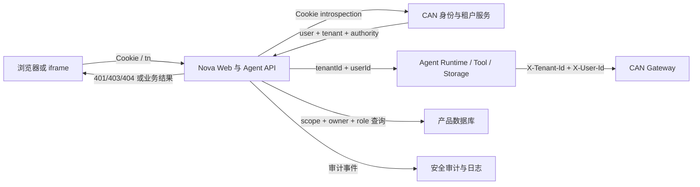
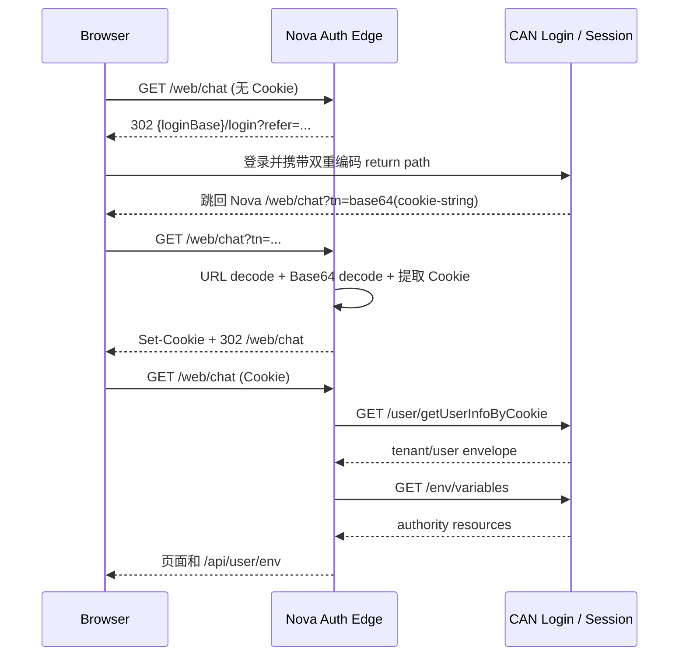
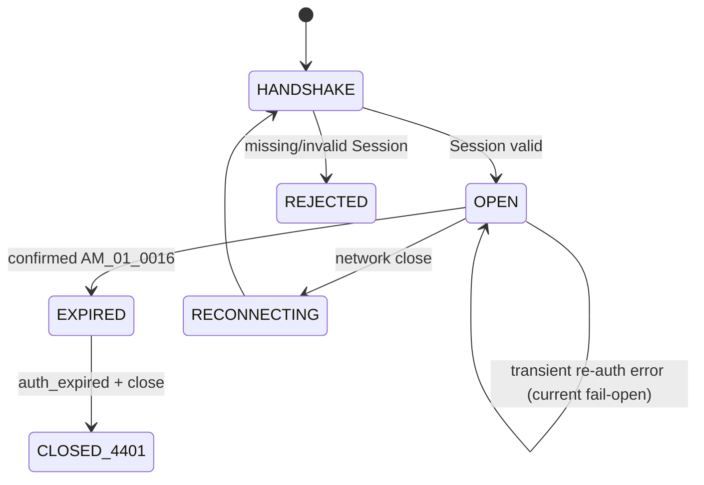
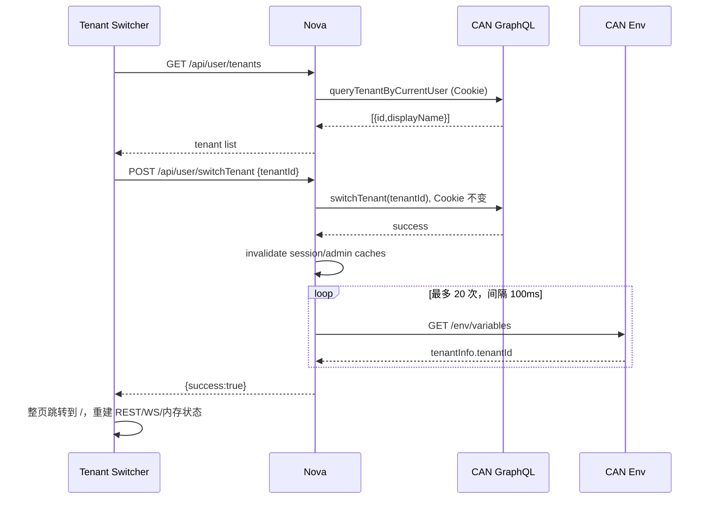
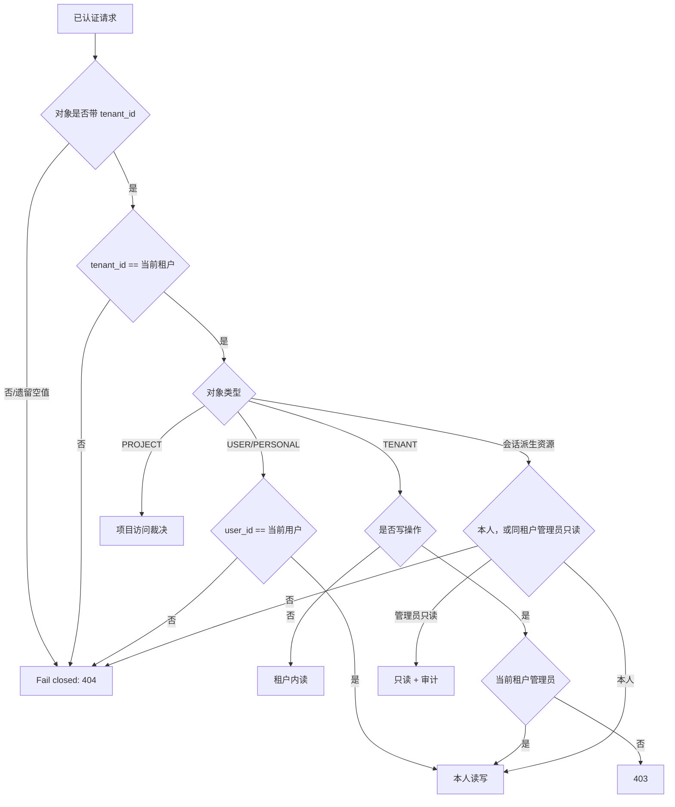
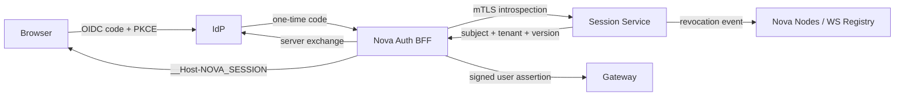

```
# 登录、会话、RBAC、租户和用户隔离复刻说明

## 1. 结论与边界

本文描述一个多租户 Agent 产品如何完成以下闭环：

1. 接收外部身份平台签发的浏览器会话；
2. 将不透明会话解析为可信的 `(tenantId, userId)`；
3. 在 REST、WebSocket、后台执行和外部 Gateway 调用中传播身份；
4. 区分租户管理员、项目管理员、项目成员和普通租户成员；
5. 对系统、租户、项目、个人、会话和文件等对象实施隔离；
6. 在会话过期、租户切换、跨账号访问和上游故障时保持安全且可恢复。

目标读者无需接触 Nova 源码即可实现等价能力。本文中的示例名称和标识均为虚构值，不是可直接用于任何环境的凭据。

### 1.1 目标用户与最终效果

| 参与者 | 目标效果 |
|---|---|
| 普通成员 | 登录后只能看到当前租户内自己有权访问的个人、项目和会话资源。 |
| 租户管理员 | 能管理当前租户级配置；可以审计式只读查看当前租户其他用户的部分会话资源；权限不得跨租户。 |
| 项目管理员 | 能管理其项目成员和项目能力，但不因此获得整个租户的管理权。 |
| 项目成员 | 能使用有权进入的项目；不能修改项目治理配置。 |
| 外部身份平台 | 负责登录、会话、用户—租户关系、当前租户和租户资源权限。 |
| CAN Gateway | 接收 Nova 透传的租户/用户身份；Nova 依赖其返回经过语义资源和成员目录授权过滤的结果。因缺少 Gateway 源码与运行验证，真实对端是否以及如何执行授权只能标为 `F`；兼容对端必须将该授权作为 `REQ`，不能只信任 Header。 |
| 嵌入宿主 | 在 iframe 会话过期时收到事件，重新发起登录或会话交换。 |

### 1.2 输入、输出和依赖

主要输入：

- 默认名为 `CIP_SESSION`、但允许配置名称的不透明 Cookie；
- 外部入口携带的 `tn` 查询参数或 `X-Agent-Tn` Header；
- CAN 用户信息、环境变量和 GraphQL 租户接口；
- REST 路径、WebSocket 消息、当前资源 ID、项目 ID；
- 数据库存储的 `tenant_id`、`user_id`、`project_id`、scope 和成员角色。

主要输出：

| 输出 | 当前静态实现 | 生产复刻目标 |
|---|---|---|
| 服务端可信身份上下文 | 构造 `(tenantId,userId,tenantAdmin,locale)` 并传播到请求、Agent、Tool 和存储链路 | 保持不可变身份并增加 session version、认证时间和安全指纹 |
| 用户环境与租户能力 | 返回 CAN `data` 本体，并在对象响应上追加 Nova 公共配置 | 返回有版本的字段契约和服务端 capability projection |
| 身份错误 | 缺失、无效、撤销、上游网络/5xx、坏 JSON 等多数认证异常都映射为 401；部分授权错误仍为 500 | 401 只表示无有效身份；403/404 表示授权；502/503 表示身份或 Gateway 上游不可用 |
| 实时认证失效 | WebSocket 发送 `auth_expired` 后以 4401 关闭 | 继续保留，并对 tenant/user/session version 变化使用明确关闭语义 |
| 审计 | 管理员跨用户读取和 capability run 使用结构化日志 | 进入不可抵赖、可检索、有保留策略的安全审计存储 |

外部依赖：

- CAN 核心/业务平台：负责会话、用户、租户、权限和租户切换；从本地职责资料可知，`semantic` 是 CAN 核心服务，`anymetrics` 是 CAN 业务层，`jscip` 提供账号和数据源等基础平台配置。本文无法从 Nova 调用方证明上述接口具体落在哪一个对端进程，因此复刻时把它们视为统一的“身份与租户服务”边界。
- CAN Gateway：负责 UID 透传业务请求和租户用户目录。
- 浏览器及反向代理：必须正确传递 HTTPS 信息、Cookie、CORS 和 WebSocket Upgrade。

### 1.3 本次证据状态

- `I`：已对 Nova、`nova_auto_test`、`nova_ui_e2e` 做静态分析。
- `I-risk`：由当前源码静态确认的实现风险或安全缺口；它不是测试仓登记的 Known Failure，也不表示已运行复现。
- `A`：两个测试仓中存在 active 或直接编写的验收契约，但本次没有执行。
- `K`：测试仓登记了若干已知缺陷，见第 8、13、15 节。
- `R`：本次没有运行应用、测试或真实环境，故没有运行验证结论。
- `F`：没有 CAN 身份服务源码；其对端行为由客户端、DTO、Mock 和测试反推。
- `D`：本文给出的生产级强化方案不代表 Nova 当前已经实现。

### 1.4 明确不包含

- 密码登录页内部的账号密码校验实现；Nova 只观察登录页和回跳结果。
- CAN 内部的组织模型、目录同步和会话存储实现。
- OAuth/OIDC、SAML、SCIM 的完整标准实现；生产建议会给出替代架构。
- 各业务模块的完整 CRUD；本文只定义它们必须遵循的身份和权限边界。

## 2. 术语与参与方

| 术语 | 定义 |
|---|---|
| Session | 身份平台签发的不透明浏览器会话。Nova 不应自行解析其内部内容。 |
| 当前租户 | Session 在身份平台侧当前绑定的租户。切换租户时 Cookie 值可以保持不变。 |
| 租户管理员 | 当前租户的 `TENANT` 资源上 `canEdit=true` 的用户。必须同时匹配当前 `tenantId`。 |
| Sandbox Context | 请求/执行期可信上下文，至少含 `tenantId`、`userId`、`tenantAdmin`，可附加会话、执行、项目场景和语言信息。 |
| SYSTEM | 全局只读或平台预置资源，不属于某一租户/用户。 |
| TENANT | 当前租户共享资源，通常仅租户管理员可写。 |
| USER/PERSONAL | 当前租户下某一用户的私有资源。不同模块在线格式上分别使用 `USER` 或 `PERSONAL`。 |
| PROJECT | 当前租户某一项目共享资源，需项目访问裁决。 |
| 对象级授权 | 在已认证后继续检查某个 conversation、message、file、artifact、task 或 project 是否属于调用者。 |
| 隐藏式拒绝 | 对不可见的私有对象返回 404，而不是泄露对象确实存在。 |



## 3. 业务规则

### 3.1 认证规则

1. 生产环境必须启用真实认证；认证关闭模式只能用于隔离的本地开发。
2. 请求体、查询参数中的 `tenantId`、`userId` 不得覆盖认证上下文。
3. 外部 `tn` 只是一种 Session 搬运格式，不是身份本身；必须继续向身份服务验证其中的 Session。
4. REST 每次请求都应经过认证边界；允许短 TTL 缓存，但缓存不得跨 Session 或租户。
5. WebSocket 在握手时认证，并在每条客户端消息到达前重新检查 Session。
6. Session 已明确过期时必须停止处理，不得继续执行 Agent、Tool、取消或订阅操作。
7. 身份平台临时不可用与 Session 无效应区分。当前 REST 将二者都表现为 401，而当前 WS 对非“明确过期”错误 fail-open；生产复刻应采用第 7.7 节的统一策略。

### 3.2 租户管理员规则

管理员判定必须满足全部条件：

```text
存在 authorityResource：
  resourceDTO.resourceType == "TENANT"
  resourceDTO.resourceId   == authenticated.tenantId
  canEdit                  == true
```

不能仅凭 `authorityRole == TENANT_ADMIN`，也不能只寻找任意租户的 `canEdit=true`。环境变量缺失、结构异常、身份服务失败均按非管理员处理。

### 3.3 作用域与覆盖规则

| 逻辑作用域 | 推荐存储归属 | 可见者 | 可写者 | 常见覆盖优先级 |
|---|---|---|---|---|
| SYSTEM | `tenant_id=NULL,user_id=NULL,project_id=NULL` | 所有允许使用该能力的用户 | 平台发布流程 | 最低 |
| TENANT | `tenant_id=T,user_id=NULL/空` | 租户 T 用户 | 租户 T 管理员 | 高于 SYSTEM |
| PROJECT | `tenant_id=T,project_id=P,user_id=NULL` | 对 P 有 view/use 权限者 | 项目管理员或租户管理员，按操作分类 | 高于 TENANT |
| USER/PERSONAL | `tenant_id=T,user_id=U` | T/U 本人 | T/U 本人；高风险恢复需额外确认 | 最高 |

Skill 和 MCP 当前采用 `PERSONAL > PROJECT > TENANT > SYSTEM` 的同名解析顺序。工具设置存在 `USER/TENANT` 与 `PERSONAL/TENANT` 两套命名，复刻时应统一内部枚举，API 层兼容别名。

### 3.4 对象级权限

| 对象 | Owner Key | 普通用户 | 同租户管理员 | 跨租户管理员 |
|---|---|---|---|---|
| 会话/消息 | `(tenantId,userId,conversationId)` | 本人读写 | 可按受控入口只读他人非后台、非删除会话 | 拒绝 |
| 任务 | `(tenantId,userId,taskId)` | 本人读写 | 管理接口与普通任务接口分离 | 拒绝 |
| 文件/Artifact | 会话 owner 或显式 grant | owner/grantee | 基于同租户会话授权只读，并记录审计 | 拒绝 |
| 个人模型/工具/Skill | `(tenantId,userId,resourceId)` | 本人读写 | 不自动继承他人个人资源 | 拒绝 |
| 租户设置 | `(tenantId,resourceId)` | 只读有效值 | 当前租户写 | 拒绝 |
| 项目 | `(tenantId,projectId)` | 依据 access mode 和成员关系 | 可治理/检查当前租户项目 | 拒绝 |

同一个 `userId` 只能视为租户内唯一；任何本人比较都必须同时匹配 `tenantId`。

### 3.5 项目角色规则

- `ALL_TENANT`：当前租户普通用户可使用，未显式入组时有效角色可投影为 `MEMBER`。
- `RESTRICTED`：仅 ACTIVE 项目成员可使用。
- `PROJECT ADMIN`：可管理项目能力与成员。
- `TENANT ADMIN`：可查看受限项目并执行项目治理/管理；但“使用项目”仍应经过 use 裁决，当前实现不会因租户管理员身份自动放开受限项目执行。
- 已软删除项目可供管理员检查或恢复，但不能继续修改配置。
- 每个项目必须至少保留一个 `ACTIVE ADMIN`。降级或移除最后一个 ACTIVE ADMIN 时当前返回 409，业务码为 `PROJECT_LAST_ADMIN`。
- 成员唯一键是 `(tenantId,projectId,userId)`；移除成员不会物理删除该行，而是置为 `REMOVED`。后续重新添加同一用户时复用该唯一键并重新激活，而不是创建第二条成员关系。
- 已软删除项目不能新增、移除或变更成员；当前返回 409，业务码为 `PROJECT_STATE_CONFLICT`。租户管理员的治理能力也不能绕过此状态约束。

### 3.6 防信息泄露规则

- 私有对象不存在和无权访问优先统一返回 404。
- 403 用于“调用者知道该功能存在，但角色不足”的租户管理操作。
- 401 只表示没有有效身份或身份已过期。
- 上游不可用建议返回 502/503，不应伪装为用户未登录。
- 响应、日志、Trace、截图不得包含 Cookie、`tn`、密码、API Key、密文、完整请求体或堆栈。

最后一条是生产复刻安全红线 `D`，不是当前实现保证。当前认证适配器在部分失败路径会把上游异常消息返回客户端，并把截断后的上游响应体写入日志，详见第 8.6 节。

## 4. 完整执行链路

### 4.1 页面登录和 `tn` 回跳



当前兼容行为：

1. `tn` 是标准 Base64 编码的分号分隔 Cookie 字符串，例如 `CIP_SESSION=<opaque>; other=value`；解码前若含 `%` 会先 URL decode，Base64 padding 会补齐。
2. 页面入口解码后设置 Cookie，并把 URL 中 `tn` 去掉；`/chatAgent/**` 入口固定跳到 `/web/chat`。
3. `/api/**?tn=...` 不重定向，而是在当前请求内直接认证；`X-Agent-Tn` 对 `/api/**` 使用同一路径。
4. API 直入既写 Cookie又处理当前请求，适合嵌入或跨域初始化。
5. Next.js 的 `index.txt`、`/web/*.txt` 和 `_rsc` 回跳标记会被清理，其他查询参数保留。

安全边界：当前格式本身没有签名、时效和一次性消费语义。安全性完全依赖其中 `CIP_SESSION` 仍会被服务端 introspection。生产设计应使用一次性交换码，见第 10 节。

### 4.2 REST 请求认证

```text
authenticateRest(request):
  if validCorsPreflight(request): pass without business processing
  if direct tn/header on /api/**: decode, extract configured session, continue
  else if public path or PUBLIC plugin route: pass
  else if WebSocket upgrade: leave to handshake interceptor
  else: session = cookie[configuredCookieName]

  user = sessionCache.get(session) ?? identityService.introspect(session)
  admin = adminCache.get(session + "|" + user.tenantId)
          ?? safeAdminCheck(identityService.env(session), user.tenantId)
  context = {tenantId,userId,tenantAdmin,locale}
  request.attribute["sandboxContext"] = context
  threadLocal.set(context)
  try:
      lazilyConnectVisibleMcp(context)  // fail-soft
      chain.next()
  finally:
      threadLocal.clear()
      localeContext.clear()
```

当前公开路径包括健康检查前缀、H2 Console、favicon、logout、公开分享 API、公开分享 SPA 和 Next.js 静态资源；插件 HTTP 路由还可显式声明 `PUBLIC`。公开只意味着绕过 Cookie Filter，Controller 仍可使用分享 token 等自己的授权。

### 4.3 WebSocket 握手和消息重认证

1. `GET /ws/chat?lang=zh` Upgrade 时只从配置名称的 Cookie 读取 Session。
2. 握手认证成功后写入 session attributes：`tenantId`、`userId`、`locale`、`cipSession`。
3. 每条文本消息先调用 `authenticate(cipSession)`。
4. 明确收到会话过期码时：尽力发送 `auth_expired`，随后以 4401 `Session expired` 关闭；该消息不能进入 chat/cancel/resume/subscribe 等业务分支。
5. 前端看到 4401 后停止自动重连；普通页面调用 logout 得到登录 URL并跳转，iframe 则向父窗口发送 `nova:auth-expired`。
6. 非过期认证异常当前会记录告警并 fail-open；握手阶段异常始终拒绝为 401。



当前风险：消息重认证只验证 Session 仍可认证，没有将新返回的 `(tenantId,userId)` 与握手属性比较。如果同一 Cookie 在另一标签页切换了租户，旧 WS 可能继续以旧 attributes 工作，直到页面自身重载或连接断开。生产复刻必须在身份变化时关闭旧连接。

### 4.4 租户切换



切换请求成功并不等于立即可见。当前实现最多等待约 2 秒确认 `tenantInfo.tenantId` 等于目标租户；否则返回内部错误。成功后整页重载是必要的安全动作，用于清空旧租户前端状态和旧 WebSocket。

生产实现还应：

- 校验目标租户在本次 `listTenants` 或身份服务授权集合中；
- 使切换具备 request ID 和幂等语义；
- 广播同一浏览器其他标签页关闭旧 WS 和清理租户缓存；
- 将“切换 GraphQL 成功、但确认超时”表达为可恢复的 409/202 状态，而不是笼统 500。

### 4.5 对象授权流程



## 5. 对外契约

### 5.1 Nova 认证配置

```yaml
nova:
  auth:
    enabled: false
    auth-url: https://identity.example.invalid
    api-url: ""       # 空时回退 auth-url，服务端可达地址
    login-url: ""     # 空时回退 auth-url，浏览器可达地址
    timeout-seconds: 10
    cookie-name: CIP_SESSION
    mock-tenant-id: default-tenant
    mock-user-id: default-user
  cors:
    allowed-origin-patterns:
      - "https://app.example.invalid"
```

| 配置 | 当前默认 | 复刻要求 |
|---|---:|---|
| `enabled` | `false` | 生产必须 `true`；启动时应阻止生产 profile 使用 mock。 |
| `auth-url` | 无 | 兼容兜底地址。 |
| `api-url` | 回退 `auth-url` | 仅服务端访问，不回传内网地址给浏览器。 |
| `login-url` | 回退 `auth-url` | 仅浏览器跳转和详情链接使用。 |
| `timeout-seconds` | `10` | connect/request timeout 当前相同。 |
| `cookie-name` | `CIP_SESSION` | 浏览器 Cookie 提取、REST、WS、logout 和租户 GraphQL 使用该配置值；但当前 CAN introspection 与 env 调用仍固定发送 `CIP_SESSION`，这是兼容性缺口。复刻时应统一，或显式拆成 browser/upstream 两个配置。 |
| `mock-tenant-id/user-id` | 固定开发值 | 仅本地、非共享、非生产数据。 |
| CORS origin patterns | 当前为 `*` | 生产必须改为显式 allowlist。 |

### 5.2 `GET /api/user/env`

认证：受保护 Cookie。

成功 `200`：返回 CAN `/env/variables` 的 `data`，并追加 Nova 公共配置。

```json
{
  "redirectUri": "",
  "userInfo": {
    "userId": "user-1",
    "account": "alice",
    "nickname": "Alice",
    "photo": null,
    "userSource": "Aloudata",
    "email": null,
    "phone": null,
    "allAuthorityResource": [
      {
        "resourceDTO": {
          "resourceType": "TENANT",
          "resourceId": "tenant-1",
          "resourceName": "Tenant One"
        },
        "authorityRole": "TENANT_ADMIN",
        "canEdit": true,
        "canDelete": true,
        "canAuth": true
      }
    ]
  },
  "tenantInfo": {
    "tenantId": "tenant-1",
    "tenantName": "Tenant One",
    "displayName": null
  },
  "authUrl": "https://identity.example.invalid",
  "gatewayUrl": "https://gateway.example.invalid",
  "allowShare": true,
  "allowDownload": true,
  "defaultLocale": "zh"
}
```

字段契约：

| 字段 | 类型 | 当前来源与必填性 | 默认/缺失语义 |
|---|---|---|---|
| `redirectUri` | string | CAN 上游 `data` 字段；前端类型声明必填，但 Nova 不构造它 | 当前产品不依赖它完成认证；兼容 Stub 可返回空字符串 |
| `userInfo` | object | CAN 上游字段；认证和管理员 UI 所需 | 缺失时前端无法得到用户展示信息；生产适配器应拒绝不完整对象 |
| `userInfo.userId` | string | CAN 上游字段；身份主键 | 必须非空；不能从浏览器请求体补齐 |
| `userInfo.allAuthorityResource` | array | CAN 上游字段；管理员判定使用 | 缺失或非数组时按非管理员处理 |
| `tenantInfo` | object | CAN 上游字段 | 生产契约必须存在并包含非空 `tenantId` |
| `tenantInfo.tenantId` | string | CAN 当前租户 | 必须与已认证身份租户一致；当前 Controller 未做这项二次一致性校验 |
| `authUrl` | string | Nova 在 `login-url/auth-url` 可解析出非空浏览器地址时追加 | 未配置时字段省略，不返回空字符串 |
| `gatewayUrl` | string | Nova 在指标 Gateway URL 非空时追加 | 未配置时字段省略 |
| `allowShare` | boolean | Nova 从当前租户平台设置追加 | 仅当 CAN `data` 是 JSON object 时追加 |
| `allowDownload` | boolean | Nova 从当前租户平台设置追加 | 仅当 CAN `data` 是 JSON object 时追加 |
| `defaultLocale` | string | Nova 从当前租户平台设置追加 | 仅当 CAN `data` 是 JSON object 时追加 |

成功响应是上述 `data` 对象本体，不再包装为 `{success:true,data:{...}}`。当前 Controller 只有在 CAN `data` 是 JSON object 时才追加 Nova 字段；若上游成功 envelope 的 `data` 是数组、字符串或其他非对象值，它会原样返回且不装饰。这是 `I-risk`：兼容 Stub 可用于复现当前宽松行为，生产适配器应要求 `data` 为对象并校验 `userInfo.userId`、`tenantInfo.tenantId` 及其与认证上下文的一致性。

会话在 Filter 缓存窗口内通过、但 live `/env/variables` 返回过期时，Controller 层仍必须返回 401：

```json
{
  "success": false,
  "error": "获取环境变量失败: session expired",
  "errorCode": "AM_01_0016"
}
```

### 5.3 租户 API

`GET /api/user/tenants`

```json
[
  {"id":"tenant-1","displayName":"Tenant One"},
  {"id":"tenant-2","displayName":"Tenant Two"}
]
```

`POST /api/user/switchTenant`

```http
Content-Type: application/json
Cookie: CIP_SESSION=<opaque>

{"tenantId":"tenant-2"}
```

成功：`200 {"success":true}`。

空请求或空 `tenantId`：推荐 `400`：

```json
{"success":false,"message":"tenantId is required"}
```

### 5.4 Logout API

`POST /api/user/logout?path=/web/chat&query=conversationId%3Dc1`

该路径故意公开，使已失效 Session 也能清本地 Cookie。行为：

1. 若请求带 Cookie，清理本地身份和管理员缓存；
2. 下发同名、`Path=/`、`Max-Age=0`、`HttpOnly` Cookie；
3. HTTPS 下附加 `Secure; SameSite=None; Partitioned`；
4. 返回登录 URL，保留用户原页面。

```json
{
  "loginUrl":"https://identity.example.invalid/login?refer=<encoded>"
}
```

当前 logout 只清 Nova 域 Cookie，不证明身份平台全局 Session 已撤销。产品文案应区分“退出当前 Agent”与“退出统一身份平台”。

当前实现还有一个反向代理边界差异：登录/`tn` 下发 Cookie 时会综合 `request.isSecure()` 和受信转发头判断 HTTPS，而 logout 清 Cookie 时只检查 `request.isSecure()`。TLS 在反向代理终止时，两条链路可能生成属性不同的 Cookie。复刻时应复用同一个受信 HTTPS 判定器，并以相同的 Cookie 名、Domain、Path、Secure、SameSite 和 Partitioned 属性清除 Cookie。

### 5.5 `tn` 入口

页面：

```http
GET /web/chat?tn=<urlencoded-base64-cookie-string>
```

API 直入：

```http
GET /api/user/env?tn=<urlencoded-base64-cookie-string>
```

或：

```http
X-Agent-Tn: <base64-cookie-string>
```

解码错误当前返回 `400`：

```json
{"error":"Failed to decode token: <reason>"}
```

生产复刻不应把底层 Base64 异常细节回显给客户端，应使用固定错误码 `AUTH_ENTRY_INVALID`。

### 5.6 WebSocket 契约

握手：

```http
GET /ws/chat?lang=zh
Upgrade: websocket
Cookie: CIP_SESSION=<opaque>
```

缺失或认证失败：握手 HTTP 401，不建立连接。

会话中途明确过期：

```json
{"type":"auth_expired","content":"Session expired. Please log in again."}
```

随后 Close Frame：

```text
code = 4401
reason = "Session expired"
```

所有 `chat`、`cancel`、`resume`、`subscribe`、`unsubscribe`、`clarification_response` 都必须在身份检查和 owner 检查之后处理。

### 5.7 通用错误语义

| 目标状态 | 目标语义 | 当前静态行为差异 | 建议错误码 | 是否隐藏对象存在性 |
|---:|---|---|---|---|
| 400 | 参数、tn、JSON 格式错误 | tn 解码和部分业务参数已返回 400，但错误 envelope 未统一且 tn 会回显底层解码原因 | `REQUEST_INVALID` | 否 |
| 401 | 缺少、伪造、撤销或过期身份 | 当前还会把身份服务网络/5xx/坏 JSON 等非身份错误映射为 401 | `AUTH_REQUIRED` / 稳定过期码 | 不返回资源信息 |
| 403 | 身份有效但缺少已知管理能力 | 注解型管理员拒绝和业务拒绝的 envelope 不一致 | `TENANT_ADMIN_REQUIRED` / `PROJECT_ACCESS_DENIED` | 视对象而定 |
| 404 | 私有对象不存在或调用者不可见 | 部分对象当前仍返回 500 或错误的 200 | `RESOURCE_NOT_FOUND` | 是 |
| 409 | 项目状态、最后管理员、租户切换确认或并发冲突 | 项目状态/版本已有 409；租户切换确认超时当前仍为 500 | 结构化业务码，如 `PROJECT_LAST_ADMIN` | 否 |
| 500 | 真正的本服务缺陷 | 当前仍混入部分授权和对端契约失败 | `INTERNAL_ERROR` | 必须脱敏 |
| 502/503 | 身份平台或 Gateway 不可用、响应格式非法 | 身份认证链当前多数返回 401；GraphQL 租户链多数返回 500 | `IDENTITY_UPSTREAM_UNAVAILABLE` / `IDENTITY_UPSTREAM_INVALID_RESPONSE` | 不应要求用户反复登录 |

当前实现并未完全统一这张表，第 8.4 节列出差异。

### 5.8 CORS、Cookie 和 CSRF

当前 REST `/api/**`：

- 方法：GET、POST、PUT、PATCH、DELETE、OPTIONS；
- Header：`*`；
- 暴露 `X-Next-Cursor`；
- `allowCredentials=true`；
- origin pattern 默认 `*`。

当前 WS allowed origins 也是 `*`。代码中没有统一 CSRF Token、Origin 校验或 Spring Security CSRF 防护证据。与此同时 HTTPS Session Cookie 为 `SameSite=None`，这是嵌入场景需要，却会扩大跨站请求风险。

生产复刻必须实施：

1. REST 和 WS 使用相同的精确 origin allowlist；
2. 所有状态变更请求要求 CSRF Token，或使用双重提交 Cookie/自定义 Header；
3. 校验 `Origin`，不能只依赖 CORS 响应头；
4. `X-Agent-Tn` 只允许来自受信反代或使用 mTLS 的服务，不对公网浏览器开放；
5. `tn` 使用短期、一次性、只可交换为 Session 的 code；
6. 登录/回跳响应使用 `Cache-Control: no-store` 和严格 Referrer Policy；
7. Cookie 建议 `__Host-` 前缀、`Path=/`、无 Domain、HttpOnly、Secure，并按嵌入与非嵌入场景拆分 SameSite 策略。

## 6. 数据模型与生命周期

### 6.1 可信身份对象

```ts
interface AuthenticatedIdentity {
  tenantId: string;      // 非空；参与所有资源查询
  userId: string;        // 非空；仅租户内唯一
  userName?: string;
  account?: string;
  tenantAdmin: boolean;  // 只对 tenantId 有效
  locale: "zh" | "en";
  sessionFingerprint: string; // 推荐：哈希/指纹，不存原 Session
}
```

身份上下文必须由认证边界构造。后台线程、异步回调和 Tool 执行不得隐式继承线程池中的旧 ThreadLocal；应显式复制不可变 identity，并在 `finally` 清除。

### 6.2 用户安全缓存表

当前产品把身份服务返回的安全展示字段缓存到本地：

```sql
CREATE TABLE user_info (
  tenant_id  varchar(255) NOT NULL,
  user_id    varchar(255) NOT NULL,
  user_name  varchar(255),
  account    varchar(255),
  updated_at timestamp,
  PRIMARY KEY (tenant_id, user_id)
);
```

它不是认证事实源，只能用于显示名、成员候选等。Session 失效或用户被禁用时，存在该行不能让用户通过认证。写入采用 upsert 语义；并发首次登录的唯一键冲突可重新读取后更新。

### 6.3 作用域约束

建议对每类可继承资源增加数据库约束：

```sql
CHECK (scope <> 'SYSTEM'
       OR (tenant_id IS NULL AND user_id IS NULL AND project_id IS NULL));
CHECK (scope <> 'TENANT'
       OR (tenant_id IS NOT NULL AND user_id IS NULL AND project_id IS NULL));
CHECK (scope NOT IN ('USER','PERSONAL')
       OR (tenant_id IS NOT NULL AND user_id IS NOT NULL AND project_id IS NULL));
CHECK (scope <> 'PROJECT'
       OR (tenant_id IS NOT NULL AND user_id IS NULL AND project_id IS NOT NULL));
```

查询不能只依赖应用层在写入时填充 owner；Repository 方法本身必须把 owner tuple 放进 WHERE 条件。

### 6.4 项目成员

```sql
CREATE TABLE project_member (
  id         bigint PRIMARY KEY,
  tenant_id  varchar(255) NOT NULL,
  project_id varchar(64) NOT NULL,
  user_id    varchar(255) NOT NULL,
  role       varchar(16) NOT NULL CHECK (role IN ('ADMIN','MEMBER')),
  status     varchar(16) NOT NULL CHECK (status IN ('ACTIVE','REMOVED')),
  created_by varchar(255) NOT NULL,
  created_at timestamp NOT NULL,
  updated_by varchar(255) NOT NULL,
  updated_at timestamp NOT NULL,
  UNIQUE (tenant_id, project_id, user_id)
);
```

成员移除是状态转换 `ACTIVE -> REMOVED`，不是物理删除；重新添加同一 `(tenant_id,project_id,user_id)` 时更新原行并转回 `ACTIVE`。角色变更和移除必须在项目行锁或等价串行化边界内重新统计 ACTIVE ADMIN；若操作会使管理员数降为零，则返回 409 `PROJECT_LAST_ADMIN`。项目为 `DELETED` 时，任何成员新增、角色变更或移除均返回 409 `PROJECT_STATE_CONFLICT`。

生产设计应让项目主键或外键包含 `tenant_id`，避免仅凭全局 `project_id` 外键造成租户归属无法由数据库共同验证。

### 6.5 Session 缓存生命周期

当前静态确认的缓存：

| Cache | Key | Value | 最大项 | TTL | 主动失效 |
|---|---|---|---:|---:|---|
| 身份 | 原始 Session | AuthUser | 10,000 | 写入后 10 秒 | logout、租户切换、env 返回过期码 |
| 管理员 | `Session + "|" + currentTenantId` | boolean | 10,000 | 写入后 10 秒 | 同上，按 Session 精确前缀清全部租户项 |

原始 Session 作为进程内 key 是当前行为，不应写日志或持久化。生产建议使用 keyed HMAC 指纹作 key，并在分布式撤销事件到达时主动清理各节点缓存。

### 6.6 Cookie 生命周期

`tn` 入口当前把解码出的 Cookie 下发为 24 小时浏览器 Max-Age；它不改变身份平台 Session 的真实有效期。Session 可能早于浏览器 Cookie 过期，之后请求通过 introspection 得到 401。

当前实现会下发 `tn` 内的所有 Cookie：只有配置 Session 名和兼容名 `CIP_SESSION` 被标 HttpOnly，其他 Cookie 可被脚本读取。生产复刻应只接受 allowlist 中的 Session Cookie，拒绝任意 Cookie 搬运。

## 7. 核心实现设计

### 7.1 最小可用模块

```text
auth-edge
  - TokenEntryDecoder
  - RestAuthenticationFilter
  - WebSocketHandshakeAuthenticator
  - LoginRedirectBuilder

identity-adapter
  - SessionIntrospector
  - EnvironmentClient
  - TenantGraphqlClient
  - TenantUserDirectoryClient
  - ShortTtlIdentityCache

authorization
  - TenantAdminPolicy
  - ScopePolicy
  - ProjectAccessPolicy
  - ConversationAccessPolicy
  - AuthorizationErrorMapper

identity-context
  - immutable RequestIdentity
  - Servlet request attribute bridge
  - Tool/Agent execution identity bridge
  - WS session identity snapshot

security-observability
  - AuthAuditSink
  - SecretRedactor
  - SecurityMetrics
```

### 7.2 Session introspection伪代码

```java
AuthUser introspect(String session) {
  requireNonBlank(session);
  return cache.get(hmacFingerprint(session), ignored -> {
    HttpResponse r = get(apiBase + "/user/getUserInfoByCookie",
                         header("Cookie", cookieName + "=" + session),
                         timeout);
    if (r.status / 100 != 2) throw upstreamOrAuthFailure(r);
    Envelope e = parseStrictJson(r.body);
    if (!e.success) throw new AuthFailure(e.errorCode, safe(e.errorMsg));
    requireNonBlank(e.data.user.userId);
    requireNonBlank(e.data.tenant.tenantId);
    return new AuthUser(e.data.tenant.tenantId,
                        e.data.user.userId,
                        e.data.user.username,
                        e.data.user.account);
  });
}
```

当前代码只拒绝缺失或 JSON null 的 ID，文本空串可能进入后续上下文并在构建时失败。复刻实现必须在 adapter 边界拒绝 blank。

### 7.3 统一授权伪代码

```java
Decision authorize(Action action, Resource row, Identity actor) {
  if (!constantTimeEqual(row.tenantId, actor.tenantId)) return HIDDEN_NOT_FOUND;

  return switch (row.scope) {
    case SYSTEM -> action.isRead() ? ALLOW : PLATFORM_ONLY;
    case TENANT -> action.isRead()
        ? ALLOW
        : actor.tenantAdmin ? ALLOW : FORBIDDEN;
    case USER, PERSONAL -> constantTimeEqual(row.userId, actor.userId)
        ? ALLOW : HIDDEN_NOT_FOUND;
    case PROJECT -> projectPolicy.decide(action, actor, row.projectId);
  };
}
```

对于会话派生资源，先解析 conversation owner，再基于 owner 做授权；不得分别在文件、Artifact、消息 API 中复制稍有差异的判断。

### 7.4 项目裁决伪代码

```text
load project WHERE tenant_id=:actorTenant AND project_id=:projectId
membership = ACTIVE row for actor

view:
  tenantAdmin OR accessMode==ALL_TENANT OR membership exists
use:
  project.status==ACTIVE AND (accessMode==ALL_TENANT OR membership exists)
admin/edit:
  tenantAdmin OR membership.role==ADMIN
edit additionally requires project.status != DELETED

member mutation (under project lock):
  require project.status != DELETED, else 409 PROJECT_STATE_CONFLICT
  add a REMOVED user -> update existing unique row to ACTIVE
  downgrade/remove ADMIN -> count ACTIVE ADMIN after intended change
  if remainingActiveAdmins == 0 -> 409 PROJECT_LAST_ADMIN
```

### 7.5 身份传播到 Gateway

用户态请求：

```http
X-Tenant-Id: tenant-1
X-User-Id: user-1
```

管理态请求：

```http
X-API-Key: <server-side secret>
X-Tenant-Id: tenant-1
```

请求调用方不得自定义或覆盖这三个 Header；值必须拒绝 CR/LF 和控制字符。Gateway 必须验证用户确实属于租户，不能只相信 Header。生产推荐 Nova 与 Gateway 使用 mTLS 或签名的短期 service assertion，并把用户身份作为不可篡改 claims。

### 7.6 前端 RBAC

当前前端：

- 管理员显示设置入口；普通用户隐藏；
- 管理页面由客户端 Guard 包裹，普通用户深链跳回 `/web/chat`；
- 非管理员刷新后也不恢复管理 UI；
- 管理员和非管理员 E2E 使用独立 storage state 文件。

前端 Guard 只能改善体验，不能替代服务端授权。当前前端管理员 helper 只检查任意 `TENANT + canEdit=true`，没有匹配 `tenantInfo.tenantId`；后端判定是绑定当前租户的。该差异可能错误展示管理入口，但受保护 API 仍应由后端拒绝。复刻时前端应直接消费服务端投影的 `capabilities`：

```json
{
  "capabilities": {
    "tenantAdmin": true,
    "manageModels": true,
    "manageTools": true,
    "viewOps": true
  }
}
```

不要让浏览器重新解释复杂权限资源。

### 7.7 推荐的故障策略

| 场景 | REST | 已建立 WS | 管理员权限 |
|---|---|---|---|
| 明确 Session 过期/撤销 | 401，清缓存 | `auth_expired` + 4401 | false |
| 身份服务网络/5xx，缓存内有未过期身份 | 短暂使用缓存并标记 degraded，限制高风险写 | 保持连接但拒绝高风险写或有限 fail-open | 使用已有极短缓存；过期后 false |
| 身份服务网络/5xx，无缓存 | 503，不是 401 | 握手拒绝 1013/HTTP 503 | false |
| Session 身份 tenant/user 与 WS snapshot 改变 | 要求重建上下文 | 4409 `Identity changed` | 重算 |
| env 权限接口失败 | 普通业务可继续 | 普通聊天可继续 | fail-closed false |

当前 WS 对所有非过期认证异常允许消息继续，范围过宽。生产实现至少要区分只读 ping、普通 chat 和产生外部副作用的 Tool/管理操作。

### 7.8 Secret 处理

当前产品的通用凭据加密采用 AES-256-GCM：32 字节 Base64 主密钥、随机 12 字节 IV、128 位 tag，存储格式为 `IV || ciphertext || tag`；配置型 Secret 再包一层 JSON envelope：

```json
{
  "__secret": true,
  "alg": "AES-256-GCM",
  "keyVersion": 1,
  "ciphertextBase64": "<ciphertext>"
}
```

REST 输出使用 `****` 掩码；`****` 表示保留已有值，空字符串表示显式清除。生产强化：主密钥进入 KMS/HSM，密文使用 tenant/resource/field 作为 AAD，实现真正的 key version 轮换，不容忍新增明文；任何 legacy 明文兼容都必须有迁移截止时间。

## 8. 并发与非正常路径

### 8.1 缓存与撤销竞态

- 身份撤销后，本地身份缓存最多存在约 10 秒陈旧窗口。
- `/env/variables` 若先发现 `AM_01_0016`，会立即清身份缓存和该 Session 的所有租户管理员缓存。
- 普通 503 不清身份缓存，避免短暂故障造成全量登出。
- 管理员 Cache key 必须含租户；清理时必须匹配 `session + 分隔符`，不能误删有相同字符串前缀的另一 Session。

### 8.2 租户切换竞态

- GraphQL 成功后立即失效本地缓存，再轮询 env；顺序不能颠倒。
- 前端必须整页重载并关闭旧 WS。
- 多标签页需要 BroadcastChannel 或服务端 session version；否则旧标签页可能保留旧租户内存数据。
- 同时发起两个不同租户切换时应以单调 session version 或 compare-and-set 决定最终值，响应带 `currentTenantId` 和 `sessionVersion`。

### 8.3 跨账号访问

活动黑盒契约要求：

- 他人 conversation 的 read/delete 为 403 或 404，owner 仍为 200；
- WS resume/subscribe 他人会话返回明确但不泄漏内部信息的拒绝；
- 跨账号 snapshot 不得返回 `processData`；
- 他人的 task、file/artifact、Skill、knowledge、tool config、model override 不得读取或修改；
- 第二租户的 theme/platform/tool 设置在第一租户变更和恢复期间保持不变。

资源创建和清理同样必须使用 owner identity。测试清理不能因为拿到了 ID 就使用管理员旁路删除别人的数据。

### 8.4 当前错误不一致与已知缺陷

以下均为静态测试契约或缺陷登记，本次未运行：

| 现象 | 等级 | 影响 | 复刻要求 |
|---|---|---|---|
| 伪造 Session 对受保护接口接受 401 或 403 | `A` | 未统一缺少身份与权限不足 | 统一为 401。 |
| `/health` 已列为公开前缀，但 release 登记返回 404 | `K` | 编排系统无法可靠探活 | 实现真实 200 health，且不暴露内部依赖。 |
| 跨账号 `POST /api/chat` 当前活动用例断言 500 | `A` 当前行为/设计缺陷 | 将授权失败误报内部错误 | 目标实现返回隐藏式 404。 |
| 外租户数据源 update 当前为 500 | `K` | 错误不可控 | 403/404，owner 数据不变。 |
| 外租户推荐问题 read 当前返回 200 | `K` | 明确跨租户泄露 | 查询必须强制 tenant 条件并返回 404。 |
| 缺失/外用户 feedback mutation 当前为 500 | `K` | 授权失败映射错误 | 403/404 且 owner 反馈不变。 |
| 相同 keyword 的跨租户个人知识匹配在第二租户返回 0 | `K` | 过度隔离/错误 winner 选择 | 只能隐藏他租户结果，不能吞掉当前租户结果。 |
| 敏感保存收到 401 后 UI 仍停管理页 | `K` (`NOVA-BUG-032`) | 过期页面可继续展示陈旧管理内容 | 统一 401 事件、清敏感状态、跳登录，刷新不可恢复。 |
| 知识 Markdown script 被创建为 DOM 节点 | `K` (`NOVA-BUG-033`) | 存储型 XSS | 严格净化和文本化；与 RBAC 共同防止横向扩大。 |

### 8.5 `tn` 与 Cookie 边界

- 当前解码器会接受任意 Cookie 名并全部写回；生产只允许 session allowlist。
- `tn` 放在 URL 会进入浏览器历史、反代访问日志和 Referer；清理跳转不能抹掉已经记录的入口请求。
- 配置 Cookie 名不为 `CIP_SESSION` 时，API 直入有兼容 fallback，但后续 REST/WS 只读配置名；对端必须生成配置名称，不能依赖 fallback。
- 当前浏览器侧提取和 GraphQL 租户切换使用配置 Cookie 名，但 `/user/getUserInfoByCookie` 与 `/env/variables` 的上游请求头固定为 `CIP_SESSION=<value>`。如果二者名称不同，只有“读配置名、向上游重命名为 `CIP_SESSION`”这一组合能工作；不能把 `cookie-name` 误解为端到端统一配置。推荐分别定义 `browser-cookie-name` 与 `upstream-cookie-name`，或让所有调用只使用一个配置值并补兼容测试。
- HTTPS 判断兼容 `request.isSecure`、`X-Forwarded-Proto`、`X-Forwarded-Ssl`、`X-Forwarded-Port` 和 `Forwarded`。生产必须只信任受信代理写入的 forwarded headers。

### 8.6 当前认证错误映射与诊断泄露风险

当前认证适配层用同一个 `AuthenticationException` 表达以下不同故障：

- Session 缺失、伪造、撤销或明确过期；
- 身份服务网络失败、超时、中断和 HTTP 非 2xx；
- 空响应、HTML、坏 JSON、缺少身份字段；
- `/env/variables` 返回业务失败。

REST Filter 和 Controller 异常处理器会把这些异常大多统一映射为 401，并把异常 message 放进 JSON `error`。网络异常 message、JSON 解析原因和上游错误文案因此可能把内部地址、库实现或诊断细节带给客户端。认证和 env 客户端在 HTTP 非 2xx、响应解析失败时还会把最多 500 字符的上游响应体写入日志；GraphQL 租户调用也会记录或拼接截断后的 body/errorMsg。这是静态确认的 `I-risk`，而不是已完成的脱敏保证。

生产复刻必须在适配器边界先分类再脱敏：

```text
AM_01_0016 / invalid session -> 401 AUTH_REQUIRED
valid identity but policy denied -> 403 or hidden 404
upstream timeout/network/5xx -> 502/503 IDENTITY_UPSTREAM_UNAVAILABLE
bad upstream schema/JSON -> 502 IDENTITY_UPSTREAM_INVALID_RESPONSE
unexpected local defect -> 500 INTERNAL_ERROR
```

对客户端只返回固定错误码和安全文案；详细原因只进入受控内部日志。日志不得记录原 Cookie、`tn`、完整上游 body、GraphQL response、密码、Token 或用户环境对象。若排障确需响应摘要，只记录状态、内容类型、长度、稳定错误码和不可逆指纹。

## 9. 安全、权限和审计

### 9.1 服务端是唯一授权边界

- 所有管理 Controller 必须用统一策略或注解保护；不能只隐藏前端菜单。
- 注解型租户管理员拦截当前返回 403 `Tenant admin required`；业务异常则通常返回 JSON `{"success":false,"message":"..."}`。复刻时统一 JSON envelope。
- 插件公共路由必须显式声明；动态插件不得通过路由注册绕过产品身份策略。
- 管理员只读他人会话不得变成通用 impersonation，也不能调用修改、重试、Tool 执行或分享操作。

### 9.2 审计事件

当前至少存在两类结构化日志审计：

1. `AUDIT.admin-access`：租户管理员读取其他用户的 conversation/messages/file/artifact；记录 actor tenant/user、owner tenant/user、conversation、resource type/id。
2. capability run audit：记录 tenant/user/project、scene mode、agent、policy version、工具/Skill 策略和结果；快照约定不含凭据。

生产审计建议模型：

```json
{
  "eventId": "uuid",
  "occurredAt": "2026-08-13T10:00:00Z",
  "action": "CONVERSATION_ADMIN_READ",
  "outcome": "ALLOWED",
  "actor": {"tenantId":"tenant-1","userId":"admin-1"},
  "target": {"tenantId":"tenant-1","ownerUserId":"user-2","type":"FILE","id":"file-9"},
  "request": {"requestId":"req-1","ipHash":"...","userAgentHash":"..."},
  "policy": {"version":"v7","reason":"SAME_TENANT_ADMIN_READ_ONLY"},
  "sessionFingerprint": "hmac:..."
}
```

不记录原 Cookie、tn、密码、API Key、文件内容或用户 Prompt。拒绝事件要限流，避免攻击者制造审计洪泛。

### 9.3 测试仓 Secret 风险

UI E2E 认证状态文件位于 `.auth/<env>-<username>.json`，最大复用年龄默认 12 小时，管理员与非管理员使用不同文件。该目录、密码、Cookie 和 storage state 必须被 Git 忽略并限制文件权限。

静态检查发现 UI 测试环境映射包含可直接使用的默认账号信息。本文不复制其值。复刻工程不得提交真实或共享环境密码；只提交环境变量名和占位模板。失败 Trace、截图、视频、HTML 报告和 console 必须做敏感 Header/Body 脱敏。

## 10. 外部依赖对端设计

### 10.1 已观察到的 CAN 用户信息契约（`F`）

请求：

```http
GET /user/getUserInfoByCookie
Cookie: CIP_SESSION=<opaque-session>
Accept: application/json
Content-Type: application/json
```

成功：

```json
{
  "success": true,
  "errorCode": null,
  "errorMsg": null,
  "data": {
    "user": {
      "userId": "user-1",
      "username": "Alice",
      "account": "alice"
    },
    "tenant": {
      "tenantId": "tenant-1"
    }
  }
}
```

业务失败可使用 HTTP 200：

```json
{
  "success": false,
  "errorCode": "AM_01_0016",
  "errorMsg": "session expired",
  "data": null
}
```

Agent 对 non-2xx、空响应、HTML、坏 JSON、`success=false`、缺失 userId/tenantId 全部拒绝；HTTP Client 不跟随 redirect。

这里的 `CIP_SESSION` 是当前适配器固定写入的上游 Cookie 名，不是 `nova.auth.cookie-name` 的动态替换结果。浏览器请求可以使用配置名称，Agent 读取其值后仍会以 `CIP_SESSION=<同一值>` 调用该接口。若对端也要支持改名，应扩展为独立的上游 Cookie 名配置，并确保 introspection、env 与 GraphQL 三条调用链的一致性。

### 10.2 已观察到的 CAN 环境变量契约（`F`）

请求：

```http
GET /env/variables
Cookie: CIP_SESSION=<opaque-session>
Accept: application/json
Content-Type: application/json
```

响应 envelope 与第 5.2 节相同，外层为 `{success,errorCode,errorMsg,data}`。对管理员判定真正必需的是：

```text
data.userInfo.allAuthorityResource[*].resourceDTO.resourceType
data.userInfo.allAuthorityResource[*].resourceDTO.resourceId
data.userInfo.allAuthorityResource[*].canEdit
data.tenantInfo.tenantId
```

前端还消费 user account/nickname/photo/source/email/phone、tenantName/displayName。对端可增加字段，但不得改变上述嵌套和类型。

### 10.3 已观察到的 CAN GraphQL 契约（`F`）

列租户：

```json
{
  "operationName":"queryTenantByCurrentUser",
  "variables":{},
  "query":"query queryTenantByCurrentUser { queryTenantByCurrentUser { id displayName } }"
}
```

切换：

```json
{
  "operationName":"switchTenant",
  "variables":{"tenantId":"tenant-2"},
  "query":"mutation switchTenant($tenantId: String) { switchTenant(tenantId: $tenantId) }"
}
```

均为 `POST /graphql`，Cookie Header 使用配置名称。成功 envelope 示例：

```json
{
  "data":{"switchTenant":null},
  "extensions":{"success":true}
}
```

列表 `data.queryTenantByCurrentUser` 必须为数组。`extensions.success=false` 时使用 `errorCode/errorMsg`；`AM_01_0016` 作为认证过期，其余当前被映射成内部错误。

当前条目级解析较宽松：只验证列表节点是数组，单项缺失 `id` 或 `displayName` 时会被转换为空字符串，而不是拒绝整份响应。`switchTenant` 当前也不会先把目标 `tenantId` 与本次 `queryTenantByCurrentUser` 的授权集合比较，而是直接依赖 GraphQL 对端裁决。这两项是 `I-risk`。兼容 Stub 可提供开关复现空字段行为；生产实现必须拒绝空 `id`，允许 `displayName` 为空时使用明确回退显示名，并在切换前后都验证目标租户属于当前会话的授权集合。

### 10.4 已观察到的 Gateway 用户目录契约（`F`）

```http
POST /api/users/search
X-Tenant-Id: tenant-1
X-User-Id: admin-1
Content-Type: application/json

{"keyword":"Alice","limit":20}
```

标准 Gateway envelope 的 `data`：

```json
{
  "users":[
    {"userId":"u-1","account":"alice","nickname":"Alice","displayName":"Alice"}
  ]
}
```

keyword 去首尾空白，长度 2..100，limit 当前固定 20。缺少 `users` 数组或任一用户缺 `userId` 必须失败；相同 userId 去重。显示名优先 `displayName`、nickname、account、userId。结果只可写入当前 tenant 的 `user_info` 缓存。

### 10.5 最小兼容 Stub

Stub 仅用于本地和自动化，不能接受“任意非空 Cookie”。

```ts
type SessionRow = {
  sessionId: string;
  userId: string;
  currentTenantId: string;
  allowedTenantIds: string[];
  expiresAt: number;
  revoked: boolean;
};

type Authority = {
  tenantId: string;
  canEdit: boolean;
};
```

Stub 必须实现：

1. `/login`：测试账号登录或测试专用无 UI session mint；
2. `/agent_redirect`：生成短期 Session，并以 `tn` 回跳；
3. `/user/getUserInfoByCookie`：严格查 session、过期和撤销；
4. `/env/variables`：按 `currentTenantId` 返回用户和权限资源；
5. `/graphql`：列 authorized tenants、切 current tenant；
6. `/api/users/search`：验证 X-Tenant-Id/X-User-Id 的成员关系，再搜索该租户目录；
7. 故障注入：过期码、403、500、HTML、坏 JSON、timeout、切换传播延迟、跨租户资源混入；
8. 记录请求次数但不记录 Cookie 值。

```text
introspect(session):
  row = sessions[session]
  if row missing/revoked/expired:
      return 200 {success:false,errorCode:"AM_01_0016",...}
  return identity for row.currentTenantId

switchTenant(session,target):
  require target in row.allowedTenantIds
  row.currentTenantId = target
  row.sessionVersion++
  return success
```

### 10.6 生产级身份与租户服务（`D`）

推荐用标准协议替代 Base64 Cookie 搬运：

- 浏览器：OIDC Authorization Code + PKCE；
- Nova Backend-for-Frontend：HttpOnly、Secure、主机绑定 Session；
- introspection/identity：mTLS，返回 `subject`、current tenant、session version、expiry、auth time；
- 租户切换：服务端授权 mutation，返回新 session version；
- 撤销：消息总线广播 session revoked/identity changed；
- Gateway：Nova 用 mTLS service identity + 签名 user assertion，Gateway 再验证 tenant membership；
- 管理权限：返回按当前租户计算的 capability projection，不让前端自行拼装。



## 11. 可观察性

### 11.1 日志

允许：requestId、Session HMAC 指纹、tenantId、userId、路径模板、结果、errorCode、cache hit/miss、上游耗时。

禁止：原 Cookie、tn、Authorization、API Key、密码、完整 env 响应、用户私有资源内容、堆栈回显给 UI。

### 11.2 指标

```text
auth_requests_total{channel,outcome,error_code}
auth_introspection_duration_seconds{outcome}
auth_cache_hit_total{cache=session|admin}
auth_cache_entries{cache=session|admin}
auth_session_expired_total{channel=rest|ws}
auth_ws_fail_open_total{error_class}
authorization_decisions_total{resource,action,decision}
cross_tenant_denied_total{resource}
tenant_switch_total{outcome}
tenant_switch_confirmation_seconds
admin_cross_user_reads_total{resource}
```

`auth_ws_fail_open_total` 必须告警；同一 Session 指纹大量跨租户拒绝、同一用户频繁切租户、管理接口 403 激增也应触发安全告警。

### 11.3 Trace

跨系统 Trace 只传播 request/trace ID。身份服务和 Gateway span 标注 tenant/user 可使用内部受控属性或哈希，不能把 Session 放入 baggage。

## 12. 复刻实施顺序

1. 定义不可变 Identity、scope 和统一错误模型；静态验收：任何服务方法不接受客户端 owner 作为可信身份。
2. 实现本地严格 Stub；静态验收：可模拟成功、过期、撤销、跨租户和上游失败。
3. 实现 REST Auth Edge 和上下文清理；验收：每个路径明确 protected/public，ThreadLocal 必有 finally。
4. 实现对象 Repository 的 tenant/user/project 条件和数据库约束；验收：所有 owner 查询含完整 tuple。
5. 实现 TenantAdminPolicy、ProjectPolicy、ConversationPolicy；验收：同 userId 跨租户失败。
6. 实现 WebSocket 握手、每消息重认证、身份版本变化关闭；验收：过期消息零业务事件。
7. 实现租户切换和多标签页失效；验收：旧租户前端/WS/缓存被清理。
8. 实现前端 capability projection 和深链 Guard；验收：隐藏入口、深链跳转、服务端仍独立拒绝。
9. 实现 CORS/CSRF/origin allowlist；验收：未知 origin 的 REST credential 请求和 WS 握手都拒绝。
10. 实现 Secret 加密、掩码和审计；验收：日志、响应、Trace 无 canary secret。
11. 用 API、WS、UI 三通道执行第 14 节矩阵；修复 500/200 泄漏后才能认为隔离完成。

## 13. 验收标准

### 13.1 正向

1. 合法 Session 得到正确 tenant/user，REST 和 WS 均可聊天。
2. 当前租户管理员可进入管理 UI并调用管理 API。
3. 普通用户聊天可用，但无设置入口；直接访问管理深链回聊天页，管理 API 返回 403。
4. 用户可列出自己的租户并切换；切换后 `/api/user/env`、数据列表、WS 和 Agent Tool 全部使用新 tenant。
5. PROJECT 资源仅对有权成员可见，项目管理员可写，成员只使用。
6. 同租户管理员按受控入口只读他人会话/文件时生成审计记录，且不能修改。
7. 项目管理员可重新激活已移除成员；最后一个 ACTIVE ADMIN 的降级或移除返回 409 `PROJECT_LAST_ADMIN`。

### 13.2 反向与边界

1. 无 Cookie、伪造 Cookie、过期 Cookie、坏 tn 均不进入业务。
2. 同 `userId` 不同 tenant 不视为本人。
3. A 租户管理员进入 B 租户后，只有 B 的权限条目能决定管理员身份。
4. 外账号 conversation read/delete、resume、subscribe、snapshot 全部拒绝且不泄露内容。
5. 外租户推荐问题、数据源、knowledge、Skill、tool config、模型覆盖均不能读取或修改。
6. SYSTEM/TENANT/PROJECT/PERSONAL 同名资源按规定 winner 解析，不能把另一个用户的 PERSONAL winner 带给当前用户。
7. Session 过期后的 REST 返回 401；WS 发 auth_expired 并 4401；页面或宿主进入重新登录。
8. 身份服务 503 不应被错误显示成账号密码错误；高风险写 fail-closed。
9. 未知 Origin、缺 CSRF Token 的跨站写请求拒绝；WS 未知 Origin 拒绝。
10. 错误响应不包含 Cookie、堆栈、内部路径、API Key 或 owner 私有字段。
11. 身份服务 timeout、网络错误、5xx、HTML 和坏 JSON 不伪装成未登录；响应与日志均不包含上游 body、内部主机或解析器细节。
12. 已删除项目的成员新增、角色变更和移除均返回 409 `PROJECT_STATE_CONFLICT`，状态和成员行保持不变。

### 13.3 数据生命周期

- logout 清浏览器 Cookie和本地缓存；身份平台是否全局退出有明确语义。
- 租户切换清 Session/admin cache、前端 store、query cache、WS 和旧租户临时数据。
- 被移除项目成员不能再 use；已有页面刷新后失效。
- 用户显示缓存可以保留，但不能成为认证依据。
- 个人资源删除或用户离租后的保留/归档策略必须显式定义，不能变成其他用户可见资源。

## 14. 测试矩阵

`nova_ui_e2e` 的 RBAC-02..05 只有在配置了专用非管理员账号和密码时才执行；缺失凭据会显式 `test.skip`。因此这些行是有条件的 `A` 契约，不代表任意一次测试运行都覆盖了非管理员路径。RBAC-01 只证明管理员入口与设置导航可见，不证明任意管理写 API 已通过 E2E。

| 场景 | 通道 | 前置条件 | 操作 | 预期结果 | 当前证据等级 |
|---|---|---|---|---|---|
| 合法 Cookie | API | 身份 Stub 有有效 Session | GET `/api/user/env` | 200，tenant/user 正确 | `I` |
| 伪造 Cookie | API | 新浏览器上下文 | GET protected API | 401；非空、无后端泄漏 | `A` AUTH-FILTER-004 |
| 公开 health | API | 无认证 | GET `/health` | 应为 200；当前 release 登记 404 | `K` AUTH-FILTER-005 |
| 无认证 chat | API | 无认证 | POST `/api/chat` | 401 | `A` CHAT-SYNC-006 |
| 无认证 WS | WS | 无 Cookie | 连接并发 chat | 无 conversation/token/complete | `A` CHAT-WS-004 |
| REST Session 过期 | API | 先缓存成功，再让 env 返回过期码 | GET `/api/user/env` | 401并清两类缓存 | `I` |
| WS Session 过期 | WS | 握手后撤销 | 发送下一条消息 | auth_expired + 4401，消息未处理 | `I`，Auto 未登记实跑 |
| WS 身份发生租户变化 | WS | 同 Cookie 切租户 | 旧连接发消息 | 推荐 4409关闭；当前存在缺口 | `I-risk` + `D` |
| 当前租户 admin 入口 | UI | 当前 tenant resource canEdit=true | 点击设置入口 | 进入设置导航 | `A` RBAC-01 |
| 当前租户 admin 管理写 | API | 当前 tenant resource canEdit=true | 写租户配置 | 服务端放行 | `I`；建议新增独立 `A` 用例 |
| 其他租户 admin（服务端） | API | 仅 A admin，当前在 B | 访问 B 管理 API | 403 | `I` |
| 其他租户 admin（前端） | UI | 仅 A admin，当前在 B | 打开 B 页面 | 目标无设置入口；当前 helper 可能因 A 的权限错误展示 | `I-risk` + `D`；建议新增 `A` |
| 普通成员深链 | UI | 独立非管理员 storage state | 访问所有管理路径并刷新 | 回 `/web/chat`，不显示管理内容 | `A` RBAC-02..04 |
| 登录态隔离 | UI | 管理员/普通用户两个 context | 并行打开聊天 | 权限展示互不污染 | `A` RBAC-05 |
| 跨账号会话读删 | API | 两账号 | 外账号 read/delete | 403/404，owner仍200 | `A` CHAT-CONV-010 |
| 跨账号取消 | WS | 两账号，owner 有运行中会话 | 外账号 cancel owner conversation | 拒绝且 owner 任务不受影响 | `A` CHAT-CANCEL-004 |
| 跨账号 resume | WS | 两账号 | 外账号 resume owner conv | 拒绝，无泄漏 | `A` CHAT-CONV-008 |
| 跨账号 subscribe | WS | 两账号 | 外账号 subscribe | 拒绝，无泄漏 | `A` CHAT-CONV-009 |
| 跨账号 snapshot | WS/API | owner有 processData | 外账号取 snapshot | 403/404且无 processData | `A` CHAT-STATS-021 |
| 外账号 POST chat | API | 两账号 | 使用 owner conversationId | 当前 active 契约记录500；目标应隐藏式404 | `A` CHAT-SYNC-008（不理想现状）+ `D`（目标） |
| 跨租户工具配置 | API | 两租户 | owner变更并恢复 | 第二租户始终不变 | `A` TOOL-CONF-007 |
| 跨租户数据源 | API | 两租户 | 外租户 update/test/delete | 403/404，owner不变；当前 update 500 | `K` SET-DS-003 |
| 跨租户推荐问题 | API | 两租户 | 外租户 read/write | 403/404；当前 read 200 | `K` SET-RECQ-004 |
| 跨租户个人知识 winner | WS | 两租户相同 keyword | 当前租户 search | 只返回当前可见项；当前第二租户0结果 | `K` KNOW-MATCH-006 |
| 用户模型覆盖 | API | 两账号 | owner设 override | 外账号有效配置不变 | `A` LLM-RESOLVE-005 |
| 知识内容 XSS | UI | 允许租户测试写，使用 canary payload | 创建、查看、离开返回、刷新 | HTML/script 始终为不可执行文本；当前明确失败 | `K` SEC-UI-01 / NOVA-BUG-033 |
| 401 敏感保存 | UI | 管理页拦截保存为401 | 保存并刷新 | 进入登录页，不恢复管理页 | `K` SEC-UI-02 / NOVA-BUG-032 |
| 500 敏感错误 | UI | 注入 canary secret/stack | 保存 provider | 通用错误，草稿保留且不泄漏 | `A` SEC-UI-03 |
| 身份上游超时/网络失败 | API | 身份 Stub 注入 timeout/connection error | 访问受保护接口 | 固定 502/503 错误，不含主机、路径、Cookie 或库异常；当前多映射401 | `I-risk` + `D`，建议新增 `A` |
| 身份上游坏 JSON/HTML/非2xx | API | 身份 Stub 注入异常响应 | 访问受保护接口和 `/api/user/env` | 固定 502，响应与日志不含 body/解析栈/凭据 | `I-risk` + `D`，建议新增 `A` |
| CORS credential | API | allowlist/unknown origin | preflight + credential request | allowlist成功，unknown拒绝 | `D`；当前默认过宽 |
| CSRF | API | 有 Cookie，无 token | 跨站 POST | 403 | `D`；当前缺少统一实现证据 |

## 15. 当前能力与建议汇总

### `I` 已实现事实

- 可配置 Cookie 名，默认 `CIP_SESSION`；REST Filter 与 WS 握手均接入 CAN introspection。
- `tn` 页面回跳、API query 和 `X-Agent-Tn` 直入存在；HTTPS Cookie支持 Secure、SameSite=None、Partitioned。
- 身份和管理员使用 10 秒、10,000 项短缓存；管理员 key 绑定当前租户。
- env 过期码 `AM_01_0016` 会清身份和管理员缓存。
- 租户列表/切换使用 CAN GraphQL；切换后失效缓存并确认 env，再由前端整页重载。
- 对话权限比较 tenant+user；同租户管理员只读，跨租户拒绝，删除/BACKGROUND会话拒绝。
- 项目有 ALL_TENANT/RESTRICTED、ADMIN/MEMBER 和 ACTIVE/REMOVED 规则；最后一个 ACTIVE ADMIN 不可降级或移除，REMOVED 成员可按原唯一键重新激活，DELETED 项目禁止成员变更。
- 多种资源具备 SYSTEM/TENANT/PROJECT/PERSONAL 归属和数据库约束。
- 有管理员跨用户读取和能力策略结构化审计。

### `I-risk` 静态实现风险

- 身份服务网络/5xx/坏 JSON 等非身份错误当前多被映射为 401；异常 message 可能进入客户端错误，截断后的上游 body/errorMsg 可能进入日志。
- `/api/user/env` 仅在上游 `data` 是对象时追加 Nova 字段；非对象成功数据会原样返回，且当前没有校验 env tenant 与认证 tenant 一致。
- GraphQL 租户列表只验证数组外形，条目空 id/displayName 会被宽松转换；switchTenant 不先校验目标在已授权租户集合。
- 前端管理员计算没有把 authority resource 的 resourceId 与当前 tenantId 比较，可能错误展示管理入口。
- 当前 CORS 和 WS origin 默认 `*`，且没有统一 CSRF 防护证据。
- 旧 WS 每消息重认证后不核对 tenant/user 是否相对握手快照变化；非明确过期异常无条件 fail-open。

### `A` 当前验收契约

- 非管理员隐藏入口、深链回聊天、刷新不恢复、不同账号 storage state 隔离；RBAC-02..05 依赖专用非管理员凭据，缺失时会条件跳过。
- 伪造 Session、无认证 chat/WS 被拒绝且不泄露后端。
- 会话、snapshot、task、file、Skill、knowledge、tool config、模型覆盖具备跨账号/租户隔离用例。

### `K` 已知问题

- health 公开前缀与实际 404 不一致。
- 若干跨对象授权失败返回 500；推荐问题存在外租户 read 200。
- 敏感保存 401 后 UI 不跳登录。
- 知识渲染存在 script DOM/XSS 缺陷。

### `F` 强推断

- CAN 身份服务维护一个可不换 Cookie 而改变 current tenant 的 Session。
- `AM_01_0016` 是稳定的 Session expired 业务码。
- CAN env 的 authority resource 是当前租户管理员判定权威来源。
- Gateway 必须以 `X-Tenant-Id`/`X-User-Id` 做用户级授权，并支持 `X-API-Key` 管理态。

### `D` 复刻建议

- 使用 OIDC Code+PKCE/BFF Session和一次性交换码替代 Base64 Cookie 字符串。
- REST/WS 同源 allowlist + CSRF + Origin 校验；禁止公网 `X-Agent-Tn`。
- 后端返回 capability projection，前端不自行解释 authority resource。
- 统一 401/403/404/502；私有对象隐藏式 404，不再产生授权类 500。
- WS 对 tenant/user/sessionVersion变化关闭，非过期故障按风险分级，不做无条件 fail-open。
- KMS/HSM、AAD、密钥版本轮换和持久化安全审计。

## 16. 证据附录

以下路径仅用于追溯，正文不依赖这些符号才能实施。

### Nova 认证、租户和权限

- `nova-app/src/main/java/com/aloudata/nova/auth/AuthFilter.java`
- `nova-app/src/main/java/com/aloudata/nova/auth/AuthProperties.java`
- `nova-app/src/main/java/com/aloudata/nova/auth/CipSessionAuthService.java`
- `nova-app/src/main/java/com/aloudata/nova/auth/WebSocketAuthInterceptor.java`
- `nova-app/src/main/java/com/aloudata/nova/auth/TenantAdminChecker.java`
- `nova-app/src/main/java/com/aloudata/nova/auth/AdminAuthInterceptor.java`
- `nova-app/src/main/java/com/aloudata/nova/auth/TenantSwitchService.java`
- `nova-app/src/main/java/com/aloudata/nova/auth/TenantUserService.java`
- `nova-app/src/main/java/com/aloudata/nova/auth/ConversationAccessResolver.java`
- `nova-app/src/main/java/com/aloudata/nova/controller/UserController.java`
- `nova-app/src/main/java/com/aloudata/nova/controller/ChatWebSocketHandler.java`
- `nova-app/src/main/java/com/aloudata/nova/config/CorsConfig.java`
- `nova-app/src/main/java/com/aloudata/nova/config/WebSocketConfig.java`
- `nova-app/src/main/java/com/aloudata/nova/project/service/ProjectAccessGuard.java`
- `nova-app/src/main/java/com/aloudata/nova/project/service/ProjectMemberService.java`
- `nova-app/src/main/java/com/aloudata/nova/gateway/CanGatewayHttpClient.java`
- `nova-app/src/main/java/com/aloudata/nova/gateway/GatewayHeaders.java`
- `nova-app/src/main/java/com/aloudata/nova/audit/AdminAccessAuditLogger.java`
- `nova-app/src/main/java/com/aloudata/nova/security/CredentialEncryptionService.java`
- `nova-app/src/main/java/com/aloudata/nova/security/RuntimeSecretCodec.java`

### Nova 前端

- `web/lib/api.ts`
- `web/lib/api/user.ts`
- `web/lib/websocket.ts`
- `web/hooks/useWebSocket.ts`
- `web/lib/embedAuthEvents.ts`
- `web/stores/userStore.ts`
- `web/components/auth/AdminGuard.tsx`
- `web/components/layout/TenantSwitcher.tsx`
- `web/components/layout/UserProfile.tsx`
- `web/components/layout/DevAuthBootstrap.tsx`

### Nova 单元与迁移证据

- `nova-app/src/test/java/com/aloudata/nova/auth/AuthFilterDirectTnApiTest.java`
- `nova-app/src/test/java/com/aloudata/nova/auth/AuthFilterTokenEntryCookieTest.java`
- `nova-app/src/test/java/com/aloudata/nova/auth/CipSessionAuthServiceCacheTest.java`
- `nova-app/src/test/java/com/aloudata/nova/auth/CipSessionAuthServiceAdminCacheTest.java`
- `nova-app/src/test/java/com/aloudata/nova/auth/TenantAdminCheckerTest.java`
- `nova-app/src/test/java/com/aloudata/nova/auth/TenantSwitchServiceTest.java`
- `nova-app/src/test/java/com/aloudata/nova/auth/ConversationAccessResolverTest.java`
- `nova-app/src/main/resources/db/product-migration/postgresql/V1__baseline.sql`
- `nova-app/src/main/resources/db/product-migration/postgresql/V202607151630__add_project_foundation.sql`
- `nova-app/src/main/resources/db/product-migration/postgresql/V202607271430__add_skill_project_fields.sql`

### `nova_auto_test`

- `cases/14-auth-tenant/auth-filter/AUTH-FILTER-004.yaml`
- `cases/14-auth-tenant/auth-filter/AUTH-FILTER-005.yaml`
- `cases/01-chat-streaming/sync-chat/CHAT-SYNC-006.yaml`
- `cases/01-chat-streaming/sync-chat/CHAT-SYNC-008.yaml`
- `cases/01-chat-streaming/ws-connection/CHAT-WS-004.yaml`
- `cases/01-chat-streaming/conversation-lifecycle/CHAT-CONV-008.yaml`
- `cases/01-chat-streaming/conversation-lifecycle/CHAT-CONV-009.yaml`
- `cases/01-chat-streaming/conversation-lifecycle/CHAT-CONV-010.yaml`
- `cases/01-chat-streaming/cancel/CHAT-CANCEL-004.yaml`
- `cases/01-chat-streaming/process-stats/CHAT-STATS-021.yaml`
- `cases/15-settings/datasource-settings/SET-DS-003.yaml`
- `cases/15-settings/recommended-question/SET-RECQ-004.yaml`
- `cases/15-settings/feedback/SET-FB-004.yaml`
- `cases/07-knowledge/matcher/KNOW-MATCH-006.yaml`
- `cases/17-model-access/model-resolve/LLM-RESOLVE-005.yaml`

### `nova_ui_e2e`

- `tests/agent-rbac.spec.ts`
- `tests/agent-security-ui.spec.ts`
- `src/agent-auth.ts`
- `src/agent-env.ts`
- `src/agent-page.ts`
- `src/security-ui.ts`
- `global-setup.ts`

```
