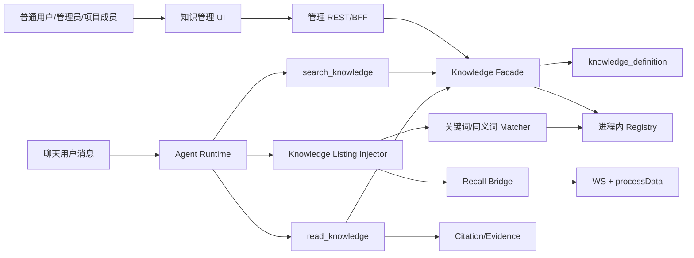
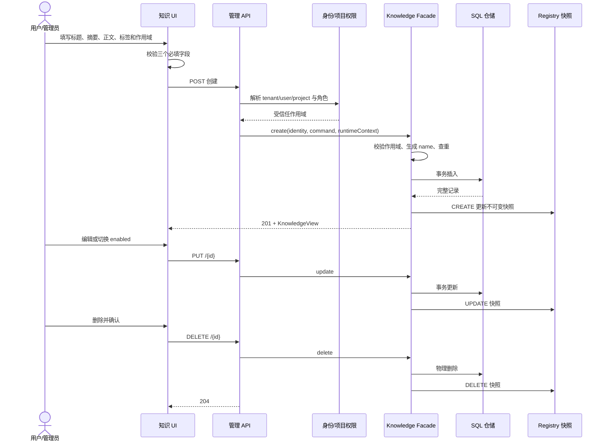
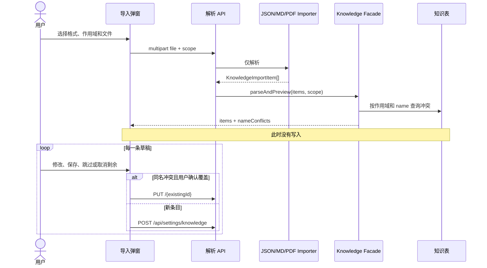
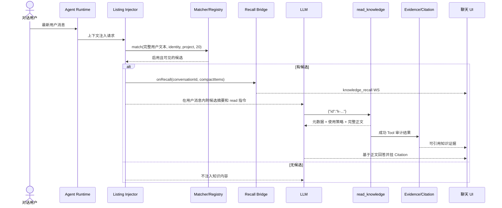
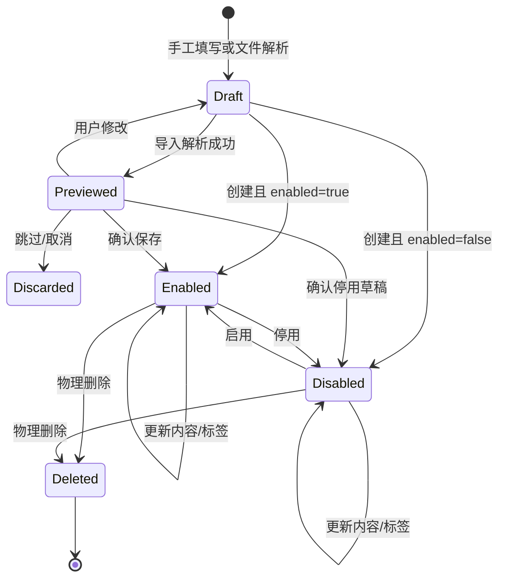
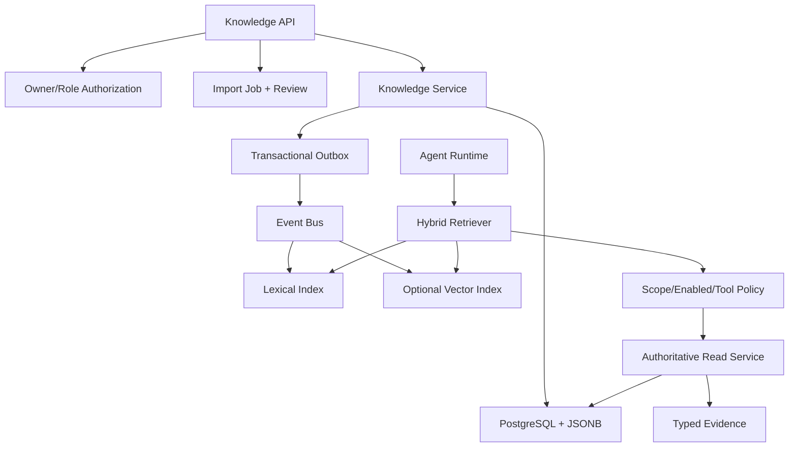

```
# 知识库创建、导入、检索与运行时召回：自包含复刻说明

## 1. 结论与边界

### 1.1 业务问题与产品效果

本能力把业务术语、经验说明、分析模板和其他 Markdown 知识保存为可治理的知识条目，并在 Agent 对话中按关键词或同义词召回。它同时服务四类场景：

1. 普通用户维护只属于自己的知识。
2. 租户管理员维护租户共享知识，系统预置知识只读。
3. 项目管理员维护只属于某个项目的知识，项目成员只读。
4. Agent 在一次对话运行中发现候选知识，读取全文，并把实际使用的知识转成可引用证据。

用户最终可以看到知识目录、详情、启停、导入预览、冲突覆盖、导出、同义词辅助，以及聊天时间线中的“召回了哪些知识”。Agent 获得的不是一个通用文档向量库，而是一组结构化的单条知识定义；当前检索只匹配 `keywords` 和 `synonyms`，全文由 `read_knowledge` 按稳定 ID 读取。

### 1.2 核心输入与输出

输入：

- 标题、摘要、正文、稳定名称、分类、关键词、同义词、作用域和启用状态。
- JSON、Markdown 或含可提取文本的 PDF 文件。
- 当前登录身份中的 tenantId、userId，以及受信任运行上下文中的 projectId。
- Agent 当前用户消息和 `search_knowledge` / `read_knowledge` Tool 参数。

输出：

- 持久化知识条目及其管理视图。
- 无持久化副作用的导入预览与同名冲突映射。
- 关键词/同义词命中的候选列表及排序分数。
- 全文 Tool 结果、`knowledge_recall` 实时/持久化事件、知识证据和使用统计。

### 1.3 明确边界

本文包含：知识 CRUD、四级作用域、导入/预览/确认/导出、同义词和双语关键词建议、缓存索引、匹配算法、自动召回、Tool 调用、WebSocket 事件、引用衔接、权限、异常与复刻设计。

本文不包含：

- “归因知识”是 CAN Gateway 上的另一套领域能力，不等同于本知识库。
- 文件索引、上传附件检索和用户长期记忆是其他能力。
- 当前没有知识分块、向量数据库、Embedding、BM25、语义重排或 OCR。历史 `knowledge_chunks` 表已经删除；不得按旧文档把这些写成现有能力。
- 本轮只做静态分析，没有启动服务、执行 API、Playwright、Maven 或前端构建，因此没有 `R`（Runtime Verified）结论。

### 1.4 当前状态结论

- `I`：当前实现保存一条完整知识正文，使用 JDBC 表和进程内不可变快照索引；检索只扫描启用条目的关键词、同义词。
- `I`：作用域实际为 `SYSTEM / TENANT / PERSONAL / PROJECT`。PROJECT 已进入表结构、管理 API、项目 UI、运行时可见性和召回事件。
- `I`：导入端点只解析和预览；用户逐条确认后才调用普通创建或更新接口。它不是服务端批量事务。
- `I`：PDF 先做确定性文本提取，再用统一 LLM 网关尝试提取元数据；LLM 失败会降级成可编辑的停用草稿。
- `I`：自动召回只把候选标题、摘要和别名注入当前用户消息，明确要求模型继续调用 `read_knowledge` 读取全文；候选摘要不能作为回答依据。
- `I`：`search_knowledge` 结果可压缩，`read_knowledge` 结果要求持久保留；只有读取全文的结果可作为知识 Citation 源，搜索列表不可直接引用。
- `I`：停用只把条目排除出 Registry 候选和搜索；`read_knowledge` 按 ID 直接读取数据库且不检查 `enabled`。因此知道旧 ID 的模型仍可读取、引用并产生使用记录，这是当前能力边界缺口，不得把“停用”等同于撤销访问。
- `I`：知识物理删除只移除定义和 Registry 项；已持久化消息过程、Citation、公开分享快照和 `asset_usage_record` 历史不会随知识删除级联清除。
- `A`：黑盒测试把 CRUD、导入预览、冲突、跨租户隔离、检索边界、启停生效、同义词建议和运行时事件作为当前验收目标。本次未执行。
- `K`：64 KiB 正文曾在 release 返回 500；201 条导入被全部接受；部分无效导入未隔离；跨租户相同关键词场景未返回第二租户自己的可见知识。
- `K`：UI E2E 记录导出会包含同作用域所有条目，而不是只包含当前选中条目；导出 500 仍会被下载成文件。
- `K`：知识 Markdown 详情可把原始 `<script>` 形成真实 DOM 节点，虽然观察到的 Chromium 路径未执行脚本，仍属于 XSS 缺陷。
- `I Security Gap`：当前通用知识管理 Controller 把 `UserCtx` 转成只含 tenantId/userId 的 Identity，丢弃 `isTenantAdmin`；Facade 的 TENANT 授权也只比较 tenantId。因而 TENANT create/update/delete/import preview/export 及现有条目的建议端点均没有管理员门禁，不能依赖 UI 隐藏按钮弥补。
- `I Security Gap`：公开分享仅从 `knowledge_recall.items` 删除 ID；允许公开的 `tool_exec/sub_tool_exec` 仍保留 `read_knowledge` 的 args/result，知识 Citation 快照也复制 code、summary、keywords、synonyms 和完整 content。创建分享等同于授权这些所选消息快照中的知识内容公开，当前清洗注释所称“public-safe”不能替代数据所有者同意。
- `D`：生产复刻应保留关键词模式作为确定性基线，同时补充事件化缓存失效、稳定数据库唯一键、输入上限、导入校验报告、HTML 清理和可选混合检索。

## 2. 术语与参与方

| 术语/参与方 | 定义与职责 |
|---|---|
| 知识条目 | 一条标题、摘要、正文、关键词、同义词、分类和作用域组成的可独立读取记录。 |
| 稳定名称 `name` | 作用域内冲突检测使用的业务键；创建后不可修改。为空时由标题 slug 化生成。 |
| `knowledgeId` | 对外稳定 ID，当前格式为 `k-` 加 12 位十六进制字符。 |
| 分类 | `TERM` 术语、`EXPERIENCE` 经验、`TEMPLATE` 模板、`OTHER` 其他。 |
| 作用域 | `SYSTEM` 全局只读；`TENANT` 租户共享；`PERSONAL` 租户内个人；`PROJECT` 租户内项目。 |
| 管理 BFF | 认证用户、暴露知识管理 REST、解析上传文件，并把身份转换为插件可识别作用域。 |
| 知识插件 | 注册工具和上下文注入器，迁移数据库，维护仓储、缓存、匹配器与 Facade。 |
| Registry | 全量加载数据库并保存进程内不可变快照，供低延迟匹配。 |
| Matcher | 按关键词和同义词判断用户文本是否命中并排序。 |
| Context Injector | 每次 LLM 调用前检查最后一条用户消息，把候选摘要追加到该用户消息内部。 |
| Tool Runtime | 向 LLM 暴露 `search_knowledge` 和 `read_knowledge`，受正式工具策略控制。 |
| Recall Bridge | 把自动候选列表转成 `knowledge_recall` WS 事件并写入消息过程数据。 |
| Evidence Pipeline | 把成功的 `read_knowledge` 结果转换为知识证据和 Citation。 |



## 3. 业务规则

### 3.1 字段与默认值

| 字段 | 类型 | 创建必填 | 默认/约束 | 更新语义 |
|---|---|---:|---|---|
| `knowledgeId` | string | 服务端生成 | 当前 `k-xxxxxxxxxxxx` | 不可变 |
| `name` | string | 否 | 去空格后最长 128；为空则标题 slug；slug 为空时生成时间戳随机名 | 不允许更新 |
| `title` | string | 是 | 去首尾空白，不能为空；DB `VARCHAR(256)` | null 表示不改，空白拒绝 |
| `summary` | string | 是 | 去首尾空白，不能为空；DB `VARCHAR(512)`；当前 UI `maxLength=500` | null 表示不改 |
| `content` | string | 是 | 去首尾空白判空，保存去空白后的正文；当前无显式服务端长度上限 | null 表示不改 |
| `keywords` | string[] | 否 | null 变空数组；忽略空项；以 JSON 字符串存储 | null 表示不改，`[]` 表示清空 |
| `synonyms` | string[] | 否 | 同上 | 同上 |
| `category` | enum | 否 | `OTHER` | null 表示不改 |
| `scope` | enum | 是 | 无默认；创建后不可变 | 不在更新体中 |
| `enabled` | boolean | 否 | `true` | null 表示不改 |
| `tenantId/userId/projectId` | string | 否 | 从受信任身份和项目上下文推导，客户端不能指定 | 不可变 |
| `createdBy` | string | 否 | 当前解析用户 ID；无用户时可能为空 | 不可变 |
| `createdAt/updatedAt` | datetime | 否 | 服务器本地时区时间 | 更新只推进 `updatedAt` |
| `canEdit` | boolean | 否 | 响应计算字段，不持久化 | 不适用 |

当前实现没有完整校验 title、summary 与数据库列长度，也没有正文、关键词数量、单词长度或批量条数限制。数据库拒绝时可能被翻译成 500；这正是正文边界和 201 条导入已出现 Known Failure 的原因之一。

### 3.2 名称生成和唯一性

名称生成伪代码：

```text
resolveName(name, title):
  if trim(name) is not empty:
    require length <= 128
    return trim(name)
  slug = lower(title or "knowledge")
  slug = replace every run outside [a-z0-9一-龥] with "-"
  slug = trim leading/trailing "-"
  slug = first 128 chars
  if slug is empty:
    return "knowledge-" + epochMillis + "-" + randomHex(8)
  return slug
```

业务唯一键必须是：

```text
(scope, tenant_id-or-empty, user_id-or-empty, project_id-or-empty, name)
```

当前 Facade 在单进程内用互斥锁包住“查重 + 插入”，JDBC 在事务中再次查重。数据库迁移同时保留了旧 `(scope, tenant_id, user_id, name)` 和新增 `(scope, tenant_id, project_id, name)` 唯一约束；在 PostgreSQL 中含 `NULL` 的普通唯一约束不能可靠阻止所有重复，因此多实例并发仍可能穿透。生产复刻应使用 `NULLS NOT DISTINCT`、表达式索引 `COALESCE(...)`，或单独的 `owner_key` 非空列建立唯一约束。

### 3.3 四级作用域和继承

| 作用域 | 归属字段 | 管理可见性 | 运行时可见性 | 写权限 |
|---|---|---|---|---|
| SYSTEM | 三个 owner 均为空 | 所有身份可读 | 所有身份可匹配 | Facade 和 UI API 禁止创建、修改、删除；通用 API 也禁止导出 |
| TENANT | tenantId | 同租户可读 | 同租户可匹配 | 当前 Facade 对任意同租户身份可写；推荐仅租户管理员 |
| PERSONAL | tenantId + userId | 本人可读 | 本人可匹配 | 仅本人 |
| PROJECT | tenantId + projectId，userId 必须为空 | 具备项目查看权限者可读 | 仅活动项目上下文中可匹配 | 租户管理员或 Project ADMIN；普通 MEMBER 只读 |

管理页面与运行时继承并不相同：

- 通用列表会返回当前身份可读的 SYSTEM、TENANT、PERSONAL；前端按入口过滤。个人扩展入口显示 PERSONAL 和 TENANT，并把非 PERSONAL 项强制为只读；管理员入口显示 TENANT 和 SYSTEM。
- 项目管理 API 只列当前项目自己拥有的 PROJECT 条目，不把继承的 SYSTEM/TENANT/PERSONAL 混进项目设置列表。
- 项目 Agent 运行时则可同时匹配 SYSTEM、同租户 TENANT、当前用户 PERSONAL 和当前 PROJECT。这是继承，不是复制或覆盖；当前算法也没有作用域优先级，同词条可以同时出现。
- PROJECT 的 projectId 只能来自服务端验证后的运行上下文。项目控制器把请求体 scope 强制改为 PROJECT，跨项目已知 ID 对调用方伪装成 404。

一个需要谨慎复刻的当前差异：管理 `canRead(PERSONAL)` 在解析到 tenantId 但 userId 为空时允许读取该租户所有个人知识；运行时 Registry 则要求 userId 非空且相等。正常产品用户身份同时携带两者，但租户级服务身份可能触发管理与运行时不一致。推荐生产实现不要把 `userId=null` 解释成“全租户个人知识”，除非调用方具有单独审计过的管理员权限。

### 3.4 分类、启用和模板决策

1. 分类只是管理和 LLM 决策元数据，不改变匹配算法。
2. `enabled=false` 的条目仍可在管理列表读取、编辑和导出，也不进入 Registry 可见候选，因此不会被自动召回或 `search_knowledge` 命中。但是 `read_knowledge` 调用 Facade 的数据库 `get`，没有 enabled 条件；持有停用前 ID 的调用者仍能读取全文、生成 Citation 和使用统计。当前没有“停用即撤权”的保证。
3. `TEMPLATE` 命中后，Tool 输出会增加决策规则：若用户只是简单查询，应先让用户在“按模板完成分析”和“只返回简单数据”之间明确选择；用户已明确要求模板/报告时直接执行。
4. 任何相关知识都要求在数据查询前读全文；若多条都可能改变口径、筛选、SQL/MQL 或时间范围，应逐条读取，不能读一条就停止。

### 3.5 Tool 可用性边界

知识数据可见和知识 Tool 可见是两条独立链：

1. 插件注册 `search_knowledge`、`read_knowledge` 只表示运行时拥有实现。
2. 产品配置定义正式 `knowledge-tools` 工具组，并在配置存在 `core-tools` 时把该组引用加入主工具组；Agent policy 再决定本轮是否暴露。
3. 项目挂载知识不能自动越权开放 Tool；无 Tool 权限时，完整正文不可由模型读取是合理结果。
4. 自动 Listing Injector 是独立上下文能力，即便 Tool 被策略隐藏，它仍可能把当前身份可见的候选摘要注入用户消息。生产复刻最好让 Injector 同时检查 `read_knowledge` 能力，或在 Tool 不可用时不注入候选，避免给模型一个无法完成的指令。

## 4. 完整执行链路

### 4.1 手工创建、编辑、启停和删除



删除是知识定义的物理删除，不存在软删除、回收站或定义版本历史。它不会追溯删除已完成消息中的 Tool args/result、Citation、recall processData、公开分享快照或使用记录；因此“删除后任何地方都不可见”不是当前语义。取消删除不应发送请求。创建后 `name` 和 `scope` 不可编辑；“复制为我的”由 UI 读取原条目全文，清空 ID、把 scope 改成 PERSONAL，再走普通创建。

### 4.2 导入、预览和逐条确认



导入不是批量事务：前几条保存成功后，用户取消剩余项，前几条仍然存在；中途失败时草稿与进度应保留，重试不能重复创建已成功项。

解析规则：

- JSON：根必须可反序列化成条目数组；空数组合法，返回零条。当前解析阶段不逐条校验必填字段。
- Markdown：一个文件只产生一条。文件以 `---` 开头时解析 YAML frontmatter；识别 `name/title/summary/keywords/synonyms/category/enabled`。没有 title 时取正文第一个 `# H1`，仍没有则用 `(untitled)`；没有 summary 用 `(no summary)`；未知 category 变 OTHER；正文保留 frontmatter 之后的 Markdown。
- PDF：PDFBox 提取文本，空/损坏/扫描件无文本时返回受控 400。提取结果超过 200,000 字符会静默截断后作为草稿正文，元数据 Prompt 只看前 10,000 字符。调用统一网关的 `simple` 角色；源码虽声明 `LLM_MAX_TOKENS=1024`，实际 `callRole` 没有传该参数，故 1,024 不是运行时保证。Prompt 要求 3~8 个 keywords、0~6 个 synonyms，但解析器不检查数量、长度或语言。先构造“文件名标题 + 待补摘要 + 空数组 + OTHER + enabled=false”的 fallback，再逐字段覆盖：非空 title/summary 覆盖，非空数组覆盖，合法 category 覆盖；缺失、空值或非法 category 保留各自 fallback，只有整个 LLM 调用/JSON 解析失败才全部 fallback。200,000 字符草稿仍可能在确认保存时触发数据库或上下文限制错误，解析成功不表示可保存。

### 4.3 自动召回、全文读取和 Citation



自动召回行为：

1. 只读取消息列表中最后一条 USER 文本；空文本不召回。
2. 最多 20 条；摘要最多 180 字符；每条最多展示 5 个同义词。
3. 注入位置是当前用户消息内部，不创建长期 system prompt。
4. 同时发出紧凑 recall 事件；事件发送失败只记录警告，不中断 LLM。
5. `read_knowledge` 成功结果包含稳定机器标记，Evidence Pipeline 据此解析 scope、title、summary、keywords、synonyms、projectId 和正文。
6. `search_knowledge` 只返回多候选列表，不是可引用的唯一事实来源；模型必须先 read。
7. 完成的 Agent 响应会扫描 ToolCall 审计列表，按每次参数中带非空 `id` 的 `read_knowledge` 写一条知识使用统计。Recorder 不检查 ToolCall 的 success/result，因此失败或被拒绝的 read 只要进入 completed response audit 也会计数；记录失败 fail-soft，不影响对话。

### 4.4 生命周期状态图



Previewed 不是数据库状态，只存在浏览器内存。当前没有 `PROCESSING`、`FAILED`、版本号或异步导入 Job。

## 5. 对外契约

### 5.1 通用管理 REST

统一前缀：`/api/settings/knowledge`。认证使用产品登录态；服务端从当前用户上下文提取 tenantId/userId。

上传沿用应用级 Spring multipart 限制：示例配置为单文件最大 50 MB、单请求最大 100 MB。它只是传输层上限，不等于知识业务上限；生产复刻仍需对格式、条目数、提取后字符数和正文长度分别校验，并把超限稳定映射为 413 或 422。

| 方法与路径 | 请求 | 成功响应 | 关键错误 |
|---|---|---|---|
| `GET /api/settings/knowledge` | query: `scope? category? keyword? enabled? page? pageSize?` | `200 KnowledgeView[]` | 未认证 401 |
| `GET /{knowledgeId}` | path ID | `200 KnowledgeView`，含正文 | 403 不可见；404 不存在 |
| `POST /api/settings/knowledge` | `KnowledgeCreateRequest` | `201 KnowledgeView` | 400 校验；403 scope；409 同名 |
| `PUT /{knowledgeId}` | 部分更新体 | `200 KnowledgeView` | 403；404 |
| `DELETE /{knowledgeId}` | 无 | `204` | 403；404 |
| `POST /import` | multipart `file`, `scope` | `200 KnowledgeParseResponse` | 400 文件/解析；403 SYSTEM |
| `POST /import/pdf` | multipart `file`, `scope` | `200 KnowledgeParseResponse` | 400 PDF；403 SYSTEM |
| `POST /{id}/suggest-synonyms` | 无 | `200 SynonymSuggestionResult` | 403；404 |
| `POST /suggest-synonyms-draft` | draft JSON | `200 SynonymSuggestionResult` | 400 title/summary |
| `POST /{id}/suggest-bilingual` | 无 | `200 SynonymSuggestionResult` | 403；404 |
| `POST /suggest-bilingual-draft` | draft JSON | `200 SynonymSuggestionResult` | 400 |
| `GET /export?scope=...` | PERSONAL 或 TENANT | `200 KnowledgeImportItem[]` + attachment header | 403 SYSTEM |

分页规则：`page` 默认 0；`pageSize` 默认 0。`pageSize<=0` 表示不分页；正数最大 100；负 page 按 0；超出范围返回空数组。当前响应没有 total、page 或 nextCursor。列表按数据库 `updated_at DESC, id DESC` 顺序过滤，且列表项 `content=null`；详情才带全文。

`I Security Gap`：上表的 TENANT create、update、delete、普通/PDF import preview、export，以及对 TENANT 存量条目的 synonym/bilingual 建议，都只要求登录且 tenantId 相同。Controller 构造 Identity 时没有携带 `isTenantAdmin`，Facade 也没有角色字段可判断；这不是推断，而是当前逐端点可追踪的授权行为。生产复刻必须在 Controller/统一授权服务校验 tenant admin，并让 import preview、export 与建议端点采用相同规则。

异常映射还有一个不对称：通用 POST 捕获 `IllegalArgumentException` 并转 400，但通用 PUT 没有捕获它，字段校验异常可能落成 500；PROJECT POST/PUT 都捕获并转 400。复刻时所有入口应共用同一 validation/error mapper。

SYSTEM export 存在契约冲突：真实后端在进入身份解析前固定返回 403；`nova_ui_e2e` 的 KB-19 却拦截该 URL 并模拟 200，断言系统知识可下载。该测试只能证明 UI 在 mock 200 下会下载，不能证明后端支持 SYSTEM export。复刻前必须选定产品语义；若保持后端禁止，应修改 UI 文案与测试，不可把 KB-19 当成真实 API 证据。

完整创建示例：

```http
POST /api/settings/knowledge
Content-Type: application/json

{
  "name": "refund-policy",
  "title": "退款政策",
  "summary": "定义退款窗口和例外条件",
  "keywords": ["退款", "refund"],
  "synonyms": ["退货退款"],
  "category": "TERM",
  "content": "# 退款政策\n\n标准窗口为收到商品后的若干天。",
  "scope": "PERSONAL",
  "enabled": true
}
```

```json
{
  "knowledgeId": "k-12ab34cd56ef",
  "name": "refund-policy",
  "title": "退款政策",
  "summary": "定义退款窗口和例外条件",
  "keywords": ["退款", "refund"],
  "synonyms": ["退货退款"],
  "category": "TERM",
  "content": "# 退款政策\n\n标准窗口为收到商品后的若干天。",
  "scope": "PERSONAL",
  "tenantId": "tenant-a",
  "userId": "user-1",
  "projectId": null,
  "enabled": true,
  "createdBy": "user-1",
  "createdAt": "2026-08-07T10:20:30.123456",
  "updatedAt": "2026-08-07T10:20:30.123456",
  "canEdit": true
}
```

部分更新示例：

```http
PUT /api/settings/knowledge/k-12ab34cd56ef
Content-Type: application/json

{
  "synonyms": ["退货退款", "售后退款"],
  "enabled": false
}
```

当前 Controller 使用 Spring `ResponseStatusException`；错误体具体外壳会受到 Spring 配置影响，黑盒契约主要稳定断言状态码和“不泄露 SQL/堆栈/外租户正文”。生产复刻应统一为：

```json
{
  "success": false,
  "errorCode": "KNOWLEDGE_NAME_CONFLICT",
  "message": "A knowledge entry with this name already exists in the selected scope.",
  "requestId": "req-..."
}
```

### 5.2 项目知识 REST

统一前缀：`/api/projects/{projectId}/knowledge`。路径项目经过对象级授权；PROJECT scope 和 projectId 由服务端钉死，忽略请求体伪造。

| 方法 | 路径 | 权限 | 语义 |
|---|---|---|---|
| GET | `/` | 项目可查看 | 只列当前 PROJECT 自有条目 |
| GET | `/{id}` | 项目可查看 | ID 不属于路径项目时返回 404 |
| POST | `/` | 租户管理员或项目 ADMIN | 强制 PROJECT，返回 201 |
| PUT/DELETE | `/{id}` | 同上 | 先验证条目属于路径项目 |
| POST | `/import`, `/import/pdf` | 同上 | 不需要 scope 表单字段 |
| POST | 同义词/双语四个端点 | 写权限 | 行为与通用端点一致 |
| GET | `/export` | 项目可查看 | 导出当前项目全部 PROJECT 条目 |

项目被删除后不可编辑；普通 MEMBER 的响应 `canEdit=false`。项目控制器刻意把跨项目“无权限”和“不存在”都表现为 404，避免确认对象存在。

### 5.3 导入预览契约

JSON 文件格式：

```json
[
  {
    "name": "weekly-performance-template",
    "title": "周度经营分析模板",
    "summary": "统一周报的分析步骤和输出结构",
    "keywords": ["周报", "weekly performance"],
    "synonyms": ["周度经营报告"],
    "category": "TEMPLATE",
    "content": "# 周度经营分析\n\n1. 查询核心指标……",
    "enabled": true
  }
]
```

Markdown 文件格式：

```markdown
---
name: weekly-performance-template
title: 周度经营分析模板
summary: 统一周报的分析步骤和输出结构
keywords: [周报, weekly performance]
synonyms: [周度经营报告]
category: TEMPLATE
enabled: true
---
# 周度经营分析

1. 查询核心指标……
```

预览响应：

```json
{
  "items": [
    {
      "name": "weekly-performance-template",
      "title": "周度经营分析模板",
      "summary": "统一周报的分析步骤和输出结构",
      "keywords": ["周报", "weekly performance"],
      "synonyms": ["周度经营报告"],
      "category": "TEMPLATE",
      "content": "# 周度经营分析\n\n1. 查询核心指标……",
      "enabled": true
    }
  ],
  "nameConflicts": {
    "weekly-performance-template": "k-existing123"
  }
}
```

`nameConflicts` 是 `name -> existing knowledgeId`。UI 遇到冲突时 PUT 原 ID，因而覆盖保持 ID 不变；用户可以跳过。预览本身不得写数据库。

### 5.4 同义词建议契约

草稿请求：

```json
{
  "title": "GMV",
  "summary": "商品交易总额",
  "keywords": ["GMV"],
  "synonyms": ["成交总额"]
}
```

响应：

```json
{
  "suggested": ["交易总额", "商品成交金额"],
  "alreadyExists": ["GMV", "成交总额"]
}
```

规则分成确定性代码保证和模型 Prompt 期望：

- 确定性保证：普通建议输入 title、summary、keywords，不发送正文；双语输入只包含 keywords。结果去除空字符串，以大小写不敏感方式排除与现有 token 重合的项，`suggested` 最多取 10 个；若模型输出含重合项，`alreadyExists` 返回这些重合项，否则返回输入已有 token 集。候选为空或 LLM 失败仍返回 200 和空 suggested，属于 fail-soft。当前过滤器没有对模型返回的新增候选相互去重。
- Prompt 期望而非代码保证：普通建议与标题/摘要同语言；双语逐项中译英/英译中、每项至多一个、保持顺序、不扩写新概念，并跳过 GMV、ROI、KPI、DAU、API、SKU 等通用缩写。服务端没有确定性检测输出语言、1:1 对齐、顺序、缩写或“不得新增概念”，模型违反这些规则仍可能进入 suggested。
- 建议端点从不自动持久化。UI 展示默认全选的候选多选框，用户确认后才合入关键词或同义词，最终保存走普通 PUT/POST。

### 5.5 Tool 契约

`search_knowledge`：

```json
{
  "name": "search_knowledge",
  "arguments": {
    "query": "退款政策",
    "limit": 10
  }
}
```

- `query` 可省略；`limit` 默认 10，最大 50，最小值以下回落默认值。
- 为兼容模型错误，整数别名 `page_size/num_results/max_results/count/n/top_k/size/k/results` 可被接受并记录警告；非整数返回失败 ToolResult。
- 空 query，或包含 list、all knowledge、knowledge entries、available knowledge、有哪些、所有、列出、列表、知识库条目等短语，进入“列出所有可见且启用条目”分支，而不是 matcher。
- 零命中是成功：`No knowledge entries found for query: ...`。
- 输出 retention 为 `CONDENSABLE`。

命中输出格式：

```text
<知识使用决策规则>

- [id=k-12ab34cd56ef] (TERM) 退款政策 - 定义退款窗口和例外条件
```

`read_knowledge`：

```json
{
  "name": "read_knowledge",
  "arguments": {"id": "k-12ab34cd56ef"}
}
```

- `id` 必填且只能使用搜索/候选列表返回的稳定 ID。
- 不存在：失败结果 `Error: knowledge not found: <id>`。
- 不可见：失败结果 `Error: knowledge <id> not visible to current user`，不返回正文。
- 其他异常：`Error: read_knowledge failed - <ExceptionType>: <message>`；生产复刻不应向模型暴露底层异常类和敏感消息，应改用错误码。
- 输出 retention 为 `DURABLE`。

成功输出协议：

```text
[KNOWLEDGE_INSTRUCTION]
[meta] id=k-12ab34cd56ef scope=PERSONAL category=TERM
[knowledge_metadata] {"summary":"定义退款窗口和例外条件","keywords":["退款","refund"],"synonyms":["退货退款"]}

# 退款政策

[KNOWLEDGE_USAGE_POLICY]
...要求检查并读取其他相关条目...

[knowledge_content]

# 退款政策

标准窗口为收到商品后的若干天。
```

PROJECT 条目的 metadata 额外包含 `projectId`。这些 marker 是 Evidence 解析契约，不应随意改文案或顺序；若要演进应显式版本化为结构化 Tool result。

### 5.6 WebSocket 与持久化过程事件

事件类型：`knowledge_recall`。服务器在 active conversation listener 存在时发送：

```json
{
  "type": "knowledge_recall",
  "conversationId": "conv-123",
  "content": "{\"items\":[{\"id\":\"k-12ab34cd56ef\",\"title\":\"退款政策\",\"summary\":\"定义退款窗口和例外条件\",\"synonyms\":[\"退货退款\"],\"scope\":\"PERSONAL\"}]}"
}
```

内部 payload 解码后应是：

```json
{
  "items": [
    {
      "id": "k-12ab34cd56ef",
      "title": "退款政策",
      "summary": "定义退款窗口和例外条件",
      "synonyms": ["退货退款"],
      "scope": "PROJECT",
      "projectId": "project-a"
    }
  ]
}
```

同一 payload 会进入助手消息 `processData.events[*]`，用于刷新后回放。前端对连续完全相同的 recall 去重，不同 recall 保留多次并与工具事件按时间排序。

公开分享必须按快照授权理解，而不能按“删掉 recall ID 就安全”理解：

1. 所有者创建分享时选择属于自己会话的消息，服务端把当时的消息、Citation 和清洗后的 processData 固化成公开 token 可读取的快照；公开端无需登录。
2. Sanitizer 只从 `knowledge_recall.recall.items[*]` 保留 title/summary/synonyms/scope 并删除 id；它允许 `tool_exec/sub_tool_exec` 的 tool、args、result 通过，只替换其中的文件/Artifact URL。因此 `read_knowledge` args 中的 ID和 result 中的 metadata/完整正文仍会进入公开快照。
3. Citation 另由 SnapshotBuilder 从原始 processData 提取；knowledge Citation 明确复制 name、summary、keywords、synonyms、content、code，以及存在时的 factors/dimensions/relations。知识 ID/code 和全文不会因为 recall 清洗而消失。
4. 分享可由所有者 `PATCH /api/shares/{id}/revoke` 撤销；源会话软删除会级联撤销。公开读取对不存在、已撤销或无内容统一返回 410。撤销阻止未来公开访问并清理附件，但不等于修改源消息历史；知识定义删除也不会自动撤销既有分享。

生产隐私策略应在创建分享前明确提示“所选消息中的知识全文和 Tool 过程会公开”，默认删除或二次确认知识 Tool args/result 与知识 Citation content，并提供按知识 ID 批量查找和撤销受影响分享的能力。

当前前端 recall 类型没有声明 `projectId`，Recall Card 只对 TENANT 路由到管理员页，其他作用域都路由到个人知识页，因此 PROJECT 卡片链接不能可靠跳到项目知识详情。后端 Evidence Mapper 已把 read metadata 中的 projectId 放入 Citation metadata，但前端 `KnowledgeMetadata` 类型和 Citation drawer header 都不消费它，header 仍只按 TENANT/非 TENANT 二分，PROJECT Citation 同样跳到个人知识页；公开分享的 Citation cherry-pick 也没有复制 projectId。这是两个独立静态缺口，应让 recall 和 Citation 共用 `{scope, projectId, knowledgeId}` 路由契约。

## 6. 数据模型与生命周期

### 6.1 推荐兼容 DDL

下面 DDL 同时表达当前字段和生产复刻所需的可靠唯一性。若数据库不支持 `NULLS NOT DISTINCT`，使用非空 owner key。

```sql
CREATE TABLE knowledge_definition (
  id            BIGSERIAL PRIMARY KEY,
  knowledge_id  VARCHAR(64) NOT NULL UNIQUE,
  name          VARCHAR(128) NOT NULL,
  title         VARCHAR(256) NOT NULL,
  summary       VARCHAR(512) NOT NULL,
  keywords      TEXT NOT NULL DEFAULT '[]',
  synonyms      TEXT,
  category      VARCHAR(32) NOT NULL,
  content       TEXT NOT NULL,
  scope         VARCHAR(16) NOT NULL,
  tenant_id     VARCHAR(64),
  user_id       VARCHAR(64),
  project_id    VARCHAR(64),
  enabled       BOOLEAN NOT NULL DEFAULT TRUE,
  metadata      TEXT,
  created_by    VARCHAR(64),
  created_at    TIMESTAMP(6) NOT NULL,
  updated_at    TIMESTAMP(6) NOT NULL,
  CONSTRAINT ck_knowledge_scope_owner CHECK (
    (scope = 'SYSTEM'  AND tenant_id IS NULL AND user_id IS NULL AND project_id IS NULL) OR
    (scope = 'TENANT'  AND tenant_id IS NOT NULL AND user_id IS NULL AND project_id IS NULL) OR
    (scope = 'PERSONAL' AND tenant_id IS NOT NULL AND user_id IS NOT NULL AND project_id IS NULL) OR
    (scope = 'PROJECT' AND tenant_id IS NOT NULL AND user_id IS NULL AND project_id IS NOT NULL)
  ),
  CONSTRAINT ck_knowledge_category CHECK (category IN ('TERM','EXPERIENCE','TEMPLATE','OTHER')),
  CONSTRAINT ck_knowledge_scope CHECK (scope IN ('SYSTEM','TENANT','PERSONAL','PROJECT'))
);

CREATE UNIQUE INDEX uk_knowledge_owner_name
ON knowledge_definition (
  scope,
  COALESCE(tenant_id, ''),
  COALESCE(user_id, ''),
  COALESCE(project_id, ''),
  name
);

CREATE INDEX idx_knowledge_scope_tenant_user
  ON knowledge_definition(scope, tenant_id, user_id);
CREATE INDEX idx_knowledge_scope_tenant_project
  ON knowledge_definition(scope, tenant_id, project_id);
CREATE INDEX idx_knowledge_category ON knowledge_definition(category);
CREATE INDEX idx_knowledge_enabled ON knowledge_definition(enabled);
```

当前历史迁移只严格检查 PROJECT owner 组合；生产复刻应把四种 owner 约束全部加入数据库，防止脏数据依赖应用层解释。

### 6.2 存储编码

`keywords` 和 `synonyms` 当前存成 JSON 字符串，但读取兼容三种历史格式：JSON string array、逗号分隔、换行分隔。JSON 以 `[` 开头却解析失败时返回空列表，不回落 CSV。新实现建议使用数据库 JSON/JSONB 数组；兼容迁移先解析旧字段，坏数据进入隔离报告，不能静默丢标签。

`metadata` 当前创建值是 `{}`，PDF importer 虽提供 provenance metadata 方法，但 `KnowledgeImportItem` 没有 metadata 字段，实际导入链不会持久化 PDF 文件名或来源。这是当前追溯缺口。推荐至少保存 `sourceType`、originalFilename、contentHash、importedAt、importedBy 和 extractorVersion。

### 6.3 创建、更新、删除与缓存一致性

```text
CREATE: validate -> DB insert transaction -> registry CREATE
UPDATE: authorize -> DB update transaction -> registry UPDATE
DELETE: authorize -> DB physical delete -> registry DELETE
STARTUP: migrate -> repository.findAll -> registry.loadCache
```

Registry 用 volatile 不可变快照保证读线程无锁，写操作同步复制 map/set 后整体替换。优点是查询简单、不会看到半更新索引；限制是：

- DB 已提交但 Registry 更新抛错时，本进程检索暂时看不到新状态。
- 多实例各有本地 Registry，没有数据库通知、消息总线或轮询；一个实例写入后其他实例直到重启都可能过期。
- 启动时 `findAll()` 加载全部正文到内存，数据量增大会带来启动、内存和复制成本。

生产设计应在事务提交后发布带版本的 outbox 事件；每个实例按事件增量更新或定期校验版本。检索索引可以只保存 metadata/token，不必把所有正文复制到每个实例。

### 6.4 使用记录表与删除后的历史

当前 PostgreSQL 等价 DDL 如下；H2 只把自增和时间类型换成对应方言：

```sql
CREATE TABLE asset_usage_record (
  id              BIGSERIAL PRIMARY KEY,
  tenant_id       VARCHAR(64),
  user_id         VARCHAR(64) NOT NULL,
  asset_type      VARCHAR(16) NOT NULL,
  asset_id        VARCHAR(128) NOT NULL,
  asset_name      VARCHAR(255),
  asset_scope     VARCHAR(16),
  conversation_id VARCHAR(64),
  message_id      VARCHAR(64),
  created_at      TIMESTAMP WITH TIME ZONE NOT NULL DEFAULT CURRENT_TIMESTAMP
);
CREATE INDEX idx_aur_tenant_type_time
  ON asset_usage_record (tenant_id, asset_type, created_at);
CREATE INDEX idx_aur_asset_time
  ON asset_usage_record (tenant_id, asset_type, asset_id, created_at);
CREATE INDEX idx_aur_conversation
  ON asset_usage_record (conversation_id);
```

写入只填 tenant_id、user_id、`asset_type='KNOWLEDGE'`、Tool 参数中的原始 asset_id、conversation_id、message_id 和 created_at；`asset_name/asset_scope` 当前 Recorder 不填。没有指向知识表、消息表或会话表的外键，也没有知识删除级联。一次 completed AgentResponse 的 audit 列表里每出现一次带 ID 的 `read_knowledge` 就插一行，不检查成功标志；相同 message 重复 read 产生多行，questionCount 查询时才按 message_id 去重。

运营统计把当前定义与使用聚合按 asset_id 合并。知识被删除后，usage 行继续存在并显示 `defined=false`、名称回退成原始 ID、scope/owner 为空。PROJECT 还有额外缺口：统计加载定义时使用只有 tenantId、没有 projectId 的 tenant-scope Facade Identity，而 PROJECT 的可读判断要求 projectId，因此项目知识定义进不了合并集合；其使用行即使定义仍存在也可能显示为 `defined=false`。复刻时应让运营查询使用专门的管理员仓储接口而非运行时 Facade 可见性，并明确历史保留期、删除请求的匿名化/清除规则和 PROJECT 归属。

## 7. 核心实现设计

### 7.1 当前确定性匹配算法

Token 来源只有 keywords + synonyms，统一 trim + lowercase + 去重。标题、摘要、正文和 name 不参与运行时 matcher；它们只参与管理列表的 `keyword` 过滤。

```text
match(query, tenantId, userId, projectId, limit):
  if query blank or limit <= 0: return []
  q = lowercase(query)
  candidates = []
  for entry in registry.visibleEnabledEntries(identity/project):
    hits = []
    for token in normalized(entry.keywords + entry.synonyms):
      if token is ASCII [A-Za-z0-9_]+:
        matched = regex (?<![A-Za-z0-9_])token(?![A-Za-z0-9_]) finds q
      else:
        matched = q contains token
      if matched: hits += token
    if hits not empty:
      score = hits.count * 10
      candidates += (entry, hits, score)
  sort by score DESC, updatedAt DESC NULLS LAST, name ASC, knowledgeId ASC
  return first limit
```

因此：

- 中文 token 可作为查询子串命中。
- ASCII token 要求字母数字下划线边界；`GMV` 匹配 `gmv`，不匹配 `XGMVY`。
- 多 token 命中只返回一条，分数按不同归一化 token 数量计算。
- 同一 scope 或不同 scope 没有优先级和覆盖；排序完全由分数和更新时间决定。
- 符号查询通常零命中。
- 这不是语义搜索。用户改写成没有任何显式 token 的近义表达时不会命中，除非预先把该表达维护为 synonym。

Registry 虽维护 `token -> knowledgeId set` 索引并提供 lookup 方法，当前 production Matcher 没有调用它；实际路径先取全部可见启用条目，再逐条扫描所有 token，复杂度近似 `O(可见条目数 × 每条 token 数)`，另加排序成本。文档中的 token index 不能被当成当前查询加速保证。

### 7.2 最小兼容实现

要在另一个 Agent 工程复刻当前业务效果，最少需要以下组件：

```text
KnowledgeController
  -> KnowledgeAuthorization
  -> KnowledgeService
      -> KnowledgeRepository
      -> KnowledgeIndex
      -> KnowledgeMatcher
KnowledgeImportService
  -> JsonImporter / MarkdownImporter / PdfTextExtractor
  -> MetadataSuggestionGateway
KnowledgeContextInjector
KnowledgeSearchTool
KnowledgeReadTool
KnowledgeRecallEventPublisher
KnowledgeEvidenceMapper
```

最小版本顺序：

1. 建表并完成 SYSTEM/TENANT/PERSONAL/PROJECT owner 校验。
2. 实现 CRUD、list/get、启停、物理删除和作用域授权。
3. 构建进程内关键词索引与上述确定性 matcher。
4. 注册两个 Tool，保留 search/list/read 的精确输出语义。
5. 在 Agent 上下文阶段做候选注入，发 recall 事件并持久化 processData。
6. 实现 JSON/Markdown 预览；PDF 和 LLM 建议可以第二阶段加入。
7. 把 read 结果接入证据映射和使用统计。

### 7.3 生产级推荐实现

推荐架构：



生产补强：

- 数据库是权威源；搜索结果返回版本号，read 时重新鉴权并取最新正文，避免索引越权或陈旧。
- 关键词检索保持确定性；可选向量召回只扩展候选，最终仍按 scope/owner/enabled 过滤和重排。
- 大正文分块只用于检索，不改变“条目是管理与权限单元”；Citation 应指向 entryId + version + chunk offsets。
- 导入改为 `upload -> parse job -> validation report -> review -> idempotent commit`，每条有错误码，支持全有或全无/选择性提交。
- 使用 ETag/version 做乐观并发，避免编辑覆盖；删除进入可恢复软删除，异步清理索引。
- 所有 HTML/Markdown 在展示前使用严格 allowlist sanitizer；原文可保留但绝不能直接构造脚本 DOM。
- Tool 返回结构化 JSON，不依赖脆弱文本 marker；渲染层和 Evidence Mapper消费同一 Schema。
- 作用域写权限由服务端统一检查；前端只负责呈现，不承担安全边界。

### 7.4 推荐结构化检索接口

```json
{
  "query": "退款政策",
  "limit": 10,
  "scopes": ["SYSTEM", "TENANT", "PERSONAL", "PROJECT"],
  "projectId": "project-a",
  "retrievalMode": "LEXICAL",
  "includeDisabled": false
}
```

```json
{
  "hits": [
    {
      "knowledgeId": "k-12ab34cd56ef",
      "version": 3,
      "title": "退款政策",
      "summary": "定义退款窗口和例外条件",
      "category": "TERM",
      "scope": "PERSONAL",
      "projectId": null,
      "hitTokens": ["退款"],
      "lexicalScore": 10,
      "semanticScore": null,
      "score": 10
    }
  ],
  "indexVersion": 1042
}
```

## 8. 并发与非正常路径

| 场景 | 当前行为 | 风险 | 生产处理 |
|---|---|---|---|
| 同进程并发同名创建 | Facade 全局 createLock，预期一成功一 409 | 所有 scope 串行，吞吐受限 | 数据库唯一键 + 捕获约束冲突 |
| 多实例并发同名创建 | 应用锁不跨实例；NULL 唯一约束可能穿透 | 重复记录 | 非空 owner key 唯一索引 |
| DB 提交后 cache 更新失败 | API 可能报错或缓存旧 | 管理与搜索不一致 | outbox + 重放；写后按 DB 响应成功 |
| 其他实例缓存未刷新 | 长期旧数据 | 启停/删除仍被召回 | 事件总线 + 版本巡检 |
| 更新覆盖 | 无 version/ETag，最后写入者获胜 | 用户改动丢失 | `version` 乐观锁，409 返回最新版本 |
| 删除与 read 并发 | read 可能先从 DB 读到；cache 更新有窗口 | 短暂读到已删内容 | 权威 read + 事务版本；删除事件 |
| 停用后用旧 ID read | DB get 不检查 enabled，仍成功并可 Citation/计数 | 管理员误以为已撤权 | Tool read 强制 enabled，或把“仅停止发现”写入产品语义并另设 revoke |
| 删除后的历史 | 定义消失，但消息 processData、Citation、分享快照和 usage 保留 | 全文/ID 继续存在，合规删除不完整 | 数据地图、保留期、引用 tombstone、分享撤销与删除编排 |
| 导入中途失败 | 已确认项保留，当前草稿停留 | 部分成功 | 明确逐条提交；或提供原子 commit 模式 |
| LLM 元数据失败 | PDF 返回停用 fallback 草稿 | 用户仍可编辑 | 保留此 fail-soft，展示“需人工补充” |
| 同义词 LLM 失败 | 200 + 空建议 | 无法区分真无建议和故障 | 返回 `status=DEGRADED` 和诊断码 |
| recall WS 无 listener | 不发 UI 事件；LLM 注入仍继续 | UI 看不到召回 | 持久事件独立于在线 listener，重连回放 |
| recall sink 抛错 | 警告并继续 | 可观察性缺口 | 指标告警，不阻断主对话 |
| Tool 参数 limit<1 | 回落默认 10 | 隐藏模型错误 | 保持兼容但附 warning 字段 |
| Tool limit>50 | 截断 50 | 可接受 | 在 Schema 声明 maximum 并记录 |
| 超大正文 | 当前无服务上限，已有 500 缺陷 | DB/上下文/提示注入压力 | 预检字节和字符上限，413/422 |
| 201 条导入 | 当前全部预览，已有 K | 内存/人工审核失控 | 明确 maxItems，例如 200，超限 413/422 |
| 部分无效记录 | 当前预览可能保留无效项，已有 K | 后续逐条保存失败 | 每条 validationErrors，禁止无声混入 |
| 扫描 PDF | 无文本，受控 400 | 不支持图片型文档 | 明确提示 OCR 未启用；生产可异步 OCR |
| Matcher 多租户同词 | 设计应各自只见自己的；release 有 K | 错误隔离或缓存问题 | 每个 hit 后再次按 owner 鉴权；跨租户回归 |

## 9. 安全、权限与审计

### 9.1 强制授权矩阵

生产复刻必须在服务端执行：

```text
SYSTEM: read authenticated; write only controlled deployment/admin seed path
TENANT: read same tenant; write tenant admin
PERSONAL: read/write same tenant + same user
PROJECT: read project viewer; write tenant admin or project admin; hide cross-project ID as 404
```

客户端提交的 tenantId、userId、projectId 全部忽略。项目 ID 必须经过项目服务验证后才进入 ToolExecutionContext；不能直接信任聊天请求 runtimeContext。

### 9.2 内容安全

知识正文属于用户输入，至少会进入：管理 Markdown 详情、LLM prompt、Tool 审计、Citation payload、聊天过程数据和导出文件。必须：

- 展示 Markdown 时禁用 raw HTML，或使用严格 allowlist 清洗；script、事件属性、javascript URL、iframe 和危险 SVG 全部移除。
- Tool 结果把知识正文标成“不可信业务资料”，不能让正文伪造 system/tool 指令。可用独立 content block 和明确数据边界。
- 限制正文和标签长度、控制字符、嵌套深度；导出 JSON 使用正确编码，防公式注入和内容嗅探。
- 日志只记录 knowledgeId、scope、租户哈希、耗时和大小，不记录全文或真实用户问题。
- 公开分享必须对 recall、Tool 过程和 Citation 分别清洗，并在创建时取得对知识全文的显式授权；匿名端只读取不可变快照，不动态访问知识库。

最后一条描述是生产目标，不是当前事实。当前分享确实是快照，但只删除 recall item ID；read Tool args/result 和 knowledge Citation 的 ID/code/全文仍进入匿名可访问内容。安全验收必须扫描最终 `content_json`，不能只单测 `sanitizeRecall`。

当前 `SEC-UI-01 / NOVA-BUG-033` 证明仅仅“脚本没有弹窗”不等于安全：原始 script 已经形成 DOM 节点，必须以零危险节点为验收标准。

### 9.3 审计事件

建议记录：

```json
{
  "eventType": "KNOWLEDGE_UPDATED",
  "knowledgeId": "k-12ab34cd56ef",
  "scope": "TENANT",
  "tenantId": "tenant-a",
  "projectId": null,
  "actorUserId": "admin-1",
  "requestId": "req-...",
  "oldVersion": 2,
  "newVersion": 3,
  "changedFields": ["summary", "keywords", "enabled"],
  "timestamp": "2026-08-07T10:30:00Z"
}
```

读取全文和 Agent 使用也应审计，但避免保存正文。当前使用统计以 completed response audit 中每次带 ID 的 `read_knowledge` Tool call 为一行，不判断调用成功；同一问题重复读取会重复计数，问题数在分析时按 messageId 去重。

## 10. 外部依赖对端设计

本能力没有类似 CAN Gateway 的独立知识对端；外部依赖主要是 LLM Provider 和 PDF 解析库。

### 10.1 已观察到的 LLM 交互

- 同义词建议通过后台 LLM Job Runner；identity 随请求传入；禁用工具；事件静默；最大 token 512；最大一轮。
- PDF 元数据通过产品统一 LLM Gateway 的 `simple` 模型角色；输入只包含前 10,000 字符。源码常量写了 1024，但网关调用只传 role 和 messages，没有传 options，因此不能声称实际最大 token 为 1024。
- 两者都要求 JSON，且对非严格输出做有限容错；失败不应阻断用户继续编辑。

同义词的“同语言”和双语的“1:1、跳过缩写、不扩展概念”全是系统 Prompt 约束，服务端只确定性执行解析、空值过滤、与已有项的大小写无关重合判断和最多 10 条截取。PDF 的 3~8/0~6 数量同样只在 Prompt；解析层逐字段接纳数组，不强制数量。复刻测试必须区分“Prompt 中表达了意图”和“代码拒绝违规输出”。

### 10.2 最小兼容 Stub

```text
POST /internal/llm/jobs
{
  "jobName": "knowledge-synonym-suggest",
  "identity": {"tenantId":"tenant-a","userId":"user-1"},
  "systemPrompt": "...",
  "userInput": "...",
  "tools": [],
  "maxRounds": 1,
  "maxTokens": 512
}

200 {"status":"COMPLETED","content":"[\"交易总额\"]"}
```

Stub 可以按固定字典返回建议；超时返回 `FAILED`，知识服务转换为空建议。PDF Stub 返回固定 metadata JSON；错误时由 importer 使用文件名 fallback。

### 10.3 生产级对端

- 统一模型路由按 tenant/user 解析 Provider，不允许知识模块直接持有 API Key。
- Job 设总超时、速率限制、租户配额、输入大小和 traceId；记录 token 数但不记录敏感正文。
- 输出先做 JSON Schema 校验，再做长度、语言和去重校验。
- PDF 元数据提取只发送经过大小限制和内容分类的数据；敏感租户可关闭云模型解析，仅保留本地提取。
- 失败状态应区分超时、模型不可用、内容策略拒绝和解析错误，但 UI 只显示安全可行动文案。

无法由 Nova 证明 LLM Provider 的内部缓存、数据保留和训练策略；复刻者必须按所选 Provider 的企业合规合同另行确定。

## 11. 可观察性

建议日志字段：`operation, knowledgeId, scope, tenantHash, userHash, projectIdHash, requestId, durationMs, status, errorCode, contentBytes, itemCount, conflictCount, cacheVersion`。

建议指标：

- `knowledge_api_requests_total{operation,status}`
- `knowledge_import_items_total{format,result}`
- `knowledge_import_parse_seconds{format}`
- `knowledge_registry_entries{scope,enabled}`
- `knowledge_registry_refresh_failures_total`
- `knowledge_match_requests_total`、`knowledge_match_hits`、`knowledge_match_seconds`
- `knowledge_recall_events_total{delivered}`
- `knowledge_read_tool_total{success,scope}`
- `knowledge_synonym_job_total{status}`
- `knowledge_cache_version_lag`

告警：缓存版本长期落后、跨租户鉴权拒绝激增、导入 5xx、PDF/LLM 失败率、同名冲突异常、正文大小 p99、Recall 有命中但 read Tool 不可用。

测试诊断附件应包含创建 ID、API 路径/状态、conversationId、脱敏 WS frames、持久化 processData 和精确清理结果；不得附真实知识正文、Cookie 或 Token。

## 12. 复刻实施顺序

1. **领域和权限**：定义四种 scope、owner 约束和角色矩阵。静态验收：所有写接口从服务端身份推导 owner。
2. **数据库**：建表、可靠唯一索引、版本字段和迁移。验收：并发同名创建恰好一个成功。
3. **管理服务**：CRUD、分页、过滤、启停、导出。验收：列表不带全文、详情带全文、跨 scope 隔离。
4. **确定性索引**：实现当前关键词/同义词匹配和稳定排序。验收：中英文边界测试完全确定。
5. **Agent Tool**：注册 search/read、明确结果保留和错误契约。验收：零命中是成功，未知 ID 是失败结果。
6. **上下文与事件**：候选注入、recall WS、processData 回放。验收：刷新后事件仍在且 disabled 不召回。
7. **Evidence**：把 read 结果映射为 typed knowledge evidence。验收：搜索不可引用，读取可引用。
8. **导入**：JSON、Markdown 预览和逐条确认；再加 PDF。验收：预览零写入、冲突覆盖原 ID。
9. **LLM 辅助**：普通/双语建议与 PDF metadata fail-soft。验收：建议不自动持久化。
10. **生产补强**：HTML 清理、长度限制、outbox 缓存、乐观锁、审计和可选混合检索。

## 13. 验收标准

### 13.1 正向场景

1. PERSONAL、TENANT、PROJECT 分别创建一条完整知识，返回正确 owner，刷新后仍存在。
2. SYSTEM 条目对所有登录身份只读且可在运行时命中。
3. 更新保持 knowledgeId/name/scope 不变，启停立即影响新对话召回。
4. JSON/Markdown/PDF 预览不写库；确认后逐条写入；跳过不写。
5. 同名预览返回 existing ID，确认覆盖后仍只有一条且 ID 不变。
6. 中文子串、ASCII 边界、大小写、多 token 和 Top-N 与算法一致。
7. search 后 read 返回完整正文；最终回答的 Citation 指向 read 证据。
8. 项目成员能读项目知识但不能写；项目 ADMIN 可写；跨项目 ID 返回 404。

### 13.2 反向与恢复场景

1. title/summary/content 任一空白不发创建请求或返回 400。
2. SYSTEM create/update/delete/import/export 被拒绝。
3. 跨租户 read/update/delete 返回 403 或 404，响应不含 owner title/content/SQL/堆栈。
4. 两个并发同名创建恰好一成功一 409；多实例也一致。
5. 正文和文件超限返回 413/422，不得 500；201 条导入按公开上限拒绝或受控截断。
6. 部分无效导入返回逐条错误，不能把空标题项混入可保存队列。
7. 扫描 PDF 无 OCR 时返回明确受控错误，createdCount=0。
8. LLM 故障不阻断 PDF 草稿编辑；同义词建议不改变原知识。
9. 导出 500 不产生下载文件；导出范围语义和 UI 文案一致。
10. 任意 HTML/脚本知识在详情中零危险 DOM 节点，编辑态仍能安全保留原始文本。
11. 停用后拿旧 ID 调 `read_knowledge` 必须按选定产品语义验收：若停用代表撤权则失败且不产生 Citation/usage；若只停止发现，则 UI 必须明确提示旧 ID 仍可读。当前实现属于后者但没有明确提示。
12. 删除后列表、详情、索引和新 recall 不再可见；同时单独验证历史消息、Citation、分享和 usage 的公开保留/撤销策略，不能错误断言它们已随定义删除。
13. 分享最终快照不得意外含 `read_knowledge` ID/全文；若产品选择允许，必须有创建前显式授权、所有者撤销、源会话删除级联撤销和审计证据。

## 14. 测试矩阵

| 场景 | 通道 | 前置条件 | 操作 | 预期结果 | 当前证据等级 |
|---|---|---|---|---|---|
| 创建/读/列/改/删 | API | 登录用户 | 完整生命周期 | 201/200/204，字段保持 | `A`：KNOW-CRUD-001~004 |
| 同名冲突 | API | 已有同 scope/name | 再创建 | 409，原记录不变 | `A`：CRUD-005、ERR-001 |
| 并发同名 | API | 唯一名称 | 并发两 POST | 一成功一 409 | `A`：ERR-006 |
| 缺失对象 | API | 随机 ID | GET/PUT | 404 | `A`：CRUD-006、ERR-003 |
| 跨租户隔离 | API | 两账号 | 外租户 list/get/update/delete | 隐藏或拒绝，无泄露 | `A`：CRUD-007、ERR-002/005、CONF-004 |
| 正文边界 | API | 空/64 KiB | 创建 | 空拒绝；长文受控或无损 | `K`：CRUD-008 曾 500 |
| JSON 预览确认 | API | 2 条有效项 | import 后逐条 create | 预览 2、创建 2 | `A`：IMPORT-001 |
| PDF 文本导入 | API | 文本 PDF | preview + confirm | 正文保留、创建 1 | `A`：IMPORT-002 |
| 冲突预览零写入 | API | 同名 owner | import | conflict ID 正确，未确认不写 | `A`：IMPORT-003 |
| 非法文件 | API | 坏 JSON/txt | import | 400，零创建 | `A`：IMPORT-004 |
| 导入条数上限 | API | 201 条 | import | 受控拒绝或截断 | `K`：IMPORT-005 全接受 |
| 扫描 PDF | API | 无文本 PDF | import/pdf | 非 5xx、零创建 | `A`：IMPORT-006 |
| 空数组 | API | `[]` | import | 零 preview/conflict/create | `A`：IMPORT-007 |
| 部分无效 | API | 一有效一空标题 | import | 只保留有效项 | `K`：IMPORT-008 未隔离 |
| 过滤分页 | API | 2 条共享关键词 | pageSize=1 | 两页各一且不重复 | `A`：CONF-001 |
| 启停影响检索 | API+WS | 已启用条目 | 停用/启用并新对话 | 隐藏后恢复 | `A`：CONF-002 |
| 批量导出 | API | 2 条 PERSONAL | export | 全部字段存在 | `A`：CONF-003 |
| 中文子串 | WS | 中文 keyword | search | 命中 | `A`：MATCH-001 |
| ASCII 边界 | WS | ASCII keyword | token 与 XtokenY | 前者命中、后者不命中 | `A`：MATCH-002 |
| 多 token/大小写/混合 | WS | 唯一 token | search | 单条、大小写无关 | `A`：MATCH-003/005/007 |
| 符号查询 | WS | 无 fixture | search | 成功零命中 | `A`：MATCH-004 |
| 跨租户相同 token | WS | 两租户各自条目 | 第二租户 search | 只见自己的 | `K`：MATCH-006 曾零结果 |
| search -> read | WS | 唯一条目 | 顺序调用两个 Tool | read 含全文 | `A`：SEARCH-002 |
| 未知 read | WS | 随机 ID | read | `success=false` + 明确错误 | `A`：SEARCH-005 |
| Top-N | WS | 12 条同 token | limit=10 | 恰好 10 | `A`：SEARCH-007 |
| 同义词建议 | API | 存量/草稿 | suggest | 最多 10、不自动保存 | `A`：SYN-001/002/006 |
| 采纳同义词后召回 | API+WS | 更新 synonyms | search alias | 命中并发 recall | `A`：SYN-003 |
| UI CRUD/导入/权限 | Browser | 目标环境可达 | KB-01~21 | 五层持久化与失败恢复 | 22 条中 2 条 `test.fail`；远程无写授权仅运行 6 条、跳过 16 条；本次未运行 |
| 选中项导出 | Browser | 同 scope 两条 | 选 A 导出 | 仅 A | `K`：KB-11 当前导出全部 scope |
| 导出失败 | Browser | 拦截 500 | 点击导出 | 不下载且提示 | `K`：KB-11F |
| 运行时启停 | Browser+WS/API | 唯一 token | 新对话前后启停 | processData recall 精确变化 | `A`：KB-21、TOOLRT-PW-03 |
| 停用后直接 read 旧 ID | WS | 先获取 ID 再停用 | `read_knowledge(id)` | 当前仍成功并可 Citation/usage；作为 gap 固化 | `I`；外部测试仓缺少专门反向用例 |
| 删除后历史保留 | API+DB+Share | 已有 read/Citation/share/usage | 删除定义后回看 | 新检索消失，历史按各自生命周期保留 | `I`；需新增跨模块测试 |
| 分享知识泄露面 | API+Share | 消息含 read Tool/Citation | 创建并匿名读取分享 | 当前 recall ID 删，但 Tool/Citation ID 与全文仍在 | `I Security Gap`；需新增最终快照测试 |
| 知识 XSS | Browser | 恶意 Markdown | 查看/刷新/编辑 | 零危险节点、无执行 | `K`：SEC-UI-01 / BUG-033 |
| 沉淀分析思路 | Browser | 已有回答 | 保存到 PERSONAL 再删 | 列表出现并可精确清理 | `A`：MSG-PW-05 |
| PROJECT 生命周期 | API+Browser | 项目角色 | CRUD/import/recall | 按项目隔离 | `I`；两个外部测试仓暂无等价 E2E，属于缺口 |

所有 `A/K` 用例本轮均未实际执行，不可表述为运行通过。

## 15. 当前能力与建议汇总

### `I` 已实现事实

- 四种 scope、四种 category、单表全文、物理删除、导入预览、同义词辅助。
- JSON/Markdown/PDF 解析；PDF LLM fail-soft 草稿。
- 关键词/同义词 Registry、ASCII 边界和非 ASCII 子串 matcher。
- 自动 listing 注入、recall WS/processData、search/read Tool、Citation 和使用统计。
- 项目知识单独 API/UI，项目成员只读、管理员可写。
- 停用只停止候选发现；按旧 ID read 仍可读。定义删除不级联历史消息、分享或 usage。
- 公开分享保留 read Tool args/result 和知识 Citation 全文；只删除 recall item ID。

### `A` Active 契约

- `nova_auto_test` 的 42 个知识 YAML 中有 38 个 active，覆盖 API 和 WS；本次未运行。
- `nova_ui_e2e` 的知识设置主套件有 22 条：KB-11、KB-11F 两条显式 `test.fail`；非回环环境无本次写授权时只运行 KB-02、09、11F、12、15、19 六条，另外 16 条跳过。不能笼统表述为 22 条都是 active 远程验收。
- 运行时必须以新对话和持久化 `knowledge_recall`/Tool 事件为证据，模型文案不能替代原始事件。

### `K` 已知缺陷

- 正文边界 500、导入条数和无效项控制、跨租户同词匹配。
- 选中项导出语义与 scope 导出实现冲突；导出失败仍下载。
- 后端 SYSTEM export 固定 403，但 KB-19 用 mock 200 验证下载，测试期望与真实 API 冲突。
- Markdown XSS 危险节点。

### `I Security Gap` 已实现的不安全行为

- TENANT CRUD、import preview、export 和建议链没有 tenant-admin 服务端门禁；Controller Identity 丢弃管理员标志，Facade 只比较 tenantId。
- 公开分享最终快照可包含知识 ID/code 和完整正文；仅 recall 列表 ID 被清洗。
- `enabled=false` 不阻止旧 ID 直接 read、Citation 和 usage；usage 还会统计 completed audit 中失败的 read call。

### `P` 规划或缺失

- PROJECT 在 `nova_auto_test` 类型和知识 YAML 中尚未覆盖，`nova_ui_e2e` 也没有项目知识真实浏览器 E2E。
- 没有 OCR、版本历史、软删除、原子批量导入、导入 Job、向量检索或跨实例索引同步。

### `F` 强推断

- Registry 的进程本地特性意味着多实例缓存不一致；源码未见跨节点失效机制。

### `D` 复刻建议

- 服务端统一四级授权、owner 非空唯一键、乐观锁、输入上限和安全错误码。
- Outbox 驱动索引更新，严格 Markdown sanitizer，typed Tool result。
- 导入返回逐条 validationErrors，明确批量提交语义和 provenance。
- 保留确定性关键词召回，可按需加入混合检索，但 read 时必须重新鉴权。

## 16. 证据附录

以下路径仅用于追溯，删除本节不影响正文实施：

### Nova 实现

- `nova-bundled-plugins/nova-ext-knowledge/src/main/java/com/aloudata/nova/ext/knowledge/DefaultKnowledgeFacade.java`
- `nova-bundled-plugins/nova-ext-knowledge/src/main/java/com/aloudata/nova/ext/knowledge/store/KnowledgeRegistry.java`
- `nova-bundled-plugins/nova-ext-knowledge/src/main/java/com/aloudata/nova/ext/knowledge/store/KnowledgeMatcher.java`
- `nova-bundled-plugins/nova-ext-knowledge/src/main/java/com/aloudata/nova/ext/knowledge/store/JdbcKnowledgeRepository.java`
- `nova-bundled-plugins/nova-ext-knowledge/src/main/java/com/aloudata/nova/ext/knowledge/context/KnowledgeListingInjector.java`
- `nova-bundled-plugins/nova-ext-knowledge/src/main/java/com/aloudata/nova/ext/knowledge/tools/SearchKnowledgeTool.java`
- `nova-bundled-plugins/nova-ext-knowledge/src/main/java/com/aloudata/nova/ext/knowledge/tools/ReadKnowledgeTool.java`
- `nova-app/src/main/java/com/aloudata/nova/controller/KnowledgeSettingsController.java`
- `nova-app/src/main/java/com/aloudata/nova/controller/ProjectKnowledgeController.java`
- `nova-app/src/main/java/com/aloudata/nova/core/bridge/knowledge/PdfKnowledgeImporter.java`
- `nova-app/src/main/java/com/aloudata/nova/core/bridge/knowledge/ProductKnowledgeRecallBridge.java`
- `nova-app/src/main/java/com/aloudata/nova/service/citation/EvidencePayloadMapper.java`
- `nova-app/src/main/java/com/aloudata/nova/service/AssetUsageRecorder.java`
- `nova-app/src/main/java/com/aloudata/nova/service/AssetStatsService.java`
- `nova-app/src/main/java/com/aloudata/nova/share/service/ProcessDataSanitizer.java`
- `nova-app/src/main/java/com/aloudata/nova/share/service/SnapshotBuilder.java`
- `nova-app/src/main/resources/db/product-migration/*/*knowledge*.sql`
- `nova-app/src/main/resources/db/product-migration/*/V202607131200__add_asset_usage_stats.sql`
- `web/lib/api/knowledgeSettings.ts`、`web/lib/api/projectKnowledge.ts`
- `web/components/settings/KnowledgeSettings.tsx`
- `web/components/projects/ProjectKnowledgePanel.tsx`
- `web/components/chat/KnowledgeRecallCard.tsx`

### nova_auto_test

- `cases/07-knowledge/**/*.yaml`
- `src/features/knowledge/client.ts`
- `src/features/knowledge/importRunner.ts`
- `src/features/knowledge/matcherRunner.ts`
- `src/features/knowledge/searchRunner.ts`
- `src/features/knowledge/settingsRunner.ts`
- `src/features/knowledge/synonymRunner.ts`
- `src/features/knowledge/errorRunner.ts`

### nova_ui_e2e

- `nova_ui_e2e/docs/system-settings-knowledge-ui-regression-test-design.md`
- `tests/settings-knowledge.spec.ts`
- `src/system-settings-knowledge.ts`
- `tests/agent-tool-runtime.spec.ts`
- `tests/agent-message-actions.spec.ts`
- `tests/agent-security-ui.spec.ts`
- `nova_ui_e2e/docs/known-product-issues.md`

```
