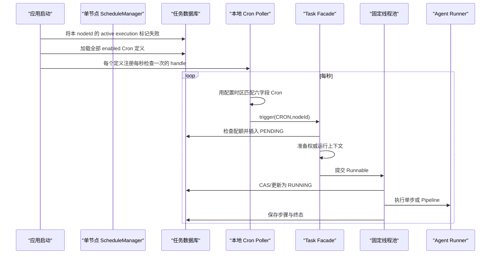
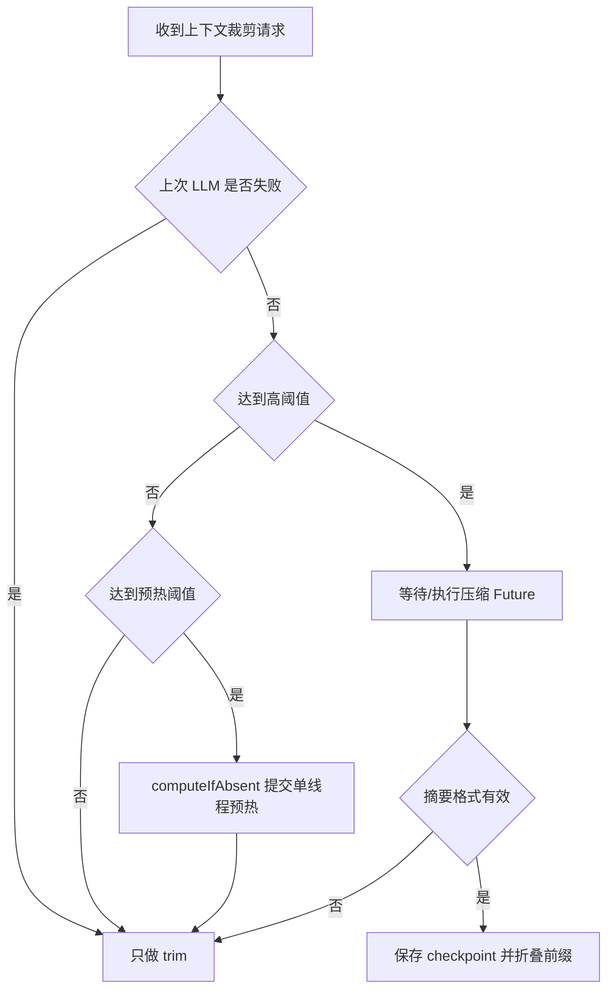
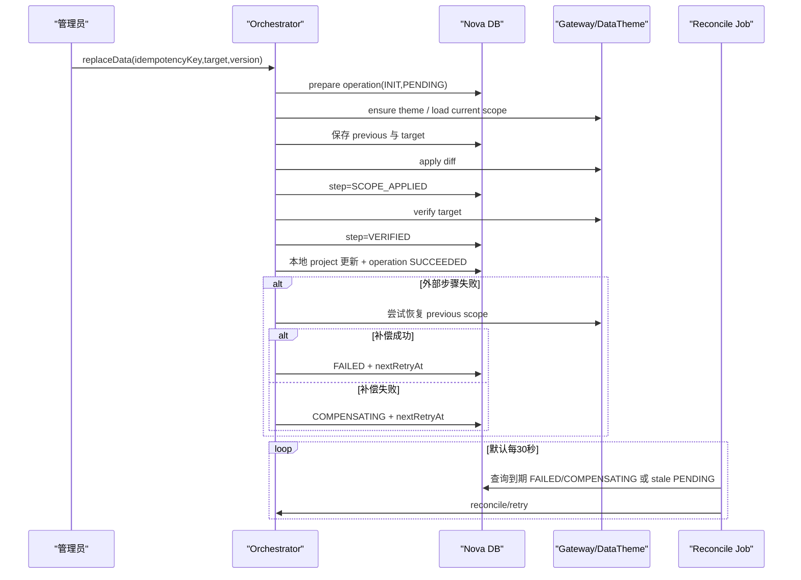
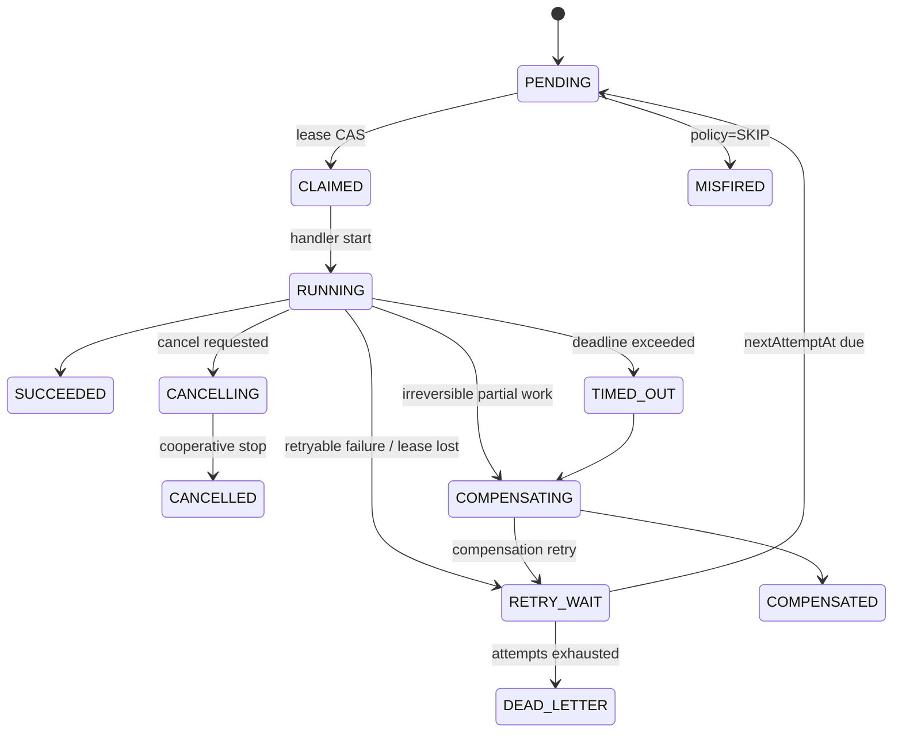

```
# 调度、异步执行与补偿：可复刻技术设计

> 本文是独立复刻说明。读者无需访问 Nova 源码，也能实现业务效果等价的调度、后台作业、恢复与补偿体系。正文中的类名和路径只在末尾“证据附录”出现，不承担关键解释。

## 0. 结论、边界与证据标记

Nova 当前不是一个统一的 Job 平台，而是多个业务子系统各自实现了调度与恢复：用户定时任务、记忆 Review、上下文压缩、Project Gateway Saga、评测批次、Spring 定时清理任务。它们在持久化、领取、取消、超时、重试和多节点语义上并不一致。

本文同时完成两件事：

1. 精确复刻“当前行为”，包括缺口和部署边界；
2. 给出可落地的统一 Job/Execution 框架，作为新工程的推荐实现。

本文不复述聊天 Tool Loop、知识检索或 Project 产品需求，只描述它们如何提交、执行、恢复和补偿后台工作。

证据标签：

| 标签 | 含义 |
|---|---|
| **I** | 静态实现确认 |
| **A** | 自动化测试或测试设计证据 |
| **K** | 当前已知缺口或风险 |
| **P** | 根据代码结构作出的推断，尚未运行验证 |
| **REQ** | 复刻当前行为必须保留的规则 |
| **F** | 当前已有但不完整的基础能力 |
| **D** | 推荐的新工程统一设计，不宣称当前已实现 |

### 0.1 一句话架构判断

**I**：当前系统采用“业务表即作业状态 + 本地 Executor/Spring Scheduler 驱动”的组合；只有记忆 Review 有数据库 CAS claim 和过期锁，Project Saga 有持久化检查点与补偿，其他大部分机制依赖本进程存活。

**K**：多节点一致性、统一租约、统一取消、统一重试、统一可观测性和事务 Outbox 均未形成平台级保证。

**D**：生产复刻应以数据库为真相源，拆分 `JobDefinition`、`JobExecution`、`JobAttempt`、`JobStep`、`OutboxEvent`，通过 lease/heartbeat/CAS 领取，业务 Handler 只实现幂等步骤和补偿。

## 1. 产品与系统边界

### 1.1 参与方

| 参与方 | 输入 | 输出 | 当前执行形态 |
|---|---|---|---|
| 定时任务用户 | 手工执行或六字段 Cron | Agent 会话、步骤、结果、artifact | DB execution + 本地固定线程池 |
| 记忆系统 | 对话完成标记 | 用户画像增删改 | DB job + 定时 claim worker |
| Agent 上下文系统 | token 阈值与消息前缀 | 压缩摘要 checkpoint | 进程内单线程 Future，必要时同步等待 |
| Project 管理员 | 创建项目/替换数据范围 | Nova 本地项目与 Gateway 状态一致 | 持久 Saga + Spring 轮询补偿 |
| 评测管理员 | 启动/续跑/取消评测或候选生成 | 逐题结果、报告、候选项 | DB run + 虚拟线程 + 启动恢复 |
| 运维定时任务 | 固定延迟/固定 Cron | 清理、刷新、对账 | Spring `@Scheduled` |
| 内容摄取 | 导入知识文件 | 解析预览 | **当前是同步预览，无 durable ingestion job** |

### 1.2 当前多套实现对比

| 能力 | 用户任务 | 记忆 Review | 上下文压缩 | Project Saga | 评测 | Spring Jobs |
|---|---|---|---|---|---|---|
| durable execution | 是 | 是 | 否，仅输出 checkpoint | 是 | 是 | 通常否 |
| 数据库领取 | 否 | CAS claim | 否 | 行锁式 retry claim | 否 | 否 |
| lease/heartbeat | 否 | 2 分钟租约、无续租 | 否 | stale 时间窗、无 owner lease | 否 | 否 |
| 多节点安全 | 否 | 部分 | 否 | 部分 | 否 | 否 |
| retry | 字段存在但未执行 | 最大 3 次 | 摘要本地最多 2 次 | 指数退避、默认最多 5 次 | 手工/启动 resume | 业务自行决定 |
| cancel | best effort | 无公共取消 | 无调用方取消句柄 | 无普通取消，走补偿 | cooperative | 通常无 |
| timeout | 字段未兑现 | LLM 自身边界 | 无总体 Future timeout | stale 判定，不是调用超时 | 单题默认 240 秒，超时后放弃不打断 | 未统一 |
| compensation | 无 | 无 | fail-soft | 有 | 续跑跳过已完成题 | 无 |
| misfire | 停机期间丢失 | 到期后可 claim | 不适用 | 到期后扫描 | 启动扫描 active | 依赖 Spring 本地行为 |

## 2. 当前实现一：用户手工与 Cron Agent 任务

### 2.1 外部契约

认证后的普通用户 API：

```http
GET    /api/tasks
POST   /api/tasks
GET    /api/tasks/{definitionId}
PUT    /api/tasks/{definitionId}
DELETE /api/tasks/{definitionId}
POST   /api/tasks/{definitionId}/copy
POST   /api/tasks/{definitionId}/execute
GET    /api/tasks/{definitionId}/executions
GET    /api/tasks/executions/{executionId}
POST   /api/tasks/executions/{executionId}/cancel
GET    /api/tasks/executions/{executionId}/conversation
GET    /api/tasks/executions/running
```

所有读写都必须以认证上下文中的 `(tenantId,userId)` 做归属校验，不能信任请求体身份。手工执行立即返回：

```json
{"executionId": 9812}
```

租户管理员另有定义、执行和配额查询接口。管理端所谓 scheduler rebalance 只返回 `single-node scheduler active`，不是实际再均衡。

`I/K` LLM 侧 `task_management` 工具只发布 `list/get/create/execute/cancel/list_executions`，并不等价于 REST 的 update/delete/copy 全能力。权威运行上下文准备出现已知业务失败时，facade 会尽量把 execution 写为 FAILED；部分错误还要求禁用定义并刷新 schedule。若“失败状态持久化”本身失败，会抛稳定的 `TASK_RUN_PREPARATION_PERSIST_FAILED`；若禁用或刷新失败，会抛 `TASK_RUN_SUSPEND_FAILED`。工具把已知参数/未找到/状态错误转为可见 ToolResult error，意外 RuntimeException 会记录异常并返回错误。`K` 因而不能把“tool 返回 error”理解为 execution 必定已可靠 release/终结；上述持久化失败可能留下 active/PENDING 状态，需启动恢复或对账。`D` 把 preparation admission 与失败终结放入 durable claim 事务，并用 sweeper 收敛遗留状态。

### 2.2 定义与执行数据

任务定义至少应包含：`id, tenantId, userId, name, prompt, type, enabled, cronExpression, steps, timeoutSeconds, retryPolicy, maxConcurrentExecutions, createdAt, updatedAt`。执行至少包含：`id, definitionId, tenantId, userId, triggerType, nodeId, status, conversationId, startedAt, finishedAt, error, retryAttempt`。

状态为：

```text
PENDING -> RUNNING -> COMPLETED
                   -> FAILED
                   -> CANCELLED
```

Pipeline 的每一步记录独立状态。`I` 普通步骤 ERROR/异常时当前步骤记 `FAILED`，剩余步骤显式记 `SKIPPED`。`I/K` Agent 返回 CANCELLED 时，当前步骤记 `FAILED`、execution 记 `CANCELLED`，却直接返回而没有补余下 `SKIPPED` 行；因此取消时间线与普通失败不一致。Agent 返回 `COMPLETED` 或 `TRUNCATED` 都按任务成功处理。`D` 终结事务应把尚未开始的步骤统一改为 `SKIPPED`，并以 `skip_reason=CANCELLED|UPSTREAM_FAILED` 区分。

### 2.3 Cron 调度链路



**I/REQ**：Cron 是六字段、秒级、配置时区解析；本地 poller 每秒 `scheduleAtFixedRate`。每个 handle 只用进程内 `lastTriggered` 避免同一秒重复。

**K**：没有持久化 `next_fire_at`，应用停机期间的触发不会补跑；没有 misfire policy。

**K**：每个节点都会加载全部 Cron。多个应用实例会重复触发同一个任务。若多个实例误用同一 `nodeId`，其中一个启动时还可能把另一个实例的 active execution 判失败。

**I**：定义变更会刷新本地 handles；禁用/删除/表达式变化会 cancel handle，但 `cancel(false)` 不打断正在执行的 tick。

### 2.4 派发、限额与关闭

**I**：默认 execution pool 为 4 个平台线程；底层固定线程池使用无界队列。默认 scheduler pool 为 2。

**K**：无界队列会把数据库 PENDING 持续堆入内存；停机期间的拒绝提交可能留下永久 PENDING。

**I**：当前在“读取 active 数 -> 插入 execution”之间没有原子配额占位，多请求并发可越过租户/任务并发上限。默认配额为：定义 50、并发 5、Cron 最小间隔 300 秒、每天 100 次、artifact 500 MB；后两项存在数据契约但当前主触发链未见强制执行。

**K**：`timeoutSeconds`、`retryPolicy`、`retryAttempt` 已进入数据模型，但执行器未兑现超时和自动重试。

**I**：关闭时 dispatcher 先等待 5 秒，再 `shutdownNow`；scheduler 直接取消 handles 并关闭。插件自身的 `stop()` 清理 facade、resolver、skill/classloader 引用，线程资源由 Spring bean 的 destroy method 关闭。

## 3. 当前实现二：记忆 Review 作业

### 3.1 业务触发与去重

每次对话完成后，以 `(tenantId,userId,conversationId)` 标记一个 Review job。数据库唯一键保证每个对话只有一行；后续新消息会更新游标、设置 `nextReviewAt=now+reviewDelay`、重置 attempt 与锁，形成 debounce。

**K**：首次并发插入仍可能触发唯一键冲突；更新一个正在 RUNNING 的行会清除其锁并重置状态，旧 worker 可能继续写画像，而新 worker 又领取同一行。

### 3.2 领取协议

候选查询选择 `PENDING/FAILED/RUNNING` 中已经到期且无锁或锁过期的行。worker 先 select 候选，再对每行做一次较弱的条件更新：

```sql
UPDATE memory_review_job
SET status='RUNNING', locked_by=:worker, locked_at=:now,
    lock_expires_at=:now + interval '2 minutes'
WHERE id=:id
  AND (locked_by IS NULL OR lock_expires_at IS NULL OR lock_expires_at <= :now);
```

更新行数为 1 才领取成功。`K` claim UPDATE 只校验 `id + lock`，没有再次校验 status、`next_review_at` 或读到的 version；select 与 update 之间若 `markPending` 改了 due time，旧 claimant 仍可能提前领取。默认单批 4 个；scheduler 为单 daemon 线程、最短每秒一次 fixed-delay。job 从最多 1000 条消息中选最多 40 个合格块，并限制 prompt 约 50K 字符。`D` 加 version，在一个事务内用 `FOR UPDATE SKIP LOCKED`，或让 UPDATE 同时校验 `status IN (...) AND next_review_at<=now AND version=:seenVersion`；完成/失败校验不可预测 lease token 和未过期时间，而不只校验 worker 字符串。

### 3.3 完成与失败

worker 用后台 LLM Runner，只开放记忆变更工具。成功后更新 Review cursor 并完成；失败默认延迟 5 分钟，最多 3 次，耗尽进入 `BLOCKED`。关闭中断时保留 RUNNING，等待租约过期被恢复。

**I**：完成/失败更新要求 `status=RUNNING AND locked_by=:worker`。

**K**：没有 heartbeat。处理超过 2 分钟时，其他 worker 可重新领取。旧 worker 对画像的工具副作用可能已发生，即使它最后因 owner 不匹配而不能提交 job 终态。

**K**：当前没有用户级 cancel/requeue BLOCKED API，也没有统一死信管理。

## 4. 当前实现三：Background LLM 与上下文压缩

Background LLM Runner 是同步库调用，不是 durable job queue。它创建临时 run/sandbox，只使用 SYSTEM+USER 两条消息，工具白名单与 runtime-context key 白名单，最终释放 sandbox。`SILENT` 不发事件，`INTERNAL_METRICS` 只记日志，`INTERNAL_PROGRESS` 目前也没有外部 observer。

上下文压缩存在两档：

1. 达到较低阈值时，在单 daemon 线程中预热 sealed-prefix summary，本轮仍使用 trim；
2. 达到较高阈值时，当前 Agent 轮次阻塞等待 summary。

摘要格式校验失败会最多重试两次；仍失败返回 null，主对话 fail-soft。checkpoint 持久化失败只告警，内存摘要仍可使用。`K` 记忆 review 的单个 job 失败有 retry/BLOCKED，但失败落库自身再抛异常时并非全部隔离，可能中断本批后续处理。`D` worker 外层应分别捕获 handler error 和 `recordFailure` error，后者写 emergency metric/dead-letter 后继续下一 claim。



**K**：Future 无 durable execution、无租约、无外部取消句柄；高阈值 `.join()` 没有总体超时。单线程 Executor 默认无界队列。进程重启丢失预热任务。

**REQ**：复刻现状时，压缩失败绝不能打断主对话；如果上次 LLM 调用本身失败，本轮禁止再触发摘要 LLM，避免失败放大。

## 5. 当前实现四：Project Gateway Saga 与对账

### 5.1 持久 Saga 数据

每个操作记录：`operationId, tenantId, projectId, operationType, state, step, idempotencyKey, requestHash, requestJson, dataThemeId, previousScopeJson, targetScopeJson, retryCount, errorCode, errorMessage, nextRetryAt, createdBy, timestamps`。

状态：`PENDING, SUCCEEDED, FAILED, COMPENSATING`。步骤：`INIT, THEME_CREATED, PROJECT_BOUND, SCOPE_APPLIED, VERIFIED, LOCAL_COMMITTED, COMPENSATED`。

`(tenantId,idempotencyKey)` 唯一。相同 key 但请求 hash 或 operation type 不同必须返回冲突，不能静默复用。

### 5.2 替换项目范围链路



每个本地状态更新使用短事务，外部 Gateway 调用不包在数据库事务中。创建项目、完成 scope 更新时，本地业务实体与 operation 成功状态在同一事务提交。

默认 `staleAfter=2m`、最大重试 5，退避封顶 1 小时。补偿也可能失败并进入后续重试。

**K**：Reconcile 使用 Spring 本地 scheduler，多节点都会扫描。领取依靠行锁和 stale 判定，但没有 owner/lease/heartbeat；外部调用超过 stale 窗口可能被另一个节点重复执行。因此 Gateway 的 add/remove/update 必须支持幂等，或以 operationId 作为幂等键。

**K**：没有事务 Outbox；“DB 提交后通知其他子系统”主要依赖事件监听与周期性对账。

### 5.3 Project 任务联动

Project 禁用、删除或成员失权后，AFTER_COMMIT listener 批量禁用相关任务、best-effort 取消 active execution，并刷新 scheduler。监听失败不能回滚已经提交的 Project 事务，故另有默认每分钟运行的 reconciliation job 扫描修复。

**I**：reconciliation cursor 只在内存，单实例用 `synchronized`，每页最多 100；重启从头扫描，多节点重复扫描。操作大体幂等，但没有 durable checkpoint 或分布式领取。

## 6. 当前实现五：评测与候选生成

### 6.1 提交和双层并发

HTTP 事务先保存 run/job 和问题 ID 快照，再通过 AFTER_COMMIT 回调提交虚拟线程，避免 worker 读不到未提交行。外层 Executor 用 `putIfAbsent(runId)` 原子拒绝同一进程内重复提交；内层为每题虚拟线程，并由 Semaphore 限制并发，默认 4、硬上限 32。`K` AFTER_COMMIT 中 executor submit 若因关闭或饱和而被拒绝，原事务已经成功且没有可靠 outbox 接管，可能遗留 PENDING/RUNNING 行直到启动恢复或人工处理。

每个子虚拟线程显式绑定 tenant sandbox ThreadLocal，完成后清理；这说明普通 ThreadLocal 不会自动成为可靠的异步上下文传播机制。

### 6.2 取消、超时、续跑

评测 run 的取消是 cooperative：设置进程内 `AtomicBoolean`，提交循环在 semaphore 获取前后都复查，停止新增题，等待已在跑的题完成，再落 `CANCELLED`；不直接中断 H2 写路径。

候选生成 generation job 是另一套语义：取消 API 先把数据库 job 直接置 `CANCELLED/finishedAt`，再请求外层 executor cancel。生成循环只在获取 semaphore **之前**查 DB cancelled；等待空位后没有二次复查，故取消可能在竞态窗口后额外提交一题。`K` 两种取消机制不能合称一种保证。`D` 二者统一为 durable `cancel_requested_at`，任何 admission（尤其 acquire semaphore 之后、真正 submit 之前）再次 CAS 检查 generation/lease；终态由 worker 在在途收敛后写入。

单题默认 wall-clock timeout 240 秒。超时后调用方“放弃等待”，但不打断 Agent；后台 Agent 可能继续到 socket timeout 或 tool-round 上限，并继续写其隔离的 BACKGROUND conversation。

续跑依据创建时保存的问题 ID snapshot，跳过已有 aggregate result/candidate 的题。应用 ready 时扫描所有 `PENDING/RUNNING` 行并自动 resume；遗留无 snapshot 或题目全删除的行转 `FAILED`。

**K**：startup recovery 没有集群 owner。多个节点同时启动会各自拥有本地 `putIfAbsent` map，可能重复续跑同一 run。应以数据库 claim 取代进程内 admission。

**K**：虚拟线程 Executor 没有全局排队上限；Semaphore 仅限制单 run，不限制跨 run 总并发和租户配额。

## 7. 内容摄取与通用 Spring 调度边界

**I/K**：当前知识 JSON/Markdown/PDF 导入是同步解析/预览，不存在 durable content-ingestion、embedding 或 index-build job。因此不能宣称支持断点续传、失败重试、异步进度或索引原子切换。新工程若需要这些效果，必须实现本文第 10 节统一模型。

应用启用了 Spring scheduling 与 async。Project Saga 对账、Project 任务修复、conversation lease 清理、分享计数刷新/限流清理/审计清理、主题完整性、临时表清理、数据源刷新等使用本地 `@Scheduled`。

**I/F**：工程包含 db-scheduler starter、启用配置和官方 `scheduled_tasks` 表；示例配置为 heartbeat 5 秒、polling 10 秒、threads 4。

**I/K**：未发现业务 task registration 或 handler 使用 db-scheduler。现有 `@Scheduled` 和用户 Cron 没有因此自动获得分布式语义。

**K**：没有统一 Spring `TaskScheduler`/`AsyncConfigurer` 证据；`@Async` artifact cleanup 依赖框架默认执行器。各种子系统还自行创建 cached pool、fixed pool、virtual-thread pool 和 scheduler，无法统一限流、命名、指标与关闭。

## 8. 线程、队列与上下文传播规则

### 8.1 当前线程资源表

| 用途 | 线程模型 | 队列/上限 | 关闭语义 |
|---|---|---|---|
| 用户任务执行 | fixed 4 | 无界队列 | 5 秒后 interrupt |
| 用户 Cron | scheduled fixed 2 | 每定义一个 handle | cancel + shutdownNow |
| 记忆 Review | single scheduled daemon | 顺序 tick | cancel(true)+shutdownNow |
| sealed 压缩预热 | single daemon | 无界队列 | shutdownNow |
| 评测外层/内层/单题 | virtual-thread-per-task | 无全局界限；单 run semaphore | 外层等待 30 秒，不强停；内层自然结束 |
| Spring scheduler | 框架默认 | 未统一声明 | Spring lifecycle |

### 8.2 必须显式传播的上下文

异步 payload 必须携带且服务端重新校验：

```json
{
  "tenantId": "t-001",
  "userId": "u-009",
  "projectId": "p-123",
  "conversationId": "optional",
  "requestId": "req-...",
  "traceparent": "00-...",
  "locale": "zh-CN",
  "capabilitySnapshotId": "cap-..."
}
```

**D**：不要序列化 API key、明文 credential 或完整认证 token。worker 应按 tenant/user/project 重新解析权限和 secret。ThreadLocal 只能作为 handler 执行期间的适配层，必须在 `finally` 清理。

## 9. 统一框架：领域模型与状态机（推荐设计）

### 9.1 四层模型

| 模型 | 生命周期 | 作用 |
|---|---|---|
| `JobDefinition` | 长期 | Cron/手工定义、handler、misfire、retry、timeout、并发策略 |
| `JobExecution` | 一次逻辑触发 | 幂等键、计划时间、业务 payload、最终结果 |
| `JobAttempt` | 一次 worker 尝试 | lease owner、heartbeat、异常、开始结束时间 |
| `JobStep` | Saga/批处理步骤 | checkpoint、输入/输出 hash、补偿状态 |

统一状态：



`SUCCEEDED/CANCELLED/COMPENSATED/MISFIRED/DEAD_LETTER` 为终态。`TIMED_OUT` 是否终态取决于业务是否需要补偿；推荐先记录 timeout attempt，再把 execution 转入 `COMPENSATING` 或 `RETRY_WAIT`。

### 9.2 幂等键

推荐唯一键：

```text
(tenant_id, handler, idempotency_key)
```

生成规则：

- 手工请求：客户端 `Idempotency-Key`；
- Cron：`definitionId + scheduledFireTime`，不是实际轮询时间；
- 对话 Review：`tenant:user:conversation:messageWatermark`；
- 内容摄取：`sourceId:sourceVersion:parserVersion:indexVersion`；
- 评测：`runId:questionId:rerunOrdinal:judgeVersion`；
- Saga：现有 operation idempotency key。

相同 key 但 `request_hash` 不同必须 409；相同 key、相同 hash 返回已有 execution。

## 10. 统一数据库契约

以下是 PostgreSQL 最小实现。`K` H2 不能只机械地把 `jsonb` 换 `clob`、`timestamptz` 换 `timestamp`：partial index、`SKIP LOCKED`、时区/JSON check、identity/default 和锁行为都有差异。复刻必须维护独立 H2 migration 与领取 SQL并跑相同契约测试；若 H2 仅用于单机测试，应明确它不证明 PostgreSQL 多节点语义。

```sql
CREATE TABLE job_definition (
  id varchar(64) PRIMARY KEY,
  tenant_id varchar(64) NOT NULL,
  owner_user_id varchar(64),
  handler varchar(128) NOT NULL,
  name varchar(256) NOT NULL,
  enabled boolean NOT NULL DEFAULT true,
  schedule_type varchar(16) NOT NULL,
  cron_expression varchar(128),
  zone_id varchar(64) NOT NULL DEFAULT 'UTC',
  next_fire_at timestamptz,
  misfire_policy varchar(24) NOT NULL DEFAULT 'FIRE_ONCE',
  overlap_policy varchar(24) NOT NULL DEFAULT 'FORBID',
  timeout_seconds integer NOT NULL DEFAULT 600,
  retry_policy jsonb NOT NULL,
  payload jsonb NOT NULL,
  version bigint NOT NULL DEFAULT 0,
  created_at timestamptz NOT NULL,
  updated_at timestamptz NOT NULL,
  CHECK (schedule_type IN ('MANUAL','ONCE','CRON','EVENT')),
  CHECK (misfire_policy IN ('SKIP','FIRE_ONCE','CATCH_UP'))
);

CREATE TABLE job_execution (
  id varchar(64) PRIMARY KEY,
  definition_id varchar(64) REFERENCES job_definition(id),
  retry_of_execution_id varchar(64) REFERENCES job_execution(id),
  root_execution_id varchar(64) REFERENCES job_execution(id),
  tenant_id varchar(64) NOT NULL,
  owner_user_id varchar(64),
  handler varchar(128) NOT NULL,
  idempotency_key varchar(256) NOT NULL,
  request_hash char(64) NOT NULL,
  trigger_type varchar(16) NOT NULL,
  scheduled_at timestamptz,
  available_at timestamptz NOT NULL,
  deadline_at timestamptz,
  status varchar(24) NOT NULL,
  cancel_requested_at timestamptz,
  payload jsonb NOT NULL,
  result jsonb,
  error_code varchar(128),
  error_message text,
  attempt_count integer NOT NULL DEFAULT 0,
  max_attempts integer NOT NULL DEFAULT 1,
  priority integer NOT NULL DEFAULT 0,
  trace_id varchar(64),
  created_at timestamptz NOT NULL,
  started_at timestamptz,
  finished_at timestamptz,
  version bigint NOT NULL DEFAULT 0,
  UNIQUE (tenant_id, handler, idempotency_key)
);
CREATE INDEX idx_job_claim
  ON job_execution(status, available_at, priority DESC, created_at);

-- FORBID overlap 的原子占位；与 execution 创建/终态释放同事务。
CREATE TABLE job_active_slot (
  definition_id varchar(64) PRIMARY KEY REFERENCES job_definition(id),
  execution_id varchar(64) NOT NULL UNIQUE REFERENCES job_execution(id),
  acquired_at timestamptz NOT NULL
);

CREATE TABLE job_attempt (
  id varchar(64) PRIMARY KEY,
  execution_id varchar(64) NOT NULL REFERENCES job_execution(id),
  attempt_no integer NOT NULL,
  worker_id varchar(128) NOT NULL,
  lease_token varchar(64) NOT NULL,
  lease_expires_at timestamptz NOT NULL,
  heartbeat_at timestamptz NOT NULL,
  status varchar(24) NOT NULL,
  started_at timestamptz,
  finished_at timestamptz,
  error_class varchar(256),
  error_message text,
  UNIQUE(execution_id, attempt_no),
  UNIQUE(lease_token)
);

CREATE TABLE job_step (
  id varchar(64) PRIMARY KEY,
  execution_id varchar(64) NOT NULL REFERENCES job_execution(id),
  step_key varchar(128) NOT NULL,
  ordinal integer NOT NULL,
  state varchar(24) NOT NULL,
  input_hash char(64),
  checkpoint jsonb,
  output jsonb,
  compensation_state varchar(24),
  compensation_attempt_count integer NOT NULL DEFAULT 0,
  compensation_max_attempts integer NOT NULL DEFAULT 3,
  compensation_available_at timestamptz,
  compensation_policy jsonb,
  attempt_count integer NOT NULL DEFAULT 0,
  started_at timestamptz,
  finished_at timestamptz,
  UNIQUE(execution_id, step_key)
);

CREATE TABLE job_compensation_attempt (
  id varchar(64) PRIMARY KEY,
  execution_id varchar(64) NOT NULL REFERENCES job_execution(id),
  step_id varchar(64) NOT NULL REFERENCES job_step(id),
  attempt_no integer NOT NULL,
  state varchar(24) NOT NULL,
  worker_id varchar(128),
  lease_token varchar(64),
  lease_expires_at timestamptz,
  available_at timestamptz NOT NULL,
  started_at timestamptz,
  finished_at timestamptz,
  error_code varchar(128),
  error_message text,
  UNIQUE(step_id, attempt_no)
);

CREATE TABLE job_outbox (
  id varchar(64) PRIMARY KEY,
  tenant_id varchar(64) NOT NULL,
  aggregate_type varchar(64) NOT NULL,
  aggregate_id varchar(64) NOT NULL,
  event_type varchar(128) NOT NULL,
  payload jsonb NOT NULL,
  created_at timestamptz NOT NULL,
  published_at timestamptz,
  status varchar(24) NOT NULL DEFAULT 'PENDING',
  available_at timestamptz NOT NULL,
  publish_attempts integer NOT NULL DEFAULT 0,
  max_publish_attempts integer NOT NULL DEFAULT 20,
  claimed_by varchar(128),
  claim_token varchar(64),
  claim_expires_at timestamptz,
  last_error text
);
CREATE INDEX idx_job_outbox_due ON job_outbox(status, available_at, created_at)
  WHERE published_at IS NULL AND status IN ('PENDING','RETRY_WAIT');
```

安全要求：payload/result/error 中不得放 credential；`error_message` 写库前做 secret redaction。用户/API 查询必须带 tenant filter。`K` 当前有些可信后台 worker 为扫描全局 backlog 会跨租户读取，这不是普通用户隔离的反例，但也不能无审计地沿用请求线程 repository。`D` 为 trusted worker 建独立 capability/repository，领取后绑定 job 自带 tenant，再解析权限与 secret；记录 worker、来源租户、目标 tenant/execution 和处理结果。管理员跨租户查询同样需要独立审计权限。

## 11. 领取、心跳、完成与恢复算法

### 11.1 原子领取

PostgreSQL 推荐 `FOR UPDATE SKIP LOCKED`：

```sql
WITH candidate AS (
  SELECT id FROM job_execution
  WHERE status IN ('PENDING','RETRY_WAIT')
    AND available_at <= now()
    AND (deadline_at IS NULL OR deadline_at > now())
    AND attempt_count < max_attempts
  ORDER BY priority DESC, available_at, created_at
  FOR UPDATE SKIP LOCKED
  LIMIT :batch
)
UPDATE job_execution e
SET status='CLAIMED', attempt_count=attempt_count+1,
    version=version+1
FROM candidate c
WHERE e.id=c.id AND e.attempt_count < e.max_attempts
RETURNING e.*;
```

在同一事务插入 `status=CLAIMED,started_at=NULL` 的 attempt，生成不可预测 lease token。真正开始 handler 前必须执行 `startIfLeaseOwned`，以 executionId+attemptNo+token+未过期 lease CAS：execution `CLAIMED -> RUNNING, started_at=COALESCE(started_at,now())`，attempt `CLAIMED -> RUNNING, started_at=now()`；任一更新失败都不得调用 handler。worker 每 `leaseDuration/3` 心跳一次。成功/失败提交只允许 RUNNING owner，并同时校验 `executionId + attemptNo + leaseToken + leaseExpiresAt>now()`。

```sql
-- 同一事务；先锁/更新 attempt，再更新 execution，任一不是1行即回滚。
UPDATE job_attempt
SET status='RUNNING', started_at=now(), heartbeat_at=now()
WHERE execution_id=:executionId AND attempt_no=:attemptNo
  AND status='CLAIMED' AND lease_token=:token AND lease_expires_at>now();

UPDATE job_execution
SET status='RUNNING', started_at=COALESCE(started_at,now()), version=version+1
WHERE id=:executionId AND status='CLAIMED';
```

两个 sweeper 补齐不会自然进入 claim 的行：其一把已经 due 且 `attempt_count>=max_attempts` 的 PENDING/RETRY_WAIT 用 CAS 转 `DEAD_LETTER`，同事务写 finished/error/outbox；其二关闭 lease 已过期的 **CLAIMED 或 RUNNING** attempt 为 `LEASE_EXPIRED`，按 attempt 上限与 deadline 将 execution 转为 `RETRY_WAIT/DEAD_LETTER/TIMED_OUT` 并设置带 jitter 的 `available_at`。这也覆盖 claim 成功但 pool submit/start CAS 前进程崩溃的窗口。旧 worker 晚到的终态 CAS 必须影响 0 行。

### 11.2 worker 伪代码

```java
while (!stopping) {
  List<Claim> claims = store.claim(workerId, capacity.available());
  for (Claim claim : claims) {
    pool.submit(() -> {
      try (ContextScope ignored = context.bind(claim.safeContext())) {
        if (!store.startIfLeaseOwned(claim)) return;
        heartbeat.start(claim);
        if (claim.cancelRequested()) throw new CooperativeCancel();
        HandlerResult result = handlers.get(claim.handler()).execute(claim);
        store.succeedIfLeaseOwned(claim, result); // 与 outbox insert 同事务
      } catch (RetryableException e) {
        store.retryIfLeaseOwned(claim, backoff(claim.attemptNo()), redact(e));
      } catch (NeedsCompensation e) {
        store.beginCompensationIfLeaseOwned(claim, redact(e));
      } catch (CooperativeCancel e) {
        store.cancelIfLeaseOwned(claim);
      } catch (Throwable e) {
        store.failOrDeadLetterIfLeaseOwned(claim, redact(e));
      } finally {
        heartbeat.stop(claim);
        context.clear();
      }
    });
  }
}
```

若完成更新影响 0 行，表示 lease 已丢失；worker 不能再发布事件或写非幂等副作用。外部调用仍可能已经发生，故每个外部系统都必须接受 operation/execution/step idempotency key。

### 11.3 retry 与 timeout

推荐退避：`min(maxDelay, base * 2^(attempt-1)) + random(0,jitter)`。分类必须由 handler 显式返回：

- retryable：429、临时 5xx、连接超时、可恢复锁冲突；
- permanent：参数、权限、资源不存在、schema 不兼容；
- compensate：外部部分成功，本地或后续步骤失败；
- cancelled：用户请求，不计失败次数。

retry/耗尽必须是 owner lease CAS，不是先读 attempt 再无条件更新：

```sql
-- 当前 attempt 仍有余额：attempt_count 已在 claim 时递增，此处不再加一。
UPDATE job_execution e
SET status='RETRY_WAIT', available_at=:retryAt,
    error_code=:code, error_message=:message, version=version+1
WHERE e.id=:executionId AND e.status='RUNNING'
  AND e.attempt_count < e.max_attempts
  AND EXISTS (
    SELECT 1 FROM job_attempt a
    WHERE a.execution_id=e.id AND a.attempt_no=:attemptNo
      AND a.lease_token=:token AND a.lease_expires_at>now()
  );

-- 已耗尽：同一 owner 才能转死信；终态事务同时写 outbox。
UPDATE job_execution e
SET status='DEAD_LETTER', finished_at=now(),
    error_code=:code, error_message=:message, version=version+1
WHERE e.id=:executionId AND e.status='RUNNING'
  AND e.attempt_count >= e.max_attempts
  AND EXISTS (
    SELECT 1 FROM job_attempt a
    WHERE a.execution_id=e.id AND a.attempt_no=:attemptNo
      AND a.lease_token=:token AND a.lease_expires_at>now()
  );
```

timeout 分两层：调用级 socket/read timeout；execution deadline。claim 前过滤 deadline 还不够：PENDING deadline sweeper 要把已过期未领取行 CAS 为 `TIMED_OUT`；RUNNING watchdog 到点写 cancel request/失效 lease，并在旧 attempt 晚返回时用 lease/version CAS 拒绝成功。Java interrupt 只在 handler 声明 `interruptSafe=true` 时使用。H2/不可中断 Agent 路径采用 cooperative cancel + 隔离写入 + lease 失效，不能把“调用方停止等待”误写成“后台执行已停止”。

### 11.4 Cron 与 misfire

调度器应在事务中锁 definition，基于上一次 `scheduled_at` 推导下一次，不以当前轮询时间漂移。策略：

- `SKIP`：推进 next fire，不建 execution；
- `FIRE_ONCE`：为所有错过时点只建一个 execution；
- `CATCH_UP`：逐个创建，受 `maxCatchUp` 限制。

Cron execution 的 `(definitionId,scheduledAt)` 唯一键使多节点并发扫描也只能插入一次。用户任务为避免重叠，默认 `overlapPolicy=FORBID`；创建 execution 的同一事务执行 `INSERT INTO job_active_slot(definition_id,execution_id,acquired_at) VALUES (...) ON CONFLICT (definition_id) DO NOTHING`，影响 0 行者记录 `MISFIRED/OVERLAP_SKIPPED`，不能“先 count active 再 insert”。终态事务只以 `DELETE ... WHERE definition_id=? AND execution_id=?` 释放自己的 slot；过期 lease 的 slot 由 sweeper 对照 execution 状态修复。

## 12. 取消、补偿与 Outbox

取消 API 只写 `cancel_requested_at` 并发出 wakeup，不直接伪造终态。handler 在步骤边界、等待队列前后、长循环中轮询。不可取消的外部调用完成后，若已请求取消，应转补偿而不是宣布成功。

Saga 每一步契约：

```java
interface DurableStep {
  String key();
  StepResult execute(JobContext ctx, JsonNode checkpoint);
  CompensationResult compensate(JobContext ctx, JsonNode committedOutput);
}
```

`execute` 与 `compensate` 都必须幂等。补偿按已提交步骤逆序；每步使用独立 `job_compensation_attempt` 领取、lease、attemptNo、availableAt 和终态 CAS，不能复用正向 step 的计数或锁。`compensation_max_attempts/policy` 在 materialize step 时从 handler/definition policy 固化，默认 3；后续配置变化不重写在途步骤。

claim 补偿时锁定 due step，要求 `compensation_state IN ('PENDING','RETRY_WAIT') AND compensation_available_at<=now() AND compensation_attempt_count<compensation_max_attempts`，原子递增 count、置 CLAIMED 并插入相同 attemptNo 的 compensation attempt；开始与终态同样校验 token+expiry。失败后比较**已递增**的 count：小于 max 写 RETRY_WAIT+backoff，否则 DEAD_LETTER。崩溃后从最后一个 `COMPENSATED` checkpoint 继续逆序，不重复已提交补偿副作用。补偿耗尽进入 `DEAD_LETTER` 并报警，不能把状态改回普通 FAILED 掩盖不一致。

业务状态更新、execution 终态与 Outbox insert 必须同事务。publisher 用 `FOR UPDATE SKIP LOCKED` 或条件 UPDATE 领取 due event 并写 claim token/expiry；成功按 token CAS `published_at/status=PUBLISHED`，失败按指数退避写 `RETRY_WAIT/available_at`，耗尽转 `DEAD_LETTER` 并报警。publisher 崩溃由 claim expiry 接管，因此是至少一次投递；消费者以 `eventId` 去重：

```sql
UPDATE job_outbox
SET status='PUBLISHED', published_at=now(), claimed_by=NULL,
    claim_token=NULL, claim_expires_at=NULL
WHERE id=:id AND claim_token=:token AND claim_expires_at>now();

UPDATE job_outbox
SET status=CASE WHEN publish_attempts + 1 >= max_publish_attempts
                THEN 'DEAD_LETTER' ELSE 'RETRY_WAIT' END,
    publish_attempts=publish_attempts+1, available_at=:retryAt,
    last_error=:redactedError, claimed_by=NULL, claim_token=NULL,
    claim_expires_at=NULL
WHERE id=:id AND claim_token=:token;
```

```json
{
  "eventId": "evt-uuid",
  "eventType": "job.execution.succeeded.v1",
  "occurredAt": "2026-08-13T08:30:00Z",
  "tenantId": "t-001",
  "executionId": "job-uuid",
  "definitionId": "def-uuid",
  "handler": "content-ingestion",
  "attempt": 2,
  "traceId": "...",
  "resultRef": "artifact-or-row-id"
}
```

## 13. 统一 API 契约

```http
POST /api/job-definitions
PUT  /api/job-definitions/{id}
POST /api/job-definitions/{id}:pause
POST /api/job-definitions/{id}:resume
POST /api/job-definitions/{id}/executions
GET  /api/job-executions/{id}
GET  /api/job-executions?definitionId=&status=&cursor=&limit=
POST /api/job-executions/{id}:cancel
POST /api/job-executions/{id}:retry
GET  /api/job-executions/{id}/events
```

创建 execution：

```http
POST /api/job-definitions/def-123/executions
Idempotency-Key: ui-f7c2...
Content-Type: application/json

{"payload":{"projectId":"p-1"},"priority":10}
```

```json
{
  "id":"exec-123",
  "status":"PENDING",
  "triggerType":"MANUAL",
  "availableAt":"2026-08-13T08:30:00Z",
  "attemptCount":0,
  "links":{"self":"/api/job-executions/exec-123"}
}
```

取消采用 202/200 幂等响应；已经终态时返回当前状态，不返回假 success。retry 只允许 `FAILED/DEAD_LETTER/CANCELLED` 且调用者有操作权限，并要求新的 `Idempotency-Key`：创建新 execution，设置 `retryOfExecutionId` 和继承的 `rootExecutionId`，把原 payload/requestHash 复制为不可变快照。同 key+同 hash 返回同一 retry execution，不同 hash 返回 409；旧终态永不重写。

## 14. 内容摄取如何接入统一框架

建议步骤：`VALIDATE_SOURCE -> EXTRACT -> NORMALIZE -> CHUNK -> EMBED -> BUILD_STAGING_INDEX -> VERIFY -> ACTIVATE_INDEX`。旧索引在 `ACTIVATE_INDEX` 前始终可读；切换用一个事务更新 active version。失败删除 staging 数据；若切换后业务元数据提交失败，则把 active pointer 补偿回 previous version。

checkpoint 记录 `sourceVersion, parserVersion, lastChunkOrdinal, stagingIndexVersion, completedChunkHashes`。每个 chunk 的唯一键为 `(documentVersion, chunkOrdinal, contentHash, embeddingModelVersion)`，使 lease 过期后的重跑不会重复写。

## 15. 监控、审计与运维

必须提供：

| 指标 | 标签建议 | 告警 |
|---|---|---|
| `job_queue_depth` | handler,tenantBucket,status | 持续增长 |
| `job_oldest_age_seconds` | handler,status | 超过 SLO |
| `job_execution_total` | handler,outcome,trigger | failure/dead-letter 比例 |
| `job_duration_seconds` | handler,outcome | p95/p99 |
| `job_retry_total` | handler,errorCode | 突增 |
| `job_lease_lost_total` | handler,worker | 非零持续出现 |
| `job_misfire_total` | definition,policy | 非预期错过 |
| `job_compensation_total` | handler,outcome | 失败立即告警 |
| `job_worker_capacity` | pool,state | 饱和 |
| `job_outbox_lag_seconds` | eventType | 超阈值 |

日志统一字段：`tenantId, executionId, attemptId, definitionId, handler, step, workerId, traceId, scheduledAt, attemptNo, errorCode`。禁止日志写 prompt 全文、tool secret、credential 或画像明文。

运维端需要：按租户/handler/status 查 backlog；查看 attempt/step 时间线；安全地 retry/dead-letter replay；强制失效 lease；暂停 definition/handler；查看 worker 心跳。每个运维动作写审计日志。

## 16. 失败矩阵

| 故障 | 当前表现 | 统一设计预期 |
|---|---|---|
| Cron 节点停机 10 分钟 | 用户 Cron 丢触发 | 按 misfire policy 补一次/追赶/显式跳过 |
| 两节点同时扫描 Cron | 各触发一次 | scheduled time 幂等键唯一，只成功一次 |
| execution 已落库、队列拒绝 | 可能永久 PENDING | DB worker 后续领取 |
| worker 执行中崩溃 | task 依赖启动 node 清理；memory 等 lease | lease 过期后 retry，attempt 历史保留 |
| worker 超过 lease | memory 可能重复副作用 | heartbeat；外部 step key 幂等；旧 lease 不得提交 |
| cancel 与完成竞态 | 子系统各异 | 条件状态机；先成功提交者决定，响应返回真实状态 |
| 外部 Gateway 成功、本地失败 | Saga 尝试补偿 | durable step + 逆序补偿 + dead-letter |
| AFTER_COMMIT listener 异常 | 原事务已成功，靠扫表修复 | 同事务 Outbox，publisher 重试 |
| 单题超时 | Agent 被放弃但继续跑 | 明确 ABANDONED attempt；隔离副作用；最终回收 |
| 应用多节点启动评测恢复 | 可能重复 resume | DB claim + question-step 唯一键 |
| 压缩 LLM 失败 | fail-soft trim | 保持；压缩 handler 可重试但不能阻塞主链超时 |
| 内容索引中途失败 | 当前无异步索引 | staging index 不可见，重试或清理 |

## 17. 最小生产落地顺序

1. **第一阶段：可恢复队列**——落 `job_execution/job_attempt`、SKIP LOCKED claim、lease/heartbeat、幂等键、bounded worker pool、基础指标。
2. **第二阶段：迁移高风险机制**——先迁移用户 Cron 和评测 startup recovery；保留原 API facade，内部转成统一 execution。
3. **第三阶段：事件可靠性**——加入 Outbox；替换 Project AFTER_COMMIT best-effort 联动。
4. **第四阶段：Saga steps**——将 Project operation 映射为 execution/steps，兼容读取旧 operation 表直到存量终态。
5. **第五阶段：后台 LLM**——记忆 Review 与 sealed compression 使用同一 worker 基础设施；压缩仍保留 fail-soft deadline。
6. **第六阶段：内容摄取**——实现 staging/versioned index 和逐 chunk checkpoint。

迁移期间不得让两套 scheduler 同时产生同一个 Cron execution。使用 definition 级 `schedulerOwner=LEGACY|UNIFIED` 开关，并在一次事务中切换；统一表的唯一键仍作为最后防线。

## 18. 可验收复刻标准

### 18.1 当前行为等价验收

- 创建、编辑、启停、手工运行、取消、删除任务；执行历史可见 conversation 与错误；租户/用户不能越权读取。
- 六字段 Cron 在配置时区命中；非法表达式拒绝或跳过并产生可定位告警；最小间隔生效。
- Pipeline 普通失败后余下步骤为 `SKIPPED`；当前取消分支是“当前步骤 FAILED + execution CANCELLED”，但余下步骤没有统一 `SKIPPED` 行；取消不会把 execution 标为成功。
- 记忆 job 同一对话 debounce；两个 worker 只有一个 CAS 领取；重试耗尽 BLOCKED。
- 上下文摘要失败回退 trim，主 Agent 仍完成；上次 LLM 失败时不再次调用摘要模型。
- Project 相同幂等键同请求返回同一结果，不同请求 409；scope 部分失败会补偿 previous scope。
- 评测 cancel 停止新增题并保留在途结果；重启后只续跑无 aggregate result 的题。

### 18.2 统一设计生产验收矩阵

| 编号 | 场景 | 注入方式 | 预期可观察结果 |
|---|---|---|---|
| JOB-01 | 双节点领取 | 两 worker 同时 claim 同一行 | 仅一个 attempt RUNNING |
| JOB-02 | worker 崩溃 | kill -9 after external step | lease 到期重领；step 不重复副作用 |
| JOB-03 | 心跳中断 | 阻断 DB 连接超过 lease | 旧 worker 不能提交终态 |
| JOB-04 | Cron misfire | 停 scheduler 跨 3 个 fire time | 三种 policy 结果分别正确 |
| JOB-05 | 幂等手工提交 | 同 key 并发 20 请求 | 一个 execution；hash 冲突为 409 |
| JOB-06 | 配额竞争 | 同租户并发提交超限 | active/queued 上限原子生效 |
| JOB-07 | cooperative cancel | 长批次中途 cancel | 不再创建新 step；在途完成；终态 CANCELLED |
| JOB-08 | timeout | handler 超 deadline | attempt TIMED_OUT；按策略 retry/compensate |
| JOB-09 | Saga 补偿失败 | Gateway rollback 返回 500 | COMPENSATING 重试，耗尽 DEAD_LETTER 告警 |
| JOB-10 | DB commit 后 broker 宕机 | 停 event sink | outbox 留存；恢复后投递一次以上、消费去重 |
| JOB-11 | graceful shutdown | 有 running 与 queued | 停止 claim、续租在途至 grace；剩余由其他节点恢复 |
| JOB-12 | tenant isolation | 使用其他租户 execution ID | 404/403，无日志或事件泄漏 |
| JOB-13 | content index fail | embedding 第 N chunk 失败 | 旧 active index 可读；续跑从 checkpoint 开始 |
| JOB-14 | 压缩超时 | background LLM 卡住 | 主对话在 deadline 后 trim，不被阻塞 |

### 18.3 静态门禁

- 每个 executor 有明确 pool size、queue capacity、rejection policy、thread name 和 shutdown hook；
- 每个 durable handler 声明 idempotency、retry、timeout、cancel、compensation 策略；
- 不允许只靠本地 map 防多节点重复；
- 不允许数据库状态提交与业务事件裸分成两个不可靠步骤；
- 所有终态更新是带 version/lease token 的条件更新；
- 所有后台入口重新做 tenant/权限解析，不复用过期用户 token；
- 自动化覆盖双节点、崩溃、超时、取消竞态和补偿失败，而不只覆盖 happy path。

## 19. 自动化证据与覆盖缺口

**A**：UI E2E 已设计/覆盖任务创建、搜索、编辑、启停、手工运行、删除、周 Cron 创建、非法时间阻止提交、失败详情、连续两次执行历史。自动化服务仓库也有通过 WS 工具创建任务，再经 REST 读取并清理的链路。

**A/K**：这些测试主要验证单节点产品可见效果；未证明 Cron 真正到点触发、多节点不重复、misfire、进程崩溃恢复、队列饱和、lease 失效、补偿与 Outbox。

**P**：本文是静态分析，没有启动应用、没有运行定时器，也没有执行 Maven、Playwright 或自动化测试。所有“当前实现”结论按源码与测试资产标记，运行环境实际配置仍需部署验收。

## 20. 证据附录

复核当前行为时可追溯以下实现区域：

- 用户任务：tasks 插件的 facade、dispatcher、agent executor、single-node schedule manager、polling cron scheduler，以及产品侧 tasks config/controller；
- 记忆：memory-profile 插件的 review scheduler/worker/JDBC job store 与 migration；
- 上下文：默认 context 插件的 summarizing reducer、segment summarizer、background LLM runner；
- Project：gateway operation entity/service/orchestrator/reconcile job、project-task listener/reconciliation job；
- 评测：run service、candidate generation service、virtual-thread executor、single-question evaluator、startup recovery；
- 平台：应用启动类的 scheduling/async 开关、db-scheduler starter/config/baseline table；
- 测试：`nova_ui_e2e` 的 scheduled-task Playwright 资产与 `nova_auto_test` 的 tasks feature/transport。

这些位置仅用于审计；实现本文契约不应依赖原工程符号名。

```
