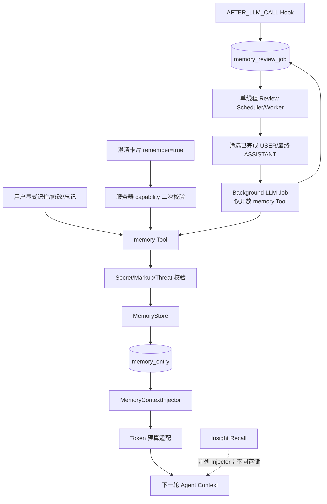
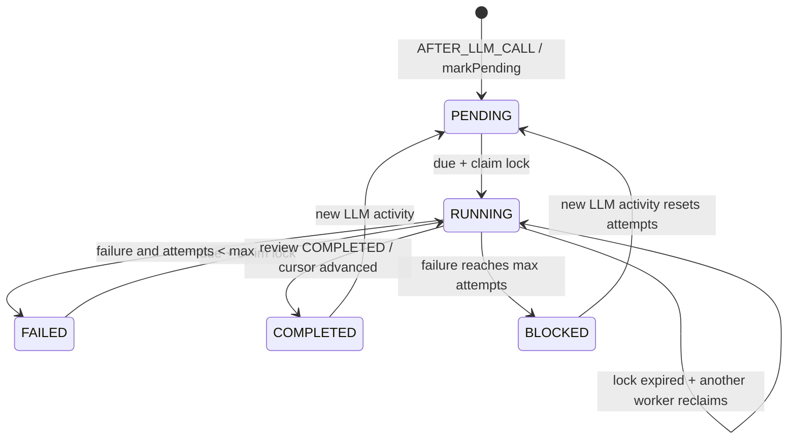
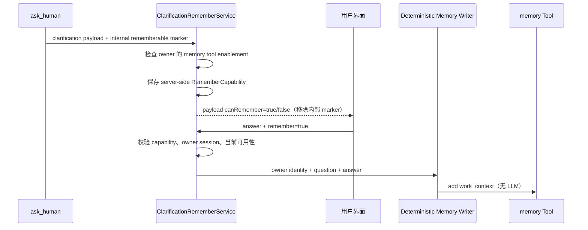

```
# 长期记忆、画像注入与后台 Review：可复刻设计

> 技术轴 T12。本文说明如何复刻一个具有显式记忆工具、跨会话画像注入、后台事实 Review、身份隔离和可审计持久化的 Agent 记忆模块。正文包含实现所需契约，不要求读者访问 Nova 源码。

## 1. 边界、结论与证据等级

### 1.1 业务目标

该模块让 Agent 在用户明确要求记住、修改或忘记稳定事实后，能在新会话中继续使用这些事实；同时后台低优先级 Review 可以从已完成对话中提取用户明确确认的长期事实和最终决策。目标用户是需要跨会话个性化与稳定工作上下文的登录用户。

输入包括：可信 Identity、记忆工具参数、已完成会话消息、当前模型 TokenEstimator 和运行配置。输出包括：持久化记忆行、下一轮的受控 runtime-context 注入、后台 review job 状态与审计事件。

不属于本模块：短期聊天历史、项目文档/Skill、提醒与任务、任意工具结果、搜索知识库、Insight 知识沉淀，以及把模型推测当成用户画像。Insight Recall 是并列的另一套 ContextInjector：它召回用户保存的“分析思路”知识并用相关性 gate 选择，不读写 memory_entry，也不参与 memory review queue。

### 1.2 核心结论

- 记忆分为 `person_profile` 与 `work_context` 两类；前者是脱离具体项目仍成立的人类事实，后者是项目、环境、团队、工具与业务规则。
- 写入有两条正式路径：用户/产品显式调用 `memory` 工具，以及延迟后台 reviewer 通过只开放该工具的内部 LLM job 调用。两条路径复用同一验证、去重、字符限额和身份 scope。
- 每个新用户轮开始时，ContextInjector 按 `tenantId + userId` 读取两类记忆，使用当前 provider 的 TokenEstimator 压入默认 1024 token，再作为“runtime-generated, not user-authored”的 USER-role context 放在真实用户消息前。
- review 由每次成功 LLM 调用后的轻量 hook 标脏；单线程 scheduler 周期 claim 到期 job。普通标记、调度和 review 失败都 fail-soft，不阻断用户对话。
- 当前“事实置信度”没有持久化字段或数值模型；“merge”也不是独立操作。冲突更新依赖 `replace`，后台 LLM 按 prompt 自主选择 add/replace/touch/remove_indices。任何复刻文档若声称已有 confidence scoring 或自动语义合并，都超出当前事实。
- 当前产品没有独立 Memory REST CRUD 或画像管理 UI；外部可见行为主要经 `/api/chat`、WebSocket 对话、工具设置，以及澄清卡片中的“记住”选择完成。

### 1.3 标记

| 标记 | 含义 |
|---|---|
| **I** | 静态实现确认 |
| **A** | 多处证据一致支持的架构结论 |
| **K** | 已知缺口或风险 |
| **P** | 推荐复刻/生产强化，不代表现状 |
| **REQ** | 运行与运维要求 |
| **F** | 失败和降级语义 |
| **D** | 数据、生命周期与合规约束 |

证据来自 Nova 主仓、`nova_ui_e2e` 与 `nova_auto_test` 静态分析。本次未启动应用、未运行测试、未调用真实模型；active 用例只表示已登记自动化契约，不表示本环境已通过。

## 2. 总体架构



三个数据平面必须分离：

| 平面 | 内容 | 权威性 |
|---|---|---|
| 会话真相 | 原始 USER/ASSISTANT 消息 | review 来源；不可被记忆替代 |
| 长期记忆 | 用户级稳定事实 | 跨会话派生事实，可被用户修改/删除 |
| review 控制 | job、cursor/lastMessageId、锁与重试 | 可重建的调度状态，不是用户事实 |

## 3. 记忆分类、来源与数据对象

### 3.1 MemoryKind

| 工具值 | DB `profile_type` | 应保存 | 不应保存 |
|---|---|---|---|
| `person_profile` | `USER` | 姓名、角色、语言偏好、沟通风格、稳定习惯和个人偏好 | 当前项目进度、临时纠正、工具查到的事实 |
| `work_context` | `MEMORY` | 项目/工作区/团队/环境/工具特性、业务规则、编码约定 | 未来提醒、一次性 TODO、Skill 中的通用流程 |

兼容解析允许 `user` → person_profile、`memory` → work_context，也接受枚举名和历史 `PERSON_PROFILE/WORK_CONTEXT`。新实现的 wire schema 只应公开两个规范值，别继续扩散别名。

### 3.2 MemorySource

| 枚举 | DB 值 | 语义 |
|---|---|---|
| `USER_DIRECT` | `USER_MANUAL` | 用户明确工具调用或产品确定性写入 |
| `USER_MANUAL` | `USER_MANUAL` | 历史兼容 |
| `LLM_ACTIVE` | `LLM_ACTIVE` | 预留的主动 LLM 来源；当前工具路径未使用 |
| `BACKGROUND_REVIEW` | `BACKGROUND_REVIEW` | reviewer 写入 |
| `MIGRATION` | `MIGRATION` | 迁移或未知旧来源；空/未知 DB 值读为 MIGRATION |

### 3.3 MemoryEntry

```json
{
  "id": 412,
  "tenantId": "tenant-a",
  "userId": "alice",
  "memoryKind": "PERSON_PROFILE",
  "content": "User prefers concise responses.",
  "contentHash": "sha256(normalized-content)",
  "charCount": 31,
  "createdAt": "2026-08-13T01:00:00Z",
  "updatedAt": "2026-08-13T01:00:00Z",
  "lastRelevantAt": "2026-08-13T01:00:00Z",
  "source": "USER_DIRECT",
  "sourceConversationId": "conv-1",
  "sourceMessageId": null,
  "sourcePromptVersion": "v2",
  "metadataJson": null
}
```

**K**：Java record 预留 `sourceMessageId`、`metadataJson` 和计算出的 `contentHash`，但当前表没有对应列，JDBC insert 也忽略传入的 sourceMessageId；读取时两者为 null，hash 每次从 content 重算。来源审计不能声称精确到消息。

**K**：没有 confidence、validFrom/validTo、事实主体、namespace、敏感级别或 provenance chain。review prompt 的“明确陈述/确认”只是行为规则，不是可查询的置信度保证。

## 4. 持久化契约与 DDL

当前等价 DDL：

```sql
CREATE TABLE memory_entry (
  id BIGINT GENERATED BY DEFAULT AS IDENTITY PRIMARY KEY,
  tenant_id VARCHAR(64) NOT NULL,
  user_id VARCHAR(64) NOT NULL,
  profile_type VARCHAR(8) NOT NULL,
  content TEXT NOT NULL,
  char_count INT NOT NULL,
  created_at TIMESTAMP WITH TIME ZONE NOT NULL,
  updated_at TIMESTAMP WITH TIME ZONE NOT NULL,
  last_relevant_at TIMESTAMP WITH TIME ZONE NOT NULL,
  source VARCHAR(32) NOT NULL,
  source_conversation_id VARCHAR(64),
  source_prompt_version VARCHAR(8)
);
CREATE INDEX idx_memory_target
  ON memory_entry(tenant_id, user_id, profile_type);
CREATE INDEX idx_memory_relevance
  ON memory_entry(tenant_id, user_id, last_relevant_at);

CREATE TABLE memory_review_job (
  id BIGINT GENERATED BY DEFAULT AS IDENTITY PRIMARY KEY,
  tenant_id VARCHAR(64) NOT NULL,
  user_id VARCHAR(64) NOT NULL,
  conversation_id VARCHAR(128) NOT NULL,
  status VARCHAR(24) NOT NULL,
  next_review_at TIMESTAMP WITH TIME ZONE NOT NULL,
  last_message_id VARCHAR(128),
  attempt_count INT NOT NULL DEFAULT 0,
  locked_by VARCHAR(128),
  locked_at TIMESTAMP WITH TIME ZONE,
  lock_expires_at TIMESTAMP WITH TIME ZONE,
  created_at TIMESTAMP WITH TIME ZONE NOT NULL,
  updated_at TIMESTAMP WITH TIME ZONE NOT NULL,
  UNIQUE(tenant_id, user_id, conversation_id)
);
CREATE INDEX idx_memory_review_job_due
  ON memory_review_job(status, next_review_at);
```

迁移还创建 `memory_review_cursor`，含 `last_reviewed_message_idx/failure_count`，但当前 worker/job store 不使用该表；真实 cursor 是 `memory_review_job.last_message_id`。这是遗留/规划结构，不应在复刻逻辑中同时维护两套 cursor。

**K**：memory_entry 数据库没有 `(tenant,user,kind,content_hash)` 唯一约束，content_hash 也未落库；应用先查后插，两个并发 add 可都未查到并插入重复行。insert 捕获 SQL 异常后再次 findByHash 只能处理数据库真的报冲突的情形，但当前 schema 不会因语义重复报冲突。

**D** 生产迁移不能直接在存量表上 `ADD content_hash NOT NULL`：已有行没有值，而且规范化后可能出现重复。PostgreSQL 与 H2 都应采用“可空列 → 回填 → 冲突处理 → 非空 → 唯一”的分阶段迁移；两种 vendor 各写一份等价 migration：

```sql
-- Phase 1: additive, deploy old/new code both can tolerate
ALTER TABLE memory_entry ADD COLUMN content_hash CHAR(64);
ALTER TABLE memory_entry ADD COLUMN source_message_id VARCHAR(128);
ALTER TABLE memory_entry ADD COLUMN confidence DECIMAL(5,4);
ALTER TABLE memory_entry ADD COLUMN version BIGINT NOT NULL DEFAULT 0;

-- Phase 2: application-compatible backfill. The hash MUST use exactly the
-- same canonicalization and UTF-8 SHA-256 algorithm as the writer.
UPDATE memory_entry
SET content_hash = '<sha256(canonical content)>'
WHERE content_hash IS NULL;

-- Phase 3: report and deterministically resolve duplicate groups before
-- adding the constraint; archive/merge losers rather than deleting silently.
SELECT tenant_id,user_id,profile_type,content_hash,COUNT(*)
FROM memory_entry
GROUP BY tenant_id,user_id,profile_type,content_hash
HAVING COUNT(*) > 1;

-- Phase 4: only after the conflict report is empty.
ALTER TABLE memory_entry ALTER COLUMN content_hash SET NOT NULL; -- PostgreSQL
-- H2 uses its vendor-supported SET NOT NULL syntax in the H2 migration.
CREATE UNIQUE INDEX uq_memory_dedup
  ON memory_entry(tenant_id, user_id, profile_type, content_hash);
```

回填应可重入、分批提交并记录进度；先发布能双写 hash 的应用，再回填，再启用 NOT NULL/unique，最后才让写路径依赖唯一约束。若 H2 与 PostgreSQL 的表达式/ALTER 语法不同，不要强求一份 SQL 通吃。

敏感画像应加密静态存储；删除用户时必须按 `(tenant_id,user_id)` 删除 entry/job/offload/audit 派生数据。仅删除对话当前不会自动删除从该对话产生的记忆，因为长期记忆设计上跨会话；产品应在隐私删除中提供“删除会话但保留已确认记忆”和“连同来源记忆删除”两种明确语义。

## 5. MemoryStore SPI 与算法

```java
interface MemoryStore {
  MemoryAddResult addDetailed(scope, kind, content, source,
      sourceConversationId, sourceMessageId, sourcePromptVersion);
  List<MemoryEntry> list(scope, kind, limit);
  List<MemoryEntry> listForReview(scope, kind);
  List<MemoryEntry> listStaleCandidates(scope, staleDays);
  Optional<MemoryEntry> replace(id, scope, content);
  Optional<MemoryEntry> replaceMatching(scope, kind, oldContent, newContent);
  boolean remove(id, scope);
  boolean removeMatching(scope, kind, oldContent);
  Optional<MemoryEntry> touch(id, scope);
  Optional<MemoryEntry> touchMatching(scope, kind, oldContent);
}
```

所有读写 SQL 都必须同时带 tenantId 和 userId；普通 Identity 映射为 `tenantId="" + userId=identity.key()`。tenant-scope Identity 若没有 userId 不满足个人记忆语义，应拒绝，而不是建立共享租户画像。

### 5.1 去重

```text
normalized = lowerCase(content)
normalized = collapseWhitespace(normalized).trim()
while lastChar in ".,!?;:。，！？；：": remove lastChar
hash = SHA-256(UTF-8(normalized))
```

去重只用于比较，原始文本原样保存。大小写、连续空白和末尾中英文标点差异视为同一内容；语义相同但措辞不同不会合并。重复 add 返回原 row 与 `created=false`，不 touch、也不更新来源。

### 5.2 字符限额

默认 person_profile 总字符上限 800，work_context 1500。总量是每条 content 长度，加相邻条目间 `\n§\n` 三字符分隔；replace 用 `oldTotal-oldLength+newLength`。超过限额返回可定位错误，不自动删除旧记忆。

### 5.3 排序与匹配

- 普通 list：`last_relevant_at DESC, updated_at DESC, id DESC`，默认 20，最大 100。
- review/injection：`created_at ASC, id ASC`，稳定索引供 `remove_indices`。
- stale：`last_relevant_at < now-staleDays`，最旧相关时间优先。
- replace/remove/touch 的 old_content 是 `contains(trimmedOldContent)`；若多个不同正文匹配则失败并要求更具体。如果重复正文多行，distinct content 为一，当前选择第一行。

**K**：replace 更新 content、char_count、updated_at、last_relevant_at，但没有更新 source/sourceConversation/promptVersion；也没有重新写持久化 hash（因为无 hash 列）。并发 replace/remove 没有 version/CAS，最后写胜出。

## 6. Memory Tool 对外契约

工具名 `memory`，类别 `Memory`，默认结果 retention 为 EPHEMERAL：工具输出用于当前回合确认，不应长期占据上下文；事实已经在 memory_entry 持久化并由 injector 重载。

```json
{
  "type": "object",
  "required": ["action"],
  "properties": {
    "action": {"enum": ["add","list","replace","remove","touch","remove_indices"]},
    "kind": {"type": "string"},
    "target": {"type": "string"},
    "content": {"type": "string"},
    "memory_id": {"type": "integer"},
    "old_content": {"type": "string"},
    "old_text": {"type": "string"},
    "new_content": {"type": "string"},
    "indices": {"type": "array", "items": {"type": "integer"}},
    "limit": {"type": "integer"}
  }
}
```

这是**当前 schema**：action 有 enum，但 kind 只有文字说明，没有 JSON Schema enum；limit 的说明写 1–100，schema 没有 minimum/maximum；target 和 old_text 作为兼容字段公开。执行层仍会把 kind/target 解析为两类、把 limit/常见别名及数字字符串容错并 clamp。**D** 新工程可在不破坏旧调用的前提下逐版收紧 schema（为 kind 加 enum、limit 加 min/max，并将 alias 标 deprecated），但不能把建议的严格 schema 写成当前事实。

| action | 参数 | 权限/效果 |
|---|---|---|
| add | kind, content | 验证、去重、字符限额后插入 |
| list | kind, limit | 当前 identity 下列举 |
| replace | memory_id+new_content，或 kind+old_content+new_content | 更新一个匹配项 |
| remove | memory_id，或 kind+old_content | 物理删除一个匹配项 |
| touch | id 或 kind+old_content | 仅 private review mode；刷新 lastRelevantAt |
| remove_indices | kind+indices | 仅 private review mode；按 review 稳定快照的 1-based 索引删除 |

模型常误写的 limit 别名 `page_size/num_results/max_results/count/n/size/top_k/k/results` 会被容错解析并 warning；数字字符串也接受。新调用方应只用 canonical 参数。

**K**：当前 `remove_indices` 先取稳定快照，却在同一循环内“校验一个索引、立即删除一个条目”。例如 `[1,999]` 会先删除 #1，再因 999 越界返回 Error；重复索引还可能对同一快照条目重复操作。它没有事务、全量预校验、去重或 snapshot version，因此部分成功会被错误结果掩盖，并发写也会造成索引漂移。**D** 应在一个事务中固定快照/version，先解析并去重全部索引、一次性验证都在范围内，再按 entry id + expected version/CAS 删除；任一校验/删除失败整批回滚。

成功示例：

```text
Memory saved: #412 [person_profile] User prefers concise responses.
Memory already exists: #412 [person_profile] User prefers concise responses.
Memory replaced: #412 [person_profile] User prefers Chinese responses.
```

失败统一是 `Error: <reason>` ToolResult，例如 `memory entry not found`、`memory action requires private review mode`、字符超限或内容威胁命中。顶层 RuntimeException 会记录异常对象，但当前工具错误正文包含异常类名和 message，**K**：数据库内部信息可能透给模型/UI；生产边界应返回稳定 code，详情只进日志。

## 7. 写入安全和事实选择

保存前按顺序拒绝：

1. 疑似 secret：长 `sk-*`、`api key:`、`password=`、`token=`；
2. 角色/运行框架硬标记：system/assistant/developer/tool/function tag、Nova runtime frame；
3. `system prompt/developer message/ignore previous instructions`；
4. 中英文提示注入、角色劫持、欺骗、绕过限制、不可见 Unicode；
5. curl/wget 携带 KEY/TOKEN/SECRET、读取 `.env/credentials/.netrc/.pgpass`、SSH backdoor 等外泄模式。

这只是规则扫描，不是 DLP 或语义安全证明。用户可能合法谈论上述字符串而被误报；变体、编码和其他语言也会漏报。**P**：生产版应先分类 PII/secret，默认不保存高敏数据；允许用户预览和确认；所有 memory injection 使用结构 envelope 和不可执行声明。

事实选择规则：用户明确要求“记住/以后/不要忘记”时，先分类为稳定个人事实、稳定工作上下文、未来提醒或临时纠正。提醒走 automation/task，不写 memory；临时信息除非明确跨会话泛化，否则不写。写成陈述事实，不写“Always do X”命令。

## 8. 跨会话 Context Injection

### 8.1 执行链

```mermaid
sequenceDiagram
    participant A as AgentContextAssembler
    participant M as MemoryContextInjector
    participant DB as MemoryStore
    participant P as Current Provider

    A->>M: Identity + pre-injection messages + Provider
    M->>DB: listForReview(scope, PERSON_PROFILE)
    M->>DB: listForReview(scope, WORK_CONTEXT)
    DB-->>M: createdAt/id ascending rows
    M->>M: per kind take first N (default 20)
    M->>P: TokenEstimator estimate candidates
    M->>M: person first, then work; fit <= maxTokens
    M-->>A: BEFORE_USER_MESSAGE + InjectionStats
    A->>A: wrap RUNTIME_CONTEXT and escape markers
```

渲染形状：

```text
Person profile:
1. User prefers concise responses.
2. User's preferred language is Chinese.
3 omitted.

Work context:
1. Project uses Maven and JUnit 5.
```

每类先截到 `per-kind-limit`，默认 20。预算选择先逐条尝试 person，再逐条尝试 work；每加入一条都用当前 provider TokenEstimator 对完整 USER message 估算。最终仍超预算时先从 work 尾部移除，再从 person 尾部移除；连标题/omitted 提示都放不下则不注入。

`InjectionStats`：messagesInjected=1，tokensInjected=最终估算，hitsFromBackend 是截到 per-kind-limit 后两类条目数，不是实际选入数。注入点是 `BEFORE_USER_MESSAGE`，组装器再包裹 runtime-generated/not-user-authored envelope 并转义 marker/角色 tag。

**K**：injection 读取 `listForReview` 的最老创建记录，而非最近相关记录；当超过 per-kind-limit 时，新记忆可能永远不进入候选，touch 也不改变注入顺序。**P**：候选应按 relevance/updated 排序，并在 person/work 之间做公平或优先级预算；omitted 统计应区分 store 截断和 token 截断。

记忆必须走 ContextInjector，不能硬编码到稳定 SystemPrompt：否则每次记忆变更都会破坏 cache prefix，且会把用户数据提升到 system 信任级。Reducer 应把结构化 runtime context 当保护内容，但在极端窗口下仍需受总预算约束。

## 9. Review 触发、队列和状态机

### 9.1 标脏

系统 hook 监听 `AFTER_LLM_CALL`。有 conversationId 时 best-effort `markPending(scope, conversationId, null, reviewDelay)`；默认延迟 30 秒。标记失败只 warning，不影响 LLM 响应。

注意：一次 tool loop 可有多次 LLM call，每次都会把同一 job 重置为 PENDING、`next_review_at=now+delay`、attempt=0 并清锁，形成 debounce。它不是只在最终回答完成后标记；worker 依靠 MessageState/消息类型过滤不完整内容。

### 9.2 状态机



`markPending` 按 `(tenant,user,conversation)` 做“先查再 insert/update”：已有行不论状态均改 PENDING、attempt=0、清锁，并用 `COALESCE(newLastMessageId, old)` 保留 cursor。worker 一次先 claim 最多 4 个；store 自身最大 claim limit 为 10。候选含 PENDING/FAILED/过期 RUNNING，按 nextReviewAt/id 排序。当前实现先 select，再逐行 update lock，只有 update 成功的行返回。

complete/fail 都只要求 `status=RUNNING AND locked_by=job.lockedBy`，没有 generation/随机 claim token。新消息若只把正在执行的行改成 PENDING，旧 worker 立即 complete 时通常因 status 不符而更新 0 行；但这不是可靠的代际隔离：同一固定 workerId 后续重新 claim 该行后，旧执行仍可能用相同 lockedBy 完成新一代 RUNNING。达到默认 3 次失败后 BLOCKED；新消息重新标脏会解锁并清零。

**K**：claim 没有数据库 `FOR UPDATE SKIP LOCKED`，且 claim UPDATE 只复查“锁为空/过期”，不复查候选 status 和 `next_review_at <= now`。因此 select 后若新 LLM 活动执行 markPending，把 due time 延后并清锁，旧 claim UPDATE 仍能立刻把它改回 RUNNING，绕过 debounce。条件 update 能降低两个 claimant 同时持锁的概率，但不能保护这类状态/到期时间竞态。markPending 对不存在行又是先查后插，并发首写可能撞唯一约束且没有 upsert retry，hook 会 fail-soft 丢掉一次标脏。

**D**：在 PostgreSQL 用短事务 `SELECT ... FOR UPDATE SKIP LOCKED` 选取并更新，或单条 `UPDATE ... WHERE status/due/lease 条件 RETURNING`；H2 测试实现保持相同语义。每次 claim 生成不可复用的 `lease_token`/generation，complete/fail 必须匹配 `(id,status,lease_token,generation)`。markPending 使用真正 atomic upsert 并递增 generation；这样新活动、旧 worker、重新 claim 三者不能互相覆盖。

## 10. Review Worker 与后台 LLM Job

### 10.1 来源筛选

worker 以 job 的 Identity 从 ConversationStore 最多加载 1000 条 newest-first 消息，然后只处理 cursor 之前未 review 的部分。review 来源必须：

- 未删除且 MessageState=COMPLETED；
- USER message；或
- ASSISTANT message 且不含 ToolUse/ToolResultBlock。

TOOL role、带工具调用的中间 assistant、reasoning/runtime context/skill frames 都排除。正文还会剥离完整 `RUNTIME_CONTEXT` 和 `SYSTEM_REMINDER` frame。最多选择 newest-first 40 条、总 conversation slice 默认 50,000 字符；单条超剩余预算时保留首尾并插入 `...[truncated]...`，随后反转成时间正序交给 reviewer。

**K**：若恶意/损坏 frame 只有 open 没有 close，sanitize 会丢弃从 open 到结尾；这是安全 fail-closed，但可能丢合法用户正文。最终 assistant 的 durable outcome 可成为记忆来源，即使用户未逐字确认，依赖 reviewer prompt 判断，存在模型误提取风险。

### 10.2 Review 输入

```text
Conversation slice:
USER: My durable preference is concise replies.
ASSISTANT: Noted.

[Current person_profile — 31/800 chars]
[person_profile #1] User prefers direct answers.

[Current work_context — 0/1500 chars]
(empty)

[Stale candidates — entries not touched recently]
[person_profile #1] "User prefers direct answers." (last relevant 35 days ago)
```

snapshot 使用 createdAt/id 稳定顺序，编号供 `remove_indices`。stale 默认 30 天未 touch；stale 只是提示，reviewer可 touch 或删除，不是自动过期。

### 10.3 Background job 契约

```json
{
  "jobName": "memory-reviewer",
  "identity": {"tenantId":"tenant-a","userId":"alice"},
  "systemPrompt": "quiet background memory reviewer...",
  "userInput": "Conversation slice: ...",
  "providerName": null,
  "allowedToolIds": ["memory"],
  "runtimeContext": {"nova.memory.review_mode": true},
  "runtimeContextKeys": ["nova.memory.review_mode"],
  "maxToolRounds": 0,
  "eventMode": "INTERNAL_METRICS",
  "llmOptions": {"maxTokens": 4096}
}
```

job runner 只构造 SYSTEM+USER，不加载正常历史、不执行普通 ContextInjector、不写 ConversationStore。只开放 memory 工具，review_mode 使 `touch/remove_indices` 可用，并使 add 来源标为 BACKGROUND_REVIEW。最终文本被丢弃，只有工具副作用有效。只有 response status `COMPLETED` 才 complete job；TRUNCATED/CANCELLED/ERROR 都走 fail/retry。

`maxToolRounds: 0` **不是“禁止工具”或“零轮”**，而是 runtime 的“使用默认值”哨兵：runner 仅在请求值 `>0` 时采用请求值，否则使用 `defaultMaxToolLoopRounds`。当前 NovaCoreBuilder 的默认是 **50**，产品装配还可以覆盖它。因此 memory reviewer 当前最多工具轮数是运行时有效默认值，而不是 JSON 中的 0；复刻时应避免用 0 同时表达“默认”和“禁用”，改用 nullable/显式枚举。

**K**：worker 不检查 `toolCallCount`、每次 memory ToolResult 成败或实际 mutation 数；后台 Agent 即使某次 memory 调用返回 `Error:`，只要最终 LLM job 状态是 COMPLETED，job 仍会推进 cursor。复刻时 BackgroundLlmJobResponse 应携带结构化 tool outcomes，memory review 只有所有计划 mutation 成功或明确“Nothing to save”时才 complete。

### 10.4 Review 算法伪码

```text
for job in claimDue(workerId, limit=4, lockTtl):
  try:
    messages = conversationStore.load(job.conversationId, job.identity, 1000)
    if empty: complete(job, oldCursor); continue
    latestId = messages[0].id
    unreviewed = messages until oldCursor encountered
    sources = completed USER + final non-tool ASSISTANT
    sources = strip runtime frames; bound to 40 messages / char limit
    if sources empty: complete(job, latestId); continue
    input = sources + current memory snapshots + stale candidates
    response = backgroundRunner(memory-only, reviewMode=true, maxOutputTokens)
    if response.status == COMPLETED:
        complete(job, latestId)
    else:
        fail(job, retryDelay, maxAttempts)
  catch per-job error:
    fail-or-release-this-lease-with-its-own-error-isolation
    continue
```

**K**：cursor 若在最近 1000 条之外或被删除，`messagesAfterCursor` 会把加载到的 1000 条都当未 review；dedup 可降低重复 add，但 touch/remove/replace 可能重复。job 锁默认 2 分钟且没有 heartbeat；review 超过 TTL 时可被第二 worker 重领，产生并发副作用。数据库唯一 dedup 缺失会放大该风险。

**K**：当前 `runOnce` 先 claim 4 个，再逐个调用 review。review 会捕获主体 RuntimeException，但 catch 后调用的 `jobStore.fail` 不在保护层内；如果 fail 自身抛异常，整个 `runOnce` 中断，后面已经 claim 的 job 保持 RUNNING，只能等 TTL。complete 在空消息/空 prompt/成功分支抛错也会进入 catch，再尝试 fail；fail 再失败同样中断批次。

**D**：每个 job 的 load/review/complete/fail 必须有最外层独立隔离；一次失败不能终止其余已 claim job。长任务续租 heartbeat，或缩小 claim window；未开始的预取 job 应及时 release lease。记录 `claimed/started/completed/failed/fail_persist_failed/lease_expired`，并对 fail 持久化失败进入 reconciliation，而不是只等无指标的 TTL。

## 11. Scheduler 和插件生命周期

配置解析有两层：系统全局键 `memory.profile.*` 优先，其次插件 `memory-profile` namespace，最后默认值。完整配置：

| 键 | 默认 | 归一化 |
|---|---:|---|
| max-injected-tokens | 1024 | injector 至少 1 |
| per-kind-limit | 20 | 至少 1 |
| review-interval-ms | 60000 | scheduler 至少 1000 |
| review-initial-delay-ms | 30000 | 至少 0 |
| review-delay-ms | 30000 | 至少 0 |
| review-retry-delay-ms | 300000 | worker 至少 1000 |
| review-lock-ttl-ms | 120000 | worker 至少 1000 |
| review-max-slice-chars | 50000 | 至少 1 |
| review-max-output-tokens | 4096 | 至少 1 |
| review-max-attempts | 3 | 至少 1 |
| user-char-limit | 800 | store 至少 1 |
| memory-char-limit | 1500 | store 至少 1 |
| stale-days | 30 | worker 至少 0 |

当前没有 `memory.profile.enabled` 配置，产品启动会直接注册插件；示例中其他位置提到的 `profile.enabled=true` 是文档漂移，不是可用开关。实际按身份关闭主要依赖 memory builtin tool 设置，但如前所述尚需统一到 injector/reviewer。

生命周期：

1. `init` 只注册 memory tool 与 review marker hook，store 是 late-binding proxy；
2. `registerSystemServices` 解析配置、注册 ContextInjector，若 BackgroundLlmJobRunner/StoreRegistry/ConversationStore 缺失则禁用 reviewer但保留显式工具和注入；
3. `start` 要求 SqlStorage，执行 namespace `memory_profile` 的 H2/PostgreSQL migration，装配 JDBC stores，再启动单线程 daemon scheduler；
4. scheduler `scheduleWithFixedDelay`，单个 tick 包裹 RuntimeException；
5. `stop` cancel task、`shutdownNow`，最多等 5 秒，然后清空 late-binding delegate。

启动前误调用 late-binding store 应明确报 unavailable。reviewer 被禁用是可接受降级，但 SqlStorage 缺失导致插件 start 失败，因为显式记忆也无法安全持久化。

插件自身不创建画像 JSON/Markdown 文件，也不使用 Agent sandbox；运行资产只有 classpath migration 与 JDBC 表。备份、恢复和数据保留应针对数据库完成，不能通过复制 workspace 文件复原记忆。

## 12. 产品入口、REST/UI 与 Clarification Remember

### 12.1 常规外部行为

没有 `/api/memory/**` 管理接口。客户端通过现有聊天契约：

```http
POST /api/chat
Content-Type: application/json

{"message":"请记住我偏好简洁回答"}
```

模型在 capability 可见时调用 memory tool；回复只是对保存结果的自然语言确认。用户可通过聊天要求 list/replace/remove。新会话无需显式 list，injector 自动提供记忆。

工具设置页把类别 `Memory` 显示为“记忆”；如果 memory builtin 对该 identity 禁用，Agent 不应获得写工具。**K**：ContextInjector 本身是系统注册的，并未在其实现内检查该 identity 的 tool enablement；需要确认宿主是否同时按能力关闭注入。产品的 `MemoryAvailability` 目前只用于澄清记忆 UI。**P**：统一 MemoryCapabilityResolver，让 tool visibility、injector、reviewer 和 UI 使用同一个授权决定。

### 12.2 澄清卡片“记住”



客户端 `remember=true` 只是意图，不能授权写入。服务器必须拥有同 conversation 的 capability ticket，ticket 记录 owner tenant/user、emit 时可用性和问题；响应时再次校验 session owner 和工具可用性。写入内容为 `用户澄清确认 — 问：...；答：...`，固定 work_context，经相同 secret/threat/dedup 校验。任何失败 warning 后跳过，不能阻断用户回答继续执行。

**K**：所有澄清统一存 work_context，未按语义区分个人偏好；问题和答案拼接可能超过字符限额或触发 scanner。没有用户可见的“保存失败”状态。

## 13. Insight Recall 的关系与边界

Insight Recall 是产品插件注册的 `insight-relevance` injector，priority 50。它从用户当前问题取 lexical top 5，再用相关性 gate 选一个用户保存的 Knowledge/Insight，读取完整分析思路并作为 inside-user system-reminder 注入。匿名/无 tenant-user scope 不注入，任一步异常返回 empty。

它和 Memory Profile 的共同点只有：都使用 Identity、ContextInjector、当前 provider token 统计和 fail-soft。差异：

| 维度 | Memory Profile | Insight Recall |
|---|---|---|
| 数据 | 短小稳定事实 | 较长分析方法/思路知识 |
| 召回 | 当前实现全量前 N，无语义 gate | 当前 query 相关性召回 |
| 写入 | memory tool / background review | Insight/Knowledge 产品流程 |
| 插入 | BEFORE_USER_MESSAGE | INSIDE_USER_MESSAGE |
| 生命周期 | touch/stale/review | Knowledge 的独立生命周期 |

两者可能同时注入；由于 injector registry 按 priority/id 确定顺序且每个看到相同 pre-injection snapshot，不能让 Insight 读取 Memory injector 的输出。总上下文预算由后续 ContextReducer 统一控制。

## 14. 并发、幂等、重试、审计与删除

### 14.1 当前保证与风险

| 场景 | 当前行为 | 风险/生产要求 |
|---|---|---|
| 重复 add | 应用 hash 去重，返回 already exists | 并发 race；DB unique hash |
| 并发 replace | 最后写胜出 | version/CAS，冲突 409 |
| remove 重试 | 首次 true，后续 not found | 可接受幂等语义应返回 already absent |
| review job 重复 | lock + cursor + hash 降低重复 | lock heartbeat、唯一 dedup、operation id |
| 新消息撞旧 complete | status+lockedBy 条件使旧 complete 不覆盖 PENDING | 保留 |
| scheduler shutdown | 中断时不 fail job，等锁过期重领 | 需要 shutdown 指标 |
| 删除会话 | review load 为空后 complete | job/来源记忆未自动清理 |

### 14.2 审计事件

当前 MemoryEntry 只有 source、conversation 和 prompt version，job 有状态/attempt/lock；不构成完整审计。生产至少写不可变审计：

```json
{
  "event":"memory_mutation",
  "operationId":"reviewJob:81/toolCall:3",
  "tenantHash":"...",
  "userHash":"...",
  "memoryId":412,
  "kind":"PERSON_PROFILE",
  "action":"ADD|REPLACE|TOUCH|REMOVE",
  "source":"BACKGROUND_REVIEW",
  "sourceConversationHash":"...",
  "sourceMessageId":"msg-9",
  "oldContentHash":null,
  "newContentHash":"...",
  "promptVersion":"v3",
  "model":"fold-model-route",
  "timestamp":"2026-08-13T01:02:03Z",
  "outcome":"CREATED|DEDUPED|REJECTED|CONFLICT"
}
```

日志/指标默认不包含 content；需要诊断正文时进入受权限控制的加密审计存储。用户应能查看每条记忆的来源、最后修改时间并单条删除。

### 14.3 删除协议

```text
deleteUserMemory(scope):
  revoke active review jobs for scope
  wait/expire leases or mark DELETING generation
  delete memory_entry where tenant/user
  delete memory_review_job/cursor where tenant/user
  append privacy audit without content
  invalidate injector caches
```

用 `generation/deleted_at` 阻止已在途 reviewer 在删除后重新写入。单条删除、全部清空和账号隐私删除要有不同权限与确认级别。

## 15. 错误、降级与安全不变量

| 故障 | 行为 |
|---|---|
| review markPending 失败 | warning，用户对话继续 |
| reviewer 依赖缺失 | 禁用 scheduler；显式 tool/injector 仍可工作 |
| injector store 失败 | ContextInjector 框架捕获并跳过，主对话继续 |
| background status 非 COMPLETED | FAILED/retry，达上限 BLOCKED |
| shutdown interrupt | 不 fail，保留 RUNNING 直到锁过期 |
| memory SQL/验证失败 | ToolResult Error；不得伪报成功 |
| char/token 预算不足 | 写入拒绝或注入省略；不静默截断持久化事实 |
| 跨用户 id 猜测 | SQL scope 不匹配，返回 not found |

安全不变量：

1. Identity 只能来自认证/可信系统，不从 runtimeContext 或工具参数获取。
2. conversationId 只是 provenance/queue key，不是记忆授权凭据。
3. review_mode 不能由普通用户请求直接写入；BackgroundJob 只暴露 allowlisted key。
4. `touch/remove_indices` 必须 private review mode；普通用户仍可用明确 id/content remove。
5. memory 内容以 untrusted runtime context 注入，不提升为 system 指令。
6. 后台 review 不读取工具结果、runtime frame 或中间 tool-call assistant。
7. tool disabled 不仅应禁止写入，也应禁止注入与后台自动写入。

## 16. 可观测性

指标：

- `memory_tool_calls_total{action,outcome,source}`；
- `memory_entries{kind}`、`memory_chars{kind}`，仅低基数聚合；
- `memory_dedup_total`、`memory_rejected_total{reason}`；
- `memory_injection_tokens/hits/omitted/duration`；
- `memory_review_jobs{status}`、due lag、claim conflicts、lock expiry/reclaims；
- `memory_review_duration/status/tool_calls/retries/blocked`；
- `memory_cursor_miss_total`、`memory_review_slice_truncated_total`；
- `memory_cross_scope_denied_total`、privacy deletion latency。

Trace 结构：AFTER_LLM mark → job id → claim worker → conversation slice ids/hash → background LLM trace → memory mutation operation ids → complete/fail。禁止把用户画像原文放 metric label；日志中的 tenant/user/conversation 使用 HMAC hash。

告警建议：BLOCKED job 突增、oldest due lag > 5×interval、lock reclaim 高、dedup race/unique conflict、injection failure、字符容量 >90%、后台 review 写入率突然升高。

## 17. 最小复刻与生产强化

### 17.1 最小可用顺序

1. IdentityScope + memory_entry + 显式 add/list/replace/remove。
2. content scanner、数据库唯一 hash 去重、字符限额。
3. ContextInjector + provider TokenEstimator 预算 + runtime envelope。
4. 澄清 remember capability 的服务端二次校验。
5. review job 表、debounce marker、lease claim、单线程 scheduler。
6. memory-only BackgroundLlmJob、来源筛选、cursor 和失败 BLOCKED。
7. 管理 UI、审计、全部删除和 consent。

### 17.2 推荐生产增强

- 事实 schema 增加 subject/predicate/value、confidence、sensitivity、validity、provenance 和 version。
- reviewer 先输出结构化 proposals，不直接写；高敏/低置信/冲突项需用户确认。
- 语义 merge 以明确规则或 embedding candidate + deterministic conflict resolution 完成，不能让 LLM 无审计覆盖。
- tenant/user 公平队列、heartbeat lease、幂等 operation id、DB SKIP LOCKED。
- 独立 Memory CRUD API/UI，支持来源查看、修改、删除、暂停自动 review、导出和全部清空。
- MemoryCapabilityResolver 统一 tool、injector、review、澄清 UI 的开关与授权。

## 18. 三仓验收

### 18.1 Nova 主仓白盒

| 域 | 必测 |
|---|---|
| Kind/source | 全部规范值和旧别名；USER_DIRECT DB 映射 |
| Tool | 六 action、参数别名、review-only、EPHEMERAL、错误前缀 |
| Scanner | secret、markup、中英文注入、Unicode、合法误报样例 |
| Store | scope 隔离、排序、字符限额、hash 规范化、并发 unique、ambiguous match |
| Injector | 空 store、两类、per-kind、1024 边界、omitted、person/work 删除顺序、store fail-soft |
| Marker/job | debounce、唯一 scope、claim race、锁过期、stale complete、3 次 BLOCKED/new activity reset |
| Worker | 消息类型过滤、frame 剥离、40/50k/1000 边界、cursor 缺失、status 分支、interrupt |
| Lifecycle | 缺 runner/conversation store 降级、migration、start/stop/late binding |
| Product glue | capability owner、remember=false、emit/write 双重 availability、writer fail-soft |

### 18.2 `nova_auto_test`

已登记 active 的 profile 用例：

| ID | 行为 |
|---|---|
| MEM-PROFILE-002 | add 后在新 conversation 自动注入，最后 remove 并清会话 |
| MEM-PROFILE-004 | add old → replace new → list 只见 new → cleanup |
| MEM-PROFILE-007 | owner add/list 可见，第二账号 list 不泄漏，owner cleanup |
| MEM-PERSIST-001 | 实际是会话消息/turnIndex 持久化，不直接证明 memory_entry |

这些 runner 都通过 `/api/chat` 驱动模型必须调用 memory tool，再用自然语言响应包含 marker 做断言。它能验证真实链路但受模型遵循影响；应补一个受认证测试专用 API/fixture，直接检查 mutation outcome，而非把“模型回复包含 marker”等价为 DB 正确。

新增自动化：并发 add 唯一、scanner 拒绝、容量边界、review 提取/无事实、fold error retry/BLOCKED、cursor、tool disabled 时不注入/不 review、删除用户后在途 job 不复活、同 tenant 不同 user 与跨 tenant 双维隔离。

### 18.3 `nova_ui_e2e`

当前只有工具设置中 `Memory` → “记忆”的分类映射，没有专门 memory 页面 E2E。应补：

1. 禁用 memory 后澄清卡不显示“记住”，普通聊天不能写且下一会话不注入；
2. 启用后用户勾选 remember，下一会话能使用，且失败时 UI 明确未保存；
3. 记忆管理页显示 kind/content/source/time，支持 edit/delete/all-clear；
4. 跨账号 UI/API 不泄漏；
5. 删除后刷新、新会话和重登录均不再出现；
6. review proposal 需确认的设计下，拒绝 proposal 不得写入。

## 19. 可执行 Stub

```java
final class ScriptedBackgroundRunner implements BackgroundLlmJobRunner {
  Queue<BackgroundLlmJobResponse> script;
  List<BackgroundLlmJobRequest> seen = new ArrayList<>();

  public BackgroundLlmJobResponse run(BackgroundLlmJobRequest request) {
    assert request.allowedToolIds().equals(Set.of("memory"));
    assert request.runtimeContextKeys().equals(Set.of("nova.memory.review_mode"));
    assert request.eventMode() == INTERNAL_METRICS;
    seen.add(request);
    return script.remove();
  }
}
```

测试 runner 还需能脚本化：COMPLETED 且无 tool call、COMPLETED+add/replace/touch/remove、ERROR、TRUNCATED、CANCELLED、超 lock TTL、工具副作用成功但响应失败。最后一种尤其重要：重试必须依赖 DB 幂等，不能假设 response failure 表示没有写入。

## 20. 完成定义与 I/A/K/P/REQ/F/D 总表

复刻完成需同时满足：显式记忆跨会话生效；双维身份隔离；动态注入在预算内；后台 review 不阻断主对话且只读允许来源；重复/重试不产生重复；用户能检查和删除；关闭 capability 后读写都停；三仓测试覆盖正反路径。

| 标记 | 结论 |
|---|---|
| I | 两类 memory、六 action、EPHEMERAL tool result、800/1500 字符限额 |
| I | injection 默认每类 20、总 1024 token、person 优先、BEFORE_USER_MESSAGE |
| I | AFTER_LLM_CALL debounce、单线程 scheduler、lease job、3 次 BLOCKED |
| I | reviewer 只读 completed USER/最终非工具 ASSISTANT，最多 40 条/50k 字符 |
| I | background job 只开放 memory，review_mode allowlist，最终文本丢弃 |
| A | 会话真相、长期记忆、review 控制三平面分离是正确复刻核心 |
| K | 无 confidence/结构化事实/语义 merge；sourceMessage/metadata 未持久化 |
| K | 去重缺 DB unique，并发 add/review lease 过期可重复写 |
| K | 注入按最老 createdAt 前 N，新记忆可能因 per-kind limit 不可见 |
| K | tool enablement 与 injector/reviewer 是否统一关闭缺少单一能力判定 |
| K | 无 Memory CRUD REST/UI；澄清保存失败对用户不可见 |
| P | proposal+consent、结构化事实、CAS、heartbeat、唯一 operation id、统一 capability |
| REQ | 监控 due lag、BLOCKED、锁重领、注入 token、容量、拒绝/去重和删除延迟 |
| F | marker/injector/reviewer fail-soft；授权、解密、身份和明确写入失败不得伪成功 |
| D | memory 是用户级长期数据；来源、保留、导出、删除与在途 job fencing 必须完整 |

## 21. 静态证据追溯

正文已自包含。追溯范围包括：memory-profile 插件的 Tool/Store/Injector/Review Job/Scheduler/Worker、H2/PostgreSQL migration 与单测；产品的 NovaCore 装配、工具设置、澄清 remember bridge、Insight Recall；自动化仓的 MEM-PROFILE-002/004/007 与 MEM-PERSIST-001；UI E2E 的 Memory 类别映射。未运行任何测试。

```
