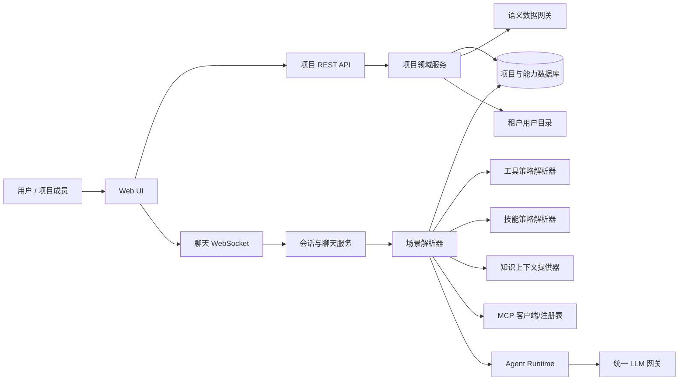
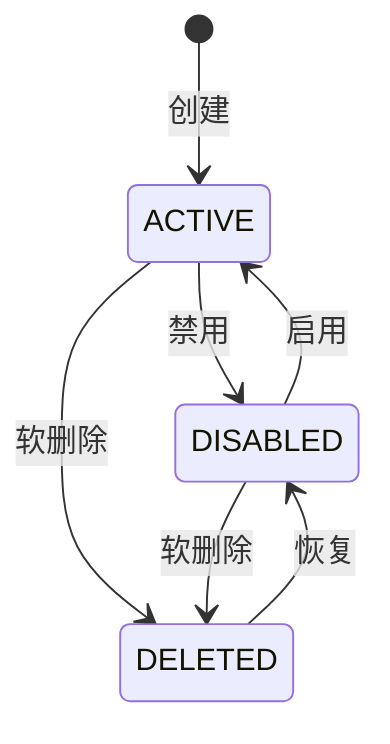
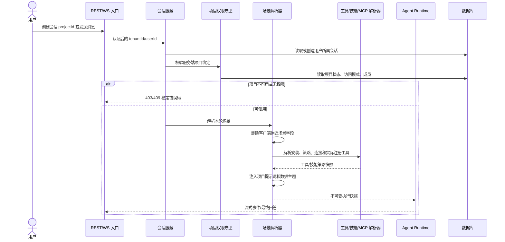
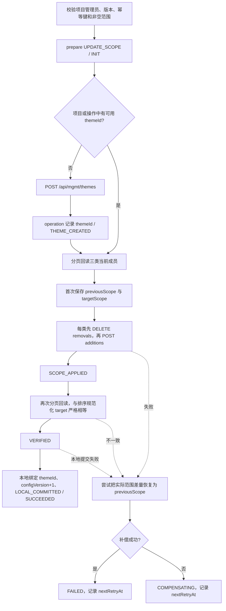

```
# 项目工作空间与场景资源挂载复刻说明

## 1. 结论与边界

### 1.1 能力结论

项目工作空间是 Nova 在“个人对话”之上提供的受治理 AI 场景容器。它把一组成员、项目提示词、语义数据范围、知识、技能、原生工具和 MCP 服务组合成可复用的执行场景，并把对话永久绑定到该场景。最终效果是：同一项目内的用户获得一致的业务上下文和候选能力，但每次执行仍按当前用户、租户、项目状态和工具策略重新授权。【I】

这套机制最重要的边界是：

> **资源挂载只声明“项目可见或可选的资源”，不等于授予 Agent 使用该资源或其依赖工具的权限。**

例如，挂载知识库不自动开放知识检索工具；安装技能不自动激活技能，也不自动放开技能声明的工具；安装 MCP Server 不代表其工具已连接、已发现或已通过工具策略；挂载语义数据范围也不代表物理数据源凭据被挂载。【I】

### 1.2 目标用户、输入与输出

| 角色 | 主要目标 | 输入 | 可见输出 |
|---|---|---|---|
| 租户管理员 | 创建、治理、恢复项目，管理任意项目配置 | 项目元数据、成员、资源配置 | 项目治理列表、配置版本、操作状态、审计结果 |
| 项目管理员 | 管理本项目成员和场景资源 | 成员变更、项目提示词、挂载/卸载请求 | 项目设置页、资源清单、版本变化 |
| 项目成员 | 在项目场景中发起对话 | 项目选择、消息 | 带项目上下文的流式回答、引用、工具执行阶段 |
| Agent Runtime | 将项目定义解析为不可变执行快照 | 会话、身份、运行时请求 | 可信场景上下文、工具/技能策略、提示词片段 |
| 外部网关 | 保存 Nova 不直接拥有的数据对象 | 主题范围、用户目录、MCP 连接信息 | 对端对象、校验或错误响应 |

### 1.3 包含与不包含

本文包含项目 CRUD、生命周期、成员与权限、对话归属、场景解析、知识/语义数据/技能/工具/MCP 的挂载语义、配置版本、持久化、事件、异常、并发、删除语义以及外部依赖契约。

本文不展开单个知识检索算法、CAN 指标计算、MCP 协议全部报文、模型路由和通用聊天渲染；这些能力只描述与项目场景相交的契约。

### 1.4 当前实现与推荐设计

- 【I】当前实现具备项目、成员、不可变会话绑定、逐轮场景解析、资源安装关系和语义数据范围 Saga。
- 【I】当前没有“项目挂载物理数据源”的表、API 或 UI；“数据”页挂载的是外部语义主题中的指标、维度和数据集名称。
- 【I】项目软删除不会级联清理会话、知识、安装关系、项目私有技能/MCP 或外部语义主题。
- 【I】项目名称唯一性主要由应用层检查，数据库没有对应唯一约束，存在并发重名窗口。
- 【I】技能场景策略仍存在兼容实现，未形成与工具策略同等强度的权威快照。
- 【D】复刻时应采用“资源供给池 → 场景候选集 → 用户/入口策略交集 → 实际连接状态 → 执行快照”的分层模型，并用事务性 Outbox、资源 epoch、数据库唯一约束和显式保留策略补强。
- 【R】本次未启动服务、未执行构建或测试，因此没有运行验证结论。

## 2. 术语与参与方

| 术语 | 定义 |
|---|---|
| 项目 Project | 租户内的 AI 场景容器，有独立成员、状态、配置版本和资源范围 |
| 项目成员 | 显式加入项目的租户用户，角色为 `ADMIN` 或 `MEMBER` |
| 租户管理员 | 租户治理角色，可管理项目，但对受限项目不天然拥有运行权限 |
| 使用权限 | 允许在项目中创建或继续对话；要求项目为 `ACTIVE` 且用户可使用 |
| 管理权限 | 允许修改项目和成员；项目管理员或租户管理员拥有 |
| 资源挂载 | 建立项目与能力资产或外部主题之间的关系 |
| 能力资产 | 工具、MCP Server、技能等可安装对象，拥有平台、租户、项目或用户归属 |
| 场景快照 | 每轮执行前解析出的不可变项目上下文、工具策略、技能策略和提示词片段 |
| 配置版本 | 项目配置变化的递增数字，用于部分写接口的乐观并发和执行追溯 |
| 数据主题 | 外部语义系统保存的项目指标、维度、数据集范围；不是物理数据源 |
| 默认工具扩展 | 为某项目、Agent 和运行时工具名配置的默认工具组成员关系 |



## 3. 业务规则

### 3.1 项目基本规则

1. 项目业务 ID 在全库唯一，所有对象同时保存租户 ID；任何读取和写入必须同时校验租户。【I】
2. 项目名称必填，去除首尾空白后最长 128 字符；描述最长 1000；项目提示词最长 20000。【I】
3. 访问模式为 `ALL_TENANT` 或 `RESTRICTED`；前者允许所有租户用户使用，后者只允许有效成员使用。【I】
4. 创建项目要求租户管理员和 `Idempotency-Key`。创建时不能直接提交非空数据范围；应先创建本地项目，再单独配置外部语义范围。【I】
5. 创建者被写入显式 `ADMIN/ACTIVE` 成员；项目初始为 `ACTIVE`、配置版本为 1、数据主题为空。【I】
6. 正常列表只返回非删除且当前用户可使用的项目；治理列表仅租户管理员可见并返回所有非删除项目，按更新时间倒序分页。【I】
7. 普通列表中的 `page` 最小为 0，`size` 被限制在 1 到 100。【I】

### 3.2 权限矩阵

| 操作 | 项目条件 | ALL_TENANT 普通用户 | RESTRICTED 非成员 | 有效 MEMBER | 有效 ADMIN | 租户管理员 |
|---|---|---:|---:|---:|---:|---:|
| 直接查看项目详情 | 可含禁用/删除 | 是 | 否 | 是 | 是 | 是 |
| 创建/继续项目对话 | 必须 ACTIVE | 是 | 否 | 是 | 是 | 仅 ALL_TENANT 或同时为成员 |
| 修改项目配置 | 非 DELETED | 否 | 否 | 否 | 是 | 是 |
| 管理成员 | 非 DELETED | 否 | 否 | 否 | 是 | 是 |
| 查看已绑定数据范围 | 项目存在 | 是 | 否 | 是 | 是 | **仅 ALL_TENANT 或同时为成员** |
| 治理列表、失败操作重试 | 非 DELETED/存在操作 | 否 | 否 | 否 | 否 | 是 |

租户管理员是治理旁路，不是受限项目的运行旁路。一个容易复刻错的特例是：数据范围 `GET` 当前调用普通 `requireView(identity, projectId)`，没有传入“租户管理员旁路”标记，所以租户管理员若不是 `RESTRICTED` 项目成员也不能读取其数据范围；目录查询和数据范围写入则走管理权限。【I】`ALL_TENANT` 的非成员在展示上可获得等效 `MEMBER` 使用身份，但不会生成成员记录。【I】

### 3.3 成员规则

- 成员必须来自当前租户用户目录，候选搜索关键字必填且长度为 2～100。【I】
- 添加已移除成员会恢复原记录；重复添加有效成员不应生成第二条记录。【I】
- 成员状态为 `ACTIVE` 或 `REMOVED`，角色为 `ADMIN` 或 `MEMBER`。【I】
- 至少保留一个有效项目管理员。最后一个管理员不能被移除或降级；变更时对项目行加悲观锁串行校验。【I】
- 成员被移除后，下一轮对话会重新鉴权并拒绝；已有正在执行的一轮使用已解析快照，当前未观察到主动取消机制。【I】【F】
- 项目会话仍归创建用户所有；项目成员不能仅凭项目 ID 读取其他成员的会话。【I】

### 3.4 生命周期



- `DISABLED`：可查看、可由管理员配置，但不能创建或继续项目执行。【I】
- `DELETED`：不出现在列表，不可编辑或使用；部分直接读取接口仍可能返回对象，当前各资源子接口的删除态读取语义不完全一致。【I】
- 恢复后先进入 `DISABLED`，管理员必须显式启用，避免资源在未复核时立即重新执行。【I】
- 删除是软删除，不物理删除项目行，也不级联删除关联资源和会话。【I】

### 3.5 对话归属规则

1. 对话可为个人模式或项目模式，项目绑定允许为空。【I】
2. 创建项目对话前必须检查项目当前可用性和用户使用权限。【I】
3. 项目绑定一经持久化，正常聊天协议不能修改；已绑定会话携带不同 `projectId` 时返回冲突。【I】
4. 每轮消息按 `conversationId + tenantId + userId + 未删除` 读取会话，再使用服务端绑定的项目重新解析场景。【I】
5. 客户端传入的场景权威字段不可信，必须删除后由服务端重建。四个正式运行时键是：`nova.scene.mode`、`nova.project.id`、`nova.project.config-version`、`dataThemeId`；同时必须清除两个历史主题键 `themeId`、`nova.can.theme-id`，并移除工具/技能桥接字段后再附加服务端策略。【I】

### 3.6 资源挂载语义

| 资源 | 当前项目语义 | 是否等同执行授权 | 生命周期要点 |
|---|---|---|---|
| 语义数据范围 | 项目绑定一个外部主题，主题内保存指标/维度/数据集名称 | 否；仍需 CAN 能力和工具策略 | 全量替换，Saga，外部对象不随项目删除 |
| 项目知识 | 项目直接拥有的知识定义，可参与隐式召回 | 否；显式检索工具仍独立授权 | 软删除/导入导出；当前未统一增加项目版本 |
| 原生工具 | 项目安装某能力资产，进入工具供给池 | 否 | 可启停、配置、卸载；再经多层策略交集 |
| MCP Server | 项目安装可见 Server 或创建项目私有 Server | 否 | 连接失败可降级；只有已发现工具才可进入策略 |
| 技能 | 项目安装可见技能或创建项目私有技能 | 否 | 安装不等于激活；所需工具仍要授权 |
| 默认工具扩展 | 指定项目/Agent 下默认加入工具组的运行时工具 | 否 | 原子全量替换；失效来源会从有效集合剔除 |
| 物理数据源 | 当前无项目挂载模型 | 不适用 | 【D】如新增，必须单独治理凭据和访问策略 |

推荐问题是项目展示配置，不是 Agent 能力。服务端严格按 `null 元素删除 → trim → 删除空串 → 截断到 200 字符 → 按截断后的文本 distinct（保留首次）→ limit 10` 的顺序规范化；顺序不能交换，因为两个不同的超长问题可能截断成同一文本。整个输入列表为 null 在共享 normalizer 内可归一为空列表，但项目 REST DTO 把 `questions` 标为必填非 null，因此 HTTP 请求显式 null/缺字段应在进入 Service 前返回 400。只有规范化后的内容发生实际变化才递增项目版本。【I】

## 4. 完整执行链路

### 4.1 创建和配置项目

1. UI 收集名称、描述、提示词和访问模式；首次创建的数据范围必须为空。
2. API 从认证上下文取得租户和操作者，不接受请求体覆盖。
3. 校验租户管理员、字段长度和幂等键；若相同幂等键和相同请求已成功则返回原结果，不同请求返回冲突。
4. 检查租户内非删除项目的名称冲突。
5. 在同一事务写入项目和创建者管理员成员。
6. 返回项目详情；数据、知识、技能和连接在后续独立接口配置。
7. 每个配置写入按自身语义递增项目配置版本或记录独立操作状态。

### 4.2 成员变更

1. 管理员从租户目录搜索候选人。
2. 服务端校验项目非删除、操作者管理权限和候选人的租户归属。
3. 锁定项目行；对降级/移除管理员的请求重新统计有效管理员。
4. 新增、恢复、改角色或标记移除成员。
5. 发布访问变化事件。调度任务监听器在事务提交后暂停被移除用户的项目任务；添加成员不会自动恢复历史任务。【I】
6. 下一轮聊天重新鉴权；已有会话记录不删除。

### 4.3 创建对话和逐轮场景解析



项目提示词作为独立、带边界标记的可信 `AGENT_INSTRUCTIONS/AFTER` 片段注入，而不是拼接客户端文本。数据主题仅在项目已绑定时注入可信运行时上下文。场景策略版本由项目配置、数据主题、提示词、工具版本、技能版本、身份和可信上下文组合计算，用于审计和复现，不作为授权凭据。【I】

### 4.4 工具、技能和 MCP 的解析

必须区分三个集合，不能把“安装”“可用”“默认进上下文”写成同一个布尔值：【I】

```text
registered = 身份过滤后实际注册的原生工具和已发现 MCP 工具
explicitInstallationBindings = resolveEnabledInstallations(
    TENANT(tenantId),
    PROJECT(projectId) only when mode=PROJECT,
    USER(userId)
)
installedRuntimeNames = runtimeNames(
    explicitInstallationBindings
      -> ACTIVE capability assets
      -> ownership visibility check
      -> exact Tool/MCP execution-source resolution
)
frozenSystemDefaultNames = frozenSystemGroup.allAvailableFallback
                           ? empty
                           : frozenSystemGroup.effectiveSystemToolNames
availableToolNames = installedRuntimeNames ∪ frozenSystemDefaultNames
availableToolNames &= request.allowedToolNames       // 非空时才收窄
excluded = projectModeExcluded ∪ request.excluded ∪ effectiveConfigDenied
maximumToolNames = registered ∩ availableToolNames - disabled - excluded
baseDefault = allAvailableFallback
              ? maximumToolNames
              : frozenSystemGroup.effectiveSystemToolNames ∩ maximumToolNames
runtimeDefault = resolvedRuntimeExtensions ∩ maximumToolNames
defaultContextToolNames = (baseDefault ∪ runtimeDefault) ∩ maximumToolNames
```

其中 `availableToolNames` 只有两条授权来源：**显式启用的 TENANT/PROJECT/USER installation**，以及**冻结系统默认组**。`PLATFORM` ownership 只表示资产位于共享供给目录；`TENANT/PROJECT/USER` ownership 只约束资产是否对当前场景可见；`PROJECT_OWNED`、`USER_OWNED` 等 provenance 只用于审计。它们都不能替代 installation，也不能单独把 runtimeName 加入 available。MCP 同样要求 Server capability 已显式安装，再与当前可见、已发现的 server/tool source 对上，才生成 runtime tool binding。【I】

`maximumToolNames` 是本轮任何惰性激活都不可越过的硬上限，`defaultContextToolNames` 才是 Agent 初始上下文中的工具。检查快照时运行时扩展组为空；真实运行通过受信桥接把已解析的运行时扩展送入同一 NovaCore 解析器，因此最终默认集合仍受 maximum 约束。【I】

六个反例是验收此设计的最低要求：【I】

1. 项目安装工具 A，但 A 不在系统默认组、也未设项目默认扩展：A 可以在 `available/maximum`，但不在 `defaultContext`。
2. 冻结系统默认组含 B，B 没有 installation：B 仍可由系统策略进入 `available`；但若未实际注册、被 deny 或被排除，仍不能进入 `maximum/defaultContext`。
3. 存在 ACTIVE 的 PLATFORM 工具资产 C，当前租户可见且 Registry 也注册了 C，但 C 无任何有效 installation、也不在冻结系统默认组：C 不在 `available/maximum`。
4. 项目直接拥有工具资产 D，但没有显式 PROJECT/TENANT/USER installation：ownership 只证明 D 对项目可见，不提供执行授权，D 不在 `available/maximum`。
5. E 同时由租户 installation 和项目 installation 提供，但项目排除或有效配置禁用 E：排除优先，E 不在 `maximum`。
6. 项目默认扩展请求 F，但 F 不在 `maximum`：解析时必须剔除；若直接向 NovaCore 提交越界运行时组，应以 `INVALID_RUNTIME_TOOL_GROUP` 拒绝，不能借默认扩展扩权。

技能安装只进入可发现列表；惰性技能仍需 Agent 选择并读取其说明，技能声明的 `required_tools` 只是请求，最终仍与 `maximumToolNames` 相交。【I】

MCP Server 在场景组装时尝试连接。单个 Server 连接失败时当前流程记录错误并继续，未发现的工具自然不会出现在有效工具集合中。【I】

### 4.5 语义数据范围全量替换 Saga



请求字段虽沿用 `metricIds/dimensionIds/datasetIds`，当前值实际是资产名称；服务端应去空白、去重、排序，总量不超过 5000，且替换后的总范围不能为空。【I】

枚举声明了 `INIT`、`THEME_CREATED`、`PROJECT_BOUND`、`SCOPE_APPLIED`、`VERIFIED`、`LOCAL_COMMITTED`、`COMPENSATED`。当前真实持久化路径是：纯本地创建 `INIT → LOCAL_COMMITTED/SUCCEEDED`；已有主题的范围更新 `INIT → SCOPE_APPLIED → VERIFIED → LOCAL_COMMITTED/SUCCEEDED`；新建或重建主题时在中间增加 `THEME_CREATED`。`succeed()` 会同时写 `step=LOCAL_COMMITTED` 和 `state=SUCCEEDED`。`PROJECT_BOUND` 和 `COMPENSATED` 当前没有实际写入路径，仅存在于枚举/数据库检查约束；补偿成功后状态仍是 `FAILED`，补偿失败才是 `COMPENSATING`。【I】

项目创建本身现在只写本地项目和创建者成员，`dataThemeId=null`，不调用 CAN。主题在第一次数据范围替换时按需创建。若主题创建成功、随后本地绑定失败，当前补偿只把主题成员恢复为前态，**不会删除新建主题**，所以可能产生由 operation 记录 themeId 的空孤儿主题；定时对账通过重试复用记录或外部引用继续处理，但没有孤儿删除作业。【I】后台默认每 30 秒扫描，超过 2 分钟的 PENDING 可接管，失败按指数延迟（上限 1 小时）重试，最多 5 次。【I】

### 4.6 执行时语义查询范围校验（P0）

数据挂载不是只在配置入口校验。MQL、指标后端 JDBC 和元数据发现都接入同一个 fail-closed 校验器：【I】

```java
ActiveProject resolveScope(ToolExecutionContext ctx) {
  if (!equalsIgnoreCase(ctx.runtime["nova.scene.mode"], "PROJECT")) return empty;
  require TenantIdentity with nonBlank tenantId;
  projectId = requireText(ctx.runtime["nova.project.id"]);
  runtimeTheme = optionalText(ctx.runtime["dataThemeId"]);
  runtimeVersion = requireLong(ctx.runtime["nova.project.config-version"]);

  project = find(tenantId, projectId, status=ACTIVE); // 每次调用重读，不信快照本身
  require project exists;
  if (blank(project.dataThemeId) || blank(runtimeTheme))
      throw ProjectDataNotConfigured;
  require project.dataThemeId == runtimeTheme;
  require project.configVersion == runtimeVersion;
  return project;
}

validateMql/validateJdbc:
  catch ProjectDataNotConfigured -> 稳定英文 PROJECT_DATA_NOT_CONFIGURED
  catch other RuntimeException   -> 通用中文范围确认失败

validateMetadata:
  catch RuntimeException         -> 通用中文范围确认失败
```

- **MQL**：递归提取 `metrics`、`dimensions`、`dataset(s)/datasetName(s)`，并检查筛选、排序、表达式、派生指标和 indirection；快速计算指标名去掉首个 `__...` 后缀，本地 `metricDefinitions` 不当作外部指标，`metric_time` 系统维度不校验。分别加载主题的 `metrics/dimensions/datasets` 后做集合差。【I】
- **JDBC**：参数 `datasource_alias` 缺省时固定为指标后端别名 `__metric_backend__`；任何其他 alias 立即拒绝。只从 SQL 的 `FROM`/`JOIN` 关系提取数据集，识别 CTE、schema/引号和别名；遇到无法可靠解析的关系或表值函数/动态关系就 fail-closed，提示改用普通只读 `FROM/JOIN` 查询。不能因为 SQL 参数为空而推断已授权；当前空白 SQL 由后续工具自己的参数校验处理。【I】
- **元数据复核**：元数据工具返回候选名称后，再按 `METRIC/DIMENSION/DATASET` 回读同一主题成员并求差；只要结果包含范围外名称，就整体拒绝返回且不在错误中回显越界名称，避免枚举泄露。【I】
- **分页与上限**：每类成员以 `pageNumber=1`、`pageSize=200` 起分页；累积唯一名称超过 5000 视为无法确认范围并拒绝。MQL 只加载实际引用到的类别，元数据只加载被复核的类别。【I】
- **错误语义不是三个入口完全一致**：MQL 与指标后端 JDBC 对“项目或可信 runtime 未配置主题”单独捕获，稳定返回英文 `Error: PROJECT_DATA_NOT_CONFIGURED: Project data is not configured`；metadata 对**非空候选名称集**做二次复核时没有该专门 catch，未配置主题会落入通用异常分支，返回中文 `Error: 无法确认当前项目的数据范围，已拒绝执行查询。请刷新项目后重试。`。metadata 名称集为 null/空时校验器直接放行，因为没有结果可复核，不能用该路径探测主题配置。MQL/JDBC 越界返回以 `Error:` 开头的中文可定位说明，最多展示 20 个越界名；metadata 越界只说明资源类型，不回显名称。身份、ACTIVE 状态、theme/version 不一致、分页异常、超上限等也进入通用中文范围确认失败。所有错误都返回给工具链并阻止底层查询。【I】

最低测试应覆盖 PERSONAL 绕过、MQL 正反例、JDBC 合法 JOIN、外部 alias、越界数据集、无法解析 SQL、MQL/JDBC 未配置主题的稳定英文、metadata 未配置主题的通用中文、陈旧 version、theme 变化、非 ACTIVE、元数据越界/陈旧、分页与 5000 上限；当前静态单测已经覆盖其中 PERSONAL、MQL/JDBC 正反、外部 alias、MQL/JDBC 未配置、陈旧 version 和元数据复核，未证明全部边界已自动化。【I】

### 4.7 生命周期变化的下游效果

- 禁用或删除项目后，新对话和下一轮对话立即失败；项目配置仍可在禁用态调整。【I】
- 项目生命周期监听器在提交后禁用项目调度定义，并取消待执行/运行中的项目任务。【I】
- 访问模式或成员变化会重新校验任务所有者；无权者任务暂停，新增权限不自动恢复。【I】
- 当前未观察到项目删除时清除外部主题、私有 MCP/技能、知识、安装关系或会话的级联流程。【I】

## 5. 对外契约

### 5.1 通用响应、错误和并发语义

业务错误统一形态：

```json
{
  "success": false,
  "message": "Project is not active",
  "errorCode": "PROJECT_NOT_ACTIVE"
}
```

| HTTP | 语义 | 代表错误码 |
|---:|---|---|
| 400 | 参数无效 | `PROJECT_ID_REQUIRED`, `PROJECT_REQUEST_INVALID`, `PROJECT_MEMBER_INVALID`, `PROJECT_MEMBER_SEARCH_INVALID` |
| 403 | 对象级权限拒绝 | `PROJECT_ACCESS_DENIED` |
| 404 | 功能关闭或对象不可见 | `PROJECT_FEATURE_DISABLED`, `PROJECT_NOT_FOUND`, `PROJECT_OPERATION_NOT_FOUND` |
| 409 | 状态、版本、幂等或成员约束冲突 | `PROJECT_NOT_ACTIVE`, `PROJECT_STATE_CONFLICT`, `PROJECT_VERSION_CONFLICT`, `PROJECT_NAME_CONFLICT`, `PROJECT_LAST_ADMIN`, `PROJECT_IDEMPOTENCY_CONFLICT`, `PROJECT_OPERATION_IN_PROGRESS`, `PROJECT_OPERATION_RETRY_EXHAUSTED`, `PROJECT_OPERATION_NOT_RETRYABLE`, `CONVERSATION_PROJECT_MISMATCH` |
| 500 | 本地序列化/上下文缺失 | `PROJECT_REQUEST_SERIALIZATION_FAILED`, `PROJECT_CONTEXT_RESOLVE_FAILED`, `PROJECT_CREATE_FAILED` |
| 502 | 外部依赖失败 | `PROJECT_GATEWAY_CREATE_FAILED`, `PROJECT_GATEWAY_SCOPE_FAILED`, `PROJECT_MEMBER_SEARCH_FAILED` |

部分项目配置写入把请求字段 `configVersion` 解释为期望版本；不匹配时返回 409。能力安装类接口通常不接收期望版本，而在事务内原子递增版本。它不是覆盖所有资源变化的全局 epoch。【I】

### 5.2 项目和成员 REST

| 方法与路径 | 权限 | 请求/查询 | 结果及语义 |
|---|---|---|---|
| `POST /api/projects` | 租户管理员 | Header `Idempotency-Key`；创建体 | 创建 ACTIVE 项目和 ADMIN 成员 |
| `GET /api/projects` | 登录用户；`governance=true` 限租户管理员 | `page=0,size=20,governance=false` | 更新时间倒序分页 |
| `GET /api/projects/{projectId}` | 可查看 | 无 | 项目详情和有效身份 |
| `PUT /api/projects/{projectId}` | 可管理且非删除 | 元数据、`configVersion` | 更新并递增版本 |
| `POST .../{id}/enable` | 可管理 | 无请求体 | DISABLED→ACTIVE，并递增版本 |
| `POST .../{id}/disable` | 可管理 | 无请求体 | ACTIVE→DISABLED，并递增版本 |
| `POST .../{id}/delete` | 可管理 | `reason` 最长 500 | ACTIVE/DISABLED→DELETED |
| `POST .../{id}/restore` | 租户管理员/可管理 | 无 | DELETED→DISABLED |
| `GET .../{id}/members` | 可管理 | 无 | 成员列表 |
| `GET .../{id}/members/candidates` | 可管理 | `keyword` 2～100 | 当前租户候选用户 |
| `POST .../{id}/members/{userId}` | 可管理 | 路径 `userId`，请求体 `role` | 新增或恢复成员 |
| `PUT .../{id}/members/{userId}` | 可管理 | `role` | 改角色，保护最后管理员 |
| `DELETE .../{id}/members/{userId}` | 可管理 | 无 | 标记 REMOVED |

创建示例：

```http
POST /api/projects HTTP/1.1
Authorization: Bearer <token>
Idempotency-Key: 7fe8f9ce-2f79-4df4-8450-55afd1562f60
Content-Type: application/json

{
  "name": "零售经营分析",
  "description": "门店经营分析工作空间",
  "projectPrompt": "回答时优先说明指标口径和时间范围。",
  "accessMode": "RESTRICTED",
  "dataScope": {
    "metricIds": [],
    "dimensionIds": [],
    "datasetIds": []
  }
}
```

示例响应：

```json
{
  "projectId": "prj_01JXYZ",
  "name": "零售经营分析",
  "description": "门店经营分析工作空间",
  "projectPrompt": "回答时优先说明指标口径和时间范围。",
  "status": "ACTIVE",
  "accessMode": "RESTRICTED",
  "configVersion": 1,
  "myRole": "ADMIN",
  "canUse": true,
  "createdAt": "2026-08-13T02:00:00Z",
  "updatedAt": "2026-08-13T02:00:00Z"
}
```

### 5.3 对话 REST 与 WebSocket

```http
POST /api/conversations HTTP/1.1
Authorization: Bearer <token>
Content-Type: application/json

{"projectId":"prj_01JXYZ"}
```

```json
{"conversationId":"conv_01JXYZ","projectId":"prj_01JXYZ","mode":"PROJECT"}
```

聊天通道为 `/ws/chat`。客户端消息至少携带会话和正文；新会话兼容携带项目 ID，已有会话必须与持久化绑定一致：

```json
{
  "conversationId": "conv_01JXYZ",
  "projectId": "prj_01JXYZ",
  "message": "比较本月各门店销售额"
}
```

服务器输出沿用通用聊天流式事件；项目能力没有另开一套流协议。授权失败应在 Agent 执行前返回稳定错误，不能把客户端项目字段透传给运行时。【I】

### 5.4 场景资源 REST

| 资源 | 主要路径 | 关键操作 | 权限/版本语义 |
|---|---|---|---|
| 数据范围 | `/api/projects/{id}/data` | `GET`、`PUT` 全量替换 | 查看/管理；PUT 要幂等键和期望版本 |
| 数据目录 | `/api/projects/{id}/data/catalog/{metrics|dimensions|datasets}` | 查询可选资产 | 项目管理员或租户管理员；依赖外部网关 |
| 数据操作 | `/api/project-operations/{operationId}`、`.../retry` | 查 Saga、重试 | **控制器类级要求租户管理员，查询和重试都不是项目管理员权限**；同时按当前租户查 operation |
| 推荐问题 | `/api/projects/{id}/recommended-questions` | `GET`、`PUT` 全量替换 | 查看/管理；PUT 带期望版本 |
| 知识 | `/api/projects/{id}/knowledge` | CRUD、JSON/MD/PDF 导入、同义词建议、导出 | 读需查看，写需管理；服务端固定 PROJECT 归属 |
| 工具 | `/api/v1/projects/{id}/tools` | 清单、安装、卸载、配置 CRUD | 项目管理；安装变更原子递增版本 |
| 默认工具扩展 | `/api/v1/projects/{id}/tool-group-extensions/{agentName}` | GET、PUT 全量替换 | GET 当前实现要求可使用，PUT 要管理 |
| 技能 | `/api/v1/projects/{id}/skills` | 清单、安装/卸载、私有技能创建/上传/更新/下载/删除定义 | 读按可见性，写需管理 |
| MCP | `/api/v1/projects/{id}/mcp` | 清单、安装/卸载、私有 Server CRUD、测试、重连 | 测试也视为管理写操作；秘密不回显 |

数据范围替换示例：

```http
PUT /api/projects/prj_01JXYZ/data HTTP/1.1
Authorization: Bearer <token>
Idempotency-Key: scope-20260813-001
Content-Type: application/json

{
  "configVersion": 1,
  "dataScope": {
    "metricIds": ["销售额", "毛利额"],
    "dimensionIds": ["门店", "日期"],
    "datasetIds": ["门店经营宽表"]
  }
}
```

`DataScope` 的三个列表在 REST contract 中都为必填且非 null，外层 `dataScope` 也必填；“某一类没有选择”必须传空数组，不能省略或传 null。创建项目请求同样要求非 null 的空 `DataScope`，因为首次创建禁止直接配置成员：【I】

```json
{
  "name": "经营分析",
  "accessMode": "RESTRICTED",
  "dataScope": {
    "metricIds": [],
    "dimensionIds": [],
    "datasetIds": []
  }
}
```

项目推荐问题全量替换契约：【I】

```http
PUT /api/projects/prj_01JXYZ/recommended-questions HTTP/1.1
Content-Type: application/json

{
  "configVersion": 3,
  "questions": [null, "  本月销售额？  ", "", "本月销售额？"]
}
```

HTTP 字段 `configVersion` 和 `questions` 均必填非 null；列表内部允许 null，由 normalizer 删除。上述请求规整为 `["本月销售额？"]`。处理顺序固定为：删除 null 元素、trim、删除空串、每条截断 200 字符、截断后去重并保留第一次、最后保留前 10 条。响应始终给出非 null `questions` 和当前 `configVersion`；内容未变化时版本不递增。

工具安装的真实路径、请求体和响应是：

```http
POST /api/v1/projects/prj_01JXYZ/tools/install HTTP/1.1
Content-Type: application/json

{"capabilityId":"cap_tool_search_knowledge"}

HTTP/1.1 200 OK
```

请求 DTO 只有 `capabilityId`，没有 `enabled`；成功体为空。卸载为 `DELETE /api/v1/projects/{projectId}/tools/{capabilityId}`，同样返回 200 空体。该响应只能证明安装关系生效；执行前仍必须经过工具策略和注册状态解析。【I】

### 5.5 事件契约

| 事件 | 最小字段 | 消费语义 |
|---|---|---|
| `ProjectCapabilityChanged` | tenantId、projectId、capabilityId、action=`INSTALLED/UNINSTALLED` | 当前主要记录变化；解析按逐轮读取保证新鲜度 |
| `ProjectAccessChanged` | tenantId、projectId、userId、action=`ADDED/ROLE_CHANGED/REMOVED/ACCESS_MODE_CHANGED` | 提交后重检用户调度任务；事件本身不携带新旧角色详情 |
| `ProjectLifecycleChanged` | tenantId、projectId、oldStatus、newStatus | 提交后禁用/取消项目任务；事件本身不携带操作者 |

当前主要使用进程内事件，能力变化监听未形成持久化缓存失效协议。【I】生产复刻应使用事务性 Outbox，并让消费者按事件 ID 幂等。【D】

### 5.6 配置

```yaml
nova:
  project:
    enabled: true
    operation-reconcile-enabled: true
    operation-reconcile-delay: 30s
    operation-stale-after: 2m
    operation-max-retries: 5
    task-reconcile-enabled: true
    task-reconcile-delay: 1m
    task-reconcile-page-size: 100
    project-mode-excluded-tool-ids: []
```

## 6. 数据模型与生命周期

以下 DDL 是可复刻的合并版，省略数据库方言差异但保留关键约束：

```sql
CREATE TABLE project (
  id BIGINT GENERATED BY DEFAULT AS IDENTITY PRIMARY KEY,
  project_id VARCHAR(64) NOT NULL UNIQUE,
  tenant_id VARCHAR(255) NOT NULL,
  data_theme_id VARCHAR(255),
  name VARCHAR(128) NOT NULL,
  description VARCHAR(1000),
  project_prompt TEXT,
  status VARCHAR(16) NOT NULL CHECK (status IN ('ACTIVE','DISABLED','DELETED')),
  access_mode VARCHAR(16) NOT NULL CHECK (access_mode IN ('ALL_TENANT','RESTRICTED')),
  config_version BIGINT NOT NULL DEFAULT 1,
  created_by VARCHAR(255) NOT NULL,
  created_at TIMESTAMP NOT NULL,
  updated_by VARCHAR(255) NOT NULL,
  updated_at TIMESTAMP NOT NULL,
  deleted_by VARCHAR(255),
  deleted_at TIMESTAMP,
  deletion_reason VARCHAR(500),
  UNIQUE (tenant_id, data_theme_id)
);
CREATE INDEX idx_project_list ON project(tenant_id, status, updated_at);

CREATE TABLE project_member (
  id BIGINT GENERATED BY DEFAULT AS IDENTITY PRIMARY KEY,
  tenant_id VARCHAR(255) NOT NULL,
  project_id VARCHAR(64) NOT NULL REFERENCES project(project_id),
  user_id VARCHAR(255) NOT NULL,
  role VARCHAR(16) NOT NULL CHECK (role IN ('ADMIN','MEMBER')),
  status VARCHAR(16) NOT NULL CHECK (status IN ('ACTIVE','REMOVED')),
  created_by VARCHAR(255) NOT NULL,
  created_at TIMESTAMP NOT NULL,
  updated_by VARCHAR(255) NOT NULL,
  updated_at TIMESTAMP NOT NULL,
  UNIQUE (tenant_id, project_id, user_id)
);

ALTER TABLE conversation ADD COLUMN project_id VARCHAR(64) REFERENCES project(project_id);
ALTER TABLE conversation ADD COLUMN binding_created_at TIMESTAMP;
CREATE INDEX idx_conversation_project
  ON conversation(tenant_id, user_id, project_id, is_deleted);

CREATE TABLE capability_asset (
  capability_id VARCHAR(64) PRIMARY KEY,
  tenant_id VARCHAR(64),
  kind VARCHAR(32) NOT NULL CHECK (kind IN ('TOOL','MCP_SERVER','SKILL','KNOWLEDGE')),
  logical_name VARCHAR(255) NOT NULL,
  runtime_name VARCHAR(255),
  display_name VARCHAR(255),
  display_description VARCHAR(1000),
  ownership_scope VARCHAR(32) NOT NULL,
  owner_ref_id VARCHAR(64),
  source_type VARCHAR(32) NOT NULL,
  source_ref VARCHAR(255) NOT NULL,
  status VARCHAR(16) NOT NULL,
  version BIGINT NOT NULL DEFAULT 1,
  created_by VARCHAR(64),
  created_at TIMESTAMP NOT NULL,
  updated_at TIMESTAMP NOT NULL,
  deleted_at TIMESTAMP,
  UNIQUE (kind, source_type, source_ref),
  UNIQUE (tenant_id, kind, runtime_name)
);

CREATE TABLE capability_installation (
  id BIGINT GENERATED BY DEFAULT AS IDENTITY PRIMARY KEY,
  tenant_id VARCHAR(64) NOT NULL,
  capability_id VARCHAR(64) NOT NULL REFERENCES capability_asset(capability_id),
  scope_type VARCHAR(32) NOT NULL,
  scope_id VARCHAR(64) NOT NULL,
  enabled BOOLEAN NOT NULL DEFAULT TRUE,
  installed_by VARCHAR(64),
  installed_at TIMESTAMP NOT NULL,
  updated_at TIMESTAMP NOT NULL,
  UNIQUE (tenant_id, capability_id, scope_type, scope_id)
);

CREATE TABLE tool_installation_config (
  id BIGINT GENERATED BY DEFAULT AS IDENTITY PRIMARY KEY,
  installation_id BIGINT NOT NULL
    REFERENCES capability_installation(id) ON DELETE CASCADE,
  config_json TEXT,
  updated_at TIMESTAMP NOT NULL,
  UNIQUE (installation_id)
);

CREATE TABLE tool_group_extension_member (
  id BIGINT GENERATED BY DEFAULT AS IDENTITY PRIMARY KEY,
  tenant_id VARCHAR(64) NOT NULL,
  scope_type VARCHAR(32) NOT NULL CHECK (scope_type IN ('PROJECT','USER')),
  scope_id VARCHAR(64) NOT NULL,
  agent_name VARCHAR(128) NOT NULL,
  tool_runtime_name VARCHAR(255) NOT NULL,
  source_capability_id VARCHAR(64),
  enabled BOOLEAN NOT NULL DEFAULT TRUE,
  created_by VARCHAR(64),
  created_at TIMESTAMP NOT NULL,
  updated_at TIMESTAMP NOT NULL,
  UNIQUE (tenant_id, scope_type, scope_id, agent_name, tool_runtime_name)
);

CREATE TABLE project_recommended_question (
  id BIGINT GENERATED BY DEFAULT AS IDENTITY PRIMARY KEY,
  tenant_id VARCHAR(255) NOT NULL,
  project_id VARCHAR(64) NOT NULL REFERENCES project(project_id),
  display_order INTEGER NOT NULL,
  question VARCHAR(200) NOT NULL,
  enabled BOOLEAN NOT NULL DEFAULT TRUE,
  created_at TIMESTAMP NOT NULL,
  updated_at TIMESTAMP NOT NULL,
  UNIQUE (tenant_id, project_id, display_order)
);

CREATE TABLE project_gateway_operation (
  id BIGINT GENERATED BY DEFAULT AS IDENTITY PRIMARY KEY,
  operation_id VARCHAR(64) NOT NULL UNIQUE,
  tenant_id VARCHAR(255) NOT NULL,
  project_id VARCHAR(64) NOT NULL,
  operation_type VARCHAR(16) NOT NULL
    CHECK (operation_type IN ('CREATE','UPDATE_SCOPE','RECONCILE')),
  state VARCHAR(16) NOT NULL
    CHECK (state IN ('PENDING','SUCCEEDED','FAILED','COMPENSATING')),
  step VARCHAR(32) NOT NULL
    CHECK (step IN ('INIT','THEME_CREATED','PROJECT_BOUND','SCOPE_APPLIED',
                    'VERIFIED','LOCAL_COMMITTED','COMPENSATED')),
  idempotency_key VARCHAR(128) NOT NULL,
  request_hash VARCHAR(64) NOT NULL,
  data_theme_id VARCHAR(255),
  request_json TEXT NOT NULL,
  previous_scope_json TEXT,
  target_scope_json TEXT,
  retry_count INTEGER NOT NULL DEFAULT 0,
  last_error_code VARCHAR(64),
  last_error_message VARCHAR(2000),
  next_retry_at TIMESTAMP,
  created_by VARCHAR(255) NOT NULL,
  created_at TIMESTAMP NOT NULL,
  updated_at TIMESTAMP NOT NULL,
  UNIQUE (tenant_id, idempotency_key)
);
CREATE INDEX idx_project_operation_retry
  ON project_gateway_operation(state, next_retry_at);
```

上述合并 DDL 之外，复刻时必须保留当前真实访问路径所依赖的索引，否则“每轮重读授权/项目”和对账扫描会退化：【I】

| 表 | 当前索引/唯一键 | 服务的访问路径 |
|---|---|---|
| `project` | `(tenant_id,status,updated_at)`、`(tenant_id,name)`；`project_id` 全局唯一；`(tenant_id,data_theme_id)` 唯一 | 用户/治理列表、同租户名称预检、按项目执行重读 |
| `project_member` | 唯一 `(tenant_id,project_id,user_id)`；`(tenant_id,user_id,status)`；`(tenant_id,project_id,role,status)` | requireView/use、用户可见项目、最后管理员计数 |
| `conversation` | `(tenant_id,user_id,project_id,is_deleted)` | 只读取当前用户所属项目会话 |
| `project_gateway_operation` | 唯一 `(tenant_id,idempotency_key)`；`(state,next_retry_at)`；`(tenant_id,project_id,created_at)` | 幂等 prepare、对账扫描、项目操作历史 |
| `capability_asset` | 唯一 `(kind,source_type,source_ref)`；唯一 `(tenant_id,kind,runtime_name)`；归属与 tenant/kind/status 索引 | 执行源去重、runtimeName 反查和可见资产目录 |
| `capability_installation` | 唯一 `(tenant_id,capability_id,scope_type,scope_id)`；`(tenant_id,scope_type,scope_id,enabled)`；`(tenant_id,capability_id,enabled)` | 项目/租户安装集合和反向影响查询 |
| `tool_group_extension_member` | 唯一 `(tenant_id,scope_type,scope_id,agent_name,tool_runtime_name)`；`(tenant_id,scope_type,scope_id,agent_name,enabled)`；`(tenant_id,source_capability_id)` | 组装项目默认工具和资源卸载清理 |

边界说明：`ProjectQueryScopeValidator` 按 `(tenant_id,project_id,status=ACTIVE)` 重读项目，但 `project_id` 本身全局唯一，当前迁移没有为这个三列条件单独增加复合索引；数据库可利用 `project_id` 唯一索引后再过滤 tenant/status。若复刻系统改为“项目 ID仅租户内唯一”，必须把所有外键和唯一键升级为 `(tenant_id,project_id)` 复合键，不能照搬当前单列外键。【I】【D】

`capability_asset.runtime_name` 是 LLM/runtime 使用的精确工具名，不等同于展示名或 capability id；数据库用 `(tenant_id,kind,runtime_name)` 防止同租户同类能力撞名。PLATFORM 资产的 `tenant_id` 为 null，PostgreSQL/H2 普通唯一索引允许多个 null，因此平台工具名的最终唯一性还由 Tool Registry 注册冲突兜底。`created_by` 与 `capability_installation.installed_by` 都是可空 `VARCHAR(64)`：系统同步、历史回填或迁移可能没有真实操作者，不能虚构用户；有人类操作时必须写认证用户 ID并进入审计。【I】

项目知识、技能定义和 MCP Server 定义都应保存 `tenant_id`、`project_id` 和 `scope='PROJECT'`，并用检查约束保证：PROJECT 作用域必须有租户和项目、不能有用户；非 PROJECT 作用域不得带项目。项目私有技能和 MCP 同时可通过 `capability_id` 软关联到能力资产。【I】

数据主题操作表保存操作 ID、项目、租户、幂等键、请求摘要、状态、当前步骤、重试次数、最后错误、请求/前态/目标态 JSON 和创建/更新时间；`tenant_id + idempotency_key` 唯一。【I】期望项目版本位于被摘要和持久化的请求 JSON 中，而不是独立列。生产设计建议额外保存每步补偿参数和外部请求 ID。【D】

### 6.1 归属和删除

- 项目、成员、能力安装、知识、私有技能/MCP 必须在查询条件中同时限定租户和项目。
- 对象级越权时返回 404 或 403应按接口统一；知识详情当前使用 404 防止对象存在性泄露。【I】
- 当前项目删除仅写删除审计字段；外键保留关联数据并阻止随意物理删除。【I】
- 【D】生产复刻应定义保留期：先冻结项目，异步导出/清理外部主题与秘密，匿名化审计，再物理清理；每个子资源记录独立清理状态。
- MCP 凭据和工具配置中的秘密必须加密保存，响应只返回掩码或“已配置”标记，日志不得输出明文。【I】【D】

## 7. 核心实现设计

### 7.1 模块划分

| 模块 | 职责 |
|---|---|
| Project Domain | CRUD、状态机、配置版本、名称和字段校验 |
| Project Authorization | `requireView/use/admin/edit` 四种对象级守卫 |
| Membership | 成员状态、最后管理员保护、租户目录适配 |
| Conversation Binding | 会话创建、不可变项目绑定、逐轮归属校验 |
| Scene Resolver | 清洗客户端上下文并创建不可变执行快照 |
| Capability Catalog | 资产、安装、作用域可见性和私有资源定义 |
| Tool Policy | 多层交集、禁用策略、默认扩展和实际注册状态 |
| Skill Policy | 技能可见性、激活、依赖工具检查和快照版本 |
| Data Theme Orchestrator | 外部主题 Saga、幂等、补偿和对账 |
| Knowledge Provider | 项目知识 CRUD、隐式召回和显式工具边界 |
| Audit/Outbox | 领域审计、事件持久化和下游任务协调 |

### 7.2 权限守卫伪代码

```java
Project requireUse(Identity actor, String projectId) {
  Project p = repository.findByTenantAndProject(actor.tenantId(), projectId)
      .orElseThrow(PROJECT_NOT_FOUND);
  if (p.status() != ACTIVE) throw PROJECT_NOT_ACTIVE;
  if (p.accessMode() == ALL_TENANT) return p;
  if (!members.isActive(actor.tenantId(), projectId, actor.userId()))
    throw PROJECT_ACCESS_DENIED;
  return p;
}

Project requireEdit(Identity actor, String projectId) {
  Project p = requireView(actor, projectId);
  if (p.status() == DELETED) throw PROJECT_STATE_CONFLICT;
  if (!actor.isTenantAdmin() && !members.isActiveAdmin(...))
    throw PROJECT_ACCESS_DENIED;
  return p; // DISABLED 可编辑
}
```

### 7.3 场景组装伪代码

```java
SceneSnapshot resolve(ChatRequest request, Identity actor) {
  Conversation c = conversations.findOwned(request.conversationId(), actor);
  assertRequestedProjectMatchesPersistedBinding(request.projectId(), c.projectId());

  Project p = c.projectId() == null ? null : projectGuard.requireUse(actor, c.projectId());
  Map<String,Object> trusted = sanitize(request.runtimeContext());
  trusted.removeAll(SERVER_OWNED_SCENE_KEYS);

  SceneBase base = p == null
      ? personalScene()
      : projectScene(p.projectId(), p.dataThemeId(), p.configVersion());
  writeServerOwnedKeys(trusted, base);

  ToolPolicy tools = toolResolver.resolve(actor, base);
  SkillPolicy skills = skillResolver.resolve(actor, base, tools);
  List<PromptSegment> prompts = p == null || blank(p.prompt())
      ? List.of()
      : List.of(delimitedProjectInstruction(p.prompt()));

  return immutableSnapshot(base, tools, skills, prompts, trusted,
      hash(base, tools.version(), skills.version(), actor.subject(), trusted));
}
```

### 7.4 能力解析实现要点

Tool capability resolver 必须先查 installation，再查 asset，不能反过来扫描“所有可见资产”并当成已安装：

```java
List<Installation> installations = concat(
    enabled(TENANT, tenantId),
    mode == PROJECT ? enabled(PROJECT, projectId) : List.of(),
    userId != null ? enabled(USER, userId) : List.of());

List<Binding> installed = installations.stream()
    .map(i -> assets.find(i.capabilityId()))
    .filter(asset -> asset.status() == ACTIVE)
    .filter(asset -> visibleToScene(asset, tenantId, projectId, userId))
    .flatMap(asset -> resolveExactRuntimeBindings(asset))
    .toList();

Set<String> available = union(
    installed.runtimeNames(),
    frozenSystemDefaultNames);
```

`visibleToScene` 可接受 PLATFORM、同租户 TENANT、同项目 PROJECT、同用户 USER 资产，但它只过滤 installation 指向的资产；不能自己创建 binding。MCP 的 `resolveExactRuntimeBindings` 还必须用已安装 Server 的 source id 过滤当前已发现工具，防止“同租户可见但未安装的 Server”贡献 runtimeName。多个 capability/source 映射到同一 runtimeName 且指纹不一致时 fail-closed，不能任选其一。【I】

### 7.5 最小可用版与生产版

| 维度 | 最小可用版 | 生产级推荐 |
|---|---|---|
| 项目与成员 | 单库事务、四类权限守卫、软删除 | DB 唯一约束、审计不可变存储、权限属性测试 |
| 会话绑定 | `conversation.project_id` 不可变 | 绑定审计、撤权 epoch、执行中取消 |
| 资源安装 | 通用资产和安装表 | 策略决策解释、依赖图、供应链签名 |
| 场景解析 | 每轮读库，无缓存 | 版本化快照、短缓存+可靠失效、可重放清单 |
| 外部主题 | 持久化 Saga+定时对账 | Outbox/Inbox、补偿编排、对端幂等请求 ID |
| 事件 | 进程内 after-commit | 事务性 Outbox、至少一次投递、消费者幂等 |
| 删除 | 软删除并禁止使用 | 可配置保留期和外部资源清理工作流 |

## 8. 并发与非正常路径

| 情况 | 当前行为 | 复刻要求/补强 |
|---|---|---|
| 相同创建幂等键重复请求 | 相同载荷复用结果，不同载荷冲突【I】 | 保存规范化请求摘要和最终响应 |
| 并发同名创建 | 应用层先查，仍可能同时通过【I】 | 【D】增加 `(tenant_id, normalized_name)` 条件唯一索引 |
| 并发元数据修改 | 请求中的 `configVersion` 作为期望版本防止覆盖【I】 | 冲突返回当前版本和可重试提示 |
| 并发能力安装 | 唯一安装键+事务内版本递增【I】 | 所有变更追加审计，明确重复安装的幂等响应 |
| 并发移除两个管理员 | 锁项目行后检查最后管理员【I】 | 保持串行锁或可序列化事务 |
| 外部主题创建后本地绑定失败 | 当前恢复成员前态但不删除新主题；operation 失败/补偿，可能留下空孤儿【I】 | 对端 external-reference 查询 + 安全窗口孤儿清理【D】 |
| 网关超时 | Nova 保存 operation 并可重试；它会发幂等/external-reference header，但对端是否真正去重未被本仓证明【I/F】 | 增加按请求键查询状态后再重试，避免重复主题【D】 |
| 网关返回主题不存在 | 当前读取可能展示“存在但空范围”【I】 | 【D】明确 `themeExists=false` 并创建修复操作 |
| MCP 连接失败 | 记录并继续，其工具不可用【I】 | 输出按 Server 聚合的诊断，不暴露凭据 |
| 运行中撤销成员 | 下一轮失败；当前轮未证明主动取消【I】【F】 | 【D】使用访问 epoch 或取消令牌终止高风险执行 |
| 项目删除 | 软删除，外部及子资源保留【I】 | 明确保留/恢复窗口和异步清理状态 |
| 进程在事件发布前崩溃 | 进程内事件可能丢失【F】 | 【D】事务性 Outbox |
| 知识更新与版本 | 当前未观察到统一递增项目版本【I】 | 【D】独立 `knowledgeEpoch` 或统一 scene epoch |

取消和断线不能改变服务端会话绑定。WebSocket 重连后必须从持久化会话恢复项目，并重新鉴权、重新解析场景，而不是复用客户端旧快照。【D】

## 9. 安全、权限和审计

1. 认证上下文是租户和用户的唯一可信来源；请求体中的 tenant/user/project 场景字段不能覆盖它。【I】
2. 所有子资源查询都使用租户和项目双重限定；外键只引用全局项目 ID不能替代租户校验。【I】
3. 项目提示词由管理员配置，可视为受治理但仍可能包含提示注入。必须放入独立片段、带边界标记、限制长度并记录修改审计。【I】【D】
4. 项目挂载知识或技能不能自动注入工具；工具解析必须 fail-closed。【I】
5. MCP URL、认证头、Token、工具配置和物理数据源凭据应加密保存、最小权限解密、响应脱敏、日志过滤。【I】【D】
6. 私有技能上传应限制大小、路径穿越、符号链接、可执行文件和压缩炸弹；生产环境应做恶意内容扫描和签名校验。【D】
7. 建议审计：项目创建/更新/状态变化、成员变化、资源安装/卸载、秘密变更、数据范围 Saga 每一步、场景解析策略版本、执行时实际工具集合。【D】
8. 返回无权子资源时避免对象存在性预言；同类接口应统一 404/403 策略。【D】

## 10. 外部依赖对端设计

### 10.1 语义数据网关

#### 已观察兼容契约

下表是 **Nova 当前 HTTP 客户端真实发出的 wire**，不是对 CAN Gateway 内部实现的猜测。所有管理请求都带 `Accept: application/json`、`X-API-Key: <admin-key>`、`X-Tenant-Id: <tenantId>`；带 body 的请求另带 `Content-Type: application/json`。租户 ID还会写入创建/更新/成员批量 body，客户端拒绝调用方覆盖三个认证头。【I】

| 动作 | HTTP wire | 查询/body | `data` 响应 |
|---|---|---|---|
| 列全部主题 | `GET /api/mgmt/themes` | 无 | 主题数组 |
| 分页主题 | `GET /api/mgmt/themes/page` | `keyword?`, `pageNumber`, `pageSize` | `{items,total,pageNumber,pageSize,hasNext}` |
| 主题详情 | `GET /api/mgmt/themes/{themeId}` | 无 | 主题对象和可选紧凑 `selections` |
| 创建主题 | `POST /api/mgmt/themes` | `{"tenantId":"t1","name":"项目名 (projectId前8位)","description":"..."}` | 主题对象，至少需要非空 `id` |
| 更新主题元信息 | `PUT /api/mgmt/themes/{themeId}` | 同上 | 主题对象 |
| 删除主题 | `DELETE /api/mgmt/themes/{themeId}` | 无 | 可为空 |
| 分页读成员 | `GET /api/mgmt/themes/{themeId}/members/{type}` | `keyword?`, `pageNumber`, `pageSize`；`type=metrics|dimensions|datasets` | `{items,total,pageNumber,pageSize,hasNext}` |
| 批量加成员 | `POST /api/mgmt/themes/{themeId}/{type}` | 见下方 | `{added,ignored,removed,notFound,coveredDirectRemovedCount}` |
| 批量删成员 | `DELETE /api/mgmt/themes/{themeId}/{type}`，**带 JSON body** | 见下方 | 同上 |
| 批量挂载指标类目 | `POST /api/mgmt/themes/{themeId}/metric-categories` | `tenantId + categories`，见下方 | 同一批量结果 |
| 批量卸载指标类目 | `DELETE /api/mgmt/themes/{themeId}/metric-categories`，**带 JSON body** | 同上 | 同一批量结果 |
| 批量挂载维度类目 | `POST /api/mgmt/themes/{themeId}/dimension-categories` | `tenantId + categories`，见下方 | 同一批量结果 |
| 批量卸载维度类目 | `DELETE /api/mgmt/themes/{themeId}/dimension-categories`，**带 JSON body** | 同上 | 同一批量结果 |

Project 编排器创建主题时还必须发送：

```http
Idempotency-Key: <Nova operation idempotency key，最长128>
X-External-Reference: <稳定 projectId>
```

如果已有项目 themeId 已丢失，重建主题使用 `<operationId>-theme-<retryCount+1>` 作为创建幂等键。`X-External-Reference` 始终是 projectId，目的是在“对端已创建但响应丢失”时按稳定业务引用恢复结果。【I】但当前仓库只证明 Nova 发出了这两个 header；没有 CAN Gateway 源码或契约测试证明对端确实持久化、查重或可按 external reference 查询，因此“端到端恰好一次创建”只能标为【F】，不能标为已保证。

成员 body 按类型严格不同；`names` 空集合在 Nova Service 层直接拒绝：【I】

```json
{"tenantId":"t1","metricNames":["sales_amt"]}
{"tenantId":"t1","dimNames":["region"]}
{"tenantId":"t1","datasetNames":["orders_daily"]}
```

类目增删的 body 与直接成员不同，指标类目和维度类目共用以下形状；`categoryName` 可为 null 并在序列化时省略，`categoryId` 是对端稳定类目 ID：【I】

```json
{
  "tenantId": "t1",
  "categories": [
    {"categoryId": "cat-core", "categoryName": "核心指标"},
    {"categoryId": "cat-extra"}
  ]
}
```

POST/DELETE 均解析同一批量响应：

```json
{
  "success": true,
  "data": {
    "added": ["cat-core"],
    "ignored": ["cat-extra"],
    "removed": [],
    "notFound": [],
    "coveredDirectRemovedCount": 2
  }
}
```

`added/ignored` 主要用于 POST，`removed/notFound` 主要用于 DELETE；缺失列表被 Nova 解析为空列表，`coveredDirectRemovedCount` 可为 null。类目挂载意味着目录演进时由该类目覆盖的成员可随类目进入主题，不等同于逐个 direct-selected 成员。【I】

成员页 item 在 Nova 归一为：

```json
{
  "name": "sales_amt",
  "displayName": "销售额",
  "isMissing": false
}
```

对端原字段可为 `metricCode|metricName|dimName|datasetName`，Nova 都归一到 `name`。新增结果中 `added` 是实际新增，`ignored` 表示未知或已存在；删除结果中 `removed` 是实际删除，`notFound` 表示本就不存在。Project 全量替换不调用一个假想的 scope PUT，而是对三类集合各自计算 `current-target` 和 `target-current`，先删后加，再用分页成员接口完整回读，排序后与 target 严格相等；不一致即 `PROJECT_GATEWAY_SCOPE_FAILED` 并尝试反向差量恢复前态。【I】

Gateway 统一响应包络应是：

```json
{"success":true,"data":{}}
```

通用解包器对 **2xx** 做兼容处理：空 body 返回 Jackson `NullNode`；合法 JSON 缺 `data` 返回 `NullNode`；合法 JSON 缺 `success` 仍按成功处理并返回 `data`（缺 `data` 仍为 `NullNode`）。只有非 2xx、2xx 中显式 `success=false`、非法 JSON、网络异常或线程中断才抛统一网关异常；中断分支会恢复线程中断标志。异常保留 HTTP 状态和截断响应体。上层 DTO adapter 对 NullNode 还可能转为空列表、空 page 或空 batch，因此“网关成功但无数据”和“返回完整对象”不能混为一谈。【I】

Nova 能识别 400/403/404，项目数据控制器把网关异常统一对外映射为 HTTP 502 + `PROJECT_GATEWAY_SCOPE_FAILED`。当前 `getData` 遇到主题 404 返回 `themeExists=true` 加空范围，这是已实现但语义可疑的兼容行为，不应误写成“失联=false”。【I】Nova 无法从当前仓库证明对端内部数据库、事务模型、成员存在性校验、事务原子性和删除策略。

#### 推荐的 D 级重设计（不是当前 wire）

如果从零设计 CAN Gateway，建议保留上述管理面资源路径以降低 Nova 改造成本，同时补齐当前未证明的协议：【D】

1. 建立 `(tenantId,idempotencyKey)` inbox，保存规范化请求摘要、处理中/成功/失败状态和原响应；同键异载荷返回 409。
2. 建立 `(tenantId,externalReference)` 唯一索引，提供 `GET /api/mgmt/themes/by-external-reference/{projectId}`，使响应丢失后可查回，而不是盲目再创建。
3. 对成员批量变更增加 `If-Match: <themeVersion>` 或 operation key，并在响应返回 `version`；当前逐类 DELETE/POST 不是跨三类原子事务。
4. 提供 `GET /api/mgmt/operations/{idempotencyKey}`；明确超时后客户端先查状态再重试。
5. 404 对外统一，审计内部区分“不存在/跨租户”；400 返回字段级错误；409 返回版本或幂等冲突；429/5xx 带可重试提示。
6. 引入带保留期的孤儿清理：只有 Nova operation 最终失败、external reference 未绑定活跃项目且超过安全窗口才删除。当前 Nova 不会自动删除第一次配置时创建的孤儿主题。

#### 最小 Stub

内存 Stub 应逐字实现 `/api/mgmt/themes/**`、标准包络、四个 header 和 DELETE body。Map 以 `(tenantId,themeId)` 为键，另存 `(tenantId,idempotencyKey)->(requestHash,response)` 和 `(tenantId,externalReference)->themeId`；支持分页、`hasNext`、三类成员 body、两类 category 路径、`categories[{categoryId,categoryName}]`、统一批量结果、`ignored/notFound`，并可注入 2xx 空 body/缺 data/缺 success，以及 2xx success=false、非法 JSON、400/403/404/409/500、超时、“写成功但响应丢失”和回读不一致。

#### 生产设计

使用关系库保存主题、成员、版本、external reference 和幂等收件箱，审计表记录范围变更；单主题变更采用乐观版本或串行化，Outbox 发布变化，目录来自语义资产服务。若 CAN Gateway 由多个服务组成，Nova 只依赖稳定网关契约，不依赖其内部服务拓扑。【D】

### 10.2 租户用户目录

对端至少提供按租户和关键字搜索用户、按用户 ID校验存在性/状态的接口。返回用户 ID、显示名、可选头像和是否可加入；不能跨租户返回。超时或 5xx 转换为 `PROJECT_MEMBER_SEARCH_FAILED`，不能把“目录失败”当成“用户不存在”。【I】

最小 Stub 用两个租户的固定用户集验证隔离，并支持空关键字、无结果、超时和跨租户用户 ID。

### 10.3 MCP Server

Nova 保存 Server 定义和密文认证配置，通过 MCP 客户端连接、列举工具并注册到运行时。对端必须维持稳定工具名、参数 Schema 和错误语义；连接成功不代表项目授权，工具调用仍由 Nova 策略控制。【I】

最小 Stub 应实现握手、`tools/list`、一个成功工具、一个确定性错误工具和断线重连。生产对端应支持认证轮换、限流、超时、审计、Schema 版本治理和调用幂等。Nova 无法证明第三方 MCP Server 的内部实现和数据权限正确性，因此应将其视为不可信外部执行面。【D】

### 10.4 物理数据源

当前项目模块没有数据源挂载契约。【I】如果复刻产品要求项目级数据源，应新建 `project_datasource_binding`，只保存数据源引用和策略，不复制凭据；运行时同时校验项目绑定、用户数据权限和查询工具授权。数据源目录/凭据服务可由独立账户与数据源服务承担，但这一对接在当前项目代码中未被证明。【F】【D】

## 11. 可观察性

### 11.1 日志与 Trace

每次项目写操作记录 `requestId/tenantId/projectId/operator/action/oldVersion/newVersion/result`；每次场景解析记录 `conversationId/projectId/scenePolicyVersion/toolPolicyVersion/skillPolicyVersion` 和工具数量，不记录提示词全文、秘密或数据结果。外部网关调用贯穿同一 Trace，并记录 operationId、步骤、延迟、HTTP 状态和可重试分类。【D】

### 11.2 指标

- `project_api_requests_total{operation,result,error_code}`
- `project_scene_resolution_duration_seconds`
- `project_scene_resolution_failures_total{reason}`
- `project_capability_effective_count{kind}`
- `project_data_operation_total{status,step}`
- `project_data_operation_stale_total`
- `project_mcp_connection_total{result}`
- `project_access_denied_total{operation}`
- `project_outbox_lag_seconds`（采用推荐 Outbox 后）

### 11.3 告警和诊断

对 PENDING/COMPENSATING 超过阈值、同一项目连续网关失败、MCP 大面积断连、访问拒绝突增、事件积压和资源清理失败告警。诊断附件应包含版本、状态和错误分类，不包含 Token、认证头、项目提示词全文或业务查询结果。【D】

## 12. 复刻实施顺序

1. **身份和租户基础**：统一认证上下文与对象级守卫。静态验收：任何仓储方法都要求 tenantId。
2. **项目/成员表与状态机**：实现 CRUD、最后管理员保护、软删除。静态验收：状态转移集中定义，非法路径有稳定错误码。
3. **会话不可变绑定**：新增 projectId 并逐轮鉴权。静态验收：客户端场景键全部清洗。
4. **场景快照**：分离可信基础上下文、提示词、工具和技能策略。静态验收：快照不可变且可计算版本。
5. **通用能力资产与安装**：先实现工具，再扩展技能和 MCP。静态验收：只有 enabled TENANT/PROJECT/USER installation 或 frozen system default 能供给 runtimeName；PLATFORM/ownership 单独存在时测试必须为空。
6. **项目知识**：实现 PROJECT 归属、隐式召回与显式工具边界。静态验收：越权读取无对象预言。
7. **数据主题 Saga**：建立操作日志、幂等、补偿和对账后再接真实网关。静态验收：每个外部步骤可恢复；category 两类 POST/DELETE 与 2xx NullNode 兼容分支有契约测试。
8. **事件和任务协调**：先 after-commit，生产升级 Outbox。静态验收：消费者幂等。
9. **UI 设置页**：设置、数据、知识、技能、连接五个页签；仅展示后端授权结果。静态验收：不把数据主题文案称为物理数据源。
10. **删除与保留策略**：实现恢复、导出和异步清理。静态验收：每类子资源有明确保留/清理状态。

## 13. 验收标准

1. 租户管理员能用幂等键创建项目；重复相同请求返回同一项目，重复不同载荷返回 409。
2. 受限项目只有有效成员能创建和继续对话；租户管理员若不是成员也不能运行。
3. ALL_TENANT 用户能使用项目，但不会自动写成员记录。
4. 会话一旦绑定项目，伪造其他 projectId 被拒绝；跨用户读取同项目会话被拒绝。
5. 禁用项目后下一轮 WS 消息在执行前失败；恢复项目后保持禁用，显式启用后才可运行。
6. 并发移除/降级管理员时至少保留一个有效 ADMIN。
7. 安装知识、技能、工具或 MCP 后，只有满足各层策略和连接状态的工具进入执行快照。
8. 技能要求一个未授权工具时，该工具仍不可调用，系统给出可定位的缺少依赖结果。
9. MCP 连接失败不会扩大权限，也不会阻塞其他可用工具；UI 显示连接诊断。
10. 数据范围更新在网关超时后可通过同一操作 ID对账，不重复创建主题。
11. 项目删除后列表不可见且不能运行；保留数据可按策略恢复或清理。
12. 所有错误包含稳定 errorCode；日志和响应不泄露凭据、密文或跨租户对象。
13. PLATFORM 资产或项目 ownership 只有可见性、没有 installation 时不能进入工具 available；冻结系统默认组仍可独立供给工具，所有供给最终都受 registered/deny/excluded 交集约束。
14. MQL/JDBC 未配置主题稳定返回英文 `PROJECT_DATA_NOT_CONFIGURED`；metadata 同场景返回通用中文范围确认失败，三者都 fail-closed。
15. Gateway 类目 POST/DELETE 的 metric/dimension 两条路径、`tenantId + categories(categoryId/categoryName)` body 和批量结果均可由 Stub 锁定。
16. Gateway 2xx 空 body、缺 data、缺 success 不报错而返回 NullNode；非 2xx、显式 success=false、非法 JSON、网络和中断必须抛错。
17. 推荐问题严格按 null→trim→drop empty→truncate200→distinct→limit10 规范化；DataScope 三列表及 REST questions 字段缺失/null 返回 400。
18. 合并 DDL 包含 capability runtimeName 唯一性和审计字段，并允许系统同步产生 null installedBy。

## 14. 测试矩阵

| 场景 | 通道 | 前置条件 | 操作 | 预期结果 | 当前证据等级 |
|---|---|---|---|---|---|
| 幂等创建项目 | REST | 租户管理员 | 两次相同键和载荷 | 同一项目，无重复成员 | I（静态测试与实现，未运行） |
| 幂等键载荷冲突 | REST | 已使用幂等键 | 改名重试 | 409 幂等冲突 | I |
| 创建时非空数据范围 | REST | 合法管理员 | 创建体带资产 | 400，提示先创建后配置 | I |
| 治理与使用权限分离 | REST/WS | 受限项目，租户管理员非成员 | 创建项目会话 | 拒绝使用，但可治理 | I |
| ALL_TENANT 隐式成员 | REST | 普通租户用户 | 列表和详情 | 可用、无成员行 | I |
| 最后管理员保护 | REST | 仅一个 ADMIN | 移除或降级 | 409，成员不变 | I |
| 会话绑定不可变 | WS | 已绑定项目 A | 消息携带项目 B | 409 `CONVERSATION_PROJECT_MISMATCH` | I |
| 移除成员后的历史会话 | WS | 会话已存在 | 移除后发送下一轮 | 执行前拒绝 | I |
| 禁用项目 | REST/WS | ACTIVE 项目 | 禁用后继续聊天 | 项目可配置但不可使用 | I |
| 删除再恢复 | REST | 可管理项目 | 删除、恢复 | 列表隐藏；恢复为 DISABLED | I |
| 元数据并发更新 | REST | 版本 3 | 两请求均期望 3 | 一个成功，另一个 409 | I |
| 并发同名创建 | REST | 同租户 | 两事务同名 | 当前有竞态；推荐 DB 拒绝其一 | I（缺陷）/D |
| 数据范围规范化 | REST/Gateway | 项目 ACTIVE | 重复、空白、乱序名称 | 去空白去重排序，总量≤5000 | I |
| DataScope REST 非空契约 | REST | 管理员、合法项目 | 外层 dataScope 或 metricIds/dimensionIds/datasetIds 任一缺失/null | 400；无选择的类别必须显式传 `[]` | I（Bean Validation，未运行） |
| MQL 范围内/外 | Tool | 四个可信 runtime key 与 ACTIVE 项目一致 | 引用允许/禁止的指标、维度、数据集 | 范围内执行；范围外返回 `Error:` 且不执行 | I（静态单测，未运行） |
| JDBC alias 与关系解析 | Tool | PROJECT 模式 | 外部 alias、普通 JOIN、无法解析关系 | 外部 alias/无法解析 fail-closed；项目数据集 JOIN 可执行 | I（部分静态单测） |
| 未配置主题的入口差异 | Tool | PROJECT 未绑定主题或 runtime 无 dataThemeId | 分别调用 MQL、JDBC、带非空候选集的 metadata | MQL/JDBC 返回稳定英文 `PROJECT_DATA_NOT_CONFIGURED`；metadata 返回通用中文范围确认失败；三者都不访问底层 | I（实现；MQL/JDBC 有静态单测，metadata 分支待专门锁定） |
| 快照陈旧或绑定变化 | Tool | runtime version/theme 与项目不同 | MQL/JDBC/metadata | 回读 ACTIVE 项目后统一拒绝，不访问底层查询 | I（version 有静态单测；theme 待补） |
| 元数据二次复核 | Tool | 元数据返回含范围外名称 | 返回候选 | 整体拒绝且错误不回显越界名 | I（静态单测） |
| 主题成员超 5000 | Tool | Gateway 分页返回超限 | 任一受限查询 | 统一范围确认失败 | I（实现）/D（待补自动化） |
| 数据网关写成功响应丢失 | REST/Job | 可注入故障 Stub | 更新范围 | Nova 可重试；是否不重复创建取决于未被本仓证明的对端幂等实现 | I（Nova 恢复结构）/F（对端去重）/D（状态查询） |
| 外部主题 404 | REST | 本地仍绑定主题 | 读取数据范围 | 当前可能误报存在且空；推荐明确失联 | I（缺陷）/D |
| 工具安装但策略禁用 | REST/WS | 已安装工具 | 对话请求使用 | 工具不进入有效集合 | I |
| PLATFORM 可见不等安装 | REST/WS | ACTIVE PLATFORM 工具可见且已注册，但无 installation、非系统默认 | 解析场景 | 不进入 available/maximum | I（实现静态事实） |
| 项目 ownership 不等安装 | REST/WS | 项目拥有 ACTIVE 工具资产但未安装 | 解析场景 | 只可见/可审计，不进入 available/maximum | I（实现静态事实） |
| 冻结系统默认独立供给 | REST/WS | 工具无 installation，但在 frozen system default 且已注册、未 deny | 解析场景 | 可进入 available/maximum/default；排除仍优先 | I（实现静态事实） |
| 技能依赖未授权工具 | REST/WS | 已安装技能 | 激活并执行 | 依赖工具仍不可用 | I |
| MCP 连接失败 | WS | 安装故障 Server | 开始项目执行 | 其他能力继续，故障 Server 工具缺席 | I |
| 知识存在但检索工具未授权 | WS | 项目知识已创建 | 要求显式调用工具 | 可有隐式召回，但工具不可调用 | I |
| 项目物理数据源挂载 | UI/REST | 无 | 查找入口 | 当前不存在，应明确不支持 | I |
| 删除资源清理 | REST/Job | 项目含多类资源 | 删除项目 | 当前保留；生产按策略异步清理 | I/D |
| 类目 Gateway wire | Gateway unit | admin key + tenant | POST/DELETE metric-categories、dimension-categories | 路径准确；body 含 tenantId 与 categories(categoryId/categoryName)；解析统一 batch | I（静态单测，未运行） |
| Gateway 2xx 兼容解包 | Gateway unit | 可控 Stub | 依次返回空 body、缺 data、缺 success、success=false、非法 JSON | 前三者返回 NullNode；后两者抛 GatewayException | I（实现；建议补齐显式单测） |
| capability 合并 DDL | Schema validation | PostgreSQL/H2 migrations | 校验字段和唯一键 | runtime_name、created_by 存在；tenant+kind+runtime_name 唯一；installed_by 为 nullable VARCHAR(64) | I（迁移静态事实，未运行） |
| 推荐问题规范化顺序 | REST/unit | configVersion 匹配 | null/空白、两条截断后相同、超过 10 条 | null→trim→drop empty→truncate200→distinct→limit10，保留首次 | I（静态单测，未运行） |
| 推荐问题 REST 非空 | REST | 项目管理员 | questions 缺失/null；列表内含 null | 前者 400；后者删除 null 元素后正常替换 | I（Bean Validation/normalizer） |
| 两外部测试仓项目业务用例 | Auto/UI E2E | `nova_auto_test`、`nova_ui_e2e` 当前版本 | 搜索非空 projectId、`/api/projects`、PROJECT 场景 | 未发现项目业务 case；`nova_auto_test` 有 `projectId:null, mode:PERSONAL` 的 runner unit | I（仓库静态范围） |

以上测试均未在本次分析中执行，不能视为通过。【R：无】

## 15. 当前能力与建议汇总

### I — 已实现事实

- 项目 CRUD、三态生命周期、访问模式、配置版本、管理员成员和软删除。
- `requireView/use/admin/edit` 分离；租户管理员治理权限不自动转化为受限项目使用权。
- 会话项目绑定持久化且正常工作流不可变；逐轮重新校验项目状态与成员权限。
- 服务端清洗客户端场景字段，注入项目提示词、数据主题和能力策略快照。
- 语义数据主题 Saga、执行时 MQL/JDBC/metadata 范围复核、能力资产/安装、项目知识、工具、技能、MCP 和默认工具扩展。
- 工具 available 只合并显式启用的 TENANT/PROJECT/USER installation 所解析出的 runtimeName 与 frozen system default；PLATFORM/ownership 仅决定资产可见和执行源归属，不自动供给。
- MQL/JDBC 未配置主题返回稳定英文错误；metadata 同一情况进入通用中文范围确认失败。
- Gateway 支持 metric/dimension category 的 POST/DELETE 批量契约；2xx 空 body/缺 data/缺 success 兼容为 NullNode。
- capability 合并 DDL 包含 runtime_name、`(tenant_id,kind,runtime_name)` 唯一键、created_by，以及 nullable `VARCHAR(64)` installed_by。
- 推荐问题按 null→trim→drop empty→truncate200→distinct→limit10 规范化；DataScope 三列表与推荐问题 REST questions 均要求非 null。
- 项目资源挂载不等于工具授权；有效工具由供给、策略、连接和注册边界共同决定。
- 当前没有项目级物理数据源挂载。
- 禁用/删除/成员变化与调度任务联动；删除不级联清理多数子资源。

### A — Active 测试契约

在本次检索的 `nova_auto_test` 和 `nova_ui_e2e` 当前登记/测试中，未发现携带非空 `projectId`、调用 `/api/projects` 或断言 PROJECT 业务效果的 active case。`nova_auto_test` 的 API/metrics runner 单元测试明确覆盖了 `projectId:null, mode:"PERSONAL"`，它只能证明个人模式请求/响应解析，不能提升为项目工作空间 A 级证据。因此没有可独立提升为 A 的结论。

### K — Known Failure

两测试仓未发现本模块登记的 Known Failure。本文指出的竞态和语义缺口来自当前实现静态分析，仍标记为 I 下的已知限制，而不是 K。

### P — Planned Requirement

两测试仓未发现本模块的 planned/disabled 项目用例。设计文档只作为取证入口，并未将其未实现描述直接标为 P。

### R — Runtime Verified

无。本次遵循任务约束，没有运行服务、构建、单元测试、自动化或 UI E2E。

### F — 强推断

- 已解析场景是单轮不可变快照，因此撤权不会自动终止已经进入执行阶段的一轮；当前未发现聊天运行取消监听器。
- 进程内事件在数据库提交后、事件处理前崩溃可能丢失下游动作。
- Nova 创建主题时发出 `Idempotency-Key` 与 `X-External-Reference`，但没有 CAN Gateway 源码/契约测试证明对端持久化去重、冲突检测或查询恢复；端到端幂等仅是强推断。
- 独立账户/数据源服务可能适合作为未来项目数据源目录对端，但当前项目集成没有证明该契约。

### D — 复刻建议

- 用 DB 条件唯一索引消除项目名称竞态。
- 建立统一 scene epoch，把知识、技能、工具、MCP、提示词和数据主题变化纳入可追溯版本。
- 使用事务性 Outbox/Inbox、幂等消费者和访问 epoch。
- 为外部主题提供真实可验证的幂等 inbox、external-reference 查询、明确 404 语义和孤儿资源清理；不能只因 Nova 发了 header 就宣称端到端幂等。
- 建立项目删除保留期和每类资源的可恢复异步清理流程。
- 若新增物理数据源挂载，资源引用、数据权限、凭据和工具授权必须四层分离。

## 16. 证据附录

### 16.1 Nova 实现与迁移

- 项目 API 与领域：`nova-app/src/main/java/com/aloudata/nova/project/controller/`、`nova-app/src/main/java/com/aloudata/nova/project/service/`
- 权限与成员：`nova-app/src/main/java/com/aloudata/nova/project/service/ProjectAccessGuard.java`、`nova-app/src/main/java/com/aloudata/nova/project/service/ProjectMemberService.java`
- 会话绑定与聊天入口：`nova-app/src/main/java/com/aloudata/nova/controller/ChatController.java`、`nova-app/src/main/java/com/aloudata/nova/controller/ChatWebSocketHandler.java`、`nova-app/src/main/java/com/aloudata/nova/project/repository/ConversationProjectBindingRepository.java`
- 场景解析：`nova-app/src/main/java/com/aloudata/nova/project/service/SceneExecutionContextResolver.java`、`nova-app/src/main/java/com/aloudata/nova/project/service/AgentExecutionSceneAssembler.java`、`nova-app/src/main/java/com/aloudata/nova/project/service/SceneRuntimeContextSanitizer.java`
- 项目数据范围、执行时复核和 Saga：`nova-app/src/main/java/com/aloudata/nova/project/controller/ProjectDataController.java`、`nova-app/src/main/java/com/aloudata/nova/project/service/ProjectGatewayOrchestrator.java`、`nova-app/src/main/java/com/aloudata/nova/project/service/ProjectQueryScopeValidator.java`、`nova-app/src/main/java/com/aloudata/nova/project/service/QueryResourceExtractor.java`
- CAN 真实 wire：`nova-app/src/main/java/com/aloudata/nova/datatheme/gateway/DataThemeGatewayClient.java`、`nova-app/src/main/java/com/aloudata/nova/datatheme/gateway/HttpDataThemeGatewayClient.java`、`nova-app/src/main/java/com/aloudata/nova/gateway/CanGatewayHttpClient.java`
- 能力资产、安装、工具策略：`nova-app/src/main/java/com/aloudata/nova/capability/ToolCapabilityResolver.java`、`EffectiveToolCapabilityResolver.java`、`nova-app/src/main/java/com/aloudata/nova/project/service/FoundationSceneToolPolicyProvider.java`、`nova-core/nova-core-runtime/src/main/java/com/aloudata/nova/core/runtime/tool/ToolPolicyResolver.java`
- 推荐问题与 REST 非空 DTO：`nova-app/src/main/java/com/aloudata/nova/recommend/RecommendedQuestionNormalizer.java`、`nova-app/src/main/java/com/aloudata/nova/project/dto/ProjectDtos.java`、`nova-app/src/main/java/com/aloudata/nova/project/recommend/`
- 项目技能：`nova-app/src/main/java/com/aloudata/nova/skill/`
- 项目 MCP：`nova-app/src/main/java/com/aloudata/nova/mcp/`
- 项目知识入口：`nova-app/src/main/java/com/aloudata/nova/controller/ProjectKnowledgeController.java`、`nova-app/src/main/java/com/aloudata/nova/controller/KnowledgeSettingsController.java`；产品与 Core 的召回桥接位于 `nova-app/src/main/java/com/aloudata/nova/core/bridge/knowledge/`
- 调度联动：`nova-app/src/main/java/com/aloudata/nova/service/tasks/ProjectTaskLifecycleListener.java`
- 项目和会话迁移：`nova-app/src/main/resources/db/product-migration/{postgresql,h2}/V202607151630__add_project_foundation.sql`
- 数据主题绑定迁移：`nova-app/src/main/resources/db/product-migration/{postgresql,h2}/V202608021430__allow_project_without_data_theme.sql`
- 能力资产迁移：`nova-app/src/main/resources/db/product-migration/{postgresql,h2}/V202607221500__add_capability_tables.sql`
- capability runtimeName 迁移：`nova-app/src/main/resources/db/product-migration/{postgresql,h2}/V202607231000__add_capability_runtime_name.sql`
- 项目知识迁移：`nova-app/src/main/resources/db/product-migration/{postgresql,h2}/V202607281530__add_project_knowledge_scope.sql`
- 项目技能迁移：`nova-app/src/main/resources/db/product-migration/{postgresql,h2}/V202607271430__add_skill_project_fields.sql`
- 项目 MCP 迁移：`nova-app/src/main/resources/db/product-migration/{postgresql,h2}/V202607221501__add_mcp_project_fields.sql`
- 默认工具扩展迁移：`nova-app/src/main/resources/db/product-migration/{postgresql,h2}/V202607292350__add_tool_group_extension_member.sql`

### 16.2 Nova 静态测试证据（本次未运行）

- `nova-app/src/test/java/com/aloudata/nova/project/service/ProjectAccessGuardTest.java`
- `nova-app/src/test/java/com/aloudata/nova/project/service/ProjectServiceTest.java`
- `nova-app/src/test/java/com/aloudata/nova/project/service/ProjectMemberServiceTest.java`
- `nova-app/src/test/java/com/aloudata/nova/project/service/ProjectGatewayOrchestratorTest.java`
- `nova-app/src/test/java/com/aloudata/nova/project/service/ProjectQueryScopeValidatorTest.java`
- `nova-app/src/test/java/com/aloudata/nova/project/service/QueryResourceExtractorTest.java`
- `nova-app/src/test/java/com/aloudata/nova/datatheme/gateway/HttpDataThemeGatewayClientTest.java`
- `nova-app/src/test/java/com/aloudata/nova/gateway/CanGatewayHttpClientTest.java`
- `nova-app/src/test/java/com/aloudata/nova/recommend/RecommendedQuestionNormalizerTest.java`
- `nova-app/src/test/java/com/aloudata/nova/project/service/`
- `nova-app/src/test/java/com/aloudata/nova/controller/`
- `nova-app/src/test/java/com/aloudata/nova/service/tasks/`

### 16.3 产品 UI 证据

- `web/components/projects/`
- `web/app/(app)/projects/`
- 项目设置页可见形态为设置、数据、知识、技能、连接；工具与 MCP 在连接相关区域管理。

### 16.4 外部测试仓检索范围

- `nova_auto_test`：未检出非空 `projectId`、`/api/projects` 或 PROJECT 场景业务 case；`tests/unit/core/apiCaseRunner.spec.ts`、`tests/unit/features/metrics/queryRunner.spec.ts` 等存在 `projectId:null, mode:"PERSONAL"` 的个人模式单元覆盖。
- `nova_ui_e2e/tests/`：未检出非空 `projectId`、`/api/projects` 或项目工作空间 Playwright 用例；仓内大量 `PERSONAL` 字样属于工具/技能/知识作用域，不能当作项目模式证据。
- 此结论只说明当前检索范围没有登记证据，不证明其他分支、外部平台或未入库用例不存在。

### 16.5 设计材料的使用方式

- `docs/design/` 中项目、架构、API 和前端材料用于建立检索入口。
- 本文当前能力结论以实现、迁移和静态测试结构交叉校验；设计材料中的期望不自动视为已实现事实。

```
