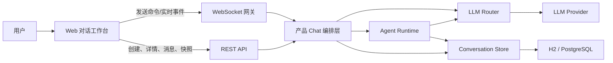
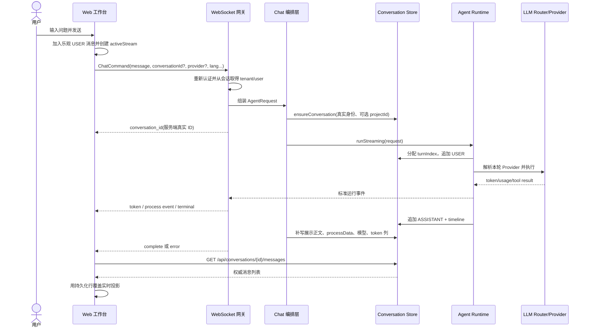
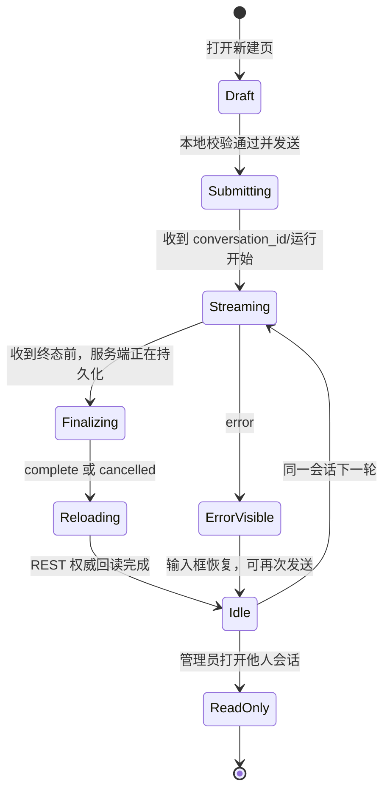
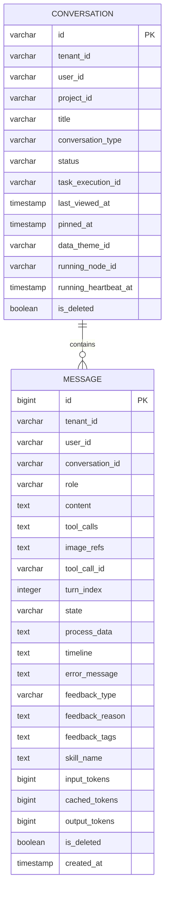

# AI 对话工作台与消息交互复刻设计

## 1\. 结论与边界

### 1.1 结论

AI 对话工作台不是一个“输入框调用一次大模型”的页面，而是一个以会话为业务聚合根、以问答轮次为持久化单元、以 WebSocket 事件为实时投影、以 REST 回读为最终权威状态的交互系统。复刻等价能力至少需要同时具备以下部分：
1. 新建或进入会话，显示历史消息和会话级上下文。
2. 用户输入文本并选择可选模型供应商；发送后立即显示乐观用户消息。
3. 后端从认证上下文取得租户和用户身份，而不是信任请求体中的身份。
4. 后端保证会话存在，按同一 `turnIndex` 持久化一条用户消息和一条助手消息。
5. 实时通道发送会话 ID、执行过程、回答文本和唯一终态；前端把事件投影为当前回答。
6. `I`：收到 `complete` 或 `cancelled` 后通过 REST 重新加载消息，以数据库中的内容、消息主键、状态和 `processData` 覆盖临时投影；收到 `error` 时当前不回读，而是保留实时错误文本。
7. 刷新页面后只依赖会话详情和消息接口即可恢复完整可见对话，不依赖内存中的实时事件。
8. 同一会话的运行必须串行，不同会话允许并发；租户和对象级权限必须贯穿 REST、WebSocket、文件与作品链路。

当前结论均来自静态代码与测试定义，本次没有启动服务或执行自动化，因此本文不使用 `R`（Runtime Verified）等级。

证据标记：`I`=当前实现静态事实，`A`=Active 自动化契约但本次未执行，`K`=已知缺陷，`P`=Planned 测试/需求，`F`=基于多处证据的强推断，`D`=绿地复刻设计。为避免每句重复标签，连续段落或表格以开头标签为作用域；未描述当前事实、而使用“应/必须/建议”的规范性语句均属于 `D`。

### 1.2 解决的业务问题
- 为普通用户提供连续、多轮、可恢复的 AI 问答工作台。
- 允许用户在发送前选择当前可用的模型供应商，并让本轮回答通过统一路由使用该供应商。
- 在模型、工具或子代理执行较慢时持续反馈进度，而不是让页面表现为无响应。
- 将最终回复、执行证据和错误状态保存下来，使刷新、分享、反馈、作品追踪和运营分析具备稳定数据源。
- 在个人会话、项目会话和租户管理员只读查看之间维持明确的权限边界。

### 1.3 输入、输出和可见效果

主要输入：
- 必填：非空用户文本；纯附件场景会由服务端生成附件提示作为用户文本。
- 可选：已有 `conversationId`、新会话的 `projectId`、图片、文件引用、模型供应商覆盖 `provider`、嵌入场景的数据主题、界面语言 `lang`。
- 隐式：服务端认证得到的 `tenantId`、`userId`、管理员标志、平台限额和模型配置。

主要输出：
- 一个服务端确认的 `conversationId`。
- 用户消息气泡、助手 Markdown 正文、执行过程区域、消息状态和错误提示。
- 可通过 REST 回读的会话、消息、轮次、执行过程、模型和用量数据。

### 1.4 范围

本文包含：工作台页面入口、文本消息发送与展示、模型选择、会话/消息/轮次/`processData` 关系、REST 与 WebSocket 的分工、前端状态归并、持久化、权限、错误可见性和验收设计。

本文明确不深入展开：
- 停止、取消、断线重连、订阅和事件补偿的完整协议；这里只定义它们与工作台的接口边界。
- 附件上传、图片视觉模型代理、文件解析的内部实现。
- 多代理、工具、Citation、Artifact、分享、反馈、重生成和会话历史管理的内部实现。
- 模型 Provider 配置 CRUD 与模型路由器内部算法。

### 1.5 当前实现、测试期望与缺口
- `I`：浏览器主入口为 `/web/chat`，具体会话通过查询参数 `conversationId` 表达；新建页没有该参数。
- `I`：产品同时提供同步 REST、SSE 和 WebSocket 三种发送面，但主 Web 工作台采用 WebSocket，完成后用 REST 回读。
- `I`：同步 REST 只返回最终 `conversationId` 和 `content`；SSE 只暴露简化的 token/tool/complete，不足以承载完整工作台状态。
- `I`：请求体类型中遗留了 `model/apiKey/baseUrl` 字段，但当前产品发送链路实际只把 `provider` 作为模型覆盖写入运行时上下文。复刻时不应把遗留客户端字段误当成受支持契约。
- `A`：黑盒测试将多轮上下文、会话隔离、并发会话隔离、刷新不空白、明确错误和输入框恢复作为验收目标；本次未运行。
- `K`：测试工程记录过“提问后中断、刷新后空白”的真实缺陷 QWGK-329。无论当前代码是否已覆盖部分修复，复刻验收必须保留该回归项。
- `D`：新工程应对发送命令增加客户端生成的幂等键；当前观察到的聊天请求没有独立幂等键，网络层重试可能形成重复轮次。

## 2\. 术语与参与方

| 术语 | 定义 |
|------|------|
| 会话 `Conversation` | 一组有序问答轮次的聚合根，绑定租户、属主、可选项目和数据主题。 |
| 消息 `Message` | 会话中的持久化记录。产品可见历史只返回 USER/ASSISTANT；内部仍可能有工具消息或完整运行时间线。 |
| 轮次 `turnIndex` | 一次用户提问及其对应助手结果共享的单调递增整数。删除/重生成以轮次而非单条 UI 气泡为边界。 |
| 实时投影 | 浏览器根据 WebSocket 事件临时构造的回答和执行过程。它提升即时体验，但不是终态权威数据。 |
| `processData` | 助手消息上的前端可消费 JSON，保存工具执行、思考摘要、阶段、用量、模型、引用等运行证据。 |
| 运行时间线 `timeline` | 运行时内部的完整事件记录，与面向产品展示的 `processData` 分列保存。 |
| 乐观消息 | 用户按下发送后，服务器响应之前立即加入浏览器状态的本地消息。 |
| 供应商覆盖 `provider` | 用户本轮显式选择的 Provider 名称；为空时由租户/用户模型角色配置解析。 |
| 权威回读 | 收到 `complete` 或 `cancelled` 后重新请求消息列表，用数据库行替换浏览器临时结果；`error` 不回读。 |

参与方：
- 用户：输入问题、选择模型、阅读结果。
- Web 工作台：维护草稿、消息、流状态、当前会话和路由。
- REST API：创建/读取会话和消息，提供同步兼容入口与快照。
- WebSocket 网关：认证连接、接收聊天命令、转发实时事件。
- 产品 Chat 编排层：组装身份、场景、模型选择、上下文和 Agent 请求。
- Agent Runtime：加载历史、调用 LLM/工具、生成回答和运行时间线。
- Conversation Store：持久化会话和消息，并按身份隔离查询。
- LLM Router/Provider：根据角色配置和本轮覆盖解析模型并执行调用。



## 3\. 业务规则

### 3.1 输入和工作台规则
1. 普通文本发送必须在 `trim()` 后非空；发送中不得再次提交当前会话。
2. Enter 发送；输入框在无活跃运行时可编辑。取消请求已发出但尚未收到终态时仍视为运行中。
3. 草稿按会话隔离保存；在不同会话间切换不能串草稿。新建会话使用独立草稿键。
4. 用户消息采用纯文本气泡；助手消息使用受控 Markdown 渲染。模型返回的 HTML、SVG、图表或文件必须经过专用安全渲染器，不能直接把任意 HTML 注入 DOM。
5. 新会话可先显式调用创建接口，也可第一次发送时不传 `conversationId`，由服务端生成 UUID。
6. 后端若生成新 ID，第一批会话相关事件必须先宣布 `conversation_id`，后续事件都绑定真实 ID。
7. 首次问题用于产生默认标题：合并连续空白并去除首尾空白；不超过 120 个 Unicode code point 时原样使用，超出时保留 119 个再加省略号。显式重命名的当前限制为 100 个 Java 字符，二者存在口径差异，复刻时建议统一为同一个 code-point 规则。

### 3.2 模型选择规则
1. 工作台展示当前用户可见的有效 Provider 名称列表，而不是硬编码模型清单。
2. `I`：当前选择来自用户的 `complex` 模型角色；选择一个 Provider 时，前端并发发出两次独立的 `PUT /api/settings/models/mine`，分别更新 `simple` 和 `complex`。两次请求不在同一事务内，存在一项成功、另一项失败的部分保存窗口。
3. `I`：任一保存返回失败时前端会回滚本地选择；但该回滚不撤销已经成功的另一项服务端写入。`D`：复刻时使用原子批量角色接口，或只把聊天选择保存到 `complex`。
4. 每次发送从当前模型状态读取 `provider`；后端用 `DEFAULT_CHAT + provider override + tenant/user identity` 解析绑定。
5. 供应商覆盖只影响本轮路由，不允许请求体直接携带 API Key 绕过统一配置。
6. `I`：当前助手消息 `processData.model` 写入的是路由绑定的 `displayName`；产品路由器把它设置为 Provider 配置键（例如 `provider-a`），不是 Provider 配置里的真实 `modelName`（例如 `gpt-5`）。因此它只能证明路由键，不能证明上游实际模型。
7. `D`：新契约应同时记录 `providerKey`、`providerType`、`modelName` 和可选的上游响应模型名；验收“实际模型”时不得只检查当前的 `processData.model`。

### 3.3 会话、消息和轮次规则
1. 会话主键是全局不透明字符串；所有读写仍必须附带租户和用户条件。
2. 同一运行分配一个新的 `turnIndex = max(all rows, including soft-deleted) + 1`。
3. USER 与对应 ASSISTANT 使用同一个 `turnIndex`；索引只增不复用。
4. 正常运行先持久化 USER，再持久化最终 ASSISTANT。
5. `I`：消息生命周期完整枚举是 `PENDING`、`STREAMING`、`COMPLETED`、`CANCELLED`、`ERROR`。历史回读通常看到后三种终态；截断的成功回复持久化为 `COMPLETED`，正文增加用户可理解的截断提示。
6. 消息历史只返回未删除的 USER/ASSISTANT，按创建时间正序；前端以服务端数值主键作为反馈、删除、重生成等操作锚点。
7. `processData` 归属于助手消息，因为它解释“这个回答如何产生”；用户消息通常为空。
8. 会话运行状态为 `IDLE`、`RUNNING` 或 `ERROR`，用于侧边栏和恢复判断；它不替代消息终态。
9. 项目会话的项目归属只允许在创建时确定。已有会话的消息请求不得用请求体中的 `projectId` 改绑。

### 3.4 权限规则
1. `tenantId/userId` 只能来自认证层注入的服务端上下文。
2. 属主是“同租户且同 userId”，不能只比较 userId。
3. `I`：同租户管理员可以读取他人会话和消息，返回 `readOnly=true` 并写读审计。当前写接口并未共享同一套管理员只读拒绝器：删除返回 404；标记已读返回 404；标题、数据主题、置顶和取消置顶按调用者 owner 条件更新，目标为他人会话时通常零行更新，但控制器仍分别返回 200、200、200、204。复刻不能把这些响应误认为写入成功。
4. 跨租户、同租户普通用户访问他人会话、已删除会话、后台会话一律表现为不可见。
5. WebSocket 的取消、订阅、恢复和交互响应必须再次校验会话属主，不能因连接已认证就允许操作任意 ID。
6. 工作台在 `readOnly=true` 时隐藏输入框和所有写操作，但后端对象级校验仍是安全边界。

## 4\. 完整执行链路

### 4.1 新建工作台
1. 用户打开 `/web/chat`，页面加载推荐问题、模型可见列表、个人/项目选择和空草稿。
2. 页面不要求立刻持久化空会话。只有附件需要提前上传或产品希望预创建时，才调用会话创建接口。
3. 用户选择 Provider。前端立即显示选择，并异步保存个人模型角色；保存失败则恢复旧选择。
4. 用户输入文本。草稿被保存在以当前会话 ID 或 `__new_chat__` 为键的本地内存映射中。
5. 用户按 Enter。前端进行非空、非运行中、附件状态等校验。

### 4.2 主工作台发送链路



关键顺序：
1. 前端必须在同一个原子状态更新中加入用户消息和 `activeStream`，避免出现“用户消息已经显示但系统认为未运行”的渲染空窗。
2. 服务端解析 JSON；缺少 `conversationId` 时生成 UUID。缺少文本且也没有可转成提示的附件时拒绝。
3. WebSocket 每条消息处理前重新认证；请求体中的 `lang` 覆盖握手语言，使切换语言后的下一条消息立即生效。`I`：普通嵌入工作台可能发送 `dataThemeId`，但当前 WS 主处理链没有调用已有的主题校验 helper，该字段实际被忽略；REST 则直接写入上下文，见 5.3。
4. 服务端创建/确认会话并发送 `conversation_id`。前端把临时 `__new__` 流、乐观消息和路由迁移到真实 ID。
5. 服务端注册会话运行任务，再进入 Agent。一个会话若已有活动任务，拒绝第二个并发运行。
6. Runtime 持久化 USER，装配历史上下文，调用统一 LLM 路由和工具循环。
7. 实时 token 与过程事件更新 `activeStream`，但不直接作为永久历史。
8. Runtime 在 `complete` 主路径通常先持久化基础 Assistant 行，再由产品 bridge 尝试补写 token usage、引用、process data、Skill/Artifact 使用和会话状态；这些产品后处理是 best-effort，并不与 WebSocket 终态形成同一事务。即使部分投影补写失败，服务端仍可能发送唯一逻辑终态，随后权威回读可能暂时缺少部分投影字段。`I/K`
9. `complete` 到达时前端先标记“正在权威回读”，再清理 active stream，防止短暂合成“未生成回答”占位。
10. 前端请求消息接口；成功后，以服务端数据替换会话消息，并清除回读标记。

### 4.3 页面刷新和进入已有会话
1. 从 URL 查询参数读取 `conversationId`。
2. 并行或顺序请求会话详情、消息列表；详情返回 `readOnly`、项目和会话类型，消息列表返回持久化历史。
3. 将每条服务端消息转换为 UI 消息：解析 `processData`，标准化状态大小写，把持久化图片引用转换为受保护 URL。
4. 若会话显示 `RUNNING`，通过快照和实时恢复接口判断是否仍有运行；这部分完整协议由流式恢复文档定义。
5. 若详情 404 或无权访问，显示可定位的“会话不存在或无权访问”，不得渲染旧缓存。

### 4.4 状态模型



错误事件与完成事件不同：当前前端在 `error` 时保留实时错误文本，不立即全量回读，因为持久化错误行可能正文为空或格式不同；若事件带 `messageId`，则把该错误 UI 绑定到真实助手行。复刻时更推荐让错误行持久化与事件正文完全一致，并允许安全回读。

## 5\. 对外契约

### 5.1 认证约定

`I`：当前认证开关为 `nova.auth.enabled`，默认 `false`。关闭时使用 `mockTenantId/mockUserId`，且管理员判断恒为真；这是本地开发分支，生产必须开启。开启时浏览器携带默认名为 `CIP_SESSION`（可用 `nova.auth.cookie-name` 改名）的 Cookie。REST 过滤器和 WebSocket 握手拦截器都调用 Anymetrics/CAN 认证适配器，然后生成以下服务端对象：
```json
{
  "tenantId": "tenant-a",
  "userId": "user-42",
  "tenantAdmin": false,
  "locale": "zh",
  "dataThemeId": null
}

```

聊天请求不接受 `tenantId` 或 `userId`。即使客户端传入，也必须忽略或拒绝。

最小认证对端契约：
```http
GET {nova.auth.api-url 或 nova.auth.auth-url}/user/getUserInfoByCookie
Cookie: CIP_SESSION=<opaque-session>
Accept: application/json

```
```json
{
  "success": true,
  "data": {
    "user": {
      "userId": "user-42",
      "username": "张三",
      "account": "zhangsan"
    },
    "tenant": {
      "tenantId": "tenant-a"
    }
  }
}

```

`success=false` 时适配器读取 `errorCode/errorMsg` 并认证失败；`errorCode=AM_01_0016` 被识别为 session 已过期。非 2xx、空响应、HTML、不可解析 JSON、缺少 `userId/tenantId` 也失败。连接和请求超时均取 `nova.auth.timeout-seconds`，默认 10 秒；成功身份按原始 session 缓存 10 秒，最大 10000 项。

管理员位另使用同一 Cookie 调用：
```http
GET {api-base}/env/variables
Cookie: CIP_SESSION=<opaque-session>

```
```json
{
  "success": true,
  "data": {
    "userInfo": {
      "allAuthorityResource": [
        {
          "resourceDTO": {
            "resourceType": "TENANT",
            "resourceId": "tenant-a",
            "resourceName": "Tenant A"
          },
          "canEdit": true
        }
      ]
    },
    "tenantInfo": {
      "tenantId": "tenant-a"
    }
  }
}

```

判定规则是 `userInfo.allAuthorityResource[]` 至少存在一项：其 `resourceDTO.resourceType == "TENANT"`、`resourceDTO.resourceId == 当前认证 tenantId`，且该资源项的 `canEdit == true`。管理员结果以 `session + tenantId` 为键缓存 10 秒；调用或解析失败时降级为 `false`。`/env/variables` 返回 `AM_01_0016` 时还会主动清除该 session 的身份与管理员缓存。

`I`：REST 认证失败为 401 JSON：`{"success":false,"error":"...","errorCode":"..."}`。WebSocket 握手认证失败为 401。连接建立后每条消息会重新认证：只有明确的 session-expired 错误才发送 `auth_expired` 并以 4401 关闭；网络抖动、上游 5xx 等非过期认证错误会 **fail-open**，继续处理该条消息。`D`：复刻时必须显式评审此可用性优先策略；高敏感部署宜 fail-closed，或仅允许在短缓存内使用最后一次成功身份并记录安全指标。

### 5.2 创建会话

`POST /api/conversations`

请求：
```json
{
  "projectId": null
}

```

| 字段 | 类型 | 必填 | 语义 |
|------|------|------|------|
| `projectId` | string/null | 否 | 空表示个人会话；非空时必须是当前身份可使用的项目。 |

成功：HTTP 201。
```json
{
  "conversationId": "9ca09239-28b7-40f8-95e3-3a03f3f5d632",
  "projectId": null,
  "mode": "PERSONAL"
}

```

错误：未认证为 401/403；项目不存在、不可用或无成员权限为 4xx；项目解析器不可用属于服务端配置错误。新实现应使用统一错误体。

### 5.3 同步聊天

`POST /api/chat`

该接口适合服务器集成或低交互客户端，不是完整 Web 工作台首选。
```json
{
  "conversationId": "9ca09239-28b7-40f8-95e3-3a03f3f5d632",
  "message": "请用一句话总结本月销售表现",
  "provider": "provider-a",
  "projectId": null,
  "dataThemeId": null,
  "lang": "zh",

  "images": [],


  "files": [ ]

}

```

| 字段 | 类型 | 必填 | 默认/规则 |
|------|------|------|-------------|
| `conversationId` | string | 否 | 缺省时服务端生成 UUID。 |
| `message` | string | 条件必填 | 空白且无附件提示时错误。 |
| `provider` | string | 否 | 空时按默认角色路由；非空只能引用当前身份可见 Provider。 |
| `projectId` | string | 否 | 只在新会话创建时生效。 |
| `dataThemeId` | string/null | 否 | `I`：REST 将非空值直接写入本轮 `SandboxContext`，此入口未验证主题是否对租户可见；空值表示不覆盖。 |
| `lang` | `zh`/`en` | 否 | 回答语言；缺省时使用认证/会话语言。 |
| `images` | array | 否 | 图片内联对象，具体限制见附件能力。 |
| `files` | array | 否 | 已上传文件引用，具体限制见附件能力。 |

成功：HTTP 200。
```json
{
  "conversationId": "9ca09239-28b7-40f8-95e3-3a03f3f5d632",
  "content": "本月销售整体增长，但区域表现存在分化。"
}

```

`I`：同一进程内同步接口使用公平锁串行化相同 `conversationId`。WebSocket 侧另有活动任务注册表拒绝同会话重入。生产多实例复刻不能只依赖 JVM 锁，见第 8 节。

当前 Active 黑盒契约精确记录了以下兼容行为；它们不是推荐的新设计：

| 场景 | 当前 Active 期望 | 复刻解释 |
|------|--------------------|------------|
| 缺少 `message` 的 `POST /api/chat` | HTTP 500，Spring 默认体含 `timestamp/status/error/path`，其中 `error=Internal Server Error` | `A` 兼容现状；`D` 新版应改为 400/422 业务错误。 |
| 未认证 `POST /api/chat` | 401 或 403 | `A` 只约束拒绝，不约束唯一状态码。 |
| 无效 `provider=&#95;&#95;e2e&#95;missing&#95;provider&#95;&#95;` | 400--599，错误文本非空且不得泄漏后端细节 | `A`：该项是 Active，不是 Planned。 |
| 第二账户向属主会话 `POST /api/chat` | 属主请求 200；第二账户请求 500，且为 Spring 默认 Internal Server Error | `A`：测试只证明 cross-account，不说明两账户是否同租户，不能据此声称 cross-tenant 行为。`D` 新版应稳定返回 404 或 403。 |
| 第二账户读取详情或删除会话 | 403 或 404 | `A`：同样仅为 cross-account。 |
| 不存在的会话详情 | 404 | `A`。 |

`I`：实现层的对象查询同时带 `tenantId/userId`；同租户管理员读取另有显式只读路径。因此“跨租户不可见”是实现策略事实，而上表的第二账户自动化不能单独证明租户关系。

### 5.4 SSE 兼容接口

`POST /api/chat/stream`，响应 `text/event-stream`，服务端 emitter 超时 300 秒。

观察到的事件：
```text
event: token
data: 本

event: tool_call
data: metric_query

event: complete
data: 本月销售额为……

```

错误通过 SSE 连接错误完成，没有稳定的结构化 `error` 事件。`D`：若新工程保留 SSE，应复用 WebSocket 的统一事件 envelope 和错误码，不维护第二套简化语义。

### 5.5 WebSocket 聊天命令

连接：`GET /ws/chat?lang=zh`，升级为 WebSocket；单条文本/二进制消息上限 20 MiB。客户端每 25 秒发应用层 `ping`，服务端计划每 30 秒心跳。

主工作台发送的 JSON 可以省略 `type`；服务端将未知或缺省类型落入聊天处理。建议复刻时显式使用 `type: "chat"`。
```json
{
  "type": "chat",
  "conversationId": "9ca09239-28b7-40f8-95e3-3a03f3f5d632",
  "message": "只回复 OK",
  "provider": "provider-a",
  "lang": "zh"
}

```

服务端事件统一 envelope：
```json
{
  "type": "token",
  "content": "O",
  "conversationId": "9ca09239-28b7-40f8-95e3-3a03f3f5d632",
  "seq": 3,
  "messageId": null
}

```

| 字段 | 类型 | 必填 | 语义 |
|------|------|------|------|
| `type` | string | 是 | 事件类型。 |
| `content` | string/object | 是 | 多数为字符串；部分查询事件使用数组/对象。 |
| `conversationId` | string | 会话事件是 | 用于后台流和多标签页正确路由。 |
| `seq` | integer | 流事件通常是 | `I`：**单次 Run 内**单调递增；每次聊天运行创建新 collector，因此下一轮重新从 1 开始。控制事件可能没有。 |
| `messageId` | integer | 否 | 当前只在错误终态尽力返回持久化助手行 ID。 |

与本能力直接相关的事件：

| 事件 | `content` | 工作台行为 |
|------|---------|---------------|
| `conversation&#95;id` | 真实会话 ID | 迁移临时消息/流，更新 URL，刷新会话列表。 |
| `llm&#95;call&#95;start` | 空串 | 显示模型调用已开始，保持发送门禁。 |
| `token` | 文本增量 | 追加到当前轮临时缓冲。 |
| `thinking` | 思考展示文本 | 写入过程区域，不混入最终回答。 |
| `answer&#95;start` | 空串 | 切换到回答阶段。 |
| `round&#95;boundary` | `tool` 或 `final` | 判定本轮 token 属于执行过程还是最终正文。 |
| `stream&#95;reset` | 空串 | 清理当前轮临时文本。 |
| `token&#95;stats` | 管道分隔数字 | 更新实时用量展示；四段格式为输入总量、缓存、输出、工具数。 |
| `complete` | 最终完整正文 | 进入权威回读，不再接受该运行的正文事件。 |
| `error` | 本地化错误文本 | 展示错误、解除发送门禁；可附 `messageId`。 |
| `auth&#95;expired` | 错误文本 | 客户端停止重连并进入统一登出；服务端还使用关闭码 4401。 |
| `pong` | 空串 | 连接存活确认。 |

工具、子代理、交互确认、取消、恢复相关事件属于其他能力文档，但它们必须使用同一 envelope、会话 ID 和序列空间。

`I`：当前 envelope 没有 `runId`。前端把水位暂存为 `lastSeqByConv[conversationId]`，但在每次 `addUserMessage` 的原子更新中删除该会话旧水位，因此第二轮的 `seq=1` 能被接收。快照的 `lastSeq` 也只对当次活动 Run 有意义。若遗漏发送前清零，上一轮高水位会把下一轮所有低序号事件误判为重复。

`D`：生产契约增加不可变 `runId`，服务端以 `(conversationId, runId, seq)` 标识事件；客户端按 `(conversationId, runId)` 保存水位。至少验收：第一轮结束于 `seq=50`，第二轮从 `seq=1` 开始时仍接收；同一 Run 重放 `seq<=lastSeq` 时丢弃。

`I`：请求对象允许 `dataThemeId`，WebSocket 类中也存在“规范化并校验租户可见性、失败时回退基础上下文”的 helper，但当前聊天主链没有调用它。因此 WS 请求字段实际被忽略；REST 同名字段却未经可见性校验直接进入本轮上下文。前端只在嵌入且主题被锁定时把该字段放进 WS 命令；普通工作台的主题选择通过 `PUT .../data-theme` 持久化到会话。`D`：两入口必须收敛为同一主题解析器：规范化 `null/空/all`，校验租户可见性，明确非法值是 4xx 还是 fail-open，并把最终主题记录到 Run。

`D`：管道分隔的 `content` 容易与工具参数和结果中的 `|` 冲突。新工程应让 `content` 始终为结构化 JSON，例如：
```json
{
  "type": "token_stats",
  "conversationId": "...",
  "seq": 18,
  "content": {
    "inputTokens": 1200,
    "cachedTokens": 300,
    "outputTokens": 240,
    "toolCallCount": 1
  }
}

```

### 5.6 会话详情与消息回读

`GET /api/conversations/{id}`
```json
{
  "id": "9ca09239-28b7-40f8-95e3-3a03f3f5d632",
  "title": "请用一句话总结本月销售表现",
  "dataThemeId": null,
  "conversationType": "CHAT",
  "taskExecutionId": null,
  "taskDefinitionId": null,
  "projectId": null,
  "projectName": null,
  "mode": "PERSONAL",
  "projectStatus": null,
  "readOnly": false
}

```

不可读或不存在返回 404，避免用 403 暴露对象存在性。

`GET /api/conversations/{id}/messages`
```json
[
  {
    "id": 101,
    "role": "user",
    "content": "只回复 OK",
    "processData": null,
    "turnIndex": 0,
    "feedbackType": null,
    "feedbackReason": null,
    "skillName": null,
    "state": "COMPLETED",
    "errorMessage": null,
    "feedbackTags": null,
    "skillNames": null,
    "createdAt": "2026-08-06T08:00:00Z",
    "images": null
  },
  {
    "id": 102,
    "role": "assistant",
    "content": "OK",

    "processData": "{\"events\":[],\"tokenStats\":{\"inputTokens\":20,\"totalTokens\":20,\"cachedTokens\":0,\"cacheHitRatio\":0.0,\"outputTokens\":1,\"toolCallCount\":0},\"totalDurationMs\":420,\"model\":\"provider-a\"}",

    "turnIndex": 0,
    "feedbackType": null,
    "feedbackReason": null,
    "skillName": null,
    "state": "COMPLETED",
    "errorMessage": null,
    "feedbackTags": null,

    "skillNames": [],

    "createdAt": "2026-08-06T08:00:01Z",
    "images": null
  }
]

```

注意：`processData` 在 REST DTO 中是 JSON 字符串而不是内嵌对象；前端必须容错解析。新契约可直接返回对象，但需要版本化，不能无提示改变现有字段类型。

`I`：SPI/数据库角色值为大写 `SYSTEM | USER | ASSISTANT | TOOL`，而当前 Web `MessageDto.role` 显式转为小写 `user | assistant`，且消息回读过滤掉 SYSTEM/TOOL。不要让数据库约束照抄 REST 大小写。完整 Web DTO 字段为：`id: long|null`、`role: string`、`content: string|null`、`processData: string|null`、`turnIndex: integer|null`、`feedbackType: string|null`、`feedbackReason: string|null`、`skillName: string|null`、`state: string`、`errorMessage: string|null`、`feedbackTags: string[]|null`、`skillNames: string[]|null`、`createdAt: instant|null`、`images: {mediaType:string,relativePath:string}[]|null`。旧生产者仍可能返回这些 nullable 值，客户端必须兼容。

会话写接口的当前逐端点行为：

| 接口 | 属主 | 同租户管理员查看他人会话 | 原因 |
|------|------|------------------------------------|------|
| `PUT /api/conversations/{id}/title`，体 `{"title":"新标题"}` | 200；空/超 100 Java 字符为 400 | 200，但 owner 条件导致零行更新 | 控制器不检查影响行数。 |
| `PUT /api/conversations/{id}/data-theme`，体 `{"dataThemeId":null}` | 200；非空主题对调用者租户不可见为 400 | 有效主题时 200/零行；无效主题 400 | 此持久化接口会验证租户主题，与聊天 REST 本轮覆盖不同。 |
| `PUT /api/conversations/{id}/pin` | 200 | 200/零行 | 不检查影响行数。 |
| `DELETE /api/conversations/{id}/pin` | 204 | 204/零行 | 不检查影响行数。 |
| `PATCH /api/conversations/{id}/viewed` | 成功无响应体 | 404 | 先按调用者 owner 查询。 |
| `DELETE /api/conversations/{id}` | 200 | 404 | 详情解析到 `readOnly=true` 后主动隐藏。 |
| `DELETE /api/messages/{messageId}` | 204，软删同轮；旧无轮次行只删自身 | 404 类业务错误 | 消息范围按调用者 tenant/user 查找。 |

`D`：管理员只读资源的所有写接口应统一返回 403 或 404；对 owner 更新必须检查 affected rows，避免“200 但未修改”。

模型选择依赖的当前契约：
- `GET /api/settings/models/mine/effective` → `{"roles":{"complex":{"roleKey":"complex","use":"provider-a","maxTokens":4096,"topP":0.9,"inheritedFrom":"USER","canResetToParent":true}}}`。`use` 是 Provider 配置键，继承顺序为 user → tenant → global。
- `GET /api/settings/providers/effective` → `{"providers":{"provider-a":{"providerName":"provider-a","providerType":"openai","modelName":"gpt-5","apiKey":"sk-***","baseUrl":"...","wireApi":null,"authStyle":"bearer","proxy":null,"parseInlineThink":false,"supportsVision":true,"visionProxy":null,"maxTokens":4096,"contextLengthTokens":128000,"temperature":0.7,"topP":0.9,"inheritedFrom":"TENANT","canReset":true,"canDelete":false}},"isAdmin":false}`。API Key 必须脱敏。
- `PUT /api/settings/models/mine`，体 `{"roleKey":"complex","use":"provider-a","maxTokens":null,"topP":null}`。当前业务校验失败仍可返回 HTTP 200，体为 `{"success":false,"message":"..."}`；成功为 `{"success":true}`。它校验角色和非空 `use`，该端点本身不证明 Provider 存在。

### 5.7 快照接口边界

`GET /api/conversations/{id}/snapshot`
```json
{
  "conversationId": "9ca09239-28b7-40f8-95e3-3a03f3f5d632",
  "status": "RUNNING",
  "processData": "{\"events\":[...],\"totalDurationMs\":1200}",
  "lastSeq": 16
}

```
- 活跃运行且当前节点持有 collector：返回实时 `processData` 和 `lastSeq`。
- 活跃运行但无 collector，或只有新鲜运行租约：状态 RUNNING，数据可为空。
- 非运行：返回最新助手消息持久化 `processData`，`lastSeq` 为空。
- 数据库残留 RUNNING 且既无本地任务也无新鲜租约时，服务端纠正为 IDLE。

这就是实时事件与持久化状态之间的恢复边界；完整去重/重连算法不在本文展开。

### 5.8 推荐的统一错误体

当前不同入口存在 Spring 默认错误、`{"error":"..."}`、WebSocket 文本和业务异常等多种形态。复刻建议统一为：
```json
{
  "error": {
    "code": "CHAT.MESSAGE_REQUIRED",
    "message": "Message is required",
    "retryable": false,
    "conversationId": null,
    "traceId": "74c2a851"
  }
}

```

HTTP 建议映射：401 未认证，403 已认证但平台功能无权，404 会话不可见，409 同会话已有运行，413 消息/附件过大，422 字段或模型能力不兼容，429 配额，502/503 上游模型失败，504 上游超时。

## 6\. 数据模型与生命周期

### 6.1 关系



### 6.2 当前兼容 Schema（）

以下以 PostgreSQL 写法重述当前迁移叠加后的兼容语义，不是理想化新库 DDL；H2 使用等价类型/索引语法。片段假定项目能力已创建 `project` 表。历史兼容导致 `conversation.tenant_id/user_id/updated_at` 与 `message.tenant_id/user_id/turn_index` 可空；新写链路仍应总是写身份和轮次。`messageCount`、`lastMessageAt` 是列表查询派生值，不是会话表列。
```sql
CREATE TABLE conversation (
    id                    varchar(255) PRIMARY KEY,
    tenant_id             varchar(255),
    user_id               varchar(255),
    title                 varchar(255),
    created_at            timestamp(6) NOT NULL,
    updated_at            timestamp(6),
    conversation_type     varchar(31) NOT NULL DEFAULT 'CHAT',
    task_execution_id     bigint,
    is_deleted            boolean NOT NULL DEFAULT false,
    status                varchar(16) NOT NULL DEFAULT 'IDLE',
    last_viewed_at        timestamp(6),
    last_error_at         timestamp(6),
    last_error_message    text,
    pinned_at             timestamp(6),
    data_theme_id         varchar(255),
    running_node_id       varchar(128),
    running_heartbeat_at  timestamp(6),
    project_id            varchar(64),
    binding_created_at    timestamp(6),
    CONSTRAINT fk_conversation_project FOREIGN KEY (project_id)
        REFERENCES project(project_id)
);

CREATE INDEX idx_conv_tenant_user ON conversation (tenant_id, user_id);
CREATE INDEX idx_conv_user_status ON conversation (tenant_id, user_id, status);
CREATE INDEX idx_conv_running_lease
    ON conversation (tenant_id, user_id, status, running_heartbeat_at);
CREATE INDEX idx_conversation_pinned_at
    ON conversation (tenant_id, user_id, pinned_at DESC NULLS LAST)
    WHERE is_deleted = false;
CREATE INDEX idx_conversation_data_theme
    ON conversation (tenant_id, user_id, data_theme_id);
CREATE INDEX idx_conversation_project
    ON conversation (tenant_id, user_id, project_id, is_deleted);

CREATE TABLE message (
    id                bigint GENERATED BY DEFAULT AS IDENTITY PRIMARY KEY,
    tenant_id         varchar(255),
    user_id           varchar(255),
    conversation_id   varchar(255) NOT NULL,
    role              varchar(255) NOT NULL,
    content           text,
    tool_calls        text,
    image_refs        text,
    tool_call_id      varchar(255),
    process_data      text,
    turn_index        integer,
    feedback_type     varchar(255),
    feedback_reason   text,
    skill_name        text,
    state             varchar(16) NOT NULL DEFAULT 'COMPLETED',
    is_deleted        boolean NOT NULL DEFAULT false,
    created_at        timestamp(6) NOT NULL,
    timeline          text,
    error_message     text,
    feedback_tags     text,
    input_tokens      bigint,
    output_tokens     bigint,
    cached_tokens     bigint
);

CREATE INDEX idx_msg_tenant_user_conv ON message (tenant_id, user_id, conversation_id);
CREATE INDEX idx_msg_turn ON message (conversation_id, turn_index);
CREATE INDEX idx_msg_feedback ON message (tenant_id, feedback_type, created_at);

```

枚举契约：角色为 `SYSTEM/USER/ASSISTANT/TOOL`；消息状态为 `PENDING/STREAMING/COMPLETED/CANCELLED/ERROR`；会话类型为 `CHAT/TASK/BACKGROUND`；会话状态为 `IDLE/RUNNING/ERROR`。当前列表查询把 `messageCount` 计算为未删除消息数，把 `lastMessageAt` 计算为未删除消息最大 `created_at`。

SPI 层消息对象还包含：持久化前可空的字符串 `id`、非空 `conversationId/identity/chatMessage/state/metadata/createdAt/skillNames`、值类型 `turnIndex/deleted`、可空 `feedback/timeline/errorMessage/processData`。`metadata` 和 `skillNames` 接受 null 输入但构造时归一为空集合。存储表将 `ChatMessage` 拆成 role、content、tool calls、image refs 和 tool call id；`timeline` 与 `process_data` 是两份独立载荷。

### 6.3 绿地复刻 Schema（）

新工程不需要继承上述 nullable 历史包袱。至少做以下强化：
```sql
ALTER TABLE conversation ALTER COLUMN tenant_id SET NOT NULL;
ALTER TABLE conversation ALTER COLUMN user_id SET NOT NULL;
ALTER TABLE conversation ALTER COLUMN updated_at SET NOT NULL;
ALTER TABLE message ALTER COLUMN tenant_id SET NOT NULL;
ALTER TABLE message ALTER COLUMN user_id SET NOT NULL;
ALTER TABLE message ALTER COLUMN turn_index SET NOT NULL;

ALTER TABLE conversation
    ADD CONSTRAINT ck_conversation_status
    CHECK (status IN ('IDLE', 'RUNNING', 'ERROR'));
ALTER TABLE message
    ADD CONSTRAINT ck_message_role
    CHECK (role IN ('SYSTEM', 'USER', 'ASSISTANT', 'TOOL'));
ALTER TABLE message
    ADD CONSTRAINT ck_message_state
    CHECK (state IN ('PENDING', 'STREAMING', 'COMPLETED', 'CANCELLED', 'ERROR'));

CREATE UNIQUE INDEX uq_message_product_turn_role
    ON message (conversation_id, turn_index, role)
    WHERE role IN ('USER', 'ASSISTANT');

CREATE TABLE chat_run (
    run_id              varchar(64) PRIMARY KEY,
    conversation_id     varchar(255) NOT NULL,
    tenant_id           varchar(255) NOT NULL,
    user_id             varchar(255) NOT NULL,
    client_message_id   varchar(128) NOT NULL,
    turn_index          integer NOT NULL,
    state               varchar(16) NOT NULL,
    last_seq            bigint NOT NULL DEFAULT 0,
    provider_key        varchar(255),
    provider_type       varchar(64),
    model_name          varchar(255),
    created_at          timestamp(6) NOT NULL,
    updated_at          timestamp(6) NOT NULL,
    CONSTRAINT fk_chat_run_conversation FOREIGN KEY (conversation_id)
        REFERENCES conversation(id),
    CONSTRAINT ck_chat_run_state CHECK (
        state IN ('PENDING', 'RUNNING', 'COMPLETED', 'CANCELLED', 'ERROR')),
    UNIQUE (tenant_id, user_id, client_message_id),
    UNIQUE (conversation_id, turn_index)
);

```

上面的 PostgreSQL 部分唯一索引为每个产品轮次限制一个 USER 与一个最终 ASSISTANT，同时保留多个 TOOL 行；H2 复刻需用等价的生成列唯一索引或在事务内显式加锁校验。`chat_run` 通过会话外键、状态约束和两个唯一键提供幂等、运行身份、模型追踪与 Run 级序号边界，避免从消息表反推活动运行。

### 6.4  模型
```json
{
  "events": [
    {
      "type": "thinking",
      "content": "正在整理信息",
      "timestamp": 1786000000000
    },
    {
      "type": "tool_exec",
      "toolCallId": "call-1",
      "tool": "example_tool",
      "args": "{\"query\":\"...\"}",
      "inputBytes": 17,
      "outputBytes": 120,
      "result": "...",
      "success": true,
      "durationMs": 85,
      "timestamp": 1786000000100
    }
  ],
  "tokenStats": {
    "inputTokens": 1200,
    "totalTokens": 1200,
    "cachedTokens": 300,
    "cacheHitRatio": 0.25,
    "outputTokens": 220,
    "toolCallCount": 1
  },

  "citations": [],

  "totalDurationMs": 1820,
  "model": "provider-a"
}

```

当前消费者应按以下宽松 schema 解析；事件类型未来可扩展，未知事件必须忽略而不是令整条消息不可见：
```typescript
type ProcessData = {

  events: ProcessEvent[];                 // collector 总是写数组

  tokenStats?: {
    inputTokens: number;
    totalTokens?: number;
    cachedTokens?: number;
    cacheHitRatio?: number;
    outputTokens: number;
    toolCallCount: number;
  };
  taskPlan?: object;
  totalDurationMs?: number;

  citations?: object[];                   // 产品后处理可追加


  artifacts?: object[];                   // 工具/产品后处理可追加

  model?: string;                         // 当前为 providerKey
};

type ProcessEvent = {
  type: "thinking" | "tool_exec" | "sub_tool_exec" | "step_start" |
        "step_complete" | "agent_phase" | "knowledge_recall" |
        "context_compression" | "perf_span" | string;
  timestamp: number;
  content?: string;
  stage?: string;
  toolCallId?: string;
  tool?: string;
  args?: string;
  result?: string;
  inputBytes?: number;
  outputBytes?: number;
  success?: boolean;
  durationMs?: number;
  role?: string;
  description?: string;
  agentLabel?: string;
  stepId?: string;
  recall?: object;
  reason?: string;
  beforeTokens?: number;
  afterTokens?: number;
  contextWindowTokens?: number;
  idleRatio?: number;
  toolCount?: number;
  schemaBytes?: number;

  artifacts?: object[];

};

```

规则：
- `events` 至少为空数组；事件按发生顺序保存。
- `I`：只有存在计划 JSON 时才输出顶层 `taskPlan`；无计划时字段被省略，不写 `null`。兼容消费者可把缺失或历史输入中的 `null` 都解释为“无计划”。
- 工具参数最多保留 4000 字符，展示证据结果最多保留 4000 字符并带截断后缀；实时展示结果上限为 8000 字符。完整大结果应转存文件/Artifact，而不是无限写入消息行。
- `tokenStats.inputTokens` 当前也被当作 `totalTokens` 兼容值；复刻建议明确区分 prompt、completion、cached 和 billable total。
- JSON 解析失败必须 fail-soft：回答仍可显示，过程面板显示“过程数据不可用”并记录诊断。
- `processData` 面向 UI，`timeline` 面向运行时恢复和审计，二者不能再次共用一个字段。
- `I`：`model` 的当前值是 Provider 配置键/路由显示键，不是有效 Provider 视图里的 `modelName`。
- `D`：版本化后的载荷增加 `schemaVersion` 和 `resolvedModel:{providerKey,providerType,modelName,upstreamModelName}`，旧 `model` 仅作为兼容别名。

### 6.5 生命周期和删除
1. 会话创建后可无消息存在。
2. 每轮依次追加 USER、ASSISTANT，正文和轮次不可原地改写；产品后处理只允许补写助手展示正文、`processData`、模型和用量。
3. 会话和消息使用软删除，默认查询排除删除行。
4. 删除会话时还应清理会话沙箱和关联 Artifact；清理失败记录日志，但当前会话删除主操作不回滚。
5. 消息轮次删除按 `turnIndex` 同时软删该问答对。软删轮次的索引不再复用。
6. 对话内容可配置 AES-256-GCM 新写加密：至少覆盖消息正文、工具调用、图片引用、`processData`、`timeline`、错误和反馈；标题为支持 LIKE 搜索保持明文。当前默认关闭，且配置说明不支持密钥轮转。
7. `D`：生产复刻必须设计密钥版本和轮转；标题搜索可改为加密标题 \+ 独立受控搜索索引，避免标题明文泄露。

## 7\. 核心实现设计

### 7.1 模块划分
```text
chat-ui/
  ChatPage            路由、详情、只读态和布局
  Composer            草稿、输入、模型选择和发送门禁
  MessageList         USER/ASSISTANT 与过程区域
  ChatProjectionStore 乐观消息、activeStream、seq 和权威回读
  ChatTransport       REST + WebSocket 客户端

chat-application/
  ChatCommandService  校验、身份、场景和 AgentRequest 组装
  ConversationService 创建、详情、消息和访问控制
  ChatRunCoordinator  同会话互斥、租约、终态
  ChatEventGateway    统一事件 envelope、订阅和背压

chat-domain/
  Conversation, Message, Turn, RunState
  ConversationAccessPolicy

chat-infrastructure/
  ConversationRepository
  MessageRepository
  DistributedRunLease
  LlmRouterAdapter
  RuntimeAdapter

```

### 7.2 发送伪代码
```java
ChatAccepted accept(ChatCommand cmd, AuthContext auth, EventSink sink) {
  requireNonBlankOrAttachment(cmd.message(), cmd.attachments());
  Identity identity = new Identity(auth.tenantId(), auth.userId());
  String conversationId = normalize(cmd.conversationId()).orElseGet(uuidGenerator::next);

  return runCoordinator.exclusive(identity, conversationId, () -> {
    Conversation conv = conversations.ensure(
        conversationId,
        identity,
        cmd.conversationId() == null ? cmd.projectId() : null,
        initialTitle(cmd.message()));
    accessPolicy.requireWritable(conv, identity);
    sink.emit(conversationIdEvent(conversationId));

    int turn = messages.nextTurnIndexForUpdate(identity, conversationId);
    Message user = messages.appendUser(identity, conversationId, turn, cmd.message());
    try {
      ResolvedModel model = llmRouter.resolveDefaultChat(identity, cmd.provider());
      AgentResult result = runtime.run(buildRequest(cmd, identity, conv, model), sink);
      Message assistant = messages.appendAssistant(
          identity, conversationId, turn, result.content(), result.state(),
          buildProcessData(result, model.providerKey()));
      conversations.markIdleAndTouch(conv.id());
      sink.emit(completeEvent(conversationId, assistant.content()));
      return new ChatAccepted(conversationId, user.id(), assistant.id());
    } catch (Throwable error) {
      Message assistant = messages.appendError(identity, conversationId, turn, visibleError(error));
      conversations.markError(conv.id(), error);
      sink.emit(errorEvent(conversationId, assistant.id(), visibleError(error)));
      throw error;
    }
  });
}

```

分配轮次的查询和 USER 插入必须位于同一数据库事务或使用会话级行锁，否则多实例并发会取得相同索引。

### 7.3 前端归并伪代码

当前兼容版（`I`）：事件没有 `runId`，所以每次发送新轮必须清除该会话水位；事件仅按 `conversationId + seq` 去重。
```typescript
function sendCurrent(command: ChatCommand) {
  if (!command.message.trim() || store.isStreaming(targetKey)) return;
  store.atomic(() => {
    store.appendOptimisticUser(targetKey, command.message);
    store.startStream(targetKey);
    store.clearConversationSeqWatermark(targetKey); // every Run restarts seq at 1
  });
  socket.send({ ...command, type: "chat", lang: activeLocale() });
}

function onCurrentEvent(event: CurrentChatEvent) {
  if (event.seq != null && !store.acceptConversationSeq(event.conversationId, event.seq)) return;
  handleAcceptedEvent(event);
}

```

绿地版（`D`）：服务端接收命令后分配并返回 `runId`；同一 Run 按三元组去重，开始新轮不需要删除旧 Run 的水位。
```typescript
function onGreenfieldEvent(event: ChatEventV2) {
  if (!event.runId) throw new ProtocolError("runId is required");
  if (event.seq != null && !store.acceptRunSeq(
      event.conversationId, event.runId, event.seq)) return;
  handleAcceptedEvent(event);
}

function handleAcceptedEvent(event: CurrentChatEvent | ChatEventV2) {
  switch (event.type) {
    case "conversation_id":
      store.moveOptimisticState("__new__", event.content);
      router.replace(`/web/chat?conversationId=${encodeURIComponent(event.content)}`);
      break;
    case "token": store.appendPendingToken(event.conversationId, event.content); break;
    case "round_boundary": store.classifyPendingRound(event.content); break;
    case "complete":
      store.beginAuthoritativeReload(event.conversationId);
      store.finishLocalStream(event.conversationId, event.content);
      api.getMessages(event.conversationId)
        .then(rows => store.replaceMessages(event.conversationId, rows))
        .finally(() => store.endAuthoritativeReload(event.conversationId));
      break;
    case "error":
      store.finishWithVisibleError(event.conversationId, event.content, event.messageId);
      break;
  }
}

```

### 7.4 最小可用版与生产级版

| 主题 | 最小可用 | 生产级 |
|------|------------|---------|
| 发送 | WebSocket 文本 \+ complete/error | 版本化 JSON envelope、schema registry、背压 |
| 会话互斥 | 单进程 map/lock | DB 行锁或 Redis lease \+ fencing token |
| 幂等 | 同会话运行门禁 | `clientMessageId` 唯一约束、可安全重试 |
| 状态恢复 | 完成后 REST 回读 | 事件日志 \+ snapshot \+ seq 水位 |
| 模型选择 | Provider 名覆盖，当前只记录 Provider 键 | 能力/配额/租户策略验证，同时记录实际模型 |
| 安全 | 认证 \+ owner 查询条件 | 对象授权中心、审计、加密轮转、内容安全 |
| 可观察性 | 错误日志、traceId | 全链路 trace、运行指标、SLO 和告警 |

### 7.5 关键配置基线

| 配置/常量 | 当前默认 | 复刻作用 |
|-------------|------------|------------|
| `nova.auth.enabled` | `false` | 生产必须显式开启；关闭时为 mock 身份与管理员。 |
| `nova.auth.api-url/auth-url/login-url` | 回退到 `auth-url` | 服务端认证地址与浏览器登录地址可分离。 |
| `nova.auth.timeout-seconds` | `10` | Anymetrics 认证和环境变量请求超时。 |
| `nova.auth.cookie-name` | `CIP&#95;SESSION` | REST/WS 共享 session 名。 |
| `nova.agent.max-history-rounds` | `10` | 注入最近问答轮数；非正数表示全部明细。 |
| `nova.agent.max-rounds` | `40` | 单次 Agent tool-loop 轮次上限。 |
| `nova.agent.max-tool-calls` | `120` | 单次运行累计工具调用硬上限。 |
| `nova.conversation.running-stale-after` | `PT2M` | RUNNING 租约过期阈值，必须大于心跳间隔。 |
| 运行心跳 | `30s` | 活动 WS Run 续约。 |
| WS 消息上限 | `20 MiB` | 文本和二进制缓冲上限。 |
| SSE emitter 超时 | `300s` | 兼容流接口最长连接。 |
| `storage.conversation.encryption.enabled` | `false` | 新写敏感消息列 AES-256-GCM；当前无密钥轮转。 |
| `storage.conversation.encryption.key` | `${STORAGE&#95;CONVERSATION&#95;ENCRYPTION&#95;KEY:}` | Base64 编码的 32-byte AES-256 密钥；应由环境变量 `STORAGE&#95;CONVERSATION&#95;ENCRYPTION&#95;KEY`/Secret 注入，禁止提交真实值。 |

`D`：这些值必须进入部署样例和配置校验；生产启动时若开启认证却缺少 API base，或开启加密却缺少 32 字节密钥，应 fail-fast。

## 8\. 并发与非正常路径

### 8.1 并发
- 同一会话两个同步请求：当前同 JVM 公平锁串行执行；`A` 的 `CHAT-CONV-015` 只检查两个请求均落在成功状态范围且不泄漏服务端细节，没有读取消息或验证轮次完整性，不能把它当作“问答对完整”的证明。
- 同一会话两个 WebSocket 运行：第二个在注册阶段得到“已有任务运行，请等待”错误。
- 不同会话：允许并发，事件必须带会话 ID，前端不得用全局“当前会话”盲接后台事件。
- 同时从两个标签页创建新会话：每个请求应生成不同 ID，临时状态只允许由自己的 `conversation_id` 迁移。
- `D`：用 `(tenant_id, user_id, client_message_id)` 唯一键实现请求幂等；活动运行使用分布式租约并附 fencing token，过期节点不得提交终态。

### 8.2 输入错误
- 空字符串/空白：前端不发送，后端仍必须返回 422/400。
- 无正文但有文件：服务端用附件提示作为用户文本，保持纯附件可用。
- 超大 WebSocket 消息：超过 20 MiB 必须关闭或返回 413 类错误；客户端先按附件规则拦截。
- 非法 JSON/空 WS payload：Active 黑盒契约要求连接不能崩溃；建议返回 `PROTOCOL.INVALID_MESSAGE`，而不是把完全不可解析消息继续当聊天。
- Emoji、中文、英文混合：必须按 UTF-8 保存和回显，标题截断按 code point 而不是 UTF-16 单元。

### 8.3 模型和上游失败
- Provider 不存在、未配置或无权：返回分类错误，不能回退到请求体中的密钥。
- 上游 401/403：提示模型认证/授权问题，日志脱敏。
- 上游 502/超时：会话结束 RUNNING，输入框恢复，用户可继续发送。
- Token 上限：错误可见，允许下一轮缩短问题或触发上下文压缩；不能永久卡在生成中。
- LLM 已返回但产品后处理失败：应持久化 ERROR 或可诊断的部分结果，不能发 complete 后再回滚数据库。

### 8.4 持久化和状态不一致
- USER 写入失败：停止运行，不写孤立 ASSISTANT；错误可以不绑定消息 ID。
- ASSISTANT 写入失败：记录高优先级错误，不能宣布成功；保留 USER 作为可重试的孤儿轮次，UI显示明确占位。
- 产品补写 `processData` 失败：正文仍可用，但过程证据缺失，记录告警并允许后台修复。
- complete 到达、REST 回读暂时失败：保留本地完整回答并显示“同步中/同步失败”，允许重试回读；不能立刻清空。
- DB 留下 RUNNING：当前以本地活动任务或两分钟内的新鲜心跳租约为依据；两者都不存在则纠正 IDLE 并清空旧错误。
- 浏览器刷新时消息为空：不得展示空白成功页。应区分真实空会话、消息加载失败和运行尚未落库。

### 8.5 取消与重连接口边界

本模块只规定终态与消息投影的交界：`I` 中 `complete` 和 `cancelled` 都会进入 reloading、结束本地流并重新请求消息；`error` 当前不回读，而是保留实时错误文本，并在有 `messageId` 时绑定持久化 ERROR 行。取消确认、订阅、快照重建、断线补偿和多节点恢复的完整协议由流式生命周期文档定义，本文不重复设计。

## 9\. 安全、权限和审计
1. REST 与 WebSocket 使用同一身份来源；WebSocket 每条业务消息前重新认证，避免连接建立后会话已注销仍可继续调用。
2. 所有查询和更新必须同时包含 `tenant_id` 与属主 `user_id`。仅凭不可猜 UUID 不能构成授权。
3. 管理员读取他人会话只能是只读，并记录操作者、属主、会话、资源类型、时间和 traceId。
4. 请求体中遗留的 `apiKey/baseUrl` 字段必须拒绝或彻底忽略；密钥只来自受控 Provider 配置。
5. 用户文本、模型输出和工具结果都是不可信内容。用户气泡按纯文本，助手 Markdown 禁止任意脚本、事件属性、危险 URL 和未经清洗的 SVG。
6. 错误消息不得返回堆栈、Cookie、上游 Authorization、模型密钥、数据库连接串或内部文件绝对路径。
7. `processData` 可能包含工具参数与业务结果；分享或管理员查看前必须经过专用脱敏/裁剪，不可原样公开。
8. 日志默认记录 conversationId、tenantId、userId 的可审计标识和 traceId，但不记录完整问题、回答、密钥或图片 base64。
9. 删除操作必须只针对精确会话 ID；测试数据清理还必须验证历史和 Artifact 中均不再存在该 ID。

## 10\. 外部依赖对端设计

本模块的直接外部依赖是 LLM Provider；CAN Gateway、MCP Server 等仅在问题触发具体工具时出现，不是基础文本对话的必要条件。

### 10.1 已观察的 LLM 交互语义
- 产品不直接调用某个 SDK，而是向统一路由器提交：租户/用户身份、`DEFAULT_CHAT` tier、本轮 Provider 覆盖。
- 路由结果至少包含 Provider 实例、显示模型名、能力声明和可选视觉代理。
- Provider 必须支持消息列表、流式 token、usage、工具调用和分类异常；纯文本对话可以没有工具事件。
- 当前兼容字段 `processData.model` 写 Provider 配置键；绿地适配器应另记录路由得到的 Provider 类型与实际 `modelName`。

### 10.2 最小兼容 Stub
```typescript
interface LlmProviderStub {
  name: string;
  displayName: string;
  stream(request: {
    messages: Array<{ role: "system" | "user" | "assistant"; content: unknown }>;

    tools?: unknown[];

    maxTokens?: number;
  }): AsyncIterable<
    | { type: "token"; text: string }
    | { type: "usage"; input: number; output: number; cached: number }
    | { type: "done" }
  >;
}

```

用于基础工作台的 Stub 可以对任意非空用户文本依次返回 token 和 done；必须能注入 401、502、超时、token-limit 和中途失败，以验收错误恢复。

### 10.3 生产级对端建议
- Provider adapter 将 OpenAI/Anthropic 等差异归一为同一事件模型。
- 按租户/用户配置和 Provider 能力做路由，支持超时、限流、熔断、计费和 trace。
- 重试只能发生在尚未向用户发出不可撤销 token、且请求具备幂等语义的阶段。
- usage 统一标准化，明确 cached token 与 billable token。
- 错误分类映射为稳定业务码，原始响应只写受控安全日志。

### 10.4 无法从 Nova 证明的细节
- 外部模型服务内部的排队、缓存、推理和数据保留策略。
- Provider 对相同幂等键是否天然去重。
- 各部署环境的具体 SLO、限流阈值和数据驻留区域。

## 11\. 可观察性

### 11.1 日志

建议每轮生成统一字段：
```json
{
  "event": "chat.run.completed",
  "traceId": "74c2a851",
  "conversationId": "9ca09239-...",
  "tenantId": "tenant-a",
  "userIdHash": "...",
  "turnIndex": 4,
  "provider": "provider-a",
  "model": "model-display",
  "durationMs": 1820,
  "inputTokens": 1200,
  "cachedTokens": 300,
  "outputTokens": 220,
  "terminal": "COMPLETED"
}

```

必须记录异常对象而不是只记异常字符串；敏感正文和凭据禁止进入日志。

### 11.2 指标
- `chat_turn_total{mode,terminal}`
- `chat_turn_duration_seconds{provider,model}`
- `chat_first_token_seconds{provider,model}`
- `chat_active_runs{node}`
- `chat_same_conversation_conflict_total`
- `chat_persistence_failure_total{stage}`
- `chat_authoritative_reload_failure_total`
- `chat_ws_connections`、`chat_ws_protocol_error_total`
- `chat_stale_running_reconciled_total`

### 11.3 Trace

建议跨度：request assemble、conversation ensure、user persistence、context assemble、provider resolve、LLM calls、tool runs、assistant persistence、product post-process、terminal emit、frontend authoritative reload。前端、WS、Runtime 和 Provider 应共享 traceId。

### 11.4 用户可定位错误

错误 UI 至少显示本地化消息和可复制 traceId；页面必须恢复输入框。管理员诊断页可基于 conversationId、messageId 和 traceId 查询，但普通用户不能看到堆栈。

## 12\. 复刻实施顺序
1. 建立认证上下文和会话对象级访问策略。静态验收：所有 repository 入口要求 tenant/user 或显式管理员访问对象。
2. 建立 conversation/message 表、迁移和按轮次查询。静态验收：USER/ASSISTANT 同轮、软删不复用索引。
3. 实现会话创建、详情和消息 REST。静态验收：刷新只依赖这些接口能还原聊天。
4. 接入统一 LLM Router，先完成同步文本聊天。静态验收：请求体不能注入密钥，Provider 键与实际模型字段可分别记录。
5. 实现版本化 WebSocket 事件和同会话运行协调。静态验收：事件均有 conversationId，终态唯一。
6. 实现前端乐观消息、active stream、临时 ID 迁移和完成后权威回读。
7. 实现 `processData` 采集、解析和过程展示；解析失败 fail-soft。
8. 增加错误分类、运行租约、过期 RUNNING 修复和多实例并发控制。
9. 增加加密、审计、可观察性和数据清理。
10. 最后接入附件、工具、多代理、Citation 和 Artifact；这些增强不得破坏纯文本无工具主链路。

## 13\. 验收标准

### 13.1 正向
1. 打开新建页，输入“只回复 OK”，发送后立即出现一条用户气泡，随后出现助手回答。
2. URL 获得服务端 `conversationId`，事件与 REST 返回的 ID 一致。
3. 消息接口恰有一对同 `turnIndex` 的 USER/ASSISTANT，助手状态 COMPLETED。
4. 助手 `processData` 可解析，含非负耗时、Provider 路由键和 token 统计；有效 Provider 视图另能给出真实 `modelName`。纯文本问题不出现工具事件。
5. 刷新页面后问题和回答仍存在，输入框可用，没有空白页面或持续生成状态。
6. 同一会话第二轮能回答第一轮给出的私有标记；新会话不能得到该标记。
7. 选择另一个有效 Provider 后，新一轮通过该覆盖路由；当前兼容验收检查 `processData.model == providerKey`，绿地验收还检查 `resolvedModel.modelName` 与有效 Provider 配置一致。
8. 第一轮最后事件 `seq=50` 后发送第二轮，第二轮从 `seq=1` 开始的 token 和 complete 均被接收；同一 Run 的重复或倒序事件被丢弃。

### 13.2 反向和权限
1. 前后端都拒绝空白消息；服务端不能只依赖 UI 校验。
2. 未认证 REST/WS 不能进入聊天流程，也不能产生 conversation\_id。
3. 普通用户访问他人或跨租户 ID 得到 404/不可见，消息内容不泄露。
4. 同租户管理员可读他人会话且 `readOnly=true`，页面无输入框并产生读审计。兼容测试逐接口验证当前差异：删除/标记已读不可见，标题/主题/置顶接口虽返回成功码但数据不变；绿地版本统一为 403 或 404。
5. 请求中伪造 `tenantId/userId/apiKey/baseUrl` 不改变身份或模型凭据。
6. Provider 保存失败时选择器回滚；发送时不能声称使用了未保存配置。

### 13.3 并发与恢复
1. 两个不同会话同时发送，conversationId、问题和回答互不串线。
2. 同一会话同时发送两条，系统串行或明确拒绝一条，并额外回读消息验证每个 `turnIndex` 至多一条 USER 和一条终态 ASSISTANT；现有 `CHAT-CONV-015` 的 HTTP 状态断言本身不足以证明这一点。
3. complete 后消息 REST 短暂失败，页面保留已收到回答并提供重试，不变成空白。
4. 服务端重启留下 RUNNING 时，超过租约阈值后列表和详情恢复 IDLE。
5. 上游 502、超时、token limit 或中途异常后显示错误，隐藏生成按钮，输入框恢复，下一轮可发送。

### 13.4 数据生命周期
1. 删除一轮时 USER/ASSISTANT 同时不可见，后续新轮使用更大的 turnIndex。
2. 删除会话后历史、详情、消息和关联 Artifact 均不可见；沙箱清理失败可诊断。
3. 开启消息加密后新行不是明文，应用仍可读取；旧明文兼容。生产版还要验证密钥轮转。

## 14\. 测试矩阵

| 场景 | 通道 | 前置条件 | 操作 | 预期结果 | 当前证据等级 |
|------|------|------------|------|------------|------------------|
| 新会话纯文本回答 | WS \+ API \+ UI | 已认证且模型有效 | 发送短文本 | `conversation&#95;id → token → complete`，持久化一对消息 | `I/A` |
| 同步聊天 | API | 已认证 | POST `/api/chat` | 200，返回 ID 和非空内容 | `I/A` |
| 显式语言 | API/WS | 模型有效 | `lang=en` 请求固定英文 | 回答使用本轮语言 | `I/A` |
| 混合字符 | API | 已认证 | 发送 Emoji/中英数字 | 内容不乱码 | `A` |
| 多轮上下文 | UI \+ API | 同一会话 | 第一轮给标记，第二轮询问 | 回答包含标记 | `A` |
| 新会话隔离 | UI \+ API | 已完成含私有标记会话 | 新建后询问标记 | 不包含旧标记 | `A` |
| 不同会话并发 | UI \+ WS \+ API | 两个页面 | 同时发送不同标记 | ID 不同且正文不串 | `A` |
| 同会话并发 | API | 已有会话 | 并发两个请求 | `A` 仅证明请求级成功范围/无泄漏；轮次完整需新增消息回读断言 | `I/A/D` |
| 刷新恢复 | Browser \+ API | 已完成问答 | 刷新会话 URL | 页面非空，消息与 REST 一致 | `A/K` |
| 纯文本无工具 | WS | 模型可直接回答 | 发固定短问题 | 无 tool\_exec，仍有 tokenStats | `A` |
| 完成快照 | API | 已完成问答 | GET snapshot | 取最新助手 processData | `I/A` |
| 未认证 API | API | 无登录态 | POST chat | 拒绝且无持久数据 | `A` |
| 未认证 WS | WS | 无登录态 | 发 chat | 不进入聊天、不发 conversation\_id | `I/A` |
| 空 WS payload | WS | 已连接 | 发空/非法内容 | 连接不崩溃，受控协议错误 | `A/D` |
| 无效 Provider | API | 已认证 | `provider=&#95;&#95;e2e&#95;missing&#95;provider&#95;&#95;` | 400--599、可读非空错误、无内部泄漏 | `A` |
| 缺失/错误模型配置 | WS/UI | 故障夹具 | 发送 | 分类错误、解除门禁 | `P` |
| 上游 502/超时 | UI | WS 故障注入 | 发送后模拟 error | 错误可见，输入框恢复，可继续发 | `A` |
| Token 上限 | UI | WS 故障注入 | 触发限制 | 不持续 RUNNING，可继续发 | `A` |
| 管理员只读 | API/UI | 同租户管理员 | 打开他人会话及逐个调用写接口 | 可读、readOnly、有审计；兼容写响应按 5.6 矩阵且数据不变 | `I` |
| 第二账户访问 | API | 另一账户的会话 ID | 详情/删除/同步发送 | 详情/删除 403 或 404；同步发送当前为 500 默认体 | `A` |
| 跨租户访问 | API/WS | 已知另一租户 ID | 详情/订阅/发送 | 实现策略要求不可见；需独立租户夹具验证 | `I/D` |

## 15\. 当前能力与建议汇总

###  已实现事实
- Web 主工作台通过 WebSocket 发送、实时投影；收到 `complete` 或 `cancelled` 后通过 REST 回读持久化消息，收到 `error` 时不回读。
- 会话与消息按 tenant/user 隔离；管理员同租户只读，他人和跨租户不可见。
- USER 与 ASSISTANT 共用单调 `turnIndex`；消息保存状态、错误、`processData`、内部 timeline 和 token 列。
- 同步接口同会话使用进程锁；WebSocket 使用活动任务注册拒绝同会话重入。
- 模型选择以两次非原子请求写个人 simple/complex 角色；本轮请求携带 Provider 覆盖，`processData.model` 写 Provider 配置键而非实际模型名。
- 工作台有乐观用户消息、临时新会话状态、服务端 ID 迁移、`complete`/`cancelled` 后回读和只读展示；`error` 保留实时错误且不回读。
- 流事件 `seq` 在单次 Run 内递增并在下一轮重置；前端发送下一轮时清除会话旧水位。
- REST 与 WS 的请求级 `dataThemeId` 当前不对称：REST 直接采用，WS 忽略。

###  Active 测试契约
- 纯文本事件顺序、会话详情/消息回读、刷新非空、多轮上下文、会话隔离和请求级并发检查。
- 未认证拒绝、显式语言、混合字符、错误可见、输入框恢复、快照和过程统计。
- 无效 Provider 的同步 REST 用例为 Active；第二账户同步发送当前期望 500，详情/删除允许 403 或 404。
- 这些用例本次均未执行，不能据此声称当前环境已通过。

###  Known Failure
- QWGK-329：提问后不应中断，刷新后不应空白。复刻工程必须把“持久化终态 \+ REST 权威回读 \+ 刷新恢复”作为发布阻断链路。

###  Planned Requirement
- 缺失/错误模型配置的 WS 可控故障夹具、部分流式故障细分仍在 planned 用例中；只能作为增强验收，不能写成已验证现状。无效 Provider 的同步 REST 用例不属于本项。

###  强推断
- WebSocket 认证上下文和 REST 认证上下文在业务层收敛为相同的租户/用户语义；具体生产部署的 Cookie/SSO 实现仍需结合部署配置确认，但对象权限语义不可替换。

###  复刻建议
- 使用 `runId`、`clientMessageId`、Run 级序号、分布式租约和 fencing token，补齐多实例幂等与并发安全。
- 统一 REST/SSE/WS 错误和事件 schema，淘汰管道分隔字符串及遗留密钥字段。
- 让错误事件正文与持久化错误行一致，从而错误也能安全权威回读。
- 为会话加密增加密钥版本与轮转，并保护标题搜索索引。
- 明确 `processData` 版本、大小预算和迁移策略。
- 统一 REST/WS 的数据主题解析，并同时记录 Provider 键、Provider 类型与真实模型名。

## 16\. 证据附录
> 本附录仅用于追溯；删除本附录不影响正文的实现与验收。   

### 16.1 Nova 实现证据
- REST 入口与会话 DTO：`nova-app/src/main/java/com/aloudata/nova/controller/ChatController.java`
- WebSocket 协议、身份重校验、活动任务、事件 envelope：`nova-app/src/main/java/com/aloudata/nova/controller/ChatWebSocketHandler.java`
- 请求组装、会话准备、模型解析、锁和产品后处理：`nova-app/src/main/java/com/aloudata/nova/service/ChatService.java`
- Web 消息 DTO：`nova-app/src/main/java/com/aloudata/nova/model/MessageDto.java`
- 会话汇总 DTO：`nova-app/src/main/java/com/aloudata/nova/model/ConversationSummaryDto.java`
- 会话对象访问策略：`nova-app/src/main/java/com/aloudata/nova/auth/ConversationAccessResolver.java`
- REST/WS 会话认证与 Anymetrics 适配器：`nova-app/src/main/java/com/aloudata/nova/auth/AuthFilter.java`、`WebSocketAuthInterceptor.java`、`CipSessionAuthService.java`、`AuthProperties.java`
- 有效模型/Provider 与个人模型保存契约：`nova-app/src/main/java/com/aloudata/nova/controller/SettingsController.java`、`controller/dto/{ModelRoleEffectiveView,ProviderEffectiveView}.java`
- Provider 路由绑定字段：`nova-app/src/main/java/com/aloudata/nova/config/ProductModelSettingsLlmRouter.java`
- Runtime 持久化和轮次分配：`nova-core/nova-core-runtime/src/main/java/com/aloudata/nova/core/runtime/agent/Agent.java`
- SPI 消息、角色和状态：`nova-core/nova-core-spi/src/main/java/com/aloudata/nova/core/spi/{conversation/Message.java,conversation/MessageState.java,llm/ChatMessage.java}`
- 产品过程数据：`nova-app/src/main/java/com/aloudata/nova/agent/ProcessDataCollector.java`
- 基线及增量迁移：`nova-app/src/main/resources/db/product-migration/{h2,postgresql}/`
- Storage 插件共享迁移：`nova-bundled-plugins/nova-ext-storage/src/main/resources/com/aloudata/nova/ext/storage/db/`
- 聊天 REST 客户端：`web/lib/api/chat.ts`
- WebSocket 客户端：`web/lib/websocket.ts`
- WS 事件消费：`web/hooks/useWebSocket.ts`
- 发送编排：`web/hooks/useChat.ts`
- 浏览器状态：`web/stores/chatStore.ts`
- 输入与模型 UI：`web/components/chat/ChatInput.tsx`、`web/components/chat/ModelSelector.tsx`
- 前端契约：`web/types/index.ts`

### 16.2  契约证据
- `cases/01-chat-streaming/streaming/CHAT-STREAM-001.yaml`
- `cases/01-chat-streaming/conversation-lifecycle/CHAT-CONV-001.yaml`
- `cases/01-chat-streaming/conversation-lifecycle/CHAT-CONV-002.yaml`
- `cases/01-chat-streaming/conversation-lifecycle/CHAT-CONV-003.yaml`
- `cases/01-chat-streaming/conversation-lifecycle/CHAT-CONV-008.yaml`
- `cases/01-chat-streaming/conversation-lifecycle/CHAT-CONV-009.yaml`
- `cases/01-chat-streaming/conversation-lifecycle/CHAT-CONV-014.yaml`
- `cases/01-chat-streaming/conversation-lifecycle/CHAT-CONV-015.yaml`
- `cases/01-chat-streaming/conversation-lifecycle/CHAT-CONV-REFRESH-001.yaml` 至 `005.yaml`
- `cases/01-chat-streaming/context-history/CHAT-CTX-001.yaml` 至 `008.yaml`
- `cases/01-chat-streaming/sync-chat/CHAT-SYNC-001.yaml` 至 `011.yaml`
- 其中错误兼容矩阵：`CHAT-SYNC-005.yaml` 至 `008.yaml`、`conversation-lifecycle/CHAT-CONV-010.yaml`、`011.yaml`
- `cases/01-chat-streaming/ws-connection/CHAT-WS-001.yaml` 至 `010.yaml`
- `cases/01-chat-streaming/process-stats/CHAT-STATS-015.yaml`、`016.yaml`、`018.yaml`、`019.yaml`、`020.yaml`
- 已知缺陷说明：`nova_auto_test/AGENTS.md` 中 QWGK-329。

### 16.3  用户体验证据
- 主流程：`nova_ui_e2e/tests/agent-main-flow.spec.ts`
- 多轮、隔离、并发、错误和恢复：`nova_ui_e2e/tests/agent-chat-stability.spec.ts`
- 稳定页面动作：`nova_ui_e2e/src/agent-page.ts`
- 会话 API 与完成等待：`nova_ui_e2e/src/agent-conversation-management.ts`
- 测试数据会话登记和清理：`nova_ui_e2e/tests/fixtures/conversation-management-test.ts`
- 模型角色持久化：`nova_ui_e2e/tests/agent-model-settings.spec.ts`

### 16.4 静态分析限制
- 本次没有运行 Maven、前端构建、Playwright、黑盒 YAML runner 或浏览器验证。
- 未验证任一具体环境的认证、模型、数据库和外部服务配置。
- 测试文件中的 active/known-failure/planned 状态仅代表测试仓库声明，正文已按证据等级分别表达。
