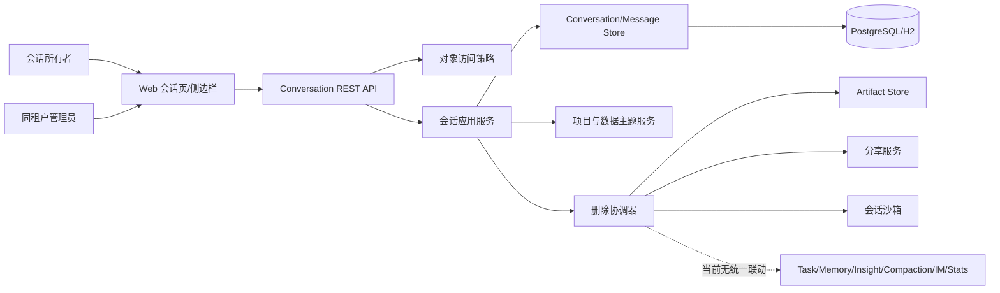
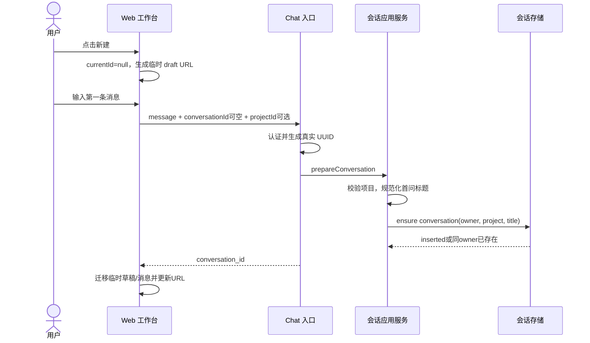
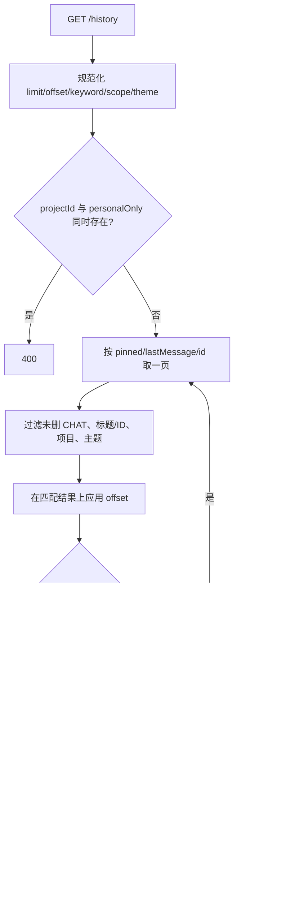
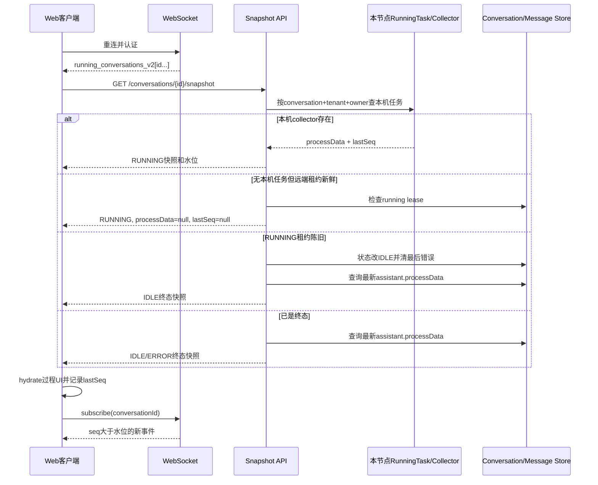
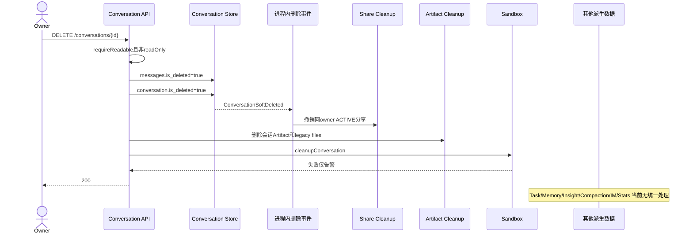
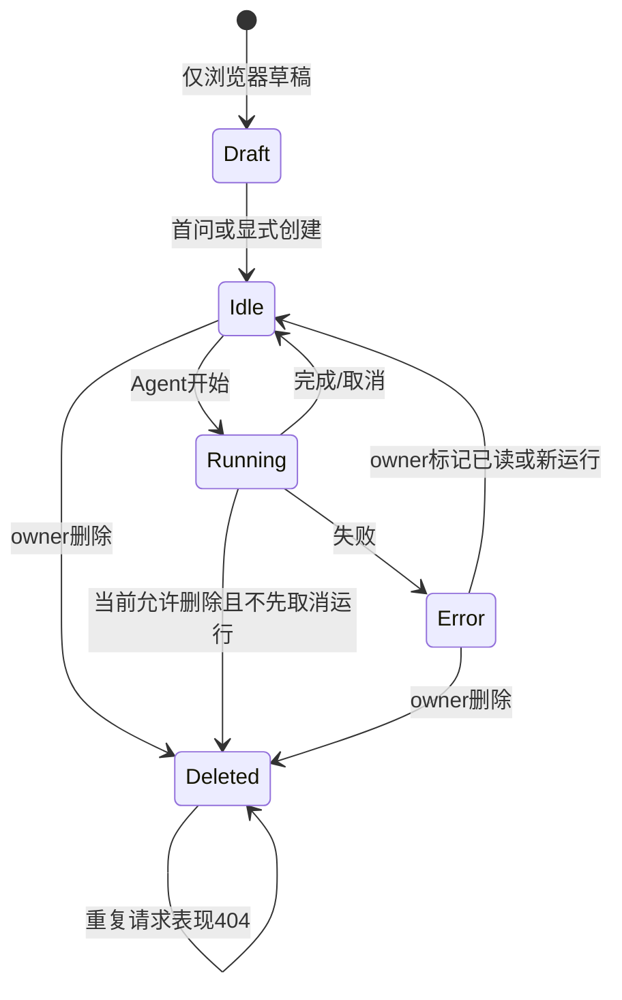

# 会话创建、历史、搜索、重命名与删除复刻设计

## 1\. 结论与边界

### 1.1 结论

会话管理不是聊天页面旁边的一组简单 CRUD。它以会话为业务聚合根，负责把用户身份、项目场景、数据主题、消息历史、运行状态、置顶与未读状态、任务来源、Artifact、分享快照和会话沙箱组织成一个可检索、可恢复、可治理的生命周期。

复刻出业务效果等价的能力，至少要同时满足以下规则：
1. 新聊天可以延迟到第一条消息再创建，也可以通过 REST 预创建；创建后得到全局不透明的 `conversationId`，但所有查询和写入仍必须带租户与属主条件。
2. 默认标题来自第一条用户消息：折叠空白、去掉首尾空白、按 Unicode 码点截断；用户之后可以显式重命名。
3. 历史列表只展示当前用户的普通聊天会话，按“置顶时间倒序 → 最后消息时间倒序 → ID 倒序”稳定排序，并支持标题/ID 子串搜索、分页、个人/项目范围和数据主题过滤。
4. 会话详情和消息回读是刷新恢复的权威来源。消息只返回未删除的 USER/ASSISTANT，并按轮次重新排成正序。
5. 同租户管理员可只读查看他人会话；所有者可重命名、切换数据主题、置顶、标记已读和删除。跨租户、同租户普通用户访问他人会话、已删除会话和后台会话统一不可见。
6. 删除当前是“立即不可见的软删除 \+ 部分派生资源物理清理”：会话和消息打软删标记，Artifact 与沙箱文件删除，ACTIVE 分享级联撤销；并不是全域合规删除。
7. `I`：当前删除没有统一事务或删除清单，且没有取消正在运行的 Agent。任务执行引用、记忆/画像来源、Insight 来源、上下文压缩检查点、IM 绑定和统计记录等不会随会话删除统一处理。
8. `D`：生产复刻应把删除实现为版本化状态机与 durable deletion job：先阻止新写并使对象不可见，再通过 outbox/工作流幂等清理每类派生数据，最终形成可审计的删除证明。

### 1.2 解决的业务问题
- 用户可以在大量历史分析中找到、打开、置顶、改名和删除目标会话。
- 页面刷新、切换设备或实时连接断开后，仍能从持久化历史恢复可见对话。
- 个人会话、项目会话、定时任务会话和后台会话不会混在同一个产品列表中。
- 管理员可以排障查看租户内用户会话，但不能以管理员身份修改属主数据。
- 删除后，消息、作品、公开分享和工作目录不会继续从正常产品入口暴露。
- 搜索、分页、并发重命名/删除和派生资源清理具备明确而可验收的契约。

### 1.3 输入、输出与最终可见效果

输入包括：
- 显式创建时的可选 `projectId`；
- 第一条用户消息，用于生成默认标题；
- 历史查询的 `limit`、`offset`、`keyword`、`projectId`、`personalOnly`、`dataThemeIds`；
- 会话 ID、重命名标题、数据主题 ID、置顶/取消置顶/标记已读/删除动作；
- 服务端认证得到的 `tenantId`、`userId` 和租户管理员标志。

输出包括：
- 会话 ID、标题、创建/更新时间、最后消息时间、运行状态、最后查看时间、错误、置顶时间、项目和数据主题等摘要；
- 会话详情及只读标志；
- 按轮次排列的持久化消息；
- 历史页的置顶区、日期分组、搜索结果、项目范围筛选、空态和加载状态；
- 删除后的 404/列表消失、作品消失、公开分享 410，以及清理审计。

### 1.4 本文包含与不包含

本文包含创建、默认标题、列表与分页、搜索、项目/主题过滤、置顶、已读、详情、消息历史、管理员只读、重命名和会话删除的业务及技术契约；同时说明与任务、Artifact、分享、沙箱、SubAgent、Memory/Insight 等派生数据的删除关系。

本文不展开 LLM/Tool Loop、实时 token 协议、附件上传、单轮消息删除、分享快照投影或 Artifact 内容预览的内部算法；但给出这些模块与会话生命周期必须遵守的交互边界。

### 1.5 证据状态总览

本次只进行了三仓静态分析，没有启动 Nova、没有执行 API/WS/UI 自动化，因此本文没有 `R`（Runtime Verified）结论。

| 等级 | 关键结论 |
|------|------------|
| `I` | 当前源码具备创建、历史、标题/ID 搜索、项目/主题过滤、置顶、已读、管理员只读、软删除、Artifact/沙箱清理和分享级联撤销。 |
| `A` | Active 黑盒用例要求列表、详情、消息、标题、置顶、取消置顶和删除持久化，并要求跨账号读删被拒绝；UI 用例要求搜索、重命名和删除的完整体验。均未在本次运行。 |
| `K` | `NOVA-BUG-019` 搜索失败显示成空结果；`020` 删除无二次确认；`021` 删除失败无可见错误；`022` UI 120 字符与后端 100 字符冲突；`023` 详情页删除后旧路由/标题残留。历史 release 还记录过跨账号 DELETE 返回 200。 |
| `F` | 删除后遗留的 Memory review job 可能读取到空历史并自行结束，但没有删除联动源码，不能把它视为清理保证。 |
| `D` | 统一写权限、版本/ETag、游标分页、搜索索引、删除状态机、outbox 和删除清单是绿地生产实现建议。 |

## 2\. 术语与参与方

### 2.1 术语

| 术语 | 定义 |
|------|------|
| Conversation | 会话聚合根，保存属主、标题、类型、运行状态、项目/主题、置顶和软删状态。 |
| Message | 会话内持久化消息。Web 历史只公开 USER/ASSISTANT，内部还可有 SYSTEM/TOOL。 |
| CHAT | 普通聊天会话；进入个人历史列表。 |
| TASK | 定时任务执行产生的会话；详情可读取任务定义 ID，但普通历史列表排除。 |
| BACKGROUND | 评测等后台会话；普通用户和管理员的会话详情都不可读。 |
| Owner | `(tenantId, userId)` 成对确定的会话属主。`userId` 不能脱离租户单独比较。 |
| Read-only admin view | 同租户管理员读取另一用户会话；返回 owner 身份数据和 `readOnly=true`，并写管理员读取审计。 |
| Soft delete | 保留数据库行但设置 `is&#95;deleted=true`，默认所有产品查询排除。 |
| Last viewed | 用户最后确认看到会话内容的时间，用于清除未确认错误并计算未读。 |
| Last message | 未删除消息最大 `created&#95;at`；不是会话表物理列。 |
| Pinned at | 非空代表置顶，同时也是多个置顶会话的排序时间。 |
| Derived resource | 以会话 ID 为来源或范围的 Artifact、分享、沙箱、任务执行、记忆、Insight、压缩检查点、IM 绑定和统计记录。 |

### 2.2 参与方



## 3\. 业务规则

### 3.1 创建与默认标题
1. 显式创建接口生成 UUID 字符串，默认标题是 `New Conversation`，类型为 `CHAT`，状态为 `IDLE`。
2. `projectId` 为空时创建个人会话；非空时必须先确认项目对当前身份可用，并在创建时写入，不允许后续消息把已有会话改绑到另一项目。
3. Web 的“新建任务/对话”默认只清空浏览器当前会话和写入一个临时 draft 路由，不立即调用后端创建；第一条消息到达后端时才生成/确认会话。
4. 通过第一条消息创建时，默认标题取用户正文：把连续空白折叠为一个空格、去首尾空白；空正文回退 `New Conversation`；超过 120 个 Unicode 码点时保留前 119 个并追加 `…`。
5. 创建和第一条消息存在两条路径差异：显式 REST 预创建会先写 `New Conversation`；后续 `prepare` 只为空标题补默认标题，不会覆盖这个非空默认值。因此当前预创建会话可能一直显示 `New Conversation`，而延迟创建路径显示首问标题。
6. 存储层在“第一条消息先于显式会话创建”的兼容路径也会以第一条 USER 正文生成标题，并使用 `INSERT ... ON CONFLICT DO NOTHING`，不能因后续 append 重置标题、类型、任务绑定或删除标志。
7. 调用方提供的会话 ID若已属于另一 `(tenant,user)`，创建/确保动作必须失败；同属主的完全重复 ensure 可幂等返回。

### 3.2 历史列表、排序和过滤
1. `/api/conversations` 与 `/api/conversations/history` 都只返回未删除 `CHAT`；`TASK` 和 `BACKGROUND` 不进入普通历史。
2. 只返回当前 `(tenantId,userId)` 的会话；列表没有管理员跨用户模式。
3. 排序键严格为：
    - `pinned_at DESC NULLS LAST`；
    - `COALESCE(MAX(undeleted message.created_at), conversation.created_at) DESC`；
    - `conversation.id DESC`。
4. `lastMessageAt` 与 `messageCount` 从全部未删除消息计算，包括内部角色；Web 消息接口只返回 USER/ASSISTANT，两者口径可能不同。
5. 历史默认 `limit=50, offset=0`；应用服务把 limit 夹在 `0..100`、offset 夹到至少 0。`limit=0` 返回空数组。
6. 搜索先 `trim`、按 `Locale.ROOT` 转小写，再在 Java 内匹配标题或会话 ID 的字面子串；不搜索消息正文。中文、英文、数字、`[]` 等特殊字符没有 SQL LIKE 通配语义。
7. 搜索按存储排序逐页扫描，每批最多 500 行、总扫描上限 5000。超过上限且仍有数据时抛服务端错误，要求调用者缩小过滤范围。
8. `offset` 是“过滤匹配后跳过的条数”，不是底层表偏移。
9. `projectId` 非空时精确匹配项目；`personalOnly=true` 时只取 `project_id IS NULL`；两者同时出现为 400。
10. `dataThemeIds` 去 null、trim、去空并保持首次顺序去重，再做精确包含过滤；空数组表示不按主题过滤。主题名称不向 Gateway 查询，列表 `dataThemeName` 当前为 null。
11. 当前 `/api/conversations` 无分页，内部聚合存储游标页，最多允许 5000 条，超过直接失败；新客户端应使用 `/history`。
12. 历史页把置顶单独分区，未置顶项按会话 `createdAt` 分为今天、昨天、本周和月份；这只是展示分组，列表本身仍按最后消息时间排序。

### 3.3 重命名与数据主题
1. 手工标题先 `trim`；空或纯空白返回 400。
2. 当前后端长度按 Java `String.length()`（UTF-16 code unit）限制为 100；自动标题却按 Unicode 码点限制为 120。
3. 当前前端输入框按 Unicode 码点限制为 120，并显示计数。ASCII 101..120 字符前端允许提交、后端返回 400；包含代理对 emoji 时前后端计数差异更明显。这是 `K/NOVA-BUG-022`。
4. 标题存储为明文以支持子串搜索；消息内容加密开关不会加密标题。
5. 数据主题传 null、空或仅空白代表清除为“全部数据”；非空主题必须对调用者租户可见。
6. 当前标题、数据主题更新没有检查 affected rows。不存在、已删除或不属于调用者的目标通常更新 0 行，但控制器仍返回 200。
7. 生产复刻必须统一标题规则，推荐 120 Unicode 码点；API、数据库约束和前端计数使用同一规范化函数及版本。

### 3.4 置顶、已读与状态纠正
1. 置顶写当前时间；取消置顶写 null。SPI 置顶操作不改变 `updated_at`，避免排序提示污染内容更新时间。
2. 当前置顶/取消置顶也不检查 affected rows：可能返回 200/204 但没有目标行被修改。
3. 打开会话后，owner 前端乐观更新 `lastViewedAt`，并异步 PATCH 后端；离开当前会话时还会再次标记已读，确保用户离开前产生的内容不再显示未读。
4. 管理员只读打开他人会话不得标记属主已读；前端在 `readOnly=true` 时跳过 PATCH。
5. PATCH viewed 先按 owner 身份读取；不存在、已删除或非 owner 返回 404。
6. 若会话为 `ERROR`，标记已读同时把状态改回 `IDLE` 并清空最后错误。
7. 若状态为 `RUNNING`，但没有本节点运行任务且没有两分钟内的新鲜跨节点租约，列表/已读路径把它修正为 `IDLE` 并清错误。
8. 未读计算只在已经有 `lastViewedAt` 时启用：`lastMessageAt > lastViewedAt` 且当前未打开即显示未读；旧数据 `lastViewedAt=null` 不把所有历史都标成未读。

### 3.5 权限规则

| 调用者 | 详情/消息 | 重命名/主题/置顶 | 已读 | 删除 |
|---------|-------------|-----------------------|------|------|
| Owner | 读写 | 允许 | 允许 | 允许 |
| 同租户管理员看他人 | 允许，`readOnly=true`，记录管理员读审计 | 当前返回成功但 owner 条件更新 0 行 | 404 | 404 |
| 同租户普通用户看他人 | 404/空 | 当前部分端点可能假成功、实际 0 行 | 404 | 404 |
| 跨租户 | 404/空 | 当前部分端点可能假成功、实际 0 行 | 404 | 404 |
| 已删除/BACKGROUND | 一律不可读 | 不允许 | 不允许 | 重复删除 404 |

生产复刻应先调用一个统一的 `requireWritableConversation`，并对管理员只读选择稳定的 403 或防枚举的 404；不能依赖“SQL 更新 0 行但返回成功”充当授权。

### 3.6 删除与保留

当前删除语义如下：
1. 控制器先读取详情；不可读或 `readOnly=true` 返回 404。
2. 存储先软删该 owner 会话的全部消息，再软删会话。两条 SQL 在 MyBatis store 中使用自动提交 session，不是一个显式数据库事务。
3. 会话此前存在且未删除时，发布同步进程内 `ConversationSoftDeleted(conversationId,tenantId,userId)` 事件。
4. 分享监听器查找同 owner 的 ACTIVE 分享，逐条转为 REVOKED，清空快照正文和 active hash，删除附件授权，保留分享 tombstone/标题/token/历史 hash/计数/审计；公开 token 随即返回 410。
5. 应用服务枚举当前 owner、当前会话的 Artifact 并物理删除元数据/内容，同时删除兼容 `files/<conversationId>` 目录。
6. 最后清理会话沙箱。沙箱不存在或清理失败只记 warning，不让 DELETE 失败。
7. 删除成功后详情和列表不再返回会话，消息接口也先因详情不可读返回 404。
8. 当前没有恢复/回收站接口，软删行也没有会话级保留期硬删除任务。

## 4\. 完整执行链路

### 4.1 延迟创建与默认标题



显式 REST 预创建的差异是：先写 `New Conversation` 并返回 201；后续首问不会覆盖这个非空标题。绿地实现应在会话增加 `title_source=AUTO_PLACEHOLDER|FIRST_MESSAGE|USER`，首问只允许把 `AUTO_PLACEHOLDER` 原子升级为 `FIRST_MESSAGE`。

### 4.2 历史搜索与分页



当前 UI 在每次输入变化后直接发请求，没有显式 debounce；使用递增 request sequence 丢弃旧响应，避免慢请求覆盖新搜索。首屏和加载更多使用 `limit=50`，滚动离底部 160px 时按当前数组长度作为 offset 继续加载。搜索或 scope 改变会令旧请求失效并重置结果。

### 4.3 打开详情与消息
1. 路由从 `conversationId` 打开会话。
2. 访问策略按全局 ID检查原始 owner、软删和类型：owner 为可写；同租户管理员为只读；其他不可读。
3. 管理员只读时，以 owner 身份加载详情/消息，并记录资源类型为 `CONVERSATION`、`MESSAGES` 的管理员读取审计；不能用管理员自己的 userId 去查 owner 行。
4. 详情补充项目名称/状态；TASK 会话通过 `taskExecutionId` 以 owner 身份查询 `taskDefinitionId`。
5. 消息接口先确认详情可读，再加载最多 1000 条最新未删除消息，过滤 SYSTEM/TOOL，按 `turnIndex → USER优先 → createdAt → id` 排成正序，并兼容修正旧数据中 assistant turnIndex 比前一 user 大 1 的配对。
6. 页面刷新后以这些 REST 行重建气泡、消息状态、过程数据和图片引用；实时内存不是历史恢复前置。

#### 4.3.1 运行快照、断线恢复与 WS 水位

快照不是消息历史的替代品，而是“正在运行的过程投影”。客户端在 WebSocket 重连收到运行中会话清单后，对每个会话读取一次快照，以快照重建工具执行、思考、引用等过程 UI，并把 `lastSeq` 记录为水位；之后才发送 `subscribe`。实时事件只有在 `event.seq > lastSeq` 时才接收，从而避免“快照已经包含的事件”又被 WS 重放一次。



当前前端失败处理是单会话 fail-soft：快照请求失败只输出 warning，该会话不执行 hydrate 和 subscribe，其他运行会话仍继续。`processData` JSON 解析失败时保留水位但不重建过程 UI。这里存在一个当前契约错位：后端在非本机 collector 分支返回 `lastSeq=null`，前端 TypeScript DTO却声明为必填 `number`；生产复刻必须把类型改成 `number | null` 并规定 null 表示“没有可用于去重的服务端水位”，不能把 null 当成已经消费所有事件。

### 4.4 重命名
1. Owner 打开操作菜单和重命名弹窗。
2. 前端把当前标题按 120 码点截断，纯空白禁用确认。
3. 提交 `{title}`；后端 trim，再按当前 100 UTF-16 长度校验。
4. 校验成功后 owner-scoped UPDATE 标题和 `updated_at`。
5. 前端只有请求成功才更新侧边栏状态并关闭弹窗；失败保留输入并显示“重命名失败”。
6. 当前详情页实现符合失败保留；历史 UI 用例要求页头、最近列表、全部历史、刷新和详情接口都一致。

### 4.5 删除链路与当前一致性边界



这里不能把源码注释中的“同一外层事务”当成当前整体保证：会话 store 自己打开自动提交 MyBatis session；ChatService 删除没有统一 `@Transactional`；Artifact 和文件系统也在另一边界。分享清理方法自身可能有事务和 after-commit 字节清理，但它不把整个会话、消息、作品、沙箱包成原子事务。

### 4.6 会话状态图



`D`：生产状态应增加 `DELETING` 与 `PURGED`。进入 `DELETING` 必须通过条件更新拒绝 `RUNNING`，或先取消并等待运行终态；所有新消息、Artifact、分享和任务派生写入都校验 deletion version。

## 5\. 对外契约

### 5.1 通用认证与对象隐藏

所有 `/api/conversations/**` 私有接口要求认证上下文。服务端从认证解析身份，绝不接受请求体覆盖 `tenantId/userId`。不可见对象推荐统一 404，避免泄露对象是否存在；未认证为 401。

### 5.2 创建会话

`POST /api/conversations`

请求体可省略：
```json
{ "projectId": "project-01" }

```

| 字段 | 类型 | 必填 | 默认 | 语义 |
|------|------|------|------|------|
| `projectId` | string/null | 否 | null | null/blank 为个人；非空 trim 后要求项目可用。 |

成功：`201 Created`
```json
{
  "conversationId": "9ca09239-28b7-40f8-95e3-3a03f3f5d632",
  "projectId": "project-01",
  "mode": "PROJECT"
}

```

当前接口没有客户端幂等键；重试会创建另一个 UUID。生产建议接收 `Idempotency-Key` 或 `clientDraftId`，唯一约束为 `(tenant_id,user_id,client_draft_id)`。

### 5.3 会话摘要列表

`GET /api/conversations`

无查询参数；返回当前 owner 全部普通聊天摘要，最多聚合 5000 条。成功 200：
```json
[
  {
    "id": "conv-01",
    "title": "分析本月销售表现",
    "createdAt": "2026-08-13T09:00:00",
    "updatedAt": "2026-08-13T09:05:00",
    "tenantId": "tenant-a",
    "userId": "user-a",
    "conversationType": "CHAT",
    "taskExecutionId": null,
    "status": "IDLE",
    "lastViewedAt": "2026-08-13T09:04:00",
    "lastErrorAt": null,
    "lastErrorMessage": null,
    "lastMessageAt": "2026-08-13T09:05:00",
    "pinnedAt": "2026-08-13T09:06:00",
    "dataThemeId": null,
    "dataThemeName": null,
    "projectId": null,
    "projectName": null,
    "mode": "PERSONAL",
    "projectStatus": null,
    "readOnly": false
  }
]

```

列表响应中的 tenant/user 是 owner；普通列表不会返回管理员只读行。当前该非分页路径没有批量补 `dataThemeId`，因此即使数据库有主题也可能返回 null；分页 history 路径会补主题。

### 5.4 历史搜索

`GET /api/conversations/history`

| 参数 | 类型 | 必填 | 默认 | 当前规则 |
|------|------|------|------|------------|
| `limit` | integer | 否 | 50 | 负值变 0；大于 100 变 100。 |
| `offset` | integer | 否 | 0 | 负值变 0。 |
| `keyword` | string | 否 | 空 | trim 后标题/ID大小写不敏感子串。 |
| `projectId` | string | 否 | null | trim 后精确匹配。 |
| `personalOnly` | boolean | 否 | false | 只取 projectId 为空；与 projectId 互斥。 |
| `dataThemeIds` | string\[\] | 否 | 空 | Spring 可接收重复参数；前端当前发送逗号拼接值，部署必须验证 binder 是否按预期拆分。 |

示例：
```http
GET /api/conversations/history?limit=50&offset=0&keyword=%E9%94%80%E5%94%AE&personalOnly=true

```

响应字段同摘要数组。当前没有 `total`、`nextCursor` 或 `hasMore`；前端以“本页长度是否等于 limit”推断是否继续。

错误：`projectId + personalOnly` 为 400；扫描超过 5000 且还有行、游标不推进或存储返回超量行属于 500。当前 UI 把加载错误转成空数组，见 Known Failure。

### 5.5 会话详情

`GET /api/conversations/{id}`
```json
{
  "id": "conv-01",
  "title": "分析本月销售表现",
  "dataThemeId": "theme-sales",
  "conversationType": "CHAT",
  "taskExecutionId": null,
  "taskDefinitionId": null,
  "projectId": null,
  "projectName": null,
  "mode": "PERSONAL",
  "projectStatus": null,
  "readOnly": false
}

```

TASK 会话可返回两个 task ID；BACKGROUND、已删除、不可读或不存在返回 404。null 标题在详情兼容为空字符串。

### 5.6 消息历史

`GET /api/conversations/{id}/messages`
```json
[
  {
    "id": 101,
    "role": "user",
    "content": "分析本月销售表现",
    "processData": null,
    "turnIndex": 0,
    "feedbackType": null,
    "feedbackReason": null,
    "skillName": null,
    "state": "COMPLETED",
    "errorMessage": null,
    "feedbackTags": null,
    "skillNames": null,
    "createdAt": "2026-08-13T01:00:00Z",
    "images": null
  },
  {
    "id": 102,
    "role": "assistant",
    "content": "……",

    "processData": "{\"events\":[]}",

    "turnIndex": 0,
    "feedbackType": null,
    "feedbackReason": null,
    "skillName": null,
    "state": "COMPLETED",
    "errorMessage": null,

    "feedbackTags": [],


    "skillNames": [],

    "createdAt": "2026-08-13T01:00:01Z",
    "images": [{"mediaType":"image/png","relativePath":"uploads/a.png"}]
  }
]

```

当前无分页参数，只取最新 1000 条存储消息后排序。因此超过 1000 行的超长会话会静默缺失更老历史。生产接口必须采用 turn cursor，并明确是 newest-first 还是 chronological projection。

### 5.7 运行过程快照

`GET /api/conversations/{id}/snapshot`

成功响应为：
```json
{
  "conversationId": "2d614926-5674-4f54-b32c-d103af3d2e57",
  "status": "RUNNING",
  "processData": "{\"events\":[{\"seq\":37,\"type\":\"thinking\"}],\"totalDurationMs\":1832}",
  "lastSeq": 37
}

```

| 字段 | 类型 | 可空 | 语义 |
|------|------|------|------|
| `conversationId` | string | 否 | 请求中的会话 ID |
| `status` | `IDLE&#124;RUNNING&#124;ERROR` | 否 | 经过本机任务/跨节点租约纠正后的运行状态 |
| `processData` | string(JSON) | 是 | 运行时 collector 或最新 assistant 消息持久化的过程数据；外层不是 JSON 对象而是 JSON 字符串 |
| `lastSeq` | int64 | 是 | 仅本机 live collector 能给出的 WS 去重水位；终态、远端新鲜租约或 collector 尚未建立时为 null |

分支优先级必须按以下顺序实现：
1. 先以 `(conversationId,tenantId,userId)` 读取未删除会话；缺失、跨账号或跨租户一律 404。
2. 若本机存在 RunningTask 且 collector 已创建，忽略库中暂时落后的状态，返回 `RUNNING + collector.snapshot(processData,lastSeq)`。
3. 若本机存在 RunningTask 但 collector 尚未创建，返回 `RUNNING,null,null`。
4. 若库状态是 RUNNING、本机无任务但跨节点租约仍新鲜，返回 `RUNNING,null,null`；快照 API不跨节点代理 collector 数据。
5. 若库状态是 RUNNING且没有新鲜租约，把状态持久化纠正为 IDLE、清空最后错误，然后继续读取最新 assistant 的 `processData`。
6. IDLE/ERROR 等终态从最新 assistant 消息读取 `processData`，没有 assistant 或该字段为空时返回 null；终态 `lastSeq=null`。

该接口与详情接口的管理员语义不同：详情通过访问策略允许同租户管理员只读，而 snapshot 直接按请求身份调用 owner-scoped facade，当前是 **owner-only**；管理员读取他人快照得到 404，不存在 `readOnly` 快照模式。这种差异应保留为兼容事实，绿地产品若要开放管理员排障，必须另设有审计、过程数据脱敏和明确授权的管理接口，不能悄悄扩大普通 snapshot 权限。

异常契约：未认证 401；对象不可见 404；未知存储/序列化错误 500。读取本机 collector snapshot 应是线程安全且单调的，`lastSeq` 不得倒退，也不得使用 `Long.MAX_VALUE` 之类哨兵冒充真实事件序号。

### 5.8 重命名

`PUT /api/conversations/{id}/title`
```json
{ "title": "新的分析标题" }

```
- 当前成功：200，空响应体。
- 当前参数错误：400，`{"error":"Title cannot be empty"}` 或 `{"error":"Title cannot exceed 100 characters"}`。
- 当前缺陷：不存在/非 owner/已删除可能 200 但不修改。
- 生产目标：404 不可见；409 `VERSION_CONFLICT`；422 `TITLE_TOO_LONG`，并返回统一错误对象。

### 5.9 数据主题

`PUT /api/conversations/{id}/data-theme`
```json
{ "dataThemeId": "theme-sales" }

```

请求体缺失或字段 null 表示清除。不可见主题当前 400：`{"error":"Data theme is not available to this tenant"}`。同样存在零行更新仍 200 的问题。

### 5.10 置顶、取消置顶和已读
```http
PUT    /api/conversations/{id}/pin       -> 200
DELETE /api/conversations/{id}/pin       -> 204
PATCH  /api/conversations/{id}/viewed    -> 200/空体（void）

```

置顶端点当前不检查目标；viewed 会先 owner 查询，非 owner/不存在为 404。生产建议 pin 接受 `pinned:boolean` 与 `If-Match`，返回更新后的摘要，减少前端猜测时间。

### 5.11 删除

`DELETE /api/conversations/{id}`
- Owner 首次删除：当前 200，空响应体。
- 不存在、已删除、越权、管理员只读：404。
- API 不支持 restore、purge、deletion status 或 dry-run。
- `A/K`：黑盒契约要求跨账号 DELETE 为 403/404；历史 release 2026-07-20 记录为 200，但 owner 会话仍可读。当前静态控制器已显式检查不可读/readOnly 并返回 404，说明代码与该环境存在版本差异；本次未运行，不能声称线上已修复。

### 5.12 推荐统一错误体
```json
{
  "error": {
    "code": "CONVERSATION_NOT_FOUND",
    "message": "Conversation does not exist or is not accessible",
    "requestId": "req-01J...",
    "retryable": false,
    "details": {}
  }
}

```

建议映射：401 未认证；404 对象不可见；409 版本/运行/删除竞态；422 标题或过滤参数；429 频率；500 仅未知服务端错误；503 搜索/存储暂不可用。

## 6\. 数据模型与生命周期

### 6.1 当前兼容 DDL（）

以下 PostgreSQL DDL是从当前迁移叠加后归纳的自包含表达；H2 使用等价类型。历史兼容使部分身份列 nullable，新写实现不应继续保留该宽松性。
```sql
CREATE TABLE conversation (
    id                    varchar(255) PRIMARY KEY,
    tenant_id             varchar(255),
    user_id               varchar(255),
    title                 varchar(255),
    created_at            timestamp(6) NOT NULL,
    updated_at            timestamp(6),
    conversation_type     varchar(31) NOT NULL DEFAULT 'CHAT',
    task_execution_id     bigint,
    is_deleted            boolean NOT NULL DEFAULT false,
    status                varchar(16) NOT NULL DEFAULT 'IDLE',
    last_viewed_at        timestamp(6),
    last_error_at         timestamp(6),
    last_error_message    text,
    pinned_at             timestamp(6),
    running_node_id       varchar(128),
    running_heartbeat_at  timestamp(6),
    data_theme_id         varchar(255),
    project_id            varchar(64),
    binding_created_at    timestamp(6),
    CONSTRAINT fk_conversation_project FOREIGN KEY (project_id)
      REFERENCES project(project_id)
);

CREATE INDEX idx_conv_tenant_user
  ON conversation(tenant_id, user_id);
CREATE INDEX idx_conv_user_status
  ON conversation(tenant_id, user_id, status);
CREATE INDEX idx_conversation_pinned_at
  ON conversation(tenant_id, user_id, pinned_at DESC NULLS LAST)
  WHERE is_deleted=false;
CREATE INDEX idx_conversation_data_theme
  ON conversation(tenant_id, user_id, data_theme_id);
CREATE INDEX idx_conversation_project
  ON conversation(tenant_id, user_id, project_id, is_deleted);
CREATE INDEX idx_conv_running_lease
  ON conversation(tenant_id, user_id, status, running_heartbeat_at);

CREATE TABLE message (
    id                bigint GENERATED BY DEFAULT AS IDENTITY PRIMARY KEY,
    tenant_id         varchar(255),
    user_id           varchar(255),
    conversation_id   varchar(255) NOT NULL,
    role              varchar(255) NOT NULL,
    content           text,
    tool_calls        text,
    image_refs        text,
    tool_call_id      varchar(255),
    process_data      text,
    turn_index        integer,
    feedback_type     varchar(255),
    feedback_reason   text,
    feedback_tags     text,
    skill_name        text,
    state             varchar(16) NOT NULL DEFAULT 'COMPLETED',
    error_message     text,
    timeline          text,
    input_tokens      bigint,
    output_tokens     bigint,
    cached_tokens     bigint,
    is_deleted        boolean NOT NULL DEFAULT false,
    created_at        timestamp(6) NOT NULL
);

CREATE INDEX idx_msg_tenant_user_conv
  ON message(tenant_id, user_id, conversation_id);
CREATE INDEX idx_msg_turn ON message(conversation_id, turn_index);
CREATE INDEX idx_msg_feedback
  ON message(tenant_id, feedback_type, created_at);

```

当前没有 `message.conversation_id -> conversation.id` 外键。它有利于兼容迁移和任务/后台数据，但允许会话删除后继续写孤儿消息。

### 6.2 派生数据删除矩阵

| 数据/资源 | 当前删除动作 | 保留内容与风险 | 生产建议 |
|-------------|------------------|---------------------|------------|
| conversation | `is&#95;deleted=true` | 标题、owner、项目/主题、错误、运行租约永久保留 | tombstone 最小化，按保留期 purge |
| message | 同 owner、同会话全部软删 | 正文/processData/timeline仍在库中；加密配置决定静态保护 | crypto-erase 或 purge；保留不可逆统计 |
| chat Artifact | 枚举后物理删除元数据与内容 | 单项删除失败传播方式不统一 | deletion manifest \+ retry/GC |
| legacy files | 删除 `files/&lt;conversationId&gt;` | IO失败只告警 | 幂等清理 job 与告警 |
| sandbox | `cleanupConversation` | 失败只告警；运行中工具可能再次写入 | 删除前取消运行并封禁 scope |
| ACTIVE share | 同 owner 级联 REVOKED | 保留 token、标题、源会话ID、历史hash、计数和审计；正文清空 | 保留策略、精确硬删、outbox |
| task execution | 不清理；`conversation&#95;id` 保留 | TASK 会话可被 owner 删除，执行记录继续引用软删行 | 明确任务会话不可删或保留只读墓碑 |
| task definition | 不受影响 | 正确：定义不应因单次执行会话删除而消失 | 保持 |
| memory entry | 不清理 | 已提取画像正文和 `source&#95;conversation&#95;id` 保留 | 产品需定义“删除聊天是否撤回记忆”；支持来源删除/去引用 |
| memory review cursor/job | 不清理 | job/cursor继续引用会话；软删消息不可读 | 删除时取消 pending job并清 cursor |
| insight source | 不清理 | `conversation&#95;id/message&#95;ids` 保留，知识条目也保留 | 依据用户选择保留派生成果或一并删除，并断开私有ID |
| compaction checkpoint | 不清理 | 摘要/水位可能保留会话内容 | purge或加密删除 |
| IM conversation binding/delivery | 不清理 | 外部会话仍指向已删 Nova 会话 | 解绑、创建新会话或保留合规墓碑 |
| asset/clarification stats | 不清理 | 来源 ID保留用于统计/审计 | 脱敏/哈希并设保留期 |
| SubAgent | 当前子代理调用是无独立会话的 stateless 调度 | 结果/过程嵌在父 assistant `processData`，随消息软删但不物理清除；产出的 Artifact按上表清理 | 若将来子代理持久化，建立 parent-child deletion policy |

### 6.3 绿地生产 Schema（）
```sql
CREATE TYPE conversation_lifecycle AS ENUM
  ('ACTIVE','DELETING','DELETED','PURGING','PURGED');

ALTER TABLE conversation
  ALTER COLUMN tenant_id SET NOT NULL,
  ALTER COLUMN user_id SET NOT NULL,
  ALTER COLUMN updated_at SET NOT NULL,
  ADD COLUMN lifecycle conversation_lifecycle NOT NULL DEFAULT 'ACTIVE',
  ADD COLUMN version bigint NOT NULL DEFAULT 0,
  ADD COLUMN title_source varchar(24) NOT NULL DEFAULT 'AUTO_PLACEHOLDER',
  ADD COLUMN deletion_version bigint,
  ADD COLUMN deleted_at timestamptz,
  ADD COLUMN deleted_by varchar(255),
  ADD COLUMN deletion_reason varchar(64),
  ADD COLUMN client_draft_id varchar(128),
  -- 历史列表的物化排序值；无未删除消息时必须等于created_at。
  ADD COLUMN last_message_at timestamptz;

UPDATE conversation c
SET last_message_at = COALESCE(
  (SELECT MAX(m.created_at)
     FROM message m
    WHERE m.conversation_id=c.id
      AND m.tenant_id=c.tenant_id
      AND m.user_id=c.user_id
      AND m.is_deleted=false),
  c.created_at
);

ALTER TABLE conversation ALTER COLUMN last_message_at SET NOT NULL;

CREATE UNIQUE INDEX uq_conversation_client_draft
  ON conversation(tenant_id,user_id,client_draft_id)
  WHERE client_draft_id IS NOT NULL;

CREATE INDEX idx_conv_history_seek
  ON conversation(
    tenant_id,
    user_id,
    pinned_at DESC NULLS LAST,
    last_message_at DESC,
    id DESC
  )
  WHERE lifecycle='ACTIVE' AND conversation_type='CHAT';

CREATE INDEX idx_conv_project_history_seek
  ON conversation(
    tenant_id,
    user_id,
    project_id,
    pinned_at DESC NULLS LAST,
    last_message_at DESC,
    id DESC
  )
  WHERE lifecycle='ACTIVE' AND conversation_type='CHAT';

CREATE INDEX idx_conv_theme_history_seek
  ON conversation(
    tenant_id,
    user_id,
    data_theme_id,
    pinned_at DESC NULLS LAST,
    last_message_at DESC,
    id DESC
  )
  WHERE lifecycle='ACTIVE' AND conversation_type='CHAT';

CREATE TABLE conversation_deletion_job (
    conversation_id varchar(255) NOT NULL,
    deletion_version bigint NOT NULL,
    tenant_id varchar(255) NOT NULL,
    owner_user_id varchar(255) NOT NULL,
    state varchar(24) NOT NULL,
    manifest_json jsonb NOT NULL,
    attempts integer NOT NULL DEFAULT 0,
    next_attempt_at timestamptz,
    last_error_code varchar(128),
    created_at timestamptz NOT NULL,
    updated_at timestamptz NOT NULL,
    PRIMARY KEY(conversation_id,deletion_version)
);

CREATE TABLE conversation_outbox (
    event_id varchar(64) PRIMARY KEY,
    aggregate_id varchar(255) NOT NULL,
    aggregate_version bigint NOT NULL,
    event_type varchar(64) NOT NULL,
    payload jsonb NOT NULL,
    created_at timestamptz NOT NULL,
    published_at timestamptz,
    UNIQUE(aggregate_id,aggregate_version,event_type)
);

```

`last_message_at` 不能靠异步最终一致投影维护，否则新消息提交后列表可能暂时排错。追加消息必须在同一数据库事务内完成“插入 message \+ `conversation.last_message_at=GREATEST(last_message_at,message.created_at)`”；软删非最新消息不改变投影，软删当前最新消息则在同一事务内重算该 owner 会话剩余未删除消息的 `MAX(created_at)`，为空时回退 `conversation.created_at`。整会话软删也在同一事务内完成消息标记、会话生命周期/版本更新和 outbox 写入。若消息和会话被拆到不同存储，只能改用带版本的可靠投影消费者，并在历史 API明确暴露其最终一致性，不能假称强一致。

生产游标编码完整排序元组 `{pinnedAt,lastMessageAt,id,filterFingerprint}`，其中 `filterFingerprint` 覆盖 tenant、owner、project/personal、dataTheme 和 keyword 规范化结果，翻页时不允许换过滤器继续使用旧游标。对 pinned cursor，下一页谓词是“`pinned_at` 更小或为 null，或 pinned 相等且 `(last_message_at,id)` 更小”；对 unpinned cursor，只在 `pinned_at IS NULL` 内比较 `(last_message_at,id)`。查询必须重复索引的 `lifecycle='ACTIVE' AND conversation_type='CHAT'` 条件；project/theme过滤走对应前导列索引。多主题 `IN` 可由各主题有序扫描归并，或使用独立倒排关联表，不能用与排序无关的 offset 扫描冒充 seek pagination。

标题搜索包含敏感信息时，生产可保存加密标题，并另外维护租户隔离、访问受控的 n-gram/全文搜索索引；不能把全租户明文标题送入共享搜索服务。

## 7\. 核心实现设计

### 7.1 模块划分
```text
conversation-ui/
  ConversationHistoryPage     搜索、scope、分页、空态/错误态
  ConversationActions         rename/pin/delete确认与失败恢复
  ConversationProjectionStore 列表缓存、乐观更新、请求代次

conversation-application/
  ConversationCommandService  create/rename/pin/view/delete
  ConversationQueryService    list/detail/messages
  ConversationAccessPolicy    owner/admin/readOnly/hidden
  ConversationDeletionService 删除状态机与manifest

conversation-domain/
  Conversation, ConversationType, RuntimeStatus, Lifecycle
  TitlePolicy, HistoryFilter, HistoryCursor

conversation-infrastructure/
  ConversationRepository, MessageRepository
  SearchIndex, Outbox, DeletionJobRepository
  Artifact/Share/Sandbox/Memory/Task cleanup adapters

```

### 7.2 默认标题算法
```text
normalizeTitle(text, maxCodePoints=120):
  normalized = collapseWhitespace(text).trim()
  if empty: return "New Conversation"
  if codePointCount(normalized) <= max: return normalized
  return firstCodePoints(normalized, max-1) + "…"

onFirstMessage(conv, userText, expectedVersion):
  title = normalizeTitle(userText)
  UPDATE conversation
     SET title=:title, title_source='FIRST_MESSAGE', version=version+1
   WHERE id=:id AND owner=:owner
     AND lifecycle='ACTIVE'
     AND title_source='AUTO_PLACEHOLDER'
     AND version=:expectedVersion

```

手工重命名写 `title_source='USER'`，以后任何首问或后台生成都不能覆盖。

### 7.3 当前兼容历史算法
```text
listHistory(owner, limit, offset, keyword, project, personalOnly, themes):
  require !(project != null && personalOnly)
  limit = clamp(limit, 0, 100)
  offset = max(offset, 0)
  keyword = trimLowerRoot(keyword)

  cursor = null; scanned = 0; matched = 0; result = [ ]

  while scanned < 5000:
    page = store.list(owner, min(500, 5000-scanned), cursor)
    if page empty: return result
    for conv in page:
      if deleted or type != CHAT: continue
      if keyword not in lower(title) and keyword not in lower(id): continue
      if project filter mismatch: continue
      if personalOnly and conv.projectId != null: continue
      if themes nonempty and conv.dataThemeId not in themes: continue
      if matched++ < offset: continue
      append result
      if size(result)==limit: return result
    cursor = cursorOf(last(page)); require cursor advanced
  if store has another row: fail "narrow filters"
  return result

```

### 7.4 生产历史算法
1. 请求接收不透明 `after` cursor，而不是 offset。
2. cursor 编码过滤版本、scope、keyword digest 与最后排序键；HMAC 签名防篡改。
3. 搜索先从 tenant/owner 隔离索引取得候选 ID，再在数据库重新授权；数据库是最终权限来源。
4. 返回 `{items,nextCursor,hasMore,snapshotAt}`。需要稳定翻页时以 `snapshotAt` 限定后续页不纳入新活动。
5. 置顶变化或新消息会改变排序键。若不使用 snapshot，API 明确允许弱一致重复，客户端按 ID 去重；不能声称 offset 无重复/遗漏。

### 7.5 生产删除算法
```text
requestDelete(owner, id, expectedVersion):
  transaction:
    conv = SELECT ... FOR UPDATE
      WHERE id=:id AND owner=:owner AND lifecycle='ACTIVE'
    if missing: 404
    if conv.runtimeStatus == RUNNING:
      issue cancel fence; return 409 until terminal
    version = conv.version + 1
    UPDATE conversation SET lifecycle='DELETING', is_deleted=true,
      deletion_version=version, deleted_at=now, version=version
    UPDATE message SET is_deleted=true WHERE conversation_id=id AND owner=owner
    manifest = snapshotDerivedReferences(id, owner)
    INSERT deletion_job(id, version, manifest, 'PENDING')
    INSERT outbox(eventId, id, version, 'ConversationDeletionRequested', minimalPayload)
  return 202 {deletionId, state:'DELETING'}

worker(job):
  for each cleanupStep in deterministic order:
    if step already SUCCEEDED: continue
    call adapter with (conversationId, owner, deletionVersion)
    persist step result and retry metadata
  when all mandatory steps succeeded:
    transaction:
      set lifecycle='DELETED'
      write deletion certificate without content
      emit ConversationDeleted

```

推荐顺序：封禁新写/取消运行 → 分享立即失效 → Artifact/文件/沙箱 → pending Memory/压缩 job → 按政策处理 Memory/Insight → IM解绑 → 最小化 tombstone。公开授权失效是同步必要步骤；大文件物理删除可异步重试。

### 7.6 最小兼容版与生产级版

| 主题 | 最小兼容版 | 生产级版 |
|------|---------------|------------|
| 创建 | UUID \+ owner \+ 可选项目 | clientDraft幂等、title\_source、版本 |
| 搜索 | Java 标题/ID扫描、5000上限 | tenant隔离索引、seek cursor、snapshot |
| 运行快照 | 本机collector实时快照；远端仅状态；终态读最新assistant | nullable水位契约、跨节点快照路由或明确降级、订阅前hydrate |
| 重命名 | trim \+ 统一120码点 \+ affected rows | ETag/version、审计、加密标题索引 |
| 置顶/已读 | owner更新并检查1行 | 返回新摘要、版本冲突处理 |
| 删除 | 消息/会话软删 \+ 明确四类联动 | DELETING状态、outbox、manifest、重试与证明 |
| 恢复 | 无 | 可选短期 restore；清理开始后不可恢复 |
| 硬删 | 无 | 保留期、crypto-erase、合规purge |

## 8\. 并发与非正常路径

| 场景 | 当前行为/风险 | 生产处理 |
|------|-------------------|------------|
| 同一 draft 重试创建 | 每次 UUID，生成重复空会话 | clientDraftId 幂等唯一键 |
| first message 与预创建竞态 | 非空 `New Conversation` 阻止首问标题 | title\_source 条件更新 |
| 同时重命名 | 后写覆盖前写，无冲突提示 | `If-Match/version`，冲突409 |
| 重命名与删除 | UPDATE 0 行仍可能200 | affected rows \+ lifecycle条件 |
| 两次 pin | 两次刷新 pinnedAt，排序改变 | PUT 幂等语义或保留第一次；返回版本 |
| 翻页时新消息/置顶 | offset 页重复或遗漏 | seek cursor \+ snapshot/客户端ID去重 |
| 搜索快速输入 | 当前 requestSeq丢旧响应，仍产生每键请求 | debounce \+ abort previous \+ sequence |
| 搜索后端500 | 当前页面清空并显示“未找到” | 区分 loading/error/empty，保留旧结果和重试 |
| 快照与WS事件交错 | 先快照后订阅，靠lastSeq过滤已包含事件；远端租约没有水位 | collector原子生成数据\+水位；订阅携带`afterSeq`并由服务端补齐间隙 |
| 快照请求失败/JSON损坏 | 前端warning；该会话本次不订阅，JSON损坏仅记录水位 | 可见重试状态；保存原活动流；超时后退化为消息刷新，不伪造水位 |
| 两次请求同时纠正stale RUNNING | GET带状态写副作用，可能重复改IDLE/清错误 | `UPDATE ... WHERE status='RUNNING' AND lease&lt;cutoff`，幂等并记录一次状态事件 |
| 删除无确认 | 当前直接发 DELETE | 风险分级确认；至少展示将清理的资源 |
| DELETE 500 | 当前历史页无可见错误，可能未移除/也可能部分清理 | deletion status \+ retry；UI保留行并显示错误 |
| 删除 RUNNING 会话 | 当前不取消；运行可能在软删后继续写消息/文件 | 取消栅栏或409；所有派生写检查 deletion version |
| 消息软删成功、会话软删失败 | 两次自动提交，可出现可见空会话 | 单DB事务；恢复任务扫描不一致 |
| 会话删、Artifact删失败 | DELETE 可能异常或部分完成 | manifest逐步状态、幂等重试 |
| 沙箱删失败 | 只告警、API仍200 | job积压指标和隔离存储生命周期 |
| 分享创建与会话删除竞态 | 删除事件查询后新分享可能提交为ACTIVE | 会话删除版本/行锁；分享创建终提交复查 |
| Memory review 与删除竞态 | job保留，可能读空或已加载旧消息 | 删除事件取消job；worker提交前校验版本 |
| 进程在删除中崩溃 | 当前无全域恢复状态 | durable job从最后成功step继续 |
| 消息超过1000 | 当前历史静默丢最老部分 | cursor分页或分段加载 |

## 9\. 安全、权限与审计

### 9.1 必须执行的安全控制
1. 所有 SQL 的 owner 条件必须同时包含规范化 tenantId 和 userId。
2. 全局 conversationId 只用于定位候选对象，不能直接授予权限。
3. 管理员读取详情/消息必须重新以 owner 身份取数据，并记录 actor、owner、资源、原因、时间和 requestId；审计不能写消息正文。普通 snapshot 当前例外为owner-only，管理员也不能读取；若增加管理快照接口，须单独授权、脱敏和审计。
4. 管理员只读 UI隐藏写入口只是体验优化，后端统一写策略才是安全边界。
5. 搜索索引必须按 tenant/owner 分区；索引命中后回数据库二次授权。
6. 标题是用户内容，渲染必须转义；日志不得原样记录标题或搜索词，可记录长度与不可逆摘要。
7. 统一404可防对象枚举；若产品选择403，需确保列表和计时差异不泄露跨租户信息。
8. 删除事件载荷只含 conversationId、owner、deletionVersion，不含消息正文/processData。
9. 加密消息时需要 key version 与轮转；删除可通过销毁会话数据密钥实现 crypto-erase。
10. 删除审计保留最小不可逆信息：删除ID摘要、actor、owner摘要、步骤计数、策略版本、完成时间和失败码。

### 9.2 推荐审计事件
- `CONVERSATION_CREATED`
- `CONVERSATION_ADMIN_READ`
- `CONVERSATION_RENAMED`（不保存原/新明文标题）
- `CONVERSATION_PIN_CHANGED`
- `CONVERSATION_DELETE_REQUESTED`
- `CONVERSATION_DELETE_STEP_SUCCEEDED/FAILED`
- `CONVERSATION_DELETED`
- `CONVERSATION_PURGED`
- `CONVERSATION_DELETE_RESTORED`（若支持）

## 10\. 外部依赖对端设计

本能力没有要求独立外部服务才能完成基本 CRUD，但依赖以下对端契约：

| 对端 | 必须提供的契约 | 失败语义 |
|------|---------------------|------------|
| 身份/管理员服务 | 认证用户、tenantId、userId、同租户管理员标志 | 认证失败401；不可用应按部署策略 fail-closed或短期缓存 |
| 项目服务 | `requireUsableProject(owner,projectId)`；批量返回名称、mode、status | 创建时失败不得写会话；列表展示失败可降级仅ID |
| 数据主题服务 | `isThemeVisibleToTenant(tenantId,themeId)` | 非法主题422/400；不得用请求体切租户 |
| Task repository | owner-scoped execution → taskDefinitionId | 详情可返回null，不能跨owner查询 |
| Artifact cleanup | owner\+conversation 枚举并幂等删除 | 进入删除job重试，不泄露storageRef |
| Share cleanup | owner\+conversation撤销全部ACTIVE分享，重复幂等 | 授权必须立即失效；字节清理可异步 |
| Sandbox provider | owner\+conversation清理隔离目录/容器 | 不存在视为成功；其他错误重试告警 |
| Memory/Insight adapters | 按产品政策 cancel/unlink/delete | 每一步记录策略版本和结果 |

最小兼容 Stub 接口：
```java
interface ConversationDependencies {
  void requireProjectUsable(Identity owner, String projectId);
  boolean isThemeVisible(String tenantId, String themeId);
  Optional<Long> taskDefinitionId(Identity owner, long executionId);
  void deleteArtifacts(Identity owner, String conversationId);
  void revokeActiveShares(Identity owner, String conversationId, long deletionVersion);
  void cleanupSandbox(Identity owner, String conversationId);
}

```

生产对端必须让清理操作接受 `deletionVersion/idempotencyKey`，返回 `SUCCEEDED | ALREADY_DONE | RETRYABLE_FAILURE | PERMANENT_FAILURE`，而不是只有 void/异常。

## 11\. 可观察性

### 11.1 日志

结构化字段：`requestId`、conversationId 的受控形式、tenant/user 摘要、actor role、operation、filter flags、page size、scan count、result count、affected rows、deletionVersion、cleanupStep、durationMs、errorCode。禁止记录标题、消息、processData、搜索原文、文件路径和密钥。

### 11.2 指标
```text
conversation_created_total{mode}
conversation_history_requests_total{scope,result}
conversation_history_scan_rows_bucket
conversation_history_latency_ms
conversation_history_scan_limit_total
conversation_snapshot_requests_total{source,result}    # source=local|remote_lease|persisted|stale_reconciled
conversation_snapshot_last_seq_regression_total       # 应恒为0
conversation_snapshot_hydration_failure_total{reason}
conversation_mutation_total{operation,result}
conversation_zero_row_success_total{operation}        # 当前缺陷监控
conversation_admin_read_total{resource}
conversation_delete_requested_total
conversation_delete_step_total{step,result}
conversation_delete_job_age_seconds
conversation_delete_orphan_total{resource_type}
conversation_search_error_presented_as_empty_total     # 应恒为0

```

### 11.3 Trace 与告警
- Trace span：`conversation.create`、`history.scan`、`access.resolve`、`messages.load`、`conversation.delete`、每个 cleanup adapter。
- 告警：扫描上限持续发生、零行写却2xx、删除 job 超时、ACTIVE 分享指向删除会话、Artifact/沙箱孤儿、Memory job 指向删除会话、跨租户拒绝异常增长。

## 12\. 复刻实施顺序
1. **身份与访问策略**：实现 owner、管理员只读和统一不可见规则。验收：跨租户及普通跨用户全部404，管理员只读返回owner数据。
2. **会话/消息 Schema**：建立非空身份、类型/状态约束、版本字段和索引。验收：所有查询计划都先按owner过滤。
3. **创建与标题策略**：支持延迟创建、显式创建、clientDraft幂等和 title\_source。验收：首问只覆盖占位标题。
4. **详情与消息回读**：实现过滤、排序、分页和 TASK 绑定。验收：刷新无需实时内存即可恢复。
5. **历史查询**：先实现兼容排序和过滤，再升级物化lastMessage、seek cursor/搜索索引。验收：相同数据稳定排序，特殊字符是字面搜索，append/delete后排序投影同步正确。
6. **运行快照**：实现owner-only分支、本机collector、fresh lease、stale纠正、终态持久化回退及nullable lastSeq。验收：快照水位与WS去重无重放、无缺口。
7. **写操作**：重命名、主题、置顶、已读统一走 writable policy、版本和 affected rows。验收：不存在/越权不再假成功。
8. **前端状态机**：loading/error/empty分离，请求代次、快照错误重试、确认弹窗、失败保留输入。验收：500不显示空结果或假成功。
9. **最小删除联动**：同事务软删会话/消息，同步让分享不可访问，Artifact/沙箱幂等清理。
10. **生产删除工作流**：增加 DELETING、outbox、manifest、重试、Memory/Insight/Task/IM策略和删除证明。
11. **保留与硬删**：数据密钥轮转、purge、恢复窗口、合规审计和孤儿扫描。

## 13\. 验收标准

### 13.1 正向场景
1. 新建草稿不写数据库；首问后产生一个会话，URL、事件和数据库使用同一ID，标题为规范化首问。
2. 使用同一 clientDraftId重试显式创建，只返回同一会话。
3. 置顶会话始终排在未置顶前；多个置顶按置顶时间，未置顶按最后消息时间，平局按ID。
4. 标题、ID完整/部分关键词均可搜索；中文、英文、数字和特殊字符按字面匹配；清空恢复列表。
5. personal/project/theme过滤正确，互斥参数返回受控错误。
6. 重命名后详情、页头、侧边栏、全部历史和刷新一致；120 Unicode码点边界与前后端一致。
7. 打开和离开会话更新已读；管理员只读不改变owner的lastViewedAt。
8. owner删除后列表/详情/消息不可见，Artifact消失，ACTIVE分享410，沙箱不可用。
9. 本机运行中会话的 snapshot 返回非空processData和单调lastSeq；以此 hydrate 后，WS不重复应用小于等于该水位的事件。

### 13.2 反向与权限场景
1. 空标题、超长标题、非法主题、冲突scope返回统一4xx且无写入。
2. 不存在/已删除/非owner的 rename/theme/pin/view/delete 均无假成功。
3. 同租户管理员可读他人详情/消息、`readOnly=true`且有审计，但全部写入被拒绝。
4. 同租户管理员读取他人普通 snapshot 得到404；不能因为其详情可读而泄露运行中processData。
5. 同租户普通用户和跨租户账号不能通过详情、消息、snapshot、搜索、删除或计时差异取得对象信息。
6. BACKGROUND 会话不出现在任何产品历史并且详情不可读；TASK 不进普通历史但其合法详情可解析任务定义。
7. 搜索接口500时展示错误和重试，不展示“无匹配”；重命名/删除失败保留原状态并显示错误。

### 13.3 并发与恢复场景
1. 并发重命名用版本检测，恰有一个成功，另一个409；不静默覆盖。
2. 翻页期间插入新消息/置顶时，snapshot cursor无重复遗漏；弱一致模式至少客户端ID去重。
3. RUNNING会话删除先取消或409；终态前不能进入DELETING。
4. 删除工作进程在任意步骤崩溃后可从manifest继续，重复调用不误删其他会话。
5. 分享创建与删除竞态最终没有ACTIVE分享；Artifact发布与删除竞态最终没有可访问Artifact。
6. Memory review已取到消息但会话随后删除时，提交阶段因deletionVersion失败，不生成新记忆。
7. 超过1000条消息的会话可以逐页读取全部历史。
8. 本机无任务但远端lease新鲜时返回`RUNNING,null,null`；lease陈旧时只一次条件更新为IDLE并回退最新assistant processData。
9. 快照超时、500或processData损坏不影响其他会话恢复；客户端不伪造lastSeq，并能通过重试或消息刷新恢复。
10. 追加消息和软删最新消息提交后，下一次历史查询立即使用正确的物化lastMessageAt；seek翻页在相同filter fingerprint下无重复遗漏。

### 13.4 数据生命周期场景
1. 软删立即从产品查询消失，但删除清单能说明每种派生数据的状态。
2. 分享 tombstone、任务执行、记忆和Insight按明确策略保留或清除，不出现“没有代码所以碰巧保留”的隐含行为。
3. 保留期到达后能按精确conversationId/deletionVersion清除允许删除的数据和字节。
4. 删除证明不含标题、正文、搜索词、文件路径或凭据。
5. 测试数据使用 `e2e_ + runMarker`，登记精确 ID；清理后历史、详情、Artifact和分享公开端均验证。

## 14\. 测试矩阵

| 场景 | 通道 | 前置条件 | 操作 | 预期结果 | 当前证据等级 |
|------|------|------------|------|------------|------------------|
| 首消息创建 | WS | 新草稿 | 发送首问 | conversation\_id先出现，后续同ID | `A` CHAT-CONV-001，未运行；实现`I` |
| 摘要列表 | API | owner有会话 | GET conversations | 200数组，仅owner CHAT | `A` CHAT-CONV-002，未运行；`I` |
| 详情和消息 | API | 已完成会话 | GET detail/messages | 都200且消息持久化 | `A` CHAT-CONV-003，未运行；`I` |
| 标题/pin/unpin/delete | API | owner会话 | 顺序执行写操作 | 各自持久化，删除后详情/列表消失 | `A` CHAT-CONV-004，未运行；`I` |
| 缺失详情 | API | 随机ID | GET detail | 404非500 | `A` CHAT-CONV-011，未运行；`I` |
| 跨账号读删 | API | 两账户 | foreign GET/DELETE | 403/404，owner仍可读 | `A` \+ 历史`K`，当前静态删除路径`I`已拒绝，未运行 |
| 消息轮次持久化 | API | 多轮会话 | 回读messages | turn递增、终态完整 | `A` MEM-PERSIST-001，未运行；`I` |
| 刷新恢复 | Browser | 完成会话 | 刷新 | 历史非空、输入可用、无伪中断 | `A` CHAT-CONV-REFRESH-001..005，未运行 |
| 运行中snapshot | WS\+API | 本机collector已有事件 | GET snapshot | RUNNING、processData存在、lastSeq\>=1且非哨兵 | `A` CHAT-STATS-018，静态Controller测试`I`存在，未运行 |
| snapshot/WS去重 | WS\+API | snapshot水位为N | hydrate后接收\<=N及\>N事件 | \<=N丢弃，\>N仅应用一次 | `A` CHAT-STATS-020与前端store逻辑`I`，未运行 |
| snapshot本机任务无collector | Unit/API | RunningTask刚建立 | GET snapshot | `RUNNING,null,null` | 静态Controller测试`I`存在，未运行 |
| snapshot远端fresh lease | Unit/API | 本机无任务、lease新鲜 | GET snapshot | `RUNNING,null,null`且不改状态 | 静态Controller测试`I`存在，未运行 |
| snapshot stale lease | Unit/API | 本机无任务、RUNNING租约陈旧 | GET snapshot | 状态改IDLE、清错误、返回最新assistant processData | 静态Controller测试覆盖状态纠正；processData回退另有终态测试，均未运行 |
| snapshot终态 | Unit/API | IDLE/ERROR且有/无assistant | GET snapshot | 最新assistant processData或null，lastSeq=null | 静态Controller测试`I`存在，未运行 |
| snapshot权限 | API | owner/admin/普通他人/跨租户 | 分别GET snapshot | owner 200，其余404；admin详情可读不改变此规则 | 当前静态owner-scoped实现`I`；缺少完整黑盒矩阵，未运行 |
| snapshot异常恢复 | UI | snapshot 500或非法JSON | WS重连 | 其他会话继续；目标可重试/刷新；不伪造水位 | 请求失败当前仅warning、非法JSON保留水位是`I`；可见重试为`D` |
| 搜索精确/部分 | UI\+API | 3个唯一标题 | 搜索、打开、清空 | 只显示目标并恢复 | `A` HIST-01，未运行；`I`实现 |
| 搜索字符边界 | UI\+API | 中文/英文/数字/特殊标题 | 前后空格、无匹配 | trim、字面匹配、明确空态 | `A` HIST-02，未运行；`I`实现 |
| 搜索500恢复 | UI | route注入500 | 搜索、重试 | 错误非空态，重试恢复 | `K` NOVA-BUG-019 / xfail，未运行 |
| 重命名跨入口 | UI\+API | owner会话 | rename、刷新、打开历史 | 所有入口同标题 | `A` HIST-04，未运行；`I` |
| 120码点标题 | UI\+API | owner会话 | 输入120字符 | 目标成功 | `K` NOVA-BUG-022：后端100，未运行 |
| 重命名500 | UI | 注入500 | 保存 | 保留输入/旧标题，显示错误 | `A` HIST-06，静态前端`I`，未运行 |
| 精确删除边界 | UI\+API | 删除/保留两个会话 | 删除一个 | 仅目标及其Artifact消失 | `A` HIST-07，未运行；`I` |
| 删除取消 | UI | owner会话 | 点击删除后取消 | 不发DELETE | `K` NOVA-BUG-020 / xfail，未运行 |
| 删除500 | UI | 注入500 | 删除 | 列表保留并提示 | `K` NOVA-BUG-021 / xfail，未运行 |
| 详情删除导航 | UI | 当前打开目标 | 删除确认 | 去新建页、清URL/标题 | `K` NOVA-BUG-023 / xfail，未运行 |
| 分享级联 | Integration | 会话有ACTIVE分享 | 删除会话 | REVOKED、内容清空、审计一次 | 静态测试`I`存在，未运行 |
| 沙箱已不存在 | Unit | 无目录 | 删除会话 | 主删除不失败 | 静态测试`I`存在，未运行 |
| 删除派生数据 | Integration | Task/Memory/Insight/Compaction/IM均有关联 | 删除 | 按策略完成且有manifest | 当前缺失，`D` |
| RUNNING删除竞态 | API\+Worker | 活动Agent | DELETE | 取消/409，禁止后续写 | 当前缺失且有风险，`D` |

## 15\. 当前能力与建议汇总

### 15.1  已实现事实
- owner-scoped 创建、详情、消息、历史、搜索、项目/主题过滤、标题、置顶、已读和软删除。
- 普通历史仅CHAT；详情允许TASK；BACKGROUND始终隐藏。
- 同租户管理员跨用户只读和审计，详情返回owner身份及readOnly。
- snapshot是独立owner-only契约：本机collector返回实时processData/lastSeq，fresh远端lease返回空RUNNING，stale RUNNING纠正IDLE，终态读取最新assistant processData。
- pinned/lastMessage/id游标排序；历史产品接口再做keyword/scope/theme扫描和offset。
- 消息/会话软删，Artifact和legacy files物理删除，沙箱fail-soft清理，ACTIVE分享同步级联撤销。
- 删除事件只在首次真实软删后发布，重复内部分享清理幂等。

### 15.2  Active 测试契约
- API/WS仓要求会话创建ID、摘要列表、详情、消息、写操作持久化、删除不可见、跨账号隔离和刷新恢复。
- UI仓要求搜索、重命名、精确删除、取消、失败恢复和跨入口持久化。
- 本次均未运行，不能写成“已通过”。

### 15.3  Known Failure
- `NOVA-BUG-019`：搜索500被误渲染为空结果，无错误/重试。
- `NOVA-BUG-020`：删除没有二次确认。
- `NOVA-BUG-021`：删除失败无用户可见错误。
- `NOVA-BUG-022`：UI/自动标题120码点，手工后端100 UTF-16字符。
- `NOVA-BUG-023`：详情页删除后旧conversationId/标题空壳状态。
- release历史缺陷：跨账号DELETE曾返回200；当前静态源码已加读权限/readOnly检查，但未运行验证。

### 15.4  规划或缺失
- 批量选择/批量删除入口当前产品不存在，UI设计明确不为其构造假用例。
- 会话恢复、回收站、精确硬删、保留期、删除状态查询和删除证明不存在。
- 消息历史分页、历史total/nextCursor、全文消息搜索不存在。

### 15.5  强推断
- 未发现Task、Memory、Insight、Compaction、IM或统计模块监听会话删除事件；其数据库行会保留。Memory worker读取软删历史后的具体终态需运行或深入单模块验证，不能假定自动清理。
- 当前同步分享监听器与会话store不处于一个可证明的全局事务；源码注释描述的外层事务不能覆盖MyBatis自动提交、Artifact和文件系统。

### 15.6  复刻建议
- 统一标题规范、写权限和 affected-row 检查；所有写端点返回更新后版本。
- 使用 clientDraft幂等、title\_source、ETag/version和seek cursor。
- 搜索结果区分loading/error/empty，输入debounce并取消旧请求。
- 删除引入DELETING/PURGED、取消栅栏、outbox、manifest、幂等adapter、重试与合规purge。
- 明确记忆/Insight/任务/IM派生数据的产品保留政策，禁止隐式遗留。

## 16\. 证据附录

本附录只用于追溯；删除本节后，正文仍包含复刻所需的规则、契约、数据和算法。

### 16.1 Nova 后端与存储
- `nova-app/src/main/java/com/aloudata/nova/controller/ChatController.java`
- `nova-app/src/main/java/com/aloudata/nova/service/ChatService.java`
- `nova-app/src/main/java/com/aloudata/nova/auth/ConversationAccessResolver.java`
- `nova-app/src/main/java/com/aloudata/nova/core/bridge/NovaCoreConversationFacade.java`
- `nova-app/src/main/java/com/aloudata/nova/core/bridge/ConversationProductMetadataRepository.java`
- `nova-app/src/main/java/com/aloudata/nova/model/ConversationSummaryDto.java`
- `nova-app/src/main/java/com/aloudata/nova/model/MessageDto.java`
- `nova-app/src/main/java/com/aloudata/nova/agent/ProcessDataCollector.java`
- `nova-app/src/main/java/com/aloudata/nova/controller/ChatWebSocketHandler.java`
- `nova-app/src/test/java/com/aloudata/nova/controller/ConversationSnapshotControllerTest.java`
- `nova-bundled-plugins/nova-ext-storage/src/main/java/com/aloudata/nova/ext/storage/conversation/store/MyBatisConversationStore.java`
- `nova-bundled-plugins/nova-ext-storage/src/main/resources/com/aloudata/nova/ext/storage/conversation/mapper/ConversationMapper.xml`
- `nova-bundled-plugins/nova-ext-storage/src/main/resources/com/aloudata/nova/ext/storage/conversation/mapper/MessageMapper.xml`
- `nova-app/src/main/resources/db/product-migration/postgresql/V1__baseline.sql`
- `nova-app/src/main/resources/db/product-migration/postgresql/V2__conversation_runtime_status.sql`
- `nova-app/src/main/resources/db/product-migration/postgresql/V6__add_conversation_pinned_at.sql`
- `nova-app/src/main/resources/db/product-migration/postgresql/V202607061700__add_conversation_running_lease.sql`
- `nova-app/src/main/resources/db/product-migration/postgresql/V202607071530__add_conversation_data_theme_id.sql`
- `nova-app/src/main/resources/db/product-migration/postgresql/V202607151630__add_project_foundation.sql`

### 16.2 删除联动与派生数据
- `nova-app/src/main/java/com/aloudata/nova/service/ArtifactCleanupService.java`
- `nova-app/src/main/java/com/aloudata/nova/share/event/ConversationSoftDeletedEvent.java`
- `nova-app/src/main/java/com/aloudata/nova/share/event/ConversationDeletedShareListener.java`
- `nova-app/src/test/java/com/aloudata/nova/service/ChatServiceDeleteConversationTest.java`
- `nova-app/src/test/java/com/aloudata/nova/share/event/ConversationDeleteCascadeIntegrationTest.java`
- `nova-bundled-plugins/nova-ext-memory-profile/src/main/resources/db/migration/memory-profile/postgresql/V1__memory_profile.sql`
- `nova-bundled-plugins/nova-ext-storage/src/main/resources/com/aloudata/nova/ext/storage/db/migration-shared/postgresql/V202606051529__create_compaction_checkpoint.sql`
- `nova-app/src/main/resources/db/product-migration/postgresql/V202606121505__add_insight_source.sql`
- `nova-bundled-plugins/nova-ext-tasks/src/main/resources/db/migration/tasks/postgresql/V1__tasks.sql`
- `nova-app/src/main/resources/db/product-migration/postgresql/V202607081345__add_im_single_chat_tables.sql`

### 16.3 Nova 前端
- `web/app/(app)/conversations/page.tsx`
- `web/lib/api/chat.ts`
- `web/stores/chatStore.ts`
- `web/components/chat/TitleBar.tsx`
- `web/components/chat/RenameDialog.tsx`
- `web/lib/chat/conversationTitle.ts`
- `web/lib/chat/conversationDateGroups.ts`
- `web/components/sidebar/ConversationStatusIcon.tsx`
- `web/hooks/useNewChatNavigation.ts`
- `web/hooks/useWebSocket.ts`
- `web/hooks/__tests__/useWebSocket.lifecycle.test.tsx`
- `web/stores/__tests__/chatStore.hydrateStream.test.ts`

### 16.4 nova\_auto\_test
- `nova_auto_test/docs/nova-test-cases/01-chat-streaming/conversation-lifecycle.md`
- `nova_auto_test/cases/01-chat-streaming/conversation-lifecycle/CHAT-CONV-001.yaml`
- `CHAT-CONV-002.yaml`、`003`、`004`、`010`、`011`、`015`
- `CHAT-CONV-REFRESH-001.yaml` 至 `005.yaml`
- `nova_auto_test/src/core/apiCaseRunner.ts`
- `nova_auto_test/cases/01-chat-streaming/process-stats/CHAT-STATS-018.yaml`
- `nova_auto_test/cases/01-chat-streaming/process-stats/CHAT-STATS-020.yaml`
- `nova_auto_test/src/core/wsClient.ts`
- `nova_auto_test/cases/06-memory/persistence/MEM-PERSIST-001.yaml`

注意：部分 YAML 仍标 `status: active`，配套用例台账却将跨账号DELETE、stale ID和同会话并发登记为 known failure；本文保留该冲突，没有把“存在 active case”解释为线上通过。

### 16.5 nova\_ui\_e2e
- `nova_ui_e2e/docs/agent-conversation-history-share-test-design.md`
- `nova_ui_e2e/tests/agent-conversation-history.spec.ts`
- `nova_ui_e2e/src/agent-conversation-management.ts`
- `nova_ui_e2e/tests/fixtures/conversation-management-test.ts`
- `nova_ui_e2e/docs/known-product-issues.md`

UI生命周期套件通过统一 fixture登记精确conversationId，teardown删除后同时检查历史和Artifact无目标ID；真实分享因当前无硬删除能力使用独立的撤销残留授权，不应把该例外扩展到会话本身。
