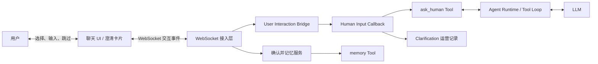
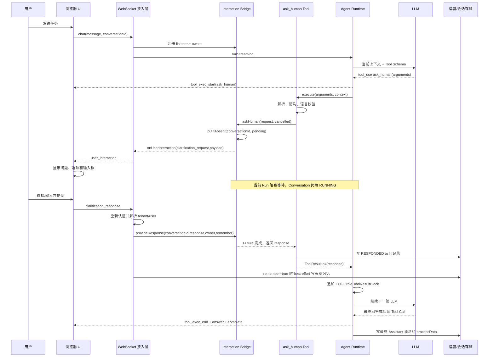
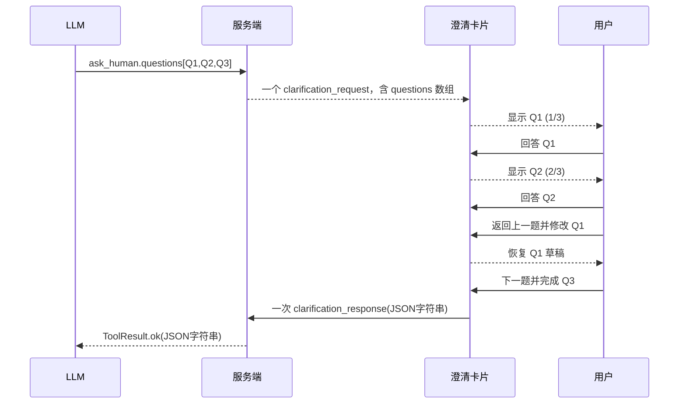
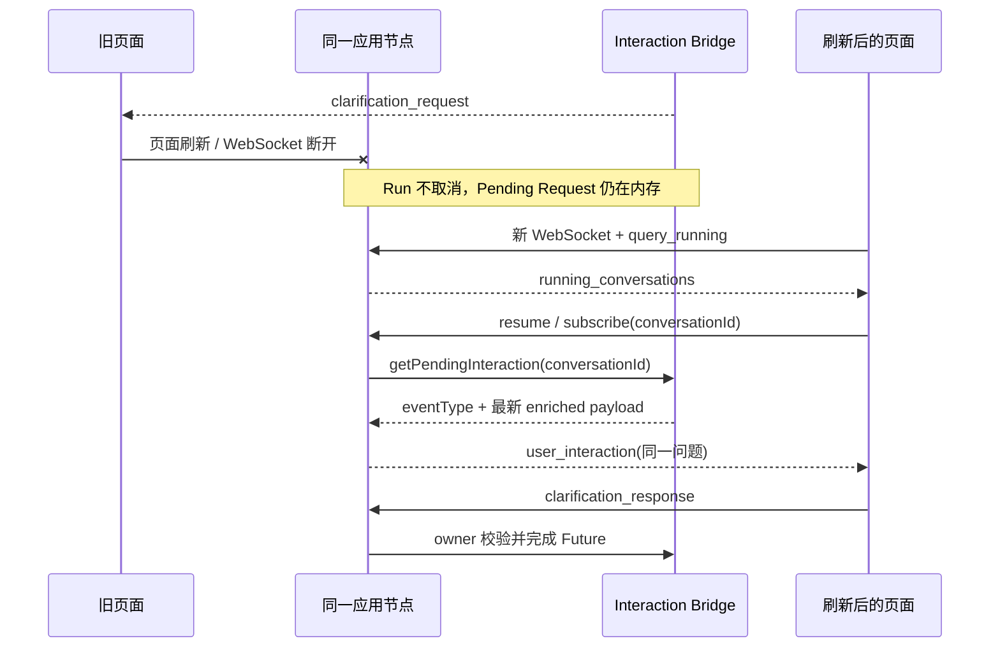
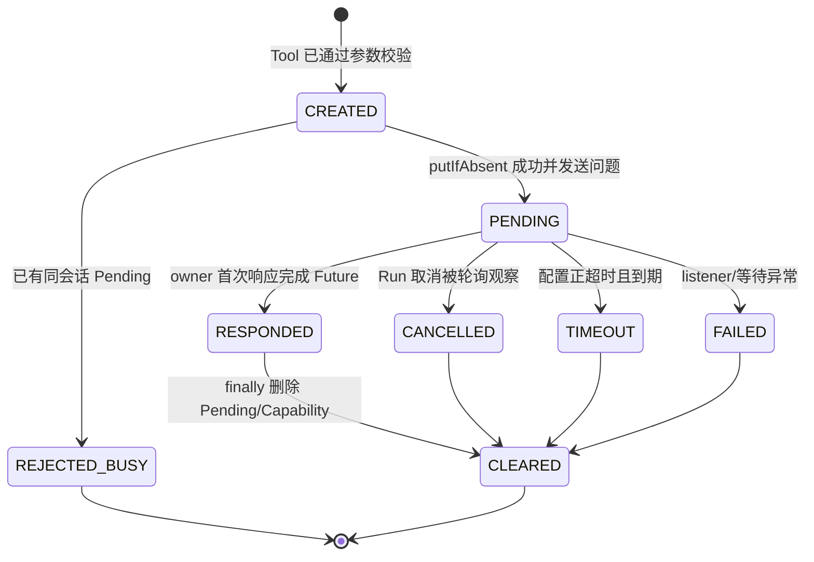
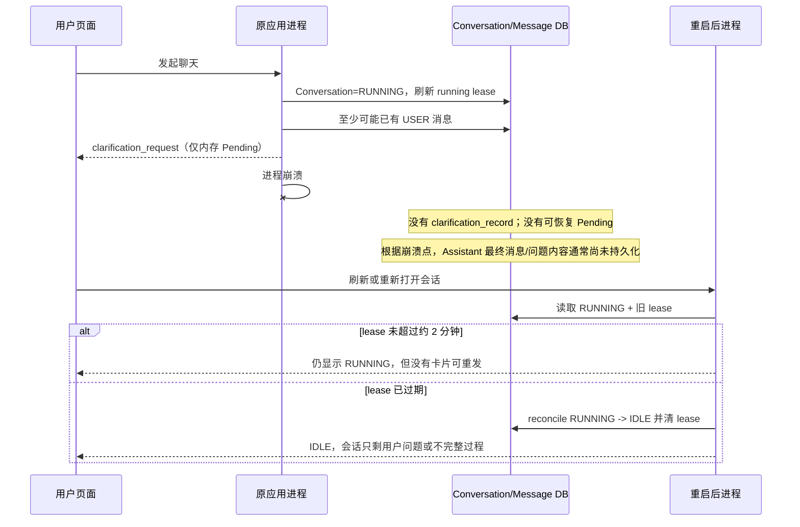
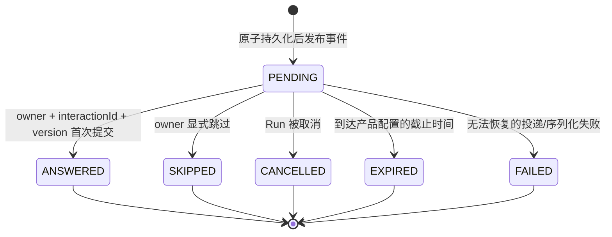
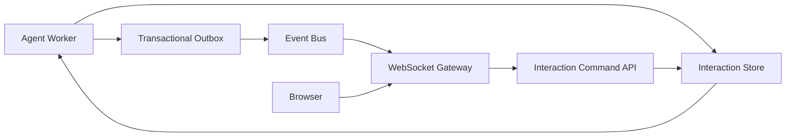

# Ask Human、确认、补充信息和人工介入复刻说明

## 1\. 结论与边界

本能力允许 Agent 在执行过程中暂停，向当前会话的所有者提出一个或多个结构化问题，等待用户选择、自由输入、跳过或确认，然后把用户答案作为一次工具结果送回同一轮 LLM/Tool Loop，使 Agent 在原运行中继续完成任务。它适用于三类场景：阻塞执行的关键歧义、需要人做出的关键决策，以及不可逆操作之前的显式确认。

目标用户是浏览器聊天用户；直接调用方是 Agent Runtime 中的 `ask_human` 工具。输入是 LLM 产生的结构化问题，输出包括：浏览器中的澄清卡片、用户回答、继续执行后的最终回复、可选的长期记忆，以及供租户管理员统计的反问记录。

本章包含：
- `ask_human` 的注册和可用性边界。
- 单选、多选、自由输入、多问题向导和推荐项。
- Agent 暂停、WebSocket 往返、恢复 Tool Loop 的完整链路。
- 跳过、记住选择、租户工具开关和工具组策略。
- 取消、刷新、断线重连、跨账号、重复响应和并发请求。
- 反问运营记录、记忆写入和自动化测试分层。
- 可直接在另一个 Agent 工程实施的最小版与生产级设计。

本章不展开通用工具注册平台、通用 WebSocket 重连框架、记忆检索算法和运营中心全部页面；但会给出实现本能力所需的交互契约。

### 1.1 当前结论

| 结论 | 等级 | 含义 |
|------|------|------|
| `ask&#95;human` 是 Runtime 内建 Tool；只有宿主提供 Human Input Callback 时才注册 | `I` | CLI、批处理或 headless 场景可以完全不暴露该工具 |
| Nova 产品应用提供 callback，并把工具默认列入 `core-tools`；最终是否可用仍受工具启用状态和 Agent 有效工具组共同约束 | `I` | “注册表中存在”不等于“当前 Agent 能调用” |
| 一次调用可包含 1～4 个独立问题，UI 逐题展示，最后只向后端提交一次响应 | `I` | 不是服务端同时挂起 4 个请求 |
| 支持 `text`、`single&#95;select`、`multi&#95;select`，推荐项仅展示，不自动选择 | `I` | 用户必须显式操作 |
| Agent 运行线程在 callback 中等待；当前 Nova 配置为无自动超时，取消状态每 200ms 轮询一次 | `I` | 用户不回答且不取消时，运行可无限等待 |
| 等待态、问题载荷和完成 Future 只存在应用进程内存中，按 `conversationId` 索引 | `I` | 进程重启或无粘性跨节点重连会丢失待回答交互 |
| WebSocket 断开不会取消等待；同一节点重连后 `resume`/`subscribe` 会重发待回答卡片 | `I` | 页面刷新可恢复的前提是 Run 仍在同一 JVM |
| 首次问题经运行订阅广播，携带递增 `seq`；`resume`/`subscribe` 重发走兼容发送路径，不携带 `seq` | `I` | 客户端只去重有序号帧，因此无序号 replay 每次都会被接纳且不推进水位 |
| 只有创建 Run 的 tenant/user 身份可以答题；同租户其他用户和其他租户都被拒绝 | `I` | 会话可读权限不能自动获得驱动 Agent 继续执行的权限 |
| 当前响应协议仅以 `conversationId` 关联，没有 `interactionId`、响应 ACK 或服务端选项校验 | `I` | 存在重复提交、卡片过早消失、旧响应串题和恶意任意回答的风险 |
| 单次 pending 交互期间，第二个同会话交互被标记 `BUSY`，Agent 收到“通道不可用”的普通成功 ToolResult 文本 | `I` | 当前实现没有队列化第二个交互 |
| 反问在回答、取消或超时后落库；请求刚展示时不落库，发送失败也不记为反问 | `I` | 进程崩溃留下的未回答问题无法从运营表识别 |
| 多问题的 `options` 以问题对象数组写库，但当前管理查询只按字符串数组反序列化，因此多问题选项在运营响应中会降级为空列表 | `I` | 写入与读取契约不对称，是复刻时必须修复的数据缺口 |
| 用户可勾选“记住此选择”；服务端重新校验 owner 和记忆可用性后，调用 memory Tool 写 `work&#95;context` | `I` | 客户端 `remember=true` 只是意图，不能单独授权写记忆 |
| UI E2E 已定义启用工具→出现卡片→选择→继续，以及关闭工具→不出现卡片的自动化契约 | `A` | 本次没有运行，不能声称目标环境通过 |
| `nova&#95;auto&#95;test` 目前没有专用 clarification response 黑盒 case；其普通 follow-up case 不能替代人工交互协议测试 | `I` \+ `A` | 三通道覆盖仍有缺口 |
| 生产复刻应将等待态持久化，并使用 `runId + interactionId + version` 做关联、幂等 ACK 和跨节点恢复 | `D` | 推荐设计，不代表 Nova 当前实现 |

本次只做三个仓库的静态取证，没有启动服务或执行测试，因此没有 `R` 结论。

## 2\. 术语与参与方

| 术语 | 定义 |
|------|------|
| Clarification | Agent 为继续当前任务而提出的澄清或确认问题 |
| Interaction | 一次从问题发出到答案被接受的人工交互；当前实现以 Conversation 作为唯一关联键 |
| Question | Interaction 内的一个独立决策，最多 4 个 |
| Option | 可立即提交的完整答案；不能是“其他，请再提供日期”这种二次输入指令 |
| Recommendation | Agent 建议的默认方向，只做标记，不预选、不自动提交 |
| Pending Request | 服务端正在等待用户回答的内存对象，包括 Future、问题载荷和 owner |
| Owner | 发起本次 Run 的 `(tenantId, userId)`，只有它能完成 Pending Request |
| Remember Capability | 服务端在问题发出时签发的内存态能力票据，用于授权“记住此选择” |
| Template Pre-gate | 产品层在 Agent Runtime 前发起的模板知识选择；复用澄清 UI，但不是 `ask&#95;human` Tool |
| ToolResult | 用户回答或回退文本封装出的工具结果，作为 TOOL role 消息送给下一轮 LLM |



## 3\. 业务规则

### 3.1 何时允许反问
1. 只在以下情况使用： 
    - 一个关键决策缺失，无法安全继续。
    - 用户需求确实存在会改变结果的歧义。
    - 后续动作不可逆，需要显式确认。
2. 一般知识问题、可通过现有工具查询的问题、可以采用安全默认值的问题，不应反问。
3. 两个以上互相独立的决策必须拆为多问题数组，不能把时间范围、维度口径和输出形式混在一个问题或选项组中。
4. 问题和全部用户可见字段使用当前 UI 语言。Runtime 对中文/英文问题句做静态语言门禁；不匹配时拒绝 Tool Call，并要求模型改写后再次调用。
5. Headless 评测必须移除 `ask_human`，避免批量任务永久等待。Nova 的单题评测运行显式排除该工具。

### 3.2 问题类型和默认值

| 类型 | 语义 | Options | Free Text |
|------|------|-------|---------|
| `text` | 本质上必须自由填写的答案 | 强制清空 | 强制允许 |
| `single&#95;select` | 只能或优先选择一个答案 | 通常 2～3 个 | 默认允许，可显式关闭 |
| `multi&#95;select` | 可以选择一个或多个答案 | 通常 2～3 个 | 默认允许，可显式关闭 |

默认规则：
- 未提供 `question_type` 且有选项：`single_select`。
- 未提供 `question_type` 且无选项：`text`。
- 未知类型：按是否有选项回退。
- Select 类型无有效选项，或只剩一个选项且不允许自由输入：降级为 `text`。
- `allow_free_text` 默认 `true`；字符串 `false`、`0`、`no` 也识别为 false。
- 多个推荐标记只保留第一个；推荐项不会自动选中。
- 选项按大小写无关去重，空值被移除。
- 包含占位符、`XXXX年`、`<value>`、`{value}` 或“请提供/please specify”等二次输入指令的选项被移除。
- Runtime 的 Tool 描述把 multi-select 表述为“零个或多个”，但当前 UI 的提交按钮要求至少选择一项或输入非空自由文本；零选择只能点击独立的“跳过”。多选答案按选项显示顺序排序，与自由文本一起用中文顿号 `、` 拼成一个字符串。

### 3.3 多问题规则
1. 一次 Tool Call 最多处理前 4 个问题；多余项被截断。
2. 每个问题必须有稳定 `id`；缺失或非法字符会被归一为 `question_n` 或下划线形式。
3. UI 逐题展示进度，例如 `1/2`；选择下一题前不向服务端提交。
4. 用户可以返回上一题；本地保存上一题的选择和自由文本草稿。
5. 最后一题提交后，客户端将全部答案封装为一个 JSON 字符串。
6. 每题都可以跳过。多题中的跳过项用 `answer:null, skipped:true` 表示；单题跳过发送本地化“跳过”文本。

### 3.4 权限和能力边界
1. Tool 注册、启用和进入 Agent 有效工具组是三个不同条件，必须同时满足。
2. 租户关闭 `ask_human` 后，新 Run 不应获得该工具；正在等待的旧 Run 不应因配置变化被篡改。
3. Pending Request 在创建时绑定 Run owner。完成回答必须同时匹配 tenantId 和 userId。
4. 同租户管理员即使能查看对话，也不能替会话所有者回答。
5. 当前授权绑定用户身份而不是浏览器 Session；同一账号的另一个有效 Session 可以回答。
6. `remember=true` 不能绕过 owner、记忆可用性、内容安全和 memory Tool 自身校验。

### 3.5 暂停、取消和等待
1. 问题发出后，Conversation 仍保持 `RUNNING`，但 UI 将其显示为 `awaiting_input`。
2. 当前产品 callback 将 timeout 配成 0，表示无限等待；Bridge 每 200ms 检查一次取消信号。
3. WebSocket 关闭不取消 Run；显式 `cancel` 才设置协作式取消信号。
4. 取消等待后，Bridge 删除 Pending Request；Runtime 检测到取消后，`ask_human` 返回错误结果并使 Run 走取消终态。
5. 同会话同一时间只能存在一个 Pending Request。第二次交互不覆盖第一题，也不排队。
6. 当前 Runtime 对同一 LLM 轮的多个 Tool Call 并行执行。因此若模型把 `ask_human` 与另一个有副作用 Tool 放在同一轮，另一个 Tool 可能在用户确认前执行。这是当前安全缺口，生产复刻必须禁止。

## 4\. 完整执行链路

### 4.1 正常 Ask Human 流程



关键步骤：
1. Run 开始时，WebSocket 接入层为实际 `conversationId` 注册 Stream Listener，并绑定发起 Session 的 tenant/user。
2. LLM 调用 `ask_human`。Tool 先检查取消，再解析参数、清理选项和校验 UI 语言。
3. Callback 把请求序列化成浏览器载荷，Bridge 用原子 `putIfAbsent` 建立 Pending Request。
4. Listener 发送 `user_interaction`；同时“记住选择”服务剥离内部标记，按 owner 判断 memory 是否可用，并增加 `canRemember`。
5. Agent Tool 执行线程等待 Future。工具的 `tool_exec_start` 已经出现，但 `tool_exec_end` 只有回答或取消后才出现。
6. 用户提交后，WebSocket 每条消息重新认证；Bridge 只接受 owner 回答，并在解除等待之前保存 `remember` 标记。
7. Callback 写反问统计，并把原始响应字符串返回 Tool。
8. Runtime 把 ToolResult 作为 TOOL role 内容追加到同一轮上下文，再调用 LLM。它不是一个新的用户聊天回合。
9. 若用户要求记忆，记忆写入是 best-effort，失败不阻断 Agent 恢复。

### 4.2 多问题向导



当前多问题答案不是服务端结构化 DTO，而是字符串：
```json
{
  "answers": [
    {
      "questionId": "time_range",
      "question": "使用哪个时间范围？",
      "answer": "整个 FY2026 财年",
      "skipped": false
    },
    {
      "questionId": "city_scope",
      "question": "使用哪个城市口径？",
      "answer": null,
      "skipped": true
    }
  ]
}

```

该 JSON 又被放入 WebSocket 的 `response` 字符串字段。服务端不解析、不验证 questionId 和选项，直接交给 LLM。

### 4.3 刷新和断线重连



当前恢复成立需要同时满足：
- 原应用进程没有重启。
- 重连控制消息到达持有 Run 的同一节点，或负载均衡具有粘性。
- Pending Request 尚未因取消、回答或失败被清除。
- 当前登录 tenant/user 与 Run owner 相同。

前端在 hydrate 运行快照时特意保留已经收到的 `clarificationRequest`，避免快照不含等待态而把卡片覆盖掉；服务端重发则覆盖/补齐刷新后丢失的前端状态。

首次 `clarification_request` 经运行的 subscriber fan-out 发送，因此带本 Run 的递增 `seq`。`resume` 和 `subscribe` 都会调用 pending replay，但 replay 使用不带运行序号的兼容帧：
```json
{
  "type": "user_interaction",
  "content": "clarification_request|{...}",
  "conversationId": "conv-123"
}

```

浏览器只在 `seq` 是数字时执行 `shouldAcceptEvent` 和 `recordSeq`。所以 replay 不会因旧水位被丢弃，也不会推进水位；连续发送 `resume`、`subscribe` 或重复控制消息时，同一 Pending 可以被接纳多次。当前 store 会用后到请求覆盖同会话的 `clarificationRequest`，但协议层没有 interaction identity，不能证明它与已有卡片是同一个请求。复刻兼容测试至少要断言：
- 有 `seq` 的首次事件按水位去重。
- 无 `seq` replay 即使已有更高水位也会被接纳。
- 重复 replay 不应清空用户正在填写的草稿；当前以请求 JSON 作为 React key，载荷变化会重置本地表单，是潜在风险。
- 生产协议的 replay 必须保留同一个 `interactionId`，客户端按该 ID merge，不能靠省略 `seq` 绕过去重。

### 4.4 取消与回答竞态



竞态语义：
- 回答先完成：首个 owner 响应成功。在 Future 已完成但 callback 的 finally 尚未删除 Pending 的短窗口内，同一 owner 第二次提交会得到 `false`，handler 随后因 `hasPendingRequest=true` 将它误判成越权并返回 `Not authorized`；Pending 删除后再提交才静默失败。
- 取消先被 Tool 观察：Tool 返回取消错误，Run 收束为 cancelled；晚到回答不会继续执行。
- 回答与取消几乎同时发生：即使 callback 已返回答案，Tool 会再次检查取消；取消已置位时丢弃该答案并返回错误。
- 当前客户端发送回答后立即隐藏卡片，不等待服务端 ACK。若网络写失败、服务端拒绝，或命中上述双提交窗口，用户可能看不到问题但 Agent 仍在等待，或看到错误的越权提示。

### 4.5 Template Pre-gate

产品层还有一个非 Tool 的人工选择入口：短问题命中知识库模板且用户没有明确要求模板报告时，在进入 Agent Runtime 前询问“按知识库模板生成分析”还是“仅返回简单指标”。它复用：
- `clarification_request` 事件类型。
- 单选卡片和 `clarification_response`。
- 同一个 conversation-scoped Pending Request。

但它与 `ask_human` 有关键差异：
- 不携带内部 `rememberable` 标记，因此 UI 不显示“记住此选择”。
- 不走 Human Input Callback 的反问统计记录。
- 回答被转换为一段服务端可信的系统性上下文后再启动 Agent，而不是 ToolResult。
- 触发逻辑属于产品启发式规则，不应写进通用 Runtime。

复刻时应保留统一 Interaction 协议，但用 `origin=TOOL|PRE_GATE|PLAN_REVIEW` 明确区分来源，避免统计、记忆和审计语义混淆。

### 4.6 进程重启后的 Ghost 链路

当前 Pending、问题 payload、listener、Future 和 Remember Capability 都在 JVM 内存。应用在等待回答时崩溃或重启，会形成以下链路：



默认 stale threshold 是 `PT2M`；会话列表读取路径在本节点没有 live task 且 lease 不再新鲜时立即 reconcile 为 `IDLE`。后台清理任务也按 60 秒间隔清过期 lease，所以纯后台收敛时间可能比阈值多一个调度周期。

这会产生“ghost interaction”：用户提交过一个问题，曾看到人工确认卡片，但重启后卡片、Pending 和反问记录都不存在；数据库 Conversation 先短暂保持 RUNNING，随后变成 IDLE，而该回合没有对应完整回答。`clarification_record` 只在 callback 从等待中返回后写，因此无法用运营表识别这类丢失。Assistant/tool-use/processData 是否留下部分行取决于崩溃检查点，不能把任何一种残留形态当成保证。

复刻必须选择并验收一种明确策略：
- 可恢复策略：事务保存 Interaction 和 Run continuation，重启后重发卡片并继续原 Tool Call。
- 可解释失败策略：启动恢复任务把失主 Run 标为 `ERROR`，持久化一条用户可见错误 Assistant 消息，并允许从该问题重试。

仅把 stale Conversation 改回 IDLE 不算恢复，因为它隐藏了未完成回合的事实。

## 5\. 对外契约

### 5.1 Tool 定义

工具名：`ask_human`；类别：`Human Interaction`。

推荐的新实现可用以下 JSON Schema。为兼容旧模型，保留单问题字段；`questions` 优先：
```json
{
  "type": "object",
  "properties": {
    "question": { "type": "string" },
    "options": {
      "type": "array",
      "items": { "type": "string" }
    },
    "question_type": {
      "type": "string",
      "enum": ["text", "single_select", "multi_select"]
    },
    "allow_free_text": { "type": "boolean" },
    "recommended_option": { "type": "string" },
    "questions": {
      "type": "array",
      "minItems": 1,
      "maxItems": 4,
      "items": {
        "type": "object",
        "required": ["id", "header", "question", "question_type"],
        "properties": {
          "id": { "type": "string" },
          "header": { "type": "string" },
          "question": { "type": "string" },
          "question_type": {
            "type": "string",
            "enum": ["text", "single_select", "multi_select"]
          },
          "allow_free_text": { "type": "boolean" },
          "options": {
            "type": "array",
            "minItems": 2,
            "maxItems": 3,
            "items": {
              "type": "object",
              "required": ["label", "description"],
              "properties": {
                "label": { "type": "string" },
                "description": { "type": "string" },
                "recommended": { "type": "boolean" }
              }
            }
          }
        }
      }
    }
  }
}

```

当前 Schema 顶层没有 JSON Schema `required`，因此执行器必须自己检查 `question` 或至少一个有效 `questions[]`。

完整 Tool Call 示例：
```json
{
  "questions": [
    {
      "id": "time_range",
      "header": "时间范围",
      "question": "本次分析使用哪个时间范围？",
      "question_type": "single_select",
      "allow_free_text": true,
      "options": [
        {
          "label": "整个 FY2026 财年",
          "description": "覆盖完整财年，适合年度复盘。",
          "recommended": true
        },
        {
          "label": "最近 90 天",
          "description": "聚焦近期变化。",
          "recommended": false
        }
      ]
    },
    {
      "id": "city_scope",
      "header": "城市口径",
      "question": "城市维度使用哪个口径？",
      "question_type": "single_select",
      "allow_free_text": false,
      "options": [
        {
          "label": "门店城市 + 发货城市",
          "description": "使用组合口径。",
          "recommended": true
        },
        {
          "label": "仅门店城市",
          "description": "只统计门店所在地。",
          "recommended": false
        }
      ]
    }
  ]
}

```

Tool Result：
```json
{
  "success": true,
  "output": "{\"answers\":[{\"questionId\":\"time_range\",\"question\":\"本次分析使用哪个时间范围？\",\"answer\":\"整个 FY2026 财年\",\"skipped\":false},{\"questionId\":\"city_scope\",\"question\":\"城市维度使用哪个口径？\",\"answer\":\"仅门店城市\",\"skipped\":false}]}"
}

```

主要错误输出：

| 条件 | ToolResult |
|------|----------|
| 执行前已取消 | `Error: cancelled before asking human` |
| 缺少有效问题 | `Error: Missing required argument 'question' or 'questions'` |
| UI 语言不匹配 | `Error: ask&#95;human rejected: ... Rewrite ... then call ask&#95;human again` |
| 等待期间取消 | `Error: cancelled while waiting for human input` |
| Callback 抛异常 | `Error: human input callback failed: &lt;Class&gt;: &lt;message&gt;` |

### 5.2 当前服务端→浏览器 WebSocket

外层帧：
```json
{
  "type": "user_interaction",
  "content": "clarification_request|{...payload json...}",
  "conversationId": "conv-123",
  "seq": 42
}

```

`content` 是 `interactionType + "|" + JSON`，客户端必须只按第一个竖线切分。`seq` 是可选字段：首次 live 广播有 `seq`，`resume`/`subscribe` 的 pending replay 没有。兼容客户端必须接纳无序号 replay，但只能把它当成同一 pending 状态的重放，不能当成新的 Interaction；生产 v2 应让 live 与 replay 都携带稳定 `interactionId` 和事件序号。

载荷：
```json
{
  "question": "本次分析使用哪个时间范围？",
  "options": ["整个 FY2026 财年", "最近 90 天"],
  "allowFreeText": true,
  "multiSelect": false,
  "questionType": "single_select",
  "questions": [
    {
      "id": "time_range",
      "header": "时间范围",
      "question": "本次分析使用哪个时间范围？",
      "options": [
        {
          "label": "整个 FY2026 财年",
          "description": "覆盖完整财年，适合年度复盘。",
          "recommended": true
        },
        {
          "label": "最近 90 天",
          "description": "聚焦近期变化。",
          "recommended": false
        }
      ],
      "allowFreeText": true,
      "multiSelect": false,
      "questionType": "single_select"
    }
  ],
  "canRemember": true
}

```

顶层字段是第一个问题的兼容投影。内部 `rememberable` 标记必须在发送给客户端前删除。

### 5.3 当前浏览器→服务端 WebSocket
```json
{
  "type": "clarification_response",
  "conversationId": "conv-123",
  "response": "最近 90 天",
  "remember": true
}

```

当前字段规则：

| 字段 | 类型 | 必填 | 当前校验 |
|------|------|------|------------|
| `type` | string | 是 | 必须为 `clarification&#95;response` 才进入回答分支 |
| `conversationId` | string | 是 | 作为 Pending Map 键；缺失可能进入通用异常回退 |
| `response` | string | 是 | 不校验非空、长度、选项成员或 JSON 结构 |
| `remember` | boolean | 否 | 默认 false；只作为用户意图 |

接受成功没有专用 ACK。非 owner 且确有 Pending 时返回：
```json
{
  "type": "error",
  "content": "Not authorized to respond to this conversation"
}

```

没有 Pending 时静默返回。已经答过但 Pending 尚未来得及从 Map 删除时，Bridge 返回 false，而 handler 只看到“Map 里仍有 Pending”，会把同 owner 的重复提交错误地返回成上述 `Not authorized`；Map 删除后才静默。这不是权限事实，而是当前返回值没有区分 `FORBIDDEN`、`ALREADY_ANSWERED` 和 `NOT_FOUND` 所致。

### 5.4 工具开关契约

产品管理接口以 `/api/settings/tools/**` 管理内建工具开关和作用域，浏览器页为 `/web/settings/tools`。对本能力必须满足：
1. 列表能显示 `ask_human` 的有效 enabled 状态。
2. 更新开关后刷新仍保持。
3. enabled 只是一道 gate；还要检查 main Agent 有效工具组是否包含直接条目或包含它的组。
4. 远程环境修改租户开关属于共享状态变更，自动化必须显式获得环境授权并在 finally 恢复初始状态。

### 5.5 管理员反问统计 REST
```http
GET /api/admin/asset-stats/clarifications
  ?startTime=2026-08-01T00:00:00
  &endTime=2026-08-31T23:59:59
  &keyword=销售额
  &userId=user-1
  &page=0
  &size=20

```

要求租户管理员权限，tenantId 从认证上下文取得，不能由 Query 传入。

响应示例：
```json
{
  "content": [
    {
      "id": 101,
      "question": "销售额使用哪个口径？",
      "options": ["净销售额", "含退款销售额"],
      "answer": "净销售额",
      "status": "RESPONDED",
      "userId": "user-1",
      "userName": "Alice",
      "conversationId": "conv-123",
      "remembered": true,
      "questionContent": "比较本月销售表现",
      "questionTurnIndex": 2,
      "createdAt": "2026-08-13T10:15:20"
    }
  ],
  "totalElements": 1,
  "summary": {
    "totalCount": 1,
    "conversationCount": 1,
    "respondedCount": 1,
    "respondedRate": 1.0
  }
}

```

## 6\. 数据模型与生命周期

### 6.1 当前 Pending Interaction

当前等待态没有数据库表，等价内存结构如下：
```text
PendingByConversation: ConcurrentMap<ConversationId, PendingRequest>

PendingRequest {
  responseFuture: CompletableFuture<String>
  interaction: {
    eventType: String
    payload: String
  }
  owner: {
    tenantId: String
    userId: String
  }
}

```

生命周期：
- Run 启动：注册 `conversationId → listener + owner`。
- 问题发出：原子创建 `conversationId → PendingRequest`。
- remember enrichment：原地替换 Pending 中 payload，但保留 Future 和 owner。
- 回答、取消、超时或失败：finally 物理删除 Pending 和 Remember Capability。
- Run 结束：条件移除 listener，防止旧 Run 清掉新 Run 的 listener。
- 进程退出：全部丢失，无恢复机制。

### 6.2 反问运营记录

可复刻 DDL：
```sql
CREATE TABLE clarification_record (
    id BIGINT GENERATED BY DEFAULT AS IDENTITY PRIMARY KEY,
    tenant_id VARCHAR(64),
    user_id VARCHAR(64) NOT NULL,
    conversation_id VARCHAR(64),
    message_id VARCHAR(64),
    question TEXT NOT NULL,
    options TEXT,
    answer TEXT,
    status VARCHAR(16) NOT NULL,
    remembered BOOLEAN,
    created_at TIMESTAMP WITH TIME ZONE NOT NULL DEFAULT CURRENT_TIMESTAMP
);

CREATE INDEX idx_clar_tenant_time
    ON clarification_record (tenant_id, created_at);
CREATE INDEX idx_clar_conversation
    ON clarification_record (conversation_id);

```

字段语义：

| 字段 | 语义 |
|------|------|
| `tenant&#95;id/user&#95;id` | 从 Conversation owner 反查，不能信任客户端 |
| `conversation&#95;id` | 反问所属会话 |
| `message&#95;id` | 当前实现 DDL 保留但写入路径未填充 |
| `question` | 单题原文；多题按 `header: question` 换行拼接 |
| `options` | 单题为 label JSON 数组；多题为每题结构 JSON；纯文本为 NULL。当前管理查询只接受 `List&lt;String&gt;`，所以多题结构会解析失败并返回空列表 |
| `answer` | 只有 RESPONDED 有值；多题时是 JSON 字符串 |
| `status` | `RESPONDED`、`TIMEOUT`、`CANCELLED` |
| `remembered` | 用户回答时的勾选；未回答为 NULL |
| `created&#95;at` | 回答/取消/超时完成时刻，不是问题展示时刻 |

当前写入是 fail-soft：Conversation 不存在、owner 无法解析或数据库错误时只记日志，不影响 Agent。

### 6.3 长期记忆内容

当用户勾选且服务端全部校验通过时，服务端直接调用 memory Tool：
```json
{
  "action": "add",
  "kind": "work_context",
  "content": "用户澄清确认 — 问：销售额使用哪个口径？；答：净销售额"
}

```

身份使用交互 owner，conversationId 作为 Tool Context；来源按直接用户动作处理。memory Tool 的敏感信息、标记语言、威胁内容和去重规则继续生效。

## 7\. 核心实现设计

### 7.1 最小兼容版

最小版可保持 Nova 当前语义，模块划分如下：
```text
HumanInteractionTool
  - schema()
  - validateAndNormalize(args, locale)
  - execute(args, toolContext)

InteractionBroker
  - registerConversation(conversationId, owner, emitter)
  - ask(conversationId, request, cancelled): String
  - answer(conversationId, owner, answer): boolean
  - pending(conversationId): Optional<Pending>

ChatWebSocketEndpoint
  - emit user_interaction
  - receive clarification_response
  - resume/subscribe 时重发 pending

ClarificationCard
  - 单选/多选/文本
  - 多问题草稿
  - 最终一次提交

```

核心伪代码：
```java
ToolResult execute(Map args, ToolContext ctx) {
  if (ctx.cancelled()) return error("cancelled before asking human");
  Request req = normalize(args, ctx.locale(), ctx.conversationId());
  if (!languageMatches(req, ctx.locale())) return error("rewrite in UI language");
  try {
    String answer = broker.ask(req, ctx::cancelled);
    if (ctx.cancelled()) return error("cancelled while waiting for human input");
    return ok(answer == null ? "" : answer);
  } catch (RuntimeException e) {
    return error("human input callback failed: " + safeMessage(e));
  }
}

```
```java
AnswerResult answer(String conversationId, Owner caller, String value) {
  Pending p = pending.get(conversationId);
  if (p == null) return NOT_FOUND;
  if (!p.owner.equals(caller)) return FORBIDDEN;
  synchronized (p) {
    if (p.future.isDone()) return ALREADY_ANSWERED;
    return p.future.complete(value) ? ACCEPTED : ALREADY_ANSWERED;
  }
}

```

接入层必须按枚举映射，而不是像当前实现一样用 `boolean + hasPending` 猜原因：
```text
ACCEPTED         -> human_interaction.ack(state=ANSWERED)
ALREADY_ANSWERED -> 返回同一 ACK，或 409 + 当前终态
FORBIDDEN        -> 403 / 安全审计
NOT_FOUND        -> 404；若已过期且保留墓碑则 410

```

最小版的限制必须公开：单节点、进程内等待、无 ACK、无请求 ID、进程重启丢失。

### 7.2 生产级推荐版

推荐增加以下领域对象：
```text
HumanInteraction {
  interactionId: UUID
  runId: UUID
  conversationId: String
  tenantId: String
  userId: String
  origin: TOOL | PRE_GATE | PLAN_REVIEW
  questions: JSON
  state: PENDING | ANSWERED | SKIPPED | CANCELLED | EXPIRED | FAILED
  version: Long
  answer: JSON nullable
  rememberRequested: Boolean
  expiresAt: Instant nullable
  createdAt: Instant
  answeredAt: Instant nullable
}

```

生产状态机：



推荐协议：
```json
{
  "type": "human_interaction.requested",
  "runId": "run-42",
  "interactionId": "hi-99",
  "conversationId": "conv-123",
  "version": 1,
  "origin": "TOOL",

  "questions": [],

  "canRemember": true,
  "expiresAt": null
}

```
```json
{
  "type": "human_interaction.answer",
  "runId": "run-42",
  "interactionId": "hi-99",
  "conversationId": "conv-123",
  "expectedVersion": 1,

  "answers": [],

  "remember": true,
  "idempotencyKey": "device-7:submit-1"
}

```
```json
{
  "type": "human_interaction.ack",
  "interactionId": "hi-99",
  "state": "ANSWERED",
  "version": 2
}

```

关键生产化规则：
1. 先持久化 PENDING，再发布事件，避免“用户看到了但服务端没有状态”。
2. 用数据库条件更新 `WHERE state='PENDING' AND version=?` 保证首答胜出。
3. 客户端收到 ACK 后才隐藏卡片；发送失败可安全重试同一个 idempotencyKey。
4. 重连通过 `GET /runs/{runId}/pending-interactions` 或可重放事件流恢复，不依赖 owner JVM。
5. Tool Runtime 把交互视为可挂起 continuation，而不是占用一个线程无限阻塞。
6. Interaction 是 Run 的子状态；取消 Run 必须原子地把所有 PENDING 改为 CANCELLED。
7. 同一 Run 默认只允许一个 PENDING Interaction。若支持队列，必须显式定义序号，不得用 Conversation Map 隐式覆盖。
8. 只允许 `ask_human` 独占一个 Tool Round；若同轮还有 Tool Call，先返回策略错误让模型重排，绝不并行执行有副作用工具。
9. 服务端验证 Answer：问题 ID 完整且唯一、Select 答案属于选项、MultiSelect 去重、文本长度限制、跳过符合策略。
10. 对不可逆操作，确认内容必须绑定操作摘要和操作哈希；回答“确认”只能授权该哈希对应的动作，防止 TOCTOU。

### 7.3 可执行 PostgreSQL 持久化设计

以下 DDL 是生产级最小闭环，应用负责生成 UUID；上下文快照必须在应用层使用 KMS envelope encryption 后写入 `BYTEA`。
```sql
CREATE TABLE human_interaction (
    interaction_id UUID PRIMARY KEY,
    tenant_id VARCHAR(64) NOT NULL,
    user_id VARCHAR(64) NOT NULL,
    conversation_id VARCHAR(64) NOT NULL,
    run_id UUID NOT NULL,
    tool_call_id VARCHAR(128) NOT NULL,
    origin VARCHAR(32) NOT NULL
        CHECK (origin IN ('TOOL', 'PRE_GATE', 'PLAN_REVIEW')),
    provider_name VARCHAR(128) NOT NULL,
    model_name VARCHAR(255) NOT NULL,
    context_version BIGINT NOT NULL CHECK (context_version >= 0),
    question_payload JSONB NOT NULL,
    state VARCHAR(24) NOT NULL
        CHECK (state IN ('PENDING', 'ANSWERED', 'SKIPPED', 'CANCELLED', 'EXPIRED', 'FAILED')),
    version BIGINT NOT NULL DEFAULT 1 CHECK (version > 0),
    answer_payload JSONB,
    remember_requested BOOLEAN NOT NULL DEFAULT FALSE,
    answer_idempotency_key VARCHAR(160),
    expires_at TIMESTAMPTZ,
    answered_at TIMESTAMPTZ,
    created_at TIMESTAMPTZ NOT NULL DEFAULT CURRENT_TIMESTAMP,
    updated_at TIMESTAMPTZ NOT NULL DEFAULT CURRENT_TIMESTAMP,
    UNIQUE (run_id, tool_call_id)
);

-- 一个 Run 同一时刻最多一个待回答 Interaction；历史终态不受影响。
CREATE UNIQUE INDEX ux_human_interaction_one_pending_per_run
    ON human_interaction (run_id)
    WHERE state = 'PENDING';

-- 同一用户提交 key 不得被复用于另一个 Interaction。
CREATE UNIQUE INDEX ux_human_interaction_answer_idempotency
    ON human_interaction (tenant_id, user_id, answer_idempotency_key)
    WHERE answer_idempotency_key IS NOT NULL;

CREATE INDEX idx_human_interaction_owner_pending
    ON human_interaction (tenant_id, user_id, state, created_at DESC);
CREATE INDEX idx_human_interaction_conversation
    ON human_interaction (tenant_id, conversation_id, created_at DESC);
CREATE INDEX idx_human_interaction_expiry
    ON human_interaction (expires_at)
    WHERE state = 'PENDING' AND expires_at IS NOT NULL;

CREATE TABLE agent_run_continuation (
    run_id UUID PRIMARY KEY,
    interaction_id UUID NOT NULL UNIQUE
        REFERENCES human_interaction(interaction_id),
    tenant_id VARCHAR(64) NOT NULL,
    user_id VARCHAR(64) NOT NULL,
    conversation_id VARCHAR(64) NOT NULL,
    tool_call_id VARCHAR(128) NOT NULL,
    provider_name VARCHAR(128) NOT NULL,
    model_name VARCHAR(255) NOT NULL,
    context_version BIGINT NOT NULL CHECK (context_version >= 0),
    context_snapshot_ciphertext BYTEA NOT NULL,
    context_codec VARCHAR(64) NOT NULL,
    context_sha256 CHAR(64) NOT NULL,
    state VARCHAR(24) NOT NULL
        CHECK (state IN ('SUSPENDED', 'CLAIMED', 'RESUMED', 'CANCELLED', 'FAILED')),
    version BIGINT NOT NULL DEFAULT 1 CHECK (version > 0),
    claimed_by VARCHAR(128),
    claimed_at TIMESTAMPTZ,
    claim_expires_at TIMESTAMPTZ,
    resume_execution_id UUID,
    suspended_at TIMESTAMPTZ NOT NULL DEFAULT CURRENT_TIMESTAMP,
    resumed_at TIMESTAMPTZ,
    updated_at TIMESTAMPTZ NOT NULL DEFAULT CURRENT_TIMESTAMP,
    UNIQUE (run_id, tool_call_id),
    UNIQUE (resume_execution_id)
);

CREATE INDEX idx_run_continuation_claimable
    ON agent_run_continuation (state, claim_expires_at, suspended_at);
CREATE INDEX idx_run_continuation_owner
    ON agent_run_continuation (tenant_id, user_id, conversation_id);

-- Durable context ledger：保证一个 Tool Call 只追加一次人工回答 ToolResult。
CREATE TABLE agent_run_context_event (
    event_id UUID PRIMARY KEY,
    run_id UUID NOT NULL,
    context_version BIGINT NOT NULL CHECK (context_version > 0),
    interaction_id UUID NOT NULL REFERENCES human_interaction(interaction_id),
    tool_call_id VARCHAR(128) NOT NULL,
    event_type VARCHAR(32) NOT NULL
        CHECK (event_type IN ('HUMAN_TOOL_RESULT')),
    payload JSONB NOT NULL,
    created_at TIMESTAMPTZ NOT NULL DEFAULT CURRENT_TIMESTAMP,
    UNIQUE (run_id, context_version),
    UNIQUE (run_id, tool_call_id, event_type)
);

-- Transactional Outbox；发布器可以至少一次投递，消费者按 event_key 幂等。
CREATE TABLE interaction_outbox (
    outbox_id UUID PRIMARY KEY,
    event_key VARCHAR(255) NOT NULL UNIQUE,
    aggregate_type VARCHAR(48) NOT NULL,
    aggregate_id UUID NOT NULL,
    aggregate_version BIGINT NOT NULL CHECK (aggregate_version > 0),
    event_type VARCHAR(80) NOT NULL,
    payload JSONB NOT NULL,
    state VARCHAR(16) NOT NULL DEFAULT 'PENDING'
        CHECK (state IN ('PENDING', 'PUBLISHING', 'PUBLISHED', 'FAILED')),
    attempts INTEGER NOT NULL DEFAULT 0 CHECK (attempts >= 0),
    available_at TIMESTAMPTZ NOT NULL DEFAULT CURRENT_TIMESTAMP,
    locked_by VARCHAR(128),
    locked_at TIMESTAMPTZ,
    published_at TIMESTAMPTZ,
    created_at TIMESTAMPTZ NOT NULL DEFAULT CURRENT_TIMESTAMP
);

CREATE INDEX idx_interaction_outbox_dispatch
    ON interaction_outbox (state, available_at, created_at)
    WHERE state IN ('PENDING', 'FAILED');

```

`question_payload` 和 `answer_payload` 应按明确版本保存，例如：
```json
{
  "schemaVersion": 1,
  "blockingPolicy": "CLARIFICATION",
  "questions": [
    {
      "id": "environment",
      "type": "single_select",
      "question": "使用哪个环境？",
      "options": [
        { "id": "test", "label": "测试环境" },
        { "id": "production", "label": "生产环境" }
      ],
      "allowFreeText": false
    }
  ]
}

```

#### 7.3.1 Suspend 事务

Agent 执行到 `ask_human` 时，不阻塞线程，执行以下单事务：
```text
BEGIN
1. 验证当前 Run 仍为 RUNNING，且 toolCallId 尚无 HUMAN_TOOL_RESULT。
2. 将上下文序列化在“assistant tool_use 已存在、ToolResult 尚不存在”的边界；
   冻结 provider、model、toolCallId、contextVersion 和上下文摘要。
3. INSERT human_interaction(state=PENDING, version=1, question_payload=...).
4. INSERT agent_run_continuation(state=SUSPENDED, encrypted snapshot...).
5. 将 Run 状态改为 WAITING_HUMAN；Conversation 可继续显示 RUNNING，
   但必须有独立 awaiting-input 状态，不能只靠前端推断。
6. INSERT interaction_outbox，event_key=
   'human-interaction:<interactionId>:requested:v1'。
COMMIT

```

事务提交后当前 Worker 返回 `SUSPENDED`，不写 Assistant 终态、不调用下一轮 LLM。Outbox 发布器再发送 `human_interaction.requested`；重放始终使用相同 interactionId。

#### 7.3.2 Answer 幂等 Claim 事务
```text
BEGIN
1. SELECT human_interaction WHERE interaction_id=? FOR UPDATE。
2. 不存在 -> NOT_FOUND/410；owner 不匹配 -> FORBIDDEN/403。
3. 若 answer_idempotency_key 等于本次 key，返回数据库中的同一 ACK。
4. 若 state 已是 ANSWERED/SKIPPED，返回 ALREADY_ANSWERED 和当前 version；
   不得伪装成 FORBIDDEN。
5. 若 state 不是 PENDING 或 expectedVersion 不匹配，返回 409/410。
6. 在服务端校验 answers；执行：
   UPDATE human_interaction
      SET state=?, answer_payload=?, remember_requested=?,
          answer_idempotency_key=?, answered_at=now(),
          version=version+1, updated_at=now()
    WHERE interaction_id=? AND state='PENDING' AND version=?。
7. INSERT interaction_outbox，event_key=
   'human-interaction:<interactionId>:answered:v<newVersion>'。
COMMIT

```

响应 ACK 直接来自已提交行。两个同 owner 并发提交时，一个完成 PENDING→ANSWERED；另一个在行锁后读取 ANSWERED，返回同一终态 ACK 或明确 `ALREADY_ANSWERED`，绝不返回权限错误。

#### 7.3.3 Worker 单次 Resume 与 ToolResult

`answered` Outbox 消费者可被重复投递，但恢复步骤必须幂等：
```text
事务 A：claim + durable ToolResult
1. SELECT continuation JOIN interaction FOR UPDATE。
2. ANSWERED/SKIPPED 才可恢复；CANCELLED/EXPIRED 不产生成功 ToolResult。
3. continuation=RESUMED：直接 ACK 消费，禁止再次调用 Provider。
4. continuation=CLAIMED 且 claim 未过期：其他 Worker 退出；过期可 CAS 抢占。
5. CAS SUSPENDED/expired-CLAIMED -> CLAIMED，写 claimedBy、claimExpiresAt、
   唯一 resumeExecutionId，version+1。
6. INSERT agent_run_context_event(HUMAN_TOOL_RESULT)，
   UNIQUE(runId,toolCallId,eventType) 保证只追加一次；payload 使用 interaction 的
   服务端规范化答案并保持原 toolCallId。
7. contextVersion 原子 +1，更新 continuation 的加密快照/摘要。
8. continuation -> RESUMED；INSERT outbox：
   event_key='agent-run:<runId>:resume-requested:<contextVersion>'。
COMMIT

事务 B：继续 Agent
9. Run Worker 消费 resume-requested，按 runId/contextVersion 原子 claim Run。
10. 校验 context_sha256，使用被冻结的 provider/model 恢复上下文；
    从 durable context event 读取唯一 ToolResult，再发起下一轮 LLM。
11. 正常持久化后续 Tool/Assistant 事件和 Run 终态。

```

Worker 在事务 A 后崩溃时，Outbox 会重发；唯一 context event 和 event\_key 阻止第二个 ToolResult。事务 B 的 Run claim 也必须以 `(runId, contextVersion)` 幂等；若 Provider 不支持请求幂等键，还需在通用 LLM 调用账本中以 `resumeExecutionId` 记录请求/响应，避免崩溃恢复造成重复外部调用。

## 8\. 并发与非正常路径

| 场景 | 当前行为 | 复刻要求 |
|------|------------|------------|
| 同会话第二个交互 | `BUSY`，不覆盖第一个；Tool 获得通道不可用回退文本 | v1 保持；生产版返回结构化 `INTERACTION&#95;ALREADY&#95;PENDING` |
| 同会话第二条普通聊天 | WebSocket Run Registry 拒绝并发 Run；REST follow-up 由会话锁串行 | 等待人工输入时应返回 409/`RUN&#95;AWAITING&#95;INPUT`，不能悄悄排队无限期 |
| 同一用户双页面同时提交 | Future 首次完成胜出；Pending 未删除窗口内后者被误报 `Not authorized`，删除后才静默 | 返回同一终态 ACK 或明确 `ALREADY&#95;ANSWERED`，不能混同 FORBIDDEN |
| 其他用户提交 | 明确 WS error，Pending 保持 | 保持 fail-closed，写安全审计 |
| 空 response | 服务端当前接受；浏览器正常提交按钮会拦截 | 服务端必须再次校验，不能信任 UI |
| 非选项 response | 当前接受 | Select 类型应拒绝，除非 allowFreeText 且显式标为 custom |
| 回答发送后断网 | UI 当前先隐藏卡片，无法知道是否接受 | ACK 前保留 submitting；重连查询状态 |
| 页面刷新 | 同节点重发 Pending；replay 无 `seq`，客户端无条件接纳 | interactionId merge \+ 带序号可重放事件，跨节点从持久化 Interaction 恢复 |
| 应用重启 | Pending 丢失；Conversation 保持 RUNNING 至 lease 约 2 分钟后读路径/清理任务收敛 IDLE，且没有反问记录 | 持久化 continuation；或显式 ERROR Assistant 终态，禁止 ghost IDLE |
| 无 listener | Callback 返回“通道不可用，请按最佳判断继续”，ToolResult 仍成功 | 交互式场景应返回 typed error；只有明确策略允许时才能自动降级 |
| missing conversationId | 回退为“无法交互，请按最佳判断继续” | 产品聊天必须视为编程错误；headless 应根本不提供 Tool |
| 正 timeout | Bridge 支持；产品当前配置 0，因此不会自然发生 | 超时必须可配置，并明确是自动取消、采用推荐值还是交给 Agent 最佳判断 |
| 取消 | 每 200ms 观察，删除 Pending，Run 走 cancelled | 状态持久化，保证取消和回答原子竞态只有一个终态 |
| ask\_human 与其他 Tool 同轮 | Runtime 可能并行执行 | 必须禁止；尤其不可在确认前执行副作用 |
| LLM 重复反问相同问题 | 没有语义去重，前一次完成后可以再次问 | 用 Interaction history 和策略提示抑制；必要时允许用户选择“不再询问” |

### 8.1 当前 fallback 的危险语义

以下情况被 Callback 转成普通文本并作为成功 ToolResult 返回：
- 没有已注册 listener。
- 同会话已经有 Pending，返回 BUSY。
- listener 发送失败或等待失败。
- 配置了超时且到期。

这些文本要求模型“按最佳判断继续”。对普通分析问题可以 fail-soft，但对不可逆操作不安全。生产复刻必须让问题携带 `blockingPolicy`：
```text
REQUIRED_CONFIRMATION  -> 通道失败必须中止动作
CLARIFICATION          -> 可选择中止或明确采用安全默认值
ADVISORY               -> 可按推荐值继续，但要告知用户

```

## 9\. 安全、权限和审计
1. WebSocket 每条消息都要重新认证，不能只信连接建立时身份。
2. Pending owner 来源于 Run 的可信身份，不从 `clarification_response` 请求体读取。
3. 回答权限必须是对象级 owner 检查，租户管理员读取权不能隐式升级为执行权。
4. 问题和答案可能包含业务敏感信息。日志只记录 conversationId、interactionId、状态和长度，不记录完整回答。
5. `remember` 是客户端意图；服务端能力票据、owner、当前 memory 可用性和内容校验缺一不可。
6. 内部 `rememberable` 标记不能暴露给客户端；客户端不能通过伪造该字段获得记忆权限。
7. 不可逆动作确认应绑定动作内容哈希、资源 ID、租户和有效期。不能把通用“确认”用于随后被修改的动作。
8. 选项、问题和自由文本都属于不可信输入。渲染必须纯文本转义，送回 LLM 前应限制长度和结构，防止提示注入放大。
9. 跨账号拒绝、重复提交、过期响应、interactionId 不匹配都要进入审计事件。
10. 运营统计接口只允许租户管理员，并始终按认证 tenant 过滤。

建议审计事件：
```text
human_interaction.requested
human_interaction.delivered
human_interaction.answered
human_interaction.skipped
human_interaction.cancelled
human_interaction.expired
human_interaction.answer_denied
human_interaction.remember_succeeded
human_interaction.remember_failed

```

## 10\. 外部依赖对端设计

本能力没有类似 CAN Gateway 的独立业务对端，但依赖三个可替换接口：

### 10.1 LLM Provider

对端只需支持标准 Tool Call：模型输出工具名和 JSON arguments；收到 TOOL role 的 ToolResult 后继续生成。模型不需要理解 WebSocket。

必须维持的语义：
- Tool Call ID 与 ToolResult 一一对应。
- 等待期间不能超时关闭整个 Provider 流，或者 Runtime 要在工具调用前结束本轮 LLM 流并在回答后新建下一轮调用。
- ToolResult 原样进入下一轮上下文。

### 10.2 Memory Tool

最小对端支持 `add(work_context, content)`，以 owner tenant/user 隔离，返回成功或可定位错误。生产对端还应做内容安全、去重、来源标记、删除和审计。

### 10.3 实时事件基础设施

最小版是单进程 WebSocket。生产版应使用可重放事件代理或持久化 Outbox：



## 11\. 可观察性

### 11.1 日志

结构化字段至少包含：
```text
traceId, runId, conversationId, interactionId,
tenantHash, userHash, origin, questionCount, questionTypes,
state, waitDurationMs, reconnectCount, rememberRequested,
rememberOutcome, errorCode

```

禁止输出完整问题、答案、API Key、Cookie 或记忆内容。

### 11.2 指标

| 指标 | 类型 | 用途 |
|------|------|------|
| `human&#95;interaction&#95;requested&#95;total{origin,type}` | Counter | 使用规模 |
| `human&#95;interaction&#95;answered&#95;total` | Counter | 回答量 |
| `human&#95;interaction&#95;wait&#95;seconds` | Histogram | 用户等待和交互效率 |
| `human&#95;interaction&#95;pending` | Gauge | 当前积压 |
| `human&#95;interaction&#95;denied&#95;total{reason}` | Counter | 越权/过期/串题攻击 |
| `human&#95;interaction&#95;cancelled&#95;total` | Counter | 取消量 |
| `human&#95;interaction&#95;expired&#95;total` | Counter | 超时量 |
| `human&#95;interaction&#95;busy&#95;total` | Counter | 同会话并发设计问题 |
| `human&#95;interaction&#95;resume&#95;total` | Counter | 刷新和重连恢复 |
| `human&#95;interaction&#95;remember&#95;total{outcome}` | Counter | 记忆写入质量 |

当前运营口径的 `respondedRate = RESPONDED / total records`；由于问题刚展示时不落库且投递失败不记录，它不是“所有尝试中的响应率”，而是“已形成终态记录中的回答比例”。复刻时应改为按 Interaction 全生命周期统计。

### 11.3 用户可见诊断
- 等待中：显示“等待你的确认”，侧边栏区别于普通运行 spinner。
- 提交中：生产版显示 submitting，直到 ACK。
- 越权：显示无权回答，不隐藏 owner 页面的 Pending。
- 过期：显示问题已过期，并允许重新触发或新建 Run。
- 通道故障：对 REQUIRED\_CONFIRMATION 明确中止，不能伪装成已确认。

## 12\. 复刻实施顺序
1. 定义 `HumanInteractionRequest/Question/Option/Answer` 领域对象和校验器。
2. 在 Agent Runtime 实现 `ask_human` Tool，并确保 headless 可不注册。
3. 先实现单问题 `text/single_select/multi_select`，验证 ToolResult 能回到同一 Tool Loop。
4. 实现 Interaction Broker、owner 绑定、取消轮询和一次 Pending 约束。
5. 实现 WebSocket request/response 与前端卡片；先做响应 ACK，再决定是否支持旧协议兼容。
6. 实现多问题 UI 草稿、上一题/下一题、跳过和结构化答案。
7. 将 Pending Interaction 持久化，加入 `interactionId/runId/version` 和原子状态更新。
8. 实现断线重放、跨节点路由和进程重启恢复。
9. 实现 tool enabled \+ Agent policy 双重能力门禁。
10. 实现 Clarification 运营事件和租户管理员统计。
11. 实现服务端签发的 Remember Capability 和 best-effort memory 写入。
12. 最后加入 Template Pre-gate 等其他 origin，复用协议而不复用错误的统计语义。

每一步的静态验收点：接口定义无 UI 类型泄漏、所有对象携带 tenant/user/run/conversation 归属、状态转换单向、ToolResult 与 Interaction 状态可以追踪关联。

## 13\. 验收标准

### 13.1 正向场景
1. 开启 `ask_human` 且 main Agent 有效工具组包含它；新会话要求模型询问环境，页面出现三个单选项。
2. 选中“测试环境”时不立即提交；点击提交后只发一次回答，Agent 最终回复包含“测试环境”。
3. `text` 问题没有选项，输入非空文字后可提交。
4. `multi_select` 至少选择一项或输入自由文本才能提交；选择多项时按稳定顺序用 `、` 拼接；零项使用独立 Skip 语义，不能提交空集合。
5. 两个问题逐题展示，可返回上一题且草稿不丢；最后服务端只收到一次结构化响应。
6. 推荐项有标记但未预选，提交按钮初始禁用。
7. `canRemember=true` 时显示勾选框；勾选后反问记录为 remembered=true，memory Tool 收到 owner 身份和 work\_context。

### 13.2 参数和权限反向场景
1. 缺少问题时 ToolResult 为错误，callback 不执行。
2. 中文 UI 收到英文问题时，问题不展示，模型收到改写错误。
3. 非可操作选项被移除；无足够选项时降级文本题。
4. 同租户其他用户和其他租户提交都被拒绝，owner 仍可回答。
5. 客户端伪造 remember=true 但没有服务端 Capability 时不写记忆。
6. 关闭工具或移出 main Agent 工具组后，新对话不出现卡片。
7. 恶意空回答、超长回答、Select 非成员回答在生产协议中被 400 拒绝。

### 13.3 并发与恢复场景
1. 同一 Interaction 双击提交只产生一个 ANSWERED 状态和一个 ToolResult；第二次获得同一 ACK 或 `ALREADY_ANSWERED`，绝不能显示 `Not authorized`。
2. 同会话第二个 Pending 不覆盖第一个；返回明确 busy 错误。
3. 页面刷新后卡片恢复，回答仍继续原 Run；首次带 seq、replay 无 seq 的兼容帧均被正确处理，重复 replay 不重置当前草稿。
4. WebSocket 断开期间 Run 不取消；重连到另一节点仍能从持久化状态恢复。
5. 应用进程在等待中重启后，Interaction 不丢失；Worker 能恢复 continuation，或将 Run 置为可解释失败并允许重试。不得出现旧 lease 约 2 分钟后仅回到 IDLE、无反问记录、无回答的 ghost 回合。
6. 回答和取消竞态只有一个终态；若取消胜出，不执行后续副作用。
7. `ask_human` 与副作用 Tool 同轮时，Runtime 拒绝并要求模型重排，不并行执行。

### 13.4 数据生命周期场景
1. RESPONDED 记录包含 owner、问题、选项、答案和 remembered。
2. CANCELLED/EXPIRED 记录答案为 null，状态正确。
3. 未知 Conversation 不产生错误归属记录。
4. 删除会话时按产品合规策略保留审计或级联清理；策略必须明确，不能悬空匿名记录。
5. 运营接口只能查询当前租户，分页和 summary 使用相同过滤条件。
6. 多问题记录必须以结构化 JSON 类型读取并完整还原每题选项；不得复刻当前“写对象数组、读字符串数组”导致的空选项缺陷。

## 14\. 测试矩阵

| 场景 | 通道 | 前置条件 | 操作 | 预期结果 | 当前证据等级 |
|------|------|------------|------|------------|------------------|
| 单选正常回答 | Unit/Tool | callback 可用 | 提交两个选项并回答 A | ToolResult.ok(A) | `I` |
| 文本题默认 | Unit/Tool | 无 options | 只传 question | type=text、free text=true | `I` |
| 多选 | Unit/Callback | 3 个选项 | 选择 A、C | UI 至少一项才可提交，Tool 收到 `A、C` | `I` |
| 多选零项 | Unit/UI | 未选择且无自由文本 | 尝试提交/点击 Skip | Submit 禁用；Skip 发送显式跳过，不发送空集合 | `I` |
| 多问题富选项 | Unit/UI | 两个问题 | 前后导航后提交 | 描述、推荐、草稿和 JSON 答案正确 | `I` |
| 非可操作选项 | Unit/UI | 选项含“请提供日期” | 解析并渲染 | 非法项不显示，必要时降级 text | `I` |
| UI 语言门禁 | Unit/Tool | locale=zh | 英文问题 | callback 不执行，返回改写错误 | `I` |
| 等待无自动超时 | Unit/Bridge | timeout=0 | 不回答后取消 | 取消前 Future 不完成，取消后 CANCELLED | `I` |
| 同会话并发交互 | Unit/Bridge | 第一题 Pending | 发起第二题 | 第二题 BUSY，第一题仍可回答 | `I` |
| owner 回答 | Unit/WS | owner Pending | owner 发 clarification\_response | Run 继续并 complete | `I` |
| 跨账号回答 | Unit/WS | 第二账号 | 非 owner 响应 | error，原 Pending 不解除 | `I` |
| 同 owner 双提交窗口 | Unit/WS | 第一次已 complete、Pending 尚未 finally 删除 | 立即第二次响应 | 当前错误返回 Not authorized；复刻版必须返回同 ACK/ALREADY\_ANSWERED | `I` \+ `D` |
| 刷新恢复卡片 | Unit/Frontend \+ WS | Pending | hydrate/resume | 卡片不被快照清除并被服务端重发 | `I`，无专用端到端运行证据 |
| 无 seq replay | Unit/Frontend | 已记录较高 lastSeq | 注入无 seq 的同 interaction replay | 兼容客户端接纳且不改水位；按 interactionId merge、不清草稿 | `I` \+ `D` |
| 显式取消等待 | WS | Pending | cancel conversation | cancelled，不能继续副作用 | `I`；通用 cancel 为 `A` |
| 工具启用运行时 | Browser | 远程写授权、临时工具组 | 开启→提问→选择 | 出现卡片并最终回复选择 | `A`，本次未运行 |
| 工具关闭运行时 | Browser | 保存初始状态 | 关闭后新会话同问题 | 无卡片，模型说明不可用 | `A`，本次未运行 |
| 普通 REST follow-up | API | 已有 conversationId | 发第二条用户消息 | 会话复用并返回上下文答案 | `A`，但**不覆盖** clarification\_response |
| 同会话普通并发 follow-up | API | 已有会话 | 并发两条消息 | 不泄漏后端错误，状态码受控 | `A`，但**不覆盖** Pending Interaction |
| 记住选择 | Unit/WS/Memory | memory 可用 | owner 勾选 remember | Capability 校验后写 work\_context | `I` |
| 进程重启恢复 | Integration | Interaction 已持久化 | 等待时重启 | 卡片和 continuation 可恢复 | `D`，当前缺失 |
| 当前重启 ghost 防回归 | Integration | 旧实现等待中重启 | 等 lease 超过 PT2M 并读取会话 | 能观察当前 RUNNING→IDLE 且问题/记录丢失；生产版不得复刻 | `I` \+ `D` |
| 响应 ACK/幂等 | WS | 相同 idempotencyKey | 重发答案 | 同一个 ANSWERED ACK，无重复 ToolResult | `D`，当前缺失 |
| Resume ToolResult 单次性 | Integration | answered Outbox 重复投递/Worker 崩溃 | 重复消费并抢占过期 claim | context ledger 仅一条 ToolResult，resume outbox 仅一 key，Provider 不重复恢复 | `D` |

### 14.1 自动化 Mock 等级

| 等级 | 被 Mock 的部分 | 主要验证 | 不可证明 |
|------|------------------|------------|------------|
| L0：纯 Tool 单测 | callback 返回固定字符串 | Schema、解析、语言、取消前后检查、ToolResult | WS、UI、真实 Tool Loop |
| L1：Bridge/Callback 单测 | listener 或 memory Tool 为 fake/mock | Pending、owner、busy、无超时、payload、统计和 remember | 浏览器状态、真实模型行为 |
| L2：WS Handler 组件测试 | ChatService/LLM 被 mock，真实 Bridge | live/replay seq 差异、回答、越权、同 owner 双提交竞态和 complete | 真实 Agent 再调用 LLM、跨节点恢复 |
| L3：前端组件测试 | useChat/send 函数 mock | 卡片标准化、推荐、多题、多选零项、无 seq replay merge、草稿、提交载荷 | 网络接受、后端权限和持久化 |
| L4：浏览器产品 E2E | 真实应用和模型；只对环境准备做 helper | 工具开关、有效工具组、真实反问卡片、选择后最终回答 | 强确定性的模型 Tool Call；受模型随机性影响 |
| L5：协议故障注入 | 推荐使用确定性 scripted LLM \+ 可控 WS/DB | ACK 丢失、重复包、跨节点、重启、取消竞态 | 真实 Provider 质量 |

复刻验收不能只跑 L4。最稳定组合是 L0～L3 覆盖所有契约，再用 scripted LLM 做 L5；真实模型 E2E 只验证少量代表性主流程。

## 15\. 当前能力与建议汇总

###  已实现事实
- Runtime callback 存在时注册 `ask_human`。
- 支持文本、单选、多选、1～4 个问题、推荐和自由输入。
- 问题清洗、语言门禁和取消前后检查存在。
- WebSocket 以 `user_interaction/clarification_request` 发题，以 `clarification_response` 回答。
- owner tenant/user 校验、同会话单 Pending、同节点重连重发存在。
- 首次交互事件带 seq，pending replay 无 seq；客户端无条件接纳无 seq 帧且不推进水位。
- 同 owner 重复回答在 Future 完成但 Pending 未删除的窗口会被误报为 `Not authorized`。
- 前端支持多问题草稿、跳过、移动端弹层和“记住此选择”。
- multi-select 必须至少一项或自由文本才可提交，多个答案用 `、` 拼接；零项只能 Skip。
- 回答作为 ToolResult 进入同一 Agent Run；反问终态落库。
- 记忆写入使用服务端 Capability 并 fail-soft。
- 当前多问题 options 的运营写入/读取类型不对称，管理 API 会把无法解析的多题选项返回为空列表。
- 等待中重启会丢失 Pending 和问题，旧 RUNNING lease 默认约 2 分钟后被读路径/后台任务收敛为 IDLE，形成无记录、无答复的 ghost 回合。

###  Active 测试契约
- UI E2E 要求启用时卡片出现、选择后继续，关闭后新对话不再反问。
- 通用 WS cancel、跨账号 cancel、重复 cancel 和竞态用例可作为本能力取消链路的旁证。
- 普通 API follow-up 和同会话并发 follow-up 是上下文/锁契约，不能当作人工交互 response 的覆盖。

###  Known Failure
- 三仓没有登记一个专属于 Ask Human 的 known-failure ID。
- 前端历史测试注释曾提到 hydrate 覆盖卡片会导致等待至旧的 300 秒超时；当前源码已改为保留卡片且 callback 无超时。由于本次未运行，只能认定为历史缺陷背景，不能宣布线上已修复。

###  规划或缺口
- `nova_auto_test` 缺少专用 clarification request/response YAML case。
- 缺少自由文本、多选、多问题、跳过、remember、首次有 seq/replay 无 seq、同 owner 双提交竞态和重复回答的浏览器/WS 专项测试。
- 缺少跨节点、旧 lease ghost 链路和进程重启 continuation 恢复测试。

###  强推断
- 在无粘性多节点部署中，重连到非 owner 节点无法发现进程内 Pending，卡片不能重发，回答也不能完成原 Future。该结论由所有运行/交互注册表均为本地内存共同支持，但本次未做多节点运行验证。
- 同轮多个 Tool Call 采用并行执行，因此 `ask_human` 不能天然充当同轮其他副作用工具的前置门禁。代码路径可静态确认并行，具体模型是否产生该组合未运行验证。

###  复刻建议
- 采用本章 PostgreSQL DDL 持久化 Interaction、加密 continuation、唯一 ToolResult context event 和 transactional outbox，并使用 runId/interactionId/contextVersion/version/idempotencyKey。
- ACK 后再隐藏 UI；提供明确的 404/403/409/410 错误。
- 将线程阻塞改为 suspend/answer claim/single-resume continuation；重复 Outbox 投递不得产生第二个 ToolResult 或 Provider resume。
- 禁止 `ask_human` 与其他 Tool 同轮并行。
- 服务端结构化校验答案和不可逆动作哈希。
- 按完整生命周期统计响应率，并补齐 API/WS/UI 自动化矩阵。

## 16\. 证据附录

以下路径仅用于追溯；删除本节不影响正文的实施信息。

### Nova Runtime 与产品端
- `nova-core/nova-core-runtime/src/main/java/com/aloudata/nova/core/runtime/builtin/AskHumanTool.java`
- `nova-core/nova-core-runtime/src/main/java/com/aloudata/nova/core/runtime/builtin/HumanInputRequest.java`
- `nova-core/nova-core-runtime/src/main/java/com/aloudata/nova/core/runtime/builtin/HumanInputQuestion.java`
- `nova-core/nova-core-runtime/src/main/java/com/aloudata/nova/core/runtime/builtin/HumanInputOption.java`
- `nova-core/nova-core-runtime/src/main/java/com/aloudata/nova/core/runtime/builtin/HumanInputCallback.java`
- `nova-core/nova-core-runtime/src/main/java/com/aloudata/nova/core/runtime/builtin/QuestionType.java`
- `nova-core/nova-core-runtime/src/main/java/com/aloudata/nova/core/runtime/NovaCore.java`
- `nova-core/nova-core-runtime/src/main/java/com/aloudata/nova/core/runtime/agent/ToolLoopRunner.java`
- `nova-app/src/main/java/com/aloudata/nova/config/NovaCoreHumanInputCallback.java`
- `nova-app/src/main/java/com/aloudata/nova/agent/interaction/UserInteractionBridge.java`
- `nova-app/src/main/java/com/aloudata/nova/agent/interaction/ClarificationRememberService.java`
- `nova-app/src/main/java/com/aloudata/nova/agent/interaction/ClarificationMemoryWriter.java`
- `nova-app/src/main/java/com/aloudata/nova/controller/ChatWebSocketHandler.java`
- `nova-app/src/main/java/com/aloudata/nova/service/ChatService.java`
- `nova-app/src/main/java/com/aloudata/nova/service/AssetUsageRecorder.java`
- `nova-app/src/main/java/com/aloudata/nova/controller/AssetStatsController.java`
- `nova-app/src/main/resources/db/product-migration/postgresql/V202607131200__add_asset_usage_stats.sql`
- `nova-app/src/main/resources/db/product-migration/postgresql/V202607132100__add_clarification_remembered.sql`
- `nova-app/src/main/resources/db/product-migration/postgresql/V202607141600__add_clarification_options.sql`

### Nova 前端
- `web/components/chat/ClarificationView.tsx`
- `web/hooks/useWebSocket.ts`
- `web/hooks/useChat.ts`
- `web/stores/chatStore.ts`
- `web/components/layout/RecentChats.tsx`
- `web/components/sidebar/ConversationStatusIcon.tsx`
- `web/types/index.ts`
- `web/components/chat/__tests__/ClarificationView.test.tsx`
- `web/stores/__tests__/chatStore.hydrateStream.test.ts`

### nova\_auto\_test
- `nova_auto_test/cases/01-chat-streaming/sync-chat/CHAT-SYNC-004.yaml`
- `nova_auto_test/cases/01-chat-streaming/conversation-lifecycle/CHAT-CONV-015.yaml`
- `nova_auto_test/cases/01-chat-streaming/cancel/CHAT-CANCEL-001.yaml` 至 `CHAT-CANCEL-008.yaml`
- `nova_auto_test/src/core/apiCaseRunner.ts`
- `nova_auto_test/src/core/wsClient.ts`

### nova\_ui\_e2e
- `nova_ui_e2e/src/agent-tools.ts`
- `nova_ui_e2e/tests/agent-ask-human-tool-toggle.spec.ts`
- `nova_ui_e2e/tests/agent-ask-human-tool-toggle.midscene.spec.ts`
- `nova_ui_e2e/flows/agent-ask-human-tool-toggle-flow.yaml`
- `nova_ui_e2e/docs/agent-p0-playwright-migration-test-design.md`
- `nova_ui_e2e/docs/system-settings-tools-skills-ui-regression-test-design.md`
```
# Ask Human、确认、补充信息和人工介入复刻说明

## 1. 结论与边界

本能力允许 Agent 在执行过程中暂停，向当前会话的所有者提出一个或多个结构化问题，等待用户选择、自由输入、跳过或确认，然后把用户答案作为一次工具结果送回同一轮 LLM/Tool Loop，使 Agent 在原运行中继续完成任务。它适用于三类场景：阻塞执行的关键歧义、需要人做出的关键决策，以及不可逆操作之前的显式确认。

目标用户是浏览器聊天用户；直接调用方是 Agent Runtime 中的 `ask_human` 工具。输入是 LLM 产生的结构化问题，输出包括：浏览器中的澄清卡片、用户回答、继续执行后的最终回复、可选的长期记忆，以及供租户管理员统计的反问记录。

本章包含：

- `ask_human` 的注册和可用性边界。
- 单选、多选、自由输入、多问题向导和推荐项。
- Agent 暂停、WebSocket 往返、恢复 Tool Loop 的完整链路。
- 跳过、记住选择、租户工具开关和工具组策略。
- 取消、刷新、断线重连、跨账号、重复响应和并发请求。
- 反问运营记录、记忆写入和自动化测试分层。
- 可直接在另一个 Agent 工程实施的最小版与生产级设计。

本章不展开通用工具注册平台、通用 WebSocket 重连框架、记忆检索算法和运营中心全部页面；但会给出实现本能力所需的交互契约。

### 1.1 当前结论

| 结论 | 等级 | 含义 |
| --- | --- | --- |
| `ask_human` 是 Runtime 内建 Tool；只有宿主提供 Human Input Callback 时才注册 | `I` | CLI、批处理或 headless 场景可以完全不暴露该工具 |
| Nova 产品应用提供 callback，并把工具默认列入 `core-tools`；最终是否可用仍受工具启用状态和 Agent 有效工具组共同约束 | `I` | “注册表中存在”不等于“当前 Agent 能调用” |
| 一次调用可包含 1～4 个独立问题，UI 逐题展示，最后只向后端提交一次响应 | `I` | 不是服务端同时挂起 4 个请求 |
| 支持 `text`、`single_select`、`multi_select`，推荐项仅展示，不自动选择 | `I` | 用户必须显式操作 |
| Agent 运行线程在 callback 中等待；当前 Nova 配置为无自动超时，取消状态每 200ms 轮询一次 | `I` | 用户不回答且不取消时，运行可无限等待 |
| 等待态、问题载荷和完成 Future 只存在应用进程内存中，按 `conversationId` 索引 | `I` | 进程重启或无粘性跨节点重连会丢失待回答交互 |
| WebSocket 断开不会取消等待；同一节点重连后 `resume`/`subscribe` 会重发待回答卡片 | `I` | 页面刷新可恢复的前提是 Run 仍在同一 JVM |
| 首次问题经运行订阅广播，携带递增 `seq`；`resume`/`subscribe` 重发走兼容发送路径，不携带 `seq` | `I` | 客户端只去重有序号帧，因此无序号 replay 每次都会被接纳且不推进水位 |
| 只有创建 Run 的 tenant/user 身份可以答题；同租户其他用户和其他租户都被拒绝 | `I` | 会话可读权限不能自动获得驱动 Agent 继续执行的权限 |
| 当前响应协议仅以 `conversationId` 关联，没有 `interactionId`、响应 ACK 或服务端选项校验 | `I` | 存在重复提交、卡片过早消失、旧响应串题和恶意任意回答的风险 |
| 单次 pending 交互期间，第二个同会话交互被标记 `BUSY`，Agent 收到“通道不可用”的普通成功 ToolResult 文本 | `I` | 当前实现没有队列化第二个交互 |
| 反问在回答、取消或超时后落库；请求刚展示时不落库，发送失败也不记为反问 | `I` | 进程崩溃留下的未回答问题无法从运营表识别 |
| 多问题的 `options` 以问题对象数组写库，但当前管理查询只按字符串数组反序列化，因此多问题选项在运营响应中会降级为空列表 | `I` | 写入与读取契约不对称，是复刻时必须修复的数据缺口 |
| 用户可勾选“记住此选择”；服务端重新校验 owner 和记忆可用性后，调用 memory Tool 写 `work_context` | `I` | 客户端 `remember=true` 只是意图，不能单独授权写记忆 |
| UI E2E 已定义启用工具→出现卡片→选择→继续，以及关闭工具→不出现卡片的自动化契约 | `A` | 本次没有运行，不能声称目标环境通过 |
| `nova_auto_test` 目前没有专用 clarification response 黑盒 case；其普通 follow-up case 不能替代人工交互协议测试 | `I` + `A` | 三通道覆盖仍有缺口 |
| 生产复刻应将等待态持久化，并使用 `runId + interactionId + version` 做关联、幂等 ACK 和跨节点恢复 | `D` | 推荐设计，不代表 Nova 当前实现 |

本次只做三个仓库的静态取证，没有启动服务或执行测试，因此没有 `R` 结论。

## 2. 术语与参与方

| 术语 | 定义 |
| --- | --- |
| Clarification | Agent 为继续当前任务而提出的澄清或确认问题 |
| Interaction | 一次从问题发出到答案被接受的人工交互；当前实现以 Conversation 作为唯一关联键 |
| Question | Interaction 内的一个独立决策，最多 4 个 |
| Option | 可立即提交的完整答案；不能是“其他，请再提供日期”这种二次输入指令 |
| Recommendation | Agent 建议的默认方向，只做标记，不预选、不自动提交 |
| Pending Request | 服务端正在等待用户回答的内存对象，包括 Future、问题载荷和 owner |
| Owner | 发起本次 Run 的 `(tenantId, userId)`，只有它能完成 Pending Request |
| Remember Capability | 服务端在问题发出时签发的内存态能力票据，用于授权“记住此选择” |
| Template Pre-gate | 产品层在 Agent Runtime 前发起的模板知识选择；复用澄清 UI，但不是 `ask_human` Tool |
| ToolResult | 用户回答或回退文本封装出的工具结果，作为 TOOL role 消息送给下一轮 LLM |


## 3. 业务规则

### 3.1 何时允许反问

1. 只在以下情况使用：
   - 一个关键决策缺失，无法安全继续。
   - 用户需求确实存在会改变结果的歧义。
   - 后续动作不可逆，需要显式确认。
2. 一般知识问题、可通过现有工具查询的问题、可以采用安全默认值的问题，不应反问。
3. 两个以上互相独立的决策必须拆为多问题数组，不能把时间范围、维度口径和输出形式混在一个问题或选项组中。
4. 问题和全部用户可见字段使用当前 UI 语言。Runtime 对中文/英文问题句做静态语言门禁；不匹配时拒绝 Tool Call，并要求模型改写后再次调用。
5. Headless 评测必须移除 `ask_human`，避免批量任务永久等待。Nova 的单题评测运行显式排除该工具。

### 3.2 问题类型和默认值

| 类型 | 语义 | Options | Free Text |
| --- | --- | --- | --- |
| `text` | 本质上必须自由填写的答案 | 强制清空 | 强制允许 |
| `single_select` | 只能或优先选择一个答案 | 通常 2～3 个 | 默认允许，可显式关闭 |
| `multi_select` | 可以选择一个或多个答案 | 通常 2～3 个 | 默认允许，可显式关闭 |

默认规则：

- 未提供 `question_type` 且有选项：`single_select`。
- 未提供 `question_type` 且无选项：`text`。
- 未知类型：按是否有选项回退。
- Select 类型无有效选项，或只剩一个选项且不允许自由输入：降级为 `text`。
- `allow_free_text` 默认 `true`；字符串 `false`、`0`、`no` 也识别为 false。
- 多个推荐标记只保留第一个；推荐项不会自动选中。
- 选项按大小写无关去重，空值被移除。
- 包含占位符、`XXXX年`、`<value>`、`{value}` 或“请提供/please specify”等二次输入指令的选项被移除。
- Runtime 的 Tool 描述把 multi-select 表述为“零个或多个”，但当前 UI 的提交按钮要求至少选择一项或输入非空自由文本；零选择只能点击独立的“跳过”。多选答案按选项显示顺序排序，与自由文本一起用中文顿号 `、` 拼成一个字符串。

### 3.3 多问题规则

1. 一次 Tool Call 最多处理前 4 个问题；多余项被截断。
2. 每个问题必须有稳定 `id`；缺失或非法字符会被归一为 `question_n` 或下划线形式。
3. UI 逐题展示进度，例如 `1/2`；选择下一题前不向服务端提交。
4. 用户可以返回上一题；本地保存上一题的选择和自由文本草稿。
5. 最后一题提交后，客户端将全部答案封装为一个 JSON 字符串。
6. 每题都可以跳过。多题中的跳过项用 `answer:null, skipped:true` 表示；单题跳过发送本地化“跳过”文本。

### 3.4 权限和能力边界

1. Tool 注册、启用和进入 Agent 有效工具组是三个不同条件，必须同时满足。
2. 租户关闭 `ask_human` 后，新 Run 不应获得该工具；正在等待的旧 Run 不应因配置变化被篡改。
3. Pending Request 在创建时绑定 Run owner。完成回答必须同时匹配 tenantId 和 userId。
4. 同租户管理员即使能查看对话，也不能替会话所有者回答。
5. 当前授权绑定用户身份而不是浏览器 Session；同一账号的另一个有效 Session 可以回答。
6. `remember=true` 不能绕过 owner、记忆可用性、内容安全和 memory Tool 自身校验。

### 3.5 暂停、取消和等待

1. 问题发出后，Conversation 仍保持 `RUNNING`，但 UI 将其显示为 `awaiting_input`。
2. 当前产品 callback 将 timeout 配成 0，表示无限等待；Bridge 每 200ms 检查一次取消信号。
3. WebSocket 关闭不取消 Run；显式 `cancel` 才设置协作式取消信号。
4. 取消等待后，Bridge 删除 Pending Request；Runtime 检测到取消后，`ask_human` 返回错误结果并使 Run 走取消终态。
5. 同会话同一时间只能存在一个 Pending Request。第二次交互不覆盖第一题，也不排队。
6. 当前 Runtime 对同一 LLM 轮的多个 Tool Call 并行执行。因此若模型把 `ask_human` 与另一个有副作用 Tool 放在同一轮，另一个 Tool 可能在用户确认前执行。这是当前安全缺口，生产复刻必须禁止。

## 4. 完整执行链路

### 4.1 正常 Ask Human 流程


关键步骤：

1. Run 开始时，WebSocket 接入层为实际 `conversationId` 注册 Stream Listener，并绑定发起 Session 的 tenant/user。
2. LLM 调用 `ask_human`。Tool 先检查取消，再解析参数、清理选项和校验 UI 语言。
3. Callback 把请求序列化成浏览器载荷，Bridge 用原子 `putIfAbsent` 建立 Pending Request。
4. Listener 发送 `user_interaction`；同时“记住选择”服务剥离内部标记，按 owner 判断 memory 是否可用，并增加 `canRemember`。
5. Agent Tool 执行线程等待 Future。工具的 `tool_exec_start` 已经出现，但 `tool_exec_end` 只有回答或取消后才出现。
6. 用户提交后，WebSocket 每条消息重新认证；Bridge 只接受 owner 回答，并在解除等待之前保存 `remember` 标记。
7. Callback 写反问统计，并把原始响应字符串返回 Tool。
8. Runtime 把 ToolResult 作为 TOOL role 内容追加到同一轮上下文，再调用 LLM。它不是一个新的用户聊天回合。
9. 若用户要求记忆，记忆写入是 best-effort，失败不阻断 Agent 恢复。

### 4.2 多问题向导


当前多问题答案不是服务端结构化 DTO，而是字符串：

```json
{
  "answers": [
    {
      "questionId": "time_range",
      "question": "使用哪个时间范围？",
      "answer": "整个 FY2026 财年",
      "skipped": false
    },
    {
      "questionId": "city_scope",
      "question": "使用哪个城市口径？",
      "answer": null,
      "skipped": true
    }
  ]
}
```

该 JSON 又被放入 WebSocket 的 `response` 字符串字段。服务端不解析、不验证 questionId 和选项，直接交给 LLM。

### 4.3 刷新和断线重连


当前恢复成立需要同时满足：

- 原应用进程没有重启。
- 重连控制消息到达持有 Run 的同一节点，或负载均衡具有粘性。
- Pending Request 尚未因取消、回答或失败被清除。
- 当前登录 tenant/user 与 Run owner 相同。

前端在 hydrate 运行快照时特意保留已经收到的 `clarificationRequest`，避免快照不含等待态而把卡片覆盖掉；服务端重发则覆盖/补齐刷新后丢失的前端状态。

首次 `clarification_request` 经运行的 subscriber fan-out 发送，因此带本 Run 的递增 `seq`。`resume` 和 `subscribe` 都会调用 pending replay，但 replay 使用不带运行序号的兼容帧：

```json
{
  "type": "user_interaction",
  "content": "clarification_request|{...}",
  "conversationId": "conv-123"
}
```

浏览器只在 `seq` 是数字时执行 `shouldAcceptEvent` 和 `recordSeq`。所以 replay 不会因旧水位被丢弃，也不会推进水位；连续发送 `resume`、`subscribe` 或重复控制消息时，同一 Pending 可以被接纳多次。当前 store 会用后到请求覆盖同会话的 `clarificationRequest`，但协议层没有 interaction identity，不能证明它与已有卡片是同一个请求。复刻兼容测试至少要断言：

- 有 `seq` 的首次事件按水位去重。
- 无 `seq` replay 即使已有更高水位也会被接纳。
- 重复 replay 不应清空用户正在填写的草稿；当前以请求 JSON 作为 React key，载荷变化会重置本地表单，是潜在风险。
- 生产协议的 replay 必须保留同一个 `interactionId`，客户端按该 ID merge，不能靠省略 `seq` 绕过去重。

### 4.4 取消与回答竞态


竞态语义：

- 回答先完成：首个 owner 响应成功。在 Future 已完成但 callback 的 finally 尚未删除 Pending 的短窗口内，同一 owner 第二次提交会得到 `false`，handler 随后因 `hasPendingRequest=true` 将它误判成越权并返回 `Not authorized`；Pending 删除后再提交才静默失败。
- 取消先被 Tool 观察：Tool 返回取消错误，Run 收束为 cancelled；晚到回答不会继续执行。
- 回答与取消几乎同时发生：即使 callback 已返回答案，Tool 会再次检查取消；取消已置位时丢弃该答案并返回错误。
- 当前客户端发送回答后立即隐藏卡片，不等待服务端 ACK。若网络写失败、服务端拒绝，或命中上述双提交窗口，用户可能看不到问题但 Agent 仍在等待，或看到错误的越权提示。

### 4.5 Template Pre-gate

产品层还有一个非 Tool 的人工选择入口：短问题命中知识库模板且用户没有明确要求模板报告时，在进入 Agent Runtime 前询问“按知识库模板生成分析”还是“仅返回简单指标”。它复用：

- `clarification_request` 事件类型。
- 单选卡片和 `clarification_response`。
- 同一个 conversation-scoped Pending Request。

但它与 `ask_human` 有关键差异：

- 不携带内部 `rememberable` 标记，因此 UI 不显示“记住此选择”。
- 不走 Human Input Callback 的反问统计记录。
- 回答被转换为一段服务端可信的系统性上下文后再启动 Agent，而不是 ToolResult。
- 触发逻辑属于产品启发式规则，不应写进通用 Runtime。

复刻时应保留统一 Interaction 协议，但用 `origin=TOOL|PRE_GATE|PLAN_REVIEW` 明确区分来源，避免统计、记忆和审计语义混淆。

### 4.6 进程重启后的 Ghost 链路

当前 Pending、问题 payload、listener、Future 和 Remember Capability 都在 JVM 内存。应用在等待回答时崩溃或重启，会形成以下链路：


默认 stale threshold 是 `PT2M`；会话列表读取路径在本节点没有 live task 且 lease 不再新鲜时立即 reconcile 为 `IDLE`。后台清理任务也按 60 秒间隔清过期 lease，所以纯后台收敛时间可能比阈值多一个调度周期。

这会产生“ghost interaction”：用户提交过一个问题，曾看到人工确认卡片，但重启后卡片、Pending 和反问记录都不存在；数据库 Conversation 先短暂保持 RUNNING，随后变成 IDLE，而该回合没有对应完整回答。`clarification_record` 只在 callback 从等待中返回后写，因此无法用运营表识别这类丢失。Assistant/tool-use/processData 是否留下部分行取决于崩溃检查点，不能把任何一种残留形态当成保证。

复刻必须选择并验收一种明确策略：

- 可恢复策略：事务保存 Interaction 和 Run continuation，重启后重发卡片并继续原 Tool Call。
- 可解释失败策略：启动恢复任务把失主 Run 标为 `ERROR`，持久化一条用户可见错误 Assistant 消息，并允许从该问题重试。

仅把 stale Conversation 改回 IDLE 不算恢复，因为它隐藏了未完成回合的事实。

## 5. 对外契约

### 5.1 Tool 定义

工具名：`ask_human`；类别：`Human Interaction`。

推荐的新实现可用以下 JSON Schema。为兼容旧模型，保留单问题字段；`questions` 优先：

```json
{
  "type": "object",
  "properties": {
    "question": { "type": "string" },
    "options": {
      "type": "array",
      "items": { "type": "string" }
    },
    "question_type": {
      "type": "string",
      "enum": ["text", "single_select", "multi_select"]
    },
    "allow_free_text": { "type": "boolean" },
    "recommended_option": { "type": "string" },
    "questions": {
      "type": "array",
      "minItems": 1,
      "maxItems": 4,
      "items": {
        "type": "object",
        "required": ["id", "header", "question", "question_type"],
        "properties": {
          "id": { "type": "string" },
          "header": { "type": "string" },
          "question": { "type": "string" },
          "question_type": {
            "type": "string",
            "enum": ["text", "single_select", "multi_select"]
          },
          "allow_free_text": { "type": "boolean" },
          "options": {
            "type": "array",
            "minItems": 2,
            "maxItems": 3,
            "items": {
              "type": "object",
              "required": ["label", "description"],
              "properties": {
                "label": { "type": "string" },
                "description": { "type": "string" },
                "recommended": { "type": "boolean" }
              }
            }
          }
        }
      }
    }
  }
}
```

当前 Schema 顶层没有 JSON Schema `required`，因此执行器必须自己检查 `question` 或至少一个有效 `questions[]`。

完整 Tool Call 示例：

```json
{
  "questions": [
    {
      "id": "time_range",
      "header": "时间范围",
      "question": "本次分析使用哪个时间范围？",
      "question_type": "single_select",
      "allow_free_text": true,
      "options": [
        {
          "label": "整个 FY2026 财年",
          "description": "覆盖完整财年，适合年度复盘。",
          "recommended": true
        },
        {
          "label": "最近 90 天",
          "description": "聚焦近期变化。",
          "recommended": false
        }
      ]
    },
    {
      "id": "city_scope",
      "header": "城市口径",
      "question": "城市维度使用哪个口径？",
      "question_type": "single_select",
      "allow_free_text": false,
      "options": [
        {
          "label": "门店城市 + 发货城市",
          "description": "使用组合口径。",
          "recommended": true
        },
        {
          "label": "仅门店城市",
          "description": "只统计门店所在地。",
          "recommended": false
        }
      ]
    }
  ]
}
```

Tool Result：

```json
{
  "success": true,
  "output": "{\"answers\":[{\"questionId\":\"time_range\",\"question\":\"本次分析使用哪个时间范围？\",\"answer\":\"整个 FY2026 财年\",\"skipped\":false},{\"questionId\":\"city_scope\",\"question\":\"城市维度使用哪个口径？\",\"answer\":\"仅门店城市\",\"skipped\":false}]}"
}
```

主要错误输出：

| 条件 | ToolResult |
| --- | --- |
| 执行前已取消 | `Error: cancelled before asking human` |
| 缺少有效问题 | `Error: Missing required argument 'question' or 'questions'` |
| UI 语言不匹配 | `Error: ask_human rejected: ... Rewrite ... then call ask_human again` |
| 等待期间取消 | `Error: cancelled while waiting for human input` |
| Callback 抛异常 | `Error: human input callback failed: <Class>: <message>` |

### 5.2 当前服务端→浏览器 WebSocket

外层帧：

```json
{
  "type": "user_interaction",
  "content": "clarification_request|{...payload json...}",
  "conversationId": "conv-123",
  "seq": 42
}
```

`content` 是 `interactionType + "|" + JSON`，客户端必须只按第一个竖线切分。`seq` 是可选字段：首次 live 广播有 `seq`，`resume`/`subscribe` 的 pending replay 没有。兼容客户端必须接纳无序号 replay，但只能把它当成同一 pending 状态的重放，不能当成新的 Interaction；生产 v2 应让 live 与 replay 都携带稳定 `interactionId` 和事件序号。

载荷：

```json
{
  "question": "本次分析使用哪个时间范围？",
  "options": ["整个 FY2026 财年", "最近 90 天"],
  "allowFreeText": true,
  "multiSelect": false,
  "questionType": "single_select",
  "questions": [
    {
      "id": "time_range",
      "header": "时间范围",
      "question": "本次分析使用哪个时间范围？",
      "options": [
        {
          "label": "整个 FY2026 财年",
          "description": "覆盖完整财年，适合年度复盘。",
          "recommended": true
        },
        {
          "label": "最近 90 天",
          "description": "聚焦近期变化。",
          "recommended": false
        }
      ],
      "allowFreeText": true,
      "multiSelect": false,
      "questionType": "single_select"
    }
  ],
  "canRemember": true
}
```

顶层字段是第一个问题的兼容投影。内部 `rememberable` 标记必须在发送给客户端前删除。

### 5.3 当前浏览器→服务端 WebSocket

```json
{
  "type": "clarification_response",
  "conversationId": "conv-123",
  "response": "最近 90 天",
  "remember": true
}
```

当前字段规则：

| 字段 | 类型 | 必填 | 当前校验 |
| --- | --- | --- | --- |
| `type` | string | 是 | 必须为 `clarification_response` 才进入回答分支 |
| `conversationId` | string | 是 | 作为 Pending Map 键；缺失可能进入通用异常回退 |
| `response` | string | 是 | 不校验非空、长度、选项成员或 JSON 结构 |
| `remember` | boolean | 否 | 默认 false；只作为用户意图 |

接受成功没有专用 ACK。非 owner 且确有 Pending 时返回：

```json
{
  "type": "error",
  "content": "Not authorized to respond to this conversation"
}
```

没有 Pending 时静默返回。已经答过但 Pending 尚未来得及从 Map 删除时，Bridge 返回 false，而 handler 只看到“Map 里仍有 Pending”，会把同 owner 的重复提交错误地返回成上述 `Not authorized`；Map 删除后才静默。这不是权限事实，而是当前返回值没有区分 `FORBIDDEN`、`ALREADY_ANSWERED` 和 `NOT_FOUND` 所致。

### 5.4 工具开关契约

产品管理接口以 `/api/settings/tools/**` 管理内建工具开关和作用域，浏览器页为 `/web/settings/tools`。对本能力必须满足：

1. 列表能显示 `ask_human` 的有效 enabled 状态。
2. 更新开关后刷新仍保持。
3. enabled 只是一道 gate；还要检查 main Agent 有效工具组是否包含直接条目或包含它的组。
4. 远程环境修改租户开关属于共享状态变更，自动化必须显式获得环境授权并在 finally 恢复初始状态。

### 5.5 管理员反问统计 REST

```http
GET /api/admin/asset-stats/clarifications
  ?startTime=2026-08-01T00:00:00
  &endTime=2026-08-31T23:59:59
  &keyword=销售额
  &userId=user-1
  &page=0
  &size=20
```

要求租户管理员权限，tenantId 从认证上下文取得，不能由 Query 传入。

响应示例：

```json
{
  "content": [
    {
      "id": 101,
      "question": "销售额使用哪个口径？",
      "options": ["净销售额", "含退款销售额"],
      "answer": "净销售额",
      "status": "RESPONDED",
      "userId": "user-1",
      "userName": "Alice",
      "conversationId": "conv-123",
      "remembered": true,
      "questionContent": "比较本月销售表现",
      "questionTurnIndex": 2,
      "createdAt": "2026-08-13T10:15:20"
    }
  ],
  "totalElements": 1,
  "summary": {
    "totalCount": 1,
    "conversationCount": 1,
    "respondedCount": 1,
    "respondedRate": 1.0
  }
}
```

## 6. 数据模型与生命周期

### 6.1 当前 Pending Interaction

当前等待态没有数据库表，等价内存结构如下：

```text
PendingByConversation: ConcurrentMap<ConversationId, PendingRequest>

PendingRequest {
  responseFuture: CompletableFuture<String>
  interaction: {
    eventType: String
    payload: String
  }
  owner: {
    tenantId: String
    userId: String
  }
}
```

生命周期：

- Run 启动：注册 `conversationId → listener + owner`。
- 问题发出：原子创建 `conversationId → PendingRequest`。
- remember enrichment：原地替换 Pending 中 payload，但保留 Future 和 owner。
- 回答、取消、超时或失败：finally 物理删除 Pending 和 Remember Capability。
- Run 结束：条件移除 listener，防止旧 Run 清掉新 Run 的 listener。
- 进程退出：全部丢失，无恢复机制。

### 6.2 反问运营记录

可复刻 DDL：

```sql
CREATE TABLE clarification_record (
    id BIGINT GENERATED BY DEFAULT AS IDENTITY PRIMARY KEY,
    tenant_id VARCHAR(64),
    user_id VARCHAR(64) NOT NULL,
    conversation_id VARCHAR(64),
    message_id VARCHAR(64),
    question TEXT NOT NULL,
    options TEXT,
    answer TEXT,
    status VARCHAR(16) NOT NULL,
    remembered BOOLEAN,
    created_at TIMESTAMP WITH TIME ZONE NOT NULL DEFAULT CURRENT_TIMESTAMP
);

CREATE INDEX idx_clar_tenant_time
    ON clarification_record (tenant_id, created_at);
CREATE INDEX idx_clar_conversation
    ON clarification_record (conversation_id);
```

字段语义：

| 字段 | 语义 |
| --- | --- |
| `tenant_id/user_id` | 从 Conversation owner 反查，不能信任客户端 |
| `conversation_id` | 反问所属会话 |
| `message_id` | 当前实现 DDL 保留但写入路径未填充 |
| `question` | 单题原文；多题按 `header: question` 换行拼接 |
| `options` | 单题为 label JSON 数组；多题为每题结构 JSON；纯文本为 NULL。当前管理查询只接受 `List<String>`，所以多题结构会解析失败并返回空列表 |
| `answer` | 只有 RESPONDED 有值；多题时是 JSON 字符串 |
| `status` | `RESPONDED`、`TIMEOUT`、`CANCELLED` |
| `remembered` | 用户回答时的勾选；未回答为 NULL |
| `created_at` | 回答/取消/超时完成时刻，不是问题展示时刻 |

当前写入是 fail-soft：Conversation 不存在、owner 无法解析或数据库错误时只记日志，不影响 Agent。

### 6.3 长期记忆内容

当用户勾选且服务端全部校验通过时，服务端直接调用 memory Tool：

```json
{
  "action": "add",
  "kind": "work_context",
  "content": "用户澄清确认 — 问：销售额使用哪个口径？；答：净销售额"
}
```

身份使用交互 owner，conversationId 作为 Tool Context；来源按直接用户动作处理。memory Tool 的敏感信息、标记语言、威胁内容和去重规则继续生效。

## 7. 核心实现设计

### 7.1 最小兼容版

最小版可保持 Nova 当前语义，模块划分如下：

```text
HumanInteractionTool
  - schema()
  - validateAndNormalize(args, locale)
  - execute(args, toolContext)

InteractionBroker
  - registerConversation(conversationId, owner, emitter)
  - ask(conversationId, request, cancelled): String
  - answer(conversationId, owner, answer): boolean
  - pending(conversationId): Optional<Pending>

ChatWebSocketEndpoint
  - emit user_interaction
  - receive clarification_response
  - resume/subscribe 时重发 pending

ClarificationCard
  - 单选/多选/文本
  - 多问题草稿
  - 最终一次提交
```

核心伪代码：

```java
ToolResult execute(Map args, ToolContext ctx) {
  if (ctx.cancelled()) return error("cancelled before asking human");
  Request req = normalize(args, ctx.locale(), ctx.conversationId());
  if (!languageMatches(req, ctx.locale())) return error("rewrite in UI language");
  try {
    String answer = broker.ask(req, ctx::cancelled);
    if (ctx.cancelled()) return error("cancelled while waiting for human input");
    return ok(answer == null ? "" : answer);
  } catch (RuntimeException e) {
    return error("human input callback failed: " + safeMessage(e));
  }
}
```

```java
AnswerResult answer(String conversationId, Owner caller, String value) {
  Pending p = pending.get(conversationId);
  if (p == null) return NOT_FOUND;
  if (!p.owner.equals(caller)) return FORBIDDEN;
  synchronized (p) {
    if (p.future.isDone()) return ALREADY_ANSWERED;
    return p.future.complete(value) ? ACCEPTED : ALREADY_ANSWERED;
  }
}
```

接入层必须按枚举映射，而不是像当前实现一样用 `boolean + hasPending` 猜原因：

```text
ACCEPTED         -> human_interaction.ack(state=ANSWERED)
ALREADY_ANSWERED -> 返回同一 ACK，或 409 + 当前终态
FORBIDDEN        -> 403 / 安全审计
NOT_FOUND        -> 404；若已过期且保留墓碑则 410
```

最小版的限制必须公开：单节点、进程内等待、无 ACK、无请求 ID、进程重启丢失。

### 7.2 生产级推荐版

推荐增加以下领域对象：

```text
HumanInteraction {
  interactionId: UUID
  runId: UUID
  conversationId: String
  tenantId: String
  userId: String
  origin: TOOL | PRE_GATE | PLAN_REVIEW
  questions: JSON
  state: PENDING | ANSWERED | SKIPPED | CANCELLED | EXPIRED | FAILED
  version: Long
  answer: JSON nullable
  rememberRequested: Boolean
  expiresAt: Instant nullable
  createdAt: Instant
  answeredAt: Instant nullable
}
```

生产状态机：


推荐协议：

```json
{
  "type": "human_interaction.requested",
  "runId": "run-42",
  "interactionId": "hi-99",
  "conversationId": "conv-123",
  "version": 1,
  "origin": "TOOL",
  "questions": [],
  "canRemember": true,
  "expiresAt": null
}
```

```json
{
  "type": "human_interaction.answer",
  "runId": "run-42",
  "interactionId": "hi-99",
  "conversationId": "conv-123",
  "expectedVersion": 1,
  "answers": [],
  "remember": true,
  "idempotencyKey": "device-7:submit-1"
}
```

```json
{
  "type": "human_interaction.ack",
  "interactionId": "hi-99",
  "state": "ANSWERED",
  "version": 2
}
```

关键生产化规则：

1. 先持久化 PENDING，再发布事件，避免“用户看到了但服务端没有状态”。
2. 用数据库条件更新 `WHERE state='PENDING' AND version=?` 保证首答胜出。
3. 客户端收到 ACK 后才隐藏卡片；发送失败可安全重试同一个 idempotencyKey。
4. 重连通过 `GET /runs/{runId}/pending-interactions` 或可重放事件流恢复，不依赖 owner JVM。
5. Tool Runtime 把交互视为可挂起 continuation，而不是占用一个线程无限阻塞。
6. Interaction 是 Run 的子状态；取消 Run 必须原子地把所有 PENDING 改为 CANCELLED。
7. 同一 Run 默认只允许一个 PENDING Interaction。若支持队列，必须显式定义序号，不得用 Conversation Map 隐式覆盖。
8. 只允许 `ask_human` 独占一个 Tool Round；若同轮还有 Tool Call，先返回策略错误让模型重排，绝不并行执行有副作用工具。
9. 服务端验证 Answer：问题 ID 完整且唯一、Select 答案属于选项、MultiSelect 去重、文本长度限制、跳过符合策略。
10. 对不可逆操作，确认内容必须绑定操作摘要和操作哈希；回答“确认”只能授权该哈希对应的动作，防止 TOCTOU。

### 7.3 可执行 PostgreSQL 持久化设计

以下 DDL 是生产级最小闭环，应用负责生成 UUID；上下文快照必须在应用层使用 KMS envelope encryption 后写入 `BYTEA`。

```sql
CREATE TABLE human_interaction (
    interaction_id UUID PRIMARY KEY,
    tenant_id VARCHAR(64) NOT NULL,
    user_id VARCHAR(64) NOT NULL,
    conversation_id VARCHAR(64) NOT NULL,
    run_id UUID NOT NULL,
    tool_call_id VARCHAR(128) NOT NULL,
    origin VARCHAR(32) NOT NULL
        CHECK (origin IN ('TOOL', 'PRE_GATE', 'PLAN_REVIEW')),
    provider_name VARCHAR(128) NOT NULL,
    model_name VARCHAR(255) NOT NULL,
    context_version BIGINT NOT NULL CHECK (context_version >= 0),
    question_payload JSONB NOT NULL,
    state VARCHAR(24) NOT NULL
        CHECK (state IN ('PENDING', 'ANSWERED', 'SKIPPED', 'CANCELLED', 'EXPIRED', 'FAILED')),
    version BIGINT NOT NULL DEFAULT 1 CHECK (version > 0),
    answer_payload JSONB,
    remember_requested BOOLEAN NOT NULL DEFAULT FALSE,
    answer_idempotency_key VARCHAR(160),
    expires_at TIMESTAMPTZ,
    answered_at TIMESTAMPTZ,
    created_at TIMESTAMPTZ NOT NULL DEFAULT CURRENT_TIMESTAMP,
    updated_at TIMESTAMPTZ NOT NULL DEFAULT CURRENT_TIMESTAMP,
    UNIQUE (run_id, tool_call_id)
);

-- 一个 Run 同一时刻最多一个待回答 Interaction；历史终态不受影响。
CREATE UNIQUE INDEX ux_human_interaction_one_pending_per_run
    ON human_interaction (run_id)
    WHERE state = 'PENDING';

-- 同一用户提交 key 不得被复用于另一个 Interaction。
CREATE UNIQUE INDEX ux_human_interaction_answer_idempotency
    ON human_interaction (tenant_id, user_id, answer_idempotency_key)
    WHERE answer_idempotency_key IS NOT NULL;

CREATE INDEX idx_human_interaction_owner_pending
    ON human_interaction (tenant_id, user_id, state, created_at DESC);
CREATE INDEX idx_human_interaction_conversation
    ON human_interaction (tenant_id, conversation_id, created_at DESC);
CREATE INDEX idx_human_interaction_expiry
    ON human_interaction (expires_at)
    WHERE state = 'PENDING' AND expires_at IS NOT NULL;

CREATE TABLE agent_run_continuation (
    run_id UUID PRIMARY KEY,
    interaction_id UUID NOT NULL UNIQUE
        REFERENCES human_interaction(interaction_id),
    tenant_id VARCHAR(64) NOT NULL,
    user_id VARCHAR(64) NOT NULL,
    conversation_id VARCHAR(64) NOT NULL,
    tool_call_id VARCHAR(128) NOT NULL,
    provider_name VARCHAR(128) NOT NULL,
    model_name VARCHAR(255) NOT NULL,
    context_version BIGINT NOT NULL CHECK (context_version >= 0),
    context_snapshot_ciphertext BYTEA NOT NULL,
    context_codec VARCHAR(64) NOT NULL,
    context_sha256 CHAR(64) NOT NULL,
    state VARCHAR(24) NOT NULL
        CHECK (state IN ('SUSPENDED', 'CLAIMED', 'RESUMED', 'CANCELLED', 'FAILED')),
    version BIGINT NOT NULL DEFAULT 1 CHECK (version > 0),
    claimed_by VARCHAR(128),
    claimed_at TIMESTAMPTZ,
    claim_expires_at TIMESTAMPTZ,
    resume_execution_id UUID,
    suspended_at TIMESTAMPTZ NOT NULL DEFAULT CURRENT_TIMESTAMP,
    resumed_at TIMESTAMPTZ,
    updated_at TIMESTAMPTZ NOT NULL DEFAULT CURRENT_TIMESTAMP,
    UNIQUE (run_id, tool_call_id),
    UNIQUE (resume_execution_id)
);

CREATE INDEX idx_run_continuation_claimable
    ON agent_run_continuation (state, claim_expires_at, suspended_at);
CREATE INDEX idx_run_continuation_owner
    ON agent_run_continuation (tenant_id, user_id, conversation_id);

-- Durable context ledger：保证一个 Tool Call 只追加一次人工回答 ToolResult。
CREATE TABLE agent_run_context_event (
    event_id UUID PRIMARY KEY,
    run_id UUID NOT NULL,
    context_version BIGINT NOT NULL CHECK (context_version > 0),
    interaction_id UUID NOT NULL REFERENCES human_interaction(interaction_id),
    tool_call_id VARCHAR(128) NOT NULL,
    event_type VARCHAR(32) NOT NULL
        CHECK (event_type IN ('HUMAN_TOOL_RESULT')),
    payload JSONB NOT NULL,
    created_at TIMESTAMPTZ NOT NULL DEFAULT CURRENT_TIMESTAMP,
    UNIQUE (run_id, context_version),
    UNIQUE (run_id, tool_call_id, event_type)
);

-- Transactional Outbox；发布器可以至少一次投递，消费者按 event_key 幂等。
CREATE TABLE interaction_outbox (
    outbox_id UUID PRIMARY KEY,
    event_key VARCHAR(255) NOT NULL UNIQUE,
    aggregate_type VARCHAR(48) NOT NULL,
    aggregate_id UUID NOT NULL,
    aggregate_version BIGINT NOT NULL CHECK (aggregate_version > 0),
    event_type VARCHAR(80) NOT NULL,
    payload JSONB NOT NULL,
    state VARCHAR(16) NOT NULL DEFAULT 'PENDING'
        CHECK (state IN ('PENDING', 'PUBLISHING', 'PUBLISHED', 'FAILED')),
    attempts INTEGER NOT NULL DEFAULT 0 CHECK (attempts >= 0),
    available_at TIMESTAMPTZ NOT NULL DEFAULT CURRENT_TIMESTAMP,
    locked_by VARCHAR(128),
    locked_at TIMESTAMPTZ,
    published_at TIMESTAMPTZ,
    created_at TIMESTAMPTZ NOT NULL DEFAULT CURRENT_TIMESTAMP
);

CREATE INDEX idx_interaction_outbox_dispatch
    ON interaction_outbox (state, available_at, created_at)
    WHERE state IN ('PENDING', 'FAILED');
```

`question_payload` 和 `answer_payload` 应按明确版本保存，例如：

```json
{
  "schemaVersion": 1,
  "blockingPolicy": "CLARIFICATION",
  "questions": [
    {
      "id": "environment",
      "type": "single_select",
      "question": "使用哪个环境？",
      "options": [
        { "id": "test", "label": "测试环境" },
        { "id": "production", "label": "生产环境" }
      ],
      "allowFreeText": false
    }
  ]
}
```

#### 7.3.1 Suspend 事务

Agent 执行到 `ask_human` 时，不阻塞线程，执行以下单事务：

```text
BEGIN
1. 验证当前 Run 仍为 RUNNING，且 toolCallId 尚无 HUMAN_TOOL_RESULT。
2. 将上下文序列化在“assistant tool_use 已存在、ToolResult 尚不存在”的边界；
   冻结 provider、model、toolCallId、contextVersion 和上下文摘要。
3. INSERT human_interaction(state=PENDING, version=1, question_payload=...).
4. INSERT agent_run_continuation(state=SUSPENDED, encrypted snapshot...).
5. 将 Run 状态改为 WAITING_HUMAN；Conversation 可继续显示 RUNNING，
   但必须有独立 awaiting-input 状态，不能只靠前端推断。
6. INSERT interaction_outbox，event_key=
   'human-interaction:<interactionId>:requested:v1'。
COMMIT
```

事务提交后当前 Worker 返回 `SUSPENDED`，不写 Assistant 终态、不调用下一轮 LLM。Outbox 发布器再发送 `human_interaction.requested`；重放始终使用相同 interactionId。

#### 7.3.2 Answer 幂等 Claim 事务

```text
BEGIN
1. SELECT human_interaction WHERE interaction_id=? FOR UPDATE。
2. 不存在 -> NOT_FOUND/410；owner 不匹配 -> FORBIDDEN/403。
3. 若 answer_idempotency_key 等于本次 key，返回数据库中的同一 ACK。
4. 若 state 已是 ANSWERED/SKIPPED，返回 ALREADY_ANSWERED 和当前 version；
   不得伪装成 FORBIDDEN。
5. 若 state 不是 PENDING 或 expectedVersion 不匹配，返回 409/410。
6. 在服务端校验 answers；执行：
   UPDATE human_interaction
      SET state=?, answer_payload=?, remember_requested=?,
          answer_idempotency_key=?, answered_at=now(),
          version=version+1, updated_at=now()
    WHERE interaction_id=? AND state='PENDING' AND version=?。
7. INSERT interaction_outbox，event_key=
   'human-interaction:<interactionId>:answered:v<newVersion>'。
COMMIT
```

响应 ACK 直接来自已提交行。两个同 owner 并发提交时，一个完成 PENDING→ANSWERED；另一个在行锁后读取 ANSWERED，返回同一终态 ACK 或明确 `ALREADY_ANSWERED`，绝不返回权限错误。

#### 7.3.3 Worker 单次 Resume 与 ToolResult

`answered` Outbox 消费者可被重复投递，但恢复步骤必须幂等：

```text
事务 A：claim + durable ToolResult
1. SELECT continuation JOIN interaction FOR UPDATE。
2. ANSWERED/SKIPPED 才可恢复；CANCELLED/EXPIRED 不产生成功 ToolResult。
3. continuation=RESUMED：直接 ACK 消费，禁止再次调用 Provider。
4. continuation=CLAIMED 且 claim 未过期：其他 Worker 退出；过期可 CAS 抢占。
5. CAS SUSPENDED/expired-CLAIMED -> CLAIMED，写 claimedBy、claimExpiresAt、
   唯一 resumeExecutionId，version+1。
6. INSERT agent_run_context_event(HUMAN_TOOL_RESULT)，
   UNIQUE(runId,toolCallId,eventType) 保证只追加一次；payload 使用 interaction 的
   服务端规范化答案并保持原 toolCallId。
7. contextVersion 原子 +1，更新 continuation 的加密快照/摘要。
8. continuation -> RESUMED；INSERT outbox：
   event_key='agent-run:<runId>:resume-requested:<contextVersion>'。
COMMIT

事务 B：继续 Agent
9. Run Worker 消费 resume-requested，按 runId/contextVersion 原子 claim Run。
10. 校验 context_sha256，使用被冻结的 provider/model 恢复上下文；
    从 durable context event 读取唯一 ToolResult，再发起下一轮 LLM。
11. 正常持久化后续 Tool/Assistant 事件和 Run 终态。
```

Worker 在事务 A 后崩溃时，Outbox 会重发；唯一 context event 和 event_key 阻止第二个 ToolResult。事务 B 的 Run claim 也必须以 `(runId, contextVersion)` 幂等；若 Provider 不支持请求幂等键，还需在通用 LLM 调用账本中以 `resumeExecutionId` 记录请求/响应，避免崩溃恢复造成重复外部调用。

## 8. 并发与非正常路径

| 场景 | 当前行为 | 复刻要求 |
| --- | --- | --- |
| 同会话第二个交互 | `BUSY`，不覆盖第一个；Tool 获得通道不可用回退文本 | v1 保持；生产版返回结构化 `INTERACTION_ALREADY_PENDING` |
| 同会话第二条普通聊天 | WebSocket Run Registry 拒绝并发 Run；REST follow-up 由会话锁串行 | 等待人工输入时应返回 409/`RUN_AWAITING_INPUT`，不能悄悄排队无限期 |
| 同一用户双页面同时提交 | Future 首次完成胜出；Pending 未删除窗口内后者被误报 `Not authorized`，删除后才静默 | 返回同一终态 ACK 或明确 `ALREADY_ANSWERED`，不能混同 FORBIDDEN |
| 其他用户提交 | 明确 WS error，Pending 保持 | 保持 fail-closed，写安全审计 |
| 空 response | 服务端当前接受；浏览器正常提交按钮会拦截 | 服务端必须再次校验，不能信任 UI |
| 非选项 response | 当前接受 | Select 类型应拒绝，除非 allowFreeText 且显式标为 custom |
| 回答发送后断网 | UI 当前先隐藏卡片，无法知道是否接受 | ACK 前保留 submitting；重连查询状态 |
| 页面刷新 | 同节点重发 Pending；replay 无 `seq`，客户端无条件接纳 | interactionId merge + 带序号可重放事件，跨节点从持久化 Interaction 恢复 |
| 应用重启 | Pending 丢失；Conversation 保持 RUNNING 至 lease 约 2 分钟后读路径/清理任务收敛 IDLE，且没有反问记录 | 持久化 continuation；或显式 ERROR Assistant 终态，禁止 ghost IDLE |
| 无 listener | Callback 返回“通道不可用，请按最佳判断继续”，ToolResult 仍成功 | 交互式场景应返回 typed error；只有明确策略允许时才能自动降级 |
| missing conversationId | 回退为“无法交互，请按最佳判断继续” | 产品聊天必须视为编程错误；headless 应根本不提供 Tool |
| 正 timeout | Bridge 支持；产品当前配置 0，因此不会自然发生 | 超时必须可配置，并明确是自动取消、采用推荐值还是交给 Agent 最佳判断 |
| 取消 | 每 200ms 观察，删除 Pending，Run 走 cancelled | 状态持久化，保证取消和回答原子竞态只有一个终态 |
| ask_human 与其他 Tool 同轮 | Runtime 可能并行执行 | 必须禁止；尤其不可在确认前执行副作用 |
| LLM 重复反问相同问题 | 没有语义去重，前一次完成后可以再次问 | 用 Interaction history 和策略提示抑制；必要时允许用户选择“不再询问” |

### 8.1 当前 fallback 的危险语义

以下情况被 Callback 转成普通文本并作为成功 ToolResult 返回：

- 没有已注册 listener。
- 同会话已经有 Pending，返回 BUSY。
- listener 发送失败或等待失败。
- 配置了超时且到期。

这些文本要求模型“按最佳判断继续”。对普通分析问题可以 fail-soft，但对不可逆操作不安全。生产复刻必须让问题携带 `blockingPolicy`：

```text
REQUIRED_CONFIRMATION  -> 通道失败必须中止动作
CLARIFICATION          -> 可选择中止或明确采用安全默认值
ADVISORY               -> 可按推荐值继续，但要告知用户
```

## 9. 安全、权限和审计

1. WebSocket 每条消息都要重新认证，不能只信连接建立时身份。
2. Pending owner 来源于 Run 的可信身份，不从 `clarification_response` 请求体读取。
3. 回答权限必须是对象级 owner 检查，租户管理员读取权不能隐式升级为执行权。
4. 问题和答案可能包含业务敏感信息。日志只记录 conversationId、interactionId、状态和长度，不记录完整回答。
5. `remember` 是客户端意图；服务端能力票据、owner、当前 memory 可用性和内容校验缺一不可。
6. 内部 `rememberable` 标记不能暴露给客户端；客户端不能通过伪造该字段获得记忆权限。
7. 不可逆动作确认应绑定动作内容哈希、资源 ID、租户和有效期。不能把通用“确认”用于随后被修改的动作。
8. 选项、问题和自由文本都属于不可信输入。渲染必须纯文本转义，送回 LLM 前应限制长度和结构，防止提示注入放大。
9. 跨账号拒绝、重复提交、过期响应、interactionId 不匹配都要进入审计事件。
10. 运营统计接口只允许租户管理员，并始终按认证 tenant 过滤。

建议审计事件：

```text
human_interaction.requested
human_interaction.delivered
human_interaction.answered
human_interaction.skipped
human_interaction.cancelled
human_interaction.expired
human_interaction.answer_denied
human_interaction.remember_succeeded
human_interaction.remember_failed
```

## 10. 外部依赖对端设计

本能力没有类似 CAN Gateway 的独立业务对端，但依赖三个可替换接口：

### 10.1 LLM Provider

对端只需支持标准 Tool Call：模型输出工具名和 JSON arguments；收到 TOOL role 的 ToolResult 后继续生成。模型不需要理解 WebSocket。

必须维持的语义：

- Tool Call ID 与 ToolResult 一一对应。
- 等待期间不能超时关闭整个 Provider 流，或者 Runtime 要在工具调用前结束本轮 LLM 流并在回答后新建下一轮调用。
- ToolResult 原样进入下一轮上下文。

### 10.2 Memory Tool

最小对端支持 `add(work_context, content)`，以 owner tenant/user 隔离，返回成功或可定位错误。生产对端还应做内容安全、去重、来源标记、删除和审计。

### 10.3 实时事件基础设施

最小版是单进程 WebSocket。生产版应使用可重放事件代理或持久化 Outbox：


## 11. 可观察性

### 11.1 日志

结构化字段至少包含：

```text
traceId, runId, conversationId, interactionId,
tenantHash, userHash, origin, questionCount, questionTypes,
state, waitDurationMs, reconnectCount, rememberRequested,
rememberOutcome, errorCode
```

禁止输出完整问题、答案、API Key、Cookie 或记忆内容。

### 11.2 指标

| 指标 | 类型 | 用途 |
| --- | --- | --- |
| `human_interaction_requested_total{origin,type}` | Counter | 使用规模 |
| `human_interaction_answered_total` | Counter | 回答量 |
| `human_interaction_wait_seconds` | Histogram | 用户等待和交互效率 |
| `human_interaction_pending` | Gauge | 当前积压 |
| `human_interaction_denied_total{reason}` | Counter | 越权/过期/串题攻击 |
| `human_interaction_cancelled_total` | Counter | 取消量 |
| `human_interaction_expired_total` | Counter | 超时量 |
| `human_interaction_busy_total` | Counter | 同会话并发设计问题 |
| `human_interaction_resume_total` | Counter | 刷新和重连恢复 |
| `human_interaction_remember_total{outcome}` | Counter | 记忆写入质量 |

当前运营口径的 `respondedRate = RESPONDED / total records`；由于问题刚展示时不落库且投递失败不记录，它不是“所有尝试中的响应率”，而是“已形成终态记录中的回答比例”。复刻时应改为按 Interaction 全生命周期统计。

### 11.3 用户可见诊断

- 等待中：显示“等待你的确认”，侧边栏区别于普通运行 spinner。
- 提交中：生产版显示 submitting，直到 ACK。
- 越权：显示无权回答，不隐藏 owner 页面的 Pending。
- 过期：显示问题已过期，并允许重新触发或新建 Run。
- 通道故障：对 REQUIRED_CONFIRMATION 明确中止，不能伪装成已确认。

## 12. 复刻实施顺序

1. 定义 `HumanInteractionRequest/Question/Option/Answer` 领域对象和校验器。
2. 在 Agent Runtime 实现 `ask_human` Tool，并确保 headless 可不注册。
3. 先实现单问题 `text/single_select/multi_select`，验证 ToolResult 能回到同一 Tool Loop。
4. 实现 Interaction Broker、owner 绑定、取消轮询和一次 Pending 约束。
5. 实现 WebSocket request/response 与前端卡片；先做响应 ACK，再决定是否支持旧协议兼容。
6. 实现多问题 UI 草稿、上一题/下一题、跳过和结构化答案。
7. 将 Pending Interaction 持久化，加入 `interactionId/runId/version` 和原子状态更新。
8. 实现断线重放、跨节点路由和进程重启恢复。
9. 实现 tool enabled + Agent policy 双重能力门禁。
10. 实现 Clarification 运营事件和租户管理员统计。
11. 实现服务端签发的 Remember Capability 和 best-effort memory 写入。
12. 最后加入 Template Pre-gate 等其他 origin，复用协议而不复用错误的统计语义。

每一步的静态验收点：接口定义无 UI 类型泄漏、所有对象携带 tenant/user/run/conversation 归属、状态转换单向、ToolResult 与 Interaction 状态可以追踪关联。

## 13. 验收标准

### 13.1 正向场景

1. 开启 `ask_human` 且 main Agent 有效工具组包含它；新会话要求模型询问环境，页面出现三个单选项。
2. 选中“测试环境”时不立即提交；点击提交后只发一次回答，Agent 最终回复包含“测试环境”。
3. `text` 问题没有选项，输入非空文字后可提交。
4. `multi_select` 至少选择一项或输入自由文本才能提交；选择多项时按稳定顺序用 `、` 拼接；零项使用独立 Skip 语义，不能提交空集合。
5. 两个问题逐题展示，可返回上一题且草稿不丢；最后服务端只收到一次结构化响应。
6. 推荐项有标记但未预选，提交按钮初始禁用。
7. `canRemember=true` 时显示勾选框；勾选后反问记录为 remembered=true，memory Tool 收到 owner 身份和 work_context。

### 13.2 参数和权限反向场景

1. 缺少问题时 ToolResult 为错误，callback 不执行。
2. 中文 UI 收到英文问题时，问题不展示，模型收到改写错误。
3. 非可操作选项被移除；无足够选项时降级文本题。
4. 同租户其他用户和其他租户提交都被拒绝，owner 仍可回答。
5. 客户端伪造 remember=true 但没有服务端 Capability 时不写记忆。
6. 关闭工具或移出 main Agent 工具组后，新对话不出现卡片。
7. 恶意空回答、超长回答、Select 非成员回答在生产协议中被 400 拒绝。

### 13.3 并发与恢复场景

1. 同一 Interaction 双击提交只产生一个 ANSWERED 状态和一个 ToolResult；第二次获得同一 ACK 或 `ALREADY_ANSWERED`，绝不能显示 `Not authorized`。
2. 同会话第二个 Pending 不覆盖第一个；返回明确 busy 错误。
3. 页面刷新后卡片恢复，回答仍继续原 Run；首次带 seq、replay 无 seq 的兼容帧均被正确处理，重复 replay 不重置当前草稿。
4. WebSocket 断开期间 Run 不取消；重连到另一节点仍能从持久化状态恢复。
5. 应用进程在等待中重启后，Interaction 不丢失；Worker 能恢复 continuation，或将 Run 置为可解释失败并允许重试。不得出现旧 lease 约 2 分钟后仅回到 IDLE、无反问记录、无回答的 ghost 回合。
6. 回答和取消竞态只有一个终态；若取消胜出，不执行后续副作用。
7. `ask_human` 与副作用 Tool 同轮时，Runtime 拒绝并要求模型重排，不并行执行。

### 13.4 数据生命周期场景

1. RESPONDED 记录包含 owner、问题、选项、答案和 remembered。
2. CANCELLED/EXPIRED 记录答案为 null，状态正确。
3. 未知 Conversation 不产生错误归属记录。
4. 删除会话时按产品合规策略保留审计或级联清理；策略必须明确，不能悬空匿名记录。
5. 运营接口只能查询当前租户，分页和 summary 使用相同过滤条件。
6. 多问题记录必须以结构化 JSON 类型读取并完整还原每题选项；不得复刻当前“写对象数组、读字符串数组”导致的空选项缺陷。

## 14. 测试矩阵

| 场景 | 通道 | 前置条件 | 操作 | 预期结果 | 当前证据等级 |
| --- | --- | --- | --- | --- | --- |
| 单选正常回答 | Unit/Tool | callback 可用 | 提交两个选项并回答 A | ToolResult.ok(A) | `I` |
| 文本题默认 | Unit/Tool | 无 options | 只传 question | type=text、free text=true | `I` |
| 多选 | Unit/Callback | 3 个选项 | 选择 A、C | UI 至少一项才可提交，Tool 收到 `A、C` | `I` |
| 多选零项 | Unit/UI | 未选择且无自由文本 | 尝试提交/点击 Skip | Submit 禁用；Skip 发送显式跳过，不发送空集合 | `I` |
| 多问题富选项 | Unit/UI | 两个问题 | 前后导航后提交 | 描述、推荐、草稿和 JSON 答案正确 | `I` |
| 非可操作选项 | Unit/UI | 选项含“请提供日期” | 解析并渲染 | 非法项不显示，必要时降级 text | `I` |
| UI 语言门禁 | Unit/Tool | locale=zh | 英文问题 | callback 不执行，返回改写错误 | `I` |
| 等待无自动超时 | Unit/Bridge | timeout=0 | 不回答后取消 | 取消前 Future 不完成，取消后 CANCELLED | `I` |
| 同会话并发交互 | Unit/Bridge | 第一题 Pending | 发起第二题 | 第二题 BUSY，第一题仍可回答 | `I` |
| owner 回答 | Unit/WS | owner Pending | owner 发 clarification_response | Run 继续并 complete | `I` |
| 跨账号回答 | Unit/WS | 第二账号 | 非 owner 响应 | error，原 Pending 不解除 | `I` |
| 同 owner 双提交窗口 | Unit/WS | 第一次已 complete、Pending 尚未 finally 删除 | 立即第二次响应 | 当前错误返回 Not authorized；复刻版必须返回同 ACK/ALREADY_ANSWERED | `I` + `D` |
| 刷新恢复卡片 | Unit/Frontend + WS | Pending | hydrate/resume | 卡片不被快照清除并被服务端重发 | `I`，无专用端到端运行证据 |
| 无 seq replay | Unit/Frontend | 已记录较高 lastSeq | 注入无 seq 的同 interaction replay | 兼容客户端接纳且不改水位；按 interactionId merge、不清草稿 | `I` + `D` |
| 显式取消等待 | WS | Pending | cancel conversation | cancelled，不能继续副作用 | `I`；通用 cancel 为 `A` |
| 工具启用运行时 | Browser | 远程写授权、临时工具组 | 开启→提问→选择 | 出现卡片并最终回复选择 | `A`，本次未运行 |
| 工具关闭运行时 | Browser | 保存初始状态 | 关闭后新会话同问题 | 无卡片，模型说明不可用 | `A`，本次未运行 |
| 普通 REST follow-up | API | 已有 conversationId | 发第二条用户消息 | 会话复用并返回上下文答案 | `A`，但**不覆盖** clarification_response |
| 同会话普通并发 follow-up | API | 已有会话 | 并发两条消息 | 不泄漏后端错误，状态码受控 | `A`，但**不覆盖** Pending Interaction |
| 记住选择 | Unit/WS/Memory | memory 可用 | owner 勾选 remember | Capability 校验后写 work_context | `I` |
| 进程重启恢复 | Integration | Interaction 已持久化 | 等待时重启 | 卡片和 continuation 可恢复 | `D`，当前缺失 |
| 当前重启 ghost 防回归 | Integration | 旧实现等待中重启 | 等 lease 超过 PT2M 并读取会话 | 能观察当前 RUNNING→IDLE 且问题/记录丢失；生产版不得复刻 | `I` + `D` |
| 响应 ACK/幂等 | WS | 相同 idempotencyKey | 重发答案 | 同一个 ANSWERED ACK，无重复 ToolResult | `D`，当前缺失 |
| Resume ToolResult 单次性 | Integration | answered Outbox 重复投递/Worker 崩溃 | 重复消费并抢占过期 claim | context ledger 仅一条 ToolResult，resume outbox 仅一 key，Provider 不重复恢复 | `D` |

### 14.1 自动化 Mock 等级

| 等级 | 被 Mock 的部分 | 主要验证 | 不可证明 |
| --- | --- | --- | --- |
| L0：纯 Tool 单测 | callback 返回固定字符串 | Schema、解析、语言、取消前后检查、ToolResult | WS、UI、真实 Tool Loop |
| L1：Bridge/Callback 单测 | listener 或 memory Tool 为 fake/mock | Pending、owner、busy、无超时、payload、统计和 remember | 浏览器状态、真实模型行为 |
| L2：WS Handler 组件测试 | ChatService/LLM 被 mock，真实 Bridge | live/replay seq 差异、回答、越权、同 owner 双提交竞态和 complete | 真实 Agent 再调用 LLM、跨节点恢复 |
| L3：前端组件测试 | useChat/send 函数 mock | 卡片标准化、推荐、多题、多选零项、无 seq replay merge、草稿、提交载荷 | 网络接受、后端权限和持久化 |
| L4：浏览器产品 E2E | 真实应用和模型；只对环境准备做 helper | 工具开关、有效工具组、真实反问卡片、选择后最终回答 | 强确定性的模型 Tool Call；受模型随机性影响 |
| L5：协议故障注入 | 推荐使用确定性 scripted LLM + 可控 WS/DB | ACK 丢失、重复包、跨节点、重启、取消竞态 | 真实 Provider 质量 |

复刻验收不能只跑 L4。最稳定组合是 L0～L3 覆盖所有契约，再用 scripted LLM 做 L5；真实模型 E2E 只验证少量代表性主流程。

## 15. 当前能力与建议汇总

### `I` 已实现事实

- Runtime callback 存在时注册 `ask_human`。
- 支持文本、单选、多选、1～4 个问题、推荐和自由输入。
- 问题清洗、语言门禁和取消前后检查存在。
- WebSocket 以 `user_interaction/clarification_request` 发题，以 `clarification_response` 回答。
- owner tenant/user 校验、同会话单 Pending、同节点重连重发存在。
- 首次交互事件带 seq，pending replay 无 seq；客户端无条件接纳无 seq 帧且不推进水位。
- 同 owner 重复回答在 Future 完成但 Pending 未删除的窗口会被误报为 `Not authorized`。
- 前端支持多问题草稿、跳过、移动端弹层和“记住此选择”。
- multi-select 必须至少一项或自由文本才可提交，多个答案用 `、` 拼接；零项只能 Skip。
- 回答作为 ToolResult 进入同一 Agent Run；反问终态落库。
- 记忆写入使用服务端 Capability 并 fail-soft。
- 当前多问题 options 的运营写入/读取类型不对称，管理 API 会把无法解析的多题选项返回为空列表。
- 等待中重启会丢失 Pending 和问题，旧 RUNNING lease 默认约 2 分钟后被读路径/后台任务收敛为 IDLE，形成无记录、无答复的 ghost 回合。

### `A` Active 测试契约

- UI E2E 要求启用时卡片出现、选择后继续，关闭后新对话不再反问。
- 通用 WS cancel、跨账号 cancel、重复 cancel 和竞态用例可作为本能力取消链路的旁证。
- 普通 API follow-up 和同会话并发 follow-up 是上下文/锁契约，不能当作人工交互 response 的覆盖。

### `K` Known Failure

- 三仓没有登记一个专属于 Ask Human 的 known-failure ID。
- 前端历史测试注释曾提到 hydrate 覆盖卡片会导致等待至旧的 300 秒超时；当前源码已改为保留卡片且 callback 无超时。由于本次未运行，只能认定为历史缺陷背景，不能宣布线上已修复。

### `P` 规划或缺口

- `nova_auto_test` 缺少专用 clarification request/response YAML case。
- 缺少自由文本、多选、多问题、跳过、remember、首次有 seq/replay 无 seq、同 owner 双提交竞态和重复回答的浏览器/WS 专项测试。
- 缺少跨节点、旧 lease ghost 链路和进程重启 continuation 恢复测试。

### `F` 强推断

- 在无粘性多节点部署中，重连到非 owner 节点无法发现进程内 Pending，卡片不能重发，回答也不能完成原 Future。该结论由所有运行/交互注册表均为本地内存共同支持，但本次未做多节点运行验证。
- 同轮多个 Tool Call 采用并行执行，因此 `ask_human` 不能天然充当同轮其他副作用工具的前置门禁。代码路径可静态确认并行，具体模型是否产生该组合未运行验证。

### `D` 复刻建议

- 采用本章 PostgreSQL DDL 持久化 Interaction、加密 continuation、唯一 ToolResult context event 和 transactional outbox，并使用 runId/interactionId/contextVersion/version/idempotencyKey。
- ACK 后再隐藏 UI；提供明确的 404/403/409/410 错误。
- 将线程阻塞改为 suspend/answer claim/single-resume continuation；重复 Outbox 投递不得产生第二个 ToolResult 或 Provider resume。
- 禁止 `ask_human` 与其他 Tool 同轮并行。
- 服务端结构化校验答案和不可逆动作哈希。
- 按完整生命周期统计响应率，并补齐 API/WS/UI 自动化矩阵。

## 16. 证据附录

以下路径仅用于追溯；删除本节不影响正文的实施信息。

### Nova Runtime 与产品端

- `nova-core/nova-core-runtime/src/main/java/com/aloudata/nova/core/runtime/builtin/AskHumanTool.java`
- `nova-core/nova-core-runtime/src/main/java/com/aloudata/nova/core/runtime/builtin/HumanInputRequest.java`
- `nova-core/nova-core-runtime/src/main/java/com/aloudata/nova/core/runtime/builtin/HumanInputQuestion.java`
- `nova-core/nova-core-runtime/src/main/java/com/aloudata/nova/core/runtime/builtin/HumanInputOption.java`
- `nova-core/nova-core-runtime/src/main/java/com/aloudata/nova/core/runtime/builtin/HumanInputCallback.java`
- `nova-core/nova-core-runtime/src/main/java/com/aloudata/nova/core/runtime/builtin/QuestionType.java`
- `nova-core/nova-core-runtime/src/main/java/com/aloudata/nova/core/runtime/NovaCore.java`
- `nova-core/nova-core-runtime/src/main/java/com/aloudata/nova/core/runtime/agent/ToolLoopRunner.java`
- `nova-app/src/main/java/com/aloudata/nova/config/NovaCoreHumanInputCallback.java`
- `nova-app/src/main/java/com/aloudata/nova/agent/interaction/UserInteractionBridge.java`
- `nova-app/src/main/java/com/aloudata/nova/agent/interaction/ClarificationRememberService.java`
- `nova-app/src/main/java/com/aloudata/nova/agent/interaction/ClarificationMemoryWriter.java`
- `nova-app/src/main/java/com/aloudata/nova/controller/ChatWebSocketHandler.java`
- `nova-app/src/main/java/com/aloudata/nova/service/ChatService.java`
- `nova-app/src/main/java/com/aloudata/nova/service/AssetUsageRecorder.java`
- `nova-app/src/main/java/com/aloudata/nova/controller/AssetStatsController.java`
- `nova-app/src/main/resources/db/product-migration/postgresql/V202607131200__add_asset_usage_stats.sql`
- `nova-app/src/main/resources/db/product-migration/postgresql/V202607132100__add_clarification_remembered.sql`
- `nova-app/src/main/resources/db/product-migration/postgresql/V202607141600__add_clarification_options.sql`

### Nova 前端

- `web/components/chat/ClarificationView.tsx`
- `web/hooks/useWebSocket.ts`
- `web/hooks/useChat.ts`
- `web/stores/chatStore.ts`
- `web/components/layout/RecentChats.tsx`
- `web/components/sidebar/ConversationStatusIcon.tsx`
- `web/types/index.ts`
- `web/components/chat/__tests__/ClarificationView.test.tsx`
- `web/stores/__tests__/chatStore.hydrateStream.test.ts`

### nova_auto_test

- `nova_auto_test/cases/01-chat-streaming/sync-chat/CHAT-SYNC-004.yaml`
- `nova_auto_test/cases/01-chat-streaming/conversation-lifecycle/CHAT-CONV-015.yaml`
- `nova_auto_test/cases/01-chat-streaming/cancel/CHAT-CANCEL-001.yaml` 至 `CHAT-CANCEL-008.yaml`
- `nova_auto_test/src/core/apiCaseRunner.ts`
- `nova_auto_test/src/core/wsClient.ts`

### nova_ui_e2e

- `nova_ui_e2e/src/agent-tools.ts`
- `nova_ui_e2e/tests/agent-ask-human-tool-toggle.spec.ts`
- `nova_ui_e2e/tests/agent-ask-human-tool-toggle.midscene.spec.ts`
- `nova_ui_e2e/flows/agent-ask-human-tool-toggle-flow.yaml`
- `nova_ui_e2e/docs/agent-p0-playwright-migration-test-design.md`
- `nova_ui_e2e/docs/system-settings-tools-skills-ui-regression-test-design.md`

```
