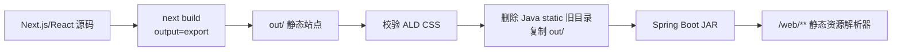
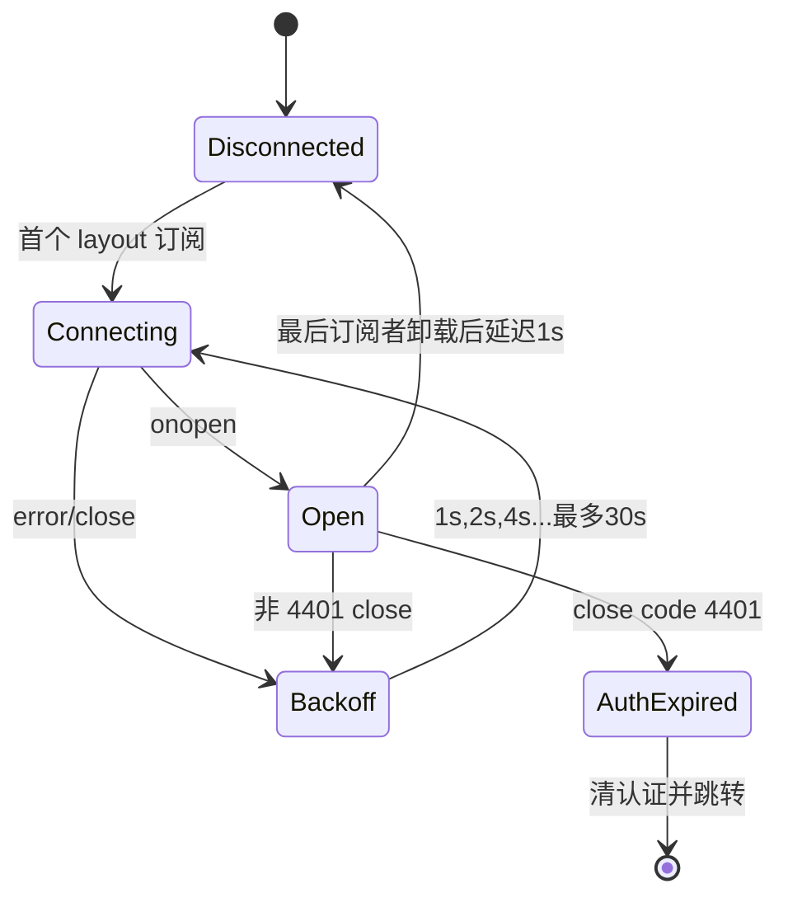
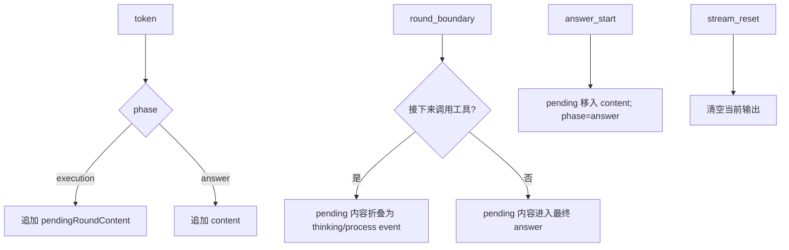
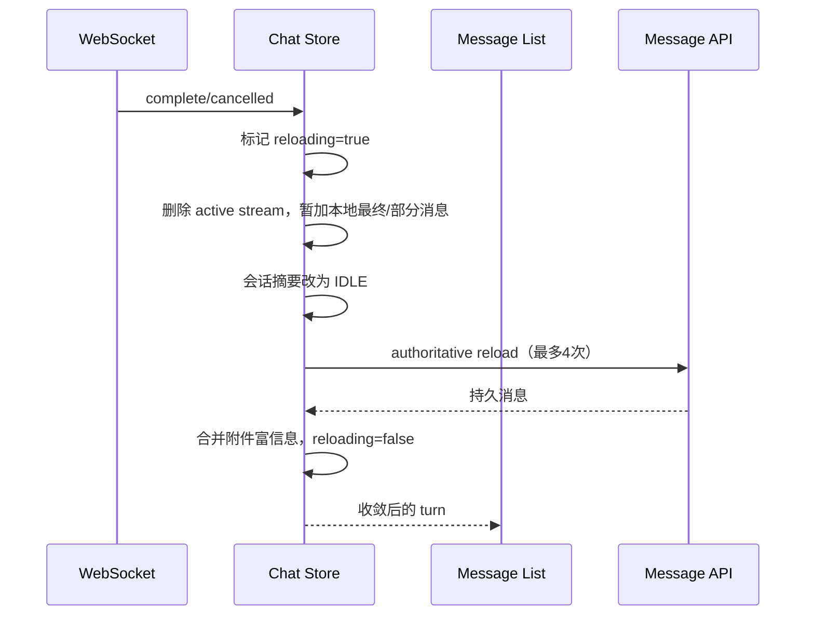
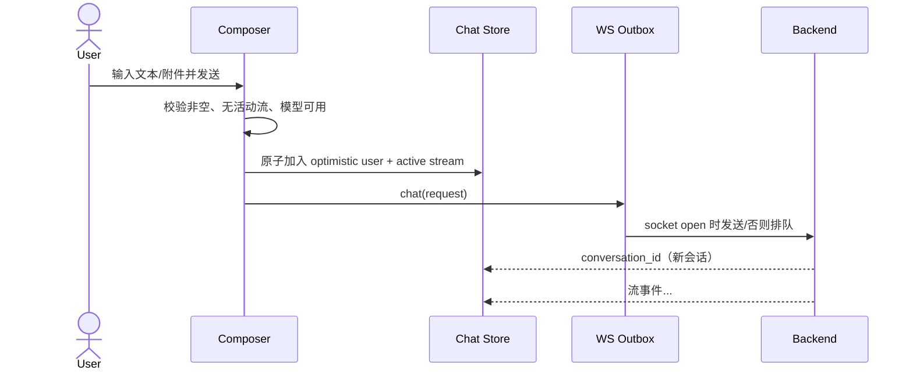
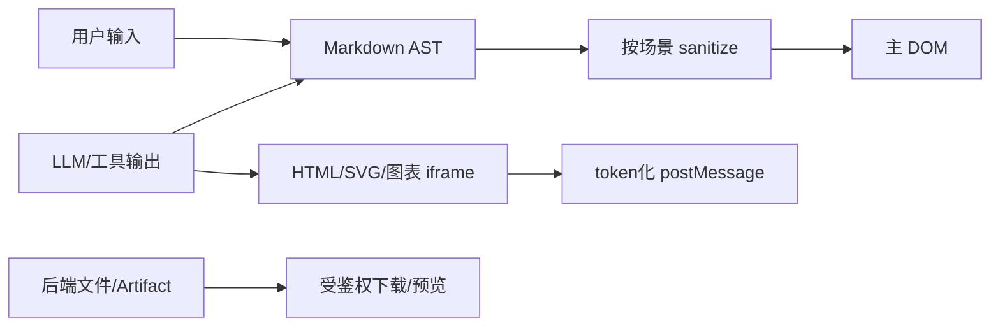

```
# Next.js 前端、状态流、流式会话与 Markdown 富渲染复刻设计

> 文档定位：可脱离 Nova 源码独立实施的前端技术复刻说明。本文覆盖静态发布、路由与 Provider、Zustand 状态、REST/WS 协议、断线恢复、Markdown/图表/Artifact/引用渲染、上传下载、设置页、设计系统、国际化、无障碍、安全、性能和三仓测试策略。

## 0. 证据等级与阅读约定

本文使用以下标记，避免把代码推断写成运行保证：

| 标记 | 含义 |
|---|---|
| **I（Implemented）** | 静态代码中已经实现的行为 |
| **A（Assumption）** | 复刻时为补全上下文而明确采用的假设 |
| **K（Known issue）** | 当前实现的已知缺口、风险或契约漂移 |
| **P（Planned）** | 从测试、注释或结构看得到意图，但不能视为已交付能力 |
| **REQ（Requirement）** | 等价复刻必须满足的要求 |
| **F（Fallback）** | 失败、兼容或降级路径 |
| **D（Design）** | 推荐的生产级复刻设计，可能强于当前实现 |

除特别标注外，本章结论来自三类静态证据：产品前端 `web`、浏览器端到端工程 `nova_ui_e2e`、协议/API 自动化工程 `nova_auto_test`。本次没有启动应用，也没有执行构建或测试，因此所有运行时表现仍需按验收章验证。

## 1. 边界、目标与结论

### 1.1 模块解决什么问题

该前端不是普通的“问一句、返回一段文本”聊天页，而是 AI Agent 的执行控制台。它需要同时完成：

1. 创建、切换、恢复和分享会话；
2. 在一次回答内展示思考片段、工具调用、子代理、计划、澄清、引用和最终答案；
3. 在 WebSocket 断开、页面刷新、取消生成、后台完成时保持前后端状态收敛；
4. 安全呈现模型生成的 Markdown、HTML、SVG、Mermaid、Graphviz、ECharts 和文件 Artifact；
5. 承载模型、工具、技能、知识、数据主题、数据源、评测、调度任务等设置界面；
6. 将同一份 Next.js 静态产物嵌入 Spring Boot 发布，同时支持开发期前后端分离。

目标用户包括普通问答用户、项目成员、租户管理员和通过公开链接访问的匿名查看者。主要输入是用户文本、附件、当前模型/项目/数据主题选择和 WS 事件；主要输出是持续更新的会话视图、可交互工具卡片、引用抽屉、Artifact 预览与下载，以及设置状态。

### 1.2 当前技术结论

- **I**：前端采用 Next.js App Router、React 19、Zustand、React Markdown/Streamdown；生产构建为静态导出，复制进 Java 应用的 classpath 静态目录。
- **I**：会话的实时真相来自 WebSocket，最终持久化真相来自 REST 重载；两者通过序号水位、会话 ID 重映射和 terminal→reload 门闩协调。
- **I**：认证应用、公开分享和移动端使用不同 layout；公开 Markdown 有严格 sanitize，内部 Markdown 当前允许 raw HTML 且没有同等级 sanitize。
- **I**：渲染器支持工具、子代理、引用、Artifact、表格、代码、高亮、ECharts、Mermaid、DOT、SVG 和 HTML iframe；没有专门的数学公式渲染链路。
- **K**：内部 Markdown raw HTML、部分 HTML Artifact iframe 的 sandbox 组合、无界 WS 待发队列、事件字符串拼接协议、无事件缺口恢复，是生产复刻时的重点风险。
- **K**：没有全局页面错误边界；长会话没有消息虚拟化，token 事件也未按动画帧批处理。
- **REQ**：复刻不能只实现 UI 组件，必须同时实现静态路由回退、事件 reducer、断线快照恢复、安全渲染边界和协议级自动化测试。

### 1.3 不在本文范围

本文不重新定义后端 Agent tool loop、数据库 schema、CAN Gateway 或引用证据生成算法，只定义前端与这些能力交互的契约。后端业务语义应由对应技术章节补充。

## 2. 发布形态与静态路由

### 2.1 构建链

生产链路如下：



**I：构建配置**

```ts
// 等价配置，不依赖源码符号名
export default {
  basePath: "/web",
  trailingSlash: false,
  images: { unoptimized: true },
  ...(production ? { output: "export" } : {}),
};
```

生产脚本的语义顺序是：执行静态构建 → 校验设计系统 CSS → 删除 Java 应用原静态目录 → 完整复制新产物。这样构建或 CSS 校验失败时不会先删除旧产物，但复制阶段自身不是事务性的。

- **K**：删除与复制之间进程中断会留下不完整目录。
- **D**：先复制到同文件系统临时目录，校验文件清单和入口页，再原子 rename；打包阶段只消费带内容哈希和 manifest 的目录。
- **REQ**：每次包含前端变更的正式交付都必须验证 Next 编译、TypeScript、静态导出以及复制链。

开发模式不做静态导出。Next dev server 将 `/api/*` 和 `/ws/*` 代理到后端地址，默认后端为 `localhost:8080`。生产静态导出不应用 Next redirects/rewrites/headers，因此生产的 API、WS 与页面路由必须由 Spring 或反向代理承接。

### 2.2 浏览器地址与后端地址

建议配置契约：

| 配置 | 默认 | 作用 | 注意 |
|---|---|---|---|
| `NEXT_PUBLIC_API_BASE` | 空字符串 | REST 基址 | 空值表示同源；跨源时必须显式设计凭据与 CORS |
| `NEXT_PUBLIC_WS_URL` | 当前源的 `/ws/chat` | WebSocket 地址 | 握手附加 `lang` 查询参数 |
| `NOVA_BACKEND_URL` | `http://localhost:8080` | 仅开发代理目标 | 不应编译进正式浏览器包 |
| `basePath` | `/web` | 页面与 Next 静态资源前缀 | REST/WS 不挂在该前缀下 |

**K**：基础 REST helper 会拼接 API base，而 raw/binary helper 故意不拼接，调用者自行传绝对或根相对 URL。若调用者混用，远程开发与生产可能走向不同源。

**D**：统一使用 `resolveApiUrl(path, kind)`，`kind` 明确为 `json|binary|external`；任何业务组件不得直接 `fetch`。跨源 Cookie 认证场景显式设置 `credentials: "include"`，并用 allowlist CORS，不依赖 fetch 默认值。

### 2.3 静态页面的 Spring 解析算法

Next 静态导出的真实文件示例：

```text
static/
├── chat.html
├── chat/_.html                 # /chat/[conversationId]
├── projects/_/settings.html   # /projects/[id]/settings
├── share/_.html                # /share/[token]
├── mobile.html
└── _next/static/<hash>.js
```

Spring 对 `/web/**` 的解析顺序必须是：

```text
1. 精确静态文件存在                       -> 返回文件
2. 路径是 _next/** 或已知静态扩展且不存在  -> 404，绝不能返回 HTML
3. path + ".html" 存在                    -> 返回静态页面
4. 从右到左依次把一个 path segment 替换为 _ -> 返回首个存在的占位页面
5. mobile/**                               -> mobile.html
6. 其余未知页面                            -> chat.html
```

第 2 步用于避免旧浏览器缓存请求失效 JS 时收到 HTML 并报 `Unexpected token '<'`。HTML 使用 `no-store`；内容哈希的 `/_next/static/**` 使用一年、public、immutable 缓存。

动态页本身通过占位参数生成 `_` 文件，客户端再从 `window.location` 提取真实会话 ID/token。**REQ**：不能把静态生成时的 `_` 当真实业务 ID。

**K**：移动 catch-all 的静态参数只明确导出了根路径；未知深层路径依赖 Spring 的 mobile fallback。若部署到不具备该 resolver 的 CDN，会直接 404。

**D**：把“导出路由表、动态占位规则、fallback 页面、缓存策略”生成机器可读 manifest；Nginx/CDN/Spring 均从同一 manifest 配置，避免只在 Java 中隐式存在。

### 2.4 页面分区

| 分区 | 典型页面 | Provider/外壳 | 权限 |
|---|---|---|---|
| authenticated app | chat、conversations、artifacts、scheduled、projects、extensions、settings、ops | 全局 WS、侧边栏、主内容滚动区、toast、引用/目录 drawer | 登录用户；管理页还需管理员 |
| public | `/share/[token]` | 极简公开 layout，无应用侧边栏 | token 能力决定只读和下载 |
| mobile | mobile chat/conversations/artifacts/search | 移动用户 bootstrap、移动 drawer、toast | 登录用户 |
| backoffice | 租户后台页 | 独立布局 | 更严格的后台权限 |

根 layout 固定首屏服务端语言为 `zh-CN`，加载图标、国际化、开发认证 bootstrap、主题和 locale initializer。认证 app layout 只挂载一次共享 WS，避免每个 chat 页面各自建连接。

## 3. Provider、上下文和状态分层

### 3.1 分层原则

**I**：该实现没有把所有状态塞入单个 Context，而是分为：

1. **React Context**：只承载需要树级语义的 locale、设置模式、消息渲染上下文和图标 provider；
2. **Zustand Store**：跨页面业务状态与动作；
3. **URL**：当前会话、公开 token、深链参数、embed 模式；
4. **module memory**：WS 单例、连接引用计数、短期 composer draft、部分展开状态；
5. **localStorage**：主题、语言手动选择、侧栏展开、部分持久化数据主题状态；
6. **后端**：会话、消息、任务、设置和权限的最终真相。

**REQ**：复刻时为每项状态明确 owner、持久化范围、失效规则和多标签页语义，不能仅按“组件需要”随意放置。

### 3.2 主要 store 清单

| Store | 核心职责 | 生命周期/缓存 |
|---|---|---|
| chat | 会话列表、消息、活动流、事件序号、只读态 | 内存；会话列表成功缓存 3 秒 |
| model | provider/model 与当前选择 | 内存；选择可乐观更新 |
| settings | 有效模型角色、草稿、连接测试 | 内存；保存后重新拉取 |
| user | 用户、租户、管理员、下载能力 | 内存；public share 可写下载能力 |
| project | 项目与能力选择 | 内存 |
| data theme | 数据主题和选择 | Zustand persist |
| task | 调度任务、执行、轮询 | 任务列表 3 秒 TTL；执行每 3 秒轮询 |
| artifact preview/citation/catalog/drawers | 全局浮层协调 | 内存 |
| theme/sidebar/mobile/extensions/share | 展示和交互状态 | 内存或局部 localStorage |

设置体系没有 React Query/SWR。缓存、请求合并、race 防护和刷新均由各 store 手写。任务详情使用递增 request sequence，较旧响应返回时不得覆盖较新选择；执行只在存在 `PENDING/RUNNING` 时每 3 秒轮询，离页必须停止。

**K**：不同 store 的 TTL、错误保留和 race 防护不一致；很容易产生重复请求或旧响应覆盖。

**D**：保留 Zustand 作为交互状态，但引入统一 server-state 层：query key 包含 tenant/user/scope/resource，支持 AbortSignal、staleTime、失效、请求去重和 mutation rollback。会话流仍使用专用 reducer，不应由通用 query cache 逐 token 管理。

### 3.3 设置模式和权限

设置 Context 至少区分：

```ts
type SettingsMode = "admin" | "extension" | "project";
```

相同的工具/技能/知识编辑组件可据此切换租户管理、个人扩展或项目范围。管理员 guard 在开发模式可配置绕过；生产读取用户信息，不满足权限则 replace 到 `/chat`，加载期间不渲染受保护内容。

- **REQ**：前端 guard 只用于体验和减少误操作，REST/WS 后端必须独立鉴权。
- **K**：若用户信息请求失败而 store 保留默认值，页面可能空白或显示过时 UI；不得由此推断后端已授权。
- **D**：权限模型返回明确 `loading|authenticated|forbidden|error`，错误页可重试；禁止把“加载失败”默认为有权限。

## 4. REST 客户端契约

### 4.1 通用请求

所有 JSON 请求应满足：

```ts
async function requestJson<T>(path: string, init: RequestInit): Promise<T> {
  const headers = new Headers(init.headers);
  headers.set("X-Nova-Lang", activeLocale());
  if (typeof init.body === "string" && !headers.has("Content-Type")) {
    headers.set("Content-Type", "application/json");
  }
  const response = await fetch(resolveApiUrl(path), {
    ...init,
    headers,
    credentials: crossOriginCookieAuth ? "include" : "same-origin",
    signal: combineTimeoutAndCallerSignal(init.signal, 30_000),
  });
  if (!response.ok) throw await translateError(response);
  return response.status === 204 ? undefined as T : response.json();
}
```

**I**：当前错误翻译能识别认证过期、403、结构化 `code/errorCode/message/error`；embed 模式还会通知宿主认证失败。所有请求注入当前语言。普通 helper 当前没有全局 timeout/retry。

**D**：只对幂等 GET、明确可重放请求做带 jitter 的有限重试；写请求使用 idempotency key 后才允许重试。错误对象至少包含：

```json
{
  "kind": "auth|forbidden|validation|conflict|rate_limit|network|server|abort",
  "status": 409,
  "code": "CONVERSATION_BUSY",
  "message": "Conversation already has an active stream",
  "requestId": "req-...",
  "retryable": false,
  "details": {}
}
```

### 4.2 乐观 mutation 规则

| 操作 | 当前策略 | 失败策略 | 复刻要求 |
|---|---|---|---|
| pin/unpin | 立即改列表 | 回滚旧值 | 保留快照并显示失败 toast |
| 模型选择 | 立即切换；并行保存 simple/complex | 失败回滚 | **K** 两个写不是事务；应使用后端批量原子接口或版本号 |
| 新会话发送 | 本地加入用户消息和活动流 | WS 错误转可见消息 | 必须有 client request id 去重 |
| 设置保存 | 保存后全量重拉 | 保留/恢复草稿 | 明确 dirty、saving、saved、conflict |
| regenerate | 先删旧 turn，再重新发送 | 当前不可事务回滚 | **D** 后端提供 regenerate 原子命令 |

## 5. WebSocket 生命周期与协议

### 5.1 连接管理

**I：生命周期**



连接打开后每 25 秒发送 ping，并发送 `query_running` 发现后台流。模块级 WS 由引用计数共享；最后使用者离开时延迟 1 秒断开，以容忍 React Strict Mode 的短暂卸载/重挂载。

重连间隔为指数退避，最大 30 秒，当前无 jitter、无最大次数。连接未打开时，发送内容进入内存数组，打开后按原顺序 flush。

- **K**：待发数组无长度、过期和去重，离线过久可重放过期 chat/cancel/control。
- **D**：按消息类型设计 outbox：chat 必须持久化 requestId 且服务端幂等；cancel 只保留每个会话最新一条；query/resume/subscribe 可合并；队列设数量/字节/TTL；用户能看到“未发送/重试/丢弃”。
- **D**：退避加入 full jitter，并用 online/visibility 信号减少后台重连风暴。

### 5.2 客户端消息契约

**I：当前 chat wire** 没有 `v`、requestId 或幂等键；服务端把缺少 `type` 的消息按 chat 处理。文本字段名是 `message`，图片直接携带 base64 `data + mediaType + name?`，文件携带上传响应引用；语言当前只接受 `"zh"|"en"`：

```ts
interface CurrentChatRequest {
  conversationId?: string;
  projectId?: string;              // 只用于服务端创建的新会话
  message: string;
  images?: Array<{data:string; mediaType:string; name?:string}>;
  files?: Array<{id:string; name:string; path:string; size:number; type:string}>;
  provider?: string;
  model?: string;
  apiKey?: string;                  // 兼容字段，正常产品链不应使用
  baseUrl?: string;                 // 兼容字段
  dataThemeId?: string | null;      // embed compatibility only
  lang?: "zh" | "en";
}
```

其余当前 client control union 是 `clarification_response|plan_confirm|plan_revise|cancel|query_running|resume|subscribe`，字段按类型复用 `conversationId,response,remember` 等；服务端也识别 `unsubscribe` 与 `ping`，但前端公开 TypeScript union 未完整表达这两个类型，属于契约漂移。

**D：推荐把当前消息显式版本化**：

```ts
type ClientEnvelope =
  | { v: 2; type: "chat"; requestId: string; conversationId?: string;
      content: string; projectId?: string; dataThemeId?: string;
      attachments?: AttachmentRef[]; lang: "zh-CN" | "en-US" }
  | { v: 2; type: "cancel"; requestId: string; conversationId: string }
  | { v: 2; type: "clarification_response"; requestId: string;
      conversationId: string; answers: Record<string, unknown> }
  | { v: 2; type: "plan_confirm" | "plan_revise"; requestId: string;
      conversationId: string; content?: string }
  | { v: 2; type: "query_running" }
  | { v: 2; type: "resume" | "subscribe"; conversationId: string; afterSeq: number };
```

当前 wire 的 `zh|en` 与推荐契约的规范区域 tag 是两层边界；复刻当前时不得直接发送 `zh-CN` 给只接受 `zh|en` 的 chat 类型。区域化是 **D**，需要前后端同时升级和兼容归一化。

### 5.3 服务端事件契约

当前最小 envelope 与完整 type union：

```ts
interface ServerEvent<T = unknown> {
  type: "token"|"tool_call"|"tool_call_result"|"complete"|"error"|
    "conversation_id"|"llm_call_start"|"agent_phase"|"task_plan"|
    "step_start"|"step_complete"|"critic_verdict"|"user_interaction"|
    "stream_reset"|"answer_start"|"round_boundary"|"tool_loop_warning"|
    "cancel_accepted"|"cancelled"|"digest_start"|"digest_progress"|
    "digest_end"|"tool_exec_start"|"tool_exec_end"|"token_stats"|
    "thinking"|"sub_tool_exec_start"|"sub_tool_exec_end"|
    "sub_tool_call_result"|"running_conversations"|
    "running_conversations_v2"|"completed_conversations"|
    "streaming_active"|"knowledge_recall"|"context_compression_start"|
    "context_compression_end"|"context_compression_failed"|"pong";
  content: T; // TS 声明为 string，但 running_conversations_v2 实际按数组消费
  conversationId?: string;
  seq?: number;
  messageId?: string;
}
```

事件族：

| 类别 | 事件 |
|---|---|
| 内容 | `token`, `thinking`, `answer_start`, `round_boundary`, `stream_reset` |
| LLM/Agent | `llm_call_start`, `agent_phase`, `token_stats` |
| 工具/子工具 | `tool_call`, `tool_result`, `tool_exec_start/end`, `subtool_start/end/result` |
| 计划/人机协作 | `task_plan`, `step_start`, `step_complete`, `critic_verdict`, `user_interaction` |
| 终态/告警 | `complete`, `error`, `cancel_accepted`, `cancelled`, `tool_loop_warning` |
| 会话发现 | `conversation_id`, `running_conversations`, `running_conversations_v2`, `completed_conversations`, `streaming_active` |
| 上下文/知识 | `knowledge_recall`, `context_compression_start/end/failed` |
| 文件消化 | `digest_start/progress/end` |
| 保活 | `pong` |

**K**：若 `content` 把 `toolName|callId|payload` 拼成字符串，名称或结果中出现分隔符会破坏解析；同一事件还可能同时存在 JSON 和 legacy 三/四字段格式。

当前逐事件 payload 规则：

| type | `content` 当前格式 | reducer 行为 |
|---|---|---|
| conversation_id/token/thinking | ID/文本 | 重映射 ID；追加 token/thinking |
| llm_call_start/answer_start/stream_reset | 通常空 | 更新 phase/reset |
| round_boundary | `tool` 或其他(final) | pending round 折叠为过程或答案 |
| complete/error/cancel* | 最终文本/错误/空 | terminal；error 可另带 messageId |
| tool_call | tool name | 校验名称，更新 current tool |
| tool_exec_start | `callId|toolName|args...|inputBytes` | 从首两 pipe 与末 pipe 解析 |
| tool_exec_end | `callId|toolName|outputBytes|success|durationMs|result...` | 固定前缀，余项重新 join |
| sub_tool_exec_start | `agentLabel|toolName|args...|inputBytes` | 建子代理 tool activity |
| sub_tool_exec_end | `agentLabel|toolName|outputBytes|success[|durationMs|result...]` | 完成 activity |
| tool_call_result/sub_tool_call_result | 任意 | 当前前端忽略 |
| token_stats | `total|cached|output|toolCount`；legacy `input|output|toolCount` | 计算 cache hit |
| digest_start/progress/end | `tool|chars` / progress / 空 | current tool 提示 |
| agent_phase | `agent|description...` | phase；嵌套 label 入栈 |
| task_plan | JSON TaskPlan | parse，缺 status 补 planned |
| step_start/step_complete | `stepId|...` / stepId | 更新步骤状态 |
| critic_verdict/tool_loop_warning | 任意 | 当前 handler 没有显式 case，等价忽略 |
| user_interaction | `clarification_request|<JSON>` 或 `plan_review|<JSON>` | 设置等待用户/计划复核 |
| knowledge_recall | JSON `{items:[...]}` | 非空才加入过程 |
| context_compression_* | pipe payload（reason/token/window/duration 等） | parse 后 start/done/failed |
| running_conversations | comma-separated IDs | start+resume+10s grace reconcile |
| running_conversations_v2 | 实际数组 `[{id,status}]` | 对每个 ID GET snapshot 后 subscribe |
| completed_conversations | comma-separated IDs | authoritative reload |
| streaming_active | conversationId | start local stream |
| pong | 空 | 无状态更新 |

未知 type 没有 default 分支：若 envelope 可解析，会被静默忽略；如果带 seq，当前代码在 switch 前已经推进 lastSeq。这意味着新增事件既不报错，也可能让该 seq 永久越过，必须作为 **K** 记录。

**D**：每个事件使用 discriminated union 和 JSON Schema，payload 永远是对象；兼容适配只在 socket ingress 做一次：

```json
{
  "v": 2,
  "type": "tool.execution.ended",
  "conversationId": "c-123",
  "seq": 41,
  "eventId": "evt-123-41",
  "serverTime": "2026-08-13T10:20:30Z",
  "payload": {
    "callId": "call-7",
    "toolName": "query_metric",
    "status": "SUCCEEDED",
    "result": {"artifactId": "a-9"},
    "durationMs": 814
  }
}
```

## 6. 会话状态机和事件 reducer

### 6.1 核心状态

```ts
interface ChatState {
  conversations: ConversationSummary[];
  currentConversationId: string | null;
  messagesByConversation: Record<string, ChatMessage[]>;
  activeStreams: Record<string, StreamState>;
  lastSeqByConversation: Record<string, number>;
  readOnlyByConversation: Record<string, boolean>;
  reloadingConversationIds: Set<string>;
  pendingStreamKey?: "__new__" | string;
}

interface StreamState {
  phase: "execution" | "answer";
  pendingRoundContent: string;
  content: string;
  cancelRequested: boolean;
  llmCallActive: boolean;
  currentTool?: ToolActivity;
  toolActivities: ToolActivity[];
  agentPhase?: string;
  taskPlan?: TaskPlan;
  clarification?: Clarification;
  planReview?: PlanReview;
  tokenStats?: TokenStats;
  knowledgeRecalls: KnowledgeRecall[];
  contextCompression?: CompressionState;
  processEvents: ProcessEvent[];
}
```

`"__new__"` 是新会话尚未获得后端 ID 时的临时 key。收到 `conversation_id` 后必须原子完成：消息映射、活动流、当前 URL/导航、会话摘要和待处理 project context 的迁移。

### 6.2 token 与轮次折叠



这种双缓冲避免 Agent 在工具前产生的推理文本被误当最终答案。工具活动只保留有限窗口，当前实现上限为 20，同时需要保留代表截断/分组的标记。

### 6.3 顺序、去重与缺口

当前 reducer 对每个会话维护 `lastSeq`：

```ts
if (event.seq != null) {
  if (event.seq <= lastSeq[conversationId]) return; // 重复/旧事件
  lastSeq[conversationId] = event.seq;
}
dispatch(event);
```

- **I**：该机制能去掉重连重复事件。
- **K**：水位在实际 handler 成功前推进；解析异常的事件不会再重放。
- **K**：收到 12 后再收到 11 会直接丢弃，没有 gap buffer；12 与 10 之间是否缺 11 也不检测。
- **D**：先校验 schema，再按期望序号处理。`seq > expected` 时暂存并启动短超时；超时后请求 `snapshot?afterSeq=`。只有 reducer 成功提交后更新 durable watermark。

### 6.4 工具和子代理活动

tool start/end 首选 `callId` 匹配；legacy 无 callId 时按工具名 FIFO 匹配。嵌套子代理用 agent label stack 表示进入/退出；主代理 `call_sub_agent` 结束时弹栈。不能识别的工具名当前会被丢弃。

**D**：复刻时过程树节点必须有稳定 ID、parentCallId、agentId、start/end timestamp 与状态；不要靠名称和数组位置关联。

```ts
interface ProcessNode {
  id: string;
  parentId?: string;
  kind: "agent" | "llm" | "tool" | "subtool" | "compression";
  label: string;
  status: "RUNNING" | "SUCCEEDED" | "FAILED" | "CANCELLED";
  startedAt: string;
  endedAt?: string;
  inputSummary?: string;
  outputSummary?: string;
}
```

### 6.5 terminal→reload 收敛

终态不能简单删除流，否则最终消息尚未被 REST 读回时，UI 会短暂显示“无人回答”的占位。当前顺序：



重载最多尝试 4 次、重试间隔约 700ms，但触发下一次的精确条件是：本次 REST **成功**，且最新服务端 turn 仍没有 assistant。网络/HTTP 失败被 reload 内部吞掉并保留最后一次成功快照，不继续走“缺 assistant”重试；4 次成功响应仍缺 assistant 时也接受缺行结果，不再无限等待。`complete/cancelled` 外层 reload 的 rejection 只 WARN，finally 清 reloading。`error` 终态故意不重载，因为后端错误行可能内容为空；前端保留 live 错误和 best-effort messageId。pre-stream ERROR/CANCELLED 会尝试补 USER/ASSISTANT 行，但该持久化本身 fail-soft，失败后硬刷新可能看不到 live notice。

**REQ**：terminal 事件必须携带能关联持久化 turn/message 的 ID。**D**：最佳方案是 terminal 只在持久事务提交后发出，并带 `persistedRevision`，REST 支持按 revision 等待或长轮询，避免固定次数猜测。

### 6.6 取消

取消动作仅在存在活动流且未请求过时发送；本地设 `cancelRequested=true`，但保持 stream gate，直到收到 `cancelled|complete|error`。这可避免用户在取消尚未生效时再次提交。

**REQ**：取消必须幂等，并区分“已接受”与“已终止”。服务器用 conversationId + executionId/requestId 鉴权，不能取消其他用户或已经换代的执行。

### 6.7 断线、刷新与后台完成

连接重开后：

1. 发送 `query_running`；
2. v2 running 列表返回每个活动会话和快照信息；
3. v2 列表项本身只有 `{id,status}`，再为每个 ID GET snapshot，解析 `processData`，以服务端 `lastSeq` 重建流；
4. 保留本地尚待用户作答的 clarification/plan review；
5. snapshot 成功后才发送 subscribe；若 snapshot GET/parse 失败，仅 WARN，当前实现不会为该 ID subscribe，可能错过后续 live event；legacy v1 则直接 resume；
6. 后端报告 completed conversations 时重载列表/消息；
7. 本地存在但服务端 running 列表缺失的流，给 10 秒宽限后重载并清理。

**K**：v2 running 的 TypeScript 声明把 `content` 写成字符串，handler 却按数组处理，说明协议类型已有漂移。复刻前应以抓包/契约测试固定真实 JSON。

## 7. 发送、附件、重新生成和只读

### 7.1 发送路径



数据主题在 embed 场景可被锁定；项目/数据主题信息只应来自正式选择上下文。新会话没有 conversationId 时可携带 projectId；已有会话不应通过单次发送偷偷换项目。

当前 composer draft 按 conversation key 存在模块级 Map，导航回来可恢复，但刷新页面即丢失。发送调用一旦进入 WS queue 就清空 draft。

- **K**：断网排队最终失败时用户可能已失去编辑稿。
- **D**：draft 存 IndexedDB/sessionStorage，outbox 返回 `acceptedToOutbox`；只有持久 outbox 成功后清空，并提供“恢复未发送消息”。

### 7.2 上传契约

图片允许 JPEG/PNG/GIF/WebP/BMP，单张前端上限 20 MiB，当前 `images[]` 直接以纯 base64 `data`（不含 Data URL 前缀）、`mediaType` 和可选 `name` 随 WS chat 发送。文档选择器允许 PDF、Office、文本、CSV、JSON、XML、YAML、Markdown、log/conf 等扩展；一般文件前端上限 50 MiB，通过 multipart 上传。

multipart 请求为 `POST /api/files/upload`，重复表单字段 `files=<binary>`，已有会话时附 `conversationId=<id>`；不要手工设置 JSON Content-Type。响应为：

```json
{
  "conversationId":"optional-server-created-id",
  "files":[{"id":"f-1","name":"a.pdf","path":"...","size":1234,"type":"application/pdf"}]
}
```

若用户先上传文件但尚无会话，前端会先创建绑定当前项目的会话，把得到的 ID 作为 upload conversation，再将响应 `files[]` 引用放入 WS chat；文件字节不再经 WS 重传。只有附件没有文字时生成明确的默认意图文本。预创建会话、上传对象和最终 turn 是三个动作，当前没有共同事务；移除 chip/发送失败可留下空会话或未引用文件。

- **K**：拖拽非图片路径没有与文件选择器完全一致的扩展校验；前端限制不能视为安全边界。
- **K**：移除已上传 chip 未必删除服务器对象，也可能留下预创建空会话。
- **REQ**：后端必须按 magic bytes/MIME/大小/租户配额/恶意内容独立校验；返回稳定 `fileId`，消息只引用 ID，不信任客户端文件名和 MIME。
- **D**：采用 `init upload -> signed/chunk upload -> complete -> scan -> READY` 状态机，未被消息引用的对象和空会话由定时任务回收。

```ts
interface AttachmentRef {
  fileId: string;
  displayName: string;
  mediaType: string;
  size: number;
  status: "UPLOADING" | "SCANNING" | "READY" | "REJECTED";
  sha256?: string;
}
```

### 7.3 regenerate

当前重新生成会定位目标 assistant 前的 user message；受保护图片先读取并转 base64，然后删除旧 turn（同 turnIndex 时整轮删除，否则依次删除 user/assistant），最后重发。

- **K**：删除和重发不是事务；WS 失败后旧回答已经消失。
- **K**：大图片转 base64 会增加约 33% 内存和编码开销。
- **D**：后端提供 `POST /conversations/{id}/turns/{turnId}:regenerate`，在同事务创建新 attempt，旧 attempt 保留版本但 UI 默认折叠；附件沿用 fileId，不重新读取字节。

### 7.4 reload 与只读

切换会话时，仅在本地没有消息才首次加载；强制 reload 会合并本地附件的预览等富信息。会话详情加载只读标志；标记已读、清未读和错误属于 best-effort。

**K**：只读详情请求失败时当前 UI 倾向回落为可写，以免误锁；安全上只能依赖后端拒绝。

**D**：权限未知时 UI 默认只读并显示加载/重试；后端所有 mutation 均校验 share/tenant/user/project scope。

### 7.5 Public Share HTTP 契约

公开 viewer 不使用登录态 `/api/user/env`，只凭不可预测 token 调用：

```http
GET /api/public/shares/{token}
```

状态语义：有效 ACTIVE 且 `contentJson` 非空返回 200；不存在、已撤销或内容被清除统一返回 410，避免泄露 token 是否曾存在；每 IP 超限返回 429 + `Retry-After: 60`；快照 JSON 解析失败返回 500。当前 controller 没有显式设置 `Cache-Control`，且每次 GET 还记录 view counter；不能假设浏览器/CDN一定 no-store。**D** 应显式 `Cache-Control: private,no-store`（或短期、按 token 隔离且撤销可 purge 的策略），避免撤销后仍从中间缓存读取。

200 JSON：

```json
{
  "title":"季度分析",
  "createdAt":"2026-08-13T10:00:00Z",
  "allowDownload":true,
  "messages":[{
    "role":"assistant",
    "content":"结论… [citation:msg1.1]",
    "createdAt":"2026-08-13T10:00:02Z",
    "images":[{"data":"<base64>","mediaType":"image/png","name":"chart.png"}],
    "files":[{"name":"source.csv","mimeType":"text/csv","publicUrl":"/api/public/shares/{token}/files/{fileToken}","sizeBytes":123}],
    "artifacts":[{"name":"report.xlsx","mimeType":"application/vnd.openxmlformats-officedocument.spreadsheetml.sheet","publicUrl":"/api/public/shares/{token}/files/{fileToken}","sizeBytes":456}],
    "citations":[{
      "label":"1","token":"msg1.1","localToken":"1","type":"metric|sql|python|knowledge|web|file|generic",
      "title":"来源标题","text":"AI解读",
      "metricSpec":{},"timeFiscalLabel":"FY2026","result":{"columns":[],"rows":[],"totalRows":0,"raw":""},
      "sql":"...","datasourceAlias":"ds","purpose":"...","pyCode":"...","pyStdout":"...",
      "knowledgeName":"...","knowledgeSummary":"...","knowledgeKeywords":[],"knowledgeSynonyms":[],
      "knowledgeContent":"...","knowledgeCode":"...","knowledgeFactors":[],"knowledgeDimensions":[],"knowledgeRelations":[],
      "fileName":"a.pdf","fileType":"pdf","fileSnippet":"...","webSiteName":"example.com","webTitle":"...",
      "metricDisplayNames":{},"dimensionDisplayNames":{}
    }],
    "processData":{"events":[],"tokenStats":{},"totalDurationMs":1000,"taskPlan":{}}
  }]
}
```

字段均为快照 allowlist，citation 类型字段按类型可选；前端必须容忍旧快照缺 `type/allowDownload`，未知 citation 降级 generic。`allowDownload` 不是创建时冻结值，而是读取时按 share 所属 tenant 的当前平台设置计算；旧后端缺字段时当前 viewer 默认为 true。

附件/Artifact 公共读取：

```http
GET /api/public/shares/{token}/files/{fileToken}
```

有效 token、fileToken 必须属于该 share 且 tenant 当前允许下载才返回 200 流；下载关闭返回 403，share 失效返回 410，file 不属于 share/不存在返回 404，限流 429。响应使用 MIME policy、安全 Content-Disposition、`nosniff` 和 Content-Length。viewer 隐藏下载 UI 只是体验，服务端在每次文件读取重新检查开关。

owner 通过认证接口 `PATCH /api/shares/{shareId}/revoke` 撤销（204）；之后公开 JSON/文件均不能继续读取，viewer 显示 expired。owner 列表和 revoke 必须按 tenant+owner 鉴权；public endpoint 的 token capability 只能读取该快照，不能访问原 conversation、私有 citation URL 或其他 share 的 fileToken。

## 8. Markdown 与富内容渲染

### 8.1 三种内容形态

| 形态 | 典型来源 | 渲染策略 |
|---|---|---|
| chat | 最终 assistant 答案 | 较大字号/行高、引用、表格、特殊 fence |
| process | 思考/工具过程 | 紧凑排版、过程树和卡片 |
| public | 分享页 | 最小组件集、严格 sanitize、只读引用/Artifact |

用户消息是 plain text，不走 Markdown。内部 `MarkdownRenderer` 的 variant 映射到语义 CSS；公开页使用独立的 `MarkdownRendererPublic`，而不是仅给内部 renderer 加一个布尔开关。

### 8.2 流式解析选择

```ts
function chooseRenderer(markdown: string, streaming: boolean) {
  const hasCitation = containsCitationToken(markdown);
  const hasSpecialFence = containsFence(markdown, [
    "echarts", "html", "svg", "mermaid", "dot", "graphviz"
  ]);
  if (streaming && !hasCitation && !hasSpecialFence) return "streamdown";
  return "react-markdown";
}
```

Streamdown 用于容忍未闭合的流式 Markdown。长中文纯文本段落达到约 140 字后，会按约 88 字目标拆分，减少整段频繁重排。包含引用 token 或特殊 fence 时，即使流式也切回 ReactMarkdown，以保证自定义 AST/组件工作。

ReactMarkdown 链路包含 GFM（关闭单波浪删除线）、frontmatter、引用 badge 插件、raw HTML 和代码高亮。进入解析前还会修复部分 malformed citation table。

**K**：没有 `remark-math`/KaTeX/MathJax；`$...$` 不具备数学语义。

**D**：若复刻要求公式，增加 `remark-math + rehype-katex`，KaTeX 使用严格模式、禁 trust/自定义 URL，并把 CSS 纳入构建和 CSP 验收。

### 8.3 基础组件契约

```ts
interface MarkdownProps {
  content: string;
  variant: "chat" | "process" | "public";
  streaming?: boolean;
  allowDownload?: boolean;
  onCitationOpen?: (citation: CitationRef) => void;
  onArtifactOpen?: (artifact: ArtifactRef) => void;
}
```

表格支持横向滚动、首列 sticky、数值列对齐、图片单元格、复制 Markdown 和下载 CSV。复制/下载时从 DOM 中去除引用节点；下载受 `allowDownload` 控制。代码块支持复制与语法高亮。

**K**：普通 Markdown 表格全部进 DOM，超大表会卡顿。**D**：AST 阶段统计行数，超过阈值改为虚拟化 data-grid 或生成可下载 Artifact，只渲染预览。

### 8.4 特殊 fence

| fence | 当前渲染 | 安全边界 |
|---|---|---|
| `echarts` | 解析 JSON/类 Python dict，注入主题色 | 删除函数、疑似 function formatter 和 tooltip formatter；禁止 eval |
| `mermaid` | 串行全局渲染，IntersectionObserver 懒加载 | `securityLevel: strict`，输出 SVG 再 sanitize |
| `dot`/`graphviz` | Viz 渲染 | 输出 SVG sanitize |
| `svg` | 浏览器 DOMParser 后清理 | 当前黑名单不够完整，见安全章 |
| `html` | `srcdoc` iframe | 消息内预览使用 `sandbox="allow-scripts"`，唯一 opaque origin |

Mermaid 采用全局串行队列是因为渲染器有共享状态/ID；不可见时延迟渲染节省 CPU。ECharts 默认从设计系统 `data-series-*`、positive/negative 等 token 取色，主题切换时应 dispose/re-init 或安全 setOption。

SVG 当前移除 script，把 foreignObject 转成 SVG text，移除 `on*` 和 `javascript:` href。

- **K**：黑名单仍可能漏过 style/CSS URL、动画、外部引用、其他 URL scheme。
- **D**：使用 SVG 专用 allowlist sanitizer：只允许必要元素/属性，URL 只允许同文档 fragment 或受控 https，移除 style、外部资源、SMIL、foreignObject；渲染在 opaque-origin iframe 中。

### 8.5 HTML iframe 的两种安全形态

1. 消息内 HTML fence 使用 `sandbox="allow-scripts"`。脚本可运行，但无 same-origin；opaque-origin frame 没有可用于 `targetOrigin` 的具名 origin，当前 helper 因此允许 `postMessage(...,"*")`，父页必须同时校验 `event.source===iframe.contentWindow`、随机 nonce/token、type 与 payload schema，不能仅凭 type。
2. 完整 Artifact HTML renderer 也可使用 opaque-origin iframe，并以随机 token 验证 postMessage。若预览部署到具名独立 origin，则发送和接收都必须精确匹配该 origin，不能继续使用 `*`。

**K（高优先级）**：某些内联 Artifact HTML 预览使用 `sandbox="allow-scripts allow-same-origin"`，同时用 `srcdoc` 并从父页访问 `contentDocument`。对于同源语境，这个组合可能让不可信脚本获得父源能力，等价于削弱 sandbox，形成 XSS/数据窃取风险。

**D**：不可信 HTML 一律不同时授予 scripts 与 same-origin。推荐独立不可带认证 Cookie 的 preview origin；父页只通过带随机 nonce、严格 source/origin/type/schema 校验的 postMessage 交换高度和只读数据。具名 preview origin 必须精确指定 target origin；只有真正 opaque 的 srcdoc sandbox 才可因浏览器语义使用 `*`，且必须以 source+nonce+schema 补偿，不能笼统宣称所有 `*` 都可接受或都应禁止。

### 8.6 引用、Artifact、工具和子代理卡片

引用插件把结构化 token 转为 badge；点击后打开全局 citation drawer。公开页 badge 只读，但仍可读取分享范围内的 citation。Artifact marker 转为内联卡片，可打开预览、下载或跳到 Artifact 页面，具体能力受权限和 share 配置限制。

工具卡片按结果类型选择：指标/SQL/Python/文件/知识/Web/通用。`processData` 被解析成过程树，子代理调用被分组为独立卡片，显示运行/成功/失败/取消和耗时。

**REQ**：渲染器只消费结构化 `toolName + callId + typed result`；未知工具退化为转义后的通用 JSON/文本卡，不能使用 `dangerouslySetInnerHTML`。

**K**：部分过程展开状态保存在模块级 Map，跨会话长期导航会增长。**D**：以 conversationId/turnId 为 scope，并在 turn 卸载或 LRU 超限时回收。

### 8.7 公开 Markdown 的严格策略

公开 renderer 的 sanitizer allowlist 仅保留段落、标题、列表、强调、代码、引用、表格、换行、分隔线、链接、图片和引用 marker。URL 协议：链接仅 http/https/mailto，图片允许 http/https/data；脚本、iframe、SVG 和事件属性会被删除。外链添加 `target=_blank rel="noopener nofollow"`。

- **K**：远程图片会把访问者 IP、referrer 和打开时机暴露给第三方；data URI 也可造成资源消耗。
- **D**：公开分享默认通过服务端图片代理/缓存，限制 MIME、像素、字节和重定向，设置 `referrer-policy: no-referrer`；可选完全禁止 data URI。

公开 ECharts/Diagram 采用动态 import 且关闭 SSR，降低初始 bundle。公开图片导出在隐藏的隔离 iframe 中等待至少两帧和异步渲染完成标记；导出模块本身不得发起 fetch/XHR/WS，避免绕过分享权限。

## 9. 安全模型

### 9.1 信任边界



用户、LLM、工具、上传文件、分享内容均是不可信输入。登录态页面也不能因为“内容来自自己的 Agent”而跳过 XSS 防护；Agent 可引用网页、工具输出或被 prompt injection 控制。

### 9.2 当前风险矩阵

| 风险 | 当前事实 | 影响 | 生产设计 |
|---|---|---|---|
| 内部 raw HTML | `rehypeRaw` 后无 sanitize | DOM XSS | 与公开页同样 sanitize；业务 marker 用 AST node 而非 HTML |
| HTML Artifact sandbox | 部分 `allow-scripts allow-same-origin` | 逃逸/读取父页面 | 独立无凭据 origin + opaque sandbox |
| SVG 黑名单 | 移除常见脚本但非完整 allowlist | CSS/URL/动画攻击 | 专用 SVG allowlist sanitizer |
| WS outbox | 无界、无 TTL/idempotency | 重放/重复写/内存增长 | typed bounded outbox + requestId |
| 事件协议 | 字符串 delimiter、类型漂移 | 错误归因/解析歧义 | versioned JSON schema |
| 下载调用 | 一些组件直接 fetch | 绕过统一认证过期/基址 | 统一 binary client |
| inline bootstrap script | 常量 `dangerouslySetInnerHTML` | CSP 部署复杂 | 外置哈希脚本或构建期 CSP hash |
| 公开远程图片 | 浏览器直连 | 隐私跟踪/资源滥用 | 图片代理和限制 |

### 9.3 CSP 建议

静态导出难以逐请求生成 nonce，可采用：

```text
default-src 'self';
script-src 'self' '<bootstrap-sha256>';
style-src 'self' 'unsafe-inline';   # 逐步迁移至 hash/nonce
img-src 'self' data: blob: <image-proxy-origin>;
connect-src 'self' wss://<api-host>;
frame-src 'self' https://preview.example;
object-src 'none';
base-uri 'none';
frame-ancestors <explicit-embed-hosts>;
```

若应用支持被第三方 embed，`frame-ancestors` 必须由租户 allowlist 决定，不能全局 `*`。同时启用 Trusted Types（如浏览器支持），将 HTML/SVG/srcdoc 入口集中在受审计 policy。

## 10. 主题、设计 token、国际化与无障碍

### 10.1 主题与 token

首屏内联 bootstrap 在 React hydration 前读取 localStorage，设置 light/dark、品牌和图表 CSS 变量，防止闪烁；Initializer 再从服务端取租户主题并监听系统主题变化。

复刻约束：

- 业务组件只使用 semantic token，不直接写 hex/rgb/Tailwind 原生色阶；
- 结构选中态用 warm neutral，操作选中态用品牌轻强调，状态色仅表示状态；
- 数据图表从 `data-series-*`、`data-positive`、`data-negative` 取色；
- 组内 spacing 小于组间 spacing，主节奏 8/16/24/32；
- 同层级控件 radius 一致，主值 4/6/8/12；
- 中文优先，普通 UI 约 14px，assistant 正文约 16px、行高约 1.75，process 约 13px；
- 用户气泡 plain text，assistant 使用 `markdown.chat` 规范。

### 10.2 国际化契约

语言优先级：URL 显式值 > localStorage 手动选择 > 浏览器语言 > 默认中文；租户默认值只在没有手动选择且浏览器无法识别时参与。服务端和首个客户端 render 固定中文，hydration 后异步检测，避免 mismatch。切换语言必须：

1. 更新 provider 与 module-level active locale；
2. 更新 `<html lang>`；
3. 持久化手动选择；
4. 后续 REST 附 `X-Nova-Lang`；
5. 新 WS 握手和每个 chat 请求附语言。

**K**：module-level locale 和 React provider 是两个状态源，更新遗漏会造成 UI 与请求语言不一致。

**D**：由单一 locale store 导出同步 selector，REST/WS 在发送瞬间读取；增加字典 key parity、无硬编码、长英文布局和切换后请求头测试。

### 10.3 无障碍

**REQ**：

- icon-only button 有本地化 `aria-label`；
- Dialog/Drawer 建立标题、描述、初始焦点、焦点锁和 Escape；
- token 流更新不能每个 token 触发 screen reader，使用单独 `aria-live=polite` 的节流摘要；
- 状态不能只靠颜色，工具/任务状态有文本或图标语义；
- 表格保留 `<table>/<th scope>` 或为虚拟 grid 完成 ARIA；
- 键盘可完成发送、取消、打开引用、复制代码和关闭预览；
- 对 `prefers-reduced-motion` 关闭流动动画/展开过渡；
- 文本对比度至少 4.5:1，focus-visible 清晰；
- 流式内容完成后焦点不被抢走。

当前已有多处 aria label、键盘关闭和 reduced-motion 处理，但不能视为全站已通过 WCAG。应以自动 axe + 手工键盘/读屏验收。

## 11. 设置页、轮询与缓存

设置页包括模型/provider、工具、技能、知识、数据主题、数据源、评测、平台、主题、推荐问题、归因、插件等。应复用相同的 scope 组件和 SettingsContext，不能复制三套管理 UI。

模型设置采用“有效值 + 本地草稿”：并发拉 provider 和 role，编辑只写 draft；保存后重新拉全量有效状态并同步 chat model store。连接测试有短暂状态，当前约 3 秒后重置。

调度任务：列表成功缓存 3 秒；创建/复制/更新/删除/执行/取消后 force reload。选择任务后拉执行列表，只要存在 PENDING/RUNNING 就每 3 秒轮询；错误保持旧快照并下次重试；离页/换任务清 timer。执行详情和会话并发读取，并用递增序号防止旧响应覆盖新选择。

评测/后台作业也存在独立轮询。**K**：多个页面各自 `setInterval`，不可见标签页仍可能产生请求，且没有统一 backoff。

**D**：统一 polling scheduler：可见时轮询、隐藏时降频；服务器 Retry-After 优先；错误指数退避；同 query key 合并；终态停止；支持 SSE/WS push 时只用低频 reconciliation。

## 12. 下载、预览与错误边界

下载通常把响应读为 Blob、创建 object URL、触发隐藏 anchor，最后 revoke。**REQ**：文件名从可信响应字段或 RFC 5987 Content-Disposition 解析并去路径；下载 API 检查租户、会话/share token 与 allowDownload；设置 `Content-Type`、`Content-Disposition` 和 `X-Content-Type-Options: nosniff`。

**I**：部分下载/HTML preview 直接使用 `fetch`，没有经过统一 API client。**K**：这可能漏掉语言头、API base、认证过期通知和标准错误翻译。

当前 App Router 未发现通用 `error.tsx`、`loading.tsx`、`not-found.tsx` 或全局 React ErrorBoundary。若 Markdown/图表组件抛出，可能影响整页。

**D：边界层级**

```text
root error boundary
└── authenticated/public/mobile route boundary
    └── conversation boundary
        ├── each message boundary
        ├── each tool/artifact renderer boundary
        └── each iframe/chart boundary
```

局部错误显示“此内容无法渲染”、复制原始安全文本、重试和 requestId；不能因一个坏 ECharts 配置让整个聊天页白屏。错误上报需去除 prompt、token、文件内容等敏感数据，仅上报 renderer type、事件 type、版本、堆栈 fingerprint 和 correlation id。

## 13. 性能设计

### 13.1 当前优化

- MessageBubble 有显式 memo comparison；
- public 重图表/图形组件动态 import；
- Mermaid 使用 IntersectionObserver 懒渲染；
- 指标大表有行虚拟化；
- 特殊 renderable 有约 48/150ms debounce；
- 工具活动保留窗口上限 20；
- 静态 chunk 长缓存，HTML no-store；
- 图片导出等待异步 renderable，而不阻塞正常首屏。

### 13.2 当前瓶颈和复刻设计

**K**：普通消息列表和 Markdown 表格未虚拟化；每个 token 都写 Zustand，可能触发 Markdown 重解析、布局和滚动；长会话的 process tree/图表占用持续增长。

**D**：

1. WS ingress 先入 per-conversation buffer，每 16–50ms 或 `requestAnimationFrame` 批量提交 token；终态立即 flush；
2. 消息按 turn 虚拟化，活动 turn 允许动态高度；定位引用/搜索结果时先滚到 item 再测量；
3. streaming 使用增量纯文本/轻量 parser，完成后才做完整高亮和复杂表格；
4. 对 Mermaid/DOT/ECharts 以 content hash 缓存安全中间结果；
5. 离屏 iframe/chart dispose，object URL 及时 revoke；
6. 建立性能预算：首屏 JS、p95 token-to-paint、500 turn 内存、1 万行表格、图表渲染和 reconnect 恢复时间。

建议验收阈值（可按设备调整）：p95 token-to-paint < 100ms；500 条纯文本消息滚动不低于 45fps；断线快照恢复 < 3s；主线程单任务不持续超过 200ms。

## 14. 三仓测试策略

### 14.1 测试职责

| 工程 | 测试层 | 适合验证 |
|---|---|---|
| `web` | Vitest + happy-dom | reducer、store race、API header/error、组件渲染、sanitize、i18n/token、虚拟窗口 |
| `nova_ui_e2e` | Playwright + Midscene | 真实浏览器导航、上传下载、WS UI、视觉交互、权限、设置、移动/公开页 |
| `nova_auto_test` | YAML/runner/API/WS/browser smoke | 后端协议边界、重连/取消 race、超大/空/未知消息、引用与文件 API 契约 |

Midscene 用自然语言驱动复杂用户旅程和视觉判断，适合发现布局/可用性问题；确定性的状态、网络负载和权限断言仍由 Playwright locator/route/response 完成。两者互补，不能用自然语言视觉测试替代协议断言。

### 14.2 测试资产分级（本次均未运行）

| 分级 | 含义 | 本文使用方式 |
|---|---|---|
| ACTIVE ASSET | 被当前 Vitest 配置 include，或存在可直接运行的 Playwright/YAML runner case | 只能说明资产接线存在，未运行不能称通过 |
| KNOWN CASE | 文档/代码中明确列出场景或 known bug marker | 说明预期/已知边界，不等于自动化门禁 |
| PLANNED | 本文提出但仓库未见确定性覆盖 | 复刻时必须新增 |

`nova_ui_e2e` 的 ACTIVE/KNOWN 场景包括主聊天、多轮、停止生成、Artifact、附件多格式/大文件/损坏文件/取消选择、图表与 PPT、会话历史与分享、数据预览、国际化与 a11y、登录、消息动作、模型/provider、RBAC/安全、调度、语义和工具运行时，以及多类设置页。Midscene 有主流程、stop、artifact、附件、图表、数据、embed、模型、调度/分析等自然语言资产；它们更适合视觉/旅程发现，不作为精确协议门禁。

`nova_auto_test` 直接覆盖 WS 的 complete/cancelled/error 终态、raw/unknown/empty/oversize 消息、reconnect/resume、subscribe/unsubscribe、按 ID/活动执行取消、工具执行中取消、跨账号取消、缺失/竞态/重复取消和多轮；也维护引用前端渲染、文件/Artifact、设置等用例目录。

**A**：上述均为静态资产盘点。本次未执行任何测试，不能报告 pass/fail；下一节 schema gap、XSS corpus、outbox/gap recovery 等多数属于 PLANNED。

### 14.3 必须新增/固化的契约测试

1. JSON Schema 为所有 WS v2 消息做 producer/consumer contract；
2. seq 重复、乱序、缺口、handler 抛错、水位恢复；
3. offline outbox 的 TTL、去重、取消合并与重连重放；
4. terminal 先到、REST 持久化延迟、四次仍缺失、error 空行；
5. `conversation_id` 在导航、附件上传和 token 到达不同顺序下原子重映射；
6. internal/public Markdown 的 script、event handler、javascript/data URL、SVG/CSS、iframe escape XSS corpus；
7. HTML preview 跨源、sandbox、postMessage 伪造和 token；
8. 公开分享远程图片、下载禁止和过期 token；
9. 500 turn、1 万行表格、长中文 streaming、20+ 工具活动性能；
10. 中英 key parity、请求头、WS lang、主题无闪烁、reduced motion；
11. Spring 精确页、动态 `_` 页、未知路由、缺失静态 asset 404 和缓存头；
12. 拖拽与 picker 使用相同附件规则，后端拒绝伪 MIME/超限。

## 15. 最小生产级复刻蓝图

### 15.1 组件边界

```text
AppShell
├── AuthAndTenantProvider
├── LocaleThemeProvider
├── WebSocketSupervisor
├── Sidebar / RouteOutlet
├── GlobalDrawerCoordinator
└── ChatPage
    ├── ConversationController
    ├── VirtualMessageList
    │   └── MessageBoundary
    │       ├── SafeMarkdownRenderer
    │       ├── ProcessTree
    │       ├── ToolCardRegistry
    │       ├── CitationBadge
    │       └── ArtifactCard / IsolatedPreview
    └── DurableComposer
        ├── AttachmentManager
        └── OutboxStatus
```

### 15.2 推荐 store 切分

```ts
interface ConversationRuntimeStore {
  streams: Map<string, StreamAggregate>;
  ingest(event: ValidatedServerEvent): ReducerResult;
  hydrate(snapshot: StreamSnapshot): void;
  requestCancel(conversationId: string): Promise<void>;
}

interface ConversationQueryStore {
  summaries: ConversationSummary[];
  messages: Map<string, PersistedTurn[]>;
  load(id: string, revision?: number): Promise<void>;
  invalidate(id: string): void;
}

interface DurableOutbox {
  enqueue(command: ClientCommand): Promise<void>;
  ack(requestId: string): Promise<void>;
  listPending(): Promise<ClientCommand[]>;
}
```

runtime store 和持久 message query 分开，terminal reconciliation 明确将 transient aggregate 转换为后端 revision。UI 不直接解析 socket 字符串，也不直接拼 REST URL。

### 15.3 实施顺序

1. 定义 REST/WS v2 schema、权限 scope 和 idempotency；验证：contract tests 双端生成类型。
2. 搭建 static export + Spring/CDN resolver；验证：精确/动态/fallback/asset 404/cache matrix。
3. 实现 API client、WS supervisor、durable outbox；验证：断网、4401、退避、队列限额。
4. 实现 reducer、snapshot/revision reconciliation；验证：乱序、缺口、terminal race、取消。
5. 实现 chat/message/composer/upload；验证：新会话 ID 重映射、刷新、只读、regenerate。
6. 实现 safe Markdown 和 typed card registry；验证：XSS corpus、公开权限、特殊 fence。
7. 接入设置/任务/项目页面与统一 server cache；验证：scope、race、轮询停止。
8. 加设计 token、i18n、a11y、错误边界与性能预算；验证：三仓测试矩阵。

## 16. 验收矩阵

### 16.1 正常路径

| 编号 | 场景 | 操作 | 可观察结果 |
|---|---|---|---|
| FE-01 | 新会话 | 带文本和附件发送 | 立即显示用户消息；获得 ID 后 URL/store/流无闪烁迁移；最终与 REST 一致 |
| FE-02 | 工具多轮 | 模型先解释、调用工具、再回答 | 前置内容进入 process，工具卡状态闭合，最终答案只含 answer 阶段 |
| FE-03 | 子代理 | 主代理调用两个子代理 | 过程树父子关系正确，独立状态/耗时可见 |
| FE-04 | 刷新恢复 | 运行中刷新页面 | 发现 running、拉 snapshot、从 afterSeq 继续，无重复 token |
| FE-05 | 取消 | 生成中点击停止两次 | 仅发送一次取消；直到终态禁止再次发送；保留部分答案并标取消 |
| FE-06 | 分享 | 匿名打开 token | 仅见授权消息/引用/Artifact；下载开关生效；无编辑动作 |
| FE-07 | 设置 | 修改 provider/role 并保存 | draft/saving/error 明确；成功后有效值和 chat 选择同步 |
| FE-08 | 调度 | 打开 RUNNING 执行 | 每 3 秒或 push 更新，终态停止，离页无 timer |
| FE-09 | i18n/theme | 首屏与切换 | 无 hydration mismatch/明显闪烁；REST/WS 语言一致；图表随主题 |

### 16.2 异常与对抗路径

| 编号 | 场景 | 预期 |
|---|---|---|
| FE-X01 | WS 在 chat 后断开 | command 有 requestId，重连不重复创建 turn；UI 显示待发状态 |
| FE-X02 | seq 收到 10、12、11 | 检测缺口并补齐/快照；不静默丢 11 |
| FE-X03 | complete 先于 DB 可读 | reloading 门闩不显示错误占位；按 revision 收敛或明确可重试 |
| FE-X04 | malformed tool payload | 单卡降级显示，不推进错误水位，不使整页崩溃 |
| FE-X05 | Markdown 注入 ``/script | 内部和公开页均无执行；安全文本/允许节点正常 |
| FE-X06 | SVG 外链/style/foreignObject | 被剥离或在隔离 origin；无法访问父页/API |
| FE-X07 | Artifact iframe 伪造 postMessage | origin/source/token 任一不符即丢弃 |
| FE-X08 | 拖拽伪装 exe 为 pdf | 服务端 magic/MIME 拒绝；前端显示结构化原因 |
| FE-X09 | 只读详情请求失败 | UI 默认不可写；后端 mutation 仍 403 |
| FE-X10 | 缺失旧 hash JS | 返回 404 和正确 MIME，不返回 chat.html |
| FE-X11 | 公开远程追踪图 | 仅经图片代理或被禁止，不向第三方泄露访问者请求 |
| FE-X12 | 单条 ECharts/Markdown 崩溃 | 局部 error boundary，其他消息和 composer 可用 |

### 16.3 完成定义

复刻被认为“业务效果等价且达到生产底线”须同时满足：

- 页面能静态发布并正确处理真实动态路径；
- 新会话、既有会话、取消、刷新、断线、后台完成都能最终收敛；
- 事件有版本、schema、序号缺口处理与幂等 command；
- 内部和公开 Markdown 均不存在已知 raw HTML 主 DOM XSS；
- HTML/SVG/Artifact 处在可证明的隔离边界；
- 权限由后端执行，公开下载与引用遵循 token scope；
- 主题、双语、键盘、读屏和 reduced-motion 达到约定；
- 长会话、长表格和高频 token 满足性能预算；
- `web` 单元/组件、`nova_ui_e2e` 浏览器、`nova_auto_test` 协议三层均通过。

## 17. 当前实现与推荐复刻的差异清单

| 项目 | 当前实现 | 推荐复刻 |
|---|---|---|
| 部署 | Next export 复制进 Spring | 保留，同时做原子产物替换和 route manifest |
| Server state | 多个 Zustand store 手写缓存 | query cache + 专用 stream reducer |
| WS | 单例、refcount、退避、快照恢复 | 增加 schema、jitter、有界 durable outbox、gap recovery |
| terminal | 本地消息 + 最多四次 REST reload | persisted revision/transactional terminal |
| regenerate | 删除后重发 | 服务端 versioned atomic attempt |
| Markdown | 内部 raw HTML 未 sanitize；公开严格 | 所有主 DOM 都严格 allowlist |
| HTML preview | 部分 scripts+same-origin | 独立无认证 preview origin |
| SVG | 手写黑名单 | 专用 allowlist + opaque iframe |
| Math | 无专门支持 | 按产品需求引入 strict KaTeX 或明确不支持 |
| 错误边界 | 未发现全局/路由边界 | root/route/message/card 多层边界 |
| 性能 | memo、懒加载、部分虚拟化 | token batching、turn/table 虚拟化、预算监控 |
| 测试 | 三仓覆盖面较广 | 将 XSS、seq gap、outbox、static fallback 固化为门禁 |

## 18. 证据追溯附录

以下仅用于在仍可访问原工程时审计证据，不承担本文实现说明：

- 前端构建与路由：`web/package.json`、`web/next.config.ts`、`web/app/**`；
- Spring 静态 resolver：`nova-app/src/main/java/com/aloudata/nova/config/WebResourceConfig.java`；
- 状态与协议：`web/stores/chatStore.ts`、`web/lib/websocket.ts`、`web/hooks/useWebSocket.ts`、`web/hooks/useChat.ts`；
- REST 与语言：`web/lib/api.ts`、`web/lib/i18n/**`；
- Markdown 与卡片：`web/components/ui/MarkdownRenderer*`、`web/components/chat/**`、`web/components/artifacts/**`；
- 浏览器验证资产：`nova_ui_e2e/tests/**`、`nova_ui_e2e/src/**`；
- 协议/API 验证资产：`nova_auto_test/cases/**`、`nova_auto_test/docs/nova-test-cases/**`；
- 单元/组件测试入口：`web/vitest.config.ts`。

这些路径可用于追溯，但新的实现者仅依据正文的契约、状态机、流程和验收矩阵即可完成独立复刻。

```
