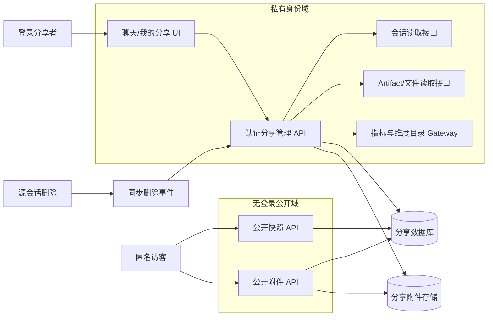
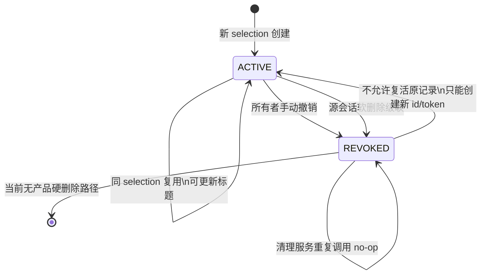
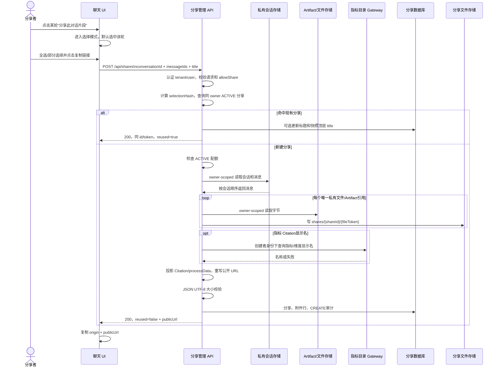
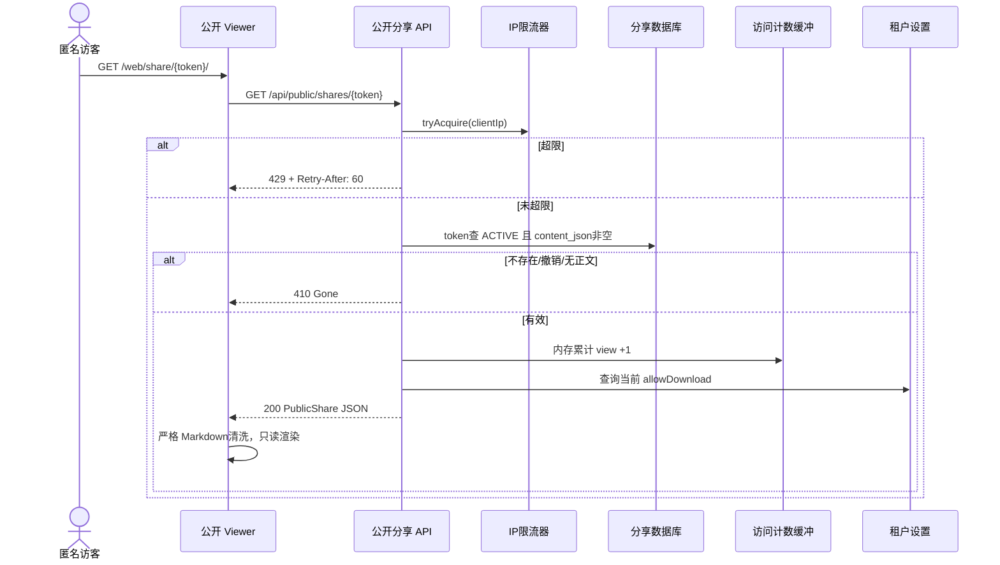
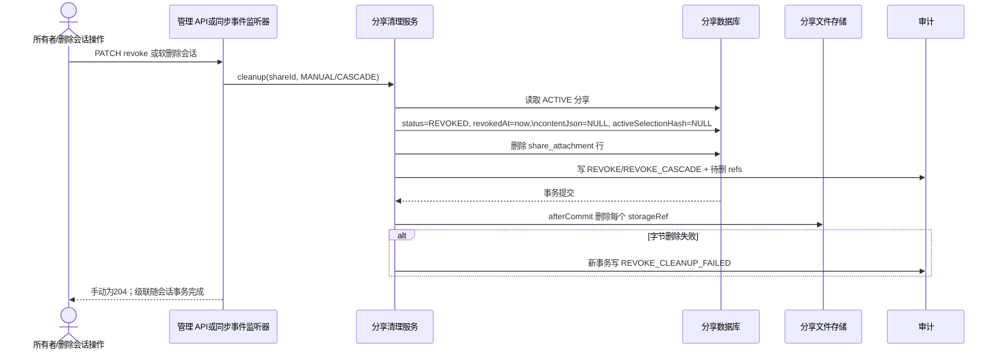

# 会话分享、匿名访问、快照与撤销：自包含复刻指南

## 1\. 结论与边界

### 1.1 业务结论

本能力把登录用户拥有的一段会话转换成一个可匿名读取、只读、可撤销的公开快照。用户不是把私有会话本身授权给访客，而是在创建分享时选择若干“轮次”，前端将轮次展开成消息 ID，服务端重新读取并校验这些消息，将正文、允许公开的执行过程、Citation 以及正文引用的文件/Artifact 复制到分享专用命名空间，最后返回不可猜测的公开 token。

公开访客只凭 token 读取快照，不需要登录，也不应获得源会话、创建者身份、租户设置或管理接口权限。分享所有者可以在“我的分享”查看访问次数、按状态筛选、复制链接和撤销。撤销立即把数据库记录改成不可公开读取的 tombstone，清空快照正文，删除附件授权记录，并在数据库提交后清理物理文件；同一公开 token 此后统一返回 `410 Gone`。

当前能力的核心语义可概括为：
```text
私有会话消息 --创建时投影--> 公开只读快照 --随机 token--> 匿名访客
       |                         |
       | 所有者/租户校验          | 所有者撤销或源会话删除
       v                         v
  不直接公开源数据             410 + 内容清除 + 附件清理

```

### 1.2 目标用户、输入和输出

| 参与者 | 输入 | 输出或可见效果 |
|---------|------|---------------------|
| 分享创建者 | 自己的会话 ID、所选消息 ID、分享标题 | 公开 URL、分享管理记录、复制成功提示 |
| 匿名访客 | 公开 URL 中的随机 token | 只读消息快照、公开 Citation、经过投影的执行过程、允许下载时的公开附件 |
| 租户管理员 | `allowShare`、`allowDownload` 等平台设置 | 控制能否新建分享以及既有分享能否下载附件 |
| 运维/合规人员 | 审计记录、指标、清理失败记录 | 创建、标题变更、手动撤销、级联撤销和附件清理失败的追踪信息 |

服务端创建输入是：
- `sourceConversationId`：源会话 ID。
- `messageIds`：至少一个消息 ID，当前硬上限和默认配置上限均为 200。
- `title`：非空，最多 255 个字符。

服务端创建输出是：
- 管理用 `shareId`。
- 公开读取用随机 `token` 和 `/web/share/{token}/` URL。
- 标题、消息数、状态、访问数、创建/撤销时间。
- `reused`：是否复用了同一用户对同一消息选择创建的现有 ACTIVE 分享。

### 1.3 包含范围

本文完整覆盖：
1. 聊天页按轮次选择、全选、清空和取消。
2. 创建分享、相同选择去重、标题更新和并发竞态。
3. 消息正文、文件、Artifact、Citation、`processData` 的快照投影。
4. 匿名公开页、公开 JSON、公开附件和访问计数。
5. “我的分享”列表、状态筛选、复制和撤销。
6. 源会话软删除触发的级联撤销。
7. 租户分享/下载开关、安全隔离、限流、审计和清理。
8. 最小兼容实现、生产级改进设计和验收矩阵。

### 1.4 明确不包含
- “下载图片”是浏览器把所选消息离屏渲染为 PNG 的客户端导出能力，不创建公开分享记录，不经过公开 token，也不受撤销生命周期管理。
- “沉淀分析思路”属于 Insight/知识能力，不属于公开分享。
- 嵌入式 Agent 应用的应用密钥、会话鉴权和宿主通信是独立能力；公开分享 token 不能替代嵌入应用凭据。
- Artifact 和 Citation 自身的完整生命周期不在本文重新展开，但本文完整规定它们进入公开快照时的复制和脱敏边界。
- 当前没有分享协作者、密码保护、到期时间、访问者名单、编辑已发布消息、按 `shareId` 硬删除或管理员批量撤销接口。

### 1.5 当前实现、测试契约与缺口

以下结论全部来自三仓静态分析；本次没有执行服务、构建或自动化测试，因此没有 `R` 级运行验证。UI 自动化证据进一步拆分，避免把真实后端生命周期、路由 Mock、预期失败和环境跳过混为“已验证”：

| UI证据标记 | 含义 |
|--------------|------|
| `A-LIVE` | Playwright 用例会访问真实 Nova 后端或真实公开端点；本文只确认用例存在，未执行。 |
| `A-MOCK` | 用例通过 Playwright route 构造至少一个关键后端响应，只能证明前端在该响应下的行为，不能证明真实后端契约。 |
| `K-XFAIL` | 用例带 `test.fail()`，对应已知产品缺陷；不能把用例中的目标断言写成当前通过能力。 |
| `SKIP-GATED` | 用例受租户写权限或“允许保留已撤销记录”环境门禁控制，未授权环境会跳过。 |

| 等级 | 结论 |
|------|------|
| `I` | 当前服务实现了 owner-scoped 创建、分页列表、手动撤销，以及 permit-all 的快照和附件公开读取。 |
| `I` | 快照消息在创建后不跟随源会话新增消息或标题变化；但同一 ACTIVE 选择再次创建时会复用原分享，并允许更新分享标题及快照 JSON 中的标题。因此“消息不可变、标题可因去重复用而变”才是准确语义。 |
| `I` | 同一 `(tenantId, userId, sourceConversationId, 排序后的 messageIds列表)` 只允许一个 ACTIVE 分享；排序忽略顺序但保留重复次数。标题不参与去重。撤销后去重槽位释放，可为同一列表生成新 token。 |
| `I` | 撤销保留分享主记录、token、标题、源会话 ID、历史 selection hash、计数和时间，但清空 `content&#95;json`，删除附件行和物理字节。没有硬删除分享的产品接口。 |
| `I` | 关闭 `allowShare` 只阻止新建并隐藏聊天入口，不会自动撤销既有 ACTIVE 分享；`allowDownload` 在每次公开读取时动态计算，能作用于旧分享。 |
| `I` | 公开 Markdown 使用严格 HTML allowlist；但分享前的 `processData` 和 Citation 投影仍可能公开工具参数/结果、思考文本、任务计划、SQL、知识全文、数据结果或内部实体标识。创建分享应视为对这些内容的一次公开发布，而不是天然安全的“文本分享”。 |
| `A-LIVE/A-MOCK` | UI E2E覆盖选择、匿名生命周期、失败恢复、重复点击、列表筛选和非法 token；其中 SHARE-03/04/06 的关键失败或列表数据由路由 Mock 构造，不能视为后端实测。所有相关用例本次均未运行。 |
| `K` | `NOVA-BUG-018`：分享只能撤销，不能硬删除；自动化只能保留已撤销审计记录。 |
| `K` | `NOVA-BUG-024`：UI E2E 台账记录匿名访客打开公开分享后可读取创建者分享管理数据并撤销分享。静态认证过滤器设计要求 `/api/shares` 仍需认证，但运行缺陷台账与之冲突；复刻时必须以“匿名管理接口永不可达”为强制安全验收。 |
| `K` | `NOVA-BUG-025`：创建请求进行中按钮虽然显示“复制中…”，DOM仍未 disabled；处理函数已有 `isCopyingShareLink` guard，缺陷用例记录的 `postCount` 仍为1。当前已知缺陷是交互状态不正确，不是已证实的重复 POST。 |
| `K` | Citation 公开 DTO 没有保存私有消息使用的 scoped citation token，真实正文标记可能无法映射到公开 `&#91;N]`；同时 `processData` 的清洗范围不足。 |
| `K` | 公开快照 JSON 反序列化失败时，当前错误日志把完整 share token作为参数写出。token是匿名读取 bearer secret；此外反向代理 access log、HTTP trace/APM若记录原始 URL，也可能捕获 token路径。 |
| `P` | `nova&#95;auto&#95;test` 当前没有分享专属 API/WS YAML case；分享契约主要由 Nova 单元/集成测试和 `nova&#95;ui&#95;e2e` 提供。应补独立 API 黑盒覆盖。 |

## 2\. 术语与参与方

### 2.1 术语

| 术语 | 定义 |
|------|------|
| Turn/轮次 | 一次用户输入及其关联的 Assistant 输出。UI 按轮次勾选，提交时展开为实际消息 ID。 |
| Selection | `sourceConversationId + messageIds` 表示的发布选择。当前哈希忽略消息 ID顺序，但不消除重复项，因此它实际识别的是“有重数的列表”而非数学集合。 |
| Selection hash | 对 `conversationId + 排序但保留重复项的 messageIds` 做 SHA-256得到的64位十六进制摘要。 |
| ACTIVE 分享 | 仍可用 token 公开读取的分享；持有快照正文和 active selection hash。 |
| REVOKED 分享 | 已撤销 tombstone；不可公开读取，快照正文已清除，但管理/审计元数据保留。 |
| Snapshot | 创建分享时从私有消息投影出的公开 JSON，以及复制到分享命名空间的附件字节。 |
| Share token | 公开 URL 的 bearer secret；知道 token 即获得快照读取能力。当前为 32 个大小写字母或数字。 |
| Public file token | 每个分享附件独立的 128-bit 随机十六进制 token，必须与 share token 同时匹配。 |
| Public projection | 从私有对象中只复制审核过的公开字段，并重写或删除私有引用。不是直接序列化原对象。 |
| Tombstone | 保留主记录和撤销元数据、删除可公开正文及授权的撤销状态。 |

### 2.2 参与方与信任边界



关键边界：
- 管理 API 根据当前认证上下文解析 `tenantId + userId`，请求体不得自行指定身份。
- 公开 API 不建立用户身份，只校验随机 token、ACTIVE 状态、快照是否存在、附件是否属于该分享。
- 创建快照是私有域到公开域的不可逆发布操作。公开投影必须在服务端完成，不能依赖公开前端隐藏字段。
- 源文件或 Artifact 不能把私有 URL直接交给匿名访客；必须复制字节并生成分享专用授权。

## 3\. 业务规则

### 3.1 选择规则
1. 分享入口只在租户 `allowShare=true` 时显示在 Assistant 消息操作区；单条入口默认选中该消息所属轮次。
2. 状态存储预留了“从会话级入口进入并在消息渲染后默认全选”的动作，但当前前端没有发现调用该动作的已渲染入口；当前可确认的产品入口是每条 Assistant 消息上的分享按钮。不能把“标题栏一键全选”当作现有可用能力。
3. 每个勾选项代表一轮；提交时收集该轮所有具有服务端 ID 的消息，因此一轮通常产生用户与 Assistant 两个消息 ID。
4. 全选框具有 `false/mixed/true` 三态；清空后复制链接和下载图片都必须禁用。
5. 取消选择模式只清理浏览器状态，不发送创建请求。
6. 服务端不相信“轮次”概念，只接受消息 ID，并重新验证源会话存在、未删除、属于当前 tenant/user，且每个去重后的消息 ID 都属于该会话。
7. 服务端按源会话原始消息顺序生成快照，而不是按客户端 `messageIds` 的传入顺序。

当前边界缺陷不是单纯的计数偏差，而是三个步骤使用了不同的规范化规则：
- selection hash先排序，但保留重复次数：`[1,2]` 与 `[1,1,2]` 得到不同 hash。
- 消息加载把列表转成 `Set`：两者生成相同的两条消息快照。
- `messageCount` 使用原始数组长度：前者为2，后者为3。

因此调用者能为逻辑上相同的公开内容创建不同 share/token，绕过“同选择复用”的本意，并重复占用 ACTIVE 配额；它不会单独突破 `max-active-per-user` 的计数上限，但会用重复变体耗尽额度。另一个输入缺口是元素没有 `@NotNull`约束：`messageIds:[1,null,2]` 能通过 Bean Validation，随后排序时触发空指针，进入非预期500而不是稳定400。复刻时必须二选一并全链路一致：推荐拒绝 null和重复 ID；若产品允许重复输入，则先按稳定规则去重，再用同一规范列表做校验、hash、计数和快照。

### 3.2 创建和去重规则

选择身份计算如下：
```text
canonical = sourceConversationId + "|" + sortAscendingPreservingDuplicates(messageIds).join(",")
selectionHash = hex(SHA-256(UTF8(canonical)))

```
- 当前唯一性范围为 `(tenantId, userId, activeSelectionHash)`。
- 标题不参与哈希。同一用户对同一会话的同一“排序后且重复次数也相同”的消息列表重复创建时，复用原 `id/token/publicUrl`，返回 `reused=true`。
- 若新标题与原标题不同，复用事务会同时更新主记录标题和快照 JSON 顶层标题，并写 `TITLE_UPDATED` 审计。
- 标题相同则不新增标题审计。
- 不同用户或不同租户即使选择完全相同，也必须生成不同分享。
- REVOKED 行的 `activeSelectionHash` 为 `NULL`，所以不阻止同一选择重新发布；新发布生成新 `id/token`。
- 每用户默认最多 200 个 ACTIVE 分享。该限制通过创建前计数实现，当前不是严格原子配额，并发创建不同选择可能短暂突破上限。

### 3.3 快照规则

当前快照遵循以下语义：
- 只保存请求选中的消息，不保存整段源会话。
- 消息正文、创建时间、公开 Citation 和经过 sanitizer 的 `processData` 被复制到 JSON。
- 当前 DTO 声明了 `images/files/artifacts` 结构化数组，但实际构建器没有填充这些字段；文件和 Artifact 主要通过扫描 Markdown 中的 `/api/files/...` 与 `/api/artifacts/{id}/content` 引用完成复制与 URL 重写。
- `/api/files/local/...` 不进入复制扫描。
- 相同源引用在一个分享内只复制一次。
- 单个附件解析失败、越权、不存在、超过大小或超出数量上限时，创建继续；对应 Markdown 引用替换为 `[文件已省略]`。
- 源文件引用必须指向当前源会话，禁止 `..` 路径穿越；Artifact 必须由当前 tenant/user 的 owner-scoped 接口读取。
- Artifact 字节被复制后保存源 Artifact ID用于内部追踪，但公开 URL只使用新 file token。
- 快照创建后，源会话重命名、新增消息、源 Artifact 内容变化或知识条目变化不会修改已保存消息内容。
- 唯一的当前更新路径是同一 selection 再次创建时更新分享标题。

### 3.4 租户开关规则

| 设置 | 创建分享 | 读取既有快照 | 下载/内联附件 |
|------|------------|------------------|-------------------|
| `allowShare=false` | 服务端返回 403；聊天入口隐藏 | 当前实现仍允许读取既有 ACTIVE 分享 | 由 `allowDownload` 独立决定 |
| `allowShare=true` | 允许 | 允许 | 由 `allowDownload` 决定 |
| `allowDownload=false` | 不影响创建 | JSON 仍返回，携带 `allowDownload=false` | 公开附件端点返回 403；前端隐藏或降级下载链接 |
| `allowDownload=true` | 不影响创建 | JSON 返回 `allowDownload=true` | 文件按 MIME 策略 inline 或 attachment |

没有租户设置记录时两个开关默认均为 `true`。设置读取有约 30 秒进程缓存，但更新路径会立即刷新当前实例缓存。

### 3.5 状态与权限规则


- 创建、列表、撤销必须登录。
- 列表只能返回当前 `(tenantId,userId)` 的记录。
- 撤销其他用户、其他租户或不存在的分享统一表现为 404，避免泄露存在性。
- 管理 API 对重复撤销返回 409；底层清理服务本身是幂等 no-op。这个差异是刻意的：HTTP 调用者能识别重复操作，内部级联可以安全重试。
- 公开读取对不存在 token、已撤销 token、ACTIVE 但正文为空统一返回 410。
- 公开附件若 share token 无效/撤销返回 410；share 有效但 file token 不属于该分享返回 404。

## 4\. 完整执行链路

### 4.1 从轮次选择到公开链接



详细步骤：
1. UI 从当前消息列表建立 `turnIndex -> messages` 映射。
2. 用户提交后，UI 仅收集有稳定服务端 ID 的选中消息。若无 ID则禁用创建。
3. 服务端先做 Bean Validation，再做业务校验。非法请求即使租户关闭分享也先以参数错误结束；但当前元素未声明 `@NotNull`且未拒绝重复项，所以这两类输入没有在该边界被正确收口。
4. 服务端检查租户分享开关；关闭时不触达快照和存储。
5. 服务端计算 selection hash，先做一次已有 ACTIVE 分享查询。
6. 若命中，进入独立事务更新标题/审计并返回，不重新读取源消息，也不刷新快照内容。
7. 若未命中，检查 ACTIVE 数量后生成： 
    - `shareId = "share-" + UUID前8位`；
    - 32 字符大小写字母/数字公开 token；
    - 每附件 16 随机字节转 32 位 hex file token。
8. 快照构建器确认源会话存在、未软删除且属于当前用户，然后确认全部请求消息属于该会话。
9. 扫描正文引用，逐个复制合格文件。单附件失败为 fail-soft；身份/消息校验和最终快照超限为 fail-closed。
10. Citation 按类型投影；指标/维度显示名创建时预解析，Gateway失败仅降级为原始code。当前投影丢失token且不改写正文中的scoped token，因此类型字段虽然保留，角标引用仍可能断链。
11. 快照序列化并检查 UTF-8 字节大小，随后保存附件行、分享行和 CREATE 审计。
12. 并发相同 selection 由数据库唯一约束选出一个赢家。输家重新查询赢家并返回 `reused=true`。
13. UI 复制绝对 URL。生产实现必须等待剪贴板操作结果，不能在失败时仍显示成功。

### 4.2 匿名读取链路



公开页没有聊天输入、删除、重命名、反馈、重新生成或分享管理动作。Citation 点击只打开本地只读抽屉，不应再调用需要创建者身份的服务。

访问数先写入进程内缓冲，默认每 30 秒批量刷入数据库；缓冲中 share key 数达到 500 时也触发刷新。公开 JSON 访问计数，公开附件访问不计数。进程正常关闭时尝试刷新；异常宕机可能丢失尚未刷新的计数。

### 4.3 公开附件链路
1. 匿名客户端请求 `/api/public/shares/{shareToken}/files/{fileToken}`。
2. 与 JSON 读取共用按 IP 的请求额度。
3. 先确认 share ACTIVE，再实时查询租户 `allowDownload`。
4. 下载关闭返回 403。
5. 以 `fileToken` 查附件，并验证 `attachment.shareId == share.id`；不匹配返回 404。
6. 只有 `image/png`、`image/jpeg`、`image/webp`、`image/gif` 允许 `inline`。
7. 其他类型统一响应 `application/octet-stream` 和 `Content-Disposition: attachment`。
8. 始终设置 `X-Content-Type-Options: nosniff`；文件名中的 CR、LF和双引号替换为下划线。

### 4.4 撤销与源会话删除



撤销采用数据库 tombstone 与物理字节删除的两阶段策略：
- 事务回滚时，分享仍为 ACTIVE、附件行仍在、物理字节不删。
- 事务提交后，公开 API立即因 REVOKED 返回 410；物理删除失败只留下不可公开访问的孤立字节，并写失败审计。
- 源会话软删除同步发布包含 `conversationId/tenantId/userId` 的事件。监听器只查询相同 owner 的 ACTIVE 分享并逐个级联撤销，数据库操作加入会话删除事务，物理字节在最外层事务提交后删除。
- 清理一个分享失败时监听器继续记录其他失败；加入的事务可能已被标记 rollback-only，最终会话删除整体失败重试，避免部分级联。

## 5\. 对外契约

### 5.1 通用认证与错误体

管理端点需要登录 cookie 或系统支持的正式认证上下文。身份来自服务端认证结果，不接受请求体覆盖。

业务错误统一形状：
```json
{
  "success": false,
  "message": "Some messageIds do not belong to source conversation (requested=4, matched=3)"
}

```

公开端点的 `410/429/500` 由 HTTP 状态表达，当前不保证与管理 API 使用同一 JSON 错误体。复刻时建议统一为不含内部信息的稳定错误码。

### 5.2 创建分享
```http
POST /api/shares
Content-Type: application/json
Cookie: CIP_SESSION=<session>

{
  "sourceConversationId": "conv-01JABCDEF",
  "messageIds": [101, 102, 105, 106],
  "title": "2026 年 7 月经营分析"
}

```

字段：

| 字段 | 类型 | 必填 | 规则 |
|------|------|------|------|
| `sourceConversationId` | string | 是 | 非空；必须是当前用户未删除的会话 |
| `messageIds` | integer\[\] | 是 | 非空；声明上限200；每个 ID必须属于源会话。当前未拒绝重复项，也未对数组元素声明 `@NotNull`，属于缺陷而非可依赖契约 |
| `title` | string | 是 | 非空，最大 255；服务端存储原值，UI通常提交会话标题 |

成功响应 `200 OK`：
```json
{
  "id": "share-7a91b2c3",
  "token": "X7dL4xVbQW8McnYq2jsR5taU9EzKpH3F",
  "publicUrl": "/web/share/X7dL4xVbQW8McnYq2jsR5taU9EzKpH3F/",
  "title": "2026 年 7 月经营分析",
  "messageCount": 4,
  "viewCount": 0,
  "lastViewedAt": null,
  "status": "ACTIVE",
  "createdAt": "2026-08-07T03:21:10.123Z",
  "revokedAt": null,
  "reused": false
}

```

主要错误：

| HTTP | 条件 | 当前语义 |
|----|------|------------|
| 400 | 空消息、消息数超限、消息不属于会话、快照超限、ACTIVE 配额超限 | `success=false, message=...` |
| 403 | 租户关闭分享 | `Sharing is disabled for this tenant` |
| 404 | 会话不存在、已删除或不属于当前用户 | 不区分真实不存在与越权 |
| 401 | 未认证 | 认证过滤器拒绝 |
| 500 | 非预期存储/序列化错误 | 不应暴露堆栈 |

当前 `SnapshotTooLarge` 被映射为 400，并在 message 中包含实际与限制字节数。生产设计可使用稳定错误码 `SHARE_SNAPSHOT_TOO_LARGE` 和 413。

当前还存在两个输入一致性缺陷：重复 ID会被 hash保留、被消息加载去重、被计数保留；null元素会在 selection hash排序阶段触发空指针并可能返回500。目标契约应在controller边界把两者都映射为400，例如 `SHARE_MESSAGE_ID_DUPLICATED` 与 `SHARE_MESSAGE_ID_REQUIRED`，且不得开始附件复制或占用配额。

### 5.3 我的分享列表
```http
GET /api/shares?status=ACTIVE&page=0&size=20
Cookie: CIP_SESSION=<session>

```

参数：
- `status`：省略、空或 `ALL` 表示全部；`ACTIVE`、`REVOKED` 大小写不敏感；其他值返回 400。
- `page`：默认 0，负数归一为 0。
- `size`：默认 20，限制到 `[1,100]`。
- 排序固定为 `createdAt DESC`。

Spring Page 兼容响应：
```json
{
  "content": [
    {
      "id": "share-7a91b2c3",
      "token": "X7dL4xVbQW8McnYq2jsR5taU9EzKpH3F",
      "publicUrl": "/web/share/X7dL4xVbQW8McnYq2jsR5taU9EzKpH3F/",
      "title": "2026 年 7 月经营分析",
      "messageCount": 4,
      "viewCount": 17,
      "lastViewedAt": "2026-08-07T04:00:00Z",
      "status": "ACTIVE",
      "createdAt": "2026-08-07T03:21:10.123Z",
      "revokedAt": null,
      "reused": false
    }
  ],
  "number": 0,
  "size": 20,
  "totalElements": 1,
  "totalPages": 1,
  "first": true,
  "last": true
}

```

列表严格按 tenant/user 过滤。REVOKED 行仍返回历史 token/publicUrl，但 UI禁用复制和撤销按钮；公开端点对该 token 返回 410。

### 5.4 手动撤销
```http
PATCH /api/shares/share-7a91b2c3/revoke
Cookie: CIP_SESSION=<session>

```

成功：`204 No Content`。

| HTTP | 条件 |
|----|------|
| 404 | ID 不存在、属于其他用户或属于其他租户 |
| 409 | 当前用户的分享已经 REVOKED |
| 400 | 其他可预期清理错误 |
| 401 | 未认证 |

当前没有 `DELETE /api/shares/{id}`，也没有恢复端点。

### 5.5 匿名读取快照
```http
GET /api/public/shares/X7dL4xVbQW8McnYq2jsR5taU9EzKpH3F

```

不需要 cookie。这里必须把“当前实际 payload”和“复刻目标 payload”分开；下面的当前示例刻意展示 Citation 断链，不能把它误读为角标已可用。

**当前实际 payload：scoped token留在正文，但公开 Citation不携带 token**
```json
{
  "title": "2026 年 7 月经营分析",
  "createdAt": "2026-08-07T03:21:10.100Z",
  "allowDownload": true,
  "messages": [
    {
      "role": "USER",
      "content": "分析 2026 年 7 月销售情况",
      "createdAt": "2026-08-07T03:20:00Z"
    },
    {
      "role": "ASSISTANT",
      "content": "销售额为 1,234 万元。[^cite:msg106.ev_a1b2c3d4e5f6] 下载[报告](/api/public/shares/X7dL4xVbQW8McnYq2jsR5taU9EzKpH3F/files/af30d8110d5b3e21b9ab45cd39a918a4)",
      "createdAt": "2026-08-07T03:20:30Z",
      "citations": [
        {
          "label": "1",
          "type": "metric",
          "title": "查询了 2026 年 7 月销售额",
          "text": "本月销售额较上月增长。",
          "metricSpec": {
            "metrics": ["retail_amt"],
            "dimensions": ["metric_date[month]"]
          },
          "result": {
            "columns": ["月份", "销售额"],
            "rows": [["2026-07", 12340000]],
            "totalRows": 1
          },
          "metricDisplayNames": {
            "retail_amt": "销售额"
          },
          "dimensionDisplayNames": {
            "metric_date": "指标日期"
          }
        }
      ],
      "processData": {
        "events": [
          {
            "type": "tool_exec",
            "tool": "metric_query",
            "success": true,
            "durationMs": 830
          }
        ],
        "tokenStats": {
          "inputTokens": 210,
          "totalTokens": 330,
          "cachedTokens": 0,
          "cacheHitRatio": 0,
          "outputTokens": 120,
          "toolCallCount": 1
        },
        "totalDurationMs": 2100
      }
    }
  ]
}

```

当前 Citation DTO只有 `label`和类型化展示字段，没有 `token/localToken`。公开 renderer虽然实现了 `token -> label`映射，但收到的映射为空，因此会把无法解析的 `[^cite:msg106.ev_a1b2c3d4e5f6]`删除，用户看不到角标；只有历史正文已经是 `[1]`且本消息 Citation中存在 `label="1"`时，数字形式才可能正常渲染。

目标实现可选择以下两套线协议之一，不能混搭：

**目标A（推荐）：快照时把 token引用重写为消息内** `**[N]**`
```json
{
  "role": "ASSISTANT",
  "content": "销售额为 1,234 万元。[1]",
  "citations": [
    {
      "label": "1",
      "type": "metric",
      "title": "查询了 2026 年 7 月销售额"
    }
  ]
}

```

目标A不向匿名端暴露私有 message ID或内部 evidence token。投影器必须在同一次构建中扫描正文、生成 `privateScopedToken -> label`映射、重写正文并输出 Citation；任一步失败都应拒绝发布或明确删除“引用与证据”两侧，不能只删一侧。

**目标B：正文保留 token语法，公开 Citation同时携带可解析 token**
```json
{
  "role": "ASSISTANT",
  "content": "销售额为 1,234 万元。[^cite:pc_7Yk2mQ]",
  "citations": [
    {
      "label": "1",
      "token": "pc_7Yk2mQ",
      "type": "metric",
      "title": "查询了 2026 年 7 月销售额"
    }
  ]
}

```

目标B应给私有 scoped token重新签发分享内不可关联的公开 token；若为了兼容直接保留 `msg106.ev_...`，必须接受其泄露内部 message ID的隐私成本。公开 renderer用 Citation的 `token`建立映射，`localToken`不是必需字段。

两套目标都必须定义以下合并和编号规则：
1. 持久化 Assistant消息的 Citation finalizer按正文中 scoped token首次出现顺序分配 `id=1..N`；同一 token重复出现仍指向同一 id。
2. 正文引用历史消息 token时，finalizer会按 owner读取历史消息 Citation并补入当前消息 `processData.citations`；如果当前数组已出现该 token则不再次补入。目标快照必须保留这一历史证据语义。
3. 当前 finalizer只阻止“历史补入”造成的新重复，不会清除输入 Citation数组中原本存在的重复 token行；这些行会得到相同 id。当前快照又会全部复制为相同 label。renderer建立 `byLabel`映射时后项覆盖前项，而抽屉查找使用首项，可能出现角标标题与抽屉内容不一致。
4. 复刻时应以 token为键先稳定去重：同 token元数据完全相同则保留首项；冲突则拒绝发布并记录不含内容的错误。随后按正文首次出现顺序编号，删除正文未引用的 Citation，缺失证据的正文 token也不得发布。
5. label作用域是“单条公开消息”，不是整个分享。不同消息都可以有 `label="1"`；Viewer必须用 `(messageIndex或publicMessageId, label)`定位抽屉，不能用全局 label。跨消息引用历史证据时，它在当前消息内获得当前消息的局部 label。

状态：

| HTTP | 条件 | Header |
|----|------|------|
| 200 | token存在、ACTIVE、`content&#95;json` 非空且可解析 | 当前没有明确 Cache-Control契约 |
| 410 | token不存在、已撤销或正文为空 | 不区分存在性 |
| 429 | 当前 IP超过每分钟额度 | `Retry-After: 60` |
| 500 | 保存的 JSON无法反序列化 | 应记录服务端错误，不返回快照 |

当前500路径存在明确的 secret日志缺陷：反序列化异常会执行等价于 `log.error("public share json parse failed token={}", token, exception)` 的日志，完整记录 bearer token。复刻时只能记录 `shareId`、错误分类、schemaVersion和 request/trace ID；如确需关联公开请求，可记录带服务端 pepper的 token hash摘要，不能记录原 token。反向代理、API gateway、Servlet access log、APM span、错误上报和前端分析也必须把实际路径归一为 `/api/public/shares/{token}`，并禁止采集 query、Referer和完整 public URL。

### 5.6 匿名读取附件
```http
GET /api/public/shares/{shareToken}/files/{fileToken}

```

成功 Header 示例：
```http
HTTP/1.1 200 OK
Content-Type: application/octet-stream
Content-Disposition: attachment; filename="report.pdf"
X-Content-Type-Options: nosniff
Content-Length: 184200

```

非图片响应会把 `Content-Type` 强制为 `application/octet-stream`。安全图片使用原图片 MIME和 `inline`。错误状态为 403/404/410/429。

### 5.7 WebSocket、SSE、Tool 和事件契约

创建、读取与撤销都是 REST，不使用 WebSocket、SSE、Agent Tool 或 MCP。唯一内部事件为源会话软删除事件：
```json
{
  "type": "ConversationSoftDeleted",
  "conversationId": "conv-01JABCDEF",
  "tenantId": "tenant-a",
  "userId": "user-a"
}

```

当前事件是进程内同步事件，不是消息队列契约。生产多服务拆分时应改为 transactional outbox，并以 `conversationId + owner + deletionVersion` 作为幂等键。

### 5.8 配置契约
```yaml
nova:
  share:
    max-messages: 200
    max-snapshot-bytes: 2097152
    max-attachment-bytes: 5242880
    max-attachments-per-share: 20
    max-active-per-user: 200
    view-rate-limit-per-minute: 60
    audit-retention-days: 90

```

配置含义：

| 配置 | 默认值 | 作用 |
|------|---------|------|
| `max-messages` | 200 | 服务端快照消息数上限 |
| `max-snapshot-bytes` | 2 MiB | `content&#95;json` UTF-8 序列化字节上限，不含复制附件 |
| `max-attachment-bytes` | 5 MiB | 单个公开副本上限 |
| `max-attachments-per-share` | 20 | 一个分享最多复制的唯一附件数 |
| `max-active-per-user` | 200 | owner维度 ACTIVE 主记录软配额 |
| `view-rate-limit-per-minute` | 60 | 单实例、按客户端 IP 的 JSON\+附件共享请求额度；小于等于0表示关闭 |
| `audit-retention-days` | 90 | 审计日志每日 03:00清理的保留天数；不删除分享主记录 |

## 6\. 数据模型与生命周期

### 6.1 当前兼容 DDL

下面的 PostgreSQL DDL足以复刻当前数据语义：
```sql
CREATE TABLE conversation_share (
    id                    VARCHAR(40) PRIMARY KEY,
    token                 VARCHAR(64) NOT NULL UNIQUE,
    tenant_id             VARCHAR(64) NOT NULL,
    user_id               VARCHAR(64) NOT NULL,
    source_conversation_id VARCHAR(40) NOT NULL,
    title                 VARCHAR(255) NOT NULL,
    message_count         INT NOT NULL DEFAULT 0,
    content_json          TEXT,
    selection_hash        VARCHAR(64) NOT NULL,
    active_selection_hash VARCHAR(64),
    status                VARCHAR(16) NOT NULL DEFAULT 'ACTIVE',
    view_count            BIGINT NOT NULL DEFAULT 0,
    last_viewed_at        TIMESTAMPTZ,
    created_at            TIMESTAMPTZ NOT NULL,
    revoked_at            TIMESTAMPTZ
);

CREATE UNIQUE INDEX uq_share_owner_active_selection
    ON conversation_share(tenant_id, user_id, active_selection_hash);
CREATE INDEX ix_share_owner_created
    ON conversation_share(tenant_id, user_id, created_at DESC);
CREATE INDEX ix_share_source_conversation
    ON conversation_share(source_conversation_id);

CREATE TABLE share_attachment (
    id                 BIGSERIAL PRIMARY KEY,
    share_id           VARCHAR(40) NOT NULL,
    public_file_token  VARCHAR(64) NOT NULL UNIQUE,
    mime_type          VARCHAR(127) NOT NULL,
    size_bytes         BIGINT NOT NULL,
    original_name      VARCHAR(255) NOT NULL,
    storage_ref        VARCHAR(512) NOT NULL,
    source_artifact_id VARCHAR(16),
    created_at         TIMESTAMPTZ NOT NULL
);
CREATE INDEX ix_share_attachment_share ON share_attachment(share_id);

CREATE TABLE share_audit_log (
    id         BIGSERIAL PRIMARY KEY,
    share_id   VARCHAR(40) NOT NULL,
    tenant_id  VARCHAR(64) NOT NULL,
    user_id    VARCHAR(64) NOT NULL,
    action     VARCHAR(32) NOT NULL,
    metadata   TEXT,
    created_at TIMESTAMPTZ NOT NULL
);
CREATE INDEX ix_share_audit_share ON share_audit_log(share_id);
CREATE INDEX ix_share_audit_owner_time
    ON share_audit_log(tenant_id, user_id, created_at);

```

当前 migration 没有为附件或审计声明外键。这样可以在撤销后保留审计、先删附件行，但也允许孤儿行。生产实现建议：
- `share_attachment.share_id -> conversation_share.id ON DELETE CASCADE`；
- 审计使用逻辑引用而非强外键，便于主数据按保留策略物理删除；
- `status/content_json/active_selection_hash/revoked_at` 增加一致性约束：ACTIVE 必须有正文和 active hash，REVOKED 必须无正文和 active hash且有 revokedAt；
- 配额和去重使用数据库事务或单独 quota row，而非先 count 后 insert。

### 6.2 快照 JSON Schema

逻辑 schema：
```typescript
interface PublicShareSnapshot {
  title: string;
  createdAt: string;             // ISO-8601

  messages: PublicMessage[];

  allowDownload?: boolean;       // 不持久化；读取时动态注入
}

interface PublicMessage {
  role: string;                  // 当前存 USER/ASSISTANT；前端大小写归一
  content: string;               // Markdown，私有附件 URL 已重写或替换
  createdAt: string;

  images?: InlineImage[];        // 当前构建器未填充


  files?: AttachmentRef[];       // 当前构建器未填充


  artifacts?: AttachmentRef[];   // 当前构建器未填充


  citations?: PublicCitation[];

  processData?: PublicProcessData;
}

interface AttachmentRef {
  name: string;
  mimeType: string;
  publicUrl: string;
  sizeBytes: number;
}

interface PublicCitation {
  label: string;                 // 当前仅有消息内局部编号
  token?: string;                // 前端类型预留，当前后端快照不输出
  localToken?: string;           // 前端类型预留，当前后端快照不输出
  type?: "metric" | "sql" | "python" | "knowledge" | "file" | "web" | "generic";
  title?: string;
  text?: string;
  // 其余类型化字段见下表
}

```

`allowDownload` 是读取时临时字段，不属于不可变快照；管理员切换开关后，旧 token 下一次读取会得到新值。

### 6.3 Citation 公开字段

当前按类型复制的字段如下：

| 类型 | 当前可能公开的字段 | 明确删除的字段 |
|------|---------------------------|---------------------|
| 通用 | label、type、caption-\>title、interpret-\>text | 未知未来字段默认删除 |
| metric | metricSpec、result、timeFiscalLabel、指标/维度显示名 map | download URL |
| sql | SQL全文、datasourceAlias、purpose、result | download URL |
| python | Python代码、stdout | 未按内容做秘密检测 |
| knowledge | 名称、摘要、关键词、同义词、全文、code、因子/维度/关系树 | 注释意图删除实体 ID，但 `code` 实际语义可能仍是实体 ID |
| file | 文件名、类型、引用片段 | 私有 filePath |
| web | 页面标题、站点名 | 原始 URL |

指标显示名在创建者身份仍有效时预解析并写入快照，匿名读取不再调用私有 Gateway。解析失败为 fail-soft，公开页显示原始 code。

当前 Citation链路的不变量与缺陷如下：
- 编号由每条 Assistant消息自己的 `processData.citations[].id`提供，因此 label可跨消息重复；公开 Viewer用 `messageIndex + label`选择抽屉，这是正确作用域。
- 同一消息内相同 scoped token重复出现在正文时，应复用同一 id；引用历史消息证据时，证据副本被合并到当前消息后重新使用当前消息内编号。
- 当前公开投影只复制 id为 `label`，丢失 `token/localToken`且不重写正文。真实正文若保留 `[^cite:msg<ID>.<localToken>]`，公开 renderer无法关联并会删除角标。
- 同一消息的 Citation数组若含重复 token/重复 label，当前没有冲突检查。渲染映射与抽屉查找对“前项/后项”的选择不同，必须在快照发布前消歧或拒绝。

### 6.4  当前 allowlist

根字段：
- `events`
- `tokenStats`
- `totalDurationMs`
- `taskPlan`

允许的事件类型和字段：

| 事件 | 字段 |
|------|------|
| `thinking` | type、content、timestamp |
| `tool&#95;exec` | type、tool、args、result、inputBytes、outputBytes、success、durationMs、timestamp、artifacts |
| `sub&#95;tool&#95;exec` | 上述字段 \+ agentLabel |
| `agent&#95;phase` | type、role、description、timestamp |
| `step&#95;start` | type、stepId、description、timestamp |
| `step&#95;complete` | type、stepId、timestamp |
| `knowledge&#95;recall` | type、recall、timestamp |

当前清洗只对 `args/result/content/description` 中的 `/api/files/...` 与 `/api/artifacts/...` URL做字符串替换；Artifact 事件仍允许 `id/filename/type/size`，recall item允许 `title/summary/synonyms/scope`，删除 recall item ID。`taskPlan` 整棵复制。

因此以下都不是当前保证：
- 工具参数/结果不含 API Key、Cookie、业务机密或普通外部 URL。
- thinking/description 不含系统提示、个人信息或内部计划。
- SQL、Python stdout、指标结果和知识全文已取得公开授权。
- Artifact `id` 与 knowledge `code` 一定不是内部实体 ID。

生产复刻必须把“JSON字段白名单”升级为“按工具/事件类型的公开投影 \+ 内容分类策略”，详见第7节。

### 6.5 生命周期和保留

| 阶段 | 主记录 | JSON | 附件行/字节 | 审计 |
|------|---------|----|----------------|------|
| 创建成功 | ACTIVE | 保留 | 保留 | CREATE |
| 同选择复用 | ACTIVE原行 | 消息不变，标题可更新 | 不重拷贝 | 可选 TITLE\_UPDATED |
| 匿名访问 | ACTIVE | 不变 | 不变 | 当前不逐次写审计；异步累计 view count |
| 手动撤销 | REVOKED | 清空 | 行事务内删、字节提交后删 | REVOKE |
| 会话删除级联 | REVOKED | 清空 | 同上 | REVOKE\_CASCADE |
| 字节清理失败 | REVOKED | 已清空 | 可能残留不可访问字节 | REVOKE\_CLEANUP\_FAILED |
| 审计到期 | 主记录不变 | 不变 | 不变 | 默认90天后删除旧审计 |

REVOKED 主记录没有自动过期或硬删除任务。标题和源会话 ID仍可能是个人信息；“正文清空”等于完全满足删除请求不是当前保证。

## 7\. 核心实现设计

### 7.1 模块划分

一个可复刻实现至少拆成以下接口：
```java
interface ShareCommandService {
  ShareSummary create(Identity owner, CreateShareCommand command);
  void revoke(Identity owner, String shareId);
  void cascadeRevoke(Identity owner, String sourceConversationId);
}

interface ShareQueryService {
  Page<ShareSummary> listOwned(Identity owner, StatusFilter status, PageRequest page);
  PublicShareSnapshot readPublic(String token, ClientContext client);
  PublicFile openPublicFile(String token, String fileToken, ClientContext client);
}

interface SnapshotProjector {
  SnapshotBuildResult build(
      Identity owner,
      String shareId,
      String publicToken,
      String conversationId,
      List<Long> messageIds,
      String title);
}

interface PublicContentPolicy {
  PublicMessage projectMessage(PrivateMessage source, ProjectionContext context);
  PublicCitation projectCitation(PrivateCitation source, ProjectionContext context);
  PublicProcessData projectProcessData(PrivateProcessData source, ProjectionContext context);
}

interface ShareBlobStore {
  StagedBlob stage(String shareId, InputStream bytes, BlobMetadata metadata);
  void commit(List<StagedBlob> blobs);
  void delete(String storageRef);
}

```

关键原则：管理命令、公开读取、快照投影、内容政策和字节存储必须分层。不能让公开 controller 直接反序列化私有 Message实体，也不能让前端承担脱敏。

### 7.2 最小兼容创建算法
```text
create(owner, request):
  validate request; reject null messageId and duplicate messageId with 400
  require tenant.allowShare
  ids = rejectDuplicatesAndSort(request.messageIds)
  hash = sha256(request.conversationId + "|" + join(ids))

  existing = findActive(owner, hash)
  if existing:
      transaction:
        lock existing
        if title changed:
          update existing.title
          update snapshot.title
          append TITLE_UPDATED audit without raw title
      return existing with reused=true

  transaction:
    reserve owner active-share quota
    insert CREATING reservation(owner, hash, random shareId, random token)

  projected = snapshotProjector.build(...)

  transaction:
    verify reservation still owned and CREATING
    persist snapshot + attachment manifests
    append CREATE audit
    transition CREATING -> ACTIVE
  commit staged blobs
  return summary

```

为兼容当前 API，可不暴露 `CREATING`，但生产内部状态应包含它，避免“先写字节后建主记录”的孤儿窗口。

### 7.3 生产级快照投影

推荐使用以下流水线：
1. **加载**：owner-scoped读取会话和选中消息；拒绝重复 ID；固定消息版本或在同一一致性快照读取。
2. **发现引用**：用 Markdown AST发现链接、图片、Artifact marker和 Citation token，不依赖正则扫描任意文本。
3. **分类**：为每个字段应用公开政策：`PUBLIC`、`CONFIRM_REQUIRED`、`DROP`。
4. **复制资源**：所有私有文件复制到 staged share namespace，内容扫描、大小限制、MIME sniff和病毒扫描后才产生 public file token。
5. **重写正文**：只在 AST链接节点中替换为公开 URL；不可复制的链接替换成明确占位组件。
6. **Citation重绑定**：优先把私有 scoped token映射为当前消息内局部编号 `[N]`；也可采用“正文保留公开 token \+ Citation携带同 token”的备选协议。无论哪种，公开 DTO和正文映射必须在同一投影事务生成，并先按 token稳定去重、校验冲突及历史证据。
7. **过程投影**：默认只公开阶段名、成功状态和耗时；工具 args/result默认删除。需要展示时每种 Tool定义自己的 `PublicToolEventProjector`。
8. **安全扫描**：在最终 JSON上扫描内部 host、私有 API前缀、tenant/user/conversation/message/artifact/knowledge ID、凭据格式和本地路径。
9. **用户确认**：若包含 SQL、Python、知识全文、数据表、思考过程或外部图片，UI展示发布清单并要求显式确认。
10. **原子发布**：先完成 staged blob和 JSON，再原子切换 ACTIVE；失败清理所有 staged资源。

推荐默认公开规则：

| 内容 | 默认策略 |
|------|------------|
| 用户/Assistant Markdown文本 | 公开，但严格清洗 HTML和 URL |
| tokenStats、总耗时 | 可公开 |
| Tool名称、成功/耗时 | 可公开 |
| Tool args/result、thinking、taskPlan | 默认删除 |
| 指标/SQL结果表 | 创建者确认后公开 |
| SQL文本/Python代码/stdout | 创建者确认后公开或删除 |
| 知识标题/摘要 | 按知识分享政策决定 |
| 知识全文、entry ID、权限 scope | 默认删除 |
| Web原始 URL/外部图片 | 默认删除或经代理重写，避免 token通过 Referer泄露 |
| 私有 Artifact/文件 | 复制生成公开副本，不公开私有 ID/URL |

### 7.4 最小版与生产级版

| 能力 | 最小兼容版 | 生产级版 |
|------|---------------|------------|
| 去重 | owner \+ selection hash唯一约束 | `Idempotency-Key` \+ owner/selection/version；响应可安全重放 |
| 配额 | 创建前 count | owner quota row原子预留 |
| 快照 | JSON列 | 版本化快照对象，带 schemaVersion、内容摘要和分类清单 |
| 文件复制 | 直接持久化后写 DB | staged blob、提交清单、失败自动回收、周期 GC |
| 匿名读取 | 随机 bearer token | token hash落库、可轮换、可到期、缓存撤销传播 |
| 限流 | 单机内存 IP计数 | 可信代理解析 \+ Redis滑动窗口/token bucket \+ token/IP双维度 |
| 撤销 | tombstone \+ afterCommit删除 | outbox驱动清理、可重试任务、删除证明和管理员批量撤销 |
| 隐私 | DTO字段 allowlist | Tool级投影、DLP、用户发布预览、合规索引和受影响分享检索 |
| 审计 | 创建/标题/撤销/清理失败 | 还包括读取聚合、策略决定、字段剔除、token轮换和管理员操作 |
| 删除 | 无硬删除 | 到期/合规物理删除，保留最小不可逆审计摘要 |

### 7.5 撤销算法
```text
revoke(owner, shareId, reason):
  transaction:
    share = selectForUpdate(shareId)
    if missing: internal cleanup returns success; owner API returns 404
    require owner match for manual revoke
    if REVOKED: internal cleanup no-op; owner API returns 409
    refs = select attachment storage refs
    update share:
      status = REVOKED
      revokedAt = now
      contentJson = null
      activeSelectionHash = null
    delete attachment authorization rows
    append audit(reason, refs or encrypted cleanup batch id)
    append outbox SHARE_BLOBS_DELETE_REQUESTED
  invalidate public caches and view buffers
  worker deletes bytes idempotently
  failures retry with backoff and alert; terminal failures retain GC manifest

```

公开授权的失效必须以数据库状态/集中撤销缓存为准，不能等待物理字节删除。即使存储字节尚在，也没有附件行和 ACTIVE share就无法通过公开接口访问。

## 8\. 并发与非正常路径

### 8.1 当前行为和风险

| 场景 | 当前行为 | 风险 | 生产处理 |
|------|------------|------|------------|
| 同 selection并发创建 | 唯一约束选出一个赢家；输家查询并复用赢家 | 输家已写的文件字节可能成为孤儿，当前只记录 storage ref供离线 GC | 先插 CREATING reservation或 staged blob；失败自动清理 |
| 快照附件已写、最终 JSON超限 | 抛 SnapshotTooLarge；附件行尚未保存 | 已写字节没有数据库清单，形成孤儿 | 先 stage并在 finally删除，或对象存储生命周期回收 staging前缀 |
| 普通 DB错误发生在字节写后 | 事务回滚数据库 | 非去重异常未必携带 refs清理 | 统一 build manifest \+补偿任务 |
| 重复/null messageId | hash保留重复项、加载去重、count保留原长度；null排序可能NPE | 同内容可生成不同token并重复占配额；计数失真；null变500 | controller拒绝null和重复项；或先统一去重，并让hash/load/count共用规范列表 |
| 不同 selection并发突破配额 | 两个线程都可能在 count检查时低于上限 | ACTIVE数超过配置 | 数据库原子 quota或串行 owner锁 |
| 快速重复点击 | pending按钮未disabled是已知缺陷；handler已有 `isCopyingShareLink` guard，现有缺陷用例强制二次点击仍统计1次POST | React状态提交前存在极短竞态的可能性仅是静态推断，当前没有重复POST实证；enabled状态仍误导用户和辅助技术 | DOM disabled \+ handler guard \+服务端 Idempotency-Key三层并存 |
| 同 selection复用同时撤销 | 读到 existing后可能在复用事务前被撤销 | 当前复用按 ID读取后未再次要求 ACTIVE/owner，存在竞态窗口 | `SELECT FOR UPDATE`并重新检查 status/owner/hash |
| 复用时更新快照标题解析失败 | 主记录标题仍更新，JSON标题保持旧值并仅记录错误 | “我的分享”标题与公开页标题不一致 | 解析失败应回滚整个标题更新；快照采用结构化列或版本化对象 |
| shareId/token极低概率碰撞 | 数据库主键/唯一键拒绝 | 当前没有专门重试，且此前可能已写附件字节 | 在写任何字节前预留 ID/token；唯一冲突重新生成并限制重试次数 |
| 访问计数刷新与新访问并发 | 内存 map复制后按 key remove | 新增计数可能在复制与remove间被删除；异常宕机也丢计数 | 原子 `compute`交换 LongAdder或消息流/Redis计数 |
| 撤销与访问计数刷新并发 | 撤销显式 invalidate，flush也检查 ACTIVE | 撤销前已返回的访问可能不计数；这是可接受近似但应定义 | 将访问数定义为近似指标，或使用持久事件 |
| 撤销事务回滚 | afterCommit不执行，DB与字节保持 ACTIVE | 正确 | 保留该不变量测试 |
| 物理字节删除失败 | 已410，写 cleanup-failed审计 | 字节占空间；审计90天后可能先被删，缺少持久 GC队列 | 独立永久/长保留 cleanup job表并告警 |
| corrupt content JSON | 公开 GET先累计 view，再反序列化失败500；异常日志直接写完整 token | 错误请求可能增加访问数并泄露bearer secret | 校验成功后再计数；保存时带schema版本；日志只记shareId/分类，access/trace路径模板化 |
| Citation显示名 Gateway超时 | fail-soft，不阻断分享 | 公开显示 raw code，创建延迟可能受串行维度请求影响 | 超时预算、批量/并行查询、缓存，失败明确降级 |
| 单附件失败/超限 | 分享成功，正文显示 `&#91;文件已省略]` | 用户可能误以为完整分享 | 创建响应返回 warnings，发布前预览缺失资源 |
| 源会话删除与分享创建并发 | 创建时检查未删除；删除事件同步撤销已查询到的 ACTIVE分享 | 创建若在事件查询后提交，可能留下指向已删除会话的 ACTIVE分享 | 会话版本/删除锁、外键状态检查或删除后补偿扫描 |

### 8.2 失败传播和 UI恢复
- 创建失败：保持选择模式和原选中项；不得写剪贴板、不得显示复制成功、不得在“我的分享”出现新记录。
- 撤销失败：确认对话框保持打开并显示可定位错误；列表仍显示 ACTIVE，公开 token仍应读取成功。解除故障后可重试。
- 列表加载失败：显示错误而非空状态；切换筛选或显式重试后恢复。
- 公开 410：统一显示“分享链接已失效”，不能暗示曾存在、创建者或撤销原因。
- 公开 429：页面可以提示稍后重试，并尊重 `Retry-After`；不能自动高频轮询。
- 附件 403：公开正文保留说明但不应渲染可点击下载；图片也应显示下载受限占位。

## 9\. 安全、权限与审计

### 9.1 授权矩阵

| 操作 | 匿名 | 登录非所有者 | 所有者 | 租户管理员 |
|------|------|------------------|---------|---------------|
| 读取 ACTIVE公开快照 | token有效即可 | token有效即可 | token有效即可 | token有效即可 |
| 读取 ACTIVE公开附件 | token/fileToken有效且允许下载 | 同左 | 同左 | 同左 |
| 创建分享 | 否 | 只能分享自己的会话 | 是 | 仍只能按自己的会话，除非另有明确管理接口 |
| 列出分享 | 否 | 只能自己的 | 只能自己的 | 当前没有租户全量列表 |
| 手动撤销 | 否 | 404 | 是 | 当前不能越权撤销他人分享 |
| 切换租户分享/下载设置 | 否 | 否 | 取决于是否管理员 | 是 |

`NOVA-BUG-024` 表明这张矩阵当前存在运行态违例。复刻验收必须使用完全无 cookie、无 storageState、无共享请求上下文的新浏览器上下文，同时探测：
- `GET /api/shares` 必须 401/403，或在特定防枚举设计下返回空但绝不能返回 owner记录。
- `PATCH /api/shares/{id}/revoke` 必须 401/403/404，绝不能204。
- 打开公开页不能在匿名上下文写入创建者 cookie、token或管理身份。

### 9.2 Token与传输安全
- share token是 bearer secret，必须使用 CSPRNG；不要把可预测 shareId当 token。
- 生产数据库建议只保存 `SHA-256(token + serverPepper)`，公开请求哈希后查询；管理列表若需复制链接，应保存加密 token或提供轮换后的短期展示能力。
- 全链路强制 HTTPS；token不得写入应用日志、Trace、错误报告或第三方分析 URL。当前 JSON损坏500分支违反该规则，会在 controller错误日志中输出完整 token，属于已确认静态缺陷。
- HTTP路径本身包含 token。除应用日志外，必须逐项审查 ingress/reverse-proxy access log、Spring request logging、OpenTelemetry/APM span属性、WAF/CDN日志、前端错误上报和浏览器分析。日志路由应保存模板 `/api/public/shares/{token}` 而非原始 path；需要关联时使用 `shareId`或带pepper的不可逆摘要。
- 公开页面必须设置 `Referrer-Policy: no-referrer`。当前外部链接只有 `noopener nofollow`，未明确 `noreferrer`；从 token URL跳往外站可能通过 Referer泄露完整分享 token。
- 外部图片会让访客浏览器请求第三方资源，暴露访客 IP，并可能携带 Referer；生产投影应删除外链图片或由受控代理复制。
- 公开响应若要求撤销立即生效，应使用 `Cache-Control: no-store`，或采用可主动 purge的短 TTL缓存。当前未声明缓存头，代理/浏览器缓存可能削弱即时撤销保证。

### 9.3 内容安全

当前公开 Markdown正确采用“先解析 raw HTML，再按 allowlist清洗”的方向：脚本、iframe、SVG、事件属性等默认删除，链接协议限制为 http/https/mailto，图片限制为 http/https/data。外链使用新窗口和 `noopener`。

但安全边界不能只看 HTML：
1. `processData.args/result` 可能包含凭据、业务敏感数据、普通 URL和路径。
2. `thinking`、`taskPlan` 可能包含系统策略或不应公开的推理内容。
3. SQL、Python、指标结果表和知识全文本身可能是敏感业务数据。
4. 公开 Citation的 knowledge `code` 和 process artifact `id` 可能是内部实体标识。
5. 分享标题存入主记录，撤销后仍保留；标题可能含个人信息。
6. `data:` 图片可能显著放大 JSON，并携带未经过服务端附件策略的内容；当前实际构建器不填 `images`，但 schema允许未来输入，新增时必须单独限制。

生产创建页面应显示“将公开什么”的最终投影预览，而不是私有消息的近似预览。用户确认的是服务端最终 JSON摘要和资源清单。

### 9.4 MIME和文件安全
- 不能信任扩展名；生产应对字节做 MIME sniff，并比较声明类型。
- HTML、XHTML、SVG、XML不允许 inline，统一 octet-stream attachment。
- 所有下载加 `nosniff`。
- Content-Disposition文件名必须处理 CRLF、引号和 RFC 5987非 ASCII编码。
- 文件复制应进行恶意内容扫描和压缩炸弹限制。
- 公开附件端点只通过 `(shareToken, fileToken, attachment.shareId)` 授权，不能接受 storageRef或源 Artifact ID。

### 9.5 审计

当前审计动作：

| action | metadata |
|------|--------|
| `CREATE` | null |
| `TITLE&#95;UPDATED` | 旧/新标题长度和旧标题 SHA-256 前8位；不保存原始标题 |
| `REVOKE` | `pending&#95;storage&#95;refs` 列表 |
| `REVOKE&#95;CASCADE` | 同上 |
| `REVOKE&#95;CLEANUP&#95;FAILED` | 单个失败 storage ref |

推荐新增：
- `SHARE_PROJECTION_COMPLETED`：消息/附件/Citation/过程事件数量、删除字段数量、策略版本、snapshot digest。
- `SHARE_PUBLIC_VIEW_AGGREGATE`：按小时聚合，不保存完整 IP；只保存带盐摘要或区域级统计。
- `SHARE_TOKEN_ROTATED`、`SHARE_EXPIRED`、`SHARE_HARD_DELETED`。
- `SHARE_POLICY_BLOCKED`：DLP原因码，不记录原始敏感内容。

撤销审计当前保存 storage ref，可能暴露内部目录结构；生产可改存 cleanup batch ID和加密 manifest。

## 10\. 外部依赖与嵌入边界

### 10.1 已观察到的外部依赖

| 对端 | 调用时机 | 必须维持的契约 | 失败策略 |
|------|------------|---------------------|------------|
| 会话存储 | 创建快照 | owner-scoped读取会话和按顺序消息，包含 role/content/createdAt/processData | 会话不存在/越权为404；消息不匹配为400 |
| Artifact服务 | 扫描到 Artifact内容 URL | owner-scoped查元数据并读取内容流 | 单资源失败替换占位，不阻断分享 |
| 会话文件目录 | 扫描到当前会话文件 URL | 规范化路径必须留在当前会话 files根 | 越界/不存在跳过 |
| 指标/维度目录 Gateway | 指标 Citation创建时 | 批量指标详情、逐个维度详情，返回显示名 | fail-soft，回退 raw code |
| FileStorage | 创建和撤销 | `persist/open/delete`，storageRef对调用者不公开 | 创建失败单附件降级；撤销失败审计\+GC |
| 租户配置存储 | 创建、公开读取、附件读取 | 精确 tenant scope的 allowShare/allowDownload | 缺失默认 true；生产故障应选择明确 fail-safe策略 |

最小兼容 Stub 可以只实现会话、文件和设置：
```java
record PrivateMessage(long id, String role, String content,
                      Instant createdAt, String processDataJson) {}

interface ConversationStub {
  Optional<Conversation> getOwned(String tenantId, String userId, String conversationId);
  List<PrivateMessage> listMessages(String tenantId, String userId, String conversationId);
}

interface ArtifactStub {
  Optional<ArtifactMeta> findOwned(String tenantId, String userId, String artifactId);
  InputStream openOwned(String tenantId, String userId, String artifactId);
}

interface CatalogStub {
  Map<String,String> metricDisplayNames(Set<String> metricCodes);
  Map<String,String> dimensionDisplayNames(Set<String> dimensionCodes);
}

```

若没有目录 Gateway，返回空名称 map即可，不能阻断分享。若没有 Artifact服务，对 Artifact链接显示 `[文件已省略]`。

### 10.2 外部嵌入边界

公开分享与“嵌入式 Agent 应用”必须是两个独立安全域：
- 公开分享是静态只读 bearer token；不创建对话、不发送消息、不调用 Agent、不继承宿主用户身份。
- 嵌入应用通常有 app secret、宿主上下文、可创建会话并进行实时交互；不能接受 share token冒充 app secret。
- 当前公开 URL为 `/web/share/{token}/`，API为 `/api/public/shares/{token}`；没有观察到正式的跨域 iframe SDK、`postMessage`协议、origin allowlist或分享专用 CSP契约。因此“可以被任意第三方 iframe嵌入”不能写成当前保证。
- 前端组件中的 `embedded` 参数只是站内布局模式或抽屉布局，不等同于外部嵌入鉴权。

若产品要支持外部嵌入公开分享，推荐单独设计：
```http
POST /api/shares/{id}/embed-grants
{
  "allowedOrigins": ["https://portal.example.com"],
  "expiresAt": "2026-08-14T00:00:00Z"
}

```

服务端返回短期、限定 origin/audience的 embed token；页面设置精确 `Content-Security-Policy: frame-ancestors ...`，通过严格 origin校验的 `postMessage`仅发布尺寸和只读导航事件。普通公开 token默认不开放跨站 iframe。

## 11\. 可观察性

### 11.1 当前指标

| 指标 | 标签/含义 |
|------|-------------|
| `nova&#95;share&#95;create&#95;total` | \`outcome=created |
| `nova&#95;share&#95;view&#95;total` | \`outcome=ok |
| `nova&#95;share&#95;revoke&#95;total` | \`reason=MANUAL |
| `nova&#95;share&#95;attachment&#95;cleanup&#95;failed&#95;total` | 物理字节删除失败总数 |

访问量还保存在 `conversation_share.view_count/last_viewed_at`，是最终一致、近似统计。

### 11.2 推荐日志

允许记录：
- shareId、owner的不可逆摘要、消息/附件数量、快照字节数、结果码、耗时、策略版本。
- 去重竞态及待 GC storage ref；生产应改为 cleanup batch ID。
- Citation显示名解析失败的 code集合，前提是 code不属于敏感数据。

禁止记录：
- share token、完整 public URL、公开附件 token。
- 消息正文、SQL/Python/知识正文、未脱敏 processData。
- Cookie、Authorization、CIP\_SESSION、用户真实身份和完整客户端 IP。

当前偏差：公开 JSON反序列化异常日志直接输出完整 share token，必须列为发布阻断项而不是仅作为推荐规范。修复后增加日志捕获测试：准备一条 ACTIVE且 `content_json`损坏的分享，用带唯一 canary的 token请求公开端点，断言响应500，同时捕获应用日志并断言 canary、完整URL和file token均未出现，只出现 shareId或允许的不可逆摘要。另以部署级集成测试检查 ingress/access log与trace exporter；单元测试无法证明外围链路已脱敏。

### 11.3 告警
- 创建拒绝率或 500率持续升高。
- `REVOKE_CLEANUP_FAILED` 非零或积压时间超过阈值。
- ACTIVE 行正文为空、REVOKED 行正文非空等状态不变量破坏。
- 匿名上下文访问 `/api/shares` 得到 2xx。
- 公开快照扫描到私有 API前缀、内部 host、凭据模式或实体 ID。
- 同一 owner ACTIVE配额超过配置。
- 视图缓冲与持久计数差异、进程退出未刷新。

## 12\. 复刻实施顺序
1. **身份和数据前置**：先实现 owner-scoped会话/消息读取及租户设置。静态验收：任何请求体都不能覆盖 owner。
2. **数据表与状态约束**：创建三张表、索引和状态 check。静态验收：同 owner active selection唯一，撤销可释放槽位。
3. **纯文本快照**：只支持消息正文，不支持附件/Citation/processData。验收：源会话后续变化不影响快照。
4. **管理 REST**：创建、列表、撤销和统一错误体。验收：跨用户/租户查询与撤销不可见。
5. **公开 REST与 Viewer**：随机 token、410归一、严格 Markdown renderer。验收：全新匿名上下文只读。
6. **两阶段撤销**：DB tombstone、afterCommit/outbox清理、源会话删除级联。验收：回滚不删字节，提交后立即410。
7. **附件复制**：staging、MIME政策、路径规范化、公开 file token。验收：无私有 URL和路径。
8. **Citation公开投影**：局部编号重绑定、按类型字段策略、匿名抽屉。验收：正文每个 `[N]` 恰好对应一条 Citation。
9. **过程投影**：先默认关闭 events/taskPlan，再逐 Tool开放审核字段。验收：最终 JSON DLP扫描通过。
10. **幂等、配额与限流**：请求幂等键、原子配额、分布式限流。验收：并发下无重复分享、无孤儿字节、无超配额。
11. **审计、GC和硬删除**：可重试清理任务、保留期和合规删除。验收：精确 ID最终可回收，不靠名称模糊删除。
12. **三通道测试**：后端单元/集成、API黑盒、Playwright匿名生命周期。验收：Known Failure全部转为正常断言。

## 13\. 验收标准

### 13.1 正向场景
1. 三轮会话从第二轮入口进入选择，默认只选第二轮；全选、部分、清空状态和计数准确。
2. 选择两轮创建分享，POST包含源会话 ID和这两轮全部稳定消息 ID；返回不可猜测 token和可复制 URL。
3. 新的无 cookie浏览器上下文打开链接，能看到标题和所有选中消息，看不到聊天输入和管理动作。
4. 访问公开 JSON后，所有者列表中的访问数在允许的最终一致窗口内增加。
5. 创建后修改源会话标题并新增消息，公开快照标题和消息不变。
6. 同 owner同 selection同标题再次创建返回相同 id/token且 `reused=true`。
7. 同 selection不同标题再次创建返回相同 id/token，公开顶层标题更新，消息内容不变。
8. 撤销后公开 JSON和附件均不可访问，JSON统一410；“我的分享”显示 REVOKED。
9. 源会话软删除后，该 owner的所有 ACTIVE分享级联撤销，其他会话/租户/用户不受影响。
10. 关闭下载后，旧分享 JSON返回 `allowDownload=false`，附件端点403；重新开启后恢复。

### 13.2 参数、权限和安全场景
1. 空消息、201条消息、null消息 ID、重复消息 ID、空标题、超长标题按契约拒绝；null/重复均为稳定400，且不写主记录、附件或审计。
2. 伪造其他会话消息 ID返回400；伪造其他用户会话返回404。
3. 非所有者列表看不到分享；撤销返回404。
4. 匿名 `GET /api/shares` 和 `PATCH revoke` 不能成功，修复 `NOVA-BUG-024`。
5. 不存在、格式错误、已撤销 token均不返回对话、用户、租户、堆栈或不同存在性提示。
6. HTML/SVG/脚本/iframe/onerror不能在公开页执行。
7. 最终快照不得包含私有 `/api/files`、`/api/artifacts`、内部 host、本地绝对路径或凭据。
8. 外部导航不携带 token作为 Referer；响应不被导致撤销失效的共享缓存长期保存。
9. HTML/SVG附件强制下载且 nosniff；图片只允许安全 MIME inline。
10. 知识全文、SQL、Python、指标表、thinking、taskPlan按明确的公开政策删除或要求发布确认。
11. 每条消息的每个 Citation正文引用恰好对应一条证据：历史证据正确合并、重复 token稳定去重、跨消息相同 label不串抽屉；选择目标A时正文只含 `[N]`，选择目标B时每个公开 token都能在同消息 Citation中解析。
12. 构造损坏快照触发500后，应用日志、access log、trace/APM和错误上报均不包含 share token canary或完整公开URL。

### 13.3 并发和恢复场景
1. 两个并发相同 selection创建只产生一个 ACTIVE主记录、一个 token和一次资源副本；无 orphan blob。
2. 快速重复点击只发一个创建请求；按钮 pending期间真实 `disabled`。验收同时保留handler guard，并用 Idempotency-Key证明即使两个请求到达服务端也只产生一次资源副本。
3. 不同 selection并发不能突破 owner配额。
4. 创建 API 500时选择保留、剪贴板不变、列表无新增。
5. 撤销 API 500时对话框保留、状态仍 ACTIVE、公开链接仍可访问；重试成功后410。
6. 撤销事务回滚时主记录/附件行/字节保持 ACTIVE可用；提交后字节删除。
7. 字节删除失败时公开授权已失效，并产生可重试 GC任务和告警。
8. 进程重启、跨实例访问和限流仍满足定义；不能依赖单实例内存保证安全配额。
9. 源会话删除与分享创建竞态最终不能留下 ACTIVE分享。

### 13.4 数据生命周期场景
1. REVOKED行正文和 active hash为空，历史 selection hash保留。
2. 撤销后同 selection可创建新 id/token，旧 token持续410。
3. 审计到期只删除审计，不意外删除ACTIVE分享。
4. 合规硬删除能按精确 shareId清理主记录、附件、字节和允许删除的审计；不能按标题模糊匹配。
5. 测试数据使用 `e2e_ + runMarker`，登记精确 shareId；在当前无硬删除能力的兼容环境中，只能在专用账号经明确授权保留已撤销记录。

## 14\. 测试矩阵

| 场景 | 通道 | 前置条件 | 操作 | 预期结果 | 当前证据等级 |
|------|------|------------|------|------------|------------------|
| 单轮/全选/部分/清空/取消 | UI | 三轮会话 | 操作选择框和取消 | 三态/计数准确；空选择禁用；取消无POST | SHARE-01 `A-LIVE + SKIP-GATED`，未运行 |
| 创建完整分享 | UI\+API | owner登录，allowShare=true | 全选并复制链接 | POST精确消息；URL进入剪贴板 | SHARE-02 `A-LIVE + K-XFAIL + SKIP-GATED`；静态实现为`I`，未运行 |
| 匿名只读 | UI\+Public API | ACTIVE token | 新匿名上下文访问 | 内容可见，无输入/编辑/管理 | SHARE-02 `A-LIVE + K-XFAIL + SKIP-GATED`；`K NOVA-BUG-024` |
| 快照不随源变化 | UI\+API | 已创建分享 | 改源标题并新增消息 | 公开内容不变 | SHARE-02 `A-LIVE + K-XFAIL + SKIP-GATED`；静态实现为`I`，未运行 |
| 同选择去重 | API\+DB | ACTIVE分享 | 重复创建 | 同 id/token，reused=true | `I` |
| 去重标题更新 | API\+DB | ACTIVE分享 | 新标题重复创建 | 消息不变、标题更新、有审计 | `I` |
| 并发去重 | 集成\+DB | 无现有分享 | 两线程创建 | 一个ACTIVE、同token | `I`测试存在；未运行 |
| 重复/null消息ID | API | 逻辑消息`&#91;1,2]` | 提交`&#91;1,1,2]`或`&#91;1,null,2]` | 目标为400且零副作用 | 当前重复会生成不同hash/相同内容，null可能500；`K/D` |
| 创建失败恢复 | UI | 拦截POST 500 | 点击复制 | 保持选择、无剪贴板/新记录 | SHARE-03 `A-MOCK + SKIP-GATED`，未运行；500由route Mock |
| 重复点击 | UI | route延迟POST | 强制点击pending按钮 | 仅一次POST且pending disabled | SHARE-05 `A-MOCK + K-XFAIL + SKIP-GATED`；当前postCount=1，失败点是未disabled |
| 列表筛选与复制 | UI\+API | Mock ACTIVE/REVOKED样本 | 切换筛选/复制 | 参数和表格准确 | SHARE-06 `A-MOCK`，未运行；列表与首次500均为route Mock |
| 手动撤销 | API\+DB\+FS | owner ACTIVE分享 | PATCH revoke | 204、tombstone、附件清理、410 | `I` |
| 撤销失败恢复 | UI | Mock列表并拦截PATCH 500 | 确认撤销 | 显示失败、仍ACTIVE | SHARE-04 `A-MOCK`，未运行；无真实后端状态 |
| 撤销回滚安全 | 集成\+DB\+FS | 分享有附件 | 事务标记回滚 | DB和字节保持ACTIVE | `I`测试存在；未运行 |
| 源会话删除级联 | 集成\+事件 | 会话有多个分享 | 软删除会话 | 同owner全部撤销，其他不动 | `I`测试存在；未运行 |
| 公开不存在/撤销统一 | Public API | 无/REVOKED token | GET | 410且无存在性泄露 | SHARE-07不存在token为`A-LIVE`，撤销路径静态为`I`；未运行 |
| 公开限流 | Public API | 同IP超过额度 | GET | 429 \+ Retry-After 60 | `I` |
| 附件作用域 | Public API | 两个分享 | 用A token取B fileToken | 404 | `I` |
| 下载开关实时生效 | Public API | 旧ACTIVE分享 | 切换allowDownload | JSON标志改变，附件403/200 | `I` |
| Citation私有URL删除 | 快照单元 | 各类型Citation | 创建快照 | 指定URL/path不进入DTO | `I`部分覆盖；存在其他泄露缺口 |
| Citation引用完整性 | 快照\+UI | scoped/历史/重复/跨消息Citation | 创建并打开 | 正文引用与证据一一对应，跨消息不串联 | 当前scoped token断链、重复label有歧义；`K/D` |
| token日志脱敏 | Public API\+日志/Trace | ACTIVE损坏JSON，canary token | GET触发500 | 所有日志/trace无canary和完整URL | 当前controller明确泄露完整token；`K`，外围链路待部署验证 |
| 最终过程数据DLP | API\+快照 | Tool结果含ID/secret/url | 创建并读取 | 生产目标应全部按政策处理 | `P/D`，当前缺覆盖 |
| 硬删除 | API\+DB\+FS | REVOKED分享 | DELETE/retention job | 最终无记录/字节 | `P`；当前无能力，`K-018` |
| Auto三通道契约 | API黑盒 | 测试环境 | 执行分享case | 正反路径可重复 | `P`；nova\_auto\_test当前无分享case |

## 15\. 当前能力与建议汇总

###  已实现事实
- owner-scoped创建、分页列表和撤销；匿名快照与附件读取。
- 创建时消息快照，源变化不自动更新；同选择复用可更新标题。
- owner/selection去重、数据库唯一约束竞态兜底、撤销释放槽位。
- 附件公开副本、URL重写、安全图片 inline、其他文件强制下载和 nosniff。
- Citation类型化投影、指标/维度显示名创建时预解析、公开只读 Citation抽屉。
- `processData`字段 allowlist和部分内部文件 URL替换。
- tombstone撤销、afterCommit字节删除、失败审计、源会话删除级联。
- 410存在性归一、单机IP限流、异步访问计数、创建/查看/撤销指标。

### UI自动化证据：、、、
- SHARE-01是受写权限门禁的真实选择流程；SHARE-02是真实分享生命周期，但同时受两类环境门禁并因权限缺陷标记预期失败；SHARE-07读取真实非法公开 token。
- SHARE-03的创建500、SHARE-04的列表与撤销500、SHARE-06的列表状态都由Playwright route Mock；它们证明的是前端状态机目标，不证明后端。
- SHARE-05用Mock延迟POST，受写权限门禁且为预期失败。它已断言强制二次点击仍只有一次POST；当前失败点是pending按钮未disabled。
- 所有上述用例本次都未运行，任何标记都不能声称环境已经通过。

###  Known Failure与安全缺口
- `NOVA-BUG-018`：无分享硬删除，撤销记录永久留在管理列表，只有审计日志有定时保留。
- `NOVA-BUG-024`：匿名公开访问与 owner管理权限发生运行态串线，属于P0越权缺陷。
- `NOVA-BUG-025`：创建中按钮未设置disabled；handler guard和现有用例仍保持一次POST。极短状态竞态可能重复发请求只是`F`，不是该缺陷的已复现事实。
- 公开 Citation真实 scoped token可能断链。
- JSON损坏错误日志会直接记录完整share token；access log、trace/APM等外围路径日志还需部署级审查。
- 重复messageId在hash/load/count三处语义不一致，null元素可能把客户端错误升级为500。
- `processData`、知识 Citation、SQL/Python/指标结果等可能公开过量内容；当前注释中的“public-safe”不是充分安全证明。
- 文件先写后事务发布存在孤儿字节路径；访问计数并发 drain也可能丢增量。
- 单实例限流、直接信任首个 `X-Forwarded-For`，不能作为多实例生产防滥用保证。
- 未明确 no-store和 no-referrer，可能削弱即时撤销或泄露 URL token。

###  规划或缺失
- 密码/到期时间、token轮换、访问者授权、管理员批量撤销。
- 精确硬删除、自动到期、合规删除和完整GC队列。
- `nova_auto_test`分享 API黑盒 case。
- 正式第三方 iframe/embed分享协议。

###  强推断
- `NOVA-BUG-024` 的具体根因无法仅凭三仓静态内容证明；静态认证白名单只放行 `/api/public/shares/` 和 `/web/share/`，私有 `/api/shares` 明确应认证。可能与运行环境认证关闭、cookie/storage隔离、部署代理或会话注入有关，修复前必须运行时抓取匿名请求 Cookie、响应和过滤器配置，不能仅改前端隐藏按钮。
- 公共 Viewer未发现分享专属 frame-ancestors/CORS SDK契约，因此外部嵌入能力不可视为存在。
- 由于handler闭包在React提交新状态前理论上可能被极短间隔再次触发，仍建议服务端幂等；但现有SHARE-05强制二次点击的`postCount=1`，不能把这个理论窗口升级为当前重复POST事实。

###  复刻建议
- 采用 CREATING/ACTIVE/REVOKED/EXPIRED/DELETED内部状态和 staged blob，消除孤儿文件。
- 客户端 pending禁用，服务端支持 Idempotency-Key和原子 owner配额。
- 最终快照使用 AST引用重写、Tool级公开投影、Citation局部 token重绑定、DLP扫描和用户发布清单。
- token hash存储、HTTPS、no-referrer、no-store/主动缓存清除、可信代理 IP解析和分布式限流。
- 撤销使用 outbox异步清理并保留可重试GC记录；提供精确硬删除和保留策略。
- 外部嵌入使用独立短期 audience/origin token，不能直接复用普通分享 token。

## 16\. 证据附录

本附录只用于追溯；删除本节不影响正文实施。

### 16.1 Nova 后端与数据库
- `nova-app/src/main/java/com/aloudata/nova/share/controller/ShareController.java`
- `nova-app/src/main/java/com/aloudata/nova/share/controller/PublicShareController.java`
- `nova-app/src/main/java/com/aloudata/nova/share/service/ShareService.java`
- `nova-app/src/main/java/com/aloudata/nova/share/service/SnapshotBuilder.java`
- `nova-app/src/main/java/com/aloudata/nova/share/service/SelectionHash.java`
- `nova-app/src/main/java/com/aloudata/nova/share/dto/CreateShareRequest.java`
- `nova-app/src/main/java/com/aloudata/nova/share/service/ProcessDataSanitizer.java`
- `nova-app/src/main/java/com/aloudata/nova/share/service/ShareCleanupService.java`
- `nova-app/src/main/java/com/aloudata/nova/share/service/SharePublicRateLimiter.java`
- `nova-app/src/main/java/com/aloudata/nova/share/service/ShareViewCounter.java`
- `nova-app/src/main/java/com/aloudata/nova/share/service/CitationDisplayNameResolver.java`
- `nova-app/src/main/java/com/aloudata/nova/share/service/MimePolicy.java`
- `nova-app/src/main/java/com/aloudata/nova/share/event/ConversationDeletedShareListener.java`
- `nova-app/src/main/java/com/aloudata/nova/share/dto/*.java`
- `nova-app/src/main/java/com/aloudata/nova/share/entity/*.java`
- `nova-app/src/main/resources/db/product-migration/postgresql/V202605271600__add_conversation_share.sql`
- `nova-app/src/main/resources/db/product-migration/postgresql/V202605271601__widen_share_tenant_and_mime.sql`
- `nova-app/src/main/resources/application.yml.example`
- `nova-app/src/main/java/com/aloudata/nova/auth/AuthFilter.java`
- `nova-app/src/main/java/com/aloudata/nova/platform/TenantPlatformSettingsService.java`
- `nova-app/src/main/java/com/aloudata/nova/service/citation/ProductCitationScopeFinalizer.java`

关键静态/集成测试：
- `nova-app/src/test/java/com/aloudata/nova/share/controller/PublicShareControllerTest.java`
- `nova-app/src/test/java/com/aloudata/nova/share/controller/ShareControllerTest.java`
- `nova-app/src/test/java/com/aloudata/nova/share/controller/AuthFilterPublicPathTest.java`
- `nova-app/src/test/java/com/aloudata/nova/share/service/ShareServiceCreateTest.java`
- `nova-app/src/test/java/com/aloudata/nova/share/service/DedupConcurrencyTest.java`
- `nova-app/src/test/java/com/aloudata/nova/share/service/SnapshotBuilderIntegrationTest.java`
- `nova-app/src/test/java/com/aloudata/nova/share/service/ProcessDataSanitizerTest.java`
- `nova-app/src/test/java/com/aloudata/nova/share/service/RevokeTransactionSafetyTest.java`
- `nova-app/src/test/java/com/aloudata/nova/share/service/RevokedShareDataPurgeTest.java`
- `nova-app/src/test/java/com/aloudata/nova/share/event/ConversationDeleteCascadeIntegrationTest.java`

### 16.2 Nova 前端
- `web/stores/share-selection.ts`
- `web/components/chat/selection-layer.tsx`
- `web/components/chat/MessageList.tsx`
- `web/components/chat/share-entry-button.tsx`
- `web/components/share/share-dialog.tsx`（存在但当前主选择工具栏直接调用创建 API）
- `web/lib/api/shares.ts`
- `web/types/share.ts`
- `web/app/(app)/shares/MySharesClient.tsx`
- `web/app/(public)/share/[token]/ShareViewerClient.tsx`
- `web/lib/share/public-message-adapter.ts`
- `web/components/ui/markdown-renderer-public.tsx`
- `web/lib/remark-citation-badge.ts`
- `web/components/citation/public-citation-drawer.tsx`

### 16.3 nova\_ui\_e2e
- `nova_ui_e2e/tests/agent-conversation-share.spec.ts`
- `nova_ui_e2e/src/agent-sharing.ts`
- `nova_ui_e2e/docs/agent-conversation-history-share-test-design.md`
- `nova_ui_e2e/docs/known-product-issues.md`：`NOVA-BUG-018`、`NOVA-BUG-024`、`NOVA-BUG-025`
- `nova_ui_e2e/src/test-environment-policy.ts`

真实分享自动化有不可硬删除残留，必须使用专用账号，并显式授权 `E2E_ALLOW_REVOKED_SHARE_RETENTION=<环境>`；清理按精确 shareId撤销，并验证公开端点410。

### 16.4 nova\_auto\_test

当前 `cases/`、API/WS runner与 specs中未发现会话分享专属 case。它为本能力提供的是通用 API错误、认证和黑盒测试框架，而不是现成分享契约；因此所有 `nova_auto_test`分享覆盖在本文标为 `P`。
```
# 会话分享、匿名访问、快照与撤销：自包含复刻指南

## 1. 结论与边界

### 1.1 业务结论

本能力把登录用户拥有的一段会话转换成一个可匿名读取、只读、可撤销的公开快照。用户不是把私有会话本身授权给访客，而是在创建分享时选择若干“轮次”，前端将轮次展开成消息 ID，服务端重新读取并校验这些消息，将正文、允许公开的执行过程、Citation 以及正文引用的文件/Artifact 复制到分享专用命名空间，最后返回不可猜测的公开 token。

公开访客只凭 token 读取快照，不需要登录，也不应获得源会话、创建者身份、租户设置或管理接口权限。分享所有者可以在“我的分享”查看访问次数、按状态筛选、复制链接和撤销。撤销立即把数据库记录改成不可公开读取的 tombstone，清空快照正文，删除附件授权记录，并在数据库提交后清理物理文件；同一公开 token 此后统一返回 `410 Gone`。

当前能力的核心语义可概括为：

```text
私有会话消息 --创建时投影--> 公开只读快照 --随机 token--> 匿名访客
       |                         |
       | 所有者/租户校验          | 所有者撤销或源会话删除
       v                         v
  不直接公开源数据             410 + 内容清除 + 附件清理
```

### 1.2 目标用户、输入和输出

| 参与者 | 输入 | 输出或可见效果 |
|---|---|---|
| 分享创建者 | 自己的会话 ID、所选消息 ID、分享标题 | 公开 URL、分享管理记录、复制成功提示 |
| 匿名访客 | 公开 URL 中的随机 token | 只读消息快照、公开 Citation、经过投影的执行过程、允许下载时的公开附件 |
| 租户管理员 | `allowShare`、`allowDownload` 等平台设置 | 控制能否新建分享以及既有分享能否下载附件 |
| 运维/合规人员 | 审计记录、指标、清理失败记录 | 创建、标题变更、手动撤销、级联撤销和附件清理失败的追踪信息 |

服务端创建输入是：

- `sourceConversationId`：源会话 ID。
- `messageIds`：至少一个消息 ID，当前硬上限和默认配置上限均为 200。
- `title`：非空，最多 255 个字符。

服务端创建输出是：

- 管理用 `shareId`。
- 公开读取用随机 `token` 和 `/web/share/{token}/` URL。
- 标题、消息数、状态、访问数、创建/撤销时间。
- `reused`：是否复用了同一用户对同一消息选择创建的现有 ACTIVE 分享。

### 1.3 包含范围

本文完整覆盖：

1. 聊天页按轮次选择、全选、清空和取消。
2. 创建分享、相同选择去重、标题更新和并发竞态。
3. 消息正文、文件、Artifact、Citation、`processData` 的快照投影。
4. 匿名公开页、公开 JSON、公开附件和访问计数。
5. “我的分享”列表、状态筛选、复制和撤销。
6. 源会话软删除触发的级联撤销。
7. 租户分享/下载开关、安全隔离、限流、审计和清理。
8. 最小兼容实现、生产级改进设计和验收矩阵。

### 1.4 明确不包含

- “下载图片”是浏览器把所选消息离屏渲染为 PNG 的客户端导出能力，不创建公开分享记录，不经过公开 token，也不受撤销生命周期管理。
- “沉淀分析思路”属于 Insight/知识能力，不属于公开分享。
- 嵌入式 Agent 应用的应用密钥、会话鉴权和宿主通信是独立能力；公开分享 token 不能替代嵌入应用凭据。
- Artifact 和 Citation 自身的完整生命周期不在本文重新展开，但本文完整规定它们进入公开快照时的复制和脱敏边界。
- 当前没有分享协作者、密码保护、到期时间、访问者名单、编辑已发布消息、按 `shareId` 硬删除或管理员批量撤销接口。

### 1.5 当前实现、测试契约与缺口

以下结论全部来自三仓静态分析；本次没有执行服务、构建或自动化测试，因此没有 `R` 级运行验证。UI 自动化证据进一步拆分，避免把真实后端生命周期、路由 Mock、预期失败和环境跳过混为“已验证”：

| UI证据标记 | 含义 |
|---|---|
| `A-LIVE` | Playwright 用例会访问真实 Nova 后端或真实公开端点；本文只确认用例存在，未执行。 |
| `A-MOCK` | 用例通过 Playwright route 构造至少一个关键后端响应，只能证明前端在该响应下的行为，不能证明真实后端契约。 |
| `K-XFAIL` | 用例带 `test.fail()`，对应已知产品缺陷；不能把用例中的目标断言写成当前通过能力。 |
| `SKIP-GATED` | 用例受租户写权限或“允许保留已撤销记录”环境门禁控制，未授权环境会跳过。 |

| 等级 | 结论 |
|---|---|
| `I` | 当前服务实现了 owner-scoped 创建、分页列表、手动撤销，以及 permit-all 的快照和附件公开读取。 |
| `I` | 快照消息在创建后不跟随源会话新增消息或标题变化；但同一 ACTIVE 选择再次创建时会复用原分享，并允许更新分享标题及快照 JSON 中的标题。因此“消息不可变、标题可因去重复用而变”才是准确语义。 |
| `I` | 同一 `(tenantId, userId, sourceConversationId, 排序后的 messageIds列表)` 只允许一个 ACTIVE 分享；排序忽略顺序但保留重复次数。标题不参与去重。撤销后去重槽位释放，可为同一列表生成新 token。 |
| `I` | 撤销保留分享主记录、token、标题、源会话 ID、历史 selection hash、计数和时间，但清空 `content_json`，删除附件行和物理字节。没有硬删除分享的产品接口。 |
| `I` | 关闭 `allowShare` 只阻止新建并隐藏聊天入口，不会自动撤销既有 ACTIVE 分享；`allowDownload` 在每次公开读取时动态计算，能作用于旧分享。 |
| `I` | 公开 Markdown 使用严格 HTML allowlist；但分享前的 `processData` 和 Citation 投影仍可能公开工具参数/结果、思考文本、任务计划、SQL、知识全文、数据结果或内部实体标识。创建分享应视为对这些内容的一次公开发布，而不是天然安全的“文本分享”。 |
| `A-LIVE/A-MOCK` | UI E2E覆盖选择、匿名生命周期、失败恢复、重复点击、列表筛选和非法 token；其中 SHARE-03/04/06 的关键失败或列表数据由路由 Mock 构造，不能视为后端实测。所有相关用例本次均未运行。 |
| `K` | `NOVA-BUG-018`：分享只能撤销，不能硬删除；自动化只能保留已撤销审计记录。 |
| `K` | `NOVA-BUG-024`：UI E2E 台账记录匿名访客打开公开分享后可读取创建者分享管理数据并撤销分享。静态认证过滤器设计要求 `/api/shares` 仍需认证，但运行缺陷台账与之冲突；复刻时必须以“匿名管理接口永不可达”为强制安全验收。 |
| `K` | `NOVA-BUG-025`：创建请求进行中按钮虽然显示“复制中…”，DOM仍未 disabled；处理函数已有 `isCopyingShareLink` guard，缺陷用例记录的 `postCount` 仍为1。当前已知缺陷是交互状态不正确，不是已证实的重复 POST。 |
| `K` | Citation 公开 DTO 没有保存私有消息使用的 scoped citation token，真实正文标记可能无法映射到公开 `[N]`；同时 `processData` 的清洗范围不足。 |
| `K` | 公开快照 JSON 反序列化失败时，当前错误日志把完整 share token作为参数写出。token是匿名读取 bearer secret；此外反向代理 access log、HTTP trace/APM若记录原始 URL，也可能捕获 token路径。 |
| `P` | `nova_auto_test` 当前没有分享专属 API/WS YAML case；分享契约主要由 Nova 单元/集成测试和 `nova_ui_e2e` 提供。应补独立 API 黑盒覆盖。 |

## 2. 术语与参与方

### 2.1 术语

| 术语 | 定义 |
|---|---|
| Turn/轮次 | 一次用户输入及其关联的 Assistant 输出。UI 按轮次勾选，提交时展开为实际消息 ID。 |
| Selection | `sourceConversationId + messageIds` 表示的发布选择。当前哈希忽略消息 ID顺序，但不消除重复项，因此它实际识别的是“有重数的列表”而非数学集合。 |
| Selection hash | 对 `conversationId + 排序但保留重复项的 messageIds` 做 SHA-256得到的64位十六进制摘要。 |
| ACTIVE 分享 | 仍可用 token 公开读取的分享；持有快照正文和 active selection hash。 |
| REVOKED 分享 | 已撤销 tombstone；不可公开读取，快照正文已清除，但管理/审计元数据保留。 |
| Snapshot | 创建分享时从私有消息投影出的公开 JSON，以及复制到分享命名空间的附件字节。 |
| Share token | 公开 URL 的 bearer secret；知道 token 即获得快照读取能力。当前为 32 个大小写字母或数字。 |
| Public file token | 每个分享附件独立的 128-bit 随机十六进制 token，必须与 share token 同时匹配。 |
| Public projection | 从私有对象中只复制审核过的公开字段，并重写或删除私有引用。不是直接序列化原对象。 |
| Tombstone | 保留主记录和撤销元数据、删除可公开正文及授权的撤销状态。 |

### 2.2 参与方与信任边界


关键边界：

- 管理 API 根据当前认证上下文解析 `tenantId + userId`，请求体不得自行指定身份。
- 公开 API 不建立用户身份，只校验随机 token、ACTIVE 状态、快照是否存在、附件是否属于该分享。
- 创建快照是私有域到公开域的不可逆发布操作。公开投影必须在服务端完成，不能依赖公开前端隐藏字段。
- 源文件或 Artifact 不能把私有 URL直接交给匿名访客；必须复制字节并生成分享专用授权。

## 3. 业务规则

### 3.1 选择规则

1. 分享入口只在租户 `allowShare=true` 时显示在 Assistant 消息操作区；单条入口默认选中该消息所属轮次。
2. 状态存储预留了“从会话级入口进入并在消息渲染后默认全选”的动作，但当前前端没有发现调用该动作的已渲染入口；当前可确认的产品入口是每条 Assistant 消息上的分享按钮。不能把“标题栏一键全选”当作现有可用能力。
3. 每个勾选项代表一轮；提交时收集该轮所有具有服务端 ID 的消息，因此一轮通常产生用户与 Assistant 两个消息 ID。
4. 全选框具有 `false/mixed/true` 三态；清空后复制链接和下载图片都必须禁用。
5. 取消选择模式只清理浏览器状态，不发送创建请求。
6. 服务端不相信“轮次”概念，只接受消息 ID，并重新验证源会话存在、未删除、属于当前 tenant/user，且每个去重后的消息 ID 都属于该会话。
7. 服务端按源会话原始消息顺序生成快照，而不是按客户端 `messageIds` 的传入顺序。

当前边界缺陷不是单纯的计数偏差，而是三个步骤使用了不同的规范化规则：

- selection hash先排序，但保留重复次数：`[1,2]` 与 `[1,1,2]` 得到不同 hash。
- 消息加载把列表转成 `Set`：两者生成相同的两条消息快照。
- `messageCount` 使用原始数组长度：前者为2，后者为3。

因此调用者能为逻辑上相同的公开内容创建不同 share/token，绕过“同选择复用”的本意，并重复占用 ACTIVE 配额；它不会单独突破 `max-active-per-user` 的计数上限，但会用重复变体耗尽额度。另一个输入缺口是元素没有 `@NotNull`约束：`messageIds:[1,null,2]` 能通过 Bean Validation，随后排序时触发空指针，进入非预期500而不是稳定400。复刻时必须二选一并全链路一致：推荐拒绝 null和重复 ID；若产品允许重复输入，则先按稳定规则去重，再用同一规范列表做校验、hash、计数和快照。

### 3.2 创建和去重规则

选择身份计算如下：

```text
canonical = sourceConversationId + "|" + sortAscendingPreservingDuplicates(messageIds).join(",")
selectionHash = hex(SHA-256(UTF8(canonical)))
```

- 当前唯一性范围为 `(tenantId, userId, activeSelectionHash)`。
- 标题不参与哈希。同一用户对同一会话的同一“排序后且重复次数也相同”的消息列表重复创建时，复用原 `id/token/publicUrl`，返回 `reused=true`。
- 若新标题与原标题不同，复用事务会同时更新主记录标题和快照 JSON 顶层标题，并写 `TITLE_UPDATED` 审计。
- 标题相同则不新增标题审计。
- 不同用户或不同租户即使选择完全相同，也必须生成不同分享。
- REVOKED 行的 `activeSelectionHash` 为 `NULL`，所以不阻止同一选择重新发布；新发布生成新 `id/token`。
- 每用户默认最多 200 个 ACTIVE 分享。该限制通过创建前计数实现，当前不是严格原子配额，并发创建不同选择可能短暂突破上限。

### 3.3 快照规则

当前快照遵循以下语义：

- 只保存请求选中的消息，不保存整段源会话。
- 消息正文、创建时间、公开 Citation 和经过 sanitizer 的 `processData` 被复制到 JSON。
- 当前 DTO 声明了 `images/files/artifacts` 结构化数组，但实际构建器没有填充这些字段；文件和 Artifact 主要通过扫描 Markdown 中的 `/api/files/...` 与 `/api/artifacts/{id}/content` 引用完成复制与 URL 重写。
- `/api/files/local/...` 不进入复制扫描。
- 相同源引用在一个分享内只复制一次。
- 单个附件解析失败、越权、不存在、超过大小或超出数量上限时，创建继续；对应 Markdown 引用替换为 `[文件已省略]`。
- 源文件引用必须指向当前源会话，禁止 `..` 路径穿越；Artifact 必须由当前 tenant/user 的 owner-scoped 接口读取。
- Artifact 字节被复制后保存源 Artifact ID用于内部追踪，但公开 URL只使用新 file token。
- 快照创建后，源会话重命名、新增消息、源 Artifact 内容变化或知识条目变化不会修改已保存消息内容。
- 唯一的当前更新路径是同一 selection 再次创建时更新分享标题。

### 3.4 租户开关规则

| 设置 | 创建分享 | 读取既有快照 | 下载/内联附件 |
|---|---|---|---|
| `allowShare=false` | 服务端返回 403；聊天入口隐藏 | 当前实现仍允许读取既有 ACTIVE 分享 | 由 `allowDownload` 独立决定 |
| `allowShare=true` | 允许 | 允许 | 由 `allowDownload` 决定 |
| `allowDownload=false` | 不影响创建 | JSON 仍返回，携带 `allowDownload=false` | 公开附件端点返回 403；前端隐藏或降级下载链接 |
| `allowDownload=true` | 不影响创建 | JSON 返回 `allowDownload=true` | 文件按 MIME 策略 inline 或 attachment |

没有租户设置记录时两个开关默认均为 `true`。设置读取有约 30 秒进程缓存，但更新路径会立即刷新当前实例缓存。

### 3.5 状态与权限规则


- 创建、列表、撤销必须登录。
- 列表只能返回当前 `(tenantId,userId)` 的记录。
- 撤销其他用户、其他租户或不存在的分享统一表现为 404，避免泄露存在性。
- 管理 API 对重复撤销返回 409；底层清理服务本身是幂等 no-op。这个差异是刻意的：HTTP 调用者能识别重复操作，内部级联可以安全重试。
- 公开读取对不存在 token、已撤销 token、ACTIVE 但正文为空统一返回 410。
- 公开附件若 share token 无效/撤销返回 410；share 有效但 file token 不属于该分享返回 404。

## 4. 完整执行链路

### 4.1 从轮次选择到公开链接


详细步骤：

1. UI 从当前消息列表建立 `turnIndex -> messages` 映射。
2. 用户提交后，UI 仅收集有稳定服务端 ID 的选中消息。若无 ID则禁用创建。
3. 服务端先做 Bean Validation，再做业务校验。非法请求即使租户关闭分享也先以参数错误结束；但当前元素未声明 `@NotNull`且未拒绝重复项，所以这两类输入没有在该边界被正确收口。
4. 服务端检查租户分享开关；关闭时不触达快照和存储。
5. 服务端计算 selection hash，先做一次已有 ACTIVE 分享查询。
6. 若命中，进入独立事务更新标题/审计并返回，不重新读取源消息，也不刷新快照内容。
7. 若未命中，检查 ACTIVE 数量后生成：
   - `shareId = "share-" + UUID前8位`；
   - 32 字符大小写字母/数字公开 token；
   - 每附件 16 随机字节转 32 位 hex file token。
8. 快照构建器确认源会话存在、未软删除且属于当前用户，然后确认全部请求消息属于该会话。
9. 扫描正文引用，逐个复制合格文件。单附件失败为 fail-soft；身份/消息校验和最终快照超限为 fail-closed。
10. Citation 按类型投影；指标/维度显示名创建时预解析，Gateway失败仅降级为原始code。当前投影丢失token且不改写正文中的scoped token，因此类型字段虽然保留，角标引用仍可能断链。
11. 快照序列化并检查 UTF-8 字节大小，随后保存附件行、分享行和 CREATE 审计。
12. 并发相同 selection 由数据库唯一约束选出一个赢家。输家重新查询赢家并返回 `reused=true`。
13. UI 复制绝对 URL。生产实现必须等待剪贴板操作结果，不能在失败时仍显示成功。

### 4.2 匿名读取链路


公开页没有聊天输入、删除、重命名、反馈、重新生成或分享管理动作。Citation 点击只打开本地只读抽屉，不应再调用需要创建者身份的服务。

访问数先写入进程内缓冲，默认每 30 秒批量刷入数据库；缓冲中 share key 数达到 500 时也触发刷新。公开 JSON 访问计数，公开附件访问不计数。进程正常关闭时尝试刷新；异常宕机可能丢失尚未刷新的计数。

### 4.3 公开附件链路

1. 匿名客户端请求 `/api/public/shares/{shareToken}/files/{fileToken}`。
2. 与 JSON 读取共用按 IP 的请求额度。
3. 先确认 share ACTIVE，再实时查询租户 `allowDownload`。
4. 下载关闭返回 403。
5. 以 `fileToken` 查附件，并验证 `attachment.shareId == share.id`；不匹配返回 404。
6. 只有 `image/png`、`image/jpeg`、`image/webp`、`image/gif` 允许 `inline`。
7. 其他类型统一响应 `application/octet-stream` 和 `Content-Disposition: attachment`。
8. 始终设置 `X-Content-Type-Options: nosniff`；文件名中的 CR、LF和双引号替换为下划线。

### 4.4 撤销与源会话删除


撤销采用数据库 tombstone 与物理字节删除的两阶段策略：

- 事务回滚时，分享仍为 ACTIVE、附件行仍在、物理字节不删。
- 事务提交后，公开 API立即因 REVOKED 返回 410；物理删除失败只留下不可公开访问的孤立字节，并写失败审计。
- 源会话软删除同步发布包含 `conversationId/tenantId/userId` 的事件。监听器只查询相同 owner 的 ACTIVE 分享并逐个级联撤销，数据库操作加入会话删除事务，物理字节在最外层事务提交后删除。
- 清理一个分享失败时监听器继续记录其他失败；加入的事务可能已被标记 rollback-only，最终会话删除整体失败重试，避免部分级联。

## 5. 对外契约

### 5.1 通用认证与错误体

管理端点需要登录 cookie 或系统支持的正式认证上下文。身份来自服务端认证结果，不接受请求体覆盖。

业务错误统一形状：

```json
{
  "success": false,
  "message": "Some messageIds do not belong to source conversation (requested=4, matched=3)"
}
```

公开端点的 `410/429/500` 由 HTTP 状态表达，当前不保证与管理 API 使用同一 JSON 错误体。复刻时建议统一为不含内部信息的稳定错误码。

### 5.2 创建分享

```http
POST /api/shares
Content-Type: application/json
Cookie: CIP_SESSION=<session>

{
  "sourceConversationId": "conv-01JABCDEF",
  "messageIds": [101, 102, 105, 106],
  "title": "2026 年 7 月经营分析"
}
```

字段：

| 字段 | 类型 | 必填 | 规则 |
|---|---|---:|---|
| `sourceConversationId` | string | 是 | 非空；必须是当前用户未删除的会话 |
| `messageIds` | integer[] | 是 | 非空；声明上限200；每个 ID必须属于源会话。当前未拒绝重复项，也未对数组元素声明 `@NotNull`，属于缺陷而非可依赖契约 |
| `title` | string | 是 | 非空，最大 255；服务端存储原值，UI通常提交会话标题 |

成功响应 `200 OK`：

```json
{
  "id": "share-7a91b2c3",
  "token": "X7dL4xVbQW8McnYq2jsR5taU9EzKpH3F",
  "publicUrl": "/web/share/X7dL4xVbQW8McnYq2jsR5taU9EzKpH3F/",
  "title": "2026 年 7 月经营分析",
  "messageCount": 4,
  "viewCount": 0,
  "lastViewedAt": null,
  "status": "ACTIVE",
  "createdAt": "2026-08-07T03:21:10.123Z",
  "revokedAt": null,
  "reused": false
}
```

主要错误：

| HTTP | 条件 | 当前语义 |
|---:|---|---|
| 400 | 空消息、消息数超限、消息不属于会话、快照超限、ACTIVE 配额超限 | `success=false, message=...` |
| 403 | 租户关闭分享 | `Sharing is disabled for this tenant` |
| 404 | 会话不存在、已删除或不属于当前用户 | 不区分真实不存在与越权 |
| 401 | 未认证 | 认证过滤器拒绝 |
| 500 | 非预期存储/序列化错误 | 不应暴露堆栈 |

当前 `SnapshotTooLarge` 被映射为 400，并在 message 中包含实际与限制字节数。生产设计可使用稳定错误码 `SHARE_SNAPSHOT_TOO_LARGE` 和 413。

当前还存在两个输入一致性缺陷：重复 ID会被 hash保留、被消息加载去重、被计数保留；null元素会在 selection hash排序阶段触发空指针并可能返回500。目标契约应在controller边界把两者都映射为400，例如 `SHARE_MESSAGE_ID_DUPLICATED` 与 `SHARE_MESSAGE_ID_REQUIRED`，且不得开始附件复制或占用配额。

### 5.3 我的分享列表

```http
GET /api/shares?status=ACTIVE&page=0&size=20
Cookie: CIP_SESSION=<session>
```

参数：

- `status`：省略、空或 `ALL` 表示全部；`ACTIVE`、`REVOKED` 大小写不敏感；其他值返回 400。
- `page`：默认 0，负数归一为 0。
- `size`：默认 20，限制到 `[1,100]`。
- 排序固定为 `createdAt DESC`。

Spring Page 兼容响应：

```json
{
  "content": [
    {
      "id": "share-7a91b2c3",
      "token": "X7dL4xVbQW8McnYq2jsR5taU9EzKpH3F",
      "publicUrl": "/web/share/X7dL4xVbQW8McnYq2jsR5taU9EzKpH3F/",
      "title": "2026 年 7 月经营分析",
      "messageCount": 4,
      "viewCount": 17,
      "lastViewedAt": "2026-08-07T04:00:00Z",
      "status": "ACTIVE",
      "createdAt": "2026-08-07T03:21:10.123Z",
      "revokedAt": null,
      "reused": false
    }
  ],
  "number": 0,
  "size": 20,
  "totalElements": 1,
  "totalPages": 1,
  "first": true,
  "last": true
}
```

列表严格按 tenant/user 过滤。REVOKED 行仍返回历史 token/publicUrl，但 UI禁用复制和撤销按钮；公开端点对该 token 返回 410。

### 5.4 手动撤销

```http
PATCH /api/shares/share-7a91b2c3/revoke
Cookie: CIP_SESSION=<session>
```

成功：`204 No Content`。

| HTTP | 条件 |
|---:|---|
| 404 | ID 不存在、属于其他用户或属于其他租户 |
| 409 | 当前用户的分享已经 REVOKED |
| 400 | 其他可预期清理错误 |
| 401 | 未认证 |

当前没有 `DELETE /api/shares/{id}`，也没有恢复端点。

### 5.5 匿名读取快照

```http
GET /api/public/shares/X7dL4xVbQW8McnYq2jsR5taU9EzKpH3F
```

不需要 cookie。这里必须把“当前实际 payload”和“复刻目标 payload”分开；下面的当前示例刻意展示 Citation 断链，不能把它误读为角标已可用。

**当前实际 payload：scoped token留在正文，但公开 Citation不携带 token**

```json
{
  "title": "2026 年 7 月经营分析",
  "createdAt": "2026-08-07T03:21:10.100Z",
  "allowDownload": true,
  "messages": [
    {
      "role": "USER",
      "content": "分析 2026 年 7 月销售情况",
      "createdAt": "2026-08-07T03:20:00Z"
    },
    {
      "role": "ASSISTANT",
      "content": "销售额为 1,234 万元。[^cite:msg106.ev_a1b2c3d4e5f6] 下载[报告](/api/public/shares/X7dL4xVbQW8McnYq2jsR5taU9EzKpH3F/files/af30d8110d5b3e21b9ab45cd39a918a4)",
      "createdAt": "2026-08-07T03:20:30Z",
      "citations": [
        {
          "label": "1",
          "type": "metric",
          "title": "查询了 2026 年 7 月销售额",
          "text": "本月销售额较上月增长。",
          "metricSpec": {
            "metrics": ["retail_amt"],
            "dimensions": ["metric_date[month]"]
          },
          "result": {
            "columns": ["月份", "销售额"],
            "rows": [["2026-07", 12340000]],
            "totalRows": 1
          },
          "metricDisplayNames": {
            "retail_amt": "销售额"
          },
          "dimensionDisplayNames": {
            "metric_date": "指标日期"
          }
        }
      ],
      "processData": {
        "events": [
          {
            "type": "tool_exec",
            "tool": "metric_query",
            "success": true,
            "durationMs": 830
          }
        ],
        "tokenStats": {
          "inputTokens": 210,
          "totalTokens": 330,
          "cachedTokens": 0,
          "cacheHitRatio": 0,
          "outputTokens": 120,
          "toolCallCount": 1
        },
        "totalDurationMs": 2100
      }
    }
  ]
}
```

当前 Citation DTO只有 `label`和类型化展示字段，没有 `token/localToken`。公开 renderer虽然实现了 `token -> label`映射，但收到的映射为空，因此会把无法解析的 `[^cite:msg106.ev_a1b2c3d4e5f6]`删除，用户看不到角标；只有历史正文已经是 `[1]`且本消息 Citation中存在 `label="1"`时，数字形式才可能正常渲染。

目标实现可选择以下两套线协议之一，不能混搭：

**目标A（推荐）：快照时把 token引用重写为消息内 `[N]`**

```json
{
  "role": "ASSISTANT",
  "content": "销售额为 1,234 万元。[1]",
  "citations": [
    {
      "label": "1",
      "type": "metric",
      "title": "查询了 2026 年 7 月销售额"
    }
  ]
}
```

目标A不向匿名端暴露私有 message ID或内部 evidence token。投影器必须在同一次构建中扫描正文、生成 `privateScopedToken -> label`映射、重写正文并输出 Citation；任一步失败都应拒绝发布或明确删除“引用与证据”两侧，不能只删一侧。

**目标B：正文保留 token语法，公开 Citation同时携带可解析 token**

```json
{
  "role": "ASSISTANT",
  "content": "销售额为 1,234 万元。[^cite:pc_7Yk2mQ]",
  "citations": [
    {
      "label": "1",
      "token": "pc_7Yk2mQ",
      "type": "metric",
      "title": "查询了 2026 年 7 月销售额"
    }
  ]
}
```

目标B应给私有 scoped token重新签发分享内不可关联的公开 token；若为了兼容直接保留 `msg106.ev_...`，必须接受其泄露内部 message ID的隐私成本。公开 renderer用 Citation的 `token`建立映射，`localToken`不是必需字段。

两套目标都必须定义以下合并和编号规则：

1. 持久化 Assistant消息的 Citation finalizer按正文中 scoped token首次出现顺序分配 `id=1..N`；同一 token重复出现仍指向同一 id。
2. 正文引用历史消息 token时，finalizer会按 owner读取历史消息 Citation并补入当前消息 `processData.citations`；如果当前数组已出现该 token则不再次补入。目标快照必须保留这一历史证据语义。
3. 当前 finalizer只阻止“历史补入”造成的新重复，不会清除输入 Citation数组中原本存在的重复 token行；这些行会得到相同 id。当前快照又会全部复制为相同 label。renderer建立 `byLabel`映射时后项覆盖前项，而抽屉查找使用首项，可能出现角标标题与抽屉内容不一致。
4. 复刻时应以 token为键先稳定去重：同 token元数据完全相同则保留首项；冲突则拒绝发布并记录不含内容的错误。随后按正文首次出现顺序编号，删除正文未引用的 Citation，缺失证据的正文 token也不得发布。
5. label作用域是“单条公开消息”，不是整个分享。不同消息都可以有 `label="1"`；Viewer必须用 `(messageIndex或publicMessageId, label)`定位抽屉，不能用全局 label。跨消息引用历史证据时，它在当前消息内获得当前消息的局部 label。

状态：

| HTTP | 条件 | Header |
|---:|---|---|
| 200 | token存在、ACTIVE、`content_json` 非空且可解析 | 当前没有明确 Cache-Control契约 |
| 410 | token不存在、已撤销或正文为空 | 不区分存在性 |
| 429 | 当前 IP超过每分钟额度 | `Retry-After: 60` |
| 500 | 保存的 JSON无法反序列化 | 应记录服务端错误，不返回快照 |

当前500路径存在明确的 secret日志缺陷：反序列化异常会执行等价于 `log.error("public share json parse failed token={}", token, exception)` 的日志，完整记录 bearer token。复刻时只能记录 `shareId`、错误分类、schemaVersion和 request/trace ID；如确需关联公开请求，可记录带服务端 pepper的 token hash摘要，不能记录原 token。反向代理、API gateway、Servlet access log、APM span、错误上报和前端分析也必须把实际路径归一为 `/api/public/shares/{token}`，并禁止采集 query、Referer和完整 public URL。

### 5.6 匿名读取附件

```http
GET /api/public/shares/{shareToken}/files/{fileToken}
```

成功 Header 示例：

```http
HTTP/1.1 200 OK
Content-Type: application/octet-stream
Content-Disposition: attachment; filename="report.pdf"
X-Content-Type-Options: nosniff
Content-Length: 184200
```

非图片响应会把 `Content-Type` 强制为 `application/octet-stream`。安全图片使用原图片 MIME和 `inline`。错误状态为 403/404/410/429。

### 5.7 WebSocket、SSE、Tool 和事件契约

创建、读取与撤销都是 REST，不使用 WebSocket、SSE、Agent Tool 或 MCP。唯一内部事件为源会话软删除事件：

```json
{
  "type": "ConversationSoftDeleted",
  "conversationId": "conv-01JABCDEF",
  "tenantId": "tenant-a",
  "userId": "user-a"
}
```

当前事件是进程内同步事件，不是消息队列契约。生产多服务拆分时应改为 transactional outbox，并以 `conversationId + owner + deletionVersion` 作为幂等键。

### 5.8 配置契约

```yaml
nova:
  share:
    max-messages: 200
    max-snapshot-bytes: 2097152
    max-attachment-bytes: 5242880
    max-attachments-per-share: 20
    max-active-per-user: 200
    view-rate-limit-per-minute: 60
    audit-retention-days: 90
```

配置含义：

| 配置 | 默认值 | 作用 |
|---|---:|---|
| `max-messages` | 200 | 服务端快照消息数上限 |
| `max-snapshot-bytes` | 2 MiB | `content_json` UTF-8 序列化字节上限，不含复制附件 |
| `max-attachment-bytes` | 5 MiB | 单个公开副本上限 |
| `max-attachments-per-share` | 20 | 一个分享最多复制的唯一附件数 |
| `max-active-per-user` | 200 | owner维度 ACTIVE 主记录软配额 |
| `view-rate-limit-per-minute` | 60 | 单实例、按客户端 IP 的 JSON+附件共享请求额度；小于等于0表示关闭 |
| `audit-retention-days` | 90 | 审计日志每日 03:00清理的保留天数；不删除分享主记录 |

## 6. 数据模型与生命周期

### 6.1 当前兼容 DDL

下面的 PostgreSQL DDL足以复刻当前数据语义：

```sql
CREATE TABLE conversation_share (
    id                    VARCHAR(40) PRIMARY KEY,
    token                 VARCHAR(64) NOT NULL UNIQUE,
    tenant_id             VARCHAR(64) NOT NULL,
    user_id               VARCHAR(64) NOT NULL,
    source_conversation_id VARCHAR(40) NOT NULL,
    title                 VARCHAR(255) NOT NULL,
    message_count         INT NOT NULL DEFAULT 0,
    content_json          TEXT,
    selection_hash        VARCHAR(64) NOT NULL,
    active_selection_hash VARCHAR(64),
    status                VARCHAR(16) NOT NULL DEFAULT 'ACTIVE',
    view_count            BIGINT NOT NULL DEFAULT 0,
    last_viewed_at        TIMESTAMPTZ,
    created_at            TIMESTAMPTZ NOT NULL,
    revoked_at            TIMESTAMPTZ
);

CREATE UNIQUE INDEX uq_share_owner_active_selection
    ON conversation_share(tenant_id, user_id, active_selection_hash);
CREATE INDEX ix_share_owner_created
    ON conversation_share(tenant_id, user_id, created_at DESC);
CREATE INDEX ix_share_source_conversation
    ON conversation_share(source_conversation_id);

CREATE TABLE share_attachment (
    id                 BIGSERIAL PRIMARY KEY,
    share_id           VARCHAR(40) NOT NULL,
    public_file_token  VARCHAR(64) NOT NULL UNIQUE,
    mime_type          VARCHAR(127) NOT NULL,
    size_bytes         BIGINT NOT NULL,
    original_name      VARCHAR(255) NOT NULL,
    storage_ref        VARCHAR(512) NOT NULL,
    source_artifact_id VARCHAR(16),
    created_at         TIMESTAMPTZ NOT NULL
);
CREATE INDEX ix_share_attachment_share ON share_attachment(share_id);

CREATE TABLE share_audit_log (
    id         BIGSERIAL PRIMARY KEY,
    share_id   VARCHAR(40) NOT NULL,
    tenant_id  VARCHAR(64) NOT NULL,
    user_id    VARCHAR(64) NOT NULL,
    action     VARCHAR(32) NOT NULL,
    metadata   TEXT,
    created_at TIMESTAMPTZ NOT NULL
);
CREATE INDEX ix_share_audit_share ON share_audit_log(share_id);
CREATE INDEX ix_share_audit_owner_time
    ON share_audit_log(tenant_id, user_id, created_at);
```

当前 migration 没有为附件或审计声明外键。这样可以在撤销后保留审计、先删附件行，但也允许孤儿行。生产实现建议：

- `share_attachment.share_id -> conversation_share.id ON DELETE CASCADE`；
- 审计使用逻辑引用而非强外键，便于主数据按保留策略物理删除；
- `status/content_json/active_selection_hash/revoked_at` 增加一致性约束：ACTIVE 必须有正文和 active hash，REVOKED 必须无正文和 active hash且有 revokedAt；
- 配额和去重使用数据库事务或单独 quota row，而非先 count 后 insert。

### 6.2 快照 JSON Schema

逻辑 schema：

```typescript
interface PublicShareSnapshot {
  title: string;
  createdAt: string;             // ISO-8601
  messages: PublicMessage[];
  allowDownload?: boolean;       // 不持久化；读取时动态注入
}

interface PublicMessage {
  role: string;                  // 当前存 USER/ASSISTANT；前端大小写归一
  content: string;               // Markdown，私有附件 URL 已重写或替换
  createdAt: string;
  images?: InlineImage[];        // 当前构建器未填充
  files?: AttachmentRef[];       // 当前构建器未填充
  artifacts?: AttachmentRef[];   // 当前构建器未填充
  citations?: PublicCitation[];
  processData?: PublicProcessData;
}

interface AttachmentRef {
  name: string;
  mimeType: string;
  publicUrl: string;
  sizeBytes: number;
}

interface PublicCitation {
  label: string;                 // 当前仅有消息内局部编号
  token?: string;                // 前端类型预留，当前后端快照不输出
  localToken?: string;           // 前端类型预留，当前后端快照不输出
  type?: "metric" | "sql" | "python" | "knowledge" | "file" | "web" | "generic";
  title?: string;
  text?: string;
  // 其余类型化字段见下表
}
```

`allowDownload` 是读取时临时字段，不属于不可变快照；管理员切换开关后，旧 token 下一次读取会得到新值。

### 6.3 Citation 公开字段

当前按类型复制的字段如下：

| 类型 | 当前可能公开的字段 | 明确删除的字段 |
|---|---|---|
| 通用 | label、type、caption->title、interpret->text | 未知未来字段默认删除 |
| metric | metricSpec、result、timeFiscalLabel、指标/维度显示名 map | download URL |
| sql | SQL全文、datasourceAlias、purpose、result | download URL |
| python | Python代码、stdout | 未按内容做秘密检测 |
| knowledge | 名称、摘要、关键词、同义词、全文、code、因子/维度/关系树 | 注释意图删除实体 ID，但 `code` 实际语义可能仍是实体 ID |
| file | 文件名、类型、引用片段 | 私有 filePath |
| web | 页面标题、站点名 | 原始 URL |

指标显示名在创建者身份仍有效时预解析并写入快照，匿名读取不再调用私有 Gateway。解析失败为 fail-soft，公开页显示原始 code。

当前 Citation链路的不变量与缺陷如下：

- 编号由每条 Assistant消息自己的 `processData.citations[].id`提供，因此 label可跨消息重复；公开 Viewer用 `messageIndex + label`选择抽屉，这是正确作用域。
- 同一消息内相同 scoped token重复出现在正文时，应复用同一 id；引用历史消息证据时，证据副本被合并到当前消息后重新使用当前消息内编号。
- 当前公开投影只复制 id为 `label`，丢失 `token/localToken`且不重写正文。真实正文若保留 `[^cite:msg<ID>.<localToken>]`，公开 renderer无法关联并会删除角标。
- 同一消息的 Citation数组若含重复 token/重复 label，当前没有冲突检查。渲染映射与抽屉查找对“前项/后项”的选择不同，必须在快照发布前消歧或拒绝。

### 6.4 `processData` 当前 allowlist

根字段：

- `events`
- `tokenStats`
- `totalDurationMs`
- `taskPlan`

允许的事件类型和字段：

| 事件 | 字段 |
|---|---|
| `thinking` | type、content、timestamp |
| `tool_exec` | type、tool、args、result、inputBytes、outputBytes、success、durationMs、timestamp、artifacts |
| `sub_tool_exec` | 上述字段 + agentLabel |
| `agent_phase` | type、role、description、timestamp |
| `step_start` | type、stepId、description、timestamp |
| `step_complete` | type、stepId、timestamp |
| `knowledge_recall` | type、recall、timestamp |

当前清洗只对 `args/result/content/description` 中的 `/api/files/...` 与 `/api/artifacts/...` URL做字符串替换；Artifact 事件仍允许 `id/filename/type/size`，recall item允许 `title/summary/synonyms/scope`，删除 recall item ID。`taskPlan` 整棵复制。

因此以下都不是当前保证：

- 工具参数/结果不含 API Key、Cookie、业务机密或普通外部 URL。
- thinking/description 不含系统提示、个人信息或内部计划。
- SQL、Python stdout、指标结果和知识全文已取得公开授权。
- Artifact `id` 与 knowledge `code` 一定不是内部实体 ID。

生产复刻必须把“JSON字段白名单”升级为“按工具/事件类型的公开投影 + 内容分类策略”，详见第7节。

### 6.5 生命周期和保留

| 阶段 | 主记录 | JSON | 附件行/字节 | 审计 |
|---|---|---|---|---|
| 创建成功 | ACTIVE | 保留 | 保留 | CREATE |
| 同选择复用 | ACTIVE原行 | 消息不变，标题可更新 | 不重拷贝 | 可选 TITLE_UPDATED |
| 匿名访问 | ACTIVE | 不变 | 不变 | 当前不逐次写审计；异步累计 view count |
| 手动撤销 | REVOKED | 清空 | 行事务内删、字节提交后删 | REVOKE |
| 会话删除级联 | REVOKED | 清空 | 同上 | REVOKE_CASCADE |
| 字节清理失败 | REVOKED | 已清空 | 可能残留不可访问字节 | REVOKE_CLEANUP_FAILED |
| 审计到期 | 主记录不变 | 不变 | 不变 | 默认90天后删除旧审计 |

REVOKED 主记录没有自动过期或硬删除任务。标题和源会话 ID仍可能是个人信息；“正文清空”等于完全满足删除请求不是当前保证。

## 7. 核心实现设计

### 7.1 模块划分

一个可复刻实现至少拆成以下接口：

```java
interface ShareCommandService {
  ShareSummary create(Identity owner, CreateShareCommand command);
  void revoke(Identity owner, String shareId);
  void cascadeRevoke(Identity owner, String sourceConversationId);
}

interface ShareQueryService {
  Page<ShareSummary> listOwned(Identity owner, StatusFilter status, PageRequest page);
  PublicShareSnapshot readPublic(String token, ClientContext client);
  PublicFile openPublicFile(String token, String fileToken, ClientContext client);
}

interface SnapshotProjector {
  SnapshotBuildResult build(
      Identity owner,
      String shareId,
      String publicToken,
      String conversationId,
      List<Long> messageIds,
      String title);
}

interface PublicContentPolicy {
  PublicMessage projectMessage(PrivateMessage source, ProjectionContext context);
  PublicCitation projectCitation(PrivateCitation source, ProjectionContext context);
  PublicProcessData projectProcessData(PrivateProcessData source, ProjectionContext context);
}

interface ShareBlobStore {
  StagedBlob stage(String shareId, InputStream bytes, BlobMetadata metadata);
  void commit(List<StagedBlob> blobs);
  void delete(String storageRef);
}
```

关键原则：管理命令、公开读取、快照投影、内容政策和字节存储必须分层。不能让公开 controller 直接反序列化私有 Message实体，也不能让前端承担脱敏。

### 7.2 最小兼容创建算法

```text
create(owner, request):
  validate request; reject null messageId and duplicate messageId with 400
  require tenant.allowShare
  ids = rejectDuplicatesAndSort(request.messageIds)
  hash = sha256(request.conversationId + "|" + join(ids))

  existing = findActive(owner, hash)
  if existing:
      transaction:
        lock existing
        if title changed:
          update existing.title
          update snapshot.title
          append TITLE_UPDATED audit without raw title
      return existing with reused=true

  transaction:
    reserve owner active-share quota
    insert CREATING reservation(owner, hash, random shareId, random token)

  projected = snapshotProjector.build(...)

  transaction:
    verify reservation still owned and CREATING
    persist snapshot + attachment manifests
    append CREATE audit
    transition CREATING -> ACTIVE
  commit staged blobs
  return summary
```

为兼容当前 API，可不暴露 `CREATING`，但生产内部状态应包含它，避免“先写字节后建主记录”的孤儿窗口。

### 7.3 生产级快照投影

推荐使用以下流水线：

1. **加载**：owner-scoped读取会话和选中消息；拒绝重复 ID；固定消息版本或在同一一致性快照读取。
2. **发现引用**：用 Markdown AST发现链接、图片、Artifact marker和 Citation token，不依赖正则扫描任意文本。
3. **分类**：为每个字段应用公开政策：`PUBLIC`、`CONFIRM_REQUIRED`、`DROP`。
4. **复制资源**：所有私有文件复制到 staged share namespace，内容扫描、大小限制、MIME sniff和病毒扫描后才产生 public file token。
5. **重写正文**：只在 AST链接节点中替换为公开 URL；不可复制的链接替换成明确占位组件。
6. **Citation重绑定**：优先把私有 scoped token映射为当前消息内局部编号 `[N]`；也可采用“正文保留公开 token + Citation携带同 token”的备选协议。无论哪种，公开 DTO和正文映射必须在同一投影事务生成，并先按 token稳定去重、校验冲突及历史证据。
7. **过程投影**：默认只公开阶段名、成功状态和耗时；工具 args/result默认删除。需要展示时每种 Tool定义自己的 `PublicToolEventProjector`。
8. **安全扫描**：在最终 JSON上扫描内部 host、私有 API前缀、tenant/user/conversation/message/artifact/knowledge ID、凭据格式和本地路径。
9. **用户确认**：若包含 SQL、Python、知识全文、数据表、思考过程或外部图片，UI展示发布清单并要求显式确认。
10. **原子发布**：先完成 staged blob和 JSON，再原子切换 ACTIVE；失败清理所有 staged资源。

推荐默认公开规则：

| 内容 | 默认策略 |
|---|---|
| 用户/Assistant Markdown文本 | 公开，但严格清洗 HTML和 URL |
| tokenStats、总耗时 | 可公开 |
| Tool名称、成功/耗时 | 可公开 |
| Tool args/result、thinking、taskPlan | 默认删除 |
| 指标/SQL结果表 | 创建者确认后公开 |
| SQL文本/Python代码/stdout | 创建者确认后公开或删除 |
| 知识标题/摘要 | 按知识分享政策决定 |
| 知识全文、entry ID、权限 scope | 默认删除 |
| Web原始 URL/外部图片 | 默认删除或经代理重写，避免 token通过 Referer泄露 |
| 私有 Artifact/文件 | 复制生成公开副本，不公开私有 ID/URL |

### 7.4 最小版与生产级版

| 能力 | 最小兼容版 | 生产级版 |
|---|---|---|
| 去重 | owner + selection hash唯一约束 | `Idempotency-Key` + owner/selection/version；响应可安全重放 |
| 配额 | 创建前 count | owner quota row原子预留 |
| 快照 | JSON列 | 版本化快照对象，带 schemaVersion、内容摘要和分类清单 |
| 文件复制 | 直接持久化后写 DB | staged blob、提交清单、失败自动回收、周期 GC |
| 匿名读取 | 随机 bearer token | token hash落库、可轮换、可到期、缓存撤销传播 |
| 限流 | 单机内存 IP计数 | 可信代理解析 + Redis滑动窗口/token bucket + token/IP双维度 |
| 撤销 | tombstone + afterCommit删除 | outbox驱动清理、可重试任务、删除证明和管理员批量撤销 |
| 隐私 | DTO字段 allowlist | Tool级投影、DLP、用户发布预览、合规索引和受影响分享检索 |
| 审计 | 创建/标题/撤销/清理失败 | 还包括读取聚合、策略决定、字段剔除、token轮换和管理员操作 |
| 删除 | 无硬删除 | 到期/合规物理删除，保留最小不可逆审计摘要 |

### 7.5 撤销算法

```text
revoke(owner, shareId, reason):
  transaction:
    share = selectForUpdate(shareId)
    if missing: internal cleanup returns success; owner API returns 404
    require owner match for manual revoke
    if REVOKED: internal cleanup no-op; owner API returns 409
    refs = select attachment storage refs
    update share:
      status = REVOKED
      revokedAt = now
      contentJson = null
      activeSelectionHash = null
    delete attachment authorization rows
    append audit(reason, refs or encrypted cleanup batch id)
    append outbox SHARE_BLOBS_DELETE_REQUESTED
  invalidate public caches and view buffers
  worker deletes bytes idempotently
  failures retry with backoff and alert; terminal failures retain GC manifest
```

公开授权的失效必须以数据库状态/集中撤销缓存为准，不能等待物理字节删除。即使存储字节尚在，也没有附件行和 ACTIVE share就无法通过公开接口访问。

## 8. 并发与非正常路径

### 8.1 当前行为和风险

| 场景 | 当前行为 | 风险 | 生产处理 |
|---|---|---|---|
| 同 selection并发创建 | 唯一约束选出一个赢家；输家查询并复用赢家 | 输家已写的文件字节可能成为孤儿，当前只记录 storage ref供离线 GC | 先插 CREATING reservation或 staged blob；失败自动清理 |
| 快照附件已写、最终 JSON超限 | 抛 SnapshotTooLarge；附件行尚未保存 | 已写字节没有数据库清单，形成孤儿 | 先 stage并在 finally删除，或对象存储生命周期回收 staging前缀 |
| 普通 DB错误发生在字节写后 | 事务回滚数据库 | 非去重异常未必携带 refs清理 | 统一 build manifest +补偿任务 |
| 重复/null messageId | hash保留重复项、加载去重、count保留原长度；null排序可能NPE | 同内容可生成不同token并重复占配额；计数失真；null变500 | controller拒绝null和重复项；或先统一去重，并让hash/load/count共用规范列表 |
| 不同 selection并发突破配额 | 两个线程都可能在 count检查时低于上限 | ACTIVE数超过配置 | 数据库原子 quota或串行 owner锁 |
| 快速重复点击 | pending按钮未disabled是已知缺陷；handler已有 `isCopyingShareLink` guard，现有缺陷用例强制二次点击仍统计1次POST | React状态提交前存在极短竞态的可能性仅是静态推断，当前没有重复POST实证；enabled状态仍误导用户和辅助技术 | DOM disabled + handler guard +服务端 Idempotency-Key三层并存 |
| 同 selection复用同时撤销 | 读到 existing后可能在复用事务前被撤销 | 当前复用按 ID读取后未再次要求 ACTIVE/owner，存在竞态窗口 | `SELECT FOR UPDATE`并重新检查 status/owner/hash |
| 复用时更新快照标题解析失败 | 主记录标题仍更新，JSON标题保持旧值并仅记录错误 | “我的分享”标题与公开页标题不一致 | 解析失败应回滚整个标题更新；快照采用结构化列或版本化对象 |
| shareId/token极低概率碰撞 | 数据库主键/唯一键拒绝 | 当前没有专门重试，且此前可能已写附件字节 | 在写任何字节前预留 ID/token；唯一冲突重新生成并限制重试次数 |
| 访问计数刷新与新访问并发 | 内存 map复制后按 key remove | 新增计数可能在复制与remove间被删除；异常宕机也丢计数 | 原子 `compute`交换 LongAdder或消息流/Redis计数 |
| 撤销与访问计数刷新并发 | 撤销显式 invalidate，flush也检查 ACTIVE | 撤销前已返回的访问可能不计数；这是可接受近似但应定义 | 将访问数定义为近似指标，或使用持久事件 |
| 撤销事务回滚 | afterCommit不执行，DB与字节保持 ACTIVE | 正确 | 保留该不变量测试 |
| 物理字节删除失败 | 已410，写 cleanup-failed审计 | 字节占空间；审计90天后可能先被删，缺少持久 GC队列 | 独立永久/长保留 cleanup job表并告警 |
| corrupt content JSON | 公开 GET先累计 view，再反序列化失败500；异常日志直接写完整 token | 错误请求可能增加访问数并泄露bearer secret | 校验成功后再计数；保存时带schema版本；日志只记shareId/分类，access/trace路径模板化 |
| Citation显示名 Gateway超时 | fail-soft，不阻断分享 | 公开显示 raw code，创建延迟可能受串行维度请求影响 | 超时预算、批量/并行查询、缓存，失败明确降级 |
| 单附件失败/超限 | 分享成功，正文显示 `[文件已省略]` | 用户可能误以为完整分享 | 创建响应返回 warnings，发布前预览缺失资源 |
| 源会话删除与分享创建并发 | 创建时检查未删除；删除事件同步撤销已查询到的 ACTIVE分享 | 创建若在事件查询后提交，可能留下指向已删除会话的 ACTIVE分享 | 会话版本/删除锁、外键状态检查或删除后补偿扫描 |

### 8.2 失败传播和 UI恢复

- 创建失败：保持选择模式和原选中项；不得写剪贴板、不得显示复制成功、不得在“我的分享”出现新记录。
- 撤销失败：确认对话框保持打开并显示可定位错误；列表仍显示 ACTIVE，公开 token仍应读取成功。解除故障后可重试。
- 列表加载失败：显示错误而非空状态；切换筛选或显式重试后恢复。
- 公开 410：统一显示“分享链接已失效”，不能暗示曾存在、创建者或撤销原因。
- 公开 429：页面可以提示稍后重试，并尊重 `Retry-After`；不能自动高频轮询。
- 附件 403：公开正文保留说明但不应渲染可点击下载；图片也应显示下载受限占位。

## 9. 安全、权限与审计

### 9.1 授权矩阵

| 操作 | 匿名 | 登录非所有者 | 所有者 | 租户管理员 |
|---|---:|---:|---:|---:|
| 读取 ACTIVE公开快照 | token有效即可 | token有效即可 | token有效即可 | token有效即可 |
| 读取 ACTIVE公开附件 | token/fileToken有效且允许下载 | 同左 | 同左 | 同左 |
| 创建分享 | 否 | 只能分享自己的会话 | 是 | 仍只能按自己的会话，除非另有明确管理接口 |
| 列出分享 | 否 | 只能自己的 | 只能自己的 | 当前没有租户全量列表 |
| 手动撤销 | 否 | 404 | 是 | 当前不能越权撤销他人分享 |
| 切换租户分享/下载设置 | 否 | 否 | 取决于是否管理员 | 是 |

`NOVA-BUG-024` 表明这张矩阵当前存在运行态违例。复刻验收必须使用完全无 cookie、无 storageState、无共享请求上下文的新浏览器上下文，同时探测：

- `GET /api/shares` 必须 401/403，或在特定防枚举设计下返回空但绝不能返回 owner记录。
- `PATCH /api/shares/{id}/revoke` 必须 401/403/404，绝不能204。
- 打开公开页不能在匿名上下文写入创建者 cookie、token或管理身份。

### 9.2 Token与传输安全

- share token是 bearer secret，必须使用 CSPRNG；不要把可预测 shareId当 token。
- 生产数据库建议只保存 `SHA-256(token + serverPepper)`，公开请求哈希后查询；管理列表若需复制链接，应保存加密 token或提供轮换后的短期展示能力。
- 全链路强制 HTTPS；token不得写入应用日志、Trace、错误报告或第三方分析 URL。当前 JSON损坏500分支违反该规则，会在 controller错误日志中输出完整 token，属于已确认静态缺陷。
- HTTP路径本身包含 token。除应用日志外，必须逐项审查 ingress/reverse-proxy access log、Spring request logging、OpenTelemetry/APM span属性、WAF/CDN日志、前端错误上报和浏览器分析。日志路由应保存模板 `/api/public/shares/{token}` 而非原始 path；需要关联时使用 `shareId`或带pepper的不可逆摘要。
- 公开页面必须设置 `Referrer-Policy: no-referrer`。当前外部链接只有 `noopener nofollow`，未明确 `noreferrer`；从 token URL跳往外站可能通过 Referer泄露完整分享 token。
- 外部图片会让访客浏览器请求第三方资源，暴露访客 IP，并可能携带 Referer；生产投影应删除外链图片或由受控代理复制。
- 公开响应若要求撤销立即生效，应使用 `Cache-Control: no-store`，或采用可主动 purge的短 TTL缓存。当前未声明缓存头，代理/浏览器缓存可能削弱即时撤销保证。

### 9.3 内容安全

当前公开 Markdown正确采用“先解析 raw HTML，再按 allowlist清洗”的方向：脚本、iframe、SVG、事件属性等默认删除，链接协议限制为 http/https/mailto，图片限制为 http/https/data。外链使用新窗口和 `noopener`。

但安全边界不能只看 HTML：

1. `processData.args/result` 可能包含凭据、业务敏感数据、普通 URL和路径。
2. `thinking`、`taskPlan` 可能包含系统策略或不应公开的推理内容。
3. SQL、Python、指标结果表和知识全文本身可能是敏感业务数据。
4. 公开 Citation的 knowledge `code` 和 process artifact `id` 可能是内部实体标识。
5. 分享标题存入主记录，撤销后仍保留；标题可能含个人信息。
6. `data:` 图片可能显著放大 JSON，并携带未经过服务端附件策略的内容；当前实际构建器不填 `images`，但 schema允许未来输入，新增时必须单独限制。

生产创建页面应显示“将公开什么”的最终投影预览，而不是私有消息的近似预览。用户确认的是服务端最终 JSON摘要和资源清单。

### 9.4 MIME和文件安全

- 不能信任扩展名；生产应对字节做 MIME sniff，并比较声明类型。
- HTML、XHTML、SVG、XML不允许 inline，统一 octet-stream attachment。
- 所有下载加 `nosniff`。
- Content-Disposition文件名必须处理 CRLF、引号和 RFC 5987非 ASCII编码。
- 文件复制应进行恶意内容扫描和压缩炸弹限制。
- 公开附件端点只通过 `(shareToken, fileToken, attachment.shareId)` 授权，不能接受 storageRef或源 Artifact ID。

### 9.5 审计

当前审计动作：

| action | metadata |
|---|---|
| `CREATE` | null |
| `TITLE_UPDATED` | 旧/新标题长度和旧标题 SHA-256 前8位；不保存原始标题 |
| `REVOKE` | `pending_storage_refs` 列表 |
| `REVOKE_CASCADE` | 同上 |
| `REVOKE_CLEANUP_FAILED` | 单个失败 storage ref |

推荐新增：

- `SHARE_PROJECTION_COMPLETED`：消息/附件/Citation/过程事件数量、删除字段数量、策略版本、snapshot digest。
- `SHARE_PUBLIC_VIEW_AGGREGATE`：按小时聚合，不保存完整 IP；只保存带盐摘要或区域级统计。
- `SHARE_TOKEN_ROTATED`、`SHARE_EXPIRED`、`SHARE_HARD_DELETED`。
- `SHARE_POLICY_BLOCKED`：DLP原因码，不记录原始敏感内容。

撤销审计当前保存 storage ref，可能暴露内部目录结构；生产可改存 cleanup batch ID和加密 manifest。

## 10. 外部依赖与嵌入边界

### 10.1 已观察到的外部依赖

| 对端 | 调用时机 | 必须维持的契约 | 失败策略 |
|---|---|---|---|
| 会话存储 | 创建快照 | owner-scoped读取会话和按顺序消息，包含 role/content/createdAt/processData | 会话不存在/越权为404；消息不匹配为400 |
| Artifact服务 | 扫描到 Artifact内容 URL | owner-scoped查元数据并读取内容流 | 单资源失败替换占位，不阻断分享 |
| 会话文件目录 | 扫描到当前会话文件 URL | 规范化路径必须留在当前会话 files根 | 越界/不存在跳过 |
| 指标/维度目录 Gateway | 指标 Citation创建时 | 批量指标详情、逐个维度详情，返回显示名 | fail-soft，回退 raw code |
| FileStorage | 创建和撤销 | `persist/open/delete`，storageRef对调用者不公开 | 创建失败单附件降级；撤销失败审计+GC |
| 租户配置存储 | 创建、公开读取、附件读取 | 精确 tenant scope的 allowShare/allowDownload | 缺失默认 true；生产故障应选择明确 fail-safe策略 |

最小兼容 Stub 可以只实现会话、文件和设置：

```java
record PrivateMessage(long id, String role, String content,
                      Instant createdAt, String processDataJson) {}

interface ConversationStub {
  Optional<Conversation> getOwned(String tenantId, String userId, String conversationId);
  List<PrivateMessage> listMessages(String tenantId, String userId, String conversationId);
}

interface ArtifactStub {
  Optional<ArtifactMeta> findOwned(String tenantId, String userId, String artifactId);
  InputStream openOwned(String tenantId, String userId, String artifactId);
}

interface CatalogStub {
  Map<String,String> metricDisplayNames(Set<String> metricCodes);
  Map<String,String> dimensionDisplayNames(Set<String> dimensionCodes);
}
```

若没有目录 Gateway，返回空名称 map即可，不能阻断分享。若没有 Artifact服务，对 Artifact链接显示 `[文件已省略]`。

### 10.2 外部嵌入边界

公开分享与“嵌入式 Agent 应用”必须是两个独立安全域：

- 公开分享是静态只读 bearer token；不创建对话、不发送消息、不调用 Agent、不继承宿主用户身份。
- 嵌入应用通常有 app secret、宿主上下文、可创建会话并进行实时交互；不能接受 share token冒充 app secret。
- 当前公开 URL为 `/web/share/{token}/`，API为 `/api/public/shares/{token}`；没有观察到正式的跨域 iframe SDK、`postMessage`协议、origin allowlist或分享专用 CSP契约。因此“可以被任意第三方 iframe嵌入”不能写成当前保证。
- 前端组件中的 `embedded` 参数只是站内布局模式或抽屉布局，不等同于外部嵌入鉴权。

若产品要支持外部嵌入公开分享，推荐单独设计：

```http
POST /api/shares/{id}/embed-grants
{
  "allowedOrigins": ["https://portal.example.com"],
  "expiresAt": "2026-08-14T00:00:00Z"
}
```

服务端返回短期、限定 origin/audience的 embed token；页面设置精确 `Content-Security-Policy: frame-ancestors ...`，通过严格 origin校验的 `postMessage`仅发布尺寸和只读导航事件。普通公开 token默认不开放跨站 iframe。

## 11. 可观察性

### 11.1 当前指标

| 指标 | 标签/含义 |
|---|---|
| `nova_share_create_total` | `outcome=created|reused|rejected` |
| `nova_share_view_total` | `outcome=ok|gone|rate_limited`；仅 JSON读取 |
| `nova_share_revoke_total` | `reason=MANUAL|CASCADE` |
| `nova_share_attachment_cleanup_failed_total` | 物理字节删除失败总数 |

访问量还保存在 `conversation_share.view_count/last_viewed_at`，是最终一致、近似统计。

### 11.2 推荐日志

允许记录：

- shareId、owner的不可逆摘要、消息/附件数量、快照字节数、结果码、耗时、策略版本。
- 去重竞态及待 GC storage ref；生产应改为 cleanup batch ID。
- Citation显示名解析失败的 code集合，前提是 code不属于敏感数据。

禁止记录：

- share token、完整 public URL、公开附件 token。
- 消息正文、SQL/Python/知识正文、未脱敏 processData。
- Cookie、Authorization、CIP_SESSION、用户真实身份和完整客户端 IP。

当前偏差：公开 JSON反序列化异常日志直接输出完整 share token，必须列为发布阻断项而不是仅作为推荐规范。修复后增加日志捕获测试：准备一条 ACTIVE且 `content_json`损坏的分享，用带唯一 canary的 token请求公开端点，断言响应500，同时捕获应用日志并断言 canary、完整URL和file token均未出现，只出现 shareId或允许的不可逆摘要。另以部署级集成测试检查 ingress/access log与trace exporter；单元测试无法证明外围链路已脱敏。

### 11.3 告警

- 创建拒绝率或 500率持续升高。
- `REVOKE_CLEANUP_FAILED` 非零或积压时间超过阈值。
- ACTIVE 行正文为空、REVOKED 行正文非空等状态不变量破坏。
- 匿名上下文访问 `/api/shares` 得到 2xx。
- 公开快照扫描到私有 API前缀、内部 host、凭据模式或实体 ID。
- 同一 owner ACTIVE配额超过配置。
- 视图缓冲与持久计数差异、进程退出未刷新。

## 12. 复刻实施顺序

1. **身份和数据前置**：先实现 owner-scoped会话/消息读取及租户设置。静态验收：任何请求体都不能覆盖 owner。
2. **数据表与状态约束**：创建三张表、索引和状态 check。静态验收：同 owner active selection唯一，撤销可释放槽位。
3. **纯文本快照**：只支持消息正文，不支持附件/Citation/processData。验收：源会话后续变化不影响快照。
4. **管理 REST**：创建、列表、撤销和统一错误体。验收：跨用户/租户查询与撤销不可见。
5. **公开 REST与 Viewer**：随机 token、410归一、严格 Markdown renderer。验收：全新匿名上下文只读。
6. **两阶段撤销**：DB tombstone、afterCommit/outbox清理、源会话删除级联。验收：回滚不删字节，提交后立即410。
7. **附件复制**：staging、MIME政策、路径规范化、公开 file token。验收：无私有 URL和路径。
8. **Citation公开投影**：局部编号重绑定、按类型字段策略、匿名抽屉。验收：正文每个 `[N]` 恰好对应一条 Citation。
9. **过程投影**：先默认关闭 events/taskPlan，再逐 Tool开放审核字段。验收：最终 JSON DLP扫描通过。
10. **幂等、配额与限流**：请求幂等键、原子配额、分布式限流。验收：并发下无重复分享、无孤儿字节、无超配额。
11. **审计、GC和硬删除**：可重试清理任务、保留期和合规删除。验收：精确 ID最终可回收，不靠名称模糊删除。
12. **三通道测试**：后端单元/集成、API黑盒、Playwright匿名生命周期。验收：Known Failure全部转为正常断言。

## 13. 验收标准

### 13.1 正向场景

1. 三轮会话从第二轮入口进入选择，默认只选第二轮；全选、部分、清空状态和计数准确。
2. 选择两轮创建分享，POST包含源会话 ID和这两轮全部稳定消息 ID；返回不可猜测 token和可复制 URL。
3. 新的无 cookie浏览器上下文打开链接，能看到标题和所有选中消息，看不到聊天输入和管理动作。
4. 访问公开 JSON后，所有者列表中的访问数在允许的最终一致窗口内增加。
5. 创建后修改源会话标题并新增消息，公开快照标题和消息不变。
6. 同 owner同 selection同标题再次创建返回相同 id/token且 `reused=true`。
7. 同 selection不同标题再次创建返回相同 id/token，公开顶层标题更新，消息内容不变。
8. 撤销后公开 JSON和附件均不可访问，JSON统一410；“我的分享”显示 REVOKED。
9. 源会话软删除后，该 owner的所有 ACTIVE分享级联撤销，其他会话/租户/用户不受影响。
10. 关闭下载后，旧分享 JSON返回 `allowDownload=false`，附件端点403；重新开启后恢复。

### 13.2 参数、权限和安全场景

1. 空消息、201条消息、null消息 ID、重复消息 ID、空标题、超长标题按契约拒绝；null/重复均为稳定400，且不写主记录、附件或审计。
2. 伪造其他会话消息 ID返回400；伪造其他用户会话返回404。
3. 非所有者列表看不到分享；撤销返回404。
4. 匿名 `GET /api/shares` 和 `PATCH revoke` 不能成功，修复 `NOVA-BUG-024`。
5. 不存在、格式错误、已撤销 token均不返回对话、用户、租户、堆栈或不同存在性提示。
6. HTML/SVG/脚本/iframe/onerror不能在公开页执行。
7. 最终快照不得包含私有 `/api/files`、`/api/artifacts`、内部 host、本地绝对路径或凭据。
8. 外部导航不携带 token作为 Referer；响应不被导致撤销失效的共享缓存长期保存。
9. HTML/SVG附件强制下载且 nosniff；图片只允许安全 MIME inline。
10. 知识全文、SQL、Python、指标表、thinking、taskPlan按明确的公开政策删除或要求发布确认。
11. 每条消息的每个 Citation正文引用恰好对应一条证据：历史证据正确合并、重复 token稳定去重、跨消息相同 label不串抽屉；选择目标A时正文只含 `[N]`，选择目标B时每个公开 token都能在同消息 Citation中解析。
12. 构造损坏快照触发500后，应用日志、access log、trace/APM和错误上报均不包含 share token canary或完整公开URL。

### 13.3 并发和恢复场景

1. 两个并发相同 selection创建只产生一个 ACTIVE主记录、一个 token和一次资源副本；无 orphan blob。
2. 快速重复点击只发一个创建请求；按钮 pending期间真实 `disabled`。验收同时保留handler guard，并用 Idempotency-Key证明即使两个请求到达服务端也只产生一次资源副本。
3. 不同 selection并发不能突破 owner配额。
4. 创建 API 500时选择保留、剪贴板不变、列表无新增。
5. 撤销 API 500时对话框保留、状态仍 ACTIVE、公开链接仍可访问；重试成功后410。
6. 撤销事务回滚时主记录/附件行/字节保持 ACTIVE可用；提交后字节删除。
7. 字节删除失败时公开授权已失效，并产生可重试 GC任务和告警。
8. 进程重启、跨实例访问和限流仍满足定义；不能依赖单实例内存保证安全配额。
9. 源会话删除与分享创建竞态最终不能留下 ACTIVE分享。

### 13.4 数据生命周期场景

1. REVOKED行正文和 active hash为空，历史 selection hash保留。
2. 撤销后同 selection可创建新 id/token，旧 token持续410。
3. 审计到期只删除审计，不意外删除ACTIVE分享。
4. 合规硬删除能按精确 shareId清理主记录、附件、字节和允许删除的审计；不能按标题模糊匹配。
5. 测试数据使用 `e2e_ + runMarker`，登记精确 shareId；在当前无硬删除能力的兼容环境中，只能在专用账号经明确授权保留已撤销记录。

## 14. 测试矩阵

| 场景 | 通道 | 前置条件 | 操作 | 预期结果 | 当前证据等级 |
|---|---|---|---|---|---|
| 单轮/全选/部分/清空/取消 | UI | 三轮会话 | 操作选择框和取消 | 三态/计数准确；空选择禁用；取消无POST | SHARE-01 `A-LIVE + SKIP-GATED`，未运行 |
| 创建完整分享 | UI+API | owner登录，allowShare=true | 全选并复制链接 | POST精确消息；URL进入剪贴板 | SHARE-02 `A-LIVE + K-XFAIL + SKIP-GATED`；静态实现为`I`，未运行 |
| 匿名只读 | UI+Public API | ACTIVE token | 新匿名上下文访问 | 内容可见，无输入/编辑/管理 | SHARE-02 `A-LIVE + K-XFAIL + SKIP-GATED`；`K NOVA-BUG-024` |
| 快照不随源变化 | UI+API | 已创建分享 | 改源标题并新增消息 | 公开内容不变 | SHARE-02 `A-LIVE + K-XFAIL + SKIP-GATED`；静态实现为`I`，未运行 |
| 同选择去重 | API+DB | ACTIVE分享 | 重复创建 | 同 id/token，reused=true | `I` |
| 去重标题更新 | API+DB | ACTIVE分享 | 新标题重复创建 | 消息不变、标题更新、有审计 | `I` |
| 并发去重 | 集成+DB | 无现有分享 | 两线程创建 | 一个ACTIVE、同token | `I`测试存在；未运行 |
| 重复/null消息ID | API | 逻辑消息`[1,2]` | 提交`[1,1,2]`或`[1,null,2]` | 目标为400且零副作用 | 当前重复会生成不同hash/相同内容，null可能500；`K/D` |
| 创建失败恢复 | UI | 拦截POST 500 | 点击复制 | 保持选择、无剪贴板/新记录 | SHARE-03 `A-MOCK + SKIP-GATED`，未运行；500由route Mock |
| 重复点击 | UI | route延迟POST | 强制点击pending按钮 | 仅一次POST且pending disabled | SHARE-05 `A-MOCK + K-XFAIL + SKIP-GATED`；当前postCount=1，失败点是未disabled |
| 列表筛选与复制 | UI+API | Mock ACTIVE/REVOKED样本 | 切换筛选/复制 | 参数和表格准确 | SHARE-06 `A-MOCK`，未运行；列表与首次500均为route Mock |
| 手动撤销 | API+DB+FS | owner ACTIVE分享 | PATCH revoke | 204、tombstone、附件清理、410 | `I` |
| 撤销失败恢复 | UI | Mock列表并拦截PATCH 500 | 确认撤销 | 显示失败、仍ACTIVE | SHARE-04 `A-MOCK`，未运行；无真实后端状态 |
| 撤销回滚安全 | 集成+DB+FS | 分享有附件 | 事务标记回滚 | DB和字节保持ACTIVE | `I`测试存在；未运行 |
| 源会话删除级联 | 集成+事件 | 会话有多个分享 | 软删除会话 | 同owner全部撤销，其他不动 | `I`测试存在；未运行 |
| 公开不存在/撤销统一 | Public API | 无/REVOKED token | GET | 410且无存在性泄露 | SHARE-07不存在token为`A-LIVE`，撤销路径静态为`I`；未运行 |
| 公开限流 | Public API | 同IP超过额度 | GET | 429 + Retry-After 60 | `I` |
| 附件作用域 | Public API | 两个分享 | 用A token取B fileToken | 404 | `I` |
| 下载开关实时生效 | Public API | 旧ACTIVE分享 | 切换allowDownload | JSON标志改变，附件403/200 | `I` |
| Citation私有URL删除 | 快照单元 | 各类型Citation | 创建快照 | 指定URL/path不进入DTO | `I`部分覆盖；存在其他泄露缺口 |
| Citation引用完整性 | 快照+UI | scoped/历史/重复/跨消息Citation | 创建并打开 | 正文引用与证据一一对应，跨消息不串联 | 当前scoped token断链、重复label有歧义；`K/D` |
| token日志脱敏 | Public API+日志/Trace | ACTIVE损坏JSON，canary token | GET触发500 | 所有日志/trace无canary和完整URL | 当前controller明确泄露完整token；`K`，外围链路待部署验证 |
| 最终过程数据DLP | API+快照 | Tool结果含ID/secret/url | 创建并读取 | 生产目标应全部按政策处理 | `P/D`，当前缺覆盖 |
| 硬删除 | API+DB+FS | REVOKED分享 | DELETE/retention job | 最终无记录/字节 | `P`；当前无能力，`K-018` |
| Auto三通道契约 | API黑盒 | 测试环境 | 执行分享case | 正反路径可重复 | `P`；nova_auto_test当前无分享case |

## 15. 当前能力与建议汇总

### `I` 已实现事实

- owner-scoped创建、分页列表和撤销；匿名快照与附件读取。
- 创建时消息快照，源变化不自动更新；同选择复用可更新标题。
- owner/selection去重、数据库唯一约束竞态兜底、撤销释放槽位。
- 附件公开副本、URL重写、安全图片 inline、其他文件强制下载和 nosniff。
- Citation类型化投影、指标/维度显示名创建时预解析、公开只读 Citation抽屉。
- `processData`字段 allowlist和部分内部文件 URL替换。
- tombstone撤销、afterCommit字节删除、失败审计、源会话删除级联。
- 410存在性归一、单机IP限流、异步访问计数、创建/查看/撤销指标。

### UI自动化证据：`A-LIVE`、`A-MOCK`、`K-XFAIL`、`SKIP-GATED`

- SHARE-01是受写权限门禁的真实选择流程；SHARE-02是真实分享生命周期，但同时受两类环境门禁并因权限缺陷标记预期失败；SHARE-07读取真实非法公开 token。
- SHARE-03的创建500、SHARE-04的列表与撤销500、SHARE-06的列表状态都由Playwright route Mock；它们证明的是前端状态机目标，不证明后端。
- SHARE-05用Mock延迟POST，受写权限门禁且为预期失败。它已断言强制二次点击仍只有一次POST；当前失败点是pending按钮未disabled。
- 所有上述用例本次都未运行，任何标记都不能声称环境已经通过。

### `K` Known Failure与安全缺口

- `NOVA-BUG-018`：无分享硬删除，撤销记录永久留在管理列表，只有审计日志有定时保留。
- `NOVA-BUG-024`：匿名公开访问与 owner管理权限发生运行态串线，属于P0越权缺陷。
- `NOVA-BUG-025`：创建中按钮未设置disabled；handler guard和现有用例仍保持一次POST。极短状态竞态可能重复发请求只是`F`，不是该缺陷的已复现事实。
- 公开 Citation真实 scoped token可能断链。
- JSON损坏错误日志会直接记录完整share token；access log、trace/APM等外围路径日志还需部署级审查。
- 重复messageId在hash/load/count三处语义不一致，null元素可能把客户端错误升级为500。
- `processData`、知识 Citation、SQL/Python/指标结果等可能公开过量内容；当前注释中的“public-safe”不是充分安全证明。
- 文件先写后事务发布存在孤儿字节路径；访问计数并发 drain也可能丢增量。
- 单实例限流、直接信任首个 `X-Forwarded-For`，不能作为多实例生产防滥用保证。
- 未明确 no-store和 no-referrer，可能削弱即时撤销或泄露 URL token。

### `P` 规划或缺失

- 密码/到期时间、token轮换、访问者授权、管理员批量撤销。
- 精确硬删除、自动到期、合规删除和完整GC队列。
- `nova_auto_test`分享 API黑盒 case。
- 正式第三方 iframe/embed分享协议。

### `F` 强推断

- `NOVA-BUG-024` 的具体根因无法仅凭三仓静态内容证明；静态认证白名单只放行 `/api/public/shares/` 和 `/web/share/`，私有 `/api/shares` 明确应认证。可能与运行环境认证关闭、cookie/storage隔离、部署代理或会话注入有关，修复前必须运行时抓取匿名请求 Cookie、响应和过滤器配置，不能仅改前端隐藏按钮。
- 公共 Viewer未发现分享专属 frame-ancestors/CORS SDK契约，因此外部嵌入能力不可视为存在。
- 由于handler闭包在React提交新状态前理论上可能被极短间隔再次触发，仍建议服务端幂等；但现有SHARE-05强制二次点击的`postCount=1`，不能把这个理论窗口升级为当前重复POST事实。

### `D` 复刻建议

- 采用 CREATING/ACTIVE/REVOKED/EXPIRED/DELETED内部状态和 staged blob，消除孤儿文件。
- 客户端 pending禁用，服务端支持 Idempotency-Key和原子 owner配额。
- 最终快照使用 AST引用重写、Tool级公开投影、Citation局部 token重绑定、DLP扫描和用户发布清单。
- token hash存储、HTTPS、no-referrer、no-store/主动缓存清除、可信代理 IP解析和分布式限流。
- 撤销使用 outbox异步清理并保留可重试GC记录；提供精确硬删除和保留策略。
- 外部嵌入使用独立短期 audience/origin token，不能直接复用普通分享 token。

## 16. 证据附录

本附录只用于追溯；删除本节不影响正文实施。

### 16.1 Nova 后端与数据库

- `nova-app/src/main/java/com/aloudata/nova/share/controller/ShareController.java`
- `nova-app/src/main/java/com/aloudata/nova/share/controller/PublicShareController.java`
- `nova-app/src/main/java/com/aloudata/nova/share/service/ShareService.java`
- `nova-app/src/main/java/com/aloudata/nova/share/service/SnapshotBuilder.java`
- `nova-app/src/main/java/com/aloudata/nova/share/service/SelectionHash.java`
- `nova-app/src/main/java/com/aloudata/nova/share/dto/CreateShareRequest.java`
- `nova-app/src/main/java/com/aloudata/nova/share/service/ProcessDataSanitizer.java`
- `nova-app/src/main/java/com/aloudata/nova/share/service/ShareCleanupService.java`
- `nova-app/src/main/java/com/aloudata/nova/share/service/SharePublicRateLimiter.java`
- `nova-app/src/main/java/com/aloudata/nova/share/service/ShareViewCounter.java`
- `nova-app/src/main/java/com/aloudata/nova/share/service/CitationDisplayNameResolver.java`
- `nova-app/src/main/java/com/aloudata/nova/share/service/MimePolicy.java`
- `nova-app/src/main/java/com/aloudata/nova/share/event/ConversationDeletedShareListener.java`
- `nova-app/src/main/java/com/aloudata/nova/share/dto/*.java`
- `nova-app/src/main/java/com/aloudata/nova/share/entity/*.java`
- `nova-app/src/main/resources/db/product-migration/postgresql/V202605271600__add_conversation_share.sql`
- `nova-app/src/main/resources/db/product-migration/postgresql/V202605271601__widen_share_tenant_and_mime.sql`
- `nova-app/src/main/resources/application.yml.example`
- `nova-app/src/main/java/com/aloudata/nova/auth/AuthFilter.java`
- `nova-app/src/main/java/com/aloudata/nova/platform/TenantPlatformSettingsService.java`
- `nova-app/src/main/java/com/aloudata/nova/service/citation/ProductCitationScopeFinalizer.java`

关键静态/集成测试：

- `nova-app/src/test/java/com/aloudata/nova/share/controller/PublicShareControllerTest.java`
- `nova-app/src/test/java/com/aloudata/nova/share/controller/ShareControllerTest.java`
- `nova-app/src/test/java/com/aloudata/nova/share/controller/AuthFilterPublicPathTest.java`
- `nova-app/src/test/java/com/aloudata/nova/share/service/ShareServiceCreateTest.java`
- `nova-app/src/test/java/com/aloudata/nova/share/service/DedupConcurrencyTest.java`
- `nova-app/src/test/java/com/aloudata/nova/share/service/SnapshotBuilderIntegrationTest.java`
- `nova-app/src/test/java/com/aloudata/nova/share/service/ProcessDataSanitizerTest.java`
- `nova-app/src/test/java/com/aloudata/nova/share/service/RevokeTransactionSafetyTest.java`
- `nova-app/src/test/java/com/aloudata/nova/share/service/RevokedShareDataPurgeTest.java`
- `nova-app/src/test/java/com/aloudata/nova/share/event/ConversationDeleteCascadeIntegrationTest.java`

### 16.2 Nova 前端

- `web/stores/share-selection.ts`
- `web/components/chat/selection-layer.tsx`
- `web/components/chat/MessageList.tsx`
- `web/components/chat/share-entry-button.tsx`
- `web/components/share/share-dialog.tsx`（存在但当前主选择工具栏直接调用创建 API）
- `web/lib/api/shares.ts`
- `web/types/share.ts`
- `web/app/(app)/shares/MySharesClient.tsx`
- `web/app/(public)/share/[token]/ShareViewerClient.tsx`
- `web/lib/share/public-message-adapter.ts`
- `web/components/ui/markdown-renderer-public.tsx`
- `web/lib/remark-citation-badge.ts`
- `web/components/citation/public-citation-drawer.tsx`

### 16.3 nova_ui_e2e

- `nova_ui_e2e/tests/agent-conversation-share.spec.ts`
- `nova_ui_e2e/src/agent-sharing.ts`
- `nova_ui_e2e/docs/agent-conversation-history-share-test-design.md`
- `nova_ui_e2e/docs/known-product-issues.md`：`NOVA-BUG-018`、`NOVA-BUG-024`、`NOVA-BUG-025`
- `nova_ui_e2e/src/test-environment-policy.ts`

真实分享自动化有不可硬删除残留，必须使用专用账号，并显式授权 `E2E_ALLOW_REVOKED_SHARE_RETENTION=<环境>`；清理按精确 shareId撤销，并验证公开端点410。

### 16.4 nova_auto_test

当前 `cases/`、API/WS runner与 specs中未发现会话分享专属 case。它为本能力提供的是通用 API错误、认证和黑盒测试框架，而不是现成分享契约；因此所有 `nova_auto_test`分享覆盖在本文标为 `P`。

```
