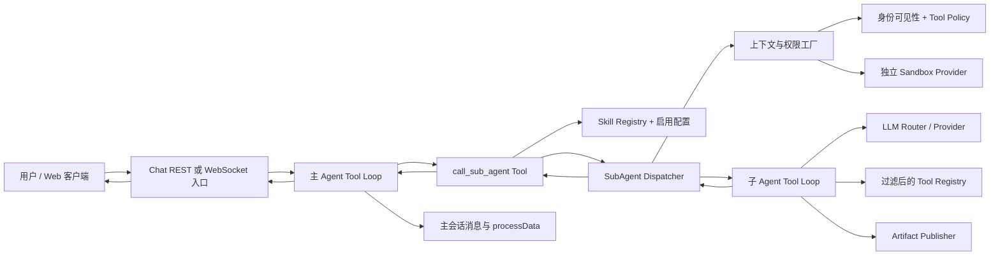
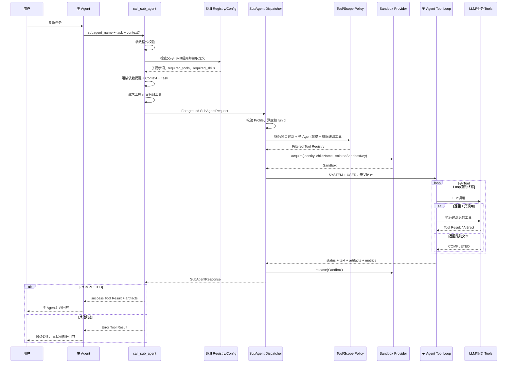
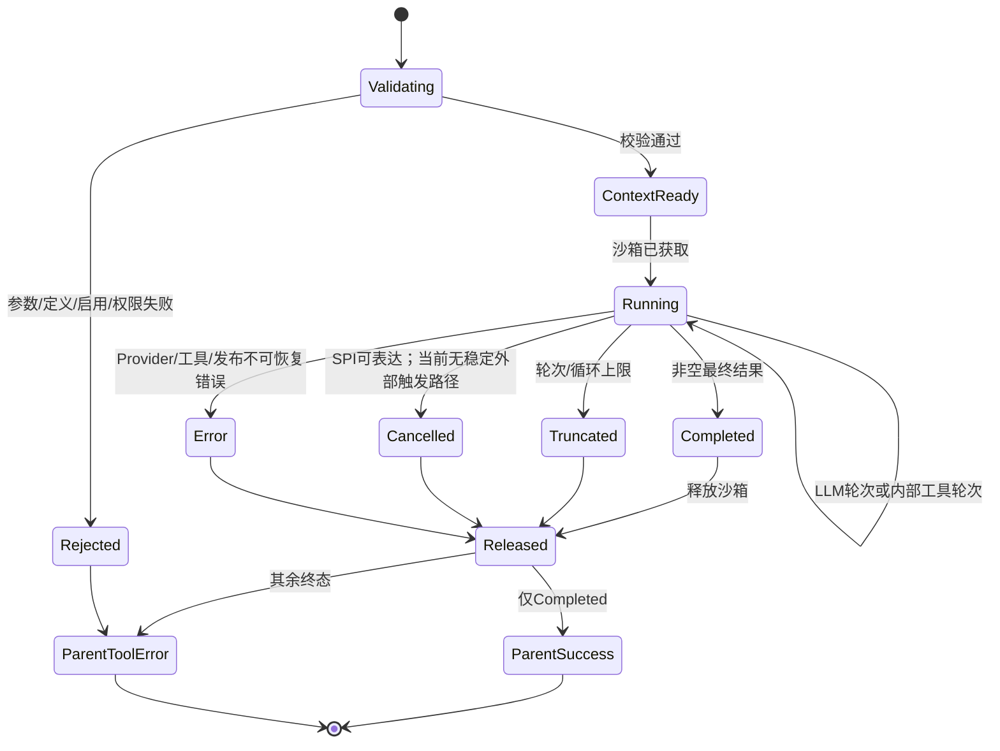

```
# 多代理委派、执行阶段和结果汇总

## 1. 结论与边界

### 1.1 解决的业务问题

当一个主 Agent 同时承担意图理解、工具选择、专业分析和最终表达时，系统提示词、工具集合和上下文会迅速膨胀，也很难为某类任务施加独立的执行边界。本能力允许主 Agent 把一个明确、聚焦的子任务同步委派给一个具名子 Agent。子 Agent 使用自己的角色说明、受限工具集合、独立 Tool Loop 和单独工作目录完成任务，再把终态文本及SPI Artifact返回给主 Agent；主 Agent把该结果当作普通工具结果继续推理并生成最终用户回答。当前工作目录分离不等同于操作系统隔离，产品内置文件 Artifact链也尚未真正接通。

目标用户并不直接创建线程或管理 Worker。对终端用户而言，它是一种对话内部能力：复杂问题可以出现“子 Agent 正在分析”的执行阶段，最后仍得到一条主 Agent 汇总后的回答。能力定义者通过嵌套 Skill 定义子 Agent 的名称、提示词、依赖工具和依赖 Skill。

### 1.2 当前能力结论

静态实现可确认以下能力：

- 子 Agent 通过名为 `call_sub_agent` 的 Tool 被同步调用，而不是通过独立 REST API 创建。
- 子 Agent 定义来自一个两段式标识的嵌套 Skill，例如 `analysis/root-cause`。当前实现只直接读取子定义；父段只做 enabled 配置检查，既不读取父定义，也不证明父子归属。
- 子 Agent只接收服务端组装的 SYSTEM 消息和一条显式委派任务，不继承主会话消息历史。
- 子 Agent继承同一租户/用户身份；项目等可信运行上下文可按键白名单传递。
- 子 Agent拥有新的 Tool Loop、过滤后的工具注册表和独立 Sandbox Key/工作目录；bundled Docker仍按 identity共享容器，因此不是独立 OS隔离域。
- 子 Agent不能再次看到 `call_sub_agent`，并且运行时拒绝深度超过一层的递归委派。
- 成功时，子 Agent终态文本和 Runner已收集到的 SPI Artifact被包装成主 Agent的 Tool Result；主 Agent决定如何汇总。产品内置文件 Tool因 child conversationId=null而不能据此保证产生可访问 Artifact。
- 同一 LLM 轮次若产生两个或以上 Tool Call，包括多个 `call_sub_agent`，会进入共享有界线程池并行执行；反馈给模型的结果仍按模型声明顺序排列。
- 子 Agent内部没有会话消息持久化；当前前台调用也没有 taskId。每次调用生成临时 runId，并在结束时释放沙箱句柄。

以下能力**不能**作为当前保证：

- 子 Agent的思考、LLM 轮次和内部工具调用不会由现有子 Agent Runner 透传给父 Agent监听器。虽然 WebSocket、`processData` 和前端已定义 `agent_phase`、`sub_tool_exec` 以及嵌套阶段展示结构，但当前新运行时的子 Agent使用空监听器静默执行。因此现状通常只能观察到父 Agent的 `call_sub_agent` 工具开始和结束事件。
- 前台 Profile 中的 `streamToParent`、`sidechainTranscript` 字段目前只是契约预留；运行时没有实现父级事件流或 Sidechain Transcript。
- Background Profile 已出现在 SPI，但运行时明确拒绝，原因是没有子任务存储。
- 没有独立的子 Agent超时、并发配额、每轮委派次数、整次会话委派次数或租户成本预算。
- 没有 `SubAgentDispatcher.cancel(runId)`；父取消与子取消没有共享的取消令牌，主要依赖父工具线程中断和底层 I/O 是否可中断，不能视为可靠级联取消。
- 没有父子会话记录、子运行表或重启恢复。父会话只可能保存 `call_sub_agent` 这个外层 Tool Event。
- 示例配置声明了 `nova.subagent.*`，也存在对应配置 Bean，但当前装配链未消费它；实际子 Agent轮次上限沿用 NovaCore 的通用 `nova.agent.max-rounds`。
- 委派 Tool解析子定义及 `required_skills` 时直接访问全局 Skill Registry，没有使用 identity/project-aware filter；知道一个不可见 Skill ID的调用方可能借错误正文或依赖提醒探测其存在和元数据。
- 子 Tool Context的 conversationId 为 null。SPI允许 Tool自己构造 Artifact，但产品内置文件 Tool把该 null传给强制作用域 Artifact Publisher，实际发布会失败；现有成功测试使用了自造 Tool和硬编码的假 conversationId，不能证明产品链成功。

### 1.3 输入、输出和用户可见效果

核心输入是：子 Agent嵌套 Skill ID、具体任务、可选紧凑背景、父身份、父有效工具集合、父运行上下文和父 Provider。核心输出是：`COMPLETED | TRUNCATED | CANCELLED | ERROR` 终态、文本、错误、Artifact 和子运行指标。`call_sub_agent` 只把 `COMPLETED` 映射为成功 Tool Result，其余终态统一映射为错误 Tool Result。

当前可靠的用户可见效果是主时间线中的“调用子 Agent”工具卡片及最终主 Agent回答。前端具备将子 Agent阶段渲染成可展开分组的能力，包括子 Agent名称、任务、步骤数、耗时、中断状态和内部工具叶子节点，但要达到该效果，后端必须补齐本章第 7 节定义的父级事件桥。

### 1.4 包含与不包含

本文包含委派触发、子 Agent定义、身份与工具权限、上下文和沙箱隔离、同步/并行执行、结果回填、阶段事件、持久化缺口、取消失败和生产级复刻设计。

本文不展开普通 Agent Tool Loop 的 Provider 重试、上下文压缩算法、Skill 全生命周期、Tool Group 管理页面、Artifact 内容存储和 WebSocket 通用重连协议；但会给出本能力必须依赖的接口和语义，使本文可以独立实施。

### 1.5 证据声明

- `I`：Nova 源码和单元测试可静态确认的实现事实。
- `A`：`active` 黑盒或 UI 自动化明确要求的行为；本次未运行测试。
- `P`：planned 用例、未登记用例或只存在于兼容前端的目标行为。
- `F`：由多处结构共同支持但无法运行确认的强推断。
- `D`：本文为新工程提出的生产级设计，不代表 Nova 已实现。
- 本次没有执行应用、构建或测试，因此没有 `R` 结论。

## 2. 术语与参与方

| 术语 | 定义 |
|---|---|
| 主 Agent | 面向当前用户回合运行的 Agent。它决定是否调用委派 Tool，并负责最终回答。 |
| 子 Agent | 一次性、无历史、以嵌套 Skill 为角色定义的隔离 Agent Run。当前不是长期存在的 Agent 实例。 |
| 子 Agent定义 | 嵌套 Skill 的结构化定义，包括 ID、正文提示词、`required_tools`、`required_skills` 和作用域元数据。 |
| 委派 | 主 Agent调用 `call_sub_agent`，同步等待子 Agent终态，并把结果作为 Tool Result 回填。 |
| 父有效工具集合 | 父 Run 在身份、租户、Tool Group、开关、MCP 可见性和场景能力过滤后真正能调用的工具集合。 |
| 工具权限上限 | 子 Agent工具集合不得超出父有效工具集合，也不得超出子 Agent定义所请求的工具集合。 |
| 子 Agent深度 | 普通主 Agent为 0；其直接子 Agent为 1。当前最大深度为 1。 |
| Foreground Profile | 同步等待并把终态结果返回父回合的执行形态。当前唯一可运行形态。 |
| Background Profile | 立即返回 taskId、后台运行并按期限保留输出的形态。当前仅有 SPI，尚未实现。 |
| Sidechain Transcript | 不混入主消息流，但可单独查询的子 Agent过程记录。当前未实现。 |
| `agent_phase` | 表示进入具名子 Agent阶段的过程事件。角色包含 `/` 时，前端把它视为分组开始。 |
| `sub_tool_exec` | 带 `agentLabel` 的子 Agent内部工具执行持久化事件。当前 Collector 和前端支持，但新子 Agent Runner未产出。 |

### 2.1 参与方与职责



各方必须保持以下边界：入口层证明用户身份；主 Agent只能看到正式能力链放行的委派 Tool；委派 Tool只负责解析嵌套 Skill 和构造受限请求；运行时负责不可绕过的权限交集和深度限制；子 Agent不能自行提升身份、工具、项目或数据范围；主 Agent负责最终结果合成。

## 3. 业务规则

### 3.1 委派触发规则

1. 当前没有服务端任务分类器或固定 Planner 决定委派。只有当 `call_sub_agent` 已进入主 Agent本次可见工具集合，且模型知道一个精确的嵌套 Skill ID 时，主模型才可能发起委派。
2. `call_sub_agent` 的 Tool Description 只表达“将聚焦任务委派给具名嵌套 Skill”。子 Agent列表并不自动嵌入 Tool Schema；通常由已激活的父 Skill正文告诉主模型可调用的子 Agent及委派时机。
3. 委派应面向边界清晰、可以独立交付的任务。主 Agent必须提供足够具体的 `task`；不能期望子 Agent读取完整父会话自行猜测目标。
4. `context` 只用于传递完成任务所需的紧凑背景。敏感信息、完整对话历史和未授权资源标识不得无选择复制进去。
5. 主 Agent可以在同一轮声明多个委派 Tool Call；运行时会将这一轮所有工具并行执行。跨 LLM 轮次的委派仍然顺序发生。

### 3.2 子 Agent定义规则

1. 标识必须是恰好两段的 `parent/child`：斜杠不能位于首尾，不能出现第二个斜杠。
2. 当前代码只要求两段式名称、检查父/子 enabled配置并读取子定义。父定义不被读取；父 enabled键缺省时按 true处理。因此“父定义存在、子定义属于该父、两者均可见且启用”是生产复刻必须补上的规则，不是当前保证。
3. 文件型 Skill 扫描时，父 Skill目录的直接子目录若含 `SKILL.md`，会合成为 `父名/子名`；只扫描一层。数据库型 Skill把父资源下“单段目录 + `SKILL.md`”注册为嵌套子 Agent；更深目录只是普通资源。
4. 嵌套子 Skill强制为手动触发，不能作为普通自动导入 Skill自行激活。
5. 子 Skill正文成为子 Agent系统提示词后缀；运行时会在其前面追加固定基线，说明它是受委派 Worker、只能执行显式任务、只能使用本次工具、结果要返回父 Agent。
6. 子 Skill的 `required_tools` 是所请求工具，不是授权。运行时还必须应用父权限上限、身份可见性、工具开关、Agent Tool Policy 和显式排除。
7. `read_file` 被当前委派 Tool隐式加入所请求工具，方便子 Agent按需读取已授权 Skill Resource；它仍必须在父权限上限内。
8. `required_skills` 只被组装成一个可用依赖提醒，包含依赖 Skill 的 ID、名称和描述；不会把依赖正文直接塞进提示词。当前依赖解析同样直接读全局 Registry，仅按 enabled配置过滤，未按调用 identity/project过滤；依赖未启用或不存在时跳过。

推荐的可移植子 Agent定义如下：

```yaml
---
name: root-cause
description: Diagnose the causes of a validated metric change.
trigger: manual
required_tools:
  - metric_query
  - read_file
required_skills:
  - analysis/data-profile
---

# Role
You are a focused root-cause analyst.

# Required output
Return verified findings, supporting evidence, uncertainties, and next actions.

# Constraints
- Do not answer questions outside the delegated task.
- Do not claim a cause without tool evidence.
- Never attempt to invoke another sub-agent.
```

### 3.3 身份、租户和项目规则

1. 子 Agent必须复用父 Run 已认证的 `Identity`，不能接受普通模型参数传入 tenantId 或 userId。
2. 项目 ID、数据主题 ID、项目配置版本等上下文必须来自服务端可信运行上下文，不得从 `task` 文本反序列化成授权范围。
3. 当前 `call_sub_agent` 将父运行上下文的所有键名声明为允许传递，因此子 Run实际继承全部父运行上下文。复刻时应改成服务端固定允许键集合，并区分“影响授权的可信键”和“仅提示模型的展示键”。
4. 子 Agent的 Skill Lookup 和 Tool Lookup应使用相同身份和过滤后的项目上下文，因此项目级 Skill、知识范围和数据工具不能越过父项目边界。当前 Runner后续激活/读取 Skill资源时会使用过滤后的 SkillLookup，但 `call_sub_agent` 在此前解析子定义正文和 `required_skills` 时直接调用全局 `skillRegistry.get`；因此当前存在“执行资源受限，但定义存在性、正文和依赖元数据先泄露”的安全缺口。
5. 子 Agent产生 Artifact 时仍要经过同一身份和作用域解析器；发布失败不能降级为泄露本地文件路径。

### 3.4 工具权限规则

目标安全公式应为：

```text
childTools =
  childDefinitionRequestedTools
  ∩ parentEffectiveTools
  ∩ identityVisibleTools
  ∩ childAgentPolicyMaximum
  − {call_sub_agent}
  − disabledTools
```

当前实现先用 `required_tools + read_file` 与父有效工具集合求交，再交给 Tool Policy Resolver；同时无条件排除 `call_sub_agent`。但当前 SPI 将“空 allowlist”解释成“不附加限制/使用定义默认值”。因此当父集合非空、交集结果恰好为空时，空集合会在下一层被重新解释为不限制，存在潜在权限回弹风险。复刻必须使用三态类型区分：

```typescript
type ToolAllowance =
  | { mode: "DEFAULT" }
  | { mode: "NONE" }
  | { mode: "EXPLICIT"; toolIds: string[] };
```

求交为空必须产生 `NONE`，绝不能编码成空集合再被解释为默认集合。另一个兼容性风险是当前 Tool Context 用空的父有效集合表示“无限制或未上报”，二者不可区分；生产实现必须让父运行时传递经过冻结的显式最大集合。

### 3.5 深度、次数和并发规则

- 当前最大子 Agent深度为 1：深度 0 的主 Agent可以创建深度 1 的子 Agent；深度 1 再委派会被拒绝，而且 `call_sub_agent` 本身已从子工具集合移除。
- 当前没有单独的“每次最多几个子 Agent”配置。委派次数仅间接受主 Agent Tool Loop轮次、模型输出和通用工具调用熔断控制。
- 子 Agent Runner直接使用低层 Tool Loop，当前只施加最大轮次，未看到子 Agent专属累计 Tool Call 上限。
- 同一轮一个委派在主 Agent线程同步执行；同一轮两个以上工具由 JVM 共享线程池并行。线程池核心线程数为 `CPU×2`，最大 `CPU×8`，队列 500，饱和后由调用线程执行以形成背压。
- 当前没有租户级子 Agent并发配额、全局委派信号量或费用预算。生产环境必须补齐，防止多个对话同时扇出造成 Provider 和下游系统雪崩。

### 3.6 结果规则

1. 子 Agent返回 `COMPLETED` 时，文本成为成功 Tool Result，保留策略为 `CONDENSABLE`，Artifact列表一并带回。
2. `TRUNCATED`、`CANCELLED`、`ERROR` 均成为失败 Tool Result，格式为 `Error: Sub-agent <name> failed: <reason>`；若缺少错误文字，使用状态名。
3. 当前失败映射丢弃失败响应中的部分文本和 Artifact；生产实现应显式决定是否保留“可用的部分结果”，不能无意丢失。
4. 子响应包含 LLM 次数、工具次数、耗时和 Token 使用量，但 `call_sub_agent` 当前未把这些指标并入父 Timeline 或 Tool Result元数据。父统计通常只计一次外层 Tool Call，成本统计会低估。
5. 多个并行子结果按模型声明的 Tool Call顺序回填，而不是按完成时间回填，保证下一轮模型上下文确定性。
6. 结果汇总不是确定性 Reducer。主 Agent在下一轮读到一个或多个 Tool Result后自行判断是否继续工具调用以及如何形成最终回答。

## 4. 完整执行链路

### 4.1 当前同步委派时序



### 4.2 入口和 Tool 可见性

产品没有 `/api/subagents` 之类面向用户的运行入口。启动时，核心工具插件先注册文件、Shell、Web 等普通工具；系统服务注册阶段若运行时提供 `SubAgentDispatcher`，再注册 `call_sub_agent`。没有 Dispatcher 时该 Tool不注册，只记录警告。

注册不等于主 Agent可用。它还必须通过 Tool Group/Agent Policy、租户与用户覆盖、开关和动态可见性过滤。打包示例的 `core-tools` 组没有列出 `call_sub_agent`，因此不能假设默认安装就会暴露委派能力。UI E2E 只确认系统 Tool Group页面能搜索、加入、继承或移除 `call_sub_agent`，没有证明实际多代理运行链路。

### 4.3 Tool 参数校验与子定义解析

Tool先把值转成字符串并去除首尾空白。正式参数名为 `subagent_name` 和 `task`；Java执行层为了旧调用兼容，也接受 `agent_name` 和 `user_input`。Tool Schema不声明旧字段且禁止额外字段，因此新模型调用只能使用正式字段。

校验顺序是：子 Agent名非空 → 名称为两段式 → 任务非空 → 子 Skill与父 Skill enabled配置不为 false → 全局 Registry中子 Skill存在。只有子定义是必需对象；父定义从未被读取，且任一 enabled配置缺省都按 true。子定义及其 `required_skills` 也没有在此处应用 identity/project可见性过滤。错误正文会区分 disabled 与 child not found，依赖提醒会带 ID、名称和描述，因此知道 ID的调用方可探测不可见定义或依赖元数据。复刻时必须以 `filteredSkillLookup(identity, projectContext).resolveNested(parent, child)` 一次性完成“父定义存在、子定义存在、父子归属一致、两者可见且启用”，并对不可见/不存在统一返回不泄露对象存在性的错误。

### 4.4 子提示词和用户输入组装

子消息固定只有两条：

```json
[
  {
    "role": "SYSTEM",
    "content": "You are a delegated worker...\n\n<child SKILL.md full body>"
  },
  {
    "role": "USER",
    "content": "<optional required-skill reminder>\n\nContext:\n<compact context>\n\nTask:\n<specific task>"
  }
]
```

依赖 Skill提醒使用带来源边界的运行时信封，并对 `<<<`、`>>>` 以及伪造的 system/assistant/developer/tool/function 标签做转义，防止依赖 Skill元数据突破提示词信任边界。子 Skill正文属于能力作者控制内容，仍应在发布时审查和版本化。

父消息列表没有进入该请求；父会话 ID也没有写进当前 SubAgent Request。`ParentRunSnapshot` 虽具备父会话和父消息字段，当前兼容路径始终生成 `parentConversationId=null, parentMessages=[]`。因此复刻不能宣称“子 Agent拥有完整会话上下文”。

### 4.5 上下文、工具和 Sandbox 创建

运行时拒绝 Background Profile和深度超限后，为本次子运行生成 UUID runId。子 Agent名、Provider、系统提示词和 allowlist形成临时 Agent Spec。Tool Policy按照身份、运行上下文和子 Agent名再次解析，排除 `call_sub_agent`。

运行时先构造如下逻辑 Sandbox Key：

```text
subagent/{safeIdentity}/{safeParentConversationOrEphemeral}/{safeChildName}/{safeRunId}
```

由于当前父会话未传入，第三段实际是 `ephemeral`。但该 Key只是作为 Sandbox Provider的 `conversationId` 参数；目录和 Docker Provider最终使用的共享 `SandboxWorkspaceLayout`忽略 `agentName`，物理路径是 `<root>/<identity>/conversations/<sandboxKey>/workspace`。因此“Key不同”只提供工作目录分离，不代表 OS用户、进程、容器、网络或内核级隔离；Docker Provider还按 identity复用同一个容器和 identity级 bind mount。

路径段必须经过安全归一化，不能让身份、会话或 Skill ID注入 `..`、绝对路径或路径分隔符。子 Agent结束后无论成功或抛异常都调用 `release`，但 bundled directory和docker Provider的 `release` 都明确是 no-op：目录用于缓存而保留，Docker容器由 identity级 reaper管理且工作区不删除。当前 key包含临时 UUID runId，却没有持久化 child run记录；父会话也未进入 key。于是进程重启或父会话删除后，产品无法从父会话精确枚举这些目录，残留是当前实现的确定性生命周期结果，而不是“Provider可能不删除”的偶发风险。

### 4.6 子 Agent运行和并行扇出

子 Agent重用普通 Runtime 的 LLM Caller、Retry Policy、Context Reducer、Loop Detector、Skill Activator、Tool Executor和 Artifact Publisher。差异是：没有 Conversation Store，没有父历史，没有普通 Agent实例级 listener，并且 Tool Context中的 conversation ID/message ID均为 null。这一点会阻断要求 conversation scope的产品内置 Artifact发布链，不能仅凭 SPI层 Artifact列表存在就宣称文件产物可用。

主模型同一轮返回多个 `call_sub_agent` 时，每个 Tool Call都启动独立 Dispatcher、runId、上下文和沙箱。共享线程池让它们并发运行；每个子 Run内部又可能在某轮并行执行多个业务 Tool，因此存在两层并发。生产配额必须对“父扇出数 × 子内部扇出数”设置组合上限。

### 4.7 结果回填与最终汇总

子响应先映射到 Tool Result，再由父 Tool Loop将包含原始 `tool_use` 的 Assistant消息和对应 `tool_result` 追加到工作历史。若多个结果并行完成，父 Loop等齐并按声明顺序追加。主 Agent下一轮看到类似：

```json
{
  "role": "TOOL",
  "toolCallId": "call_42",
  "toolName": "call_sub_agent",
  "output": "Verified findings...",
  "isError": false,
  "retention": "CONDENSABLE"
}
```

主 Agent可直接写最终答案、再次查询或发起另一个子任务。系统当前没有结构化合并算法、冲突裁决器或引用去重器；如果两个子 Agent结论冲突，主模型自行处理。生产复刻应要求子结果遵循结构化输出协议，并在最终回答前执行确定性校验，见第 7 节。

### 4.8 状态流转



## 5. 对外契约

### 5.1 `call_sub_agent` Tool契约

这是面向 LLM 的当前产品入口：

```json
{
  "name": "call_sub_agent",
  "description": "Delegate a focused task to a named sub-agent declared by a nested skill.",
  "parameters": {
    "type": "object",
    "properties": {
      "subagent_name": {
        "type": "string",
        "description": "Nested sub-agent skill id, for example 'analysis/root-cause'."
      },
      "task": {
        "type": "string",
        "description": "Specific task for the sub-agent."
      },
      "context": {
        "type": "string",
        "description": "Optional compact background context the sub-agent needs."
      }
    },
    "required": ["subagent_name", "task"],
    "additionalProperties": false
  }
}
```

成功调用示例：

```json
{
  "subagent_name": "analysis/root-cause",
  "task": "Validate the top three causes of the revenue decline and rank them by evidence strength.",
  "context": "Period: 2026-07 versus 2026-06. Metric and dimension IDs have already been resolved."
}
```

成功 Tool Result语义：

```json
{
  "success": true,
  "output": "1. ...",
  "retention": "CONDENSABLE",
  "artifacts": [
    {
      "id": "artifact-id",
      "name": "root-cause-evidence.csv",
      "kind": "FILE"
    }
  ]
}
```

错误文本至少覆盖：

| 条件 | 当前错误输出语义 |
|---|---|
| 子 Agent名空 | `Error: subagent_name is required` |
| 名称不是单层 `parent/child` | `Error: subagent_name must reference a nested skill like 'parent/child'` |
| 任务空 | `Error: task is required` |
| 父或子 Skill停用 | `Error: Sub-agent skill is disabled: <id>` |
| 子 Skill不存在 | `Error: Sub-agent skill not found: <id>` |
| 深度超限 | 执行器捕获异常后形成包含 `SubAgent recursion depth exceeded` 的错误 Tool Result |
| 子运行非 COMPLETED | `Error: Sub-agent <id> failed: <error-or-status>` |

旧字段 `agent_name`、`user_input` 只在直接 Java调用解析层兼容，不应写入新客户端契约。

### 5.2 可信进程内 Dispatcher契约

等价的语言无关接口如下：

```typescript
interface SubAgentDispatcher {
  run(request: SubAgentRequest): SubAgentResponse;
}

interface SubAgentRequest {
  identity: { tenantId: string; userId: string; identityKey: string };
  name: string;
  userInput: string;
  providerName?: string;
  systemPromptSuffix?: string;
  profile: ForegroundProfile | BackgroundProfile;
  parentSubAgentDepth: number;
  runtimeContext: Record<string, unknown>;
}

interface ForegroundProfile {
  type: "FOREGROUND";
  maxToolRounds: number;              // 0 = runtime default
  allowedToolIds: string[];           // 当前空集合有歧义，复刻应改三态
  runtimeContextKeys: string[];
  streamToParent: boolean;            // 当前未实现
  sidechainTranscript: boolean;       // 当前未实现
}

interface BackgroundProfile {
  type: "BACKGROUND";
  maxToolRounds: number;
  allowedToolIds: string[];
  runtimeContextKeys: string[];
  taskRetentionMs: number;             // 当前 Profile会被拒绝
}

interface SubAgentResponse {
  status: "COMPLETED" | "TRUNCATED" | "CANCELLED" | "ERROR";
  content: string;
  errorMessage?: string;
  artifacts: Artifact[];
  taskId: string;                      // 当前前台运行为空
  metrics: {
    llmCalls: number;
    toolCalls: number;
    durationMs: number;
    totalTokens: { inputTokens: number; outputTokens: number; cachedTokens?: number };
  };
}
```

该接口只允许受信任插件调用。绝不能把它原样暴露为 REST DTO，因为调用方可以伪造 Identity、系统提示词、Provider和工具 allowlist。

### 5.3 WebSocket阶段契约

当前主 Agent外层调用可观察为：

```text
tool_exec_start content = callId|call_sub_agent|truncatedArgs|inputBytes
tool_exec_end   content = callId|call_sub_agent|outputBytes|success|durationMs|truncatedResult
```

`args` 和 `result` 可能含 `|`，客户端解析时必须使用固定字段边界和首/尾分隔策略，不能简单 `split('|')` 后假设固定长度。Tool名必须经过合法性校验，防止恶意事件污染 UI。

前端和历史 `processData` 已准备以下期望事件：

```typescript
type AgentPhase = {
  type: "agent_phase";
  role: string;          // 包含“/”才开启子Agent分组
  description?: string;
  timestamp: number;
};

type SubToolExec = {
  type: "sub_tool_exec";
  agentLabel: string;
  toolCallId?: string;
  tool: string;
  args?: string;
  result?: string;
  inputBytes: number;
  outputBytes: number;
  success: boolean;
  durationMs: number;
  timestamp: number;
  artifacts?: ArtifactReference[];
};
```

以及实时兼容帧：

```text
agent_phase        = childName|description
sub_tool_exec_start = childName|toolName|truncatedArgs|inputBytes
sub_tool_exec_end   = childName|toolName|outputBytes|success|durationMs|truncatedResult
```

但这些是 `P` 级集成目标：当前子 Runner使用空 Listener，不会把内部事件送到父 WebSocket。生产复刻建议不要继续使用分隔字符串，而是使用带 `schemaVersion`、`parentRunId`、`childRunId`、`seq` 和 `toolCallId` 的结构化 JSON Envelope。

### 5.4 前端过程树契约

前端过程树按以下规则构造：

- `agent_phase.role` 包含 `/` 时打开一个子 Agent Group。
- 外层 `call_sub_agent` Tool Event作为分组边界，自身不渲染为普通叶子。
- 历史顺序允许“phase → 子工具 → call_sub_agent close”。
- 实时状态也容忍“call_sub_agent start占位 → phase → 子工具”；先缓存任务描述，待 phase到达时绑定。
- 分组展示 target、从外层 args提取的 task、递归叶子数、耗时、运行/成功/中断状态。
- 成功完成后默认自动折叠；失败或中断保持可见。
- 历史加载发现没有 close event的开放分组时，强制标为已中断，避免永久旋转。

当前运行时最大深度为 1，但前端树算法能够渲染嵌套组。这只能算兼容性能力，不等于后端支持递归子 Agent。

### 5.5 配置契约和实际接线差异

示例配置声明：

```yaml
nova:
  agent:
    max-rounds: 40
    max-tool-calls: 120
  subagent:
    default-max-tokens: 8192
    max-rounds: 40
    max-result-chars: 50000
    model-role: complex
```

静态装配确认：当前子 Agent Context Factory使用 NovaCore通用 `maxToolLoopRounds`，也就是产品装配的 `nova.agent.max-rounds`；`nova.subagent.*` Bean没有注入 NovaCore或委派 Tool。因此四个子 Agent配置项当前都不能视为生效。子 Agent Provider实际继承父 Tool Context中的 Provider Name；没有按 `model-role` 重新路由。复刻时要么删除未接线配置，要么在启动时验证并真正接线，禁止保留“看似可配、实际无效”的控制面。

## 6. 数据模型与生命周期

### 6.1 当前数据归属

当前没有子 Agent运行表、子会话表或父子关系表。一次调用的生命周期是进程内对象：

```text
LLM tool_use
  → SubAgentRequest
  → ephemeral UUID runId
  → isolated runtime objects + sandbox handle
  → SubAgentResponse
  → parent ToolResult
  → objects released/garbage collected
```

父会话会持久化普通 USER/ASSISTANT消息和主 Runtime Timeline。外层 `call_sub_agent` 可作为 `tool_exec` 出现在 Assistant消息的 `processData.events` 中，包含截断后的参数、结果、字节数、成功、耗时和时间戳。子内部消息、LLM轮次、工具结果和指标不会形成独立持久化记录。

### 6.2 当前 `processData` 示例

在现有新运行时可可靠期待的最小形态：

```json
{
  "events": [
    {
      "type": "tool_exec",
      "tool": "call_sub_agent",
      "toolCallId": "call_42",
      "args": "{\"subagent_name\":\"analysis/root-cause\",\"task\":\"...\"}",
      "inputBytes": 128,
      "outputBytes": 2048,
      "result": "...",
      "success": true,
      "durationMs": 7312,
      "timestamp": 1780000000000,
      "toolOrdinal": 4
    }
  ],
  "tokenStats": {
    "inputTokens": 12000,
    "totalTokens": 12000,
    "cachedTokens": 0,
    "cacheHitRatio": 0,
    "outputTokens": 1400,
    "toolCallCount": 1
  },
  "totalDurationMs": 9000
}
```

这里的 Token和 Tool Call统计是父 Run统计，不保证包含子 Run内部消耗。外层 args最多保留约 4000 字符，result最多保留约 4000 字符；前端为截断 JSON提供正则回退以尽可能提取 task，但不能据此还原完整审计记录。

### 6.3 Artifact生命周期

SPI层允许子 Tool返回 Artifact，成功子响应也会把 Artifact列表传到外层 Tool Result，父 Agent终态再聚合 Artifact；这只证明传输契约。当前子 Runner调用普通 Tool Loop时传入 `conversationId=null`。产品内置 `write_file`、`edit_file`、Shell/Python产物发布都从 Tool Context取该值，并把 null交给 Artifact Publisher；生产配置要求 scoped publication时，Publisher会以“conversationId is required”拒绝。因此当前产品链不能可靠发布子 Agent文件 Artifact。

现有 Runner单测中的成功 Artifact不是反证：测试自造 `PublishingTool`，绕过 Tool Context并在 `ArtifactPublishRequest`中硬编码 `sub-conversation`，所以只验证 SPI Publisher和 Scoped Store接线；失败测试也只验证 Scope Store异常不降级。本文将“产品内置子 Artifact发布”从 `I`降为当前缺口。复刻必须把可信父 conversationId或独立 sidechain scope显式传入 child Tool Context，并由服务端解析写作用域；不能让模型或任意 Tool自造归属 ID。

子 Sandbox目录和持久 Artifact必须区分：Sandbox是本次执行工作区，`release` 不等于 Artifact删除；Artifact是用户可见资产，应有自己的 ID、租户/项目/会话作用域和生命周期。当前子 Run没有 conversationId，既导致 scoped Artifact发布失败，也使父会话删除无法按归属清理。复刻时应明确 Artifact归属父会话还是独立 sidechain，并用持久 childRunId建立可枚举删除关系。

### 6.4 生产级推荐表结构

为实现可靠阶段、取消、重启恢复和成本审计，推荐增加：

```sql
CREATE TABLE agent_run (
  run_id             VARCHAR(64) PRIMARY KEY,
  tenant_id          VARCHAR(128) NOT NULL,
  user_id            VARCHAR(128) NOT NULL,
  conversation_id    VARCHAR(128),
  parent_run_id       VARCHAR(64),
  parent_tool_call_id VARCHAR(128),
  agent_name          VARCHAR(256) NOT NULL,
  depth               INTEGER NOT NULL,
  status              VARCHAR(32) NOT NULL,
  task_redacted       TEXT,
  provider_binding    VARCHAR(256),
  policy_snapshot_json TEXT NOT NULL,
  runtime_scope_json  TEXT NOT NULL,
  started_at          TIMESTAMP NOT NULL,
  finished_at         TIMESTAMP,
  error_code          VARCHAR(64),
  error_message       TEXT,
  version             BIGINT NOT NULL DEFAULT 0,
  FOREIGN KEY (parent_run_id) REFERENCES agent_run(run_id)
);

CREATE INDEX idx_agent_run_parent ON agent_run(parent_run_id, started_at);
CREATE INDEX idx_agent_run_owner ON agent_run(tenant_id, user_id, started_at);
CREATE UNIQUE INDEX uk_agent_run_parent_call
  ON agent_run(parent_run_id, parent_tool_call_id);

CREATE TABLE agent_run_event (
  run_id        VARCHAR(64) NOT NULL,
  seq           BIGINT NOT NULL,
  event_type    VARCHAR(64) NOT NULL,
  event_json    TEXT NOT NULL,
  created_at    TIMESTAMP NOT NULL,
  PRIMARY KEY (run_id, seq),
  FOREIGN KEY (run_id) REFERENCES agent_run(run_id)
);

CREATE TABLE agent_run_result (
  run_id            VARCHAR(64) PRIMARY KEY,
  content_ref       VARCHAR(512),
  content_preview   TEXT,
  artifacts_json    TEXT NOT NULL,
  llm_calls         INTEGER NOT NULL,
  tool_calls        INTEGER NOT NULL,
  input_tokens      BIGINT NOT NULL,
  output_tokens     BIGINT NOT NULL,
  cached_tokens     BIGINT NOT NULL,
  duration_ms       BIGINT NOT NULL,
  expires_at        TIMESTAMP,
  FOREIGN KEY (run_id) REFERENCES agent_run(run_id)
);
```

`parent_run_id + parent_tool_call_id` 唯一键提供委派幂等性。`task_redacted` 只保存经过脱敏的摘要；完整任务若含敏感数据应进入加密内容存储。事件按 runId内单调 seq排序。Foreground Sidechain可以跟随父会话保留；Background结果按 retention到期清理。

## 7. 核心实现设计

### 7.1 最小可用复刻

最小版需要以下组件：

1. `NestedAgentDefinitionRegistry`：按当前身份和项目解析 `parent/child` 定义，返回提示词、依赖工具和依赖 Skill。
2. `DelegateTool`：校验参数、解析定义、构造任务、计算工具权限上限、同步调用 Dispatcher。
3. `SubAgentDispatcher`：生成 runId、创建隔离上下文和沙箱、调用普通 Tool Loop、确保释放资源。
4. `CapabilityResolver`：用显式三态 allowlist求交，并再次做身份/租户/开关过滤。
5. `SubAgentRunner`：只接收 SYSTEM + USER，不加载父历史；禁用递归委派；返回结构化终态与指标。
6. `ParentResultAdapter`：成功转换为可压缩 Tool Result，失败转换为标准错误；保留 Artifact。

最小算法：

```text
delegate(args, parentCtx):
  validate args
  definition = registry.resolveNested(parentCtx.identity, args.subagent_name)
  require definition.parentEnabled && definition.childEnabled

  requested = definition.requiredTools + read_file
  childAllowance = intersectStrict(requested, parentCtx.explicitEffectiveTools)
  if childAllowance is NONE and definition.requiresTools:
      return Error("No authorized tools remain for sub-agent")

  request = {
    identity: parentCtx.identity,
    name: definition.id,
    systemPromptSuffix: definition.body,
    userInput: buildTask(definition.requiredSkills, args.context, args.task),
    parentRunId: parentCtx.runId,
    parentToolCallId: parentCtx.toolCallId,
    depth: parentCtx.depth,
    toolAllowance: childAllowance,
    runtimeScope: allowTrustedKeys(parentCtx.runtimeContext)
  }
  response = dispatcher.run(request, parentCtx.cancellation.child())
  return adapt(response)
```

### 7.2 生产级委派控制器

生产版应在 Tool和 Dispatcher之间增加 `DelegationCoordinator`：

- 为每次父 Tool Call分配服务端 childRunId并持久化父子关系。
- 用租户、用户和父 Run信号量限制扇出，例如每父 Run最多 3 个并行子 Agent、每租户最多 20 个。
- 计算预算：最大子 Agent数、每子最大轮次、每子 Tool Call数、Token和 wall-clock deadline。
- 派生取消令牌和 Deadline，并传递到 LLM、Tool和 Sandbox执行。
- 记录不可变的身份、项目、Provider和 Tool Policy快照。
- 将子事件写入 Event Store，并按授权投影到父 WebSocket。
- 用唯一键实现同一父 toolCallId重试幂等，避免网络或模型重放产生重复子 Run。

推荐请求：

```typescript
interface ProductionSubAgentRequest {
  childRunId: string;                 // 服务端生成
  parentRunId: string;
  parentToolCallId: string;
  identity: VerifiedIdentity;
  definitionId: string;
  definitionVersion: number;
  task: string;
  context: string;
  depth: number;
  deadline: string;
  budgets: {
    maxRounds: number;
    maxToolCalls: number;
    maxInputTokens: number;
    maxOutputTokens: number;
  };
  toolAllowance: ToolAllowance;
  runtimeScope: TrustedRuntimeScope;
  eventMode: "SILENT" | "PARENT_VISIBLE" | "PERSISTED_SIDECHAIN";
}
```

### 7.3 可靠事件桥

子 Runner不能使用空监听器。应绑定 `ChildRunListener`，为每个内部事件添加父子关联并写 Event Store：

```json
{
  "schemaVersion": 1,
  "type": "child.tool.completed",
  "parentRunId": "run-main",
  "childRunId": "run-child",
  "parentToolCallId": "call_42",
  "seq": 7,
  "occurredAt": "2026-08-13T10:00:00Z",
  "payload": {
    "agentLabel": "analysis/root-cause",
    "toolCallId": "child-call-2",
    "toolName": "metric_query",
    "success": true,
    "durationMs": 352,
    "inputBytes": 420,
    "outputBytes": 9200,
    "resultPreview": "..."
  }
}
```

父 WS订阅只收到当前用户有权读取的事件。每个 childRunId的 seq单调递增；客户端按 `(childRunId, seq)` 去重。`child.run.started` 打开分组，`child.run.completed|cancelled|failed` 关闭分组，不再依靠外层 Tool Event和栈启发式猜测边界。断线恢复通过 `afterSeq` 增量读取 Event Store，而不是只靠前端内存栈。

### 7.4 结构化结果和确定性汇总

仅让主模型读取自由文本会造成遗漏、冲突和引用丢失。推荐子 Agent返回：

```json
{
  "summary": "...",
  "findings": [
    {
      "claim": "...",
      "confidence": 0.86,
      "evidenceRefs": ["evidence://run-child/tool/child-call-2"],
      "limitations": ["..."]
    }
  ],
  "artifacts": ["artifact-id"],
  "unresolvedQuestions": ["..."]
}
```

父级先做确定性校验：Schema合法、证据引用归属当前父/子 Run、Artifact可读、无越权 URL；再把多个已验证结果交给主模型总结。冲突项应明确呈现，不可按完成顺序覆盖。超过上下文预算的结果写入受控存储并向父模型返回摘要和 recall handle。

### 7.5 取消、超时和恢复

生产级取消令牌应形成树：

```text
parentCancellation
  ├── childRunA
  │    ├── child LLM request
  │    └── child tool futures
  └── childRunB
       ├── child LLM request
       └── child tool futures
```

取消父 Run时：CAS父状态为 `CANCELLING` → 标记所有非终态子 Run → 取消 Provider请求和工具 Future → 等待短暂 grace period → 终止 Sandbox进程 → 每个子 Run写唯一终态 → 父 Tool Result形成取消错误 → 父 Run写唯一终态。超时使用绝对 deadline而非层层独立 duration，避免重试不断刷新计时器。

进程重启后，Foreground运行可统一标为 `ERROR/WORKER_LOST`，或由具备幂等 Checkpoint的 Worker恢复；不能让记录永久处于 RUNNING。Background需要租约、心跳、任务队列和幂等恢复，不能只复用当前同步方法。

### 7.6 当前版与生产版对照

| 能力 | 当前静态实现 | 生产级复刻 |
|---|---|---|
| 定义 | 一层嵌套 Skill | 版本化定义和发布校验 |
| 历史 | SYSTEM + 单条 USER | 默认仍隔离；可显式选择经过裁剪的父上下文 |
| 工具权限 | 多层过滤，但空集合语义有风险 | 三态 allowlist + 冻结父最大集合 |
| 深度 | 固定最大 1 | 默认 1，可配置且受预算约束 |
| 并发 | 共享工具线程池，无子 Agent配额 | 父/租户/全局三级信号量 |
| 取消 | SPI可表达CANCELLED，但无 Dispatcher取消/父 token连接，依赖中断 | 树形令牌 + Deadline + Sandbox终止 |
| 事件 | 子 Runner静默；UI兼容结构存在 | 结构化父子事件 + Event Store + resume |
| 持久化 | 无子 Run/Transcript | 父子 Run表、事件表、结果表 |
| 汇总 | 主模型自由文本汇总 | Schema校验 + 证据归属 + 冲突策略 |
| 成本 | 子 metrics返回但外层丢弃 | 父子成本汇总和独立预算 |
| 后台任务 | Profile预留但拒绝 | 队列、任务存储、租约、过期清理 |

## 8. 并发与非正常路径

### 8.1 并发与顺序

同轮多 Tool并行时，开始/结束事件按真实时间乱序，结果回填按声明顺序。子 Agent内部也能并行工具调用，因此监听器、Hook、配置读取器、Artifact Store和业务 Tool必须线程安全。不得使用无 runId隔离的全局栈标记当前子 Agent；当前产品监听器使用 `agentLabelStack` 只适合单连接、严格嵌套的兼容事件，无法可靠表达并行子 Agent。生产事件必须以 childRunId关联。

若同一个父模型响应包含三个 `call_sub_agent`，每个使用独立 Sandbox Key。父取消时应同时取消三者；一个子失败不应直接取消兄弟，除非父策略为 fail-fast。当前 Tool Loop会把每个 Tool异常转为独立错误结果，让其他兄弟继续完成。

### 8.2 参数和定义失败

- 缺少必填参数、名称格式不合法：不创建子 Run或沙箱，直接返回错误 Tool Result。
- 父/子 Skill被停用或子定义不存在：不调 Dispatcher。
- 解析定义和执行之间定义被更新：当前读取对象后继续执行，无版本快照审计。生产版应绑定 `definitionVersion`。
- required Skill缺失：当前静默跳过提醒。生产版应根据依赖是否 mandatory决定拒绝或告警。
- requested tool不存在或被父权限删除：当前可能在空 allowlist语义下权限回弹；修复后应明确返回 `NO_AUTHORIZED_TOOLS` 或允许纯 LLM子 Agent。

### 8.3 Provider、Tool和Artifact失败

- 子 Provider瞬态错误遵循普通 Runtime重试策略；最终失败映射子 `ERROR`。
- 子 Tool抛出 Throwable会转成 `Error: <type>: <message>` Tool Result，子模型可以基于错误调整；达到循环或轮次上限形成 TRUNCATED。
- Scope Artifact Store失败时，当前测试要求异常穿透，不返回本地文件 Artifact。
- 子 Run抛出未映射异常时，SubAgent Service仍在 `finally` 释放 Sandbox；外层 Tool Executor会捕获并转换成错误结果。

### 8.4 取消和超时缺口

当前子 Runner创建自己的私有 CancellationSignal，与父 Tool Context不共享，也没有外部方法取得或触发它。SPI的 `SubAgentResponse`/`AgentRunStatus`可以表达 `CANCELLED`，Service也能映射 Runner已经返回的 cancelled状态，但当前产品调用路径没有把父 token连接到该私有 signal，因此 `CANCELLED`不是可稳定主动触达的子终态。父 Run取消时，单 Tool路径只有在 `call_sub_agent` 返回后才再次检查父信号；多 Tool路径会取消 Future并设置工作线程中断。子内部 I/O可能碰巧因中断退出，但这是实现耦合；若底层忽略中断，父 WS可能先完成取消，而子任务仍占用线程和外部资源。

当前也没有 wall-clock timeout。Provider、HTTP Tool、Shell等各自可能有超时，但无法保证整个子 Run在统一期限结束。生产版必须设置绝对 deadline，并在每次 LLM、退避、Tool获取和 Tool内部 I/O前检查剩余时间。

### 8.5 终态和部分结果

当前外层仅承认 COMPLETED。TRUNCATED即使有可用文本也被转换为错误，CANCELLED/ERROR的 Artifact不返回。复刻时建议响应增加：

```typescript
interface PartialResultPolicy {
  exposePartialTextOnTruncated: boolean;
  exposeVerifiedArtifactsOnFailure: boolean;
  allowParentToContinueAfterChildFailure: boolean;
}
```

任何部分结果都要标注状态和不完整原因，不能伪装成成功。Artifact必须在失败前已经完成原子发布，不能暴露半写文件。

### 8.6 进程重启、孤儿和清理

当前没有子 Run记录，进程重启后无法识别或恢复子任务。bundled directory和docker Provider的 `release` 均为 no-op，且逻辑 key使用未持久化 runId和 `ephemeral`父段；因此每次子 Run工作区都会确定性保留，父会话删除也无法按父 ID精确定位。Docker的 identity共享容器可由空闲 reaper停止，但这不等于删除各 run工作区。生产版需要持久化 `parentRunId/parentConversationId/childRunId/sandboxKey`并提供周期性 Reaper：扫描过期 RUNNING租约、终结孤儿 Run、停止残留进程、按精确 runId清理 Sandbox，并保留审计结果。不得按模糊文件名清理。

## 9. 安全、权限和审计

### 9.1 不可扩大的能力边界

子 Agent继承身份但不能继承更大权限。强制检查应发生两次：委派 Tool构造请求时做父/子权限交集；Dispatcher创建执行上下文时重新从可信 Policy Snapshot验证。即使恶意插件直接调用 Dispatcher，也不能通过传入 `allowedToolIds` 扩权。

当前实现没有完整做到第一次检查：`CallSubAgentTool`直接从全局 Registry读取子定义正文，`required_skills`也沿同一路径读取 ID、名称和描述；identity/project过滤只在 Runner构造 filtered SkillLookup后应用于后续 Skill激活与资源读取。这意味着实际业务 Tool仍可能在后端按项目拒绝访问，但不可见 Skill的存在性、定义正文和依赖元数据已经进入错误或子 Prompt。生产复刻必须把 filtered lookup前移到定义解析，且不可见与不存在使用同一外部错误。

当前 SPI把 Identity、系统提示词、Provider和 allowlist都交给可信调用方，因此 Dispatcher本身是系统插件边界，不是公开网络接口。若未来开放用户创建子 Agent任务，网络 DTO只能接收定义 ID、task和context；身份、Provider、工具上限和项目范围全部由服务端解析。

### 9.2 Prompt和元数据注入

- 子 Agent名必须由 Registry解析，不把任意路径当 Skill加载。
- required Skill元数据进入信任信封前要转义信封结束标记和角色标签。
- `context` 和 `task` 始终位于 USER消息，不能拼进 SYSTEM正文。
- Skill正文属于受管理配置，应有创建/修改权限、审核、版本和回滚。
- 子结果是不可信模型输出。主 Agent或 UI渲染前要做 Markdown/HTML安全处理，Artifact URL必须重新鉴权。

### 9.3 运行上下文和秘密

当前 Profile允许父全部 runtimeContext键流入子 Run，这可能把并非子任务所需的秘密对象或内部开关传播给 Tool。生产版使用固定 Schema，例如只允许项目 ID、数据主题 ID、时区、语言和 Trace ID；凭据以服务端 Secret Reference传递给授权 Tool，绝不进入 Prompt、事件、Tool args或日志。

### 9.4 审计事件

至少记录：

- `SUBAGENT_DELEGATION_REQUESTED`：父 Run、Tool Call、定义及版本、请求摘要。
- `SUBAGENT_AUTHORIZED`：身份、项目、最终工具集合、策略快照哈希。
- `SUBAGENT_STARTED/COMPLETED/CANCELLED/FAILED`：childRunId、终态、耗时、错误码。
- `SUBAGENT_ARTIFACT_PUBLISHED`：Artifact ID和作用域，不记录内容。
- `SUBAGENT_BUDGET_EXCEEDED`：Token、轮次、工具数或 deadline类型。

审计日志不能保存完整 Prompt、密钥、原始业务数据或长 Tool Result；使用摘要、哈希和受控内容引用。

## 10. 外部依赖对端设计

本能力没有专属外部“多代理服务”，但依赖四类对端：LLM Provider、业务 Tool后端、Sandbox Provider和 Artifact Store。它们必须接受 childRunId/traceId传播，支持明确超时或取消，并遵守父身份范围。

最小兼容 Stub可以实现为：固定 LLM Provider读取请求中的 child agent name并返回确定性文本；内存 Skill Registry注册一个 `parent/child`；目录 Sandbox每次创建独立临时目录；Artifact Store只保存内存元数据。这样可以测试委派、权限和回填，不依赖真实模型。

生产对端要求：Provider支持请求级 deadline和取消；业务 Tool接受短期身份凭证且在服务端再次授权；Sandbox可以按 childRunId终止进程并精确清理；Artifact Store支持原子发布、租户/项目 Scope和失败回滚。任何对端都不能仅信任模型产生的 tenantId、projectId或资源 ID。

## 11. 可观察性

### 11.1 指标

建议按低基数维度记录：

- `subagent_runs_total{definition,status}`
- `subagent_run_duration_seconds{definition,status}`
- `subagent_llm_calls_total{definition}`
- `subagent_tool_calls_total{definition,tool,status}`
- `subagent_tokens_total{definition,direction}`
- `subagent_active{tenant_bucket}`
- `subagent_queue_wait_seconds`
- `subagent_cancellation_latency_seconds`
- `subagent_budget_exceeded_total{budget_type}`
- `subagent_orphan_reaped_total`

不要把 tenantId、userId、conversationId或完整 Skill ID无控制地作为高基数标签；放入 Trace属性或日志字段。

### 11.2 Trace

父 Agent Run为根 Span，每个委派 Tool Call创建 `subagent.run` 子 Span；子 LLM、内部 Tool和Artifact发布继续向下。必要属性包括 parentRunId、childRunId、definitionVersion、depth、status、tool count和token count。Prompt、Tool Result和任务正文默认不进入 Trace。

### 11.3 用户可定位错误

用户看到的错误应区分：子能力未安装/停用、权限不足、任务超时、模型暂时不可用、子任务达到预算、子任务被取消、Artifact发布失败。不能只展示内部异常类名。服务日志保留 errorCode、childRunId和堆栈；Tool Result向主模型返回可安全定位的 `Error: <code>: <message>`。

### 11.4 当前统计缺口

当前 `SubAgentResponse.metrics` 已计算子 Run的 LLM次数、工具次数、耗时和 Token，但外层 Tool丢弃这些指标。`CHAT-STATS-014` 计划用例期待 `sub_tool_exec` 带 agentLabel、tool和durationMs，但因为没有确定性 Fixture且路由不稳定，目前是 planned。本能力复刻验收必须用确定性 Provider和子 Tool Fixture把该用例转为 active。

## 12. 复刻实施顺序

1. **定义稳定的身份、Run和工具权限类型。** 先实现显式父有效工具集合和三态 allowlist；静态验收是交集为空绝不会恢复成默认工具。
2. **实现嵌套定义 Registry。** 支持一层 `parent/child`、版本、父子启用和作用域解析；静态验收是跨租户/项目定义不可见。
3. **实现同步 Delegate Tool和无状态 Dispatcher。** 只支持 Foreground、最大深度 1；静态验收是子消息只有 SYSTEM + USER，且不加载父历史。
4. **接入普通 Tool Loop和独立 Sandbox。** 子 Run使用过滤工具集合、绝对 deadline和派生取消令牌；静态验收是任意终态都释放 Sandbox。
5. **实现结构化子结果和父结果适配。** 保留状态、Artifact和指标；静态验收是多个并行结果按声明顺序回填。
6. **实现子事件桥和 Event Store。** 使用 childRunId/seq，不用进程内 agent栈推断；静态验收是重连可从任意 afterSeq恢复。
7. **实现父子 Run持久化和级联取消。** 用 CAS终态、租约和 Reaper；静态验收是取消、超时和重启后没有永久 RUNNING。
8. **实现配额、预算和成本汇总。** 父/租户/全局三级并发；静态验收是父统计等于父自身加全部子树。
9. **最后开放 Background。** 增加队列、taskId、结果期限和对象级读取权限；在此之前遇到 Background必须显式拒绝。

## 13. 验收标准

### 13.1 正向场景

1. 给定已启用父 Skill和 `parent/child` 子定义，且主 Agent拥有 `call_sub_agent` 与子所需工具，模型调用 Tool后子 Agent执行并返回结果；主 Agent最终回答包含经过汇总的子结论。
2. 子 Agent收到的系统消息包含固定 Worker基线和子 Skill正文；USER消息包含依赖提醒、可选 Context和Task；不包含父完整历史。
3. 子 Agent只看到 `requested ∩ parentEffective` 工具，永远看不到 `call_sub_agent`。
4. 项目会话委派后，子 Tool读取同一项目授权资源，不能读取其他项目或个人资源。
5. 子 Agent发布 Artifact后，父结果和最终 Assistant消息引用同一受权 Artifact；刷新后仍可访问。

### 13.2 参数、权限和注入场景

1. 缺少/空白 `subagent_name`、缺少/空白 `task`、非法多段 ID均在创建 Run前失败。
2. 父 Skill停用、子 Skill停用、定义不存在或作用域不可见时不调 Dispatcher。
3. 子请求工具和父工具交集为空时，子 Agent看到零工具或请求被拒绝，绝不能看到默认全量工具。
4. 恶意 required Skill名称包含信封结束标记或 `</system>` 时，生成的提示词仍保持一个完整信任边界。
5. 外部客户端伪造 tenantId、Provider或工具 allowlist不会进入可信请求。

### 13.3 并发、顺序和取消场景

1. 同一父轮发起三个子 Agent，三者并行开始但回填顺序与 Tool Call声明顺序相同。
2. 一个子失败时其他子仍完成，父模型收到逐项成功/错误，不出现缺失 Tool Result。
3. 超过父并行配额时请求排队或返回明确限流，不产生无限线程。
4. 父取消后所有子、子 LLM、子 Tool和Sandbox进程在规定延迟内终态化；只产生一个终态事件。
5. deadline到达时重试不能刷新 deadline；子 Run形成 TIMEOUT而非永久 RUNNING。
6. 子 Agent尝试再次委派时得到深度错误，且没有创建孙 Run。

### 13.4 事件、持久化和恢复场景

1. `child.run.started`、内部 Tool事件、唯一终态具有同一 childRunId和连续 seq。
2. UI显示子 Agent名、task、步骤、耗时和状态；成功自动收起，失败/中断保持展开。
3. WS断线后按 afterSeq恢复，不重复步骤、不丢终态。
4. 刷新通过持久化 Sidechain恢复相同过程树；未闭合的历史 Run按数据库终态显示，不用猜测。
5. 进程在子运行中退出，租约过期后 Reaper将其标记 WORKER_LOST并清理 Sandbox。
6. 删除父会话时，根据保留策略级联删除或匿名化子 Transcript、任务结果和临时文件；共享 Artifact按独立生命周期处理。

### 13.5 指标和成本场景

1. 父统计明确区分自身消耗和包含子树的总消耗。
2. 子 Tool事件带 agentLabel/childRunId、tool、durationMs、字节数和状态。
3. 结果预览截断不影响完整审计内容引用；日志和 Trace不出现完整任务、密钥或敏感 Tool结果。

## 14. 测试矩阵

| 场景 | 通道 | 前置条件 | 操作 | 预期结果 | 当前证据等级 |
|---|---|---|---|---|---|
| 嵌套定义正常委派 | 单元/Tool | 父子 Skill、确定性 Provider | 调 `call_sub_agent` | 子正文成为提示词，结果回父 Tool | `I` |
| task + context组装 | 单元/Tool | 有依赖 Skill | 传 task/context | 依赖提醒、Context、Task顺序完整 | `I` |
| 项目作用域继承 | 单元 | 项目 runtimeContext | 委派项目子 Agent | runtimeContext键、Skill resolver输入和工具集合保持项目范围 | 局部 `I`；不证明 nested definition/resources或真实后端跨项目拒绝 |
| 工具权限收窄 | 单元 | 父工具小于子请求 | 委派 | 超出父权限的工具被删除 | `I` |
| 空交集不回弹 | 单元/安全 | 父子工具无交集 | 委派 | 零工具或拒绝，绝不变全量 | 当前缺口，`D` |
| 禁止递归 | 单元 | parentDepth=1 | 再建子 Run | 深度错误，且子工具不含委派 Tool | `I` |
| 缺子 Agent名 | Tool/API边界 | 无 | 缺字段调用 | 明确 Error，不创建 Run | 文档未登记自动化，源码 `I` |
| 非两段名称 | Tool/API边界 | 无 | 传 `root-cause` 或 `a/b/c` | 明确 Error | 文档未登记自动化，源码 `I` |
| 子 Skill停用/不存在 | Tool | 配置或空 Registry | 委派 | 明确 Error，不调 Dispatcher | `I` |
| 定义/依赖项目可见性 | 单元/安全 | 全局Registry含其他项目定义 | 以当前项目身份猜测ID委派 | 不泄露存在性、正文、名称或描述 | 当前缺口，`D` filtered lookup |
| required Skill元数据注入 | 单元/安全 | 恶意元数据 | 委派 | 信封和角色标签被中和 | `I` |
| 子 Artifact发布 | 单元/集成 | Scope Store | 子 Tool发布 Artifact | Artifact随成功响应返回；Scope失败不泄露文件 | SPI接线局部 `I`；测试自造 Tool硬编码 conversationId，产品内置 Tool当前因 null scope失败 |
| 子 Sandbox物理隔离/清理 | 集成 | bundled directory/docker | 并行运行、release、删除父会话 | 进程/文件不越界且可按父子Run精确清理 | 当前仅工作目录分离；release no-op、父ID缺失，生产能力 `D` |
| 同轮多个子 Agent | Runtime集成 | Provider一次返回多 Tool Use | 运行父 Loop | 并行执行、声明顺序回填 | 通用 Tool并行 `I`；多子专项待补 |
| 子 Agent内部阶段实时展示 | WS/UI | 确定性子 Tool Fixture | 运行并观察 | 分组、步骤、耗时、终态正确 | `P`；当前子 Runner静默 |
| `sub_tool_exec`统计 | WS + 持久化 | 确定性 Fixture | 完成委派后读 processData | agentLabel/tool/durationMs存在 | `P`，`CHAT-STATS-014` |
| 父取消级联子运行 | WS/Runtime | 慢子 Provider/Tool | 运行中 cancel | 子及时终态且资源释放 | `CANCELLED`仅SPI可表达；当前无父 token连接/外部触发，生产能力为 `D` |
| Background Profile | SPI/Runtime | Background请求 | dispatch | 当前显式拒绝；生产版返回taskId | 拒绝为 `I`，实现为 `D` |
| UI Tool Group配置 | UI | 管理员 | 搜索/加入/继承/移除委派 Tool | 配置页面状态正确 | `A`，本次未运行 |
| 归因模型偶发选择委派 | 黑盒 | release模型 | 发归因问题 | 路由可能在直接工具和委派间变化 | 自动化理由提供 `F`，非稳定契约 |

`nova_auto_test` 的多代理设计清单列出 `MULTI-CALL-001..007`，但尚未在 YAML cases登记，不能算 Active 契约。唯一相关 YAML `CHAT-STATS-014` 为 planned。`nova_ui_e2e` 当前验证 `call_sub_agent` 作为 Tool Group条目的管理行为，没有多代理阶段端到端 Spec。因此复刻项目必须新增确定性 Fixture，而不是依赖真实模型随机选择委派。

## 15. 当前能力与建议汇总

### `I` 已实现事实

- `call_sub_agent` 是基于 Tool的同步委派入口，子定义为一层嵌套 Skill。
- 正式参数是 `subagent_name`、`task`、可选 `context`；执行层兼容旧别名。
- 子 enabled、父 enabled配置、子定义存在性和名称格式在委派前检查；父定义不读取，enabled缺省为 true，父子归属不验证。
- 子提示词为固定 Worker基线 + 子 Skill正文，子用户输入为依赖提醒 + Context + Task。
- 子 Run不继承父历史；使用同一身份、过滤后的 runtimeContext和工具注册表，并获得独立 Sandbox Key/工作目录；这不是独立OS隔离，bundled Provider也不在release时清理。
- 子工具请求由 required tools + read_file形成，再尝试与父有效集合求交；递归委派 Tool被排除；最大深度为 1。
- 子 Run重用普通 LLM/Tool Loop、Reducer、Retry和Loop Detector；SPI Artifact Publisher已接线，但产品内置文件 Tool的 scoped发布因 conversationId=null而失败。
- 成功结果以 CONDENSABLE Tool Result回父，Artifact保留；其余终态映射错误。
- 子响应计算独立 metrics，结束时总会释放 Sandbox句柄。
- 同轮多工具并行且按声明顺序回填。
- Background Profile当前会被显式拒绝。

### `A` Active测试契约

- UI E2E覆盖系统 Tool Group中 `call_sub_agent` 的搜索、加入、嵌套组展开、继承和移除等配置行为；本次没有运行。
- 没有发现 Active的多代理执行或阶段展示端到端用例。

### `P` 规划或兼容结构

- `MULTI-CALL-001..007` 只在设计文档中，尚未登记 YAML。
- `CHAT-STATS-014` 计划验证 `sub_tool_exec` 统计和 agentLabel，当前为 planned。
- `streamToParent`、`sidechainTranscript`、Background Profile和前端嵌套阶段结构为未来/兼容契约，不等于后端已接通。

### `F` 强推断与风险

- release归因用例理由显示模型曾在直接业务 Tool、`call_sub_agent` 和知识 Tool间波动，说明委派选择受模型和提示词影响，不是确定性路由。
- 空 allowlist同时承担“默认/不限制”和“求交为空”语义，可能造成子权限回弹；必须在实际发布前通过安全测试确认并修复。
- 父取消通过线程中断可能促使部分子 I/O退出，但没有共享取消令牌或取消接口，不能视为可靠级联取消。
- `CANCELLED`是SPI可表达终态，但当前私有子 CancellationSignal没有外部触发入口，不能视为当前稳定可达行为。
- bundled directory/docker的 `release`确定为 no-op；未持久化 runId和ephemeral父段使工作区无法按父会话精确枚举清理。
- 全局 Registry先于identity/project过滤解析子定义和required Skills，可泄露不可见定义正文、存在性和依赖元数据。
- 项目单测只证明runtimeContext/Skill resolver输入/工具集合传递，不证明nested definition、资源或真实业务后端跨项目拒绝。

### `D` 复刻建议

- 使用父/子 Run ID、不可变 Policy Snapshot、三态工具 allowlist、绝对 Deadline和树形取消令牌。
- 使用identity/project filtered lookup原子解析父子定义及依赖；不可见与不存在返回同一错误。
- 将可信父conversationId或独立sidechain scope传入 child Tool Context，接通产品 Artifact发布和父删除生命周期。
- 增加父/租户/全局并发配额、Token/轮次/Tool预算和成本树汇总。
- 用结构化子事件、Event Store和 Sidechain Transcript替代前端栈推断。
- 子结果使用 Schema、证据引用和冲突规则，主 Agent只汇总已验证结果。
- 子配置必须真正接线并在启动时校验；删除无效配置。
- Background只在具备任务存储、队列、租约、权限和过期清理后开放。

## 16. 证据附录

以下路径仅用于追溯；删除本节不影响正文的实施完整性。

### 16.1 Nova实现

- `nova-bundled-plugins/nova-ext-core-tools/src/main/java/com/aloudata/nova/ext/core/tools/subagent/CallSubAgentTool.java`
- `nova-bundled-plugins/nova-ext-core-tools/src/main/java/com/aloudata/nova/ext/core/tools/CoreToolsPlugin.java`
- `nova-core/nova-core-spi/src/main/java/com/aloudata/nova/core/spi/agent/SubAgentDispatcher.java`
- `nova-core/nova-core-spi/src/main/java/com/aloudata/nova/core/spi/agent/SubAgentRunProfile.java`
- `nova-core/nova-core-spi/src/main/java/com/aloudata/nova/core/spi/agent/SubAgentRunMetrics.java`
- `nova-core/nova-core-runtime/src/main/java/com/aloudata/nova/core/runtime/agent/subagent/SubAgentContextFactory.java`
- `nova-core/nova-core-runtime/src/main/java/com/aloudata/nova/core/runtime/agent/subagent/SubAgentRunner.java`
- `nova-core/nova-core-runtime/src/main/java/com/aloudata/nova/core/runtime/agent/subagent/SubAgentService.java`
- `nova-core/nova-core-runtime/src/main/java/com/aloudata/nova/core/runtime/agent/ToolExecutor.java`
- `nova-core/nova-core-runtime/src/main/java/com/aloudata/nova/core/runtime/agent/ToolLoopRunner.java`
- `nova-core/nova-core-runtime/src/main/java/com/aloudata/nova/core/runtime/NovaCore.java`
- `nova-app/src/main/java/com/aloudata/nova/skill/novacore/DbSkillBundleLoader.java`
- `nova-app/src/main/java/com/aloudata/nova/skill/SkillService.java`
- `nova-app/src/main/java/com/aloudata/nova/config/SubAgentProperties.java`
- `nova-app/src/main/resources/application.yml.example`
- `nova-app/src/main/java/com/aloudata/nova/controller/ChatWebSocketHandler.java`
- `nova-app/src/main/java/com/aloudata/nova/agent/ProcessDataCollector.java`
- `nova-app/src/main/java/com/aloudata/nova/core/bridge/mapping/RunTimelineProcessDataMapper.java`
- `nova-app/src/main/java/com/aloudata/nova/service/ChatService.java`

### 16.2 Nova测试

- `nova-bundled-plugins/nova-ext-core-tools/src/test/java/com/aloudata/nova/ext/core/tools/subagent/CallSubAgentToolTest.java`
- `nova-core/nova-core-runtime/src/test/java/com/aloudata/nova/core/runtime/agent/subagent/SubAgentContextFactoryTest.java`
- `nova-core/nova-core-runtime/src/test/java/com/aloudata/nova/core/runtime/agent/subagent/SubAgentRunnerTest.java`
- `nova-core/nova-core-runtime/src/test/java/com/aloudata/nova/core/runtime/agent/subagent/SubAgentServiceTest.java`
- `nova-app/src/test/java/com/aloudata/nova/core/runtime/agent/subagent/ProjectSubAgentScopeIntegrationTest.java`
- `nova-app/src/test/java/com/aloudata/nova/agent/ProcessDataCollectorTest.java`
- `nova-app/src/test/java/com/aloudata/nova/agent/ProcessDataCollectorArtifactsTest.java`

### 16.3 Web前端

- `web/hooks/useWebSocket.ts`
- `web/stores/chatStore.ts`
- `web/types/index.ts`
- `web/lib/chat/processTree.ts`
- `web/components/chat/CallSubAgentGroup.tsx`
- `web/lib/__tests__/processTree.test.ts`
- `web/components/chat/__tests__/ProcessBlockPreview.test.tsx`

### 16.4 黑盒与UI E2E

- `nova_auto_test/docs/nova-test-cases/09-multi-agent/call-subagent.md`
- `nova_auto_test/cases/01-chat-streaming/process-stats/CHAT-STATS-014.yaml`
- `nova_auto_test/src/core/assertions.ts`
- `nova_auto_test/src/features/settings/toolSettingsRunner.ts`
- `nova_auto_test/cases/04-attribution/attribution-knowledge/ATTR-KNOW-005.yaml`
- `nova_auto_test/cases/04-attribution/attribution-knowledge/ATTR-KNOW-006.yaml`
- `nova_auto_test/cases/04-attribution/attribution-knowledge/ATTR-KNOW-007.yaml`
- `nova_ui_e2e/tests/settings-tool-groups.spec.ts`

```
