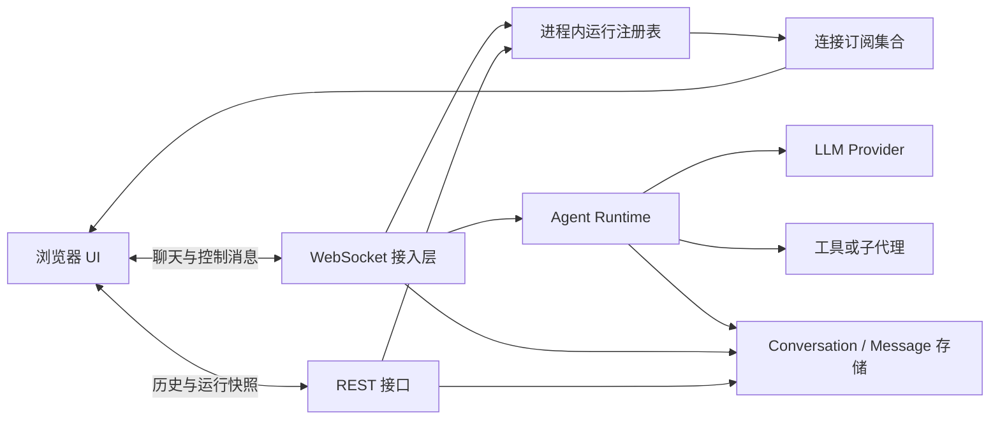
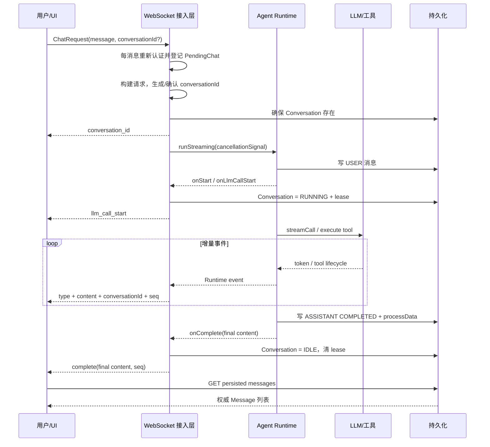
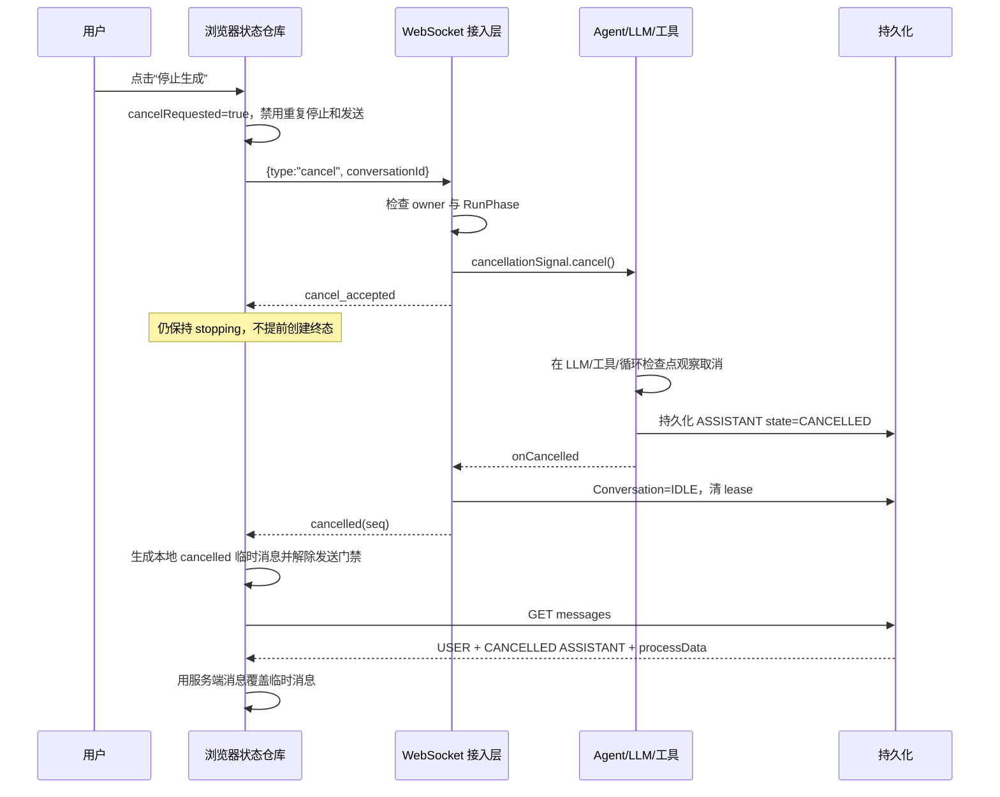
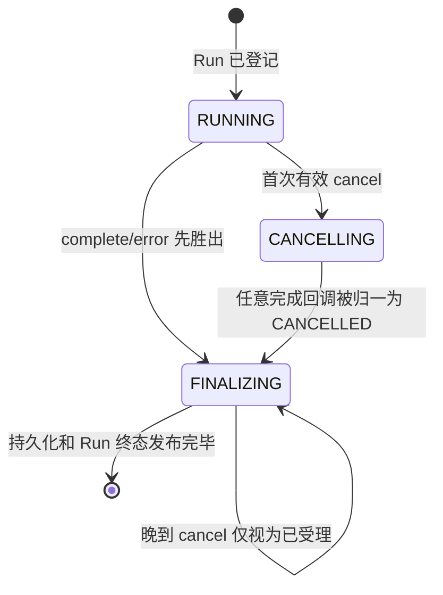
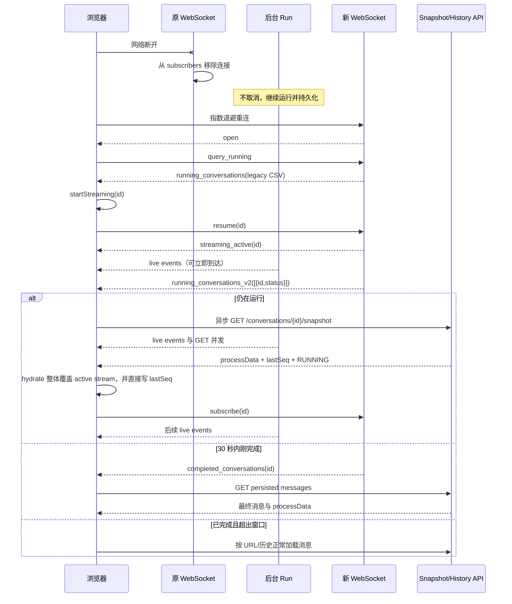

```
# 流式输出、停止、取消、恢复与断线重连复刻说明

## 1. 结论与边界

本能力让用户在一次可能持续数秒至数分钟的 Agent 运行中持续看到文本、思考阶段、工具执行和统计信息；允许用户显式停止运行；连接中断后，服务端运行不被误取消，客户端可以重新发现运行、恢复过程面板并重新订阅后续事件；运行结束后，最终消息和执行过程仍能通过普通 REST 历史接口恢复。

目标用户包括浏览器聊天用户、嵌入式聊天调用方、黑盒自动化客户端，以及需要观察同一用户运行的第二个浏览器页面。输入是聊天请求或生命周期控制消息，输出是按会话隔离的 WebSocket 事件、持久化消息和会话运行状态。

本章包含：

- WebSocket 聊天流、事件顺序和每会话序号。
- UI“停止生成”到服务端协作式取消的完整链路。
- `query_running`、`resume`、`subscribe`、`unsubscribe` 和断线后台继续运行。
- 运行中快照、终态持久化、刷新恢复及错误后继续发送。
- 同一会话并发、取消竞态、重复取消、工具执行中取消、跨账号拒绝。
- 同步 REST 与 SSE 入口同 WebSocket 能力的差异。

本章不展开模型路由、工具业务语义、Ask Human 的表单设计和会话历史管理；但会说明它们与取消、重连的接口交点。

### 1.1 当前结论

| 结论 | 等级 | 含义 |
| --- | --- | --- |
| 浏览器主链路使用 `/ws/chat`，正常文本流以 `conversation_id → ...token... → complete` 收束 | `I` | 当前前后端代码可静态确认 |
| WebSocket 关闭不会取消 Agent，只有显式 `cancel` 才请求取消 | `I` | 断网与用户停止是两种不同语义 |
| 取消是协作式、单向且幂等的；`cancel_accepted` 只是已受理，不是完成 | `I` | UI 必须等待本次 Run 的逻辑终态；但目标不存在时的 `cancelled` 只是幂等控制回执 |
| 运行中任务、订阅者和最近完成窗口主要保存在单个应用进程内 | `I` | 无粘性路由时，跨节点重连不能完整恢复实时流 |
| 当前运行快照保存结构化 `processData` 和事件水位，不保存已经流过的回答 token 文本 | `I` | 重连后可恢复过程卡片，但断线前的未完成正文要等最终 REST 重载才能完全恢复 |
| WebSocket 取消、恢复、订阅及刷新恢复均有 active 黑盒契约 | `A` | 本次分析没有运行这些用例，不能声称当前环境通过 |
| QWGK-329 记录了“提问后中断、刷新后空白”的真实缺陷，并有 5 条刷新回归用例 | `K` + `A` | 当前源码已有持久化和重连补强，但本次未运行，不能据此宣布缺陷关闭 |
| 502、上游超时、token-limit 后恢复发送，目前 UI 自动化通过 WebSocket Mock 验证前端恢复，不证明真实后端故障分类链路 | `A` | 后端故障注入类黑盒用例仍为 planned |
| 生产级复刻应使用可持久化运行日志、原子 cursor 订阅和跨节点事件代理 | `D` | 这是复刻改进设计，不是当前实现事实 |

本次只做三仓静态取证，没有启动服务、运行测试或观察线上环境，因此没有 `R` 结论。

## 2. 术语与参与方

| 术语 | 定义 |
| --- | --- |
| Conversation | 用户会话，所有运行、消息、快照和权限检查的业务归属边界 |
| Run | 一次用户消息触发的一轮 Agent 执行；同一 Conversation 当前只允许一个活动 Run |
| Origin Session | 发起聊天的 WebSocket 连接 |
| Subscriber | 获准接收某个运行事件的 WebSocket 连接，可包含发起连接和同一用户的其他连接 |
| Cooperative Cancellation | 设置共享取消信号，由 Agent、LLM 和工具在安全检查点退出，不强行中断 JDBC 所在线程 |
| Accepted | 服务端找到活动或尚未登记的运行，已经设置取消信号，但运行尚未完全收尾 |
| Logical Run Terminal | 一次真实 Run 的 `COMPLETE`、`CANCELLED`、`ERROR` 三者之一；运行状态机只记录一个逻辑终态 |
| Control Receipt | 对控制请求的即时反馈，如 `cancel_accepted`、`cancel_ignored`；当前目标不存在时也复用了无序号 `cancelled`，不能据帧名断言存在 Run 终态 |
| Snapshot | 当前累积的结构化执行过程 JSON 和事件序号水位，用于重连补水和去重 |
| Running Lease | 数据库中的 `RUNNING` 状态、执行节点和心跳时间，用来识别跨节点运行或清理僵尸状态 |
| Resume | 将新连接设为运行的主要连接并恢复事件接收 |
| Subscribe | 将连接加入某运行的订阅集合，不改变运行本身 |



## 3. 业务规则

### 3.1 流式运行规则

1. 每次聊天请求最终必须解析出一个非空 `conversationId`；新会话由服务端生成 UUID，并尽早通过 `conversation_id` 告知客户端。
2. 同一 Conversation 不能同时存在两个 WebSocket Run。第二个运行在登记阶段应失败，不能覆盖前一个运行。
3. 每个带 `seq` 的运行事件都必须绑定 `conversationId`；`seq` 在一次 Run 内严格递增，但不保证连续，并在下一轮 Run 重新从低值开始。
4. 对一次真实 Run，`complete`、带运行序号的 `cancelled`、`error` 对应互斥的逻辑终态。当前协议还会在“没有本节点任务”时发送无序号 `cancelled` 作为幂等控制回执，因此网络上可能出现多个同名回执帧；不能把“每个 `cancelled` 帧”都当作运行终态。
5. `complete` 和 `cancelled` 后，会话状态回到 `IDLE`；`error` 后为 `ERROR`。下一轮成功运行可以重新进入 `RUNNING`。
6. 客户端在发送新一轮消息时必须清空该 Conversation 上一轮的序号水位，否则新一轮低序号会被错误去重。
7. UI 不能把流式 token 直接当作最终事实。终态到达后，要用 REST 持久化消息替换本地临时消息，以得到完整正文、`processData`、消息 ID 和状态。

### 3.2 停止与取消规则

1. UI“停止生成”是一次业务取消请求，不等于关闭 WebSocket。
2. 第一次点击停止后，UI 立即进入 `stopping`，禁用重复点击和新消息发送，但保留当前流式内容。
3. 服务端收到 `cancel` 后：
   - 找到活动/待登记运行：设置取消信号并发 `cancel_accepted`。
   - 找不到运行或运行已结束：幂等发 `cancelled`。
   - ID 是当前 Session 已被服务端替换掉的临时旧 ID：发 `cancel_ignored`，不得取消真实 Run。
   - ID 属于其他租户或其他用户：发 `error`，目标运行继续。
4. 当前 UI 的 `cancel_accepted` 不解除输入框门禁，而 `cancelled` 会解除；但协议没有显式区分 Run 终态和“目标不存在”的同名控制回执。复刻 v1 时必须结合本地 active Run/`seq` 防止误关其他运行，v2 应采用 5.4 的拆分事件。
5. 不允许通过 `Thread.interrupt()` 强杀运行线程。线程可能正进行 JDBC 持久化，强制中断会把用户取消污染成数据库异常。
6. LLM 失败与取消同时发生时，只要取消信号已置位，取消语义优先，不向用户泄漏偶发的 HTTP/IO 错误。
7. 取消前 Agent 尚未写入本轮消息时，宿主层补写 USER/`CANCELLED` ASSISTANT 消息；Agent 已开始后由 Runtime 自己写，避免重复回合。
8. 工具执行中取消属于协作式退出：工具执行上下文必须可读取取消信号；无法主动终止的外部调用可能要等到超时或返回后的检查点才收束。

### 3.3 断线和恢复规则

1. WebSocket 断开时，运行继续，结果仍持久化；只从订阅集合移除死连接。
2. 客户端重连成功后立即发送 `query_running`，服务端只返回当前 tenant/user 拥有的 Run。
3. 对运行中会话，客户端先取得 Snapshot，再以其 `lastSeq` 作为去重水位，然后 `subscribe` 后续事件；旧兼容链路还会发送 `resume`。
4. `resume` 和 `subscribe` 都必须做 tenant/user 所有权检查。只有能读取会话并不等于能接管运行；当前实现采用严格的运行发起者 tenant/user 匹配。
5. 最近完成的 Conversation 在完成后 30 秒内通过 `completed_conversations` 通知重连客户端从 REST 重载；记录最多保留 60 秒。
6. `resume` 找不到活动 Run 时静默返回，不发送 `streaming_active`；客户端应依靠 `completed_conversations` 或 REST 状态判断完成，而不是无限等待。
7. 若数据库仍为 `RUNNING` 但本节点没有运行对象，且运行租约已过期，读取路径会将其回收为 `IDLE`。配置键为 `nova.conversation.running-stale-after`，默认 ISO-8601 Duration `PT2M`。

### 3.4 连接与容量规则

| 规则 | 当前值 | 说明 |
| --- | ---: | --- |
| WebSocket 文本/二进制消息上限 | 20 MiB | 会话建立后同时设置容器和 Session 限制 |
| 容器空闲超时 | 10 分钟 | 防止长 LLM 调用被容器过早断开 |
| 浏览器应用层 ping | 25 秒 | 客户端发送 `{"type":"ping"}`，期待 `pong` |
| 服务端 RFC 6455 ping | 30 秒 | 保活所有活动连接 |
| 运行状态心跳 | 30 秒 | 更新数据库 Running Lease |
| 最近完成查询窗口 | 30 秒 | `query_running` 可额外返回刚完成 ID |
| 最近完成内存 TTL | 60 秒 | 清理进程内完成标记 |
| SSE 超时 | 5 分钟 | 当前 SSE 能力明显弱于 WebSocket |
| Running Lease 过期 | `PT2M` | `nova.conversation.running-stale-after`，属于可配置项 |

这些值是 `I`，不是通用最佳值。复刻工程应通过配置设置，并让网关、负载均衡器和应用超时互相协调。

## 4. 完整执行链路

### 4.1 正常流式问答



关键顺序如下：

1. 接入层先登记一个带取消信号的 PendingChat，覆盖“消息已接收但异步线程尚未启动”的取消窗口。
2. 构建 AgentRequest。若无 `conversationId`，生成服务端 UUID；客户端提供的 `initialConversationId` 只用于待登记期取消关联，不是最终会话 ID。
3. 使用原子 `putIfAbsent` 登记活动运行，拒绝同一会话并发运行。
4. 在进入模型流前确保 Conversation 持久化并发送 `conversation_id`。运行的 `onStart` 也可能再次发送同一 ID，客户端必须幂等处理。
5. Runtime 先写用户消息，再执行 LLM/工具循环。接入层同时收集结构化 `processData`。
6. Runtime 在回调完成前写 ASSISTANT 终态消息。接入层记录该 Run 的唯一逻辑终态、更新 Conversation 状态、移除活动运行，再发布对应运行终态事件。这里的唯一性只约束 Run 状态机，不约束重复控制请求产生的无序号 `cancelled` 回执。
7. 客户端把实时临时内容切为完成态，然后用 REST 重新加载权威消息。

### 4.2 用户停止生成



服务端 RunPhase 是：



状态机的关键点是：`recordTerminal()` 只允许第一次写终态；如果先前 Phase 已是 `CANCELLING`，即使随后收到完成回调，也将有效终态固定为 `CANCELLED`。如果持久化已经进入 `FINALIZING`，晚到取消不能把数据库已写的完成态改成取消态。

### 4.3 断线、重连和补水



浏览器连接采用 1 秒起步、最大 30 秒的指数退避。服务端处理一次 `query_running` 时，**固定先同步发送** legacy `running_conversations`，再发送 `running_conversations_v2`，最后按需发送 `completed_conversations`。前端收到 legacy 后立即 `startStreaming + resume`，所以新连接可以先接 live；收到 v2 后才启动异步 `GET Snapshot → hydrateStream → subscribe`。这不是抽象上的两种任选恢复方式，而是当前真实、并行叠加的顺序。

当前 `hydrateStream` 不是 merge：有 `processData` 时会从 Snapshot 重建并整体覆盖 `activeStreams[id]`（只特例保留 Ask Human/Plan Review），没有 `processData` 时也会无条件写 `lastSeq`；两条路径都直接把 Snapshot 的 nullable `lastSeq` 覆盖本地水位，不比较新旧值。因此在 legacy `resume` 已经收到新 token/工具事件后，较旧 Snapshot 可能把活动正文、工具状态或更高水位回退。水位回退会使该区间内的重复帧重新具备被接受的可能性，但当前没有运行验证证明服务端会再次投递这些帧，此结论属于 `F`。反过来，如果 Snapshot 水位超前于其不包含的回答正文，去重又会丢掉正文补偿。无条件覆盖和竞态窗口是 `I` 级静态事实，不应写成“Snapshot 后只接收 `seq > lastSeq`”即可保证无缺口。

`D` 级复刻修复：服务端只发送一个结构化发现响应；客户端先取得 Snapshot，再以 `subscribe(afterSeq)` 原子完成缺口回放与 live 切换。过渡期至少应令 hydrate 做单调 merge：`lastSeq=max(local,snapshot)`，不得覆盖已存在的正文；Snapshot 必须携带 `runId`，仅能覆盖同一 Run，并在 hydrate 完成前缓存按序到达的 live 事件。

当前 Snapshot 只包含结构化过程事件、Token 统计、计划和总耗时。它不包含已经流出的正文 token。因此：

- 断线期间生成的工具/阶段事件可以从 Snapshot 恢复。
- 断线前已经显示但尚未持久化的回答正文，页面重建后可能暂时缺失。
- 重连订阅只能收到订阅之后的 token；Run 最终完成后，REST reload 才恢复完整权威正文。

这是当前实现边界 `I`，生产级复刻应补充可重放的正文增量或服务器当前 answer buffer。

#### 4.3.1 重连落到非 owner 节点的真实行为

当前 owner 指 tenant/user，不是运行节点；但 Run Registry、subscriber 和 PendingChat 都只在启动 Run 的 JVM 内存中。若重连或控制消息落到另一节点，即使身份相同，也会出现以下 `I` 级行为：

| 操作 | 非 owner 节点看到的状态 | 对客户端的响应 | 原 owner 节点上的 Run |
| --- | --- | --- | --- |
| `query_running` | 本地 Registry 为空 | legacy 空字符串、v2 空数组 | 继续运行 |
| `resume(id)` | 本地找不到任务 | 静默，无 `streaming_active` | 继续运行，未换主连接 |
| `subscribe(id)` | 本地找不到任务 | 静默 | 继续运行，未新增订阅者 |
| `cancel(id)` | 本地任务、PendingChat、stale ID 均不存在 | 无序号 `cancelled` 控制回执 | **继续运行，未被取消** |
| `GET Snapshot` | REST 可从数据库看到 fresh Running Lease | `status=RUNNING, processData=null,lastSeq=null` | 继续运行，但实时过程不可得 |

因此 DB lease 只证明“某节点近期宣称它在运行”，不是跨节点 Run Directory，更不能转发取消或流事件。负载均衡无粘性时，当前取消回执可能是假阳性；生产复刻必须使用粘性路由，或以 `conversationId/runId → ownerNode` 目录加内部 RPC/PubSub 转发控制与事件。

### 4.4 错误与恢复发送

`error` 是终态。浏览器收到后立即：

1. 将 Conversation 标记为 `ERROR`。
2. 删除活动流状态，隐藏停止按钮并恢复输入框。
3. 展示服务端格式化错误；若帧带 `messageId`，立即为错误消息提供反馈/重试等工具栏。
4. 当前不会像 complete/cancelled 一样立刻 REST reload，避免持久化 ERROR 行的空正文覆盖实时可读错误文本。

UI E2E 对“网络断开式流失败”“上游 timeout/502”“token limit”使用可控 WebSocket Mock：第一条发 `error`，第二条按 `answer_start → token → round_boundary(final) → complete` 返回，断言输入框恢复且第二条消息成功。这证明前端恢复链路的 active 契约，不证明真实 Provider 能稳定制造和分类这些错误。

## 5. 对外契约

### 5.1 WebSocket 连接

```text
GET ws(s)://<host>/ws/chat?lang=zh|en
Cookie: <configured-session-cookie>=<opaque-session-token>
```

- 握手认证成功后，Session 内保存 `tenantId`、`userId`、locale 和可选原始 session cookie。
- 每条入站消息都会重新校验 session。明确过期时先尽力发 `auth_expired`，再以应用关闭码 `4401` 关闭；客户端停止重连并走注销/登录流程。
- 暂时性认证上游网络或 5xx 错误当前 fail-open，避免外部认证抖动踢掉用户；这是可用性优先的风险选择。
- 允许 Origin 当前配置为 `*`。生产复刻不应照搬，应使用明确 Origin 白名单并配合 SameSite/CSRF 策略。

当前部署相关配置与硬编码边界如下：

| 配置 | 默认/示例 | 作用 | 性质 |
| --- | --- | --- | --- |
| `NEXT_PUBLIC_WS_URL` | 未设置时按浏览器当前 origin 拼 `/ws/chat`；示例为 `ws://localhost:8080/ws/chat` | 浏览器 WebSocket 地址 | 前端构建时环境变量，不是服务端 Spring 配置 |
| `nova.auth.enabled` | `false` | 是否启用 CAN Session 认证 | 可配置 |
| `nova.auth.auth-url` | 示例 `https://anymetrics.example.com` | `api-url`、`login-url` 的兼容兜底 base | 可配置，示例不是可照搬生产值 |
| `nova.auth.api-url` | 空，回退 `auth-url` | 服务端校验 cookie、读取用户和环境变量的 CAN base | 可配置 |
| `nova.auth.login-url` | 空，回退 `auth-url` | 浏览器登录跳转和 CAN 详情链接 base | 可配置 |
| `nova.auth.timeout-seconds` | `10` | 认证上游调用超时 | 可配置 |
| `nova.auth.cookie-name` | `CIP_SESSION` | 握手和消息重校验读取的 cookie 名 | 可配置 |
| `nova.auth.mock-tenant-id` / `mock-user-id` | `default-tenant` / `default-user` | 认证关闭时的开发身份 | 可配置；生产禁止以 mock 身份旁路 |
| 消息上限、ping、recent-completed 窗口/TTL、SSE 5 分钟 | 见 3.4 | 传输容量和生命周期 | 当前 Java/前端常量硬编码，不是上述配置项 |

`nova.conversation.running-stale-after=PT2M` 是单独的可配置项；不要把它和硬编码的 30 秒运行心跳、30 秒 recent-completed 查询窗口或 60 秒内存 TTL 混为一类。

### 5.2 客户端消息统一模型

```ts
type ClientMessage =
  | ChatRequest
  | { type: "ping" }
  | { type: "cancel"; conversationId?: string }
  | { type: "query_running" }
  | { type: "resume"; conversationId: string }
  | { type: "subscribe"; conversationId: string }
  | { type: "unsubscribe"; conversationId: string };

interface ChatRequest {
  type?: "chat";                 // 缺省和未知 type 当前也落入 chat 处理
  conversationId?: string;       // 续聊必填；新会话省略
  initialConversationId?: string;// 仅待登记取消关联，服务端仍可替换
  projectId?: string;            // 仅新 Conversation 接受
  message: string;               // 纯空且无有效附件时拒绝
  images?: Array<{ data: string; mediaType: string; name?: string }>;
  files?: Array<{ id: string; name: string; path: string; size: number; type: string }>;
  provider?: string;
  dataThemeId?: string | null;
  lang?: "zh" | "en";
}
```

完整聊天示例：

```json
{
  "type": "chat",
  "conversationId": "d92db1be-8e4b-47df-8871-86ffbfed5d14",
  "message": "请总结本周经营表现",
  "provider": "default",
  "lang": "zh"
}
```

取消指定 Conversation：

```json
{"type":"cancel","conversationId":"d92db1be-8e4b-47df-8871-86ffbfed5d14"}
```

不带 ID 的 `cancel` 只取消**当前 WebSocket Session 追踪的全部任务和待登记聊天**，不是取消该用户在所有设备和所有连接上的任务。

#### `dataThemeId` 当前差异与复刻约束

`dataThemeId` 虽然存在于 WebSocket 请求类型，前端也只在 Embed Conversation 发送时填入所选主题（普通 Chat 明确不填），但 WebSocket Handler 内负责“规范化、校验主题属于 tenant、写入 SandboxContext”的 `applyRequestedDataTheme(...)` helper **没有任何调用点**。因此当前 WS/Embed 请求中的该字段被解析前链路忽略，不能据 helper 的存在宣称主题已生效或已做租户校验。这是 `I` 级静态事实。

同步 `POST /api/chat` 与 SSE `POST /api/chat/stream` 则读取同名字段并直接调用 `base.withDataThemeId(requested)`；Controller 此处没有复用 WS helper 的 tenant 可见性校验，也没有把 `all` sentinel 归一为空。下游业务可能另有能力边界，但本章没有运行证据可证明两条入口最终等价。复刻时应把该差异视为安全和一致性风险。

`D` 级修复：在三种入口共同的请求装配层执行一次 `normalize → all/空转 null → tenant 可见性校验 → immutable context`，失败时返回明确的 400/403，而不是静默扩大为“全部主题”；WebSocket 必须真正调用共享 resolver，Embed 与 REST/SSE 共享同一合同测试。不要仅仅“调用现有 WS helper”，因为 REST 当前行为也需一起收敛。

### 5.3 服务端事件信封

运行事件推荐统一为：

```ts
interface ServerEvent {
  type: string;
  content: string | object;
  conversationId?: string;
  seq?: number;       // 运行内单调递增，控制消息可能没有
  messageId?: number; // 当前只在 error 帧尽力提供
}
```

```json
{
  "type": "token",
  "content": "本周",
  "conversationId": "d92db1be-8e4b-47df-8871-86ffbfed5d14",
  "seq": 7
}
```

重要事件如下：

| 事件 | `content` | `seq` | Audience | 语义 |
| --- | --- | --- | --- | --- |
| `conversation_id` | Conversation ID | 通常无 | 发起 Chat 的 primary Session | 服务端确认最终 ID；可能重复，必须幂等 |
| `llm_call_start` | 空串 | 有 | 当前 Run 全部 subscribers | 一次 LLM 调用开始 |
| `thinking` | 思考摘要文本 | 有 | 当前 Run 全部 subscribers | 独立于最终答案展示 |
| `answer_start` | 空串 | 有 | 当前 Run 全部 subscribers | 后续 token 进入最终答案阶段 |
| `token` | 文本增量 | 有 | 当前 Run 全部 subscribers | 只追加到当前 round buffer |
| `round_boundary` | `tool` 或 `final` | 有 | 当前 Run 全部 subscribers | 将刚结束的 token round 归类为中间工具轮或最终回答 |
| `stream_reset` | 空串 | 有 | 当前 Run 全部 subscribers | Provider 重试前清理当前临时流；当前黑盒故障注入用例为 planned |
| `tool_exec_start` | 管道分隔字符串 | 有 | 当前 Run 全部 subscribers | 工具开始；参数展示最多约 4000 字符 |
| `tool_exec_end` | 管道分隔字符串 | 有 | 当前 Run 全部 subscribers | 工具结果、成功、耗时；结果展示最多约 8000 字符 |
| `token_stats` | `input|cached|output|toolCalls` | **无** | **当前 primary Session only** | 通过 `sessionRef` 直发，不 fan-out 给仅 subscribe 的连接；不应用于终态判断 |
| `cancel_accepted` | 空串 | 无 | 发起 cancel 的 Session | 取消已登记，仍须等待 Run 终态 |
| `cancel_ignored` | 空串 | 无 | 发起 cancel 的 Session | 临时旧 ID 已失效，不影响真实运行 |
| `complete` | 最终完整正文 | 有 | 终态发布时仍在集合内的 subscribers | Run 成功或截断后的逻辑完成终态 |
| `cancelled` | 空串 | Run 终态有；无任务控制回执无 | Run 终态发 subscribers；幂等回执只发请求者 | 同一帧名复用了两种语义，必须结合 `seq`/Run 状态判断 |
| `error` | 本地化、脱敏后的错误 | Run 终态有 | 终态发布时仍在集合内的 subscribers | 失败逻辑终态；可能带持久化 `messageId` |
| `running_conversations` | 逗号分隔 ID | 无 | 发起 query 的 Session | 旧发现协议 |
| `running_conversations_v2` | `[{"id":"...","status":"RUNNING"}]` | 无 | 发起 query 的 Session | 新发现协议，`content` 是 JSON 数组而非字符串 |
| `completed_conversations` | 逗号分隔 ID | 无 | 发起 query 的 Session | 最近 30 秒内完成，提示 REST reload |
| `streaming_active` | Conversation ID | 无 | 发起 resume 的 Session | `resume` 已成功附着 |
| `pong` | 空串 | 无 | 发起 ping 的 Session | 应用层 ping 响应 |

工具事件当前为紧凑管道协议：

```text
tool_exec_start.content = callId|toolName|truncatedArgs|inputBytes
tool_exec_end.content   = callId|toolName|outputBytes|success|durationMs|truncatedResult
```

因为参数或结果本身可能含 `|`，两种事件必须采用不同的边界解析：

- start：取**前两个** `|` 得到 `callId`、`toolName`，再取**最后一个** `|`；中间全部内容是 `truncatedArgs`，最后是 `inputBytes`。
- end：按**前五个** `|` 得到 `callId`、`toolName`、`outputBytes`、`success`、`durationMs`，第五个分隔符之后的全部余部才是 `truncatedResult`。当前前端等价地先剥 `callId`，再 split 余部并把索引 4 起重新用 `|` join。

不能对整串简单 `split('|')` 后按固定长度截断，否则参数或结果中的管道符会破坏字段。复刻时建议改为 JSON 对象，保留旧格式只做版本兼容。

### 5.4 生命周期控制响应

| 请求 | 正常响应 | 非 owner | 目标不存在 |
| --- | --- | --- | --- |
| `cancel(id)` | `cancel_accepted`，随后等待该 Run 的逻辑终态 | `error: Not authorized to cancel this conversation` | 无序号 `cancelled` 控制回执；不证明发生了 Run 取消 |
| `cancel()` | 有任务：`cancel_accepted`；无任务：`cancelled` | 不适用，只处理当前 Session | `cancelled` |
| `resume(id)` | `streaming_active`，随后继续事件 | `error: Not authorized to resume this conversation` | 静默 |
| `subscribe(id)` | 加入 fan-out；不发确认帧 | `error: Not authorized to subscribe` | 静默 |
| `unsubscribe(id)` | 停止 fan-out；不发确认帧 | 当前无显式 owner 错误 | 幂等静默 |
| `query_running` | 固定按 legacy → v2 → 可选 completed 顺序发送 | 结果按 owner 过滤 | legacy 空串 + v2 空数组 |

当前复用 `cancelled` 同时表达“Run 已取消”和“本节点没有可取消任务”是协议歧义。`D` 级 v2 协议应拆成：控制响应 `cancel_result {requestId, runId?, result: ACCEPTED|ALREADY_TERMINAL|NOT_FOUND|STALE|FORBIDDEN|WRONG_NODE}`，以及只由运行状态机发布的 `run.cancelled {runId, seq, persistedMessageId?}`。UI 只用后者关闭对应 Run；前者只更新控制请求状态。

### 5.5 Snapshot REST

```http
GET /api/conversations/{conversationId}/snapshot
Cookie: <authenticated session>
```

运行中示例：

```json
{
  "conversationId": "d92db1be-8e4b-47df-8871-86ffbfed5d14",
  "status": "RUNNING",
  "processData": "{\"events\":[{\"type\":\"tool_exec\",\"tool\":\"metric_query\",\"success\":true,\"timestamp\":1785970000000}],\"tokenStats\":{\"inputTokens\":1200,\"outputTokens\":83,\"toolCallCount\":1},\"totalDurationMs\":3200}",
  "lastSeq": 11
}
```

规则：

- 必须验证 Conversation 未删除且属于当前 tenant/user；不可见统一返回 404，避免枚举。
- 本节点内存中仍有 Run 时，读取 Collector 的一致性 Snapshot。
- 只有活动任务但 Collector 尚未建立时，返回 `RUNNING`、`processData=null`、`lastSeq=null`。
- 无内存任务但数据库有新鲜 Running Lease 时，仍返回 `RUNNING`，但无法提供进程内 Snapshot。
- 运行结束后读取最近一条 ASSISTANT 的持久化 `processData`，`lastSeq=null`。
- 当前前端声明把 `lastSeq` 写成必有 number，而服务端实际允许 null；复刻时必须修正为 nullable。

Snapshot 有 4 条 active 黑盒契约 `A`（本次未运行）：`CHAT-STATS-018` 验证运行中 live `processData + lastSeq>=1`；`019` 验证完成后读取持久化 assistant `processData` 且 `lastSeq=null`；`020` 专门验证运行中水位可用于 WS 去重；`021` 使用第二账号验证返回 403/404 且响应不泄漏 `processData`。这些用例证明验收意图，不消除 4.3 所述 hydrate 并发覆盖缺口。

### 5.6 同步 REST 与 SSE

同步调用：

```http
POST /api/chat
Content-Type: application/json

{"conversationId":"可选","message":"你好","provider":"可选","lang":"zh"}
```

响应：

```json
{"conversationId":"...","content":"完整答案"}
```

同一 Conversation 的同步 REST 调用使用公平锁串行执行；这与 WebSocket 的“发现已有 Run 并拒绝”不是同一种并发语义。

SSE 调用：

```http
POST /api/chat/stream
Accept: text/event-stream
```

当前 SSE 只映射：

```text
event: token      data: <delta>
event: tool_call  data: <toolName>
event: complete   data: <finalContent>
```

当前 SSE 存在以下 `I` 限制：

- 固定 300 秒 emitter 超时。
- 没有面向调用方的 cancel REST 契约。
- 没有 `query_running`、Snapshot cursor、resume、subscribe 或重放。
- 客户端断开/Emitter 写失败没有绑定为 Agent 取消。
- 过程事件远少于 WebSocket。

因此，不应把 SSE 宣称为 WebSocket 的等价替代。生产复刻若保留 SSE，应共享同一个 Run Registry 和 cursor/replay 协议。

### 5.7 TypeScript 契约漂移风险

当前运行时实际支持/发送 `unsubscribe`、`cancel_ignored`、`auth_expired`、`reasoning_token`，但前端联合类型并未完整列出这些值；Snapshot 的 `lastSeq` 也存在 nullable 差异。这是 `I` 级静态契约漂移。JavaScript 运行时仍可处理部分消息，但类型系统不能提供完整保护。复刻时必须由单一 JSON Schema/AsyncAPI 生成服务端 DTO、前端类型和测试解析器。

## 6. 数据模型与生命周期

### 6.1 最小持久化模型

以下 DDL 是复刻本能力所需的最小语义模型，不要求照抄具体数据库方言：

```sql
CREATE TABLE conversation (
    id                    varchar(255) PRIMARY KEY,
    tenant_id             varchar(255),
    user_id               varchar(255) NOT NULL,
    title                 varchar(255),
    status                varchar(16) NOT NULL DEFAULT 'IDLE',
    running_node_id       varchar(128),
    running_heartbeat_at  timestamp,
    last_error_at         timestamp,
    last_error_message    varchar(2000),
    is_deleted            boolean NOT NULL DEFAULT false,
    created_at            timestamp NOT NULL,
    updated_at            timestamp
);

CREATE INDEX idx_conversation_run_lease
    ON conversation (tenant_id, user_id, status, running_heartbeat_at);

CREATE TABLE message (
    id                bigint GENERATED BY DEFAULT AS IDENTITY PRIMARY KEY,
    tenant_id         varchar(255),
    user_id           varchar(255) NOT NULL,
    conversation_id   varchar(255) NOT NULL,
    role              varchar(32) NOT NULL,
    content           text,
    process_data      text,
    timeline          text,
    turn_index        integer NOT NULL,
    state             varchar(16) NOT NULL DEFAULT 'COMPLETED',
    error_message     text,
    is_deleted        boolean NOT NULL DEFAULT false,
    created_at        timestamp NOT NULL
);

CREATE INDEX idx_message_owner_conversation
    ON message (tenant_id, user_id, conversation_id);
CREATE INDEX idx_message_turn
    ON message (conversation_id, turn_index);
```

枚举建议：

```text
Conversation.status = IDLE | RUNNING | ERROR
Message.state       = PENDING | STREAMING | COMPLETED | CANCELLED | ERROR
```

取消后 Conversation 回到 `IDLE`，取消事实保存在 ASSISTANT Message 的 `CANCELLED` state，而不是把 Conversation 永久保持为 CANCELLED。

### 6.2 进程内运行对象

```ts
interface RunningTask {
  conversationId: string;
  tenantId: string;
  userId: string;
  cancellation: { cancelled: AtomicBoolean };
  phase: AtomicReference<"RUNNING" | "CANCELLING" | "FINALIZING">;
  subscribers: ConcurrentSet<WebSocketSession>;
  primarySession: AtomicReference<WebSocketSession>;
  collector?: ProcessDataCollector;
  agentStarted: boolean;
  terminalOutcome?: "COMPLETE" | "CANCELLED" | "ERROR";
  terminalContent?: string;
  terminalError?: Error;
}
```

另需维护：

- `conversationId → RunningTask`：活动 Run 唯一表。
- `sessionId → conversationId set`：无 ID cancel 和断线清理。
- `sessionId → PendingChat set`：异步登记前取消窗口。
- `sessionId → stale initial id set`：防止临时旧 ID 误终止真实 Run。
- `conversationId → owner + completedAt`：最近完成发现窗口。

### 6.3 `processData` 示例

```json
{
  "events": [
    {
      "type": "tool_exec",
      "callId": "call-1",
      "tool": "metric_query",
      "args": "{\"metric\":\"sales\"}",
      "result": "{\"rows\":10}",
      "inputBytes": 18,
      "outputBytes": 11,
      "success": true,
      "durationMs": 238,
      "timestamp": 1785970000000
    }
  ],
  "tokenStats": {
    "inputTokens": 1200,
    "cachedTokens": 300,
    "cacheHitRatio": 0.25,
    "outputTokens": 340,
    "toolCallCount": 1
  },
  "totalDurationMs": 4200,
  "model": "provider/model"
}
```

并发工具在取消时可能存在 start 而没有正常 end。Runtime 的时间线收尾应把孤儿工具调用补成 `success=false`，结果使用明确的取消占位符，避免刷新后永久显示“运行中”。

### 6.4 生命周期与一致性

1. 接收聊天后，保证 Conversation 存在。
2. Runtime 分配同一 `turnIndex` 的 USER 和 ASSISTANT。
3. 开始运行时原子写 `RUNNING + running_node_id + heartbeat`，并清历史错误。
4. 每 30 秒只更新 heartbeat，不改变业务 `updated_at`。
5. 完成/取消：更新 Conversation 为 IDLE、清 lease 和历史错误。
6. 错误：更新为 ERROR、清 lease、写截断后的错误摘要；Message 保存完整的安全错误文本或 code。
7. 列表/Snapshot 读取发现 RUNNING 但租约超过阈值时，以条件更新回收 IDLE，防止多个节点重复回收。
8. 删除 Conversation 时应级联或软删 Message、Artifact，并首先拒绝或取消活动 Run；当前本章不证明删除运行中会话的完整事务语义。

## 7. 核心实现设计

### 7.1 最小可用版本

最小可用版本可以限定为单实例或粘性会话：

```text
WebSocket Gateway
  ├─ Authenticator
  ├─ InMemoryRunRegistry
  ├─ SubscriptionSet
  ├─ CancellationSignal
  └─ EventEnvelope(type, content, conversationId, seq)

Agent Runtime
  ├─ persist USER
  ├─ cooperative checkpoints
  ├─ persist ASSISTANT terminal
  └─ callback terminal

REST
  ├─ GET messages
  └─ GET snapshot
```

核心伪代码：

```java
void start(ChatRequest input, Session session) {
  PendingChat pending = pendingRegistry.add(session.id(), input.provisionalId());
  executor.submit(() -> {
    RunningTask task = null;
    try {
      Request req = assemble(input, session.identity());
      pending.resolve(req.conversationId());
      task = new RunningTask(req.conversationId(), session.identity(), pending.signal());
      registry.putIfAbsentOrThrow(req.conversationId(), task);
      task.subscribe(session);
      persistConversation(req);
      send(session, event("conversation_id", req.conversationId()));
      checkCancelled(task);
      runtime.run(req, task.signal(), new Listener(task));
      emitRecordedTerminal(task);
    } catch (Cancelled e) {
      persistFallbackCancelledIfAgentNotStarted(req, task);
      task.recordTerminal(CANCELLED);
      emitRecordedTerminal(task);
    } catch (Throwable e) {
      task.recordTerminal(ERROR, sanitize(e));
      emitRecordedTerminal(task);
    } finally {
      pendingRegistry.remove(pending);
      registry.removeIfSame(task);
    }
  });
}
```

取消：

```java
CancelReply cancel(Identity caller, Session session, String conversationId) {
  if (conversationId == null) {
    boolean any = cancelAllTrackedBy(session);
    return any ? ACCEPTED : ALREADY_TERMINAL;
  }
  RunningTask task = registry.get(conversationId);
  if (task != null && !task.owner().equals(caller)) throw forbidden();
  if (task == null && staleIds.contains(session.id(), conversationId)) return IGNORED_STALE_ID;
  boolean found = requestCancel(task) | pendingRegistry.cancel(session.id(), conversationId);
  return found ? ACCEPTED : ALREADY_TERMINAL;
}

boolean requestCancel(RunningTask task) {
  while (true) {
    switch (task.phase.get()) {
      case FINALIZING: return true;
      case CANCELLING: task.signal.cancel(); return true;
      case RUNNING:
        if (task.phase.compareAndSet(RUNNING, CANCELLING)) {
          task.signal.cancel();
          return true;
        }
    }
  }
}
```

### 7.2 前端状态设计

每个 Conversation 独立保存：

```ts
interface StreamState {
  content: string;
  pendingRoundContent: string;
  phase: "thinking" | "answer";
  toolActivities: ToolActivity[];
  processData?: ProcessData;
  cancelRequested: boolean;
  startTime: number;
}

interface ChatRuntimeState {
  activeStreams: Record<string, StreamState>;
  lastSeqByConversation: Record<string, number | undefined>;
  reloading: Record<string, boolean>;
}
```

处理原则：

- 用户消息追加与创建 Stream 必须是同一次原子状态更新，避免出现“已有用户消息但尚未生成”的闪烁占位。
- `cancel_accepted` 只设置 `cancelRequested=true`。
- `cancelled` 创建临时 CANCELLED assistant，删除 active stream，然后 REST reload。
- `complete` 先设置 reloading，再删除 stream，避免渲染间隙产生孤儿回答占位。
- `error` 删除 stream并展示错误；是否 reload 必须根据持久化错误正文策略统一设计。
- 当前 Snapshot hydrate 无条件覆盖 `lastSeq`，之后丢弃 `seq <= lastSeq` 的帧；这是兼容事实而非正确设计。复刻时使用同 Run 单调水位并合并正文/过程状态。
- 新一轮发送前删除旧 `lastSeq`。

### 7.3 生产级版本

当前单进程注册表适合单实例或粘性路由。生产级应增加：

1. **稳定 Run ID**：Conversation ID 之外增加每轮唯一 `runId`，所有控制和事件都携带它，解决每轮 `seq` 重置和晚到帧污染下一轮的问题。
2. **持久化事件日志**：以 `(runId, seq)` 为唯一键写 Redis Streams、Kafka 或数据库 append log，正文 token 和结构化事件都可重放。
3. **原子订阅握手**：`SUBSCRIBE runId AFTER seq`，服务端先回放缺口再切换 live；Snapshot 和 subscribe 不再存在时间窗。
4. **跨节点路由**：Run Registry 保存 `runId → ownerNode`，控制消息通过内部 RPC/消息总线转发到实际节点；或 Gateway 对运行期间保持粘性。
5. **可取消 Provider/Tool**：将信号转换为 HTTP request cancellation、进程取消或工具 worker Future cancellation；主 Run/JDBC 所在线程仍只做协作式退出，不应被粗暴 interrupt。
6. **Outbox 终态**：消息终态、Conversation 状态与 terminal event outbox 同事务写入，发布失败可重发。
7. **协议生成**：AsyncAPI/JSON Schema 生成 Java/TS/测试类型，杜绝当前联合类型漂移。
8. **Cursor 保留策略**：对已完成运行保留足够时间，而不是固定 30 秒内存窗口；历史页可按 Run 状态直接查询。

推荐协议：

```json
{
  "version": 2,
  "type": "tool.execution.completed",
  "runId": "run_01K...",
  "conversationId": "conv_01K...",
  "seq": 42,
  "occurredAt": "2026-08-06T12:00:00Z",
  "payload": {
    "callId": "call_1",
    "toolName": "metric_query",
    "success": true,
    "durationMs": 238,
    "outputBytes": 1024
  }
}
```

## 8. 并发与非正常路径

### 8.1 场景处理表

| 场景 | 当前语义 | 复刻注意点 |
| --- | --- | --- |
| cancel 早于异步线程登记 Run | PendingChat 已持有共享信号，线程启动后在准备步骤间检查并补写 CANCELLED 回合 | 不要只在正式 Registry 中查任务 |
| cancel 与 complete 竞争 | CANCELLING 先到则 CANCELLED；FINALIZING 先到则保留已记录终态 | 终态必须 compare-and-set 或同步记录 |
| 连续两次 cancel | 第一次 accepted/终态；第二次不报错、不允许 complete 复活 | HTTP 版本可返回 202/200 + 当前状态 |
| cancel 不存在/已完成 ID | 直接返回 cancelled | 不泄漏 ID 是否曾存在；审计中可区分 |
| cancel 临时 stale ID | `cancel_ignored`，真实 Run 继续 | 临时 ID 与服务端 ID 要有明确映射生命周期 |
| 工具执行中 cancel | 单工具在主调用线程协作退出；同轮 `>=2` 个并行工具时，join 线程观察取消后对未完成 worker 执行 `Future.cancel(true)`，worker 的 `isCancelled()` 同时观察共享信号和 interrupt | 不得据此 interrupt 承载主 Run/JDBC 事务的线程；为外部调用另设超时和安全检查点 |
| Provider 错误与 cancel 同时出现 | cancel 优先，发 cancelled 而不是 error | 避免停止操作向 UI 泄漏偶发 502/IO |
| WebSocket 断开 | 不取消；移除订阅连接 | 释放 Session 引用，保留 Run 和持久化 |
| 重连落到另一节点 | query 空；resume/subscribe 静默；cancel 回无序号 cancelled 但远端继续；Snapshot 仅凭 fresh DB lease 显示 RUNNING/null | 当前能力缺口；使用粘性路由或跨节点 Run Directory/代理，详见 4.3.1 |
| Snapshot 之后、subscribe 之前产生事件 | 可能形成缺口或由同时存在的 resume 路径偶然补到 | 生产版必须支持 `afterSeq` 原子回放 |
| 重连时 Run 刚完成 | `completed_conversations` 在 30 秒内触发 REST reload | 超出窗口时依靠正常历史加载 |
| resume/subscribe 他人 Run | error，目标继续 | 错误不得带目标内容或 owner 信息 |
| 同一 Conversation 两次 WebSocket chat | 第二次原子登记失败 | UI 保持第一条 Run；错误绑定正确 Conversation |
| 同一 Conversation 并发同步 REST | 当前公平锁串行 | 不同通道语义需文档化，生产建议统一拒绝或排队 |
| 进程崩溃 | 内存 Run、subscriber、recentlyCompleted 丢失；数据库 RUNNING 等待租约回收 | 当前无法继续原 Run；生产版需任务持久化/恢复策略 |
| 终态帧发送失败 | 数据已持久化、状态已转换；客户端靠重连 REST 恢复 | 终态发布失败必须有指标，不能回滚业务终态 |

### 8.2 事件顺序和去重

- 对单个 Session 的 send 使用同步锁，避免两个虚拟线程并发写同一 WebSocket。
- 同一个事件 fan-out 给多个 subscriber 时共享一个 `seq`。
- Collector 的结构事件入库和对外 send 都可能推进内部计数，所以 `seq` 可以跳号；消费者只能检查严格大于水位。
- 当前只有运行事件普遍带 seq，发现和控制事件可能不带。不要用全连接级序号推断业务顺序。
- 只使用 Conversation ID 作为去重键时，新一轮必须清水位。更安全的生产协议用 `(runId, seq)`。

### 8.3 `stream_reset`

LLM 可重试流在已经输出部分内容后重试时，需要先发 `stream_reset`，客户端清空当前临时回答，避免两次尝试正文拼接。当前源码有事件分支，黑盒用例因缺少稳定故障夹具仍为 `P`。生产复刻应建立确定性 Provider Fixture：第一次输出部分 token 后抛可重试异常，第二次成功，并断言 reset 恰好一次。

## 9. 安全、权限和审计

1. 握手身份是 tenant/user 的唯一可信来源，绝不信任消息体里的身份字段。
2. `cancel`、`resume`、`subscribe`、Snapshot 必须做对象级 owner 校验；`query_running` 逐条按 owner 过滤，最近完成 ID 也不能跨租户泄漏。
3. 无权限读取建议统一表现为 404；控制通道当前返回通用英文 error，不包含 owner、tenant 或运行内容。
4. 原始 API Key、Bearer Token、Cookie、完整工具参数和工具结果不得进入日志。WS 展示层结果需要截断，敏感字段还需结构化脱敏。
5. `setAllowedOrigins("*")` 不适合作为生产默认。使用 Cookie 鉴权时必须限制 Origin，设置 Secure/HttpOnly/SameSite，并防止跨站 WebSocket 劫持。
6. 每条消息重认证的 fail-open 策略必须只限暂时性认证服务故障；明确 session 过期必须 fail-closed。生产系统要为 fail-open 次数告警。
7. 取消审计建议记录：requester tenant/user、conversationId、runId、Session/设备、请求时间、受理结果、最终终态、取消延迟；不记录明文 prompt 或工具结果。
8. 运行中 Snapshot 可能包含工具参数和结果，只能返回 owner，分享/公开视图必须另行白名单清洗。

## 10. 外部依赖对端设计

### 10.1 LLM Provider

对端最低契约：

- 支持流式 token 回调和最终 Usage。
- 异常能区分可重试与不可重试。
- 每次调用前后检查调用方取消信号。
- 若 SDK 支持，取消时关闭 HTTP body/stream；若不支持，返回后立即丢弃结果并归一为 cancelled。
- 重试已经产生 token 时，先通知 `stream_reset`。

最小 Stub：

```ts
async function* fakeStream(signal: AbortSignal) {
  for (const token of ["一", "段", "很", "长", "的", "回答"]) {
    if (signal.aborted) throw new AgentCancelledError();
    await delay(50);
    yield { type: "token", value: token };
  }
  return { usage: { inputTokens: 20, outputTokens: 6 } };
}
```

生产对端应使用 deadline、连接池、AbortSignal、错误分类和幂等请求 ID，并明确“取消是否仍计费”的供应商事实。Nova 源码无法证明第三方 Provider 内部是否真正中止远端推理。

### 10.2 工具和子代理

Tool Execution Context 至少提供：

```ts
interface ToolExecutionContext {
  runId: string;
  conversationId: string;
  tenantId: string;
  userId: string;
  isCancelled(): boolean;
  deadline: number;
}
```

工具应在大循环、外部请求前后、长文件操作分片间检查取消。对无法中止的写操作，使用幂等键和提交点：取消发生在提交前则回滚；提交完成后返回“写入已完成但回答取消”，不能谎报为未执行。

当前实现必须区分两个线程层级：主 Run 通过共享 `CancellationSignal` 协作取消，明确避免对可能处于 JDBC 写入的主线程执行 `Future.cancel(true)`；只有一轮中存在至少两个并行工具时，ToolLoop 的独立 worker Future 才会在 join 观察到取消/中断后执行 `cancel(true)`，使 interruptible I/O 或读取 `Thread.currentThread().isInterrupted()` 的工具尽快退出。单工具轮直接在调用线程执行，不经过 worker Future。复刻时不能把“工具 worker 可 interrupt”推广成“整个 Agent Run 可安全 interrupt”。

### 10.3 负载均衡和事件代理

最小兼容部署要求单实例或 WebSocket 粘性路由。生产级推荐：

```text
Client → WS Gateway → Run Directory(runId→node)
                    ↘ Event Log / PubSub ↙
                Worker Node → LLM/Tools
```

任何节点收到 cancel/resume 都先查 Run Directory，再转发到 owner node；订阅者从 Event Log 以 cursor 补历史后接 live。仅使用数据库 Running Lease 不足以恢复 token 流。

## 11. 可观察性

### 11.1 日志

建议结构化字段：

```json
{
  "event": "chat.cancel.terminal",
  "traceId": "8-char-or-full-trace",
  "runId": "run_...",
  "conversationId": "conv_...",
  "tenantIdHash": "...",
  "userIdHash": "...",
  "phaseBefore": "CANCELLING",
  "terminal": "CANCELLED",
  "cancelLatencyMs": 386,
  "nodeId": "node-a"
}
```

必须记录异常对象用于定位，但输出前经过凭据脱敏。WebSocket 发送失败通常是连接关闭，可用 debug；终态发送失败应另有计数指标。

### 11.2 指标

- `chat_runs_active{node}`
- `chat_run_duration_seconds{terminal}`
- `chat_cancel_requests_total{result=accepted|already_terminal|forbidden|stale}`
- `chat_cancel_latency_seconds`
- `chat_ws_connections_active`
- `chat_ws_reconnect_total`
- `chat_resume_total{result=attached|missing|forbidden}`
- `chat_snapshot_latency_seconds{source=memory|database|remote_node}`
- `chat_event_replay_gap_total`
- `chat_running_lease_stale_total`
- `chat_terminal_send_failure_total`
- `chat_auth_revalidate_total{result=ok|expired|transient_fail_open}`

### 11.3 Trace

一次 Run 的 Trace 应串起：request assemble、Conversation ensure、LLM call、每次 tool execution、terminal persistence、terminal publish 和 reload。取消请求是独立 Span Link 到 Run，而不是另开无关联 Trace。

### 11.4 用户可见诊断

- `stopping` 状态超过阈值时显示“仍在停止，可安全离开页面”，不要解除门禁并启动第二轮。
- 网络断开显示“连接中断，任务仍可能在后台运行”。
- 重连后区分“已恢复实时流”“任务已完成，正在加载结果”“无法连接到运行节点”。
- 错误只显示本地化安全文案和可公开的错误代码，不显示 Java 异常、SQL、URL 凭据或堆栈。

## 12. 复刻实施顺序

1. **先做持久化模型**：Conversation 状态/租约、Message turn/state/processData。静态验收：同一 turn 的 USER/ASSISTANT 可查询，CANCELLED 可刷新恢复。
2. **实现 Run Registry 和唯一逻辑终态状态机**：支持 PendingChat、owner、phase、signal。静态验收：真实 Run 的 `COMPLETE/CANCELLED/ERROR` 只从一个发布函数产生；控制回执使用另一事件类型。
3. **接入 Agent 协作式取消**：LLM、工具、Ask Human、子代理都有检查点。静态验收：不使用线程中断作为主取消方式。
4. **实现 WebSocket 基础流**：认证、Conversation ID、token、tool events、terminal。静态验收：所有运行事件带 Conversation/Run 标识。
5. **实现 UI per-conversation stream state**：原子发送、停止中、终态、REST reload。静态验收：`cancel_accepted` 不解除门禁。
6. **实现 Snapshot + seq 去重**：新轮重置水位。静态验收：Snapshot schema 明确 nullable 字段。
7. **实现 query/resume/subscribe/unsubscribe**：owner 检查、断线不取消、recent completed。静态验收：跨账号不能影响或观察 Run。
8. **补 Running Lease 和僵尸回收**：多实例至少能正确展示状态。静态验收：心跳更新不触碰普通会话更新时间。
9. **生产化事件重放和跨节点代理**：runId、event log、atomic afterSeq subscribe。静态验收：无粘性路由下也能从任意节点取消和恢复。
10. **最后补故障注入验收**：Provider reset/502/timeout/token-limit、工具取消、进程崩溃、终态发送失败。

## 13. 验收标准

### 13.1 正向场景

- 新聊天在首个 token 前得到服务端 Conversation ID；后续运行事件全部绑定相同 ID。
- 文本至少产生一条 token，并恰好一个 complete；刷新后答案、状态和 processData 不空。
- 工具流产生配对 start/end，完成后过程面板与持久化 processData 一致。
- 用户停止后先进入 stopping，最终得到 cancelled，输入框恢复；刷新后显示 CANCELLED，而不是错误或空白。
- 断开 Origin Session 后 Run 继续；新连接能 query、hydrate、subscribe，并在完成后加载完整答案。

### 13.2 反向和权限场景

- 其他 tenant/user 的 cancel、resume、subscribe 均失败，且 owner Run 继续。
- Snapshot 不可跨账号读取；query_running 和 completed 不泄漏其他账号 ID。
- 过期 session 收到关闭码 4401 并停止重连。
- 超过 20 MiB 的 WebSocket 消息被拒绝，服务不崩溃。

### 13.3 并发和恢复场景

- cancel/complete 竞争只出现一个终态。
- 两次 cancel 不产生 error 或 complete 复活。
- cancel 能覆盖请求已接收但 Run 尚未正式登记的窗口。
- 工具执行中取消最终为 CANCELLED，未完成工具不永久显示 running。
- v1 兼容验收要能复现并监控“legacy resume live 与 v2 hydrate 并发”的覆盖窗口；v2 目标验收要求 Snapshot 水位只能单调前进、正文不回退、缺口可回放，新一轮不会被上一轮水位过滤。
- 重连发生在“Run 刚完成”窗口时，客户端收到 completed 提示并 REST reload，不合成本地 cancelled。
- 进程崩溃后 Running Lease 会在阈值后回收；若要求恢复原 Run，则必须由生产级持久任务机制完成。

### 13.4 错误恢复场景

- 网络式流中断、error、502/timeout、token-limit 均停止 spinner、隐藏停止按钮、恢复输入框。
- 错误后在同一 Conversation 发送下一条消息能正常完成。
- error 文案不包含 API Key、Bearer Token、数据库异常或内部堆栈。
- 重试型 Provider 在产生旧 token 后必须发 stream_reset，最终正文不重复拼接。

## 14. 测试矩阵

| 场景 | 通道 | 前置条件 | 操作 | 预期结果 | 当前证据等级 |
| --- | --- | --- | --- | --- | --- |
| 普通文本流 | WS | 已认证、可用模型 | 发短问题 | `conversation_id → token → complete`，单终态 | `I/A` |
| 超短回答 | WS | 已认证 | 要求仅回复一个字 | 有 ID，complete 恰好一次，不因 token 少卡住 | `A` |
| 工具流 | WS | 稳定数据集和工具 | 发指标分析问题 | tool 生命周期、round boundary、complete/cancelled | `I/A` |
| 按 ID 取消 | WS | 长回答运行中 | 发 cancel(id) | accepted 后 cancelled；无 error/双终态 | `I/A` |
| 当前 Session 全取消 | WS | Session 内有运行 | 发 cancel() | 本 Session 追踪运行终止 | `I/A` |
| 工具执行中取消 | WS | 已出现工具信号 | 发 cancel(id) | 最终 cancelled、无后端泄漏 | `I/A` |
| 跨账号取消 | WS | 第二账号 | 取消 owner Run | 通用 unauthorized error；owner 不取消 | `I/A` |
| 不存在/已完成 ID 取消 | WS | 无活动 Run | 发 cancel(id) | 幂等 cancelled，无 error | `I/A` |
| complete/cancel 竞态 | WS | 接近结束 | 延迟后 cancel | 只出现 complete 或 cancelled 之一 | `I/A` |
| 双 cancel | WS | 活动 Run | 连续两次 cancel | 第二次无 error、无 complete 复活 | `I/A` |
| UI 停止按钮 | Browser + WS 探针 | 长回答 | 点击停止 | cancel 帧、cancelled、输入框恢复、无红色错误 | `A` |
| query_running | WS | 活动 Run | 发 query_running | legacy/v2 均只含 owner ID | `I/A` |
| resume 重连 | WS | 旧连接断开、Run 未结束 | 新连接 resume | 新连接收到后续 token；旧连接不再收到 | `I/A` |
| subscribe/unsubscribe | WS | 同 owner 第二连接 | 订阅后取消订阅 | 订阅期有 fan-out，退订后无业务事件 | `I/A` |
| 跨账号 resume/subscribe | WS | 第二账号 | 控制 owner ID | 通用 unauthorized，未附着 | `I/A` |
| 最近完成发现 | WS | Run 刚完成 | 30 秒内 query | completed ID 触发 REST reload | `I` |
| 完成窗口过期 | WS | 完成超过 30 秒 | query | 不再返回 ID | `I/A` |
| stale initial ID | WS | provisional ID 与真实 ID 不同 | 用旧 ID cancel | `cancel_ignored`，真实 Run 继续 | `I`；历史 release 为 `K`，当前 YAML 为 `A` |
| Snapshot 运行中补水 | REST + WS | Run 正在执行工具 | GET snapshot | `RUNNING`、processData 非空、`lastSeq>=1`、有 thinking | `I/A`（CHAT-STATS-018） |
| Snapshot 完成态 | REST | Run 已完成 | GET snapshot | 持久化 assistant processData 非空、`lastSeq=null` | `I/A`（CHAT-STATS-019） |
| Snapshot 去重水位 | REST + WS | Run 正在执行 | GET snapshot 后继续收流 | `lastSeq>=1`；v1 能过滤旧帧，但另测 hydrate/live 竞态 | `I/A`（CHAT-STATS-020） |
| Snapshot 跨账号 | REST | 第二账号知道 Conversation ID | GET snapshot | 403/404，响应不含 processData | `I/A`（CHAT-STATS-021） |
| Snapshot/live 覆盖竞态 | REST + WS | legacy resume 后已收到新 live，延迟 v2 Snapshot | 完成 hydrate | 当前可能正文/工具状态/水位回退；v2 目标必须单调 merge+回放 | 当前限制 `I`，目标 `D` |
| 完成后刷新 | Browser | 5 类真实业务会话已完成 | 刷新页面 | 历史不空、输入框可用、无中断提示 | `A/K`（QWGK-329 回归） |
| 网络中断后继续 | Browser Mock | 既有 Conversation | 首轮 error，次轮 complete | 输入框恢复、次轮成功 | `A`，仅前端 Mock |
| 502/timeout 后继续 | Browser Mock | 同上 | 注入错误再发送 | 不持续生成、次轮成功 | `A`，仅前端 Mock |
| token-limit 后继续 | Browser Mock | 同上 | 注入错误再发送 | 不持续生成、次轮成功 | `A`，仅前端 Mock |
| 真实 LLM transport 分类 | WS 故障注入 | 可控 Provider | 注入 timeout/network/5xx | 安全 error code，无内部泄漏 | `P` |
| stream_reset | WS 故障注入 | 首次流部分 token 后可重试 | 注入失败并重试 | reset 后仅保留第二次正文 | `I/P` |
| 进程/跨节点重连 | 多节点 | 非粘性路由 | Run 中切节点并 query/resume/cancel/snapshot | query 空、resume 静默、cancel 假 cancelled、Snapshot 仅 lease RUNNING/null；远端继续 | 当前限制 `I`，目标 `D` |

所有 `A` 用例在本次分析中均未执行。

## 15. 当前能力与建议汇总

### `I` 已实现事实

- WebSocket 主流式协议、心跳、20 MiB 限制和每消息重认证。
- PendingChat 覆盖登记前取消窗口；CancellationSignal 单向幂等。
- RUNNING/CANCELLING/FINALIZING 保证取消和完成竞争只有一个有效终态。
- 断线不取消；单节点内 resume/subscribe 做 owner 校验，query_running 做 owner 过滤；跨节点不转发控制。
- query 恢复固定经历 legacy 立即 resume，再由 v2 异步 hydrate/subscribe；hydrate 会覆盖 active stream 和水位，存在静态可确认的回退竞态。
- 内存 Snapshot + `lastSeq` 去重、Message/Conversation 状态持久化和 Running Lease；lease 不提供远端实时过程。
- WS/Embed 的 `dataThemeId` 校验 helper 零调用，当前字段被忽略；REST/SSE 的同名字段走另一条直接写 Context 的路径。
- 主 Run 协作取消；仅并行工具 worker 可由 `Future.cancel(true)` interrupt。
- complete/cancelled 后 REST reload；error 后立即恢复输入并保留可读错误。

### `A` Active 测试契约

- 8 类 WS cancel、1 条 UI cancel、query/resume/subscribe/权限、5 条刷新恢复。
- CHAT-STATS-018～021 覆盖运行中、完成态、水位和跨账号 Snapshot。
- UI 断网、流错误、502/timeout、token-limit 后继续发送。
- 这些是当前验收目标，不代表本次运行通过。

### `K` 已知缺陷/历史环境事实

- QWGK-329：提问后不应中断，刷新后不应空白。当前有专门回归链路，但缺陷台账没有提供本次环境关闭证据。
- 2026-07-21 release 曾出现 stale provisional ID 仍收到 cancelled 的记录；当前源码已有 `cancel_ignored` 修正分支，YAML 已改为 active，但未运行验证。

### `P` 规划能力

- 稳定的 LLM timeout/network/5xx、context overflow、stream reset 故障注入。
- 这些不能写成当前已验证保证。

### `F` 强推断

- Snapshot/live 竞态的代码窗口、无条件覆盖和跨节点控制缺口均为 `I` 级静态事实；“某次实际用户会话必然发生正文丢失”的频率和触发概率仍是 `F`，本次未运行延迟注入来量化。

### `D` 复刻建议

- 引入每轮 runId、持久化事件日志、原子 `subscribe afterSeq`、正文 token 重放、跨节点 Run Directory 和 Outbox 终态。
- 拆分 `cancel_result` 控制响应与 `run.cancelled` 逻辑终态；hydrate 按同一 runId 单调 merge。
- 统一 WS/REST/SSE 的 dataTheme resolver，并补 Embed 合同测试。
- 使用 AsyncAPI/JSON Schema 生成协议类型，修复 runtime/TypeScript 的事件集合和 nullable 漂移。
- 将真实 Provider 故障注入纳入发布门禁，区分“前端可恢复”和“后端分类正确”。

## 16. 证据附录

以下路径只用于追溯；正文已经包含独立复刻所需的契约和设计。

### 16.1 Nova 实现证据

- `nova-app/src/main/java/com/aloudata/nova/controller/ChatWebSocketHandler.java`
- `nova-app/src/main/java/com/aloudata/nova/config/WebSocketConfig.java`
- `nova-app/src/main/java/com/aloudata/nova/auth/AuthProperties.java`
- `nova-app/src/main/java/com/aloudata/nova/auth/WebSocketAuthInterceptor.java`
- `nova-app/src/main/java/com/aloudata/nova/controller/ChatController.java`
- `nova-app/src/main/java/com/aloudata/nova/service/ChatService.java`
- `nova-app/src/main/java/com/aloudata/nova/service/ConversationStatusUpdater.java`
- `nova-app/src/main/java/com/aloudata/nova/agent/ProcessDataCollector.java`
- `nova-app/src/main/java/com/aloudata/nova/core/bridge/ConversationRunningLeaseRepository.java`
- `nova-core/nova-core-runtime/src/main/java/com/aloudata/nova/core/runtime/agent/CancellationSignal.java`
- `nova-core/nova-core-runtime/src/main/java/com/aloudata/nova/core/runtime/agent/Agent.java`
- `nova-core/nova-core-runtime/src/main/java/com/aloudata/nova/core/runtime/agent/LlmCaller.java`
- `nova-core/nova-core-runtime/src/main/java/com/aloudata/nova/core/runtime/agent/ToolLoopRunner.java`
- `nova-core/nova-core-runtime/src/main/java/com/aloudata/nova/core/runtime/agent/ToolExecutor.java`
- `nova-core/nova-core-runtime/src/main/java/com/aloudata/nova/core/runtime/agent/TimelineRecorder.java`
- `nova-core/nova-core-spi/src/main/java/com/aloudata/nova/core/spi/conversation/MessageState.java`
- `nova-app/src/main/resources/db/product-migration/postgresql/V202607061700__add_conversation_running_lease.sql`
- `nova-app/src/main/resources/application.yml.example`
- `web/.env.example`
- `web/lib/websocket.ts`
- `web/hooks/useWebSocket.ts`
- `web/hooks/useChat.ts`
- `web/stores/chatStore.ts`
- `web/types/index.ts`
- `web/lib/api/chat.ts`

白盒契约测试：

- `nova-app/src/test/java/com/aloudata/nova/controller/ChatWebSocketHandlerTest.java`
- `nova-app/src/test/java/com/aloudata/nova/controller/ChatWebSocketHandlerSubscribeTest.java`
- `nova-app/src/test/java/com/aloudata/nova/controller/ChatWebSocketHandlerSeqTest.java`
- `web/hooks/__tests__/useWebSocket.lifecycle.test.tsx`
- `web/stores/__tests__/chatStore.hydrateStream.test.ts`

### 16.2 `nova_auto_test` 黑盒证据

- `nova_auto_test/src/core/wsClient.ts`
- `nova_auto_test/src/core/wsCaseRunner.ts`
- `nova_auto_test/cases/01-chat-streaming/cancel/CHAT-CANCEL-001.yaml` 至 `CHAT-CANCEL-008.yaml`
- `nova_auto_test/cases/01-chat-streaming/cancel/CHAT-CANCEL-UI-001.yaml`
- `nova_auto_test/cases/01-chat-streaming/conversation-lifecycle/CHAT-CONV-005.yaml` 至 `CHAT-CONV-014.yaml`
- `nova_auto_test/cases/01-chat-streaming/conversation-lifecycle/CHAT-CONV-REFRESH-001.yaml` 至 `CHAT-CONV-REFRESH-005.yaml`
- `nova_auto_test/cases/01-chat-streaming/streaming/CHAT-STREAM-001.yaml` 至 `CHAT-STREAM-012.yaml`
- `nova_auto_test/cases/01-chat-streaming/error-flow/CHAT-ERR-001.yaml` 至 `CHAT-ERR-010.yaml`
- `nova_auto_test/cases/01-chat-streaming/process-stats/CHAT-STATS-018.yaml` 至 `CHAT-STATS-021.yaml`
- `nova_auto_test/docs/nova-test-cases/01-chat-streaming/cancel.md`
- `nova_auto_test/docs/nova-test-cases/01-chat-streaming/conversation-lifecycle.md`

证据冲突说明：Conversation 生命周期 Markdown 中保留了 release 2026-07-21 的 stale ID known-failure 记录，而当前对应 YAML 状态为 active，当前 Nova 源码也存在 `cancel_ignored` 防护。本文并列记录历史缺陷、当前静态修正和未运行验证，不选择性覆盖。

### 16.3 `nova_ui_e2e` 用户体验证据

- `nova_ui_e2e/src/agent-page.ts`
- `nova_ui_e2e/flows/01-chat/stop-generation.yaml`
- `nova_ui_e2e/tests/agent-stop-generation.spec.ts`
- `nova_ui_e2e/tests/agent-stop-generation.midscene.spec.ts`
- `nova_ui_e2e/tests/agent-chat-stability.spec.ts`
- `nova_ui_e2e/docs/known-product-issues.md`

QWGK-329 的明确记录还存在于 `nova_auto_test/AGENTS.md`、`nova_auto_test/README.md` 和 Conversation lifecycle 回归说明中；UI 当前开放问题台账未单独列出它，因此本文不推断其已关闭或仍在所有环境稳定复现。

```
