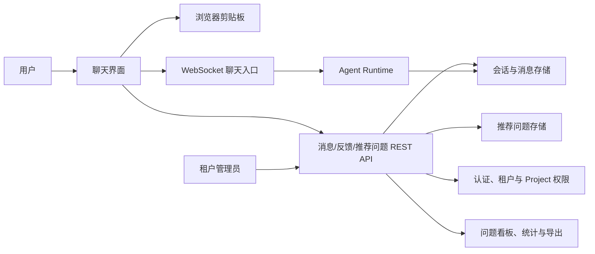
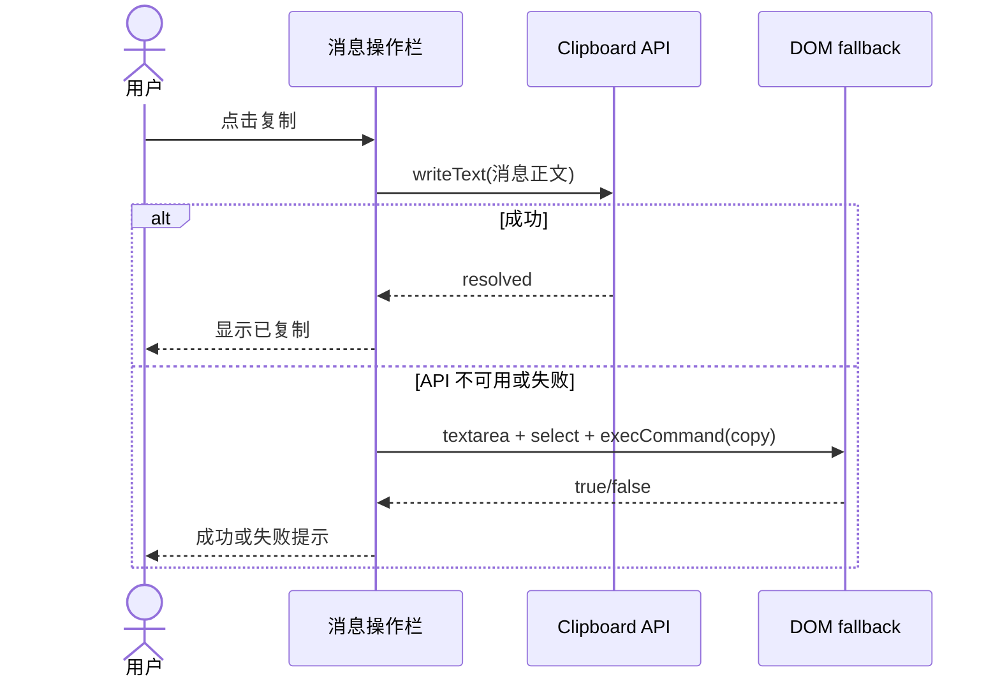
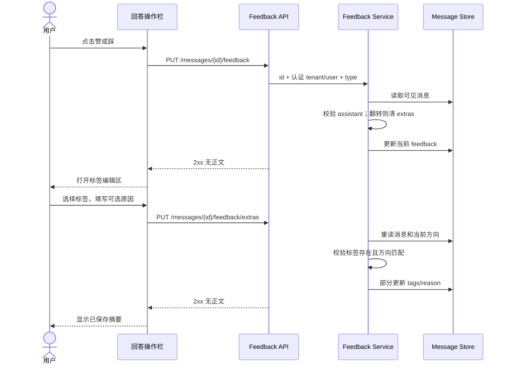
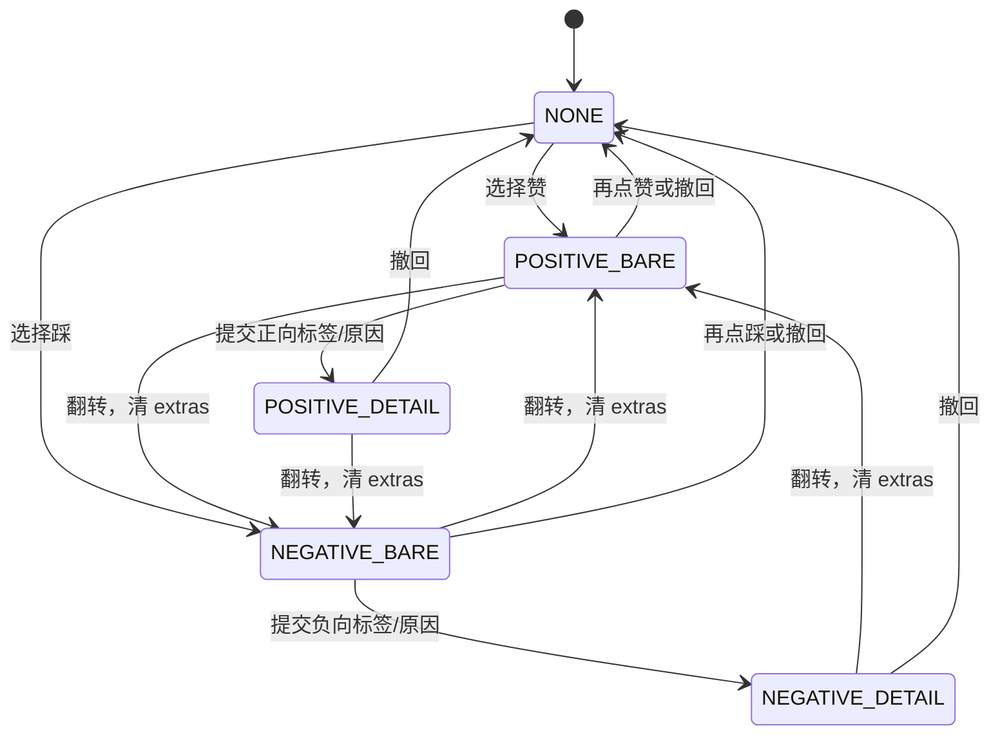
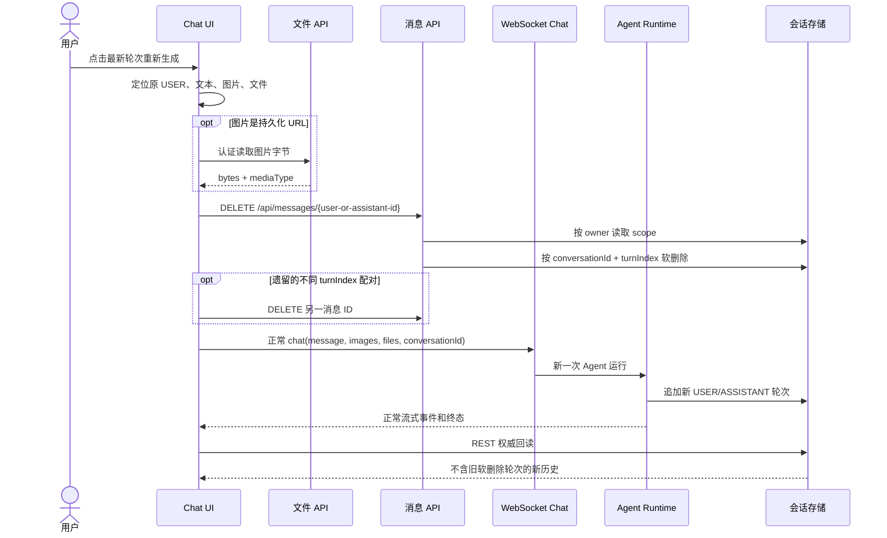
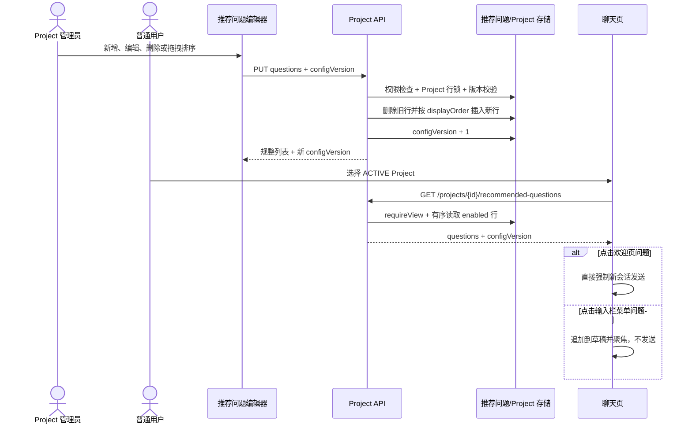

```
# 消息复制、反馈、重新生成与推荐问题复刻设计

## 1. 结论与边界

### 1.1 结论

本能力由四组表面相邻、但一致性要求完全不同的功能组成：

1. **复制消息**是纯浏览器动作：用户消息和助手消息都能复制；优先使用 Clipboard API，在非安全 HTTP Origin 上降级为临时 `textarea + execCommand("copy")`，不调用服务端、不产生业务数据。
2. **回答反馈**是助手消息上的属主级持久化状态：先选择 `POSITIVE` 或 `NEGATIVE`，再为该方向选择标签和可选自由文本；再次点击同方向会撤回，切换方向会清空旧方向的标签和原因。管理员可以按租户汇总、筛选和导出当前反馈。
3. **重新生成**当前不是“同一问题的答案版本分支”，而是一个破坏性重试编排：浏览器只给最新轮次展示入口；前端找到原用户问题和附件，软删除旧轮次，再通过正常 WebSocket 聊天入口重发问题。旧答案、旧反馈和旧执行证据不再出现在普通历史中。后端并不执行 latest 校验。
4. **推荐问题**是人工配置的有序问题列表。当前聊天主界面优先使用 URL 注入的问题，否则读取所选、可用 Project 的问题；欢迎页点击立即发起新会话，输入栏菜单点击只回填草稿。系统中还保留一套数据主题级配置和欢迎建议接口，但当前主聊天组件不消费这套历史接口。

当前静态实现没有普通聊天消息编辑、答案版本切换、重新生成分支浏览、复制审计、推荐问题点击分析事件或独立反馈审计流水。复刻时不能把这些能力推断为已存在。

本文结论来自三个工程的静态分析，本次没有启动服务或执行测试，因此没有 `R`（Runtime Verified）结论。证据等级为：`I` 已实现静态事实、`A` Active 黑盒契约但本次未运行、`K` Known Failure、`P` 规划、`F` 强推断、`D` 复刻建议。

### 1.2 解决的业务问题

- 让用户把问题或回答带到外部文档、IM 或工单系统。
- 以低成本“赞/踩 + 原因”采集回答质量信号，并支持租户管理员分析。
- 让最新一轮的错误、取消、不完整或不满意回答可以使用相同问题和上下文重新执行。
- 让项目管理员提供稳定、可运营的提问入口，降低用户不知道如何提问的门槛。

### 1.3 输入、输出与可见效果

| 能力 | 输入 | 输出/状态 | 用户可见效果 |
|---|---|---|---|
| 复制 | 当前气泡渲染文本 | 剪贴板文本、瞬时复制状态 | 图标约 2 秒切换为已复制 |
| 反馈 | 助手消息 ID、方向、标签、原因 | 消息行上的当前反馈 | 赞/踩选中态、反馈编辑面板和摘要 |
| 重新生成 | 最新轮次中任一可定位的服务端消息 ID | 原轮次软删除；新轮次正常生成 | 原轮次消失，输入区进入生成态，出现新回答 |
| 推荐问题 | Project/主题/URL 作用域下的有序字符串列表 | 草稿回填或新会话提问 | 欢迎页问题胶囊、输入栏推荐菜单 |

### 1.4 范围

本文包含复制、反馈 CRUD、反馈标签元数据、反馈运营消费、重新生成、推荐问题配置/读取/展示/点击、权限、状态、并发、错误和生产级改进设计。

本文不展开分享片段、下载分享图片、沉淀分析思路、完整聊天流协议、Project 全生命周期和运营分析页面通用设计。它们只在与本能力发生直接交互时说明。

## 2. 术语与参与方

| 术语 | 定义 |
|---|---|
| 消息 | 会话中的持久化 USER 或 ASSISTANT 行；运行时还可能有工具消息。 |
| 轮次 | 一次用户问题及其回答/工具记录形成的逻辑单元，以 `turnIndex` 关联。 |
| 当前反馈 | 助手消息上至多一个 `type + reason + tags` 值；不是反馈事件列表。 |
| 反馈方向 | `POSITIVE` 或 `NEGATIVE`。前端内部称 `up/down`，网络和数据库使用枚举名。 |
| 反馈标签 | 后端维护的稳定代码；展示文案可以按语言本地化。 |
| 重新生成 | 删除原轮次并用原问题再次调用正常聊天链路。 |
| 答案分支 | 保留同一问题多个答案版本并允许切换的模型；当前实现不具备。 |
| Theme 推荐问题 | 按 `(tenantId, dataThemeId)` 整组保存的历史配置形态。 |
| Project 推荐问题 | 按 `(tenantId, projectId, displayOrder)` 保存，并受 Project 权限和配置版本保护的当前主形态。 |
| URL 推荐问题 | 嵌入宿主通过 `recommendedQuestions` 查询参数提供的临时列表，优先级最高，不写数据库。 |

参与方包括用户、浏览器聊天界面、REST API、WebSocket 聊天入口、消息/会话存储、Project 权限服务、租户管理员和运营分析接口。



## 3. 业务规则

### 3.1 复制规则

1. USER 与 ASSISTANT 气泡都可复制；复制的是气泡传入的原始 `content` 字符串，不是渲染后的纯文本或 HTML DOM，也不包含工具过程/附件二进制。助手 Markdown 因而保留 `#`、反引号、表格管道等源码标记；用户消息复制的是经过附件标记清理后传给气泡的内容。
2. 优先调用 `navigator.clipboard.writeText(text)`；缺少 API、权限拒绝或调用异常时创建屏幕外只读 `textarea`，选中文本并调用 `document.execCommand("copy")`。
3. `I`：复制函数返回布尔值，但消息操作组件当前忽略返回值并无条件显示“已复制”。因此 HTTP Origin、权限拒绝或 fallback 失败时可能出现假成功视觉状态。
4. `D`：生产实现必须仅在实际复制成功后显示成功；失败应给出可操作错误或提供手动选中文本的降级框。
5. 复制不改变消息、不要求会话属主权限；只读管理员和公开可见渲染可保留复制，但不得因此取得隐藏的过程数据。

### 3.2 反馈规则

1. 反馈只能写到已持久化的 ASSISTANT 消息。实时临时回答没有服务端 ID 时，按钮禁用。
2. 反馈对象必须同时匹配认证上下文的 `tenantId` 和 `userId`；请求体不能指定身份。
3. 方向仅允许 `POSITIVE`、`NEGATIVE`。
4. 首次选择方向后立即持久化方向，再打开标签编辑区；因此用户关闭编辑区时，方向仍然已经保存。
5. 同方向重复提交保持现有标签和原因；方向翻转必须原子清空旧标签与旧原因。
6. 再次点击已经选中的方向等价于撤回，清除方向、标签和原因。
7. extras 采用部分更新：`null` 表示不改变；空标签数组清除标签；空白原因清除原因。
8. extras 必须在方向已存在后提交；每个标签代码必须存在且属于当前方向。
9. 当前标签集为：

| 方向 | 稳定代码 | 中文含义 |
|---|---|---|
| POSITIVE | `SOLVED_PROBLEM` | 解决了我的问题 |
| POSITIVE | `FOLLOWED_INSTRUCTIONS` | 遵循了我的指示 |
| POSITIVE | `GOOD_CONTENT` | 内容不错 |
| POSITIVE | `GOOD_OUTPUT_QUALITY` | 输出质量好 |
| POSITIVE | `FAST` | 快速高效 |
| POSITIVE | `POSITIVE_OTHER` | 其他 |
| NEGATIVE | `INCORRECT_OR_INCOMPLETE` | 不正确或不完整 |
| NEGATIVE | `DID_NOT_FOLLOW_INSTRUCTIONS` | 没有遵循我的指示 |
| NEGATIVE | `TOO_LONG` | 回答太长读不下去 |
| NEGATIVE | `LOST_CONTEXT` | 丢失上下文/缺少记忆 |
| NEGATIVE | `SLOW_OR_ERROR` | 速度慢或报错 |
| NEGATIVE | `NEGATIVE_OTHER` | 其他 |

10. UI 至少选择一个标签后才允许提交 extras；选择“其他”时展示自由文本输入。后端本身允许只保存方向、空标签或任意非空原因组合。
11. 当前没有 reason 长度、标签数量、重复标签或敏感内容约束。`D`：新系统应限制 UTF-8 字节数/Unicode code point、去重标签，并对运营展示做转义和敏感信息治理。

### 3.3 重新生成规则

1. `I`：只对当前会话的最新 `turnIndex` **在浏览器中展示**重新生成；历史轮次不展示。该约束只是 UI 门禁。
2. 会话正在流式生成或当前页面是管理员查看他人会话的只读模式时，UI 不展示按钮。
3. 可从已完成助手行、持久化错误助手行、取消行、只有用户行的孤儿轮次或“未生成回答”占位定位目标。
4. 若入口是助手行，向前寻找最近的 USER 行作为原问题；若入口本身是 USER 行则直接使用。
5. 删除单位优先是完整轮次：同一 `turnIndex` 的用户、助手和工具行由一次删除请求软删除。遗留/取消数据若用户与助手的 `turnIndex` 不一致，前端退化为顺序删除两个消息 ID。
6. 持久化图片在删除前通过受保护 URL 重新取回字节并转为 Base64；任一图片读取失败时不删除原轮次，也不重发。
7. 删除完成后，通过正常聊天命令在同一个 `conversationId` 中重发原文本、图片和文件引用。Project、模型、语言和上下文由发送当时的当前场景重新解析，不是旧运行配置的不可变快照。
8. 删除失败则不重发；发送失败时原轮次已经删除，当前实现没有自动恢复旧轮次。
9. 重新生成会产生新的轮次和新消息 ID，旧轮次保持软删除；旧反馈随旧助手行一起从普通查询中消失。
10. 当前没有独立 regenerate API、幂等键、重试事务、旧/新轮次关联字段或答案版本浏览。
11. `I-risk`：后端 `DELETE /api/messages/{id}` 只检查消息属主，不检查目标是否最新轮次、是否存在活动 Run，也不知道调用意图是否为“重新生成”。同一属主可直接调用接口删除任意历史轮次；随后普通 WebSocket chat 也不会验证“刚删除的是最新轮次”。因此“只能重生成最新轮次”不是服务端安全/一致性保证。
12. `I-risk`：数据库 `turn_index` 可为 NULL，但核心 SPI 使用不可空 `int`；存储 RowCodec 读取 NULL 时转换为 `0`。产品层声明的 `MessageScope.turnIndex == null` 遗留兼容分支在该正式存储路径上不可达。对原始 NULL 行调用删除时，实际会尝试批量删除 `turn_index=0`；若没有匹配行，影响行数可以为 0，控制器仍返回 204。复刻不能照搬这一错误的“成功”语义。

### 3.4 推荐问题规则

1. 所有持久化列表按顺序展示；统一规整规则是：忽略 `null`、首尾去空白、移除空字符串、按首次出现去重、每条截断到 200 个 Java 字符、最多保留 10 条。
2. 当前聊天来源优先级：
   - URL `recommendedQuestions` 的原始参数非空，且能解析为 JSON 数组或带 `questions/recommendedQuestions/items` 的对象时，使用规整后的列表；即使结果是空数组 `[]`，空数组在 JavaScript 中仍为 truthy，会明确压制 Project 推荐问题；
   - 否则，所选 Project 存在且状态为 `ACTIVE` 时，读取该 Project 的问题；
   - 否则返回空列表，不退回 Theme 配置。
3. URL 原始参数缺失、为空白、JSON 解析失败、或解析为数组/受支持对象之外的类型时返回 `null`，才回退 Project。URL 列表只做字符串/数字转换、trim 和去空，不执行 10 条/200 字符限制。它是嵌入宿主提供的界面内容，不是租户管理员配置。
4. 欢迎页最多展示前 5 条；点击后直接以该问题发起强制新会话。
5. 输入栏菜单展示全部已加载问题；点击只把问题追加到当前草稿并聚焦输入框，不自动发送，也不覆盖用户已有文本。
6. Project 读取要求调用者有查看权限；修改要求 Project 管理权限或被认可的租户管理员权限。`DELETED` Project 拒绝读写，`DISABLED` 可保留和管理问题，但聊天不展示。
7. Project 写入为整组替换，必须提交读取时的 `configVersion`；版本过期返回冲突，前端重新加载服务端版本，不静默覆盖。
8. Theme 设置接口仅租户管理员可访问，也是整组覆盖；当前没有版本字段，使用 `(tenantId, themeId)` upsert。
9. `K`：Theme 设置接口不验证 `themeId` 是否属于当前租户。跨租户账号用另一个租户的 Theme ID 读取会得到 HTTP 200（通常为空），写入会在自己租户下创建同名引用；Active 测试期望 403/404，并把当前行为登记为 Known Failure。
10. 当前前端存在 Theme 配置编辑器和遗留 `/api/chat/suggestions`，但主聊天推荐组件只读取 Project 或 URL。复刻或迁移时必须明确选择单一权威作用域，不能假定两套列表会自动同步。

## 4. 完整执行链路

### 4.1 复制回答



最后一步的失败分支是生产建议；当前消息组件无条件显示成功。

### 4.2 提交、修改和撤回反馈



反馈状态机：



### 4.3 重新生成



图中“最新轮次”和“没有活动 Run”的检查是 UI 在发请求前的判断，不是当前 MSG/WS 服务端链路的保证；直接 API 调用可以绕过。数据库 NULL `turn_index` 又会在 RowCodec 中先变成 0，因此图中的“按 turnIndex”对遗留 NULL 行可能变成错误的 turn 0 操作。

### 4.4 推荐问题配置与消费



## 5. 对外契约

### 5.1 通用认证与错误约定

所有 REST 请求从 Cookie/认证层注入以下服务端上下文，业务请求不得接受或信任同名字段：

```json
{
  "tenantId": "tenant-a",
  "userId": "user-42",
  "tenantAdmin": false
}
```

当前反馈和 Theme 设置接口大量使用运行时异常。`K`：缺失或他人消息的反馈写当前可能映射为 HTTP 500，Active 黑盒契约要求缺失/越权对象统一返回 403 或 404，且不得改变属主数据或泄漏消息正文。生产建议统一错误体：

```json
{
  "errorCode": "MESSAGE_NOT_FOUND",
  "message": "Message was not found or is not writable",
  "requestId": "req-01H..."
}
```

为防对象枚举，跨租户、跨用户和不存在的消息建议都返回 404；Project 管理接口可在已证明可见后返回 403。

### 5.2 反馈 REST API

#### 设置或翻转方向

```http
PUT /api/messages/812/feedback
Content-Type: application/json

{"type":"NEGATIVE"}
```

- 认证：登录用户；消息属主。
- 请求：`type` 必填，枚举 `POSITIVE|NEGATIVE`。
- 响应：当前实现成功为 `200 OK`、无正文。
- 当前幂等语义：重复设置相同方向保持 extras；它不是“toggle”。撤回由 DELETE 表达。
- 当前错误映射并不统一：未知枚举通常由 JSON 反序列化返回 400；`type:null` 进入服务后解引用会形成 500；非 assistant 抛 `IllegalArgumentException`、缺失/越权目标被包装为相同异常，当前均没有该控制器的局部或全局安全映射，通常为 500。

#### 部分更新标签和原因

```http
PUT /api/messages/812/feedback/extras
Content-Type: application/json

{
  "tags": ["INCORRECT_OR_INCOMPLETE", "TOO_LONG"],
  "reason": "数字不完整，且解释过长"
}
```

| 字段 | 类型 | 必填 | 语义 |
|---|---|---:|---|
| `tags` | `string[] | null` | 否 | null 不改变；空数组清空；非空整体替换 |
| `reason` | `string | null` | 否 | null 不改变；blank 清空；其他值原样保存 |

成功为 `200 OK` 无正文。没有方向会抛 `IllegalStateException`，未知标签或标签方向不匹配会抛 `IllegalArgumentException`；当前都通常表现为 500，而不是稳定的 409/422。前端捕获这些失败后只写 `console.error`，不显示 toast，也不会把服务端错误原因呈现给用户。

#### 撤回

```http
DELETE /api/messages/812/feedback
```

成功为 `200 OK` 无正文；清除 type、reason、tags。缺失/越权当前也可能表现为 500；前端仅写 console。

#### 标签元数据

```http
GET /api/feedback/tags?type=NEGATIVE
```

```json
[
  {"code":"INCORRECT_OR_INCOMPLETE","displayName":"不正确或不完整"},
  {"code":"TOO_LONG","displayName":"回答太长读不下去"},
  {"code":"NEGATIVE_OTHER","displayName":"其他"}
]
```

实际响应包含该方向全部六项。前端按方向缓存 Promise；失败会清缓存，使下次打开面板重新请求。

#### 消息回读投影

```json
{
  "id": 812,
  "role": "assistant",
  "content": "……",
  "turnIndex": 4,
  "feedbackType": "NEGATIVE",
  "feedbackReason": "数字不完整，且解释过长",
  "feedbackTags": ["INCORRECT_OR_INCOMPLETE", "TOO_LONG"],
  "state": "COMPLETED"
}
```

### 5.3 删除轮次与重新生成契约

当前只有删除，没有服务端 regenerate 命令：

```http
DELETE /api/messages/811
```

- 成功：`204 No Content`。
- 服务端先在 `(tenantId,userId)` 范围读取消息。
- 正常非空 `turnIndex`：软删除相同 `conversationId + turnIndex` 的全部未删除消息。
- 设计意图是“无 `turnIndex` 的遗留行只删指定消息”，但正式存储 RowCodec 已将数据库 NULL 转为 SPI 的 `0`，所以产品层 null 分支实际不可达；NULL 行可能错误地走 `turn_index=0` 批量删除。
- 批量删除影响 0 行时服务层不报错，仍返回 204；这意味着 204 不能严格证明目标轮次已删除。
- 接口不校验最新轮次或活动运行，同一属主可删除任意历史轮次。
- 缺失、已删除或越权：404 语义。

之后浏览器走现有 WebSocket chat 命令；最小字段为：

```json
{
  "conversationId": "conv-7",
  "message": "请重新计算上月 GMV",
  "images": [
    {"data":"<base64>","mediaType":"image/png","name":"chart.png"}
  ],
  "files": [
    {"name":"sales.csv","path":"uploads/sales.csv","size":1024,"type":"text/csv"}
  ]
}
```

这是两个独立网络步骤，不具备事务性。生产级替代契约见 7.3。

### 5.4 Theme 推荐问题 API（历史形态）

管理端：

```http
GET /api/settings/recommended-questions/theme-sales
PUT /api/settings/recommended-questions/theme-sales
Content-Type: application/json

{"questions":["本月销售额是多少？","哪些区域环比下降？"]}
```

```json
{"questions":["本月销售额是多少？","哪些区域环比下降？"]}
```

- 管理端 GET/PUT 要求租户管理员。
- PUT 是整组覆盖；body 为 null 时按空列表保存。
- 没有分页、版本、删除接口；保存空数组相当于业务清空，但仍保留一行 `[]`。
- 当前缺少 Theme 对象存在性和租户归属校验。

用户态只读接口：

```http
GET /api/data-themes/theme-sales/recommended-questions
```

返回同一个 `questions` 对象；要求认证上下文，但同样缺 Theme 对象级校验。

遗留欢迎建议接口：

```http
GET /api/chat/suggestions?dataThemeId=theme-sales
```

```json
{
  "greeting": "下午好，张三",
  "suggestions": ["本月销售额是多少？"]
}
```

无主题或无配置时 suggestions 为空；不调用 LLM。当前 Web 主聊天没有调用该接口。

### 5.5 Project 推荐问题 API（当前主形态）

读取：

```http
GET /api/projects/project-01/recommended-questions
```

```json
{
  "questions": ["本月销售额是多少？", "哪些区域环比下降？"],
  "configVersion": 7
}
```

整组替换：

```http
PUT /api/projects/project-01/recommended-questions
Content-Type: application/json

{
  "configVersion": 7,
  "questions": ["本月销售额是多少？", "哪些区域环比下降？"]
}
```

成功返回规整列表和递增后的版本。等价规整内容不写库、不递增版本。版本冲突：

```http
HTTP/1.1 409 Conflict
Content-Type: application/json

{
  "success": false,
  "errorCode": "PROJECT_VERSION_CONFLICT",
  "message": "Project configuration has changed; reload and retry"
}
```

Project 已删除返回 `PROJECT_STATE_CONFLICT`；不存在返回 `PROJECT_NOT_FOUND`；无管理权限返回 `PROJECT_ACCESS_DENIED`。

### 5.6 运营反馈查询

以下接口全部要求租户管理员，只在认证上下文的当前租户内查询 CHAT 会话的未删除 USER 轮次；每个 USER 轮次关联同 `turnIndex` 或兼容性的 `turnIndex+1` ASSISTANT 行。列表按用户问题 `createdAt DESC, messageId DESC` 排序。时间范围采用 ISO LocalDateTime：`startTime` 包含，`endTime` 排除。

#### 分页明细

```http
GET /api/admin/questions?feedbackType=NEGATIVE&feedbackTags=TOO_LONG&page=0&size=20
```

查询参数：

| 参数 | 类型/默认 | 规则 |
|---|---|---|
| `keyword` | string，可空 | 对解密后的用户问题正文做不区分大小写 contains；触发受限解密扫描 |
| `feedbackType` | string，默认 `ALL` | 支持 `ALL/POSITIVE/NEGATIVE/HAS_FEEDBACK/NO_FEEDBACK`；空白或未知值静默退化为 `ALL` |
| `feedbackTags` | repeated string | 多个标签是 OR：回答当前标签包含任意一个即匹配；触发解密扫描 |
| `skillName` | string，可空 | 匹配助手消息的完整 Skill 名称元素，不是模糊包含 |
| `userId` | string，可空 | 当前租户内精确用户过滤 |
| `startTime` | ISO LocalDateTime | 包含下界 |
| `endTime` | ISO LocalDateTime | 排除上界 |
| `page` | int，默认 0 | 服务层规整为 `max(0,page)` |
| `size` | int，默认 20 | 服务层规整为 `max(1,min(size,1000))` |

Spring Page 的关键响应字段与完整 `QuestionItem`：

```json
{
  "content": [{
    "conversationId": "conv-7",
    "persistedTurnIndex": 4,
    "turnIndex": 2,
    "totalTurns": 5,
    "userMessageContent": "本月销售额是多少？",
    "assistantMessageId": 812,
    "turnState": "COMPLETED",
    "userName": "张三",
    "userId": "user-42",
    "skillName": "metric-analysis, report",
    "feedbackType": "NEGATIVE",
    "feedbackReason": "数字不完整",
    "feedbackTags": ["INCORRECT_OR_INCOMPLETE"],
    "createdAt": "2026-08-13T10:00:00",
    "durationMs": 3200,
    "inputTokens": 1200,
    "totalTokens": 1400,
    "cachedTokens": 300,
    "cacheHitRatio": 0.2142857,
    "outputTokens": 200,
    "model": "provider-key"
  }],
  "totalElements": 1,
  "totalPages": 1,
  "number": 0,
  "size": 20
}
```

`persistedTurnIndex` 是数据库轮次键；`turnIndex` 是当前未删除 USER 轮次中的零基展示序号。二者不能混用。没有助手行时 `assistantMessageId/turnState/feedback/model/usage` 可为空，标签投影为空列表。

#### 汇总、趋势和活跃用户

```http
GET /api/admin/questions/stats?startTime=2026-08-01T00:00:00&endTime=2026-09-01T00:00:00
GET /api/admin/questions/stats/daily?startTime=2026-08-01T00:00:00
GET /api/admin/questions/active-users?startTime=2026-08-01T00:00:00
```

`/stats` 返回：

```json
{
  "totalQuestions": 120,
  "activeUsers": 9,
  "positiveCount": 30,
  "negativeCount": 8,
  "completedCount": 105,
  "cancelledCount": 5,
  "errorCount": 4,
  "incompleteCount": 6,
  "cancelRate": 0.0416667,
  "totalInputTokens": 50000,
  "totalTokens": 62000,
  "cachedTokens": 9000,
  "cacheHitRatio": 0.18,
  "totalOutputTokens": 12000,
  "users": [{"userId":"user-42","userName":"张三","account":"zhangsan"}],
  "skills": ["metric-analysis", "report"]
}
```

`incompleteCount` 指没有助手行或助手仍为 PENDING/STREAMING 的 USER 轮次。`cancelRate=cancelledCount/totalQuestions`；`cacheHitRatio=cachedTokens/totalInputTokens`，分母为 0 时返回 0。`users` 是租户用户目录，不是仅活跃用户；`skills` 是调用管理员当前可见的 Skill 展示名。

`/stats/daily` 返回按日期升序、只包含有问题日期的数组；前端负责补零日期：

```json
[{"date":"2026-08-13","questionCount":20,"activeUsers":4,"positiveCount":5,
  "negativeCount":2,"inputTokens":8000,"outputTokens":1600,"cachedTokens":1000,
  "cacheHitRatio":0.125}]
```

`/active-users` 返回数组，服务层最终按 `questionCount DESC, lastAskedAt DESC, userName ASC` 排序（用户名和时间均按 null-last）：

```json
[{"userId":"user-42","userName":"张三","account":"zhangsan","questionCount":16,
  "lastAskedAt":"2026-08-13T10:00:00","positiveCount":4,"negativeCount":2}]
```

汇总读取消息的**当前**反馈值；撤回或软删除旧轮次后，该反馈不再进入普通统计。keyword/tag 解密过滤受最大扫描边界保护，范围过大时返回 422、`success:false`、`errorCode:"CONVERSATION_QUERY_TOO_BROAD"`。

#### XLSX 导出

```http
GET /api/admin/questions/export?feedbackType=NEGATIVE&feedbackTags=TOO_LONG
Accept: application/vnd.openxmlformats-officedocument.spreadsheetml.sheet
```

响应文件名为 `questions-yyyyMMdd-HHmmss.xlsx`，Sheet 名为“对话明细”，冻结首行、启用筛选，以 1000 条批次扫描。列顺序固定为：

```text
用户 | 用户问题 | 提问时间 | 模型 | 耗时(ms) | 总token | 缓存token | 缓存命中率 |
返回token | 触发Skill | 轮次 | 反馈 | 反馈标签 | 反馈原因 | 会话 ID
```

方向导出为“好评/差评”，标签代码转中文并以 `、` 连接；单元格超过 XLSX 上限时安全截断并追加 `…[内容已截断]`，总数据行超过 1,048,575 时失败。导出与列表使用相同过滤语义，但不接受 page/size。

## 6. 数据模型与生命周期

### 6.1 当前消息反馈模型

下列 SQL 是与本能力相关的**裁剪片段**，不是可单独执行的完整 `message` DDL；真实表还依赖 `tool_calls`、`tool_call_id`、`image_refs`、`process_data`、`timeline`、`error_message`、token 计数、Skill 等列以及会话表。复刻建库必须从完整消息模型建立这些依赖，不能直接执行本片段后期待存储插件可工作。

```sql
CREATE TABLE message (
    id              bigint GENERATED BY DEFAULT AS IDENTITY PRIMARY KEY,
    tenant_id       varchar(255),
    user_id         varchar(255),
    conversation_id varchar(255) NOT NULL,
    role            varchar(255) NOT NULL,
    content         text,
    turn_index      integer,
    feedback_type   varchar(255),
    feedback_reason text,
    feedback_tags   text,          -- JSON string array
    state           varchar(16) NOT NULL DEFAULT 'COMPLETED',
    is_deleted      boolean NOT NULL DEFAULT false,
    created_at      timestamp(6) NOT NULL
);

CREATE INDEX idx_msg_tenant_user_conv
    ON message (tenant_id, user_id, conversation_id);
CREATE INDEX idx_msg_turn ON message (conversation_id, turn_index);
CREATE INDEX idx_msg_feedback ON message (tenant_id, feedback_type, created_at);
```

逻辑对象：

```typescript
type Feedback = {
  type: "POSITIVE" | "NEGATIVE";
  reason: string | null;
  tags: string[]; // null 输入在核心对象内规整为空列表
};
```

当前反馈与消息同生命周期：消息软删除后仍在数据库但普通查询不可见；会话删除/清理由会话生命周期决定。反馈覆盖和撤回没有独立历史行，无法仅靠业务表回答“谁在何时从赞改为踩”。

反馈原因和标签虽然是 `text` 列，但存储边界可以加密。当前配置：

```yaml
storage:
  conversation:
    encryption:
      enabled: false
      key: ${STORAGE_CONVERSATION_ENCRYPTION_KEY:} # 32-byte base64
```

`I`：开启时使用 AES-256-GCM，每次写入随机 12-byte IV，存储格式为 `ENC1:<base64(IV+ciphertext+128-bit-tag)>`。`feedback_tags` 先编码为 JSON 数组，再对整个 JSON 字符串加密；`feedback_reason` 直接加密。相同机制还保护 message 的 content、tool_calls、image_refs、process_data、timeline、error_message，以及 conversation.last_error_message；会话 title 保持明文。

读取时解密不受 `enabled` 开关影响：只要有正确 key，`ENC1:` 行始终解密；没有前缀的历史明文原样读取，因此明文/密文可永久混合。关闭加密写入时，若合法明文本身以 `ENC1:` 或 `PLN2:` 开头，会使用带二进制 magic 的 `PLN2:` Base64 envelope 转义，避免被误判为密文；历史 `PLN1:` 仍视为普通明文。开启但 key 缺失、非 Base64 或解码后不是 32 字节会启动失败；读取已有密文时 key 缺失/错误或密文损坏会抛解密错误，REST 统一返回：

```http
HTTP/1.1 503 Service Unavailable
Content-Type: application/json

{"success":false,"message":"历史会话数据暂不可读，请检查会话加密配置",
 "errorCode":"CONVERSATION_DECRYPTION_FAILED"}
```

当前 key 不支持轮转。`D`：生产复刻应在 envelope 中增加 key ID、配置多版本解密 key，并提供可审计的在线/离线重加密任务。

### 6.2 Theme 推荐问题模型

```sql
CREATE TABLE theme_recommended_questions (
    id             bigint GENERATED BY DEFAULT AS IDENTITY PRIMARY KEY,
    tenant_id      varchar(255),
    user_id        varchar(255),
    data_theme_id  varchar(255) NOT NULL,
    questions_json text,
    created_at     timestamp(6) NOT NULL,
    updated_at     timestamp(6),
    CONSTRAINT uk_theme_rec_q_tenant_theme
      UNIQUE (tenant_id, data_theme_id)
);
```

一行保存整组 JSON，适合小列表整体读写，但不便单项统计、审计、并发合并和数据库约束。

### 6.3 Project 推荐问题模型

```sql
CREATE TABLE project_recommended_question (
    id            bigint GENERATED BY DEFAULT AS IDENTITY PRIMARY KEY,
    tenant_id     varchar(255) NOT NULL,
    project_id    varchar(64) NOT NULL,
    display_order integer NOT NULL,
    question      varchar(200) NOT NULL,
    enabled       boolean NOT NULL DEFAULT true,
    created_at    timestamp(6) NOT NULL,
    updated_at    timestamp(6) NOT NULL,
    CONSTRAINT uk_project_recommended_question_order
      UNIQUE (tenant_id, project_id, display_order),
    CONSTRAINT fk_project_recommended_question_project
      FOREIGN KEY (project_id) REFERENCES project(project_id)
);

CREATE INDEX idx_project_recommended_question_read
  ON project_recommended_question (tenant_id, project_id, enabled, display_order);
```

Project 本体维护 `configVersion`。写入先锁 Project，验证版本，整组删除并重建有序行，再标记配置变更；Project 软删除不会删除问题行，恢复到 DISABLED 后仍可读取保留内容。

`I-risk`：子表同时保存 `tenant_id` 和 `project_id`，但数据库外键只引用全局唯一的 `project(project_id)`；数据库没有约束子表 `tenant_id` 必须等于父 Project 的 tenant。当前一致性只由应用服务使用认证 tenant 组装新行来保证，直接 SQL、迁移错误或未来旁路写入可能产生 tenant 不对齐记录。`D`：若保留冗余 tenant，父表增加 `(tenant_id,project_id)` 唯一键并建立组合外键；或者从子表去掉 tenant，仅通过受 ACL 保护的父表 join 推导租户。

## 7. 核心实现设计

### 7.1 最小兼容模块

```text
MessageActionUI
├── ClipboardAdapter
├── FeedbackPanel + FeedbackApiClient
├── RegenerateCoordinator
└── RecommendedQuestionSource

Backend
├── FeedbackController / FeedbackService
├── MessageTurnDeletionService
├── ThemeRecommendedQuestionStore
├── ProjectRecommendedQuestionStore
└── FeedbackAnalyticsProjection
```

反馈伪代码：

```java
transaction setType(actor, messageId, newType) {
  Message m = messages.findWritable(actor.tenantId, actor.userId, messageId)
      .orElseThrow(notFound());
  require(m.role == ASSISTANT);
  Feedback next = m.feedback == null || m.feedback.type != newType
      ? new Feedback(newType, null, List.of())
      : m.feedback;
  messages.updateFeedback(m.id, next);
}

transaction setExtras(actor, messageId, tags?, reason?) {
  Message m = messages.findWritable(...).orElseThrow(notFound());
  require(m.feedback != null);
  validateTags(tags, m.feedback.type);
  messages.updateFeedback(m.id, mergePartial(m.feedback, tags, reason));
}
```

轮次删除的最小兼容接口必须保留数据库 nullable 语义，不能在 RowCodec 中把 NULL 折叠为 0：

```java
record MessageScope(String conversationId, Integer turnIndex) {}

transaction deleteTurn(actor, messageId) {
  MessageScope scope = messages.findScopeForUpdate(actor, messageId).orElseThrow(notFound());
  int affected = scope.turnIndex() == null
      ? messages.softDeleteById(actor, messageId)
      : messages.softDeleteByTurn(actor, scope.conversationId(), scope.turnIndex());
  if (affected == 0) throw notFound();
}
```

如果公共 SPI 必须继续使用不可空 `int`，则 `findMessageScope` 必须从内部 nullable Row DTO 直接投影，或为遗留行提供 `softDeleteById` 专门入口；不得从已经丢失 null 信息的 SPI Message 反推。

推荐问题规整伪代码：

```typescript
function normalize(values: Array<string | null> | null): string[] {
  return distinctFirst(
    (values ?? [])
      .filter((v): v is string => v != null)
      .map(v => v.trim())
      .filter(Boolean)
      .map(v => v.slice(0, 200)),
  ).slice(0, 10);
}
```

### 7.2 复制的生产设计

- `ClipboardAdapter.copy(text): Promise<{ok:boolean; method:"async"|"fallback"|"manual"; errorCode?}>`。
- 成功视觉状态只依赖 `ok=true`。
- fallback 失败时打开只读文本区域并全选，允许用户手动复制。
- 不上传复制内容、不在埋点中记录全文；最多记录动作、消息角色、成功与方法。

### 7.3 原子重新生成设计

当前“两次删除 + 一次发送”存在部分删除、删除后发送失败、重复点击和配置漂移。生产级接口应由服务端原子受理：

```http
POST /api/conversations/conv-7/turns/4/regenerations
Idempotency-Key: 8c4e...
Content-Type: application/json

{
  "mode": "REPLACE",
  "expectedMessageId": 812,
  "reuseOriginalAttachments": true,
  "providerOverride": null
}
```

```json
{
  "runId": "run-92",
  "conversationId": "conv-7",
  "sourceTurnIndex": 4,
  "newTurnIndex": 5,
  "status": "ACCEPTED"
}
```

推荐数据模型：

```sql
ALTER TABLE message ADD COLUMN superseded_by_message_id bigint;

CREATE TABLE turn_regeneration (
  id uuid PRIMARY KEY,
  tenant_id varchar(255) NOT NULL,
  user_id varchar(255) NOT NULL,
  conversation_id varchar(255) NOT NULL,
  source_turn_index integer NOT NULL,
  new_turn_index integer,
  mode varchar(16) NOT NULL,       -- REPLACE / BRANCH
  idempotency_key varchar(128) NOT NULL,
  status varchar(16) NOT NULL,     -- ACCEPTED/RUNNING/COMPLETED/FAILED
  error_code varchar(64),
  created_at timestamptz NOT NULL,
  UNIQUE (tenant_id, user_id, idempotency_key)
);
```

受理事务读取并锁定最新轮次、校验属主和没有活动 Run、快照原问题与附件、创建 regeneration 记录；只有新 Run 成功登记后才把旧轮次标记 superseded。失败时保留旧轮次可见。若产品需要答案版本，使用 `BRANCH` 并保留两套答案；若追求当前等价效果，使用 `REPLACE` 隐藏旧版本但保留审计关联。

### 7.4 反馈的生产设计

当前消息列保留快速读取，同时增加不可变事件：

```sql
CREATE TABLE message_feedback_event (
  event_id uuid PRIMARY KEY,
  tenant_id varchar(255) NOT NULL,
  user_id varchar(255) NOT NULL,
  message_id bigint NOT NULL,
  action varchar(16) NOT NULL,     -- SET_TYPE/SET_EXTRAS/CLEAR
  feedback_type varchar(16),
  tags_json text,
  reason_ciphertext text,
  revision bigint NOT NULL,
  request_id varchar(128),
  created_at timestamptz NOT NULL,
  UNIQUE (message_id, revision)
);
```

- 统一为一个 `PUT /feedback` 可选接口，在一个事务提交完整期望状态，并携带 `expectedRevision` 防止多标签页丢更新。
- reason 加长度限制、静态加密、访问审计和保留期限；运营导出默认脱敏。
- 反馈事件通过 Outbox 投影到分析仓；消息当前值仍供页面快速回读。

### 7.5 推荐问题统一设计

绿地系统应统一成作用域化契约，不保留 Theme/Project 两套不相干实现：

```http
GET /api/recommended-question-sets/PROJECT/project-01
PUT /api/recommended-question-sets/PROJECT/project-01
If-Match: "7"
```

```json
{
  "scopeType": "PROJECT",
  "scopeId": "project-01",
  "questions": [
    {"id":"rq-1","text":"本月销售额是多少？","displayOrder":0,"enabled":true}
  ],
  "version": 8
}
```

每次读写先解析真实 scope 对象并执行 ACL；数据库唯一键必须包含 tenant；所有作用域使用版本/ETag。若必须迁移旧 Theme 数据，明确一次性映射策略：复制到引用该 Theme 的 Project、保留 Theme fallback，或宣告废弃，不能在运行时隐式混合。

## 8. 并发与非正常路径

| 场景 | 当前行为/风险 | 生产处理 |
|---|---|---|
| 快速双击复制 | 两次复制和两个计时器，最终仍回普通图标 | 点击期间短暂禁用或用单一可取消 timer |
| Clipboard 被拒绝 | fallback；若仍失败，当前仍显示成功 | 检查布尔结果并提供手动复制 |
| 两个标签页同时改反馈 | 无 revision，最后提交者覆盖；方向/extras 可交错 | 消息级 revision 或完整状态原子 PUT |
| 方向翻转与 extras 并发 | extras 可能基于旧方向校验后覆盖新方向的附加字段 | 行锁/乐观版本；同一事务校验与更新 |
| 缺失/他人消息反馈 | `K`：当前可能 500 | 统一 404，不泄漏正文，属主值不变 |
| 未设方向先 extras | 拒绝 | 409 `FEEDBACK_TYPE_REQUIRED` |
| 未知/错方向标签 | 拒绝 | 422，返回无敏感字段的代码 |
| `type:null` / 非 assistant / 无方向 extras | 当前多为 500，前端只写 console | 400/409/422 稳定错误 + UI toast，保留原状态 |
| 重新生成时已有流 | UI 隐藏；服务端删除 API本身不知“这是重生成” | 原子 regenerate API 校验 active Run |
| 直接删除历史轮次再重发 | 后端允许属主删除任意历史轮次，latest 仅 UI 门禁 | regenerate 命令在锁内验证目标仍为最新轮次 |
| 数据库 NULL turn_index | RowCodec 转 0，null fallback 不可达；可能删 turn 0 或 0 行仍 204 | 端到端保留 nullable，或明确按 ID 删除；0 行返回 404/409 |
| 图片重新读取失败 | 不删除、不发送；只记录 console error | 页面显示可重试错误 |
| 遗留两行顺序删除第二步失败 | 部分删除，不重发 | 服务端按 source turn/配对关系单事务处理 |
| 删除成功、WS 发送失败 | 原轮次已隐藏且无自动恢复 | 新 Run 登记成功后再 supersede，或补偿恢复 |
| 重复重生成请求 | 无幂等键，可能重复删除/重复发问 | `Idempotency-Key` + 唯一约束 |
| Theme 配置并发保存 | 无版本，最后写覆盖；首次并发 upsert可能触发唯一冲突 | 行锁或 ETag/version |
| Project 配置并发保存 | 行锁 + configVersion，旧版本 409 | 保留；前端展示服务端新版本并允许人工合并 |
| 推荐问题加载失败 | 聊天问题列表退为空；设置页显示重试 | 区分空配置与加载失败，保留最近成功缓存可选 |
| URL 推荐参数格式错误 | 静默忽略并回退 Project | 记录不含原文的诊断；嵌入 SDK 提前校验 |
| URL 推荐参数是 `[]` | 明确得到空列表并压制 Project fallback | 保留并在 SDK 文档中说明“显式关闭推荐”的语义 |

## 9. 安全、权限与审计

1. 消息反馈和删除必须以 `(tenantId,userId,messageId)` 查找；不能先按 messageId 全局查到后再做弱校验。
2. UI 在只读管理员视图隐藏反馈、删除和重新生成，但后端所有写接口仍必须拒绝；复制可以保留。
3. Theme/Project 推荐配置的 scope ID 必须解析为真实、当前租户可见对象。`K`：Theme 旧链路缺此校验，是明确复刻禁区。
4. URL 推荐问题属于不可信宿主输入；渲染为纯文本，不能解释为 HTML/Markdown，不得进入 system prompt。点击后作为普通用户输入接受聊天链路的全部安全治理。
5. 反馈 reason 是用户可能输入个人信息或业务敏感信息的自由文本。日志不得打印全文；管理员导出必须受租户管理员权限、访问审计和下载保护约束。
6. 当前设置方向会记录 `messageId + type` 的服务日志，extras 和 clear 没有对等业务审计；数据库只保留最终状态。`D`：生产系统应记录 actor、对象、动作、revision、requestId、时间和结果，但避免明文 reason。
7. 复制埋点不得包含消息正文或剪贴板内容。
8. 推荐问题写入审计至少记录作用域、版本、条数、操作者和变更摘要；Project 当前能通过 configVersion/updatedBy 留下部分配置变更线索，Theme 旧链路不足。

## 10. 外部依赖对端设计

### 10.1 浏览器剪贴板

已观察契约只有标准浏览器 API：

```typescript
interface ClipboardPort {
  writeText(text: string): Promise<void>;
}
```

最小兼容 Stub：接受字符串并保存到内存变量，测试可读取最后一次值；生产端必须在用户手势中调用，并考虑 HTTPS、安全上下文、权限策略和 iframe 的 `allow="clipboard-write"`。

### 10.2 Agent/LLM 运行

重新生成不调用独立外部服务，而是复用普通聊天运行。对端必须接受同一会话的后续问题、重新装配当前有效上下文并产生标准流式终态。当前实现无法证明上游 LLM 对重复请求的幂等性；幂等必须由 Nova 侧受理层实现。

推荐问题和反馈不依赖外部 LLM。任何“自动生成推荐问题”都属于新增能力，不能写成当前保证。

## 11. 可观察性

建议日志事件：

| 事件 | 字段（不含正文/原因明文） |
|---|---|
| `message_copy_attempt` | role、method、success、browser capability |
| `feedback_changed` | tenant、actor、messageId、from/to、tagCount、revision、requestId |
| `regeneration_requested` | conversationId、sourceTurn、sourceState、attachmentCount、idempotencyKey |
| `regeneration_terminal` | regenerationId、newTurn、status、durationMs、errorCode |
| `recommended_set_changed` | scopeType、scopeId、old/newVersion、count、actor |
| `recommended_question_picked` | scopeType、scopeId、questionId、surface=welcome/menu；不记录全文 |

建议指标：复制失败率、正负反馈率、反馈撤回/翻转率、各标签分布、重新生成接受/成功/失败率、删除后发送失败数、推荐问题加载失败率、展示到点击转化率、版本冲突率。Trace 应把 regenerate 受理、删除/替换、新 Run 和持久化关联到同一 `regenerationId`。

## 12. 复刻实施顺序

1. 建立消息、轮次、属主和软删除模型；静态验收：按任一消息 ID 能安全定位属主轮次。
2. 实现复制适配器；静态验收：成功/权限拒绝/API 缺失/fallback 失败都有确定返回。
3. 实现反馈当前状态、标签目录和属主接口；静态验收：方向翻转清 extras，撤回清全部。
4. 增加反馈事件审计和管理员投影；静态验收：当前值与事件 revision 同事务一致。
5. 实现服务端原子 regenerate 受理；静态验收：幂等、失败保留旧答案、最新轮次和活动 Run 门禁。
6. 实现统一推荐问题作用域、ACL、version/ETag 和有序编辑；静态验收：跨租户 scope 不可创建悬空引用。
7. 接入欢迎页与菜单两种点击语义；静态验收：欢迎页发送新会话，菜单只回填草稿。
8. 接入运营分析与匿名化埋点；静态验收：日志、指标、Trace 不含正文、reason 或凭据。
9. 若迁移 Nova 数据，先迁反馈当前列，再迁 Theme/Project 列表并生成显式映射报告；不要静默把同名 ID 合并。

## 13. 验收标准

### 13.1 正向场景

- USER/ASSISTANT 复制后剪贴板严格等于组件收到的原始 content；助手 Markdown 保留源码标记，而不是断言等于渲染后的纯文本。HTTPS API 与 HTTP fallback 都可验证。
- 助手回答可以赞/踩，标签和 Unicode/特殊字符原因经刷新完整回读。
- 相同方向重复设置不清 extras，方向翻转清 extras，撤回清所有字段。
- 最新成功、错误、取消和仅用户孤儿轮次均可重新生成；新回答使用同一原问题并出现新消息 ID。
- Project 管理员可新增、编辑、删除、排序，其他有查看权限用户按顺序读取。
- 欢迎页点击推荐问题立即创建新会话；菜单点击只追加草稿。

### 13.2 反向与安全场景

- USER 消息不能提交反馈；无方向不能提交 extras；未知或错方向标签拒绝。
- 缺失、跨用户、跨租户消息反馈统一 404，属主反馈保持不变，响应不泄漏正文。
- `type:null` 返回 400；非 assistant 返回 422；extras 缺方向返回 409；前端显示可重试错误而不是只写 console。这是复刻标准，当前实现尚未满足。
- 非 Project 管理员不能改配置；跨租户 scope ID 读写返回 403/404；删除 Project 不展示问题。
- URL 推荐问题中的 HTML/script 以纯文本呈现；超长/超量按嵌入契约拒绝或规整。
- URL 参数为合法 `[]` 时推荐问题保持为空且不回退 Project；缺失、空白、非法 JSON 和不支持的 JSON 类型才回退。
- 只读管理员页面不显示反馈、重新生成或删除，复制仍可用。

### 13.3 并发与恢复场景

- 两个反馈写使用 revision 时，一个成功、另一个 409；客户端刷新后可重试，不发生混合方向/标签。
- 同一 Project 两个 configVersion 写只有一个成功，另一个收到 `PROJECT_VERSION_CONFLICT`。
- 同一幂等键重复 regenerate 返回同一 `regenerationId/runId`，不产生两轮。
- regenerate 在图片读取、受理、运行登记或上游执行失败时，旧轮次仍可恢复/可见；不能出现无解释的数据丢失。
- 进程在 regenerate 受理后重启，持久化状态可恢复并完成或明确失败。

## 14. 测试矩阵

| 场景 | 通道 | 前置条件 | 操作 | 预期结果 | 当前证据等级 |
|---|---|---|---|---|---|
| 复制日期回答 | UI | 已完成回答 | 点击复制并读取剪贴板 | 原始 content 含当天日期 | `I` + UI E2E 定义，未运行 |
| 复制 Markdown 回答 | UI | 回答含标题、代码块和表格 | 点击复制 | 剪贴板保留 Markdown 源码标记，不是 DOM 纯文本 | `I`，当前无专门 E2E |
| 有帮助反馈 | UI | 已完成助手消息 | 点赞、选其他、填原因、提交 | 面板收起或成功状态，刷新可回读 | `I` + UI E2E 定义，未运行 |
| 没有帮助反馈 | UI | 已完成助手消息 | 点踩、选不正确或不完整、提交 | 状态保存 | `I` + UI E2E 定义，未运行 |
| 多标签与 Unicode 原因 | API | 创建助手消息 | 设置 NEGATIVE 和两个标签 | 完整持久化回读 | `A` SET-FB-001 |
| 标签目录 | API | 已登录 | 读取正/负标签 | 两组非空、代码唯一、文案存在 | `A` SET-FB-002 |
| 翻转和撤回 | API | 已有正向 extras | 改 NEGATIVE 再 DELETE | 翻转清 extras，撤回清全部 | `A` SET-FB-003 |
| 缺失/他人反馈 | API | 第二账号 | 对缺失和属主消息写/清 | 403/404，属主不变 | `K` SET-FB-004：当前可能 500 |
| 标签 codec 边界 | API | 已完成助手消息 | 多标签、特殊字符、空数组/空原因 | 多值回读，空值规整，方向保留 | `A` SET-FB-005 |
| 重新生成日期回答 | UI | 最新轮次完成 | 点击重新生成 | 新回答仍含日期、无错误 | `I` + UI E2E 定义，未运行 |
| 历史轮次门禁 | UI | 至少两轮 | 查看第一轮操作栏 | 无重新生成按钮 | `I` 单元测试定义，未运行 |
| 图片重新生成 | UI/REST/WS | 原问题有持久化图片 | 重新生成 | 先读取图片，再删除，再重发 Base64 | `I` 单元测试定义，未运行 |
| 直接 API 重生成旧轮次 | REST/WS | 同属主至少两轮 | 删除历史消息再发送 | 当前服务端允许；生产接口必须拒绝非最新 source | `I-risk` |
| NULL turn_index 删除 | REST/DB | 遗留 NULL 行 | DELETE 该消息 | 当前可能转为 turn 0 或 0 行仍 204；复刻应只按 ID 删除 | `I-risk` |
| Theme 有序 Unicode 保存 | API | 租户管理员、至少一主题 | 保存、回读、恢复原值 | 顺序保持并恢复 | `A` SET-RECQ-001 |
| Theme 有效读取 | API | 至少一主题 | GET 配置 | string 数组可读 | `A` SET-RECQ-003 |
| Theme 跨租户 | API | 第二租户账号 | 用属主 themeId 读写 | 403/404，属主不变 | `K` SET-RECQ-004：当前读取 200 |
| 推荐问题规整 | API | 租户管理员 | 空、重复、超长、超量列表 | 10 条、每条≤200、去空去重，可清空 | `A` SET-RECQ-005 |
| Project 推荐展示/点击 | UI/API | ACTIVE Project 有配置 | 打开欢迎页/菜单并点击 | 欢迎页发送；菜单只回填 | `I`；当前 UI E2E 无专门用例 |
| URL 显式空推荐 | UI | ACTIVE Project 有配置且 URL 为 `recommendedQuestions=[]` | 打开聊天 | 列表为空，不加载/展示 Project 问题 | `I` 单元逻辑，未运行 |
| 反馈密文混合读取 | API/DB | 明文、ENC1、PLN2 行混合 | 回读消息/运营查询 | 正确 key 可读；错误 key 返回脱敏 503 | `I` 静态契约，未运行 |
| 消息编辑/答案分支 | UI/API | 任意会话 | 寻找编辑或版本切换 | 当前不存在；不得宣称通过 | `I` 缺口 |

## 15. 当前能力与建议汇总

### `I` 已实现静态事实

- USER/ASSISTANT 纯文本复制，Clipboard API 和 HTTP fallback。
- 助手消息当前反馈的设置、extras、撤回、标签元数据和运营查询/导出。
- UI 门禁下最新轮次的破坏性重新生成，支持成功、错误、取消、孤儿和图片重取；后端没有 latest 联合校验。
- Theme 与 Project 两套推荐问题持久化；Project 是当前主聊天数据源，URL 可覆盖。
- Project 版本冲突、权限与删除状态门禁。
- feedback reason/tags 可随会话敏感列使用 AES-256-GCM `ENC1:` envelope 加密，支持历史明文混合读和脱敏 503。

### `A` Active 契约

- 反馈提交、元数据、翻转/撤回、codec 边界。
- Theme 推荐问题持久化、读取、规整和恢复。
- 本次均未执行，不能声称环境已通过。

### `K` 已知缺陷

- 缺失或他人消息反馈当前可能返回 500，而非安全的 403/404。
- Theme 推荐问题跨租户使用外部 themeId 的读取返回 200，未执行对象级拒绝。

### `I-risk` 静态风险

- `turn_index=NULL` 在正式存储读取时被转换为 0，产品层 nullable fallback 不可达；批量删除 0 行仍可能返回 204。
- “只重新生成最新轮次”仅由 UI 隐藏按钮保证；后端删除与 WebSocket 发送没有 regenerate/latest 联合校验。
- 反馈的 null type、非 assistant、无方向 extras、未知/错方向标签等异常多数未规范化，前端失败仅写 console。
- Project 推荐子表的 tenant 与父表 tenant 只由应用保证，数据库外键未建立组合一致性。

### `P` 规划或未形成当前保证

- 本文没有发现 Active 契约证明消息编辑、答案分支、反馈历史审计、推荐问题点击分析。
- UI E2E 已定义复制、正/负反馈和重新生成流程，但本次未运行；推荐问题缺专门 UI E2E。

### `F` 强推断

- Theme 推荐问题属于历史兼容形态，Project 推荐问题是当前聊天主形态：这是由前端实际数据源、组件注释和两套后端并存共同支持的推断；仓库没有正式弃用版本声明。
- 当前覆盖式反馈无法完整支持审计和行为漏斗，只能提供最终状态统计。

### `D` 复刻建议

- 复制必须依据真实返回展示成功。
- 反馈增加 revision、不可变审计事件、原因加密和数据保留策略。
- 重新生成改为服务端原子、幂等、失败保留旧答案的命令，并显式选择 REPLACE 或 BRANCH。
- 轮次作用域端到端保留 nullable，NULL 遗留行按 ID 删除；任何 0 行删除都不能返回成功。
- Theme/Project 统一为作用域化、版本化、强 ACL 的推荐问题集合。
- Project 子表使用组合租户外键，或去掉冗余 tenant 字段。
- 增加不记录正文的展示/点击埋点和完整 API/UI 并发回归。

## 16. 证据附录

以下路径仅用于追溯；正文已包含复刻所需契约和规则。

### Nova 后端与核心

- `nova-app/src/main/java/com/aloudata/nova/controller/FeedbackController.java`
- `nova-app/src/main/java/com/aloudata/nova/controller/FeedbackMetaController.java`
- `nova-app/src/main/java/com/aloudata/nova/service/FeedbackService.java`
- `nova-app/src/main/java/com/aloudata/nova/controller/MessageController.java`
- `nova-app/src/main/java/com/aloudata/nova/service/MessageService.java`
- `nova-app/src/main/java/com/aloudata/nova/controller/QuestionController.java`
- `nova-app/src/main/java/com/aloudata/nova/service/QuestionService.java`
- `nova-app/src/main/java/com/aloudata/nova/controller/RecommendedQuestionSettingsController.java`
- `nova-app/src/main/java/com/aloudata/nova/datatheme/recommend/ThemeRecommendedQuestionService.java`
- `nova-app/src/main/java/com/aloudata/nova/project/recommend/ProjectRecommendedQuestionService.java`
- `nova-app/src/main/java/com/aloudata/nova/recommend/RecommendedQuestionNormalizer.java`
- `nova-app/src/main/java/com/aloudata/nova/service/SuggestionService.java`
- `nova-core/nova-core-spi/src/main/java/com/aloudata/nova/core/spi/conversation/Feedback.java`
- PostgreSQL/H2 baseline及 `V202605191953`、`V202606021032`、`V202607201642` migrations。

### Nova Web

- `web/components/chat/MessageActions.tsx`
- `web/components/chat/RegenerateTurnButton.tsx`
- `web/hooks/useChat.ts`
- `web/stores/chatStore.ts`
- `web/lib/api/feedback.ts`
- `web/lib/utils.ts`
- `web/components/chat/useRecommendedQuestions.ts`
- `web/components/chat/RecommendedQuestionsPanel.tsx`
- `web/components/chat/WelcomeSuggestions.tsx`
- `web/components/projects/ProjectRecommendedQuestionsSection.tsx`
- `web/components/recommended-questions/RecommendedQuestionsEditor.tsx`
- `web/lib/api/recommendedQuestions.ts`
- `web/lib/mobile/embedParams.ts`

### nova_auto_test

- `cases/15-settings/feedback/SET-FB-001.yaml` 至 `SET-FB-005.yaml`
- `cases/15-settings/recommended-question/SET-RECQ-001.yaml`、`003`、`004`、`005`
- `src/features/settings/feedbackClient.ts`
- `src/features/settings/feedbackRunner.ts`
- `src/features/settings/recommendedQuestionClient.ts`
- `src/features/settings/recommendedQuestionRunner.ts`

### nova_ui_e2e

- `tests/agent-message-actions.spec.ts`
- `tests/agent-message-actions.midscene.spec.ts`
- `flows/01-chat/message-actions/copy.yaml`
- `flows/01-chat/message-actions/helpful-feedback.yaml`
- `flows/01-chat/message-actions/unhelpful-feedback.yaml`
- `flows/01-chat/message-actions/regenerate.yaml`

```
