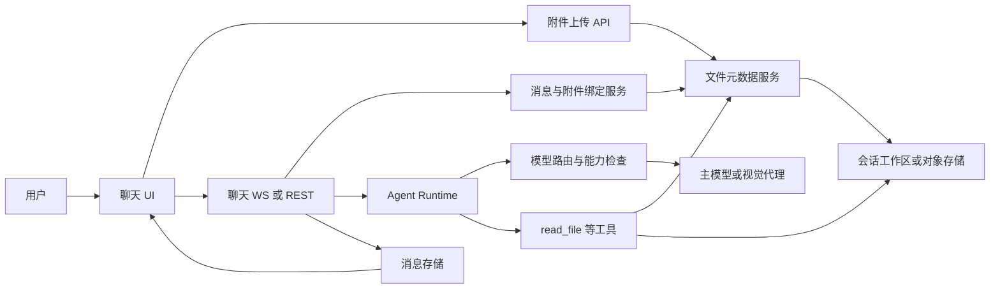
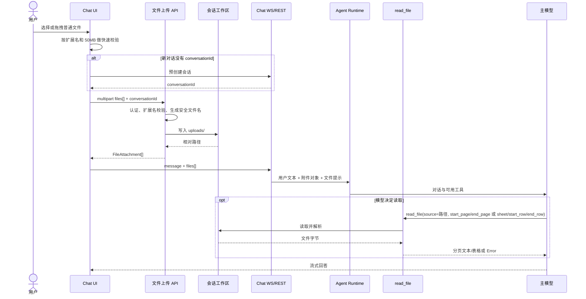
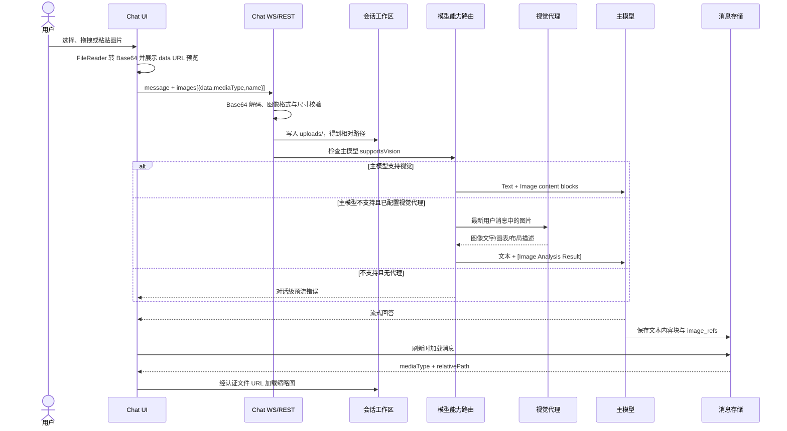
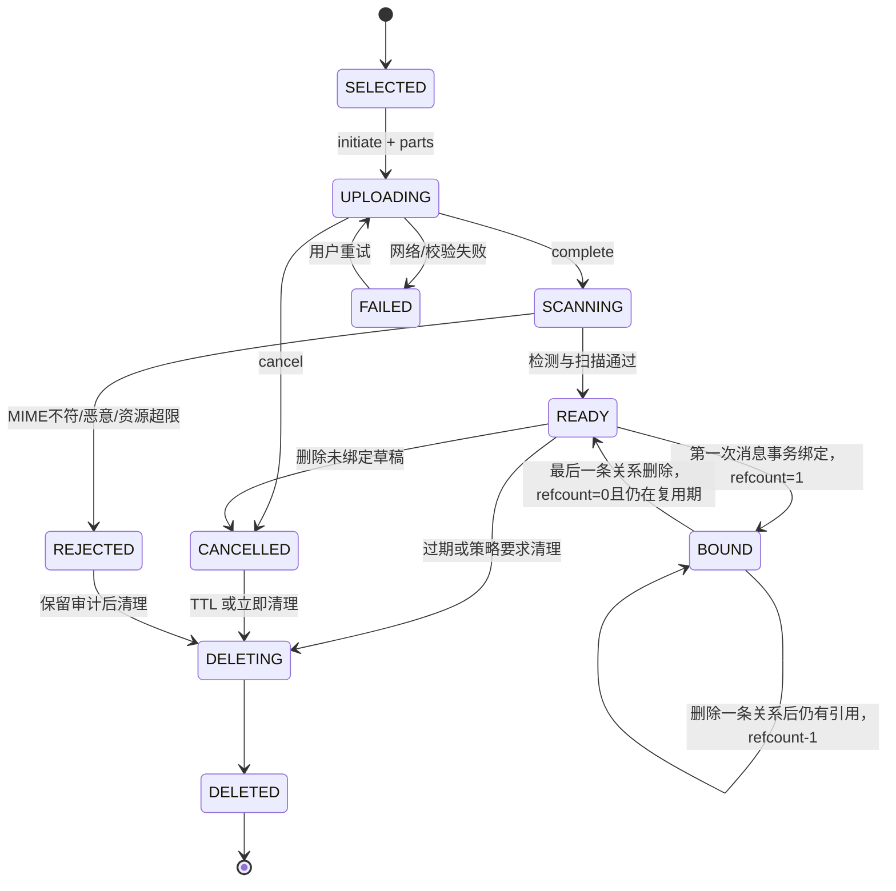

```
# 附件、多模态输入与文件上下文：自包含复刻说明

## 1. 结论与边界

### 1.1 能力结论

本能力解决“用户如何把文件或图像交给对话 Agent，并让模型在受控上下文中理解、引用和持续使用这些内容”的问题。目标用户是聊天终端用户；直接调用方还包括 Web 前端、聊天 WebSocket/REST 入口、Agent Runtime、模型路由器、文件读取工具、会话存储和工作区沙箱。

当前系统存在两条彼此不同的附件链路：

1. **图像链路**：浏览器将图像读取为 Base64，随聊天请求内联发送；服务端校验图像、写入当前会话工作区，再把图像作为原生多模态内容块交给模型。成功消息会持久化图像引用，刷新后仍可展示。
2. **普通文件链路**：浏览器先把文档、表格或文本文件上传到会话工作区，再在聊天请求里提交文件元数据和相对路径。服务端把路径写入文件上下文提示，模型需要显式调用文件读取工具才能看到内容。普通文件与消息之间当前没有持久化关联，硬刷新后附件卡片不能可靠恢复。

当前实现能够支持图片、PDF、Office 文档、文本、CSV/JSON/YAML 等输入，但“文件已上传”不等于“模型已经阅读”，也不等于“读取工具一定有权限或已安装”。URL 不是一类正式附件；它只是用户文本，或文件读取工具可接受的一类远程 source。

### 1.2 输入、输出与可见效果

| 类别 | 用户输入 | 服务端表示 | 模型获得内容的方式 | 最终可见效果 |
|---|---|---|---|---|
| 图片 | 选择、拖拽或粘贴图像 | 工作区文件 + `Image` 内容块 | 原生视觉输入，或视觉代理先转成文本 | 消息气泡显示缩略图；成功消息刷新后可恢复 |
| 普通文件 | 选择或拖拽文档/表格/文本 | 工作区文件 + 文件引用 DTO + 上下文提示 | Agent 调用 `read_file` | 发送前与当前页面显示文件卡片；硬刷新后当前实现不能可靠恢复 |
| URL | 文本中输入 URL | 普通消息文本 | Agent 决定是否调用支持 URL 的工具 | 无附件卡片；工具结果进入对话 |
| Agent 生成文件 | 工具写入工作区 | 沙箱文件 | 后续工具继续读取 | 不自动成为输入附件，也不自动成为 Artifact |
| Artifact | 经发布流程登记的产物 | 独立元数据、权限和生命周期 | 通过 Artifact 契约访问 | 可持久展示、下载、分享或版本化；不属于本章输入链路 |

### 1.3 明确边界

本章包含：选择、上传、进度与取消语义、附件 DTO、图片多模态、文档/表格读取、URL 输入、模型能力路由、文件上下文组装、消息附件持久化、预览/移除/刷新、异常与安全、生产级复刻设计和验收标准。

本章不把以下能力混为一谈：

- **附件（Attachment）**：用户意图绑定到某条消息的输入对象。
- **工作区/沙箱文件（Sandbox File）**：会话执行环境中的任意文件，包括上传文件、临时文件和 Agent 输出；它未必属于某条消息。
- **Artifact**：已登记、可治理、可分享或可版本化的最终产物；上传输入不会自动转成 Artifact。
- **知识库导入、Skill 资源上传、数据主题资产上传**：它们有各自的业务实体、权限和处理流水线，不应复用聊天附件关系表来表达业务归属。

### 1.4 当前、缺陷与推荐设计

本文使用证据等级：`I` 是可由当前源码、配置或迁移静态确认的实现事实；`A` 是 active 自动化用例声明的可执行验收契约，本次没有运行，不能写成已经通过；`K` 是用例或缺陷台账登记的已知失败；`P` 是 planned/disabled 的未来目标；`R` 仅表示本轮实际执行并观察到的 Runtime Verified 结果；`F` 是由多项调用方、DTO 或测试行为支持、但缺少运行验证的强推断；`D` 是面向复刻工程的设计建议，不代表 Nova 当前实现。本轮没有运行测试，因此本章没有 `R` 级业务结论。

当前实现的关键缺口是：普通文件消息关系不持久化；上传接口可接受客户端指定的任意会话标识且不校验其对象权限；聊天请求信任客户端提供的文件路径；无真正的逐文件上传进度和网络取消；无 MIME 嗅探、恶意文件扫描、配额和批次原子性；图片 Base64 与 WebSocket 20 MB 上限不匹配。生产复刻不应照搬这些缺陷，推荐只接受服务端签发的 `fileId`，并以统一文件元数据和消息附件关系作为可信根。

## 2. 术语与参与方

### 2.1 术语

| 术语 | 定义 |
|---|---|
| 草稿附件 | 已在客户端选择，但尚未绑定到正式用户消息的文件或图像 |
| 上传会话 | 为承载草稿附件而预先创建或选定的聊天会话 |
| 文件引用 | 客户端用于引用已上传对象的元数据；生产设计中只能是不可猜测的 `fileId`，不能是路径 |
| 内容块 | 发送给模型的结构化消息单元，如文本块或图像块 |
| 文件上下文提示 | 告知 Agent 有哪些附件、应通过何种工具读取的受控系统上下文 |
| 视觉代理 | 当主模型不支持图片时，先用视觉模型把图片转述为文本的中间处理器 |
| 声明 MIME | 浏览器或客户端报告的类型，不可信 |
| 检测 MIME | 服务端根据魔数和内容探测得到的类型，是策略判断的重要依据 |
| 绑定 | 把处于 READY 状态的文件与一条已持久化消息建立不可歧义的关系 |

### 2.2 参与方与职责



- UI 负责选择、客户端快速校验、进度展示、草稿管理和发送门禁。
- 上传 API 负责认证、策略校验、流式写入、内容检测和生成不透明文件标识。
- 元数据服务是文件归属、状态、大小、哈希和存储位置的可信来源。
- 消息服务只绑定当前身份有权使用且处于 READY，或符合复用策略且已处于 BOUND 的对象。
- Runtime 不信任客户端路径；它从服务端能力句柄解析可读取资源。
- 模型路由负责确认视觉能力，而非凭模型名称猜测。
- 文件工具负责按格式分页、限量解析，失败结果可被模型和 UI 定位。

## 3. 业务规则

### 3.1 当前实现规则

1. 图片允许客户端 MIME 为 JPEG、PNG、GIF、WEBP、BMP，客户端单文件上限 20 MB；图片通过聊天 JSON 内联发送，不经过 multipart 上传接口。`I`
2. 普通文件扩展名允许 PDF、DOCX、XLSX、XLS、PPTX、TXT、CSV、JSON、XML、YML、YAML、MD、LOG、CONF；客户端单文件上限 50 MB。`I`
3. 服务端 multipart 单文件上限 50 MB、单请求总量上限 100 MB。`I`
4. 当前没有明确文件数量上限，也没有每会话/用户/租户容量配额。`F`
5. 普通文件在发送消息前已经写入工作区；从草稿中移除只移除客户端引用，不删除服务端字节。`I/F`
6. 新对话上传普通文件时，前端会先创建或取得一个会话标识，再上传；用户放弃草稿可能留下空会话和孤立文件。`I/F`
7. 发送按钮在普通文件上传期间禁用；没有逐文件字节进度。`I`
8. 当前“取消”只支持文件选择器不选文件，或在上传完成后移除附件卡片；不支持取消正在传输的 HTTP 请求。`I/F`
9. 服务端只检查普通文件扩展名，不嗅探 MIME、不校验魔数、不扫描病毒。`I/F`
10. 零字节 multipart 文件被静默跳过，响应可为 200 且文件列表为空。该行为已有已知失败用例。`K`
11. 图片服务端会解码并读取尺寸；无法解码或宽高不大于 10 像素时拒绝。`I`
12. 图片没有服务端独立字节数、像素数、数量和总量上限；实际受 WS 文本帧 20 MB 限制。Base64 膨胀使客户端“20 MB 图片”承诺无法稳定成立。`F`
13. 普通文件进入模型上下文时只生成“附件名称 + 路径 + 请调用 read_file”的提示；不会自动把完整内容塞入 Prompt。`I`
14. `read_file` 是否可用取决于正式工具注册和权限链路；资源存在不得绕过工具能力边界。`I`
15. 成功的图片消息会持久化图像引用；普通文件引用不随消息持久化。`I/F`
16. URL 没有附件 DTO；它作为文本或 `read_file(source=https://...)` 的工具参数处理。`I`

### 3.2 生产复刻必须采用的规则

1. 客户端聊天请求只提交 `fileId`，禁止提交任何本地路径、相对路径、对象存储 key 或宿主机路径。`D`
2. 文件必须满足：租户匹配、用户或共享授权匹配、会话匹配、状态为 READY 或已被其他消息引用的 BOUND、且未过期，才能绑定消息。`D`
3. 发送一条消息时，消息行和附件关系必须在同一数据库事务中提交；第一次绑定把文件从 READY 转为 BOUND，后续合法绑定在 BOUND 上增加引用计数。`D`
4. 普通文件和图片都必须持久化统一的消息附件关系；刷新、重连、再生成和分享读取同一事实来源。`D`
5. 上传应先进入隔离 staging 区，完成 MIME 检测、大小/解压/像素限制与恶意内容扫描后才转 READY。`D`
6. 客户端发送门禁只允许所有选中附件处于 READY，或明确允许复用且已处于 BOUND；FAILED/CANCELLED 附件必须移除或重试。`D`
7. 删除消息或移除草稿不能直接无条件删除字节；应基于引用计数、保留策略和软删除状态进行回收。`D`
8. 模型视觉能力必须显式声明；未知值不应默认视为支持视觉。`D`
9. 文档解析采用分页/分块工具读取；全文不得无界注入上下文。`D`
10. URL 读取必须有出站网络策略、DNS/IP 重绑定防护、重定向复检和响应体上限；若要让 URL 成为正式附件，应先抓取、固化、扫描并生成文件实体。`D`

## 4. 完整执行链路

### 4.1 普通文件当前链路



详细步骤：

1. 浏览器按 `image/*` 与非图片分流。普通文件不读入内存，而是立即 multipart 上传。
2. UI 过滤超过 50 MB 的文件，显示统一错误提示；合法文件可批量提交。
3. 服务端按调用身份获取会话工作区，在 `uploads/` 下写文件。文件名由随机短前缀加清洗后的原始名组成。
4. 服务端返回 `id/name/path/size/type`。该 `id` 当前只是临时随机值，没有对应持久化元数据行。
5. 用户发送消息时，客户端把整个 DTO 原样放进聊天 JSON。
6. 服务端只要求 `path` 和 `name` 非空，然后把路径转换为运行时附件，并把附件提示附加到系统上下文；纯附件消息会用提示充当非空用户文本。
7. 模型若需要内容，调用文件读取工具。PDF 按页、PPTX 按幻灯片、DOCX 按正文元素、Excel 按工作表和行区间、文本按行读取。
8. 工具解析失败时返回可定位的 `Error: ...`，主对话应继续；工具不可用时模型不能读取附件。
9. 当前消息存储不保存普通文件关系，因此刷新后只能恢复文本，不能从服务端 DTO 恢复附件卡片。

### 4.2 图片当前链路



关键分支：

- 主聊天默认走复杂模型角色，而不是专门的 VISION 角色；视觉能力由已选择的主模型声明判断。
- 当前 `supportsVision` 未配置时按“支持”处理，可能把图片发给实际不支持的端点。
- 视觉代理只分析最新用户消息中的新图片。历史图片会从后续主模型请求中剥离，不会自动再次分析。
- OpenAI 兼容端点若拒绝图像内容，当前 provider 会重试一次纯文本并提示图像分析不可用；这是可用性降级，不是等价视觉理解。
- 图片字节在模型能力检查之前已写入工作区。预流失败可能留下孤立字节；预流错误消息只保存文本和错误，不保存图像引用。

### 4.3 推荐统一上传与绑定链路



推荐步骤：

1. UI 选择文件并生成本地草稿项；客户端校验只是快速反馈，不能替代服务端校验。
2. UI 调用初始化接口，携带文件名、大小、声明 MIME、会话和幂等键；服务端校验身份、会话写权限、配额并返回 `fileId` 与上传指令。
3. 客户端分片或流式上传，按已确认字节更新每文件进度；取消时中止网络并调用幂等 cancel。
4. 完成上传后服务端校验大小与 SHA-256，检测 MIME、图片像素、压缩包膨胀和文档结构，执行安全扫描。
5. 状态通过轮询、SSE 或现有 WS 事件转为 READY/REJECTED。新上传只有 READY 可发送；已经合法绑定且策略允许同会话复用的 BOUND 文件也可再次绑定。
6. 聊天请求只包含 `attachmentIds`。服务端锁定并读取文件元数据，执行对象级授权和会话匹配。
7. 在同一事务中写用户消息及 `message_attachment`；第一次绑定将附件置为 BOUND 并把引用计数改为 1，后续复用保持 BOUND 并递增引用计数。
8. Runtime 根据已验证的文件类别构建图片内容块或文件能力句柄，不接受客户端路径。
9. 消息查询始终连同附件 DTO 返回；UI 可刷新恢复预览、名称、状态和下载权限。
10. 未绑定文件按 TTL 回收；已绑定文件按消息、会话和合规保留策略回收。

## 5. 对外契约

### 5.1 当前普通文件上传 REST

**方法与路径**：`POST /api/files/upload`，`multipart/form-data`，需要登录身份。

| 字段 | 类型 | 必填 | 默认值 | 语义 |
|---|---|---:|---|---|
| `files` | multipart file[] | 是 | 无 | 一个或多个普通文件 |
| `conversationId` | string | 否 | 服务端 UUID | 目标工作区标识；当前实现未验证会话存在与写权限 |

示例：

```http
POST /api/files/upload HTTP/1.1
Content-Type: multipart/form-data; boundary=...
Authorization: <session>

--...
Content-Disposition: form-data; name="conversationId"

7b33b697-1a22-40ad-b646-b87a54d0a103
--...
Content-Disposition: form-data; name="files"; filename="sales.csv"
Content-Type: text/csv

date,region,revenue
2026-01-01,east,120
--...--
```

成功响应：

```json
{
  "conversationId": "7b33b697-1a22-40ad-b646-b87a54d0a103",
  "files": [
    {
      "id": "54fc4a87",
      "name": "sales.csv",
      "path": "uploads/54fc4a87_sales.csv",
      "size": 47,
      "type": "text/csv"
    }
  ]
}
```

当前错误语义：

- 不支持扩展名：HTTP 400，`{"error":"Unsupported file type: exe (allowed: ...)"}`。
- 单文件超过 50 MB 或请求超过 100 MB：HTTP 413，统一错误体：

```json
{
  "success": false,
  "message": "上传文件超过大小限制",
  "errorCode": "UPLOAD_SIZE_EXCEEDED"
}
```

- 写入失败：HTTP 500 或通用错误体。
- 零字节文件：当前可能 HTTP 200 且 `files: []`，不得作为推荐契约复刻。
- 批量上传非原子：后面的文件失败时，前面的字节可能已经留在工作区，错误体不报告幸存对象。
- 没有进度、取消、幂等、分页或版本字段。

### 5.2 当前聊天请求契约

WebSocket 入口为 `/ws/chat`；同一概念也可通过聊天 REST 进入。与附件有关的请求子集：

```json
{
  "conversationId": "7b33b697-1a22-40ad-b646-b87a54d0a103",
  "message": "分析这些输入并给出结论",
  "images": [
    {
      "data": "iVBORw0KGgoAAAANSUhEUgAA...",
      "mediaType": "image/png",
      "name": "dashboard.png"
    }
  ],
  "files": [
    {
      "id": "54fc4a87",
      "name": "sales.csv",
      "path": "uploads/54fc4a87_sales.csv",
      "size": 47,
      "type": "text/csv"
    }
  ],
  "provider": "optional-provider-instance"
}
```

当前字段语义：

| 字段 | 类型 | 必填 | 当前默认/校验 |
|---|---|---:|---|
| `message` | string | 条件必填 | 纯附件时 UI 自动生成“分析附件/图像”文本；服务端需保证最终用户消息非空 |
| `images[].data` | Base64 string | 图片必填 | 无 data URL 前缀；服务端解码 |
| `images[].mediaType` | string | 否 | `application/octet-stream` |
| `images[].name` | string | 否 | 服务端生成名称 |
| `files[].path` | string | 当前必填 | 非空即可；这是严重风险 |
| `files[].name` | string | 当前必填 | 非空 |
| `files[].id` | string | 否 | 缺失时生成 UUID |
| `files[].size` | integer | 否 | 无可信校验 |
| `files[].type` | string | 否 | 可为空 |

WS 文本消息上限为 20 MB。由于 Base64 约增加三分之一体积，再加 JSON 和文本开销，原始图像可用上限低于约 15 MB；多图共享同一上限。

### 5.3 当前消息查询附件 DTO

成功图片消息持久化后，对外消息 DTO 可返回：

```json
{
  "id": "message-id",
  "role": "USER",
  "content": "分析这张图",
  "images": [
    {
      "mediaType": "image/png",
      "relativePath": "uploads/ab12cd34_dashboard.png"
    }
  ]
}
```

UI 通过认证文件下载地址 `/api/files/{conversationId}/{relativePath}` 加载图片。当前消息 DTO 没有等价的普通 `files` 字段，故普通附件不能在全新页面状态下恢复。

### 5.4 当前文件读取 Tool 契约

概念调用：

```json
{
  "name": "read_file",
  "arguments": {
    "source": "uploads/54fc4a87_sales.csv",
    "start_page": 1,
    "end_page": 2,
    "sheet": 1,
    "start_row": 1,
    "end_row": 100
  }
}
```

参数按格式选择：

- `source`：必填字符串，表示当前工具策略允许的本地/会话路径、HTTP(S) URL 或 `skill://` 资源。当前附件提示传入工作区相对路径；生产建议改为 file capability。
- PDF：`start_page/end_page` 表示从 1 开始的页码闭区间。
- PPTX：`start_page/end_page` 表示从 1 开始的幻灯片闭区间。
- DOCX：`start_page/end_page` 表示从 1 开始的正文元素范围，不是视觉排版页码。
- XLS/XLSX：`sheet` 是从 1 开始的整数工作表序号，`start_row/end_row` 是从 1 开始的行号闭区间；不是工作表名称字符串。
- TXT/CSV/JSON/YAML/Markdown/代码：`start_page/end_page` 复用为从 1 开始的行号闭区间。
- HTTP(S) URL：工具下载到临时文件再按检测/推断格式解析。

示例只为集中展示参数，实际调用应按文件格式提供相关字段；读取 CSV 时不应同时提交 `sheet`，读取 Excel 时也不需要 `start_page/end_page`。

工具应返回有限长度的文本、页码/范围提示以及后续读取建议。损坏、二进制或不可解析文件返回 `Error: <可定位原因>`，不能抛出导致整个 Agent 会话中断的未处理异常。图片不能通过文本读取工具理解；应走原生图片输入。

### 5.5 推荐生产契约

#### 5.5.1 初始化上传

```http
POST /api/v1/conversations/{conversationId}/attachments:initiate
Idempotency-Key: 01J...
Content-Type: application/json
```

```json
{
  "files": [
    {
      "clientId": "draft-1",
      "name": "sales.csv",
      "size": 1048576,
      "declaredMime": "text/csv",
      "sha256": "optional-hex",
      "kind": "DOCUMENT"
    }
  ]
}
```

```json
{
  "uploadSessionId": "upl_01J...",
  "expiresAt": "2026-08-13T10:30:00Z",
  "items": [
    {
      "clientId": "draft-1",
      "fileId": "fil_01J...",
      "status": "UPLOADING",
      "uploadUrl": "/api/v1/uploads/upl_01J.../files/fil_01J...",
      "chunkSize": 8388608
    }
  ]
}
```

初始化必须校验会话写权限、声明大小、单批数量、用户和租户配额。相同幂等键与相同请求返回相同结果；相同键不同负载返回 409。

#### 5.5.2 上传、完成、状态与取消

```http
PUT /api/v1/uploads/{uploadSessionId}/files/{fileId}/parts/{partNumber}
Content-Range: bytes 0-8388607/10485760
X-Part-SHA256: ...
```

```http
POST /api/v1/uploads/{uploadSessionId}/files/{fileId}:complete
POST /api/v1/uploads/{uploadSessionId}/files/{fileId}:cancel
GET  /api/v1/uploads/{uploadSessionId}
```

状态响应：

```json
{
  "fileId": "fil_01J...",
  "status": "READY",
  "name": "sales.csv",
  "size": 10485760,
  "declaredMime": "text/csv",
  "detectedMime": "text/csv",
  "progress": {"receivedBytes": 10485760, "totalBytes": 10485760},
  "error": null,
  "version": 4
}
```

取消是幂等操作：对 CANCELLED 再取消仍返回 200；对 BOUND 返回 409 `ATTACHMENT_ALREADY_BOUND`。断点续传用已确认 part 列表恢复，不以客户端进度条为事实来源。

#### 5.5.3 绑定聊天消息

```json
{
  "conversationId": "conv_01J...",
  "message": "分析文件和图像",
  "attachmentIds": ["fil_doc_01J...", "fil_img_01J..."],
  "provider": "optional-provider-instance"
}
```

服务端响应/流式首事件应返回规范化附件：

```json
{
  "type": "user_message_committed",
  "conversationId": "conv_01J...",
  "messageId": "msg_01J...",
  "attachments": [
    {
      "fileId": "fil_doc_01J...",
      "kind": "DOCUMENT",
      "name": "sales.csv",
      "detectedMime": "text/csv",
      "size": 10485760,
      "status": "BOUND",
      "previewUrl": null,
      "downloadUrl": "/api/v1/files/fil_doc_01J.../content"
    }
  ]
}
```

标准错误体：

```json
{
  "success": false,
  "errorCode": "ATTACHMENT_NOT_READY",
  "message": "附件仍在安全检查中",
  "details": {"fileId": "fil_01J...", "status": "SCANNING"},
  "requestId": "req_01J..."
}
```

至少定义：`UPLOAD_SIZE_EXCEEDED`、`UPLOAD_COUNT_EXCEEDED`、`UPLOAD_QUOTA_EXCEEDED`、`UNSUPPORTED_FILE_TYPE`、`MIME_MISMATCH`、`CORRUPT_FILE`、`MALWARE_DETECTED`、`IMAGE_DIMENSION_EXCEEDED`、`ARCHIVE_EXPANSION_EXCEEDED`、`ATTACHMENT_NOT_READY`、`ATTACHMENT_EXPIRED`、`ATTACHMENT_FORBIDDEN`、`ATTACHMENT_CONVERSATION_MISMATCH`、`VISION_MODEL_UNAVAILABLE`。

## 6. 数据模型与生命周期

### 6.1 当前数据事实

普通文件仅存在于工作区目录，没有独立数据库元数据，也没有消息关系。当前图像通过消息表的 `image_refs` 文本列保存引用，其逻辑值为：

```json
[
  {
    "mediaType": "image/png",
    "relativePath": "uploads/ab12cd34_dashboard.png"
  }
]
```

开启会话消息加密时，`image_refs` 与消息内容一起使用 AES-256-GCM 加密；工作区中的图片字节并不会因此自动加密。普通附件路径提示没有独立持久化字段。

### 6.2 推荐统一 DDL

以下 PostgreSQL DDL 是 `D` 级复刻建议，足以让另一工程复刻核心语义；H2 或其他数据库应建立等价约束。

```sql
-- 前置约束：既有会话与消息表必须让租户成为引用键的一部分。
-- 若既有主键已经全局唯一，仍建议保留以下复合唯一键，供复合外键引用。
alter table conversation
    add constraint uq_conversation_tenant_id unique (tenant_id, id);
alter table message
    add constraint uq_message_tenant_conversation_id
    unique (tenant_id, conversation_id, id);
alter table message
    add constraint fk_message_conversation
    foreign key (tenant_id, conversation_id)
    references conversation (tenant_id, id);

create table conversation_file (
    id                 varchar(40) not null,
    tenant_id          varchar(64) not null,
    owner_user_id      varchar(64) not null,
    conversation_id    varchar(64) not null,
    category           varchar(16) not null,
    status             varchar(16) not null,
    original_name      varchar(512) not null,
    display_name       varchar(512) not null,
    declared_mime      varchar(255),
    detected_mime      varchar(255),
    extension          varchar(32),
    size_bytes         bigint not null,
    sha256_hex         char(64),
    storage_provider   varchar(32) not null,
    storage_key_enc    text not null,
    image_width        integer,
    image_height       integer,
    scan_status        varchar(16) not null default 'PENDING',
    rejection_code     varchar(64),
    upload_session_id  varchar(40),
    bound_ref_count    integer not null default 0,
    version            bigint not null default 0,
    expires_at         timestamptz,
    created_at         timestamptz not null,
    updated_at         timestamptz not null,
    deleted_at         timestamptz,
    primary key (id),
    constraint uq_file_tenant_conversation_id unique (tenant_id, conversation_id, id),
    constraint fk_file_conversation foreign key (tenant_id, conversation_id)
      references conversation (tenant_id, id),
    constraint ck_file_category check (category in ('IMAGE','DOCUMENT','INPUT','OUTPUT')),
    constraint ck_file_status check (status in
      ('UPLOADING','SCANNING','READY','BOUND','REJECTED','CANCELLED','DELETING','DELETED')),
    constraint ck_file_size check (size_bytes >= 0),
    constraint ck_file_ref_state check (
      (status = 'READY' and bound_ref_count = 0)
      or (status = 'BOUND' and bound_ref_count >= 1)
      or status not in ('READY', 'BOUND')
    ),
    unique (tenant_id, upload_session_id, id)
);

create index ix_file_conversation
    on conversation_file (tenant_id, conversation_id, status, created_at);
create index ix_file_expiry
    on conversation_file (status, expires_at)
    where expires_at is not null;
create index ix_file_hash
    on conversation_file (tenant_id, sha256_hex)
    where sha256_hex is not null;

create table message_attachment (
    tenant_id          varchar(64) not null,
    conversation_id    varchar(64) not null,
    message_id          varchar(64) not null,
    file_id             varchar(40) not null,
    ordinal             integer not null,
    kind                varchar(16) not null,
    caption             text,
    created_at          timestamptz not null,
    deleted_at          timestamptz,
    primary key (tenant_id, message_id, file_id),
    unique (tenant_id, message_id, ordinal),
    constraint fk_attachment_message foreign key (tenant_id, conversation_id, message_id)
      references message (tenant_id, conversation_id, id),
    constraint fk_attachment_file foreign key (tenant_id, conversation_id, file_id)
      references conversation_file (tenant_id, conversation_id, id)
);

create index ix_message_attachment_file
    on message_attachment (tenant_id, conversation_id, file_id);
```

`storage_key_enc` 存储服务端内部对象定位符，并使用应用密钥加密或封装；它永远不返回客户端。若使用本地目录，也应存储随机对象 key，而不是原始文件名。`sha256_hex` 可用于完整性和租户内去重，但是否去重必须服从加密、数据驻留和删除语义。两个复合外键同时包含 `tenant_id` 和 `conversation_id`，因此数据库本身会拒绝孤立文件、跨租户关系以及“同租户不同会话”的附件误绑；不能只依赖应用层检查。

### 6.3 生命周期与一致性

- UPLOADING 文件只存在 staging，上传会话过期后进入 CANCELLED/DELETING。
- SCANNING 文件不可绑定、下载或交给解析器。
- READY 表示 `bound_ref_count=0`；第一次绑定在同一事务写关系、把计数改为 1 并转 BOUND。
- 本设计选择“同一文件可被同会话多条消息引用”：BOUND 表示 `bound_ref_count>=1`，仍可在通过租户、会话、权限和过期校验后再次绑定；事务锁行、写唯一关系并递增计数。主键阻止同一消息重复引用同一文件。
- 删除消息先软删消息与关系，再在同一事务减少计数；计数仍大于 0 时保持 BOUND，减到 0 时转回 READY 并进入有限复用/保留期，过期后再清理字节。
- 重新生成回答通常复用原用户消息，不新增关系；若产品复制用户消息，则按一次新的合法绑定递增计数。定期对 `bound_ref_count` 与关系表聚合值对账，修复进程崩溃或历史迁移导致的漂移。
- 会话删除通过异步清理任务遍历文件；物理删除失败要保持 DELETING 并重试。
- REJECTED 文件只保留最小审计元数据，不允许用户下载恶意内容；字节在隔离区按安全策略销毁。
- 数据库提交成功但对象存储写入/移动失败时，状态不得转 READY；对象存储删除成功而数据库未更新时，巡检任务根据对象清单修复。
- 下载与预览每次执行对象级授权，不能只靠难猜 URL。

## 7. 核心实现设计

### 7.1 模块划分

| 模块 | 核心职责 |
|---|---|
| Attachment Draft UI | 选择、预览、状态、逐文件进度、重试、取消和发送门禁 |
| Upload Session Service | 幂等初始化、分片状态、配额预占、完成与取消 |
| Content Validation Pipeline | MIME/魔数、哈希、图像尺寸、文档结构、压缩炸弹、恶意内容扫描 |
| File Metadata Repository | 文件状态、所有权、会话归属、乐观锁和生命周期 |
| Message Attachment Binder | 在消息事务中授权、锁定和绑定 READY/可复用 BOUND 文件，并维护引用计数 |
| Attachment Context Builder | 将已验证图片转为内容块，将文档转为受控工具能力句柄 |
| Vision Capability Router | 按显式能力选择主模型、视觉代理或确定性错误 |
| Document Reader | 按格式分页、限量解析并保留页/表/行来源 |
| Preview/Download Gateway | 对象级授权、Range、Content-Disposition、安全头和审计 |
| Attachment Janitor | 回收过期草稿、孤立 staging、删除失败对象和不一致记录 |

### 7.2 可信绑定算法

```text
bindAttachments(identity, conversationId, messageId, attachmentIds):
  require conversation.canWrite(identity)
  require distinct(attachmentIds) and count <= policy.maxFilesPerMessage

  begin transaction
    rows = fileRepository.lockAllForUpdate(attachmentIds)
    require rows.size == attachmentIds.size

    for each id in caller order:
      file = rows[id]
      require file.tenantId == identity.tenantId
      require file.ownerUserId == identity.userId or explicit share permits binding
      require file.conversationId == conversationId
      require file.status in [READY, BOUND]
      require file.status == READY implies file.boundRefCount == 0
      require file.status == BOUND implies file.boundRefCount >= 1
      require file.expiresAt is null or file.expiresAt > now

    insert user_message(messageId, conversationId, ...)
    for each file in caller order:
      insert message_attachment(identity.tenantId, conversationId,
                                messageId, file.id, ordinal, inferredKind)
      increment file.boundRefCount
      set file.status = BOUND
  commit

  return canonical message DTO loaded from database
```

任何校验失败均不写消息、不建立部分关系。客户端顺序通过 `ordinal` 保存。重复的聊天幂等键返回第一次提交的 `messageId` 和附件结果，不重复增加计数。`READY -> BOUND` 与 `BOUND -> BOUND` 都在同一行锁和事务中完成；关系表的复合主键阻止同一消息重复绑定同一文件。

### 7.3 上下文组装

图片上下文：

1. 从消息附件关系加载 IMAGE 文件。
2. 通过内部文件服务获得一次请求内有效的字节流能力；不把路径暴露给 Prompt。
3. 检查所选模型显式视觉能力、支持的 MIME、单图/总图数量与大小。
4. 支持时生成 `Image(mediaType, capabilityRef)`；不支持时调用配置的视觉代理。
5. 视觉代理输出应作为带来源的派生内容保存：文件 ID、模型实例/版本、Prompt 版本、生成时间和文本。后续轮次可复用，避免反复传图和产生不一致描述。

普通文档上下文：

```text
Attached resources available through read_file:
- file_id: fil_01J...
  name: sales.csv
  detected_mime: text/csv
  size_bytes: 10485760
  capability: cap_short_lived_opaque
Never construct a filesystem path. Read only through the supplied capability.
```

工具参数应为 `file_id` 或短期 capability，而不是 `source` 路径。工具服务再次校验运行身份、会话和消息范围。若工具未安装，系统应在发送前明确提示“当前 Agent 无文件读取能力”，或允许发送但返回确定性不可读状态；不得偷偷注入工具绕过能力策略。

### 7.4 文档、表格和 URL 处理

- PDF：先校验结构和页数；按页提取文本并返回页码。图片型 PDF 应明确“无可提取文本”，可选进入受限 OCR 流水线，不能假装空文本即解析成功。
- DOCX：按段落、表格和标题结构分页；保留元素序号。
- PPTX：按幻灯片输出标题、正文、备注和表格；图片理解需单独视觉流程。
- XLS/XLSX：先返回工作表列表、范围和推断列；读取需指定工作表与行区间，并限制公式、外链和宏。
- CSV/文本：进行编码检测、分隔符与换行处理；保留行号。大文件应流式读取而不是一次性载入内存。
- 损坏文件：返回稳定错误码 `CORRUPT_FILE` 或 `PARSE_FAILED`，包括文件 ID 和可安全公开的原因。
- URL：推荐先调用受控抓取服务固化成 `conversation_file`，再走相同扫描和绑定链路。抓取必须禁止 loopback、link-local、私网、云元数据地址，并在每次 DNS 解析和重定向后复检；限制响应字节数、时间和内容类型。

### 7.5 模型角色设计

当前系统有 SIMPLE、COMPLEX、DOCUMENT、VISION 等角色，但主聊天附件默认仍使用 COMPLEX。普通文档不会因为扩展名自动切换到 DOCUMENT，图片也不会自动切到 VISION；DOCUMENT 主要适用于受控的摘要/转换任务，VISION 用于图片理解能力。

推荐策略：

1. 主聊天仍由会话策略选主模型。
2. 图片存在时，先检查主模型明确的 `vision=true` 与支持格式；能力未知按不支持处理。
3. 主模型不支持时，只有配置并授权的 VISION 角色可做代理；代理失败向 UI 返回可重试错误。
4. 大文档先由工具做确定性检索和分页；只有需要摘要、结构化转换时才调用 DOCUMENT 角色，并记录输入片段来源。
5. 路由不得由客户端提交任意 provider 绕过租户策略。

### 7.6 最小可用与生产级差异

最小可用版本可以使用单次 multipart 上传、本地工作区和同步 MIME 检测，但必须具备：服务端文件元数据、`fileId` 绑定、会话写权限、消息附件关系、大小/数量限制、图片/普通文件统一刷新恢复、真实 HTTP 取消和孤立文件 TTL。

生产级版本再增加：对象存储分片上传、异步扫描、配额预占、恶意内容扫描、内容解除武装、URL 固化、派生预览/OCR、跨节点一致性、生命周期作业、审计和数据驻留。

## 8. 并发与非正常路径

| 场景 | 当前行为 | 推荐行为 |
|---|---|---|
| 同一文件重复选择 | 可重复上传并得到不同路径 | 以草稿 `clientId` 去重；可选租户内按哈希复用字节，但保留独立关系 |
| 双击发送 | 可能提交重复消息 | Chat `Idempotency-Key` 保证只绑定一次 |
| 上传中发送 | UI 全局禁用发送 | 每项状态门禁；只有全 READY 可发送 |
| 网络中断 | fetch 整体失败，无断点 | 分片确认、状态查询与续传 |
| 真正取消 | 当前没有 | AbortController/分片终止 + 服务端幂等 cancel + staging 清理 |
| 批次部分失败 | 已写成功项可能泄漏 | 每项明确结果；消息绑定全有或全无；失败项可单独重试 |
| 零字节 | 静默跳过 | 按策略明确拒绝 `EMPTY_FILE`，不得返回伪成功 |
| 损坏文档 | 上传可成功，读取时受控失败 | 扫描阶段尽早识别；仍保留读取期 `PARSE_FAILED` 防线 |
| 超大图片 | WS 或内存阶段失败 | 直接二进制上传；限制字节、像素、帧数和解码资源 |
| MIME 伪造 | 只看扩展名/声明类型 | 魔数与结构检测；声明、扩展、检测类型必须满足允许组合 |
| 服务重启 | 草稿 Map 丢失；已上传文件可能孤立 | 草稿状态由服务端上传会话恢复；Janitor 回收过期项 |
| 扫描服务超时 | 当前无扫描 | 保持 SCANNING，指数退避；超时转 FAILED，不允许绑定 |
| 模型不支持视觉 | 预流错误或文本降级 | 显式能力检查；配置代理才降级，并向用户标识处理方式 |
| 上传后删除会话 | 可能残留文件 | 会话删除事件驱动软删，异步清理并可重试 |
| 下载时文件已删 | 404 | 404/410 按策略返回，UI 卡片显示已过期且不泄漏对象存在性 |
| 同时绑定与取消 | 无服务端状态模型 | 行锁/版本号裁决；先提交者胜，另一方获得 409 |

特别注意：当前图片先写工作区再验证视觉路由，预流失败可能产生孤儿；推荐先完成附件上传和 READY，再在消息事务绑定，模型失败不应撤销用户消息或附件事实，只新增可重试的运行错误状态。

## 9. 安全、权限和审计

### 9.1 当前关键风险

1. 上传接口接收任意 `conversationId`，但不确认业务会话存在或调用者对该会话具有写权限。静态实现能够确认的直接影响是：调用者可在**自己的 identity 沙箱范围内**制造任意会话 namespace、孤立目录和无业务绑定文件，并绕开以真实会话为基础的配额与生命周期治理；现有证据不足以证明它能直接写入另一用户 identity 的物理工作区，跨用户影响只应标为待运行验证的强推断。`I/F`
2. 聊天 `files[].path` 由客户端提供，服务端只校验非空；攻击者可绕过上传，伪造绝对路径、`~`、目录穿越或 URL。`F`
3. 文件路径被写入高信任系统上下文，而当前读取工具支持绝对路径和 URL；这形成“客户端路径注入 + 工具能力”的组合风险。`F`
4. 公共 SPI 层虽有相对路径、禁止 `..` 等校验，但产品聊天链路使用的内部附件对象未采用该保护，不能视为已修复。`I/F`
5. 上传只检查扩展名；可通过改后缀上传恶意或超高资源消耗内容。`F`
6. URL 读取若无出站策略，存在 SSRF、重定向绕过和无界响应体风险。`F`
7. 图片消息引用可加密，但文件字节没有因此自动加密；合规设计需单独覆盖存储加密和密钥轮换。`I/F`

### 9.2 生产授权模型

- 所有接口先解析真实身份，不允许生产 mock 身份或客户端声称租户。
- 上传初始化要求会话 `WRITE`；预览/下载要求 `READ`；绑定要求文件与会话双重 `WRITE/USE`。
- 文件元数据查询统一带 `tenant_id` 条件；跨租户对象统一返回不泄漏存在性的 404。
- 管理员访问若业务允许，必须区分 read 与 bind 权限并记录审计。
- Runtime 获得短期、最小范围 capability：限定 tenant、conversation、message、file、操作、过期时间；不能升级为宿主机文件访问。
- 对象下载使用鉴权代理或短时签名 URL；签名 URL 仍需限制 disposition、MIME、安全头和有效期。
- 原始文件名用于展示前需转义；响应 `Content-Disposition` 需防 CRLF 和头注入。
- Office 宏、外链、公式和嵌入对象不得执行；HTML/SVG 预览需沙箱化或转码。
- 日志不记录 Base64、文件正文、签名 URL、存储 key、用户完整路径或敏感文件名；必要时记录哈希化标识。

### 9.3 审计事件

至少记录：`ATTACHMENT_UPLOAD_INITIATED`、`UPLOAD_COMPLETED`、`UPLOAD_CANCELLED`、`ATTACHMENT_REJECTED`、`ATTACHMENT_BOUND`、`ATTACHMENT_READ_BY_TOOL`、`ATTACHMENT_PREVIEWED`、`ATTACHMENT_DOWNLOADED`、`ATTACHMENT_DELETED`、`CROSS_SCOPE_ACCESS_DENIED`、`VISION_PROXY_USED`。

审计字段包含 request/trace ID、租户、操作者、会话、文件 ID、消息 ID、结果、错误码、字节量和策略版本；不得包含正文。

## 10. 外部依赖对端设计

### 10.1 模型 Provider

已观察契约：模型实例暴露是否支持视觉；OpenAI 兼容端接收文本与 data URL 图片内容，Anthropic 端接收 Base64 图片 source。视觉代理接收最新消息图片并返回一段可供主模型消费的描述。

对端必须维持：

- 明确报告视觉能力、支持 MIME、图片数量/尺寸和请求体限制。
- 对超限、格式不支持、鉴权、限流和服务不可用返回可分类错误。
- 不把拒绝图片后的纯文本重试宣称为视觉成功。

最小兼容 Stub：接收 `text + image bytes`，校验 MIME，返回固定的结构化描述；可配置“不支持视觉”和“超限”错误，用于路由测试。

Nova 的静态代码无法证明第三方端点实际支持其配置声称的格式、保留政策、隐私处理或 SLA。复刻时需通过供应商契约与集成测试确认。

### 10.2 恶意内容扫描服务

当前工程未观察到扫描对端。推荐接口：

```json
{
  "scanRequestId": "scan_01J...",
  "objectCapability": "one-time-read-token",
  "declaredMime": "application/pdf",
  "detectedMime": "application/pdf",
  "size": 1048576,
  "sha256": "..."
}
```

响应为 `CLEAN | MALICIOUS | SUSPICIOUS | ERROR`，附引擎版本和规则版本。超时/ERROR 默认不得转 READY。对端只获一次性只读能力，不得获得通用对象存储凭据。

### 10.3 对象存储

当前实现主要使用会话工作区。生产对端需提供：分片上传、完整性校验、服务端加密、生命周期策略、版本/ETag、Range 下载和对象删除幂等性。数据库是业务状态事实源，对象存储是字节事实源；需由巡检任务对账。

### 10.4 URL 抓取服务

当前工具可直接 HTTP(S) 下载，连接/请求存在固定超时，但内部网络策略和响应体安全无法由当前工程证明。生产抓取器应独立部署在受限网络、禁止私网目标、限制重定向次数与下载字节、校验 Content-Type，并把结果作为普通文件进入扫描流水线。

## 11. 可观察性

### 11.1 日志与 Trace

同一次交互应贯穿：浏览器 `clientUploadId` → 上传 `requestId/uploadSessionId/fileId` → 聊天 `messageId/runId` → 工具 `toolCallId` → 模型 `providerRequestId`。日志只记录标识、状态、耗时和计数。

关键结构化日志：

- 上传初始化、part 完成、哈希校验、MIME 检测、扫描结果和状态迁移。
- 绑定校验失败的维度化原因，不记录攻击者完整伪造路径。
- 文档解析器、页/表/行范围、截断原因和错误分类。
- 视觉能力决策：主模型支持、代理使用、代理失败、纯文本降级。
- Janitor 扫描数量、清理数量、失败重试与数据库/对象不一致。

### 11.2 指标

- `attachment_upload_requests_total{result,error_code,mime_group}`
- `attachment_upload_bytes_total{tenant_tier}`
- `attachment_upload_duration_seconds`
- `attachment_state_count{state}`
- `attachment_scan_duration_seconds{engine,result}`
- `attachment_bind_total{result,error_code}`
- `attachment_orphan_bytes` 与 `attachment_cleanup_failures_total`
- `file_read_calls_total{format,result}`、`file_read_bytes_total`、`file_parse_duration_seconds`
- `vision_route_total{route=primary|proxy|reject|text_fallback}`
- `attachment_refresh_restore_failures_total`

### 11.3 告警与用户错误

告警：扫描积压、staging 容量逼近阈值、孤立字节持续增长、跨租户拒绝异常激增、解析器 OOM/超时、视觉代理错误率升高、数据库与对象存储对账差异。

用户错误必须包含可操作下一步，例如“文件超过 50 MB，请压缩或拆分”“文件仍在检查，请稍后发送”“当前模型不能理解图片，请切换支持视觉的模型”。不得把堆栈、宿主机路径、对象 key 或内部服务地址回传给 UI。

## 12. 复刻实施顺序

1. **定义边界和策略**：确定允许格式、单文件/单消息/用户/租户限制、保留期和模型角色。静态验收：策略表和错误码完整。
2. **建立元数据与消息关系**：创建 `conversation_file` 和 `message_attachment`，实现状态约束与索引。静态验收：任何消息附件都能仅凭数据库恢复。
3. **实现安全上传 MVP**：multipart 流式写 staging、会话写权限、服务端随机 key、大小/数量/MIME/魔数校验、SHA-256、幂等和 TTL。静态验收：聊天请求不再出现路径。
4. **实现草稿 UI**：逐文件状态、进度、失败、重试、真正取消、发送门禁和刷新恢复。静态验收：没有单一全局 uploading 布尔值承担多文件状态。
5. **实现事务绑定**：只接受 `attachmentIds`，锁定 READY/可复用 BOUND 文件并与消息同事务绑定。静态验收：任一附件失败时消息和关系均不提交，重复请求不重复增加引用计数。
6. **实现图片上下文与路由**：安全字节流、显式视觉能力、视觉代理和派生描述持久化。静态验收：未知视觉能力走拒绝或代理，不默认支持。
7. **实现文档读取**：PDF/Office/表格/文本按范围解析，错误可控，工具使用 file capability。静态验收：无绝对路径、`~`、`..` 或任意 URL 读取入口。
8. **实现查询、预览和下载**：消息 DTO 返回统一附件，鉴权代理提供内容。静态验收：硬刷新与重连后图像和普通文件均恢复。
9. **增加扫描与生产存储**：异步扫描、对象存储分片、配额预占、生命周期和对账。静态验收：SCANNING/REJECTED 永远不能绑定。
10. **补可观察性与迁移**：迁移旧 image_refs 和可识别普通附件，部署 Janitor 和仪表盘。静态验收：旧消息无数据损坏；无法恢复的旧普通附件明确标识为历史限制。

## 13. 验收标准

### 13.1 正向

1. 选择 TXT/PDF/DOCX/XLSX/PPTX/CSV 后，分别看到独立进度；全部 READY 后可发送。
2. Agent 通过受控工具按页或行读取，回答包含正确来源范围；工具请求不出现宿主机或客户端路径。
3. 选择支持格式图片后，缩略图可见；支持视觉的主模型直接理解，不支持时按配置使用视觉代理。
4. 同一消息包含图片和文档时，两者顺序、名称和类型正确，刷新、重连和新设备登录后仍恢复。
5. 删除草稿附件会取消或回收未绑定对象；已绑定附件不会因另一条消息移除卡片而误删。

### 13.2 反向与权限

1. 零字节、扩展名不支持、MIME 与魔数不符、损坏文档、恶意文件、超大字节、超高像素、压缩炸弹分别返回稳定错误码。
2. 用户 A 不能上传到、绑定、预览或读取用户 B 的会话附件；跨租户统一表现为不泄漏存在性的拒绝。
3. 手工构造路径、绝对路径、`../`、`~`、`file://` 或内网 URL 不能进入聊天附件；接口根本不接受 path 字段。
4. 未安装文件工具时，UI/Agent 给出确定性不可读提示，不自动开放工具。
5. 未知或不支持视觉能力且无代理时，消息保留为可见失败状态，附件关系仍可重试，不能静默给出无图回答。

### 13.3 并发与恢复

1. 双击发送和网络重试只生成一条用户消息与一组关系。
2. 上传断线后可从服务端确认的 part 恢复；取消后没有继续增长的已接收字节。
3. 绑定与取消并发时只有一个成功，状态与引用计数一致。
4. 服务重启后上传会话、进度和 READY 文件可恢复；过期 staging 被 Janitor 清理。
5. 对象删除短暂失败时记录仍为 DELETING 并重试，不把未删除字节误报为已清理。

### 13.4 可观察结果

- UI：每项状态、进度、错误和重试按钮准确；发送门禁可解释；刷新完整恢复。
- API/WS：错误体稳定，首个提交事件返回规范消息与附件，流式失败不丢用户事实。
- Tool：只接收 `fileId/capability`，返回范围、截断和错误信息。
- 数据：消息、关系、引用计数和对象状态一致；审计可追踪但无正文泄漏。

## 14. 测试矩阵

| 场景 | 通道 | 前置条件 | 操作 | 预期结果 | 当前证据等级 |
|---|---|---|---|---|---|
| TXT 上传并回读字节 | REST + 文件下载 | 登录且有会话 | 上传 TXT 后按返回引用下载 | 内容一致，测试清理会话 | A：active 契约，本次未运行 |
| 不支持扩展名 | REST | 登录 | 上传 `.exe` | 400/415 类拒绝 | A：active 契约，本次未运行 |
| 50MB/100MB 服务端限制 | REST | 登录 | 超过单文件/请求限制 | 413 统一错误体 | I；现有自动用例标题覆盖但实现未真正发送超大文件 |
| 零字节文件 | REST | 登录 | 上传 0 字节 TXT | 当前被静默跳过；推荐明确 EMPTY_FILE | K |
| 编码路径穿越下载 | REST | 登录 | 请求编码后的 `../` | 拒绝且不泄漏后端细节 | A：active 契约，本次未运行 |
| 跨账号文件隔离 | REST | 两个账号 | B 读取 A 的会话文件 | 拒绝 | A：active 契约，本次未运行 |
| 图片选择与分析 | UI + WS | 配置视觉模型 | 选择图片并提问 | 有预览和语义回答 | A：live Playwright active；本次未运行，前置缺失会条件 skip |
| PDF 上传与摘要 | UI + Tool | 文件工具可用 | 上传 PDF 并摘要 | 当前 E2E 容许“无法解析”等降级，不能证明正向解析 | A/F：live active 契约较弱；本次未运行 |
| Office 多附件卡片 | UI | DOCX/XLSX/PPTX 样本 | 多选并发送 | 卡片齐全且会话完成 | A：live Playwright active；本次未运行 |
| 多文件输入 | UI | TXT + PDF | 同时选择并发送 | 两张卡片和回答 | A：live Playwright active；本次未运行 |
| 128MB `.bin` | UI + REST | 编程式选择 | 选择并等待 413 | 当前 UI 会在请求前过滤且扩展名不允许，与 E2E 预期冲突 | F |
| 损坏 PDF | UI + Tool | 损坏样本 | 上传并要求读取 | 上传期或读取期受控失败，后续新对话可用 | A：live Playwright active；本次未运行 |
| 取消文件选择器 | UI | 打开 chooser | 不选择文件 | 无卡片且仍可发送 | A/F：live active；只验证 chooser 取消，不证明网络取消 |
| 长文档顺序两页读取 | WS + Tool | 工具已启用 | 模型连续读取两页 | 精确工具调用和结果顺序 | A：active 契约，本次未运行 |
| 二进制/非 UTF-8 降级 | WS + Tool | 特殊样本 | 调用文件读取 | 受控降级，不崩溃 | A：active 契约，本次未运行 |
| CSV 边界、XLSX、损坏表格、大稀疏表 | Tool | 各类样本 | 分页读取 | 正确 schema/编码/错误/截断 | P，不是当前保证 |
| WS 20MB 边界 | WS | 已认证连接 | 恰好 20MB 与超过 20MB | 边界内接受，超过拒绝 | A：active 契约，本次未运行 |
| 普通附件硬刷新恢复 | UI + API | 已发送普通文件 | 硬刷新 | 当前不能可靠恢复；推荐必须恢复 | F |
| 图片硬刷新恢复 | UI + API | 成功图片消息 | 硬刷新 | 从 image_refs 恢复认证 URL | I |
| 伪造 `files[].path` | WS/REST | 可发送聊天 JSON | 提交绝对/穿越/URL path | 当前缺少绑定校验；推荐字段不允许存在 | F |
| 上传途中真实取消 | UI + REST | 慢速大文件 | 点击取消 | 当前未实现；推荐网络中止并服务端 CANCELLED | F/D |
| 批次中后项失败 | REST | 首项合法、后项非法 | 批量上传 | 当前可能遗留首项；推荐明确逐项结果或全量清理 | F/D |
| 视觉代理 | WS + LLM | 主模型无视觉、代理有视觉 | 发送图片 | 代理描述注入主模型，图片从主模型请求剥离 | I |
| URL 私网 SSRF | Tool | 出站网络可用 | 读取 loopback/元数据 URL | 当前设计有风险；推荐抓取器拒绝 | F/D |

### 14.1 UI 自动化形态与状态

UI 仓证据必须同时标注执行形态和状态，不能仅写“有 E2E”：

| UI 形态/状态 | 本能力中的证据 | 能得出的结论 |
|---|---|---|
| live Playwright | `ATTACH-PW-01` 至 `ATTACH-PW-08`，直接连接 Agent 环境、上传真实 fixture 并等待会话完成 | 属于 A 级 active 可执行契约；本次未运行，不能声称通过 |
| live Midscene | TXT 与图片两条自然语言流程，连接真实 Agent 环境和模型 | 属于 A 级 active 可执行契约；本次未运行，且模型配置缺失时条件 skip |
| mock | 本附件测试集没有以 mock API 替代上传、聊天或模型主链路的专门用例；fixture 名中的 `mock.pdf` 只是样本文件名 | 没有可用于证明 mock 契约的本能力证据 |
| unit | UI 仓本附件范围未发现独立组件/unit 用例 | 不能据此声称客户端状态机有单元测试保证 |
| xfail | 本附件 Playwright/Midscene 用例未标为 xfail/known failure | 不把 active 用例失败自动解释为预期失败；零字节 K 证据来自自动测试仓 |
| skip | 没有静态 `test.skip` 掉整条附件场景；但缺少密码/缓存认证时 live Playwright 会条件 skip，Midscene 还会因缺少模型配置条件 skip | 一次测试任务“成功结束”仍需检查实际 executed/skipped 数量 |

## 15. 当前能力与建议汇总

### I — 静态实现确认

- 图片 Base64 内联、服务端落盘、图像内容块、视觉能力检查和 `image_refs` 持久化已经实现。
- 普通文件先上传到工作区，再通过路径提示引导 `read_file`；支持 PDF、Office、表格和文本等解析。
- 客户端有扩展名/大小快速校验、附件卡片、图片预览和上传期间全局发送禁用。
- 服务端 multipart 上限为单文件 50 MB、单请求 100 MB；WS 文本消息上限 20 MB。

### A — Active 测试契约（本次未运行）

- 普通文件上传回读、编码路径穿越拒绝、跨账号隔离、长文档连续读取、非 UTF-8/二进制降级和 WS 20 MB 边界被 active 自动化定义为当前验收目标；本次没有执行，不能表述为已经通过。
- UI live Playwright 的八条附件场景和两条 live Midscene 场景也是 active 契约；它们可能因认证或模型环境缺失条件 skip，必须结合实际执行报告判断。

### K — 已知失败

- 零字节文件被静默跳过，当前不满足明确上传结果语义。

### P — 计划但未构成保证

- CSV 边界、XLSX、schema 推断、损坏表格、编码、大稀疏表和空值/不规则行等表格场景有规划用例，但不能据此宣称已支持。

### F — 缺陷与风险

- 普通附件关系不持久化；硬刷新丢卡片。
- 上传和聊天均信任过多客户端字段：任意 `conversationId` 已能在调用者自身 identity 下制造无业务绑定 namespace/孤立目录；是否可影响其他用户物理工作区尚缺运行验证；`files[].path` 则明确进入聊天与工具提示链路。
- 没有真实上传取消、逐文件进度、配额、MIME/魔数检测、扫描、批次原子性和孤立文件回收闭环。
- 图片 Base64 与 WS 上限冲突；未知视觉能力默认支持；预流失败可能遗留图片且不持久化图像关系。
- 直接 URL 读取存在 SSRF 和无界下载风险。
- UI live PDF 契约允许失败性回答，128 MB `.bin` 契约与前端预过滤冲突；chooser 取消用例不覆盖传输中的网络取消。

### D — 复刻建议

- 建立统一文件元数据与消息附件关系；客户端只提交 `fileId`。
- 上传采用 staging、显式状态、进度、幂等取消、扫描、配额、TTL 和对象级授权。
- Runtime 只使用短期 capability，不允许客户端路径进入高信任提示或工具。
- 图片显式能力路由并持久化视觉派生描述；文档按范围工具读取；URL 先受控抓取并固化。
- 图片和普通文件统一查询、刷新、下载、删除和审计语义。

### R — 本轮 Runtime Verified

- 无。本轮按任务要求只做静态分析和文档检查，没有运行 Nova、`nova_auto_test` 或 `nova_ui_e2e`，因此不得产生 R 级业务结论。

## 16. 证据附录

以下路径和符号只用于追溯；正文不依赖它们才能实施。

### 16.1 Nova 产品与前端

- `web/components/chat/ChatInput.tsx`：选择、拖拽、粘贴、图片 Base64、普通文件上传、草稿和卡片移除。
- `web/lib/attachmentValidation.ts`：客户端普通文件 50 MB 校验。
- `web/lib/api/files.ts`：multipart 上传请求及文件 DTO。
- `web/hooks/useChat.ts`：聊天 WS 请求、图片/文件字段、再生成时图片恢复。
- `web/stores/chatStore.ts`：乐观消息附件与持久化图片映射。
- `web/components/chat/MessageBubble.tsx`：图片和普通文件展示、旧格式文本回退解析。
- `nova-app/src/main/java/com/aloudata/nova/controller/FileController.java`：普通文件上传、扩展名校验、文件服务与下载入口。
- `nova-app/src/main/java/com/aloudata/nova/model/ChatRequest.java`：聊天图片和文件请求 DTO。
- `nova-app/src/main/java/com/aloudata/nova/service/ChatService.java`：附件解析、文件提示、图片解码/尺寸校验/工作区写入、预流错误持久化。
- `nova-app/src/main/java/com/aloudata/nova/config/WebSocketConfig.java` 及 WS handler：20 MB 上限和视觉支持检查。
- `nova-app/src/main/java/com/aloudata/nova/config/ProductModelSettingsLlmRouter.java`：模型角色与能力解析。
- `nova-core/nova-core-runtime` 中视觉代理处理器：最新图片分析、历史图片剥离和文本注入。
- OpenAI/Anthropic provider 插件：图片内容序列化及 OpenAI 兼容端文本降级。
- 消息 row codec、mapper 与 Flyway `image_refs` migration：图像引用序列化、加密和 DTO 映射。
- 文件读取 Tool 及解析器：本地/会话/URL/skill source，PDF、Office、表格与文本读取。
- `nova-core/nova-core-spi/` 的 Agent attachment 契约：安全相对路径校验；同时证明产品内部链路未复用该防线。

### 16.2 nova_auto_test

- `FILE-IO-001`：上传、引用回读、字节一致性与清理。
- `FILE-IO-004`：不支持类型/过大文件标题；当前 runner 实际主要验证不支持扩展名。
- `FILE-IO-005`：编码路径穿越拒绝。
- `FILE-IO-006`：跨账号文件隔离。
- `FILE-IO-008`：零字节与特殊文件名，登记为 known failure。
- `FILE-READ-002`：长文档连续分页读取及精确工具调用顺序。
- `FILE-READ-006`：二进制/非 UTF-8 降级。
- `FILE-TAB-001` 至 `FILE-TAB-007`：表格场景规划，不代表当前实现保证。
- `CHAT-WS-007`：20 MB WS 边界。

### 16.3 nova_ui_e2e

- `tests/agent-attachments.spec.ts`：TXT、图片、PDF、DOCX/XLSX/PPTX、多文件、超大文件、损坏 PDF 和取消 chooser。
- Midscene 附件流：TXT 问答、图片问答和模型选择。
- 证据限制：本次工作只做静态分析，没有执行 E2E；部分断言接受失败性回答，不能提升为业务正向保证。

```
