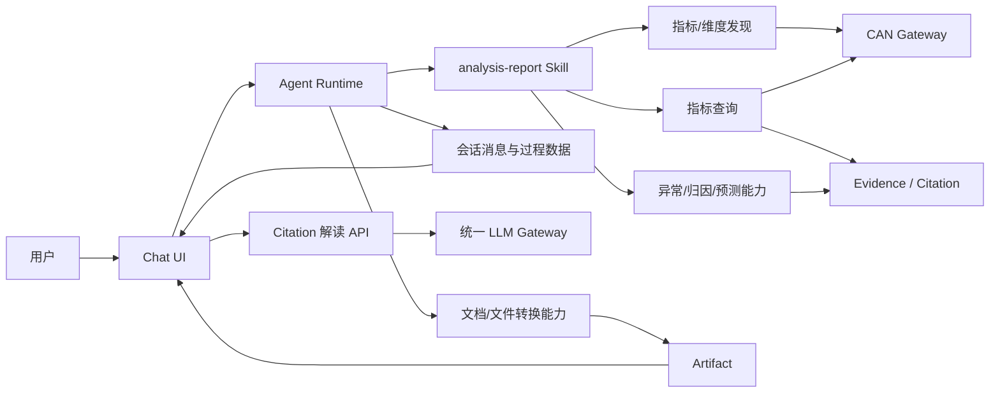
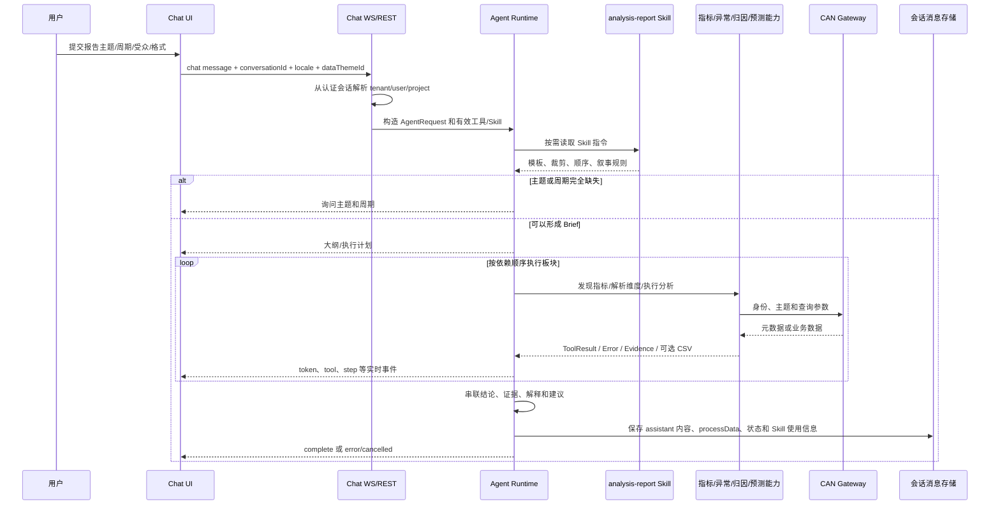
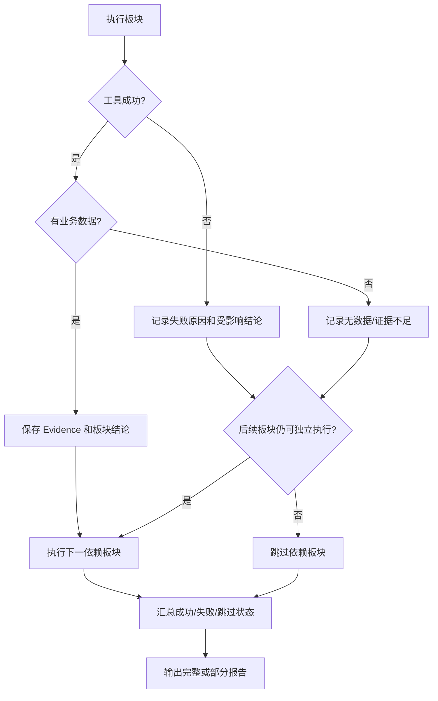
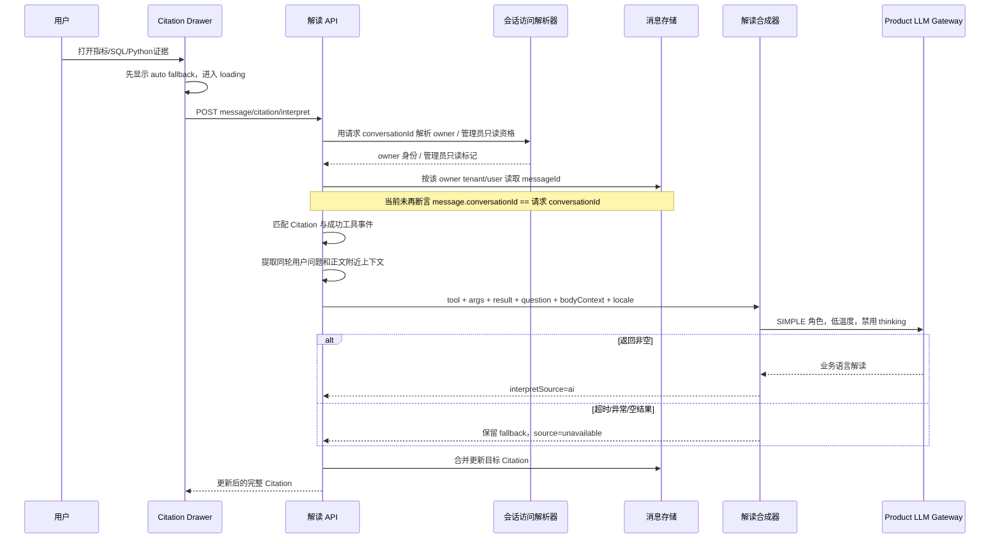
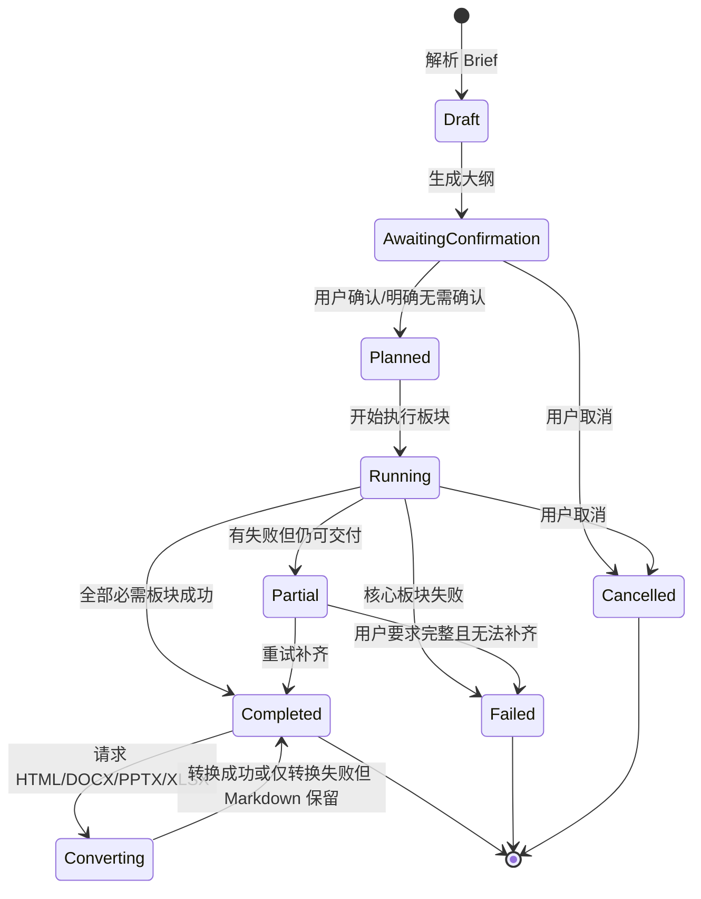

# 分析报告生成与解释能力复刻说明

## 1\. 结论与边界

### 1.1 能力结论

本能力把一句“出一份经营分析报告”转换为一段有结构、有数据依据、有业务解读、可继续追问的分析叙事。它解决的不是文件排版问题，而是以下四个业务问题：
1. 从自然语言中识别报告主题、周期、受众和深度。
2. 选择报告板块，按依赖顺序调度指标发现、维度解析、指标查询、异常检测、归因和预测能力。
3. 把分散的工具结果串成“结论—证据—解释—建议”的连贯叙事，而不是堆叠表格。
4. 为报告中的数字保留可定位证据，并允许用户打开证据后按需生成业务语言解读。

当前实现的关键形态是：**报告编排规则保存在一个可启停的系统 Skill 中，由通用 Agent Runtime 读取并遵循；不存在独立的 Report Service、**`**POST /api/reports**`**、报告数据库表或后端强制板块状态机。** 默认交付是会话中的 Markdown；HTML、DOCX、PPTX、XLSX 是在 Markdown 内容形成后，再调用相应文档或文件能力转换出的 Artifact。这一边界非常重要：复刻当前效果不需要先实现专用报告微服务，但生产级复刻若要支持长报告恢复、板块级重试和确定性验收，应增加显式报告作业模型。

### 1.2 目标用户、输入与输出

| 项目 | 内容 |
|------|------|
| 目标用户 | 业务分析人员、销售/运营负责人、管理者、希望周期性复用分析过程的任务创建者 |
| 主输入 | 自然语言中的主题、时间范围、受众、深度、指定指标/维度、目标值、输出格式 |
| 隐含输入 | 当前会话历史、租户/用户/项目身份、数据主题、可见 Skill/Tool、模型角色配置、指标平台权限 |
| 主输出 | 一条持久化 assistant 消息：Markdown 报告正文、过程事件、Citation 数据、使用过的 Skill 名称 |
| 可选输出 | 内嵌 ECharts/Mermaid；HTML/DOCX/PPTX/XLSX Artifact；可下载 CSV 证据 |
| 用户可见效果 | 先看到大纲或澄清问题，随后看到逐板块结果和最终报告；可打开 Citation 查看查询详情与 AI 解读 |

### 1.3 与相邻能力的严格边界

| 形态 | 本文负责 | 本文不负责 |
|------|------------|---------------|
| Markdown 报告 | 需求识别、板块选择、执行顺序、叙事、部分失败表达、解释与建议 | Markdown 渲染器的全部样式实现 |
| HTML 报告 | 何时由报告内容转换为 HTML、生成成功应满足的业务验收 | HTML 文件写入、脚本内联、iframe/CSP 和图表 Renderer 的完整细节 |
| Citation 解读 | 报告语境如何进入按需 AI 解读、状态和失败降级 | Citation token 铸造、编号修复、所有 Evidence 类型的完整实现 |
| Artifact | 报告与来源会话、生成轮次和交付物的关系 | Artifact 通用 ACL、版本、预览、下载和删除的全部规则 |
| PPTX/DOCX/XLSX | 报告先形成内容再请求格式转换的编排边界 | Office 文件生成、编辑、视觉 QA、预览和下载算法 |
| 定时报告 | 一次性报告如何被录制成未来任务的输入 | Cron、任务执行历史、并发和任务生命周期的完整实现 |

### 1.4 当前能力、缺陷与规划

| 结论 | 等级 | 说明 |
|------|------|------|
| `analysis-report` 是 CAN 插件随包注册并同步到产品 Skill 表的系统 Skill | `I` | 新建时默认启用；现存系统记录同步内容时保留其启用状态 |
| Skill 只声明四个直接必需工具：指标搜索、维度查询、维度值解析、指标查询 | `I` | 异常、归因、预测写成“调度其他 Skill”，但不是 `required&#95;tools`，也没有代码级嵌套 Skill 调用状态机 |
| 当前没有专用报告 API、报告表或可恢复报告作业 | `I` | 报告复用普通 Chat、Message、processData、Skill 和 Artifact 链路 |
| 默认 Markdown，用户明确要求文件时再调用文档 Skill | `I` | HTML/PPT 等文件生成属于相邻成果生成能力 |
| 报告正文中的指标数字必须由成功的查询 Evidence 支撑 | `I` | 指标查询结果会附 Citation 提醒；最终化后 Citation 随消息 `processData` 持久化 |
| 指标/SQL/Python Citation 初始有自动摘要，打开时按需请求 AI 解读 | `I` | 解读失败会保留原摘要并标记 unavailable |
| Citation 解读按请求中的会话解析 owner，再按 owner 身份取消息，但当前未显式校验消息实际所属会话等于请求会话 | `I-risk` | 尚无缺陷台账，不能标 `K`；生产复刻必须补对象绑定与反向测试 |
| 报告大纲确认、逐板块展示和板块顺序是 Skill 指令，不是服务端硬约束 | `I/F` | 模型是否逐条遵循依赖路由与运行时表现；本次没有执行模型验证 |
| `analysis-report` 对 `metric-attribution` 的委派是自然语言 Skill 指令，不是 typed child invocation | `I-risk` | 被委派 Skill 默认自己生成最终 HTML 和 80 字内聊天摘要，不能天然作为报告的结构化归因板块返回 |
| HTML 报告预览必须出现可见 Canvas 或 SVG | `A` | 两条 active 黑盒 Browser Case 有此验收，本次未运行 |
| 报告预览图表可能空白，缺陷号 QWGK-330 | `K` | 当前测试仓未给出已关闭证据 |
| 完整报告结构、数据结论一致、数据不足、部分失败、多主因和证据上限用例均未激活 | `P` | 不能写成当前运行保证 |
| UI 主流程覆盖分析后继续请求图表与 PPT | `A/F` | `A` 只保证用例检查文本关键词、Artifact 卡片、preview/download 操作；中文内容及实际图表/PPT 渲染质量只可作较弱推断 |
| 生产复刻应增加显式报告计划、板块状态、来源 Manifest 和可恢复作业 | `D` | 解决当前纯提示词编排的不可恢复、不可精确验收问题 |

本次只进行了静态分析，未启动 Nova、未执行自动化测试，因此本文没有 `R` 级结论。

## 2\. 术语与参与方

| 术语/参与方 | 含义与职责 |
|----------------|---------------|
| 报告请求 | 用户希望得到一次性分析报告的自然语言消息，不等于定时任务 |
| Report Brief | 从请求归一化出的主题、周期、受众、深度、格式、指标、维度和目标 |
| Report Plan | 有序板块列表以及每个板块的输入、依赖、执行状态和证据集合 |
| 分析报告 Skill | 报告“总编”：定义板块模板、裁剪规则、顺序和叙事规则，本身不实现分析算法 |
| 能力层 Skill/Tool | 指标查询、异常检测、归因、预测、SQL/Python 等实际取数或计算能力 |
| Agent Runtime | 选择并读取 Skill、调用 LLM 和 Tool、发事件、处理取消、持久化消息 |
| Evidence/Citation | 把报告结论与成功工具结果关联的结构化证据快照 |
| Citation 解读 | 用户打开指标/SQL/Python证据后，基于工具参数、结果、用户问题和正文附近上下文生成的业务语言说明 |
| Artifact | HTML、DOCX、PPTX、XLSX、CSV 等持久化交付物 |
| CAN Gateway | 指标目录、维度和指标查询的外部对端；本文只给出报告所需的最小契约 |



## 3\. 业务规则

### 3.1 路由和需求识别
1. “出一份报告、月报、周报、分析报告、汇报、工作总结、经营复盘、做个报告”属于一次性分析报告候选。
2. 出现“以后每天/每周/每月、定期、定时、自动跑”等重复执行意图时，应路由到定时报告，而不是直接把一次性报告当成 Cron。
3. “查一个数”“分析数据并画图”不应仅因出现“分析”而触发完整报告；前者属于单点查询，后者属于查询/可视化。
4. “分析报告一般包含什么”是知识问答，不应启动真实取数。
5. 用户只给领域，例如“出一份销售报告”时，当前 Skill 约定默认上月、标准深度，并先搜索领域核心指标。
6. 用户完全未给主题和周期时，应先询问这两项，不能猜测并执行全量查询。
7. 受众影响语言和详略：管理者版本应结论前置、减少技术细节、突出行动建议；团队版本可保留更多明细和口径。

### 3.2 报告模板与裁剪

通用报告候选板块如下：

| 顺序 | 板块 | 最小输入 | 执行能力 | 产出 |
|------|------|------------|------------|------|
| 1 | 核心指标概览 | 核心指标、周期、对比基准 | 指标查询 | KPI、同比/环比、初步解读 |
| 2 | 趋势分析 | 核心指标、时间粒度、近 N 期 | 按时间维度指标查询 | 趋势、拐点、持续性 |
| 3 | 异常扫描 | 前两板块指标和序列 | 异常检测 | 异常项、幅度、置信或数据缺口 |
| 4 | 异常归因 | 已确认异常、对比基准、候选因子/维度 | 归因分析 | 主因、贡献、下钻路径 |
| 5 | 维度拆解 | 指标、关键维度、Top/Bottom 规则 | 分组指标查询 | 排名、占比、贡献 |
| 6 | 目标达成 | 目标值、当前累计、剩余时间 | 预测/模拟 | 缺口、达标概率或情景 |
| 7 | 关键发现与建议 | 所有成功板块及失败声明 | LLM 叙事 | 结论、风险、建议、待验证项 |

裁剪规则：
- 简报只保留核心指标和建议。
- 异常扫描没有异常时跳过归因，不能为凑结构制造原因。
- 用户没有提供目标时跳过目标达成。
- 用户指定维度时，维度拆解只做该维度及必要的 Top-N。
- 日报弱化长期趋势，优先异常；月报/季报可保留长趋势和目标。
- 无数据、数据不足或中间工具失败时，报告必须标记“未完成/部分完成/证据不足”，不得把缺失板块写成成功。

### 3.3 顺序、确认与中间展示
1. 默认先展示大纲供用户确认；这是当前 Skill 的行为要求，但不是服务端事务门禁。
2. 板块应按依赖顺序执行。异常扫描决定是否归因，维度发现影响归因和建议。
3. 当前 Skill 要求每完成一个板块就向用户展示中间结果；通用 Chat 流式链路可以显示 token、tool 和 step 事件，但当前没有独立“板块消息”持久化实体，因此不能保证每个模型都形成可恢复的板块检查点。
4. 新发现可以提议扩展，但不应静默扩大范围；尤其不能自动扫描所有维度造成成本爆炸。
5. 最终报告先给 2～3 句执行摘要，再给细节；每个数据板块必须至少有一句业务解读。
6. 建议必须指向动作或进一步验证，不得只是重述“上升/下降”。

### 3.4 数据、Citation 和解释规则
1. 指标搜索、维度列表、维度值解析只提供元数据，不是业务数字来源，报告不得引用它们作为数值证据。
2. 报告使用的每个业务数字必须来自成功的 `metric_query`、SQL、Python 等可引用工具结果，并携带其精确 Citation token。
3. 指标查询的 `purpose` 应使用人类可读短语；它会成为 Citation 卡片标题，也可能成为 CSV 文件名前缀。
4. 中间诊断查询可使用 `visibility=internal`；最终展示用查询使用 `default`；用户明确要求导出或需要完整枚举时使用 `export`。
5. `internal` 不发布 UI CSV，但仍受 Citation 规则约束；超过约 4000 字符的长证据需要 Top-N、缩小筛选或改用可下载结果，不能让正文引用失去完整依据。
6. Citation 初始解释来自确定性工具摘要，`interpretSource=auto`。只有指标、SQL、Python 三类默认支持按需 AI 解读。
7. AI 解读只说明查询/计算做了什么以及它与正文结论的关系，不允许发明业务原因；中文控制为 1～2 句、约 200 字内，英文为 1～2 句、80 词内。
8. AI 解读失败、超时或空结果时保留自动摘要，标记 `unavailable`；用户可显式重试。

### 3.5 输出形态规则
- 未明确指定文件格式时，交付 Markdown 报告。
- 图表应紧跟它支持的结论；报告建议不超过 5 个图。
- 数值图表用 ECharts，流程/时序用 Mermaid，解释性静态视觉可用 SVG。
- 用户要求 HTML/DOCX/PPTX/XLSX 时，先形成完整报告内容，再交给相应文档能力；不得把格式转换成功当作分析正确。
- HTML 报告至少需要标题、报告正文和一个真实可见的图表容器；仅有文件卡片不代表报告可用。
- 当前 QWGK-330 表明“HTML 能打开但图表为空白”是真实风险，复刻验收必须检查渲染后 Canvas/SVG 的实际尺寸，而非只检查 HTML 文本。

### 3.6  委派的当前编排冲突

`analysis-report` 的 Skill 文本写着“调用/委派 `metric-attribution`”，但当前运行时没有 `invokeSkill<AttributionSectionResult>()` 之类的 typed child-Skill 契约。这个名称主要是给模型看的编排指令，不能据此假定宿主一定启动一个隔离子 Agent，也不能假定被调用能力会返回前文定义的 `SectionResult`。

更重要的是，`metric-attribution` 自身的默认交付协议与“嵌入综合报告的一个板块”存在冲突：
1. Step A 先生成 Markdown 剧本；它是内部中间产物，明确要求不要贴入聊天。
2. Step B 把剧本机械转换为完整、离线自包含的 HTML，并用文件工具发布；这是该 Skill 的最终交付物。
3. 文件发布后，聊天只回复 80 字以内的“主因 \+ 可信度”摘要。
4. HTML Artifact 内不保留 Nova Citation token，因为独立 HTML 没有消息 Citation Drawer 上下文。

因此，综合报告若直接“自然语言调用”该 Skill，可能得到一个独立 HTML 文件和短摘要，而不是可合并进最终 Markdown 的归因 facts/evidence。这是当前提示词编排的接口错配，不应伪装成稳定的板块调用链。

生产复刻有两种安全方案：
- **Section mode**：给归因能力增加显式 `outputMode=section`，返回 typed facts、caveats、evidence tokens、chart spec，不发布最终文件；仅顶层报告负责统一叙事和格式转换。
- **Child adapter**：保持归因 Skill 不变，由适配器读取其结构化运行结果/Artifact Manifest，提取允许复用的事实和聊天 Citation，禁止把独立 HTML 里的无 token 文本直接当作已引用结论。

两种方案都必须定义父子取消传播、预算、身份、数据主题、证据所有权和失败状态；仅在 prompt 中写“调用某 Skill”不够。

## 4\. 完整执行链路

### 4.1 当前一次性报告主链路



当前执行步骤可还原为：
1. WebSocket/REST 入口只信任认证上下文中的租户和用户；请求体可以给会话、消息、附件、Provider 覆盖、数据主题和语言。
2. Runtime 根据当前身份的有效 Skill 列表选择 `analysis-report`；启用该 Skill 不等于所有分析工具都自动可用。
3. 模型通过 `read_file skill://analysis-report/SKILL.md` 获取完整指令。Skill 的直接 `required_tools` 会进入正式工具可见性链，但不能越过租户、项目或 Agent policy 的能力边界。
4. 报告范围明确后先完成元数据发现，再执行实际查询；工具失败以 `Error: <原因>` 反馈给模型。
5. 每个可引用工具结果产生过程事件和 Evidence，最终回复把 Citation token 放在结论附近。
6. Runtime 对最终回复做 Citation 和 Artifact 后处理，保存 assistant 消息。消息状态为 `COMPLETED`、`CANCELLED` 或 `ERROR`，会话状态由 `RUNNING` 回到 `IDLE` 或 `ERROR`。
7. 用户要求文件时，在分析内容形成后继续调用文档/文件能力，发布 Artifact；这不是独立的报告 REST 调用。

### 4.2 部分失败与无数据

推荐且与规划测试一致的处理逻辑：



当前 Skill 对“某查询报错则继续还是停止”没有强制代码状态机。生产复刻应使用以下确定性规则：
- 核心指标概览完全失败：报告终止为 `FAILED`，因为后续叙事缺少主事实。
- 趋势失败但概览成功：报告可为 `PARTIAL`，明确缺少趋势验证。
- 异常扫描无数据：跳过归因，不能将“未检测到”写成“没有异常”。
- 某个维度失败：保留其他维度并列出失败维度。
- 多主因贡献接近：并列呈现，不强行选单一主因。
- 文件转换失败：Markdown 报告仍可成功；文件交付单独失败。

### 4.3 Citation 按需 AI 解读链路



解读不是报告生成的同步必需步骤。报告完成时已有 `auto` 摘要；只有用户打开证据卡片时前端才默认发起请求。公开分享页面不应匿名触发私有 LLM 解读，应使用分享创建时的只读快照。

当前对象绑定存在一个 `I-risk`：服务先用请求里的 `conversationId` 解析会话 owner，再按这个 owner 的 tenant/user 读取 `messageId`，但静态链路中未看到对 `message.conversationId == conversationId` 的显式断言。因此，同一 owner 名下若请求把“会话 A \+ 会话 B 的消息 ID”组合起来，消息可能仍被读取。它尚未登记为已知缺陷，不能标记为 `K`，但生产复刻必须在读取后再次校验会话 ID，并增加同 owner 跨会话、跨 owner、管理员只读三组反向测试。

### 4.4 一次性报告转为定时报告

一次性报告完成后，用户说“以后每月都这么出”时：
1. 从当前对话提取已经实际执行过的指标查询、归因步骤、阈值和输出格式。
2. 把绝对时间转成相对时间表达。
3. 生成完全自包含的任务描述，不依赖原会话。
4. 通过任务管理能力创建 Cron 任务。
5. 后续执行在新会话中重放，不把当前报告的临时 Citation token 当成未来证据。

## 5\. 对外契约

### 5.1 Chat 入口

当前没有专用报告接口。WebSocket 主入口：
```text
GET /ws/chat?lang=zh
Cookie: <配置后的认证 Cookie>

```

概念请求：
```json
{
  "type": "chat",
  "conversationId": "conv_01JXREPORT",
  "message": "给老板出一份上月销售经营报告，包含核心指标、趋势、异常、渠道拆解和行动建议，先给我看大纲。",
  "provider": "qwen",
  "dataThemeId": "theme_sales",
  "lang": "zh",

  "images": [],


  "files": [ ]

}

```

字段：

| 字段 | 类型 | 必填 | 语义 |
|------|------|------|------|
| `type` | string | 否 | 缺失时按 chat；报告请求使用 `chat` |
| `conversationId` | string | 否 | 为空时创建新会话；已有 ID 必须属于当前身份可写范围 |
| `message` | string | 是 | 原始报告需求 |
| `provider` | string | 否 | 用户选择的 Provider 覆盖；空时按角色路由 |
| `dataThemeId` | string | 否 | 会话数据主题；服务端必须验证其属于当前租户可见范围 |
| `lang` | `zh/en` | 否 | 每消息语言，优先于握手语言 |
| `images/files` | array | 否 | 报告上下文附件 |

REST 同步和 SSE 入口分别为 `POST /api/chat`、`POST /api/chat/stream`，请求字段等价；长报告产品体验以 WebSocket 为主。

与报告相关的最小实时事件：
```json
{"type":"conversation_id","content":"conv_01JXREPORT","conversationId":"conv_01JXREPORT"}
{"type":"llm_call_start","content":"","seq":1,"conversationId":"conv_01JXREPORT"}
{"type":"task_plan","content":"{\"steps\":[...]}","seq":2,"conversationId":"conv_01JXREPORT"}
{"type":"step_start","content":"overview|核心指标概览","seq":3,"conversationId":"conv_01JXREPORT"}
{"type":"tool_exec_start","content":"call_1|metric_query|{...}|312","seq":4,"conversationId":"conv_01JXREPORT"}
{"type":"tool_exec_end","content":"call_1|metric_query|1842|true|965|[Query result: 4 row(s)]...","seq":5,"conversationId":"conv_01JXREPORT"}
{"type":"step_complete","content":"overview","seq":6,"conversationId":"conv_01JXREPORT"}
{"type":"token","content":"# 上月销售经营报告...","seq":7,"conversationId":"conv_01JXREPORT"}
{"type":"complete","content":"# 上月销售经营报告...","seq":20,"conversationId":"conv_01JXREPORT"}

```

`task_plan/step_*` 是 Runtime 可发送的通用事件，不代表当前 `analysis-report` Skill 一定为每个板块发出这些事件；若复刻者需要稳定板块进度，必须把它们升级为报告服务的强契约。

错误和取消终态：
```json
{"type":"error","content":"CAN Gateway request failed: HTTP 503","seq":20,"conversationId":"conv_01JXREPORT","messageId":812}

```
```json
{"type":"cancelled","content":"","seq":20,"conversationId":"conv_01JXREPORT"}

```

### 5.2 分析报告 Skill 契约

最小 Skill frontmatter：
```yaml
name: analysis-report
required_tools:
  - metric_search
  - metric_dimensions
  - metric_dimension_resolve
  - metric_query
description: >
  编排生成完整数据分析报告；自身不实现分析算法。

```

当前 `required_tools` 只保证这四个工具在 Skill 合法启用且能力边界允许时进入有效工具集合。异常、归因、预测、文档转换仍需相应 Skill/Tool 可见；不得因为报告希望使用它们就在 Runtime 中旁路注入。

### 5.3 指标查询 Tool 契约

报告最核心的直接查询形式：
```json
{
  "name": "metric_query",
  "arguments": {
    "query_json": {
      "metrics": ["sales_amount", "order_count"],
      "dimensions": ["metric_time__FY_month"],
      "filters": ["[channel]= \"Retail\""],
      "timeConstraint": "DateTrunc(['metric_time'], \"MONTH\") >= DATEADD(DateTrunc(NOW(), \"MONTH\"), -3, \"MONTH\")",
      "limit": 100
    },
    "purpose": "近三月零售渠道销售概览",
    "visibility": "default"
  }
}

```

| 字段 | 类型 | 必填 | 规则 |
|------|------|------|------|
| `query&#95;json` | object | 是 | `metrics` 非空；时间查询使用 MQL 表达式，不是 SQL |
| `purpose` | string | 实务必填 | 建议不超过 20 字；作为 Citation 标题/CSV 名称前缀 |
| `visibility` | enum | Schema 必填 | `internal/default/export`；当前实现缺失或非法时仍降级为 `default` 并告警 |

成功结果概念示例：
```text
[Query result: 3 row(s)]

| FY month | sales_amount | order_count |
|---|---:|---:|
| FY2026-M01 | 1280000 | 3210 |
| FY2026-M02 | 1190000 | 3005 |
| FY2026-M03 | 1370000 | 3388 |

[Computable dataset] 近三月零售渠道销售概览_20260813_103000.csv — ...

```

错误必须以 `Error:` 开头，例如参数缺失、权限拒绝、Gateway 失败或数据范围超限。无数据是成功的零行业务结果并带 `(no data)`，不能与执行错误混淆。

### 5.4 assistant 消息与 Report Snapshot

当前持久化的最小消息投影：
```json
{
  "id": 812,
  "role": "assistant",
  "content": "# 上月销售经营报告\n\n> 核心摘要...[^cite:msg812.ev_a1b2c3d4e5f6]",
  "processData": "{\"events\":[...],\"citations\":[...],\"taskPlan\":{...}}",
  "turnIndex": 4,
  "skillName": "analysis-report",
  "skillNames": ["analysis-report", "metric-query"],
  "state": "COMPLETED",
  "errorMessage": null
}

```

当前没有独立 Report Snapshot。生产复刻建议从消息派生但独立保存：
```json
{
  "schemaVersion": 1,
  "reportId": "rpt_01JX...",
  "tenantId": "tenant_a",
  "ownerUserId": "user_9",
  "conversationId": "conv_01JXREPORT",
  "sourceTurnIndex": 4,
  "brief": {
    "subject": "销售经营",
    "period": "previous_complete_month",
    "audience": "executive",
    "depth": "standard",
    "locale": "zh-CN",
    "requestedFormats": ["MARKDOWN"]
  },
  "sections": [
    {"id":"overview","type":"KPI_OVERVIEW","status":"SUCCEEDED","evidenceTokens":["ev_a1b2c3d4e5f6"]},
    {"id":"trend","type":"TREND","status":"SUCCEEDED","evidenceTokens":["ev_b2c3d4e5f6a1"]},
    {"id":"attribution","type":"ATTRIBUTION","status":"SKIPPED","reason":"NO_ANOMALY"}
  ],
  "status": "SUCCEEDED",
  "primaryMessageId": 812,

  "artifactIds": [],

  "createdAt": "2026-08-13T02:30:00Z",
  "updatedAt": "2026-08-13T02:32:41Z"
}

```

### 5.5 Citation AI 解读接口
```http
POST /api/messages/{messageId}/citations/{citationId}/interpret
    ?conversationId={conversationId}&force=false
X-Nova-Lang: zh-CN
Cookie: <authenticated session>

```

参数：

| 参数 | 位置 | 类型 | 必填 | 默认/约束 |
|------|------|------|------|-------------|
| `messageId` | path | positive integer | 是 | assistant 消息 ID |
| `citationId` | path | positive integer | 是 | 消息内 Citation 序号 |
| `conversationId` | query | string | 是 | 当前用于解析 owner/管理员只读资格；生产契约还必须绑定并校验消息实际所属会话 |
| `force` | query | boolean | 否 | `false`；true 可重试 unavailable |
| `X-Nova-Lang` | header | string | 否 | `en&#42;` 归一化为英文，其余中文 |

响应是更新后的 Citation：
```json
{
  "id": 1,
  "token": "msg812.ev_a1b2c3d4e5f6",
  "localToken": "ev_a1b2c3d4e5f6",
  "messageId": "812",
  "conversationId": "conv_01JXREPORT",
  "type": "metric",
  "toolName": "metric_query",
  "caption": "上月各渠道销售额",
  "interpret": "按渠道汇总了上一个完整月的销售额，用于判断总额变化主要来自哪些渠道。",
  "interpretSource": "ai",
  "interpretGeneratedAt": "2026-08-13T02:33:10Z",
  "failed": false,
  "metadata": {
    "type": "metric",
    "metricSpec": {"metrics":["sales_amount"],"dimensions":["channel"]},
    "result": {"columns":["channel","sales_amount"],"rows":[["Retail","1370000"]],"totalRows":1}
  }
}

```

状态语义：

| `interpretSource` | 含义 | 再次打开 |
|-----------------|------|------------|
| `auto` | 工具派生的确定性摘要 | 默认触发 AI 解读 |
| `ai` | 已生成非空 AI 解读 | 直接复用，不再请求 |
| `unavailable` | AI 超时、异常或空结果，保留 fallback | 默认复用失败终态；用户可 force 重试 |

错误语义：无认证返回 401；会话不可读、消息或 Citation 不存在统一按 404；损坏的 `processData` 属于 500；LLM 不可用不返回 5xx，而是 200 \+ `unavailable`，从而保留证据可读性。

对象级授权的推荐判定必须同时满足：`conversation` 对请求者可读、`message.tenant_id/user_id` 与解析出的 owner 一致、`message.conversation_id == conversationId`、Citation 属于该消息。任一不满足均返回不泄露对象存在性的 404。当前实现只明确满足前三项中的前两项，缺少消息—会话等值校验；这是实现风险而不是既有安全保证。

### 5.6 配置契约
```yaml
nova:
  citation:
    enabled: true
    synthesis-use-main-model: false
    synthesis-result-max-chars: 1500
    synthesis-batch-timeout-seconds: 30

```
- `synthesis-use-main-model=false` 时使用统一 LLM Gateway 的 `SIMPLE` 角色；不是直接调用具体 Provider。
- 单次请求温度为 0.2，输出预算 800 token，并显式关闭 Provider thinking。
- 工具结果超过配置字符数时只把前缀送入 LLM；完整工具结果仍由 Evidence/消息存储治理。

### 5.7 编辑、Artifact 与来源关联契约

当前没有“编辑报告正文”的专用接口，也没有 Report Version 实体。三种看似编辑的动作必须区分：

| 用户动作 | 当前等价行为 | 不应声称的能力 |
|------------|------------------|---------------------|
| “把第二节改短一些” | 在同一会话发起新一轮，让 Agent 基于历史内容生成新的 assistant 消息 | 原地 patch 旧消息、自动保留报告版本树 |
| 生成/重生成 HTML、PPTX、DOCX | 发布新的 Artifact，并在消息中展示对应 marker/card | 覆盖旧 Artifact 后仍可按报告版本回滚 |
| 在 HTML 预览中操作页面内编辑控件 | 页面自身可能把 UI 状态保存在浏览器侧；是否写回服务端取决于该 HTML 应用 | 通用报告服务已保存编辑后的正文 |

当前 Artifact 列表/详情向 UI 暴露的最小投影为：
```json
{
  "id": "a1b2c3d4",
  "displayName": "上月销售经营报告.html",
  "originalFilename": "sales-report.html",
  "type": "html",
  "mimeType": "text/html",
  "size": 48321,
  "conversationId": "conv_01JXREPORT",
  "sourceTool": "execute_python",
  "projectId": "project_sales",
  "visibility": "OWNER_ONLY",
  "creator": {"userId":"user_9","displayName":"分析员甲"},
  "permissions": {"canPreview":true,"canDownload":true,"canManage":true},
  "createdAt": "2026-08-13T10:35:00",
  "contentUrl": "/api/artifacts/a1b2c3d4/content"
}

```

当前稳定 Artifact wire 的 `visibility` 取值不是 `private/public`，而是：

| 值 | 语义 |
|---|------|
| `OWNER&#95;ONLY` | 普通访问链仅 owner 可读；默认个人私有形态，不能据此推导通用管理员旁路 |
| `GRANTED` | owner 通过 Artifact grant 显式授权给同租户主体 |
| `PROJECT` | 绑定项目作用域，按项目成员关系读取 |

三种可见性都不能绕过 tenant 边界；`permissions.canPreview/canDownload/canManage` 是服务端针对当前请求者计算的最终动作权限，前端不能仅凭 `visibility` 自行推导。

其中 `conversationId` 只能证明 Artifact 属于哪个来源会话；`sourceTool` 只说明哪个工具发布了文件。当前稳定 Artifact 契约没有 `sourceMessageId`、`sourceTurnIndex`、`reportId`、`parentArtifactId` 或 `version`，因此不能只凭 Artifact 行精确证明“该文件来自报告的哪一轮、哪一版正文”。消息中的 Artifact marker 可以帮助 UI 在该次回复里展示文件，但它不是独立的报告来源 Manifest。

生产复刻应在 Artifact metadata 或独立关联表中至少保存：
```json
{
  "schemaVersion": 1,
  "reportId": "rpt_01JX...",
  "sourceConversationId": "conv_01JXREPORT",
  "sourceMessageId": 812,
  "sourceTurnIndex": 4,
  "sourceContentHash": "sha256:...",
  "format": "HTML",
  "conversionAttempt": 1,
  "parentArtifactId": null,
  "createdByTool": "execute_python"
}

```

复刻验收时应验证：从 Artifact 能反向定位到授权范围内的来源消息；重生成产生新 Artifact，不静默改变旧文件内容；删除/分享来源会话时，Artifact 的保留和访问按显式生命周期策略处理，而不是依赖文件路径猜测关系。

## 6\. 数据模型与生命周期

### 6.1 当前事实模型

当前报告内容依附于会话和消息：
```sql
CREATE TABLE conversation (
  id varchar(255) PRIMARY KEY,
  tenant_id varchar(255),
  user_id varchar(255),
  title varchar(255),
  status varchar(16) NOT NULL DEFAULT 'IDLE',
  project_id varchar(64),
  data_theme_id varchar(255),
  is_deleted boolean NOT NULL DEFAULT false,
  created_at timestamp(6) NOT NULL,
  updated_at timestamp(6)
);

CREATE TABLE message (
  id bigint GENERATED BY DEFAULT AS IDENTITY PRIMARY KEY,
  tenant_id varchar(255),
  user_id varchar(255),
  conversation_id varchar(255) NOT NULL,
  role varchar(255) NOT NULL,
  content text,
  process_data text,
  turn_index integer,
  skill_name varchar(255),
  state varchar(16) NOT NULL DEFAULT 'COMPLETED',
  error_message text,
  is_deleted boolean NOT NULL DEFAULT false,
  created_at timestamp(6) NOT NULL
);

```

`process_data` 是 JSON 文本，保存工具事件、Citation、计划和统计。Citation AI 解读直接 patch 该 JSON。报告没有独立版本号；修改报告通常意味着新一轮 assistant 消息或新 Artifact，而不是更新一个 Report 行。

系统 Skill 定义最小数据：
```sql
CREATE TABLE skill_definition (
  id bigint GENERATED BY DEFAULT AS IDENTITY PRIMARY KEY,
  skill_id varchar(64) NOT NULL UNIQUE,
  name varchar(64) NOT NULL,
  description text NOT NULL,
  content text NOT NULL,
  scope varchar(15) NOT NULL,
  tenant_id varchar(64),
  user_id varchar(64),
  project_id varchar(64),
  trigger_type varchar(16) NOT NULL DEFAULT 'auto',
  required_tools text,
  metadata text,
  enabled boolean NOT NULL DEFAULT true,
  created_at timestamp(6),
  updated_at timestamp(6)
);

```

### 6.2 推荐生产模型
```sql
CREATE TABLE analysis_report_job (
  report_id varchar(64) PRIMARY KEY,
  tenant_id varchar(64) NOT NULL,
  owner_user_id varchar(64) NOT NULL,
  conversation_id varchar(255) NOT NULL,
  source_turn_index integer NOT NULL,
  idempotency_key varchar(255) NOT NULL,
  request_hash varchar(64) NOT NULL,
  idempotency_scope_hash varchar(64) NOT NULL,
  brief_json jsonb NOT NULL,
  plan_json jsonb NOT NULL,
  status varchar(24) NOT NULL,
  primary_message_id bigint,
  error_code varchar(64),
  error_message varchar(1000),
  version bigint NOT NULL DEFAULT 0,
  created_at timestamptz NOT NULL,
  updated_at timestamptz NOT NULL,
  UNIQUE (tenant_id, owner_user_id, idempotency_scope_hash),
  UNIQUE (tenant_id, owner_user_id, idempotency_key)
);

CREATE TABLE analysis_report_section (
  report_id varchar(64) NOT NULL,
  section_id varchar(64) NOT NULL,
  section_type varchar(32) NOT NULL,
  ordinal integer NOT NULL,
  status varchar(24) NOT NULL,
  request_json jsonb,
  result_summary text,

  evidence_tokens jsonb NOT NULL DEFAULT '[]',


  artifact_ids jsonb NOT NULL DEFAULT '[]',

  error_code varchar(64),
  error_message varchar(1000),
  started_at timestamptz,
  finished_at timestamptz,
  PRIMARY KEY (report_id, section_id),
  FOREIGN KEY (report_id) REFERENCES analysis_report_job(report_id) ON DELETE CASCADE
);

CREATE TABLE report_delivery (
  delivery_id varchar(64) PRIMARY KEY,
  report_id varchar(64) NOT NULL,
  format varchar(16) NOT NULL,
  status varchar(24) NOT NULL,
  attempt integer NOT NULL,
  source_hash varchar(64) NOT NULL,
  artifact_id varchar(64),
  error_code varchar(64),
  error_message varchar(1000),
  started_at timestamptz,
  finished_at timestamptz,
  created_at timestamptz NOT NULL,
  UNIQUE (report_id, format, source_hash, attempt),
  FOREIGN KEY (report_id) REFERENCES analysis_report_job(report_id) ON DELETE CASCADE
);

CREATE TABLE report_artifact_manifest (
  manifest_id varchar(64) PRIMARY KEY,
  report_id varchar(64) NOT NULL,
  delivery_id varchar(64) NOT NULL,
  artifact_id varchar(64) NOT NULL,
  format varchar(16) NOT NULL,
  source_hash varchar(64) NOT NULL,
  parent_artifact_id varchar(64),
  version integer NOT NULL,
  conversion_attempt integer NOT NULL,
  created_at timestamptz NOT NULL,
  UNIQUE (report_id, format, version),
  FOREIGN KEY (report_id) REFERENCES analysis_report_job(report_id) ON DELETE CASCADE,
  FOREIGN KEY (delivery_id) REFERENCES report_delivery(delivery_id)
);

```

`request_hash` 是规范化 Report Brief、输出格式和来源上下文的摘要；`idempotency_scope_hash = SHA-256(ownerUserId + requestHash + 客户端幂等键)`，不能只在 tenant 内使用一个裸客户端 key。重复 scope 返回原作业；同一 owner 重用同 key 但 request hash 不一致时返回 409，不得悄悄创建语义不同的作业。

`report_delivery.status` 建议为 `PENDING/RUNNING/SUCCEEDED/FAILED/CANCELLED`。转换失败写入 `error_code/error_message`，保留成功的 Markdown 报告和既有 Artifact；只有发布成功后才写 `artifact_id` 并追加 Manifest。`source_hash` 锁定本次转换所依据的正文，`parent_artifact_id + version` 形成可追溯的重生成链，不能用覆盖同一文件伪装成版本。

索引至少包括 `(tenant_id, owner_user_id, created_at DESC)`、`(conversation_id, source_turn_index)`、`(status, updated_at)`、`report_delivery(report_id, status)` 和 `report_artifact_manifest(artifact_id)`。所有读取必须同时带 tenant；管理员只读必须审计。

### 6.3 生命周期



当前实现只有会话/消息层的 `RUNNING/IDLE/ERROR` 与 `PENDING/STREAMING/COMPLETED/CANCELLED/ERROR`，没有上述报告状态。推荐模型用于生产补强，不能反推为 Nova 已实现。

## 7\. 核心实现设计

### 7.1 最小兼容实现

最小版保持当前形态：
```text
Chat Runtime
├── SkillCatalog
├── analysis-report/SKILL.md
├── ToolRegistry
│   ├── metric_search
│   ├── metric_dimensions
│   ├── metric_dimension_resolve
│   └── metric_query
├── EvidenceFinalizer
├── ConversationStore
└── Optional Document Skills

```

核心伪代码：
```java
AgentResponse handleReport(ChatRequest request, Identity identity) {
  requireConversationWrite(identity, request.conversationId());
  EffectiveCapabilities caps = capabilityResolver.resolve(identity, request.conversationId());
  Skill reportSkill = caps.requireEnabledSkill("analysis-report");

  ReportBrief brief = reportIntentParser.parse(request.message(), request.locale());
  if (brief.subjectMissing() || brief.periodMissing()) {
    return askHuman("请补充报告主题和时间范围");
  }

  ReportPlan plan = reportPlanner.plan(brief, reportSkill.content());
  if (brief.requiresOutlineConfirmation()) {
    return askHuman(renderOutline(plan));
  }

  List<SectionResult> sections = new ArrayList<>();
  for (ReportSection section : plan.orderedSections()) {
    if (!dependenciesSatisfied(section, sections)) {
      sections.add(SectionResult.skipped(section.id(), "DEPENDENCY_UNAVAILABLE"));
      continue;
    }
    sections.add(executeSection(section, caps, identity));
  }

  String markdown = narrativeComposer.compose(brief, sections);
  CitationFinalization finalized = evidenceFinalizer.finalize(markdown, sections);
  Message message = conversationStore.appendAssistant(
      request.conversationId(), identity, finalized.content(), finalized.processData());
  return AgentResponse.completed(message);
}

```

这个版本允许 LLM 参与 Brief/Plan/叙事，但应以代码校验：权限、依赖可用性、工具结果成功、Citation token 存在、错误不得伪装成功。

### 7.2 生产级参考架构
```text
Report API / Chat Tool
├── IntentNormalizer
├── ReportPlanService
├── ReportJobRepository
├── SectionScheduler
│   ├── MetricSectionExecutor
│   ├── AnomalySectionExecutor
│   ├── AttributionSectionExecutor
│   └── ForecastSectionExecutor
├── EvidenceLedger
├── NarrativeComposer
├── QualityGate
├── ArtifactConversionAdapter
└── Outbox / ReportEventPublisher

```

关键设计：
1. **LLM 只做受约束决策和叙事**：板块依赖、状态、权限、最大维度数、最大查询数、证据存在性由代码控制。
2. **每个板块单独幂等**：业务键为 `(tenantId, reportId, sectionId, planVersion)`；重试不重复发布 CSV/Artifact。
3. **Evidence 先于叙事**：每个结论记录支持它的 Evidence token；QualityGate 拒绝没有证据的关键数字。
4. **部分成功可见**：板块状态进入报告，而不是只在模型文本中写“可能失败”。
5. **格式转换隔离**：Markdown 内容完成后再异步转换，转换失败不回滚已完成分析。
6. **可恢复**：进程重启从 `RUNNING` 板块的 lease/heartbeat 恢复或失败，不重跑已完成板块。
7. **成本上限**：Brief 中配置 `maxQueries/maxDimensions/maxCharts/maxTokens/deadline`，达到上限后输出部分报告和未执行项。
8. **子能力适配**：归因等下游能力必须提供 section mode 或 child adapter；禁止把“生成独立 HTML”的默认 Skill 响应直接强转为板块结果。
9. **交付单独建模**：每种 format 的 attempt/status/error/sourceHash 独立保存；Artifact Manifest 维护 artifactId、parent、version，转换失败不污染分析终态。

### 7.3 叙事合成算法

每个板块输入统一为：
```ts
type SectionResult = {
  id: string;
  type: "KPI_OVERVIEW" | "TREND" | "ANOMALY" | "ATTRIBUTION" | "BREAKDOWN" | "FORECAST";
  status: "SUCCEEDED" | "NO_DATA" | "FAILED" | "SKIPPED";

  facts: Array<{ statement: string; evidenceToken: string; numericValues: string[] }>;


  caveats: string[];


  suggestedCharts: ChartSpec[];

};

```

合成顺序：
1. 从所有成功 facts 选 2～3 个最重要结论作为摘要。
2. 按计划顺序渲染板块；`FAILED/NO_DATA/SKIPPED` 使用固定状态模板。
3. 每个关键数值在同句或同一表格标题附近放 Evidence token。
4. 只有异常证据存在时才允许因果/归因语言；相关性结果不能写成确定因果。
5. 建议必须引用至少一个事实或明确标为假设/待验证动作。
6. 运行确定性检查：正文数字与 Evidence 可见结果匹配、token 可解析、未引用的关键结论被拒绝或降级。

## 8\. 并发与非正常路径

| 场景 | 当前行为/风险 | 生产复刻处理 |
|------|-------------------|------------------|
| 同一会话并发生成两份报告 | Runtime 拒绝同一会话已有运行任务的重复启动 | 返回 409/受控错误；不同会话可并行 |
| WebSocket 断开 | 运行不因连接关闭自动取消，可 resume/subscribe | 报告作业独立于连接，客户端按 seq 恢复 |
| 用户取消 | Agent 消息进入 CANCELLED；晚到结果可能仍需工具层防发布 | 作业/板块带 cancellation token；取消后晚到成果不 commit |
| CAN 超时/503 | 工具返回 `Error:`，模型决定是否继续 | 指数退避仅对幂等查询；达到上限后标 PARTIAL/FAILED |
| 权限拒绝 | 查询工具提示这是权限问题，不应改写查询重试 | 立即终止受影响板块，避免重试风暴 |
| 无数据 | 成功但 `(no data)` | 状态 `NO&#95;DATA`，不等价于“无异常” |
| 证据超过截断上限 | internal 结果可能被压缩，完整审计不足 | Top-N/窄筛选；完整结果存受控 Evidence Blob，事件只放摘要 |
| LLM 未遵循大纲确认 | 当前没有强制门禁 | 代码状态 `AWAITING&#95;CONFIRMATION`，确认前禁止执行昂贵查询 |
| LLM 编造板块结论 | 当前依靠 Citation/评测约束 | QualityGate 校验关键数字与 Evidence；不通过则修订或失败 |
| Citation 解读并发 | 同业务键在单 JVM 合并；同消息写回用 JVM 锁 | 分布式幂等键 \+ 行版本 CAS/JSON 原子 patch |
| 解读多语言并发 | 当前 in-flight key 不含 locale，可能错误共享 | key 加 tenant/user/locale/model/policyVersion |
| 服务多实例 | 当前解读 in-flight 和锁都仅进程内 | Redis/DB 任务去重和分布式锁，或乐观版本重试 |
| HTML 成功但图表空白 | QWGK-330 | 发布前 headless render smoke；预览检查非空 Canvas/SVG 和 console error |
| 文件转换失败 | Markdown 可仍然完成 | 分离 `analysisStatus` 与 `conversionStatus`，不制造空 Artifact |

AI 解读当前还存在两个特别边界：
- 同一个 `unavailable` Citation 非 force 请求不会再次调用 LLM；用户点击重试才带 `force=true`。
- 当前合成器超时后返回 null，但后台任务使用 daemon cached thread pool，未显式取消仍在执行的 Provider 调用；生产实现应传播 deadline/cancellation，避免超时后继续耗费模型配额。

## 9\. 安全、权限和审计
1. Chat 和解读接口的租户/用户身份只能来自认证 Cookie/会话上下文，不能信任请求体。
2. 报告涉及数据主题或项目时，服务端必须验证主题、指标、维度和数据源属于当前 tenant/project 授权范围。
3. Skill 可见不等于工具可用；必须经过安装、作用域、Agent policy、mandatory 和 MCP 可见性等正式链路。
4. 管理员读取他人会话中的 Citation 解读需要先按 owner 身份取消息，并记录管理员只读审计；管理员不因此获得修改报告或 Artifact 的权限。
5. Citation 解读读取消息后必须再次断言 `message.conversationId == request.conversationId`；当前实现未显式做该绑定，是 `I-risk`。无权读取、绑定不一致、消息不存在、Citation 不存在应统一使用不泄露对象存在性的 404 语义。
6. 送入解读 LLM 的内容包括用户问题、工具参数、工具结果和正文窗口，可能含敏感业务数据。必须使用租户允许的 Provider、加密传输、日志脱敏和数据保留策略。
7. 解读提示词要求只复述已有事实；返回仍应做长度和危险 HTML 处理。当前 Markdown 模式由 ReactMarkdown 渲染，公开分享不应复用私有生成接口。
8. HTML 报告必须隔离脚本、禁外部 CDN/私有 API 泄露，并由 Artifact ACL 控制；详尽 Renderer 安全属于相邻文档。
9. 日志不得记录认证 Cookie、API Key、完整数据集或完整模型提示词；诊断只记录 reportId、sectionId、tool、耗时、行数和错误码。

推荐审计事件：
```json
{
  "eventType": "REPORT_SECTION_COMPLETED",
  "tenantId": "tenant_a",
  "actorUserId": "user_9",
  "reportId": "rpt_01JX...",
  "sectionId": "trend",
  "tool": "metric_query",
  "evidenceCount": 1,
  "durationMs": 965,
  "status": "SUCCEEDED",
  "traceId": "tr_8fd93a"
}

```

## 10\. 外部依赖对端设计

### 10.1 CAN Gateway：报告所需最小契约

从调用方可以确认，所有请求都携带 `X-Tenant-Id`、`X-User-Id`；POST 额外携带 `Content-Type: application/json`。这两个身份 header 必须来自认证后的执行上下文，而不是 LLM 参数。`themeId` 是 query parameter，但同样由宿主 runtime context 注入；选择“全部主题”时可以省略，模型不能自行切换到另一个租户或项目主题。

元数据端点返回的是预格式化 `text/plain`，调用方主要把文本原样交给模型，而不是依赖统一 JSON DTO：

| 能力 | 方法/路径 | Query 参数 | 返回语义 |
|------|-------------|------------|------------|
| 搜索指标 | `GET /api/metrics/search` | `keyword,pageSize,themeId?` | 指标代码、展示名、定义等文本目录 |
| 浏览指标 | `GET /api/metrics/list` | `pageNumber,pageSize,themeId?` | 分页指标文本 |
| 浏览分类 | `GET /api/metrics/categories` | `themeId?` | 分类树文本 |
| 分类下指标 | `GET /api/metrics/categories/{categoryId}` | `pageNumber,pageSize,themeId?` | 分类指标文本 |
| 单指标维度 | `GET /api/metrics/{metric}/dimensions` | `keyword?,themeId?` | 维度名、展示名、样例值文本 |
| 多指标公共维度 | `GET /api/metrics/dimensions` | `metricNames,keyword?,themeId?` | 多指标维度交集文本 |
| 维度值反查 | `GET /api/metrics/dimensions/resolve` | `metrics,value,dim?,limit?,themeId?` | 按输入值分节、按匹配分排序的文本 |

真实查询是原始 MQL JSON POST，而不是把报告 Tool DTO 再包一层：
```http
POST /api/metrics/query?themeId=theme_sales
Content-Type: application/json
X-Tenant-Id: tenant_a
X-User-Id: user_9

{
  "metrics": ["sales_amount", "order_count"],
  "dimensions": ["metric_time__FY_month"],
  "filters": ["[channel]= \"Retail\""],
  "timeConstraint": "DateTrunc(['metric_time'], \"MONTH\") >= DATEADD(DateTrunc(NOW(), \"MONTH\"), -3, \"MONTH\")",
  "limit": 5000,
  "offset": 0
}

```

对端成功响应是 `text/csv` 语义的正文：首行表头，后续为数据行；空正文或只有表头表示零行。调用方不能假定响应是 JSON。对端还可能在 **HTTP 200** 下返回单行纯文本错误，例如以 `Error:` 开头，或单行、无逗号且包含 `error/exception/failed`；这类正文必须识别为失败，不能当成一列表格。4xx/5xx 则通过 HTTP 状态映射为身份、权限、语法/语义、资源不存在或服务不可用错误。

分页由 Nova 调用方控制：每次复制原始 MQL，覆盖 `limit=pageSize`、`offset=累计已取行数` 并重复 POST；默认每页 5000 行。某页零行、少于 pageSize、没有新增行、达到用户总 `limit` 或硬上限（默认 1,000,000）时停止。用户原始 `limit` 是总量上限，不是每页大小；每页响应的表头只保留一份。任何中间页返回纯文本错误时整次查询失败，不能把前几页误报为完整结果。

最小兼容 Stub 可以实现：
```java
interface MetricPlatform {
  String getText(
      String path,
      Map<String, String> query,
      String tenantId,
      String userId);

  String postMqlCsv(
      String path,
      Map<String, String> query,
      Map<String, Object> rawMql,
      String tenantId,
      String userId);
}

```

Stub 必须验证 header、query `themeId` 和每页 `limit/offset`，并提供确定性夹具：多页 CSV、只有表头、空正文、HTTP 200 `Error:`、HTTP 200 单行 exception、401/403、503、超时、维度不匹配和多主因数据。内部如何存指标、计算聚合、实施行列权限无法由 Nova 调用方证明。

### 10.2 LLM Provider / Renderer

主报告和 Citation 解读都必须走统一 LLM Gateway，由租户/用户模型设置解析 Provider。最小 LLM 契约包括：有序消息、temperature、maxTokens、可选 Provider 偏好、identity、vendor options、文本 ContentBlock 和 finish reason。不得在报告模块直接 new OpenAI/Anthropic 客户端。

HTML 图表需要浏览器或 headless Renderer。生产对端应提供：
```http
POST /internal/render/validate-html
Content-Type: application/json

{
  "artifactId":"a1b2c3d4",
  "viewport":{"width":1280,"height":720},
  "timeoutMs":30000,
  "checks":["NO_CONSOLE_ERROR","VISIBLE_CANVAS_OR_SVG","NO_EXTERNAL_NETWORK"]
}

```

返回可见图形数量、控制台错误和截图引用。QWGK-330 的根因不能从当前仓库静态证明，可能是脚本未内联、初始化时机、容器尺寸或数据/config 错误；复刻时应通过上述通用门禁覆盖，而不是假定单一原因。

## 11\. 可观察性

建议记录：
- `report_requests_total{status,depth,format}`
- `report_section_duration_seconds{section_type,status}`
- `report_partial_total{failed_section}`
- `report_tool_calls_total{tool,status}`
- `report_uncited_numeric_claims_total`
- `citation_interpret_requests_total{source_before,source_after,force}`
- `citation_interpret_duration_seconds{provider_role,status}`
- `report_render_visible_graphics{artifact_type}`
- `report_jobs_stuck_total{stage}`

Trace 主链：`chat request -> skill selection -> report plan -> section -> tool -> gateway -> evidence -> narrative -> message persist -> optional conversion`。每个 span 带 tenant 的不可逆 hash、reportId、conversationId hash、sectionId、toolCallId、模型角色、耗时和状态；不带明文业务数据。

用户可定位错误至少包含：
- 哪个板块失败；
- 已完成哪些板块；
- 是权限、无数据、依赖超时、参数错误还是转换失败；
- Markdown 是否仍可用；
- 是否可重试或需要管理员授权。

## 12\. 复刻实施顺序
1. 实现认证、租户/用户/项目会话与 Message 持久化；静态验收：跨租户 ID 无法读取。
2. 实现 Tool SPI、正式能力可见性和 `Error:` 失败穿透；验收：禁用工具不能因 Skill 存在而被调用。
3. 接入指标目录、维度解析和查询对端；验收：正常、无数据、权限和 5xx 可区分。
4. 实现 `analysis-report` Skill 包和路由判定；验收：报告请求触发，单点查询和知识问答不触发。
5. 实现 Report Brief、模板裁剪和依赖顺序；最小版可由 LLM 执行，代码必须校验必填字段和工具成功。
6. 实现 Evidence/Citation 最终化和消息持久化；验收：关键数字能定位到成功工具结果。
7. 实现按需 Citation AI 解读、fallback、force retry 和管理员审计。
8. 实现 HTML/Office 转换适配；验收分析状态与转换状态分离。
9. 增加显式 Report Job/Section 状态、幂等和重启恢复。
10. 建立三通道验收：WS 报告契约、Browser HTML 可见图形、UI 报告到 PPT 用户旅程。

## 13\. 验收标准

### 13.1 正向场景
1. “给老板出上月销售经营报告”触发报告能力，识别上月、管理者、标准深度；先返回大纲或确认交互。
2. 用户确认后按概览、趋势、异常、条件性归因、维度拆解、建议顺序执行。
3. 每个关键数字携带可点击 Citation；Citation 的工具结果与正文方向和量级一致。
4. 最终 Markdown 含标题、核心摘要、成功板块、关键发现和可执行建议。
5. 请求 HTML 时，Markdown 内容已形成，Artifact 非空，预览包含报告标题和尺寸大于 20px 的 Canvas/SVG。
6. 打开指标 Citation 时先展示自动摘要，随后变为 `ai` 解读；刷新后从消息持久化结果复用。

### 13.2 反向与异常场景
1. “报告一般有哪些内容”不执行指标工具。
2. “查上月销售额”不启动七板块完整报告。
3. 主题和周期都缺失时先询问，不执行 CAN 查询。
4. 指标权限拒绝后不改名重复搜索；报告清晰标记权限缺口。
5. 无数据不写“没有异常”，而写“本期无数据，无法判断异常”。
6. 中途归因失败时保留概览/趋势并标 `PARTIAL`，不能伪装完整。
7. 多个主因贡献接近时并列展示。
8. Citation 解读超时后保留 fallback，API 返回 `unavailable`；手动重试带 `force=true`。
9. 跨租户用户请求别人的 message/citation 得到不泄露存在性的 404。
10. 同一 owner 使用会话 A 的 ID 请求会话 B 的 message/citation 也必须得到 404，且不得 patch 会话 B 的 `processData`。
11. HTML 图表空白时验收失败，即使文件、标题和 Artifact 卡片存在。

### 13.3 并发与恢复场景
- 同一会话重复提交报告只允许一个活动执行。
- WebSocket 断开不丢失运行作业；重连能取得运行状态或最终消息。
- 用户取消后不再发布该轮晚到 Artifact。
- 多 Citation 同时生成解读不会互相覆盖；多实例部署用 CAS/分布式幂等验证。
- 进程在第三板块崩溃后，生产实现恢复时不重复执行已成功板块。

## 14\. 测试矩阵

| 场景 | 通道 | 前置条件 | 操作 | 预期结果 | 当前证据等级 |
|------|------|------------|------|------------|------------------|
| 报告 Skill 正向触发 | Eval | Skill 可见 | 上月销售报告/库存健康报告/Q1 洞察报告 | 选择 `analysis-report` | `I`（场景存在，未运行） |
| 报告 Skill 反向路由 | Eval | 同上 | “分析数据并画图”/“报告包含什么” | 不选择 `analysis-report` | `I`（场景存在，未运行） |
| 完整归因报告结构 | WS | 稳定指标夹具 | 生成完整归因诊断报告 | 含概述、因子、下钻、结论 | `P`：ATTR-REPORT-001 |
| 数字可引用 | WS | Citation 解析稳定 | 生成带数字报告 | 每个关键数值可溯源 | `P`：ATTR-REPORT-002 |
| 结论与数据一致 | WS \+ Judge | 精确数据夹具 | 生成报告 | 方向/量级不矛盾 | `P`：ATTR-REPORT-003 |
| 数据不足 | WS \+ Judge | 无数据夹具 | 生成报告 | 标明缺口，不强结论 | `P`：ATTR-REPORT-004 |
| 中间步骤失败 | WS | 故障注入 | 归因中途失败 | 明确部分报告 | `P`：ATTR-REPORT-005 |
| Evidence 上限 | WS | 大结果夹具 | 生成 Top-N 报告 | 不因截断丢关键引用 | `P`：ATTR-REPORT-006 |
| 多主因 | WS \+ Judge | 共主因夹具 | 生成归因报告 | 并列呈现 | `P`：ATTR-REPORT-007 |
| HTML 报告可见图表 | Browser | 登录、稳定数据/预置会话 | 生成并打开 HTML | 标题存在；Canvas/SVG 宽高均 \>20 | `A`：ARTIFACT-REPORT-CHART、FILE-CHART-002，本次未运行 |
| 图表空白回归 | Browser | 可复现报告 | 打开预览 | 不能空白；失败应保留诊断 | `K`：QWGK-330 |
| 分析后请求图表/PPT | UI E2E | 模型、CAN、Office Runtime | 查询→图表→PPT | 文本关键词、Artifact 卡片及 preview/download 操作存在；不据此保证中文内容或实际渲染质量 | `A/F`：CHART-PW-01 的操作契约为 `A`，内容/渲染为较弱 `F`；本次未运行 |
| Citation payload | WS | 稳定工具与模型 | 生成带引用事实 | payload 有 caption/interpretSource | `P`：CITE-INTERP-001 |
| 解读 fallback | WS/API | 合成器空结果夹具 | 请求解读 | 保留可读 payload | `P`：CITE-INTERP-004；`I` 单元逻辑存在 |
| citeRef 不匹配 | WS/API | 畸形 token 夹具 | 请求解读 | 不错配到其他 Evidence | `P`：CITE-INTERP-006 |
| 同 owner 跨会话消息绑定 | API | owner 有会话 A/B，各有消息 | 用 A 的 conversationId \+ B 的 messageId 请求解读 | 404；B 消息不变；无 LLM 调用 | `D`：弥补当前 `I-risk`，现有规划用例未覆盖 |

## 15\. 当前能力与建议汇总

###  已实现事实
- 系统随包提供并同步 `analysis-report` Skill，默认启用且支持作用域配置。
- 一次性报告通过通用 Chat/Agent/Skill/Tool 链路生成，没有专用报告服务。
- 默认 Markdown；文件格式是后续文档能力。
- 消息可保存内容、过程数据、状态和使用过的 Skill 名称。
- Citation 初始有工具摘要；指标/SQL/Python 支持打开时按需 AI 解读。
- 解读走统一 Product LLM Gateway，具备 fallback、超时和 force retry。

###  已实现链路中的风险
- Citation 解读使用请求会话解析 owner 后按 owner 读取消息，但未显式验证消息属于该请求会话；必须补对象绑定和同 owner 跨会话反向测试。
- `analysis-report` 对 `metric-attribution` 只是自然语言委派，而后者默认交付最终 HTML \+ 80 字内摘要，不能天然映射为综合报告的 typed `SectionResult`。

###  Active 测试契约
- HTML 报告预览必须含真实可见图形。
- UI 用户旅程覆盖分析后继续请求图表/PPT，并检查文本关键词、Artifact 卡片和 preview/download 操作入口。
- 本次没有运行这些用例，不能声称通过。

###  已知缺陷
- QWGK-330：报告预览图表可能空白。

###  规划能力
- 完整报告结构、部分失败、证据上限、多主因、数据结论一致和 Citation fault injection 尚未成为 active 自动化保证。

###  强推断
- 大纲确认、逐板块展示和嵌套调用其他分析 Skill 的实际遵循度依赖模型；静态 Skill 文本不能证明每次运行都满足。
- CHART-PW-01 没有以内容语义和渲染像素证明“中文图表/PPT 正确”；现有断言之外的中文内容、图形可见性和版式质量只能作较弱推断。
- QWGK-330 的具体根因无法从当前三仓确认。

###  复刻建议
- 增加 Report Job/Section/Manifest；把依赖顺序、部分成功、幂等、恢复和证据完整性从提示词升级为代码契约。
- 增加 Report Delivery/Artifact Manifest，把 format、attempt、转换错误、sourceHash、parent 和 version 变成持久化契约；幂等 scope 至少包含 owner 与 requestHash。
- 为 `metric-attribution` 增加 section mode 或 child adapter，解决其最终 HTML/短摘要协议与综合报告板块协议冲突。
- Citation 解读强校验 message—conversation 绑定，并覆盖同 owner 跨会话组合攻击。
- 把解读幂等键扩展到 tenant/user/locale/model/policyVersion，并用分布式写入控制。
- 对 HTML 产物增加 headless 可见图形门禁，避免“有文件无图表”。
- 把 Markdown 分析成功与文件转换成功拆成两个状态。

## 16\. 证据附录

### Nova 产品仓
- `nova-bundled-plugins/nova-ext-can/src/main/resources/skills/analysis-report/SKILL.md`
- `nova-bundled-plugins/nova-ext-can/src/main/java/com/aloudata/nova/ext/can/CanPlugin.java`
- `nova-app/src/main/java/com/aloudata/nova/skill/BundledSkillDefinitionSync.java`
- `nova-bundled-plugins/nova-ext-can/src/main/java/com/aloudata/nova/ext/can/tools/MetricSearchTool.java`
- `nova-bundled-plugins/nova-ext-can/src/main/java/com/aloudata/nova/ext/can/tools/MetricDimensionsTool.java`
- `nova-bundled-plugins/nova-ext-can/src/main/java/com/aloudata/nova/ext/can/tools/MetricDimensionResolveTool.java`
- `nova-bundled-plugins/nova-ext-can/src/main/java/com/aloudata/nova/ext/can/query/MetricQueryExecutor.java`
- `nova-app/src/main/java/com/aloudata/nova/model/ChatRequest.java`
- `nova-app/src/main/java/com/aloudata/nova/controller/ChatController.java`
- `nova-app/src/main/java/com/aloudata/nova/controller/ChatWebSocketHandler.java`
- `nova-app/src/main/java/com/aloudata/nova/service/citation/EvidenceExtractor.java`
- `nova-app/src/main/java/com/aloudata/nova/controller/CitationInterpretController.java`
- `nova-app/src/main/java/com/aloudata/nova/service/citation/CitationInterpretService.java`
- `nova-app/src/main/java/com/aloudata/nova/service/citation/CitationInterpretSynthesizer.java`
- `nova-app/src/main/java/com/aloudata/nova/service/citation/CitationProperties.java`
- `nova-app/src/main/java/com/aloudata/nova/core/bridge/record/ArtifactRecord.java`
- `nova-app/src/main/java/com/aloudata/nova/controller/ArtifactController.java`
- `web/components/citation/shared/use-citation-interpret.ts`
- `web/components/citation/shared/ai-interpret-card.tsx`
- `web/types/citation.ts`
- `nova-app/src/main/resources/db/product-migration/postgresql/V1__baseline.sql`

### nova\_auto\_test
- `nova_auto_test/cases/04-attribution/report-output/ATTR-REPORT-001.yaml` 至 `ATTR-REPORT-007.yaml`
- `nova_auto_test/cases/04-attribution/ARTIFACT-REPORT-CHART.yaml`
- `nova_auto_test/cases/12-files-artifacts/chart/FILE-CHART-002.yaml`
- `nova_auto_test/cases/08-citation/interpret/CITE-INTERP-001.yaml`
- `nova_auto_test/cases/08-citation/interpret/CITE-INTERP-004.yaml`
- `nova_auto_test/cases/08-citation/interpret/CITE-INTERP-006.yaml`
- `nova_auto_test/tests/browser.spec.ts`
- `nova_auto_test/AGENTS.md`（QWGK-330）

### nova\_ui\_e2e 与 Nova 测试资源
- `nova_ui_e2e/tests/agent-chart-ppt.spec.ts`
- `nova_ui_e2e/tests/agent-chart-ppt.midscene.spec.ts`
- `nova_ui_e2e/flows/01-chat/chart-ppt.yaml`
- `nova-test/nova-test-eval/src/test/resources/scenarios/skill-trigger/analysis-report.yml`
- `nova-test/nova-test-e2e/src/test/resources/scenarios/skill-trigger/skill-trigger.yaml`

相邻复刻文档只用于主题协调：P23 描述 Artifact 通用生命周期，P24 描述图表/HTML/PPT 生成与预览，P25 描述 Citation 绑定和来源展示。本文正文已经包含复刻分析报告和按需解释所需的必要契约，不以这些相邻文档为理解前提。
```
# 分析报告生成与解释能力复刻说明

## 1. 结论与边界

### 1.1 能力结论

本能力把一句“出一份经营分析报告”转换为一段有结构、有数据依据、有业务解读、可继续追问的分析叙事。它解决的不是文件排版问题，而是以下四个业务问题：

1. 从自然语言中识别报告主题、周期、受众和深度。
2. 选择报告板块，按依赖顺序调度指标发现、维度解析、指标查询、异常检测、归因和预测能力。
3. 把分散的工具结果串成“结论—证据—解释—建议”的连贯叙事，而不是堆叠表格。
4. 为报告中的数字保留可定位证据，并允许用户打开证据后按需生成业务语言解读。

当前实现的关键形态是：**报告编排规则保存在一个可启停的系统 Skill 中，由通用 Agent Runtime 读取并遵循；不存在独立的 Report Service、`POST /api/reports`、报告数据库表或后端强制板块状态机。** 默认交付是会话中的 Markdown；HTML、DOCX、PPTX、XLSX 是在 Markdown 内容形成后，再调用相应文档或文件能力转换出的 Artifact。这一边界非常重要：复刻当前效果不需要先实现专用报告微服务，但生产级复刻若要支持长报告恢复、板块级重试和确定性验收，应增加显式报告作业模型。

### 1.2 目标用户、输入与输出

| 项目 | 内容 |
|---|---|
| 目标用户 | 业务分析人员、销售/运营负责人、管理者、希望周期性复用分析过程的任务创建者 |
| 主输入 | 自然语言中的主题、时间范围、受众、深度、指定指标/维度、目标值、输出格式 |
| 隐含输入 | 当前会话历史、租户/用户/项目身份、数据主题、可见 Skill/Tool、模型角色配置、指标平台权限 |
| 主输出 | 一条持久化 assistant 消息：Markdown 报告正文、过程事件、Citation 数据、使用过的 Skill 名称 |
| 可选输出 | 内嵌 ECharts/Mermaid；HTML/DOCX/PPTX/XLSX Artifact；可下载 CSV 证据 |
| 用户可见效果 | 先看到大纲或澄清问题，随后看到逐板块结果和最终报告；可打开 Citation 查看查询详情与 AI 解读 |

### 1.3 与相邻能力的严格边界

| 形态 | 本文负责 | 本文不负责 |
|---|---|---|
| Markdown 报告 | 需求识别、板块选择、执行顺序、叙事、部分失败表达、解释与建议 | Markdown 渲染器的全部样式实现 |
| HTML 报告 | 何时由报告内容转换为 HTML、生成成功应满足的业务验收 | HTML 文件写入、脚本内联、iframe/CSP 和图表 Renderer 的完整细节 |
| Citation 解读 | 报告语境如何进入按需 AI 解读、状态和失败降级 | Citation token 铸造、编号修复、所有 Evidence 类型的完整实现 |
| Artifact | 报告与来源会话、生成轮次和交付物的关系 | Artifact 通用 ACL、版本、预览、下载和删除的全部规则 |
| PPTX/DOCX/XLSX | 报告先形成内容再请求格式转换的编排边界 | Office 文件生成、编辑、视觉 QA、预览和下载算法 |
| 定时报告 | 一次性报告如何被录制成未来任务的输入 | Cron、任务执行历史、并发和任务生命周期的完整实现 |

### 1.4 当前能力、缺陷与规划

| 结论 | 等级 | 说明 |
|---|---|---|
| `analysis-report` 是 CAN 插件随包注册并同步到产品 Skill 表的系统 Skill | `I` | 新建时默认启用；现存系统记录同步内容时保留其启用状态 |
| Skill 只声明四个直接必需工具：指标搜索、维度查询、维度值解析、指标查询 | `I` | 异常、归因、预测写成“调度其他 Skill”，但不是 `required_tools`，也没有代码级嵌套 Skill 调用状态机 |
| 当前没有专用报告 API、报告表或可恢复报告作业 | `I` | 报告复用普通 Chat、Message、processData、Skill 和 Artifact 链路 |
| 默认 Markdown，用户明确要求文件时再调用文档 Skill | `I` | HTML/PPT 等文件生成属于相邻成果生成能力 |
| 报告正文中的指标数字必须由成功的查询 Evidence 支撑 | `I` | 指标查询结果会附 Citation 提醒；最终化后 Citation 随消息 `processData` 持久化 |
| 指标/SQL/Python Citation 初始有自动摘要，打开时按需请求 AI 解读 | `I` | 解读失败会保留原摘要并标记 unavailable |
| Citation 解读按请求中的会话解析 owner，再按 owner 身份取消息，但当前未显式校验消息实际所属会话等于请求会话 | `I-risk` | 尚无缺陷台账，不能标 `K`；生产复刻必须补对象绑定与反向测试 |
| 报告大纲确认、逐板块展示和板块顺序是 Skill 指令，不是服务端硬约束 | `I/F` | 模型是否逐条遵循依赖路由与运行时表现；本次没有执行模型验证 |
| `analysis-report` 对 `metric-attribution` 的委派是自然语言 Skill 指令，不是 typed child invocation | `I-risk` | 被委派 Skill 默认自己生成最终 HTML 和 80 字内聊天摘要，不能天然作为报告的结构化归因板块返回 |
| HTML 报告预览必须出现可见 Canvas 或 SVG | `A` | 两条 active 黑盒 Browser Case 有此验收，本次未运行 |
| 报告预览图表可能空白，缺陷号 QWGK-330 | `K` | 当前测试仓未给出已关闭证据 |
| 完整报告结构、数据结论一致、数据不足、部分失败、多主因和证据上限用例均未激活 | `P` | 不能写成当前运行保证 |
| UI 主流程覆盖分析后继续请求图表与 PPT | `A/F` | `A` 只保证用例检查文本关键词、Artifact 卡片、preview/download 操作；中文内容及实际图表/PPT 渲染质量只可作较弱推断 |
| 生产复刻应增加显式报告计划、板块状态、来源 Manifest 和可恢复作业 | `D` | 解决当前纯提示词编排的不可恢复、不可精确验收问题 |

本次只进行了静态分析，未启动 Nova、未执行自动化测试，因此本文没有 `R` 级结论。

## 2. 术语与参与方

| 术语/参与方 | 含义与职责 |
|---|---|
| 报告请求 | 用户希望得到一次性分析报告的自然语言消息，不等于定时任务 |
| Report Brief | 从请求归一化出的主题、周期、受众、深度、格式、指标、维度和目标 |
| Report Plan | 有序板块列表以及每个板块的输入、依赖、执行状态和证据集合 |
| 分析报告 Skill | 报告“总编”：定义板块模板、裁剪规则、顺序和叙事规则，本身不实现分析算法 |
| 能力层 Skill/Tool | 指标查询、异常检测、归因、预测、SQL/Python 等实际取数或计算能力 |
| Agent Runtime | 选择并读取 Skill、调用 LLM 和 Tool、发事件、处理取消、持久化消息 |
| Evidence/Citation | 把报告结论与成功工具结果关联的结构化证据快照 |
| Citation 解读 | 用户打开指标/SQL/Python证据后，基于工具参数、结果、用户问题和正文附近上下文生成的业务语言说明 |
| Artifact | HTML、DOCX、PPTX、XLSX、CSV 等持久化交付物 |
| CAN Gateway | 指标目录、维度和指标查询的外部对端；本文只给出报告所需的最小契约 |


## 3. 业务规则

### 3.1 路由和需求识别

1. “出一份报告、月报、周报、分析报告、汇报、工作总结、经营复盘、做个报告”属于一次性分析报告候选。
2. 出现“以后每天/每周/每月、定期、定时、自动跑”等重复执行意图时，应路由到定时报告，而不是直接把一次性报告当成 Cron。
3. “查一个数”“分析数据并画图”不应仅因出现“分析”而触发完整报告；前者属于单点查询，后者属于查询/可视化。
4. “分析报告一般包含什么”是知识问答，不应启动真实取数。
5. 用户只给领域，例如“出一份销售报告”时，当前 Skill 约定默认上月、标准深度，并先搜索领域核心指标。
6. 用户完全未给主题和周期时，应先询问这两项，不能猜测并执行全量查询。
7. 受众影响语言和详略：管理者版本应结论前置、减少技术细节、突出行动建议；团队版本可保留更多明细和口径。

### 3.2 报告模板与裁剪

通用报告候选板块如下：

| 顺序 | 板块 | 最小输入 | 执行能力 | 产出 |
|---:|---|---|---|---|
| 1 | 核心指标概览 | 核心指标、周期、对比基准 | 指标查询 | KPI、同比/环比、初步解读 |
| 2 | 趋势分析 | 核心指标、时间粒度、近 N 期 | 按时间维度指标查询 | 趋势、拐点、持续性 |
| 3 | 异常扫描 | 前两板块指标和序列 | 异常检测 | 异常项、幅度、置信或数据缺口 |
| 4 | 异常归因 | 已确认异常、对比基准、候选因子/维度 | 归因分析 | 主因、贡献、下钻路径 |
| 5 | 维度拆解 | 指标、关键维度、Top/Bottom 规则 | 分组指标查询 | 排名、占比、贡献 |
| 6 | 目标达成 | 目标值、当前累计、剩余时间 | 预测/模拟 | 缺口、达标概率或情景 |
| 7 | 关键发现与建议 | 所有成功板块及失败声明 | LLM 叙事 | 结论、风险、建议、待验证项 |

裁剪规则：

- 简报只保留核心指标和建议。
- 异常扫描没有异常时跳过归因，不能为凑结构制造原因。
- 用户没有提供目标时跳过目标达成。
- 用户指定维度时，维度拆解只做该维度及必要的 Top-N。
- 日报弱化长期趋势，优先异常；月报/季报可保留长趋势和目标。
- 无数据、数据不足或中间工具失败时，报告必须标记“未完成/部分完成/证据不足”，不得把缺失板块写成成功。

### 3.3 顺序、确认与中间展示

1. 默认先展示大纲供用户确认；这是当前 Skill 的行为要求，但不是服务端事务门禁。
2. 板块应按依赖顺序执行。异常扫描决定是否归因，维度发现影响归因和建议。
3. 当前 Skill 要求每完成一个板块就向用户展示中间结果；通用 Chat 流式链路可以显示 token、tool 和 step 事件，但当前没有独立“板块消息”持久化实体，因此不能保证每个模型都形成可恢复的板块检查点。
4. 新发现可以提议扩展，但不应静默扩大范围；尤其不能自动扫描所有维度造成成本爆炸。
5. 最终报告先给 2～3 句执行摘要，再给细节；每个数据板块必须至少有一句业务解读。
6. 建议必须指向动作或进一步验证，不得只是重述“上升/下降”。

### 3.4 数据、Citation 和解释规则

1. 指标搜索、维度列表、维度值解析只提供元数据，不是业务数字来源，报告不得引用它们作为数值证据。
2. 报告使用的每个业务数字必须来自成功的 `metric_query`、SQL、Python 等可引用工具结果，并携带其精确 Citation token。
3. 指标查询的 `purpose` 应使用人类可读短语；它会成为 Citation 卡片标题，也可能成为 CSV 文件名前缀。
4. 中间诊断查询可使用 `visibility=internal`；最终展示用查询使用 `default`；用户明确要求导出或需要完整枚举时使用 `export`。
5. `internal` 不发布 UI CSV，但仍受 Citation 规则约束；超过约 4000 字符的长证据需要 Top-N、缩小筛选或改用可下载结果，不能让正文引用失去完整依据。
6. Citation 初始解释来自确定性工具摘要，`interpretSource=auto`。只有指标、SQL、Python 三类默认支持按需 AI 解读。
7. AI 解读只说明查询/计算做了什么以及它与正文结论的关系，不允许发明业务原因；中文控制为 1～2 句、约 200 字内，英文为 1～2 句、80 词内。
8. AI 解读失败、超时或空结果时保留自动摘要，标记 `unavailable`；用户可显式重试。

### 3.5 输出形态规则

- 未明确指定文件格式时，交付 Markdown 报告。
- 图表应紧跟它支持的结论；报告建议不超过 5 个图。
- 数值图表用 ECharts，流程/时序用 Mermaid，解释性静态视觉可用 SVG。
- 用户要求 HTML/DOCX/PPTX/XLSX 时，先形成完整报告内容，再交给相应文档能力；不得把格式转换成功当作分析正确。
- HTML 报告至少需要标题、报告正文和一个真实可见的图表容器；仅有文件卡片不代表报告可用。
- 当前 QWGK-330 表明“HTML 能打开但图表为空白”是真实风险，复刻验收必须检查渲染后 Canvas/SVG 的实际尺寸，而非只检查 HTML 文本。

### 3.6 `metric-attribution` 委派的当前编排冲突

`analysis-report` 的 Skill 文本写着“调用/委派 `metric-attribution`”，但当前运行时没有 `invokeSkill<AttributionSectionResult>()` 之类的 typed child-Skill 契约。这个名称主要是给模型看的编排指令，不能据此假定宿主一定启动一个隔离子 Agent，也不能假定被调用能力会返回前文定义的 `SectionResult`。

更重要的是，`metric-attribution` 自身的默认交付协议与“嵌入综合报告的一个板块”存在冲突：

1. Step A 先生成 Markdown 剧本；它是内部中间产物，明确要求不要贴入聊天。
2. Step B 把剧本机械转换为完整、离线自包含的 HTML，并用文件工具发布；这是该 Skill 的最终交付物。
3. 文件发布后，聊天只回复 80 字以内的“主因 + 可信度”摘要。
4. HTML Artifact 内不保留 Nova Citation token，因为独立 HTML 没有消息 Citation Drawer 上下文。

因此，综合报告若直接“自然语言调用”该 Skill，可能得到一个独立 HTML 文件和短摘要，而不是可合并进最终 Markdown 的归因 facts/evidence。这是当前提示词编排的接口错配，不应伪装成稳定的板块调用链。

生产复刻有两种安全方案：

- **Section mode**：给归因能力增加显式 `outputMode=section`，返回 typed facts、caveats、evidence tokens、chart spec，不发布最终文件；仅顶层报告负责统一叙事和格式转换。
- **Child adapter**：保持归因 Skill 不变，由适配器读取其结构化运行结果/Artifact Manifest，提取允许复用的事实和聊天 Citation，禁止把独立 HTML 里的无 token 文本直接当作已引用结论。

两种方案都必须定义父子取消传播、预算、身份、数据主题、证据所有权和失败状态；仅在 prompt 中写“调用某 Skill”不够。

## 4. 完整执行链路

### 4.1 当前一次性报告主链路


当前执行步骤可还原为：

1. WebSocket/REST 入口只信任认证上下文中的租户和用户；请求体可以给会话、消息、附件、Provider 覆盖、数据主题和语言。
2. Runtime 根据当前身份的有效 Skill 列表选择 `analysis-report`；启用该 Skill 不等于所有分析工具都自动可用。
3. 模型通过 `read_file skill://analysis-report/SKILL.md` 获取完整指令。Skill 的直接 `required_tools` 会进入正式工具可见性链，但不能越过租户、项目或 Agent policy 的能力边界。
4. 报告范围明确后先完成元数据发现，再执行实际查询；工具失败以 `Error: <原因>` 反馈给模型。
5. 每个可引用工具结果产生过程事件和 Evidence，最终回复把 Citation token 放在结论附近。
6. Runtime 对最终回复做 Citation 和 Artifact 后处理，保存 assistant 消息。消息状态为 `COMPLETED`、`CANCELLED` 或 `ERROR`，会话状态由 `RUNNING` 回到 `IDLE` 或 `ERROR`。
7. 用户要求文件时，在分析内容形成后继续调用文档/文件能力，发布 Artifact；这不是独立的报告 REST 调用。

### 4.2 部分失败与无数据

推荐且与规划测试一致的处理逻辑：


当前 Skill 对“某查询报错则继续还是停止”没有强制代码状态机。生产复刻应使用以下确定性规则：

- 核心指标概览完全失败：报告终止为 `FAILED`，因为后续叙事缺少主事实。
- 趋势失败但概览成功：报告可为 `PARTIAL`，明确缺少趋势验证。
- 异常扫描无数据：跳过归因，不能将“未检测到”写成“没有异常”。
- 某个维度失败：保留其他维度并列出失败维度。
- 多主因贡献接近：并列呈现，不强行选单一主因。
- 文件转换失败：Markdown 报告仍可成功；文件交付单独失败。

### 4.3 Citation 按需 AI 解读链路


解读不是报告生成的同步必需步骤。报告完成时已有 `auto` 摘要；只有用户打开证据卡片时前端才默认发起请求。公开分享页面不应匿名触发私有 LLM 解读，应使用分享创建时的只读快照。

当前对象绑定存在一个 `I-risk`：服务先用请求里的 `conversationId` 解析会话 owner，再按这个 owner 的 tenant/user 读取 `messageId`，但静态链路中未看到对 `message.conversationId == conversationId` 的显式断言。因此，同一 owner 名下若请求把“会话 A + 会话 B 的消息 ID”组合起来，消息可能仍被读取。它尚未登记为已知缺陷，不能标记为 `K`，但生产复刻必须在读取后再次校验会话 ID，并增加同 owner 跨会话、跨 owner、管理员只读三组反向测试。

### 4.4 一次性报告转为定时报告

一次性报告完成后，用户说“以后每月都这么出”时：

1. 从当前对话提取已经实际执行过的指标查询、归因步骤、阈值和输出格式。
2. 把绝对时间转成相对时间表达。
3. 生成完全自包含的任务描述，不依赖原会话。
4. 通过任务管理能力创建 Cron 任务。
5. 后续执行在新会话中重放，不把当前报告的临时 Citation token 当成未来证据。

## 5. 对外契约

### 5.1 Chat 入口

当前没有专用报告接口。WebSocket 主入口：

```text
GET /ws/chat?lang=zh
Cookie: <配置后的认证 Cookie>
```

概念请求：

```json
{
  "type": "chat",
  "conversationId": "conv_01JXREPORT",
  "message": "给老板出一份上月销售经营报告，包含核心指标、趋势、异常、渠道拆解和行动建议，先给我看大纲。",
  "provider": "qwen",
  "dataThemeId": "theme_sales",
  "lang": "zh",
  "images": [],
  "files": []
}
```

字段：

| 字段 | 类型 | 必填 | 语义 |
|---|---|---:|---|
| `type` | string | 否 | 缺失时按 chat；报告请求使用 `chat` |
| `conversationId` | string | 否 | 为空时创建新会话；已有 ID 必须属于当前身份可写范围 |
| `message` | string | 是 | 原始报告需求 |
| `provider` | string | 否 | 用户选择的 Provider 覆盖；空时按角色路由 |
| `dataThemeId` | string | 否 | 会话数据主题；服务端必须验证其属于当前租户可见范围 |
| `lang` | `zh/en` | 否 | 每消息语言，优先于握手语言 |
| `images/files` | array | 否 | 报告上下文附件 |

REST 同步和 SSE 入口分别为 `POST /api/chat`、`POST /api/chat/stream`，请求字段等价；长报告产品体验以 WebSocket 为主。

与报告相关的最小实时事件：

```json
{"type":"conversation_id","content":"conv_01JXREPORT","conversationId":"conv_01JXREPORT"}
{"type":"llm_call_start","content":"","seq":1,"conversationId":"conv_01JXREPORT"}
{"type":"task_plan","content":"{\"steps\":[...]}","seq":2,"conversationId":"conv_01JXREPORT"}
{"type":"step_start","content":"overview|核心指标概览","seq":3,"conversationId":"conv_01JXREPORT"}
{"type":"tool_exec_start","content":"call_1|metric_query|{...}|312","seq":4,"conversationId":"conv_01JXREPORT"}
{"type":"tool_exec_end","content":"call_1|metric_query|1842|true|965|[Query result: 4 row(s)]...","seq":5,"conversationId":"conv_01JXREPORT"}
{"type":"step_complete","content":"overview","seq":6,"conversationId":"conv_01JXREPORT"}
{"type":"token","content":"# 上月销售经营报告...","seq":7,"conversationId":"conv_01JXREPORT"}
{"type":"complete","content":"# 上月销售经营报告...","seq":20,"conversationId":"conv_01JXREPORT"}
```

`task_plan/step_*` 是 Runtime 可发送的通用事件，不代表当前 `analysis-report` Skill 一定为每个板块发出这些事件；若复刻者需要稳定板块进度，必须把它们升级为报告服务的强契约。

错误和取消终态：

```json
{"type":"error","content":"CAN Gateway request failed: HTTP 503","seq":20,"conversationId":"conv_01JXREPORT","messageId":812}
```

```json
{"type":"cancelled","content":"","seq":20,"conversationId":"conv_01JXREPORT"}
```

### 5.2 分析报告 Skill 契约

最小 Skill frontmatter：

```yaml
name: analysis-report
required_tools:
  - metric_search
  - metric_dimensions
  - metric_dimension_resolve
  - metric_query
description: >
  编排生成完整数据分析报告；自身不实现分析算法。
```

当前 `required_tools` 只保证这四个工具在 Skill 合法启用且能力边界允许时进入有效工具集合。异常、归因、预测、文档转换仍需相应 Skill/Tool 可见；不得因为报告希望使用它们就在 Runtime 中旁路注入。

### 5.3 指标查询 Tool 契约

报告最核心的直接查询形式：

```json
{
  "name": "metric_query",
  "arguments": {
    "query_json": {
      "metrics": ["sales_amount", "order_count"],
      "dimensions": ["metric_time__FY_month"],
      "filters": ["[channel]= \"Retail\""],
      "timeConstraint": "DateTrunc(['metric_time'], \"MONTH\") >= DATEADD(DateTrunc(NOW(), \"MONTH\"), -3, \"MONTH\")",
      "limit": 100
    },
    "purpose": "近三月零售渠道销售概览",
    "visibility": "default"
  }
}
```

| 字段 | 类型 | 必填 | 规则 |
|---|---|---:|---|
| `query_json` | object | 是 | `metrics` 非空；时间查询使用 MQL 表达式，不是 SQL |
| `purpose` | string | 实务必填 | 建议不超过 20 字；作为 Citation 标题/CSV 名称前缀 |
| `visibility` | enum | Schema 必填 | `internal/default/export`；当前实现缺失或非法时仍降级为 `default` 并告警 |

成功结果概念示例：

```text
[Query result: 3 row(s)]

| FY month | sales_amount | order_count |
|---|---:|---:|
| FY2026-M01 | 1280000 | 3210 |
| FY2026-M02 | 1190000 | 3005 |
| FY2026-M03 | 1370000 | 3388 |

[Computable dataset] 近三月零售渠道销售概览_20260813_103000.csv — ...
```

错误必须以 `Error:` 开头，例如参数缺失、权限拒绝、Gateway 失败或数据范围超限。无数据是成功的零行业务结果并带 `(no data)`，不能与执行错误混淆。

### 5.4 assistant 消息与 Report Snapshot

当前持久化的最小消息投影：

```json
{
  "id": 812,
  "role": "assistant",
  "content": "# 上月销售经营报告\n\n> 核心摘要...[^cite:msg812.ev_a1b2c3d4e5f6]",
  "processData": "{\"events\":[...],\"citations\":[...],\"taskPlan\":{...}}",
  "turnIndex": 4,
  "skillName": "analysis-report",
  "skillNames": ["analysis-report", "metric-query"],
  "state": "COMPLETED",
  "errorMessage": null
}
```

当前没有独立 Report Snapshot。生产复刻建议从消息派生但独立保存：

```json
{
  "schemaVersion": 1,
  "reportId": "rpt_01JX...",
  "tenantId": "tenant_a",
  "ownerUserId": "user_9",
  "conversationId": "conv_01JXREPORT",
  "sourceTurnIndex": 4,
  "brief": {
    "subject": "销售经营",
    "period": "previous_complete_month",
    "audience": "executive",
    "depth": "standard",
    "locale": "zh-CN",
    "requestedFormats": ["MARKDOWN"]
  },
  "sections": [
    {"id":"overview","type":"KPI_OVERVIEW","status":"SUCCEEDED","evidenceTokens":["ev_a1b2c3d4e5f6"]},
    {"id":"trend","type":"TREND","status":"SUCCEEDED","evidenceTokens":["ev_b2c3d4e5f6a1"]},
    {"id":"attribution","type":"ATTRIBUTION","status":"SKIPPED","reason":"NO_ANOMALY"}
  ],
  "status": "SUCCEEDED",
  "primaryMessageId": 812,
  "artifactIds": [],
  "createdAt": "2026-08-13T02:30:00Z",
  "updatedAt": "2026-08-13T02:32:41Z"
}
```

### 5.5 Citation AI 解读接口

```http
POST /api/messages/{messageId}/citations/{citationId}/interpret
    ?conversationId={conversationId}&force=false
X-Nova-Lang: zh-CN
Cookie: <authenticated session>
```

参数：

| 参数 | 位置 | 类型 | 必填 | 默认/约束 |
|---|---|---|---:|---|
| `messageId` | path | positive integer | 是 | assistant 消息 ID |
| `citationId` | path | positive integer | 是 | 消息内 Citation 序号 |
| `conversationId` | query | string | 是 | 当前用于解析 owner/管理员只读资格；生产契约还必须绑定并校验消息实际所属会话 |
| `force` | query | boolean | 否 | `false`；true 可重试 unavailable |
| `X-Nova-Lang` | header | string | 否 | `en*` 归一化为英文，其余中文 |

响应是更新后的 Citation：

```json
{
  "id": 1,
  "token": "msg812.ev_a1b2c3d4e5f6",
  "localToken": "ev_a1b2c3d4e5f6",
  "messageId": "812",
  "conversationId": "conv_01JXREPORT",
  "type": "metric",
  "toolName": "metric_query",
  "caption": "上月各渠道销售额",
  "interpret": "按渠道汇总了上一个完整月的销售额，用于判断总额变化主要来自哪些渠道。",
  "interpretSource": "ai",
  "interpretGeneratedAt": "2026-08-13T02:33:10Z",
  "failed": false,
  "metadata": {
    "type": "metric",
    "metricSpec": {"metrics":["sales_amount"],"dimensions":["channel"]},
    "result": {"columns":["channel","sales_amount"],"rows":[["Retail","1370000"]],"totalRows":1}
  }
}
```

状态语义：

| `interpretSource` | 含义 | 再次打开 |
|---|---|---|
| `auto` | 工具派生的确定性摘要 | 默认触发 AI 解读 |
| `ai` | 已生成非空 AI 解读 | 直接复用，不再请求 |
| `unavailable` | AI 超时、异常或空结果，保留 fallback | 默认复用失败终态；用户可 force 重试 |

错误语义：无认证返回 401；会话不可读、消息或 Citation 不存在统一按 404；损坏的 `processData` 属于 500；LLM 不可用不返回 5xx，而是 200 + `unavailable`，从而保留证据可读性。

对象级授权的推荐判定必须同时满足：`conversation` 对请求者可读、`message.tenant_id/user_id` 与解析出的 owner 一致、`message.conversation_id == conversationId`、Citation 属于该消息。任一不满足均返回不泄露对象存在性的 404。当前实现只明确满足前三项中的前两项，缺少消息—会话等值校验；这是实现风险而不是既有安全保证。

### 5.6 配置契约

```yaml
nova:
  citation:
    enabled: true
    synthesis-use-main-model: false
    synthesis-result-max-chars: 1500
    synthesis-batch-timeout-seconds: 30
```

- `synthesis-use-main-model=false` 时使用统一 LLM Gateway 的 `SIMPLE` 角色；不是直接调用具体 Provider。
- 单次请求温度为 0.2，输出预算 800 token，并显式关闭 Provider thinking。
- 工具结果超过配置字符数时只把前缀送入 LLM；完整工具结果仍由 Evidence/消息存储治理。

### 5.7 编辑、Artifact 与来源关联契约

当前没有“编辑报告正文”的专用接口，也没有 Report Version 实体。三种看似编辑的动作必须区分：

| 用户动作 | 当前等价行为 | 不应声称的能力 |
|---|---|---|
| “把第二节改短一些” | 在同一会话发起新一轮，让 Agent 基于历史内容生成新的 assistant 消息 | 原地 patch 旧消息、自动保留报告版本树 |
| 生成/重生成 HTML、PPTX、DOCX | 发布新的 Artifact，并在消息中展示对应 marker/card | 覆盖旧 Artifact 后仍可按报告版本回滚 |
| 在 HTML 预览中操作页面内编辑控件 | 页面自身可能把 UI 状态保存在浏览器侧；是否写回服务端取决于该 HTML 应用 | 通用报告服务已保存编辑后的正文 |

当前 Artifact 列表/详情向 UI 暴露的最小投影为：

```json
{
  "id": "a1b2c3d4",
  "displayName": "上月销售经营报告.html",
  "originalFilename": "sales-report.html",
  "type": "html",
  "mimeType": "text/html",
  "size": 48321,
  "conversationId": "conv_01JXREPORT",
  "sourceTool": "execute_python",
  "projectId": "project_sales",
  "visibility": "OWNER_ONLY",
  "creator": {"userId":"user_9","displayName":"分析员甲"},
  "permissions": {"canPreview":true,"canDownload":true,"canManage":true},
  "createdAt": "2026-08-13T10:35:00",
  "contentUrl": "/api/artifacts/a1b2c3d4/content"
}
```

当前稳定 Artifact wire 的 `visibility` 取值不是 `private/public`，而是：

| 值 | 语义 |
|---|---|
| `OWNER_ONLY` | 普通访问链仅 owner 可读；默认个人私有形态，不能据此推导通用管理员旁路 |
| `GRANTED` | owner 通过 Artifact grant 显式授权给同租户主体 |
| `PROJECT` | 绑定项目作用域，按项目成员关系读取 |

三种可见性都不能绕过 tenant 边界；`permissions.canPreview/canDownload/canManage` 是服务端针对当前请求者计算的最终动作权限，前端不能仅凭 `visibility` 自行推导。

其中 `conversationId` 只能证明 Artifact 属于哪个来源会话；`sourceTool` 只说明哪个工具发布了文件。当前稳定 Artifact 契约没有 `sourceMessageId`、`sourceTurnIndex`、`reportId`、`parentArtifactId` 或 `version`，因此不能只凭 Artifact 行精确证明“该文件来自报告的哪一轮、哪一版正文”。消息中的 Artifact marker 可以帮助 UI 在该次回复里展示文件，但它不是独立的报告来源 Manifest。

生产复刻应在 Artifact metadata 或独立关联表中至少保存：

```json
{
  "schemaVersion": 1,
  "reportId": "rpt_01JX...",
  "sourceConversationId": "conv_01JXREPORT",
  "sourceMessageId": 812,
  "sourceTurnIndex": 4,
  "sourceContentHash": "sha256:...",
  "format": "HTML",
  "conversionAttempt": 1,
  "parentArtifactId": null,
  "createdByTool": "execute_python"
}
```

复刻验收时应验证：从 Artifact 能反向定位到授权范围内的来源消息；重生成产生新 Artifact，不静默改变旧文件内容；删除/分享来源会话时，Artifact 的保留和访问按显式生命周期策略处理，而不是依赖文件路径猜测关系。

## 6. 数据模型与生命周期

### 6.1 当前事实模型

当前报告内容依附于会话和消息：

```sql
CREATE TABLE conversation (
  id varchar(255) PRIMARY KEY,
  tenant_id varchar(255),
  user_id varchar(255),
  title varchar(255),
  status varchar(16) NOT NULL DEFAULT 'IDLE',
  project_id varchar(64),
  data_theme_id varchar(255),
  is_deleted boolean NOT NULL DEFAULT false,
  created_at timestamp(6) NOT NULL,
  updated_at timestamp(6)
);

CREATE TABLE message (
  id bigint GENERATED BY DEFAULT AS IDENTITY PRIMARY KEY,
  tenant_id varchar(255),
  user_id varchar(255),
  conversation_id varchar(255) NOT NULL,
  role varchar(255) NOT NULL,
  content text,
  process_data text,
  turn_index integer,
  skill_name varchar(255),
  state varchar(16) NOT NULL DEFAULT 'COMPLETED',
  error_message text,
  is_deleted boolean NOT NULL DEFAULT false,
  created_at timestamp(6) NOT NULL
);
```

`process_data` 是 JSON 文本，保存工具事件、Citation、计划和统计。Citation AI 解读直接 patch 该 JSON。报告没有独立版本号；修改报告通常意味着新一轮 assistant 消息或新 Artifact，而不是更新一个 Report 行。

系统 Skill 定义最小数据：

```sql
CREATE TABLE skill_definition (
  id bigint GENERATED BY DEFAULT AS IDENTITY PRIMARY KEY,
  skill_id varchar(64) NOT NULL UNIQUE,
  name varchar(64) NOT NULL,
  description text NOT NULL,
  content text NOT NULL,
  scope varchar(15) NOT NULL,
  tenant_id varchar(64),
  user_id varchar(64),
  project_id varchar(64),
  trigger_type varchar(16) NOT NULL DEFAULT 'auto',
  required_tools text,
  metadata text,
  enabled boolean NOT NULL DEFAULT true,
  created_at timestamp(6),
  updated_at timestamp(6)
);
```

### 6.2 推荐生产模型

```sql
CREATE TABLE analysis_report_job (
  report_id varchar(64) PRIMARY KEY,
  tenant_id varchar(64) NOT NULL,
  owner_user_id varchar(64) NOT NULL,
  conversation_id varchar(255) NOT NULL,
  source_turn_index integer NOT NULL,
  idempotency_key varchar(255) NOT NULL,
  request_hash varchar(64) NOT NULL,
  idempotency_scope_hash varchar(64) NOT NULL,
  brief_json jsonb NOT NULL,
  plan_json jsonb NOT NULL,
  status varchar(24) NOT NULL,
  primary_message_id bigint,
  error_code varchar(64),
  error_message varchar(1000),
  version bigint NOT NULL DEFAULT 0,
  created_at timestamptz NOT NULL,
  updated_at timestamptz NOT NULL,
  UNIQUE (tenant_id, owner_user_id, idempotency_scope_hash),
  UNIQUE (tenant_id, owner_user_id, idempotency_key)
);

CREATE TABLE analysis_report_section (
  report_id varchar(64) NOT NULL,
  section_id varchar(64) NOT NULL,
  section_type varchar(32) NOT NULL,
  ordinal integer NOT NULL,
  status varchar(24) NOT NULL,
  request_json jsonb,
  result_summary text,
  evidence_tokens jsonb NOT NULL DEFAULT '[]',
  artifact_ids jsonb NOT NULL DEFAULT '[]',
  error_code varchar(64),
  error_message varchar(1000),
  started_at timestamptz,
  finished_at timestamptz,
  PRIMARY KEY (report_id, section_id),
  FOREIGN KEY (report_id) REFERENCES analysis_report_job(report_id) ON DELETE CASCADE
);

CREATE TABLE report_delivery (
  delivery_id varchar(64) PRIMARY KEY,
  report_id varchar(64) NOT NULL,
  format varchar(16) NOT NULL,
  status varchar(24) NOT NULL,
  attempt integer NOT NULL,
  source_hash varchar(64) NOT NULL,
  artifact_id varchar(64),
  error_code varchar(64),
  error_message varchar(1000),
  started_at timestamptz,
  finished_at timestamptz,
  created_at timestamptz NOT NULL,
  UNIQUE (report_id, format, source_hash, attempt),
  FOREIGN KEY (report_id) REFERENCES analysis_report_job(report_id) ON DELETE CASCADE
);

CREATE TABLE report_artifact_manifest (
  manifest_id varchar(64) PRIMARY KEY,
  report_id varchar(64) NOT NULL,
  delivery_id varchar(64) NOT NULL,
  artifact_id varchar(64) NOT NULL,
  format varchar(16) NOT NULL,
  source_hash varchar(64) NOT NULL,
  parent_artifact_id varchar(64),
  version integer NOT NULL,
  conversion_attempt integer NOT NULL,
  created_at timestamptz NOT NULL,
  UNIQUE (report_id, format, version),
  FOREIGN KEY (report_id) REFERENCES analysis_report_job(report_id) ON DELETE CASCADE,
  FOREIGN KEY (delivery_id) REFERENCES report_delivery(delivery_id)
);
```

`request_hash` 是规范化 Report Brief、输出格式和来源上下文的摘要；`idempotency_scope_hash = SHA-256(ownerUserId + requestHash + 客户端幂等键)`，不能只在 tenant 内使用一个裸客户端 key。重复 scope 返回原作业；同一 owner 重用同 key 但 request hash 不一致时返回 409，不得悄悄创建语义不同的作业。

`report_delivery.status` 建议为 `PENDING/RUNNING/SUCCEEDED/FAILED/CANCELLED`。转换失败写入 `error_code/error_message`，保留成功的 Markdown 报告和既有 Artifact；只有发布成功后才写 `artifact_id` 并追加 Manifest。`source_hash` 锁定本次转换所依据的正文，`parent_artifact_id + version` 形成可追溯的重生成链，不能用覆盖同一文件伪装成版本。

索引至少包括 `(tenant_id, owner_user_id, created_at DESC)`、`(conversation_id, source_turn_index)`、`(status, updated_at)`、`report_delivery(report_id, status)` 和 `report_artifact_manifest(artifact_id)`。所有读取必须同时带 tenant；管理员只读必须审计。

### 6.3 生命周期


当前实现只有会话/消息层的 `RUNNING/IDLE/ERROR` 与 `PENDING/STREAMING/COMPLETED/CANCELLED/ERROR`，没有上述报告状态。推荐模型用于生产补强，不能反推为 Nova 已实现。

## 7. 核心实现设计

### 7.1 最小兼容实现

最小版保持当前形态：

```text
Chat Runtime
├── SkillCatalog
├── analysis-report/SKILL.md
├── ToolRegistry
│   ├── metric_search
│   ├── metric_dimensions
│   ├── metric_dimension_resolve
│   └── metric_query
├── EvidenceFinalizer
├── ConversationStore
└── Optional Document Skills
```

核心伪代码：

```java
AgentResponse handleReport(ChatRequest request, Identity identity) {
  requireConversationWrite(identity, request.conversationId());
  EffectiveCapabilities caps = capabilityResolver.resolve(identity, request.conversationId());
  Skill reportSkill = caps.requireEnabledSkill("analysis-report");

  ReportBrief brief = reportIntentParser.parse(request.message(), request.locale());
  if (brief.subjectMissing() || brief.periodMissing()) {
    return askHuman("请补充报告主题和时间范围");
  }

  ReportPlan plan = reportPlanner.plan(brief, reportSkill.content());
  if (brief.requiresOutlineConfirmation()) {
    return askHuman(renderOutline(plan));
  }

  List<SectionResult> sections = new ArrayList<>();
  for (ReportSection section : plan.orderedSections()) {
    if (!dependenciesSatisfied(section, sections)) {
      sections.add(SectionResult.skipped(section.id(), "DEPENDENCY_UNAVAILABLE"));
      continue;
    }
    sections.add(executeSection(section, caps, identity));
  }

  String markdown = narrativeComposer.compose(brief, sections);
  CitationFinalization finalized = evidenceFinalizer.finalize(markdown, sections);
  Message message = conversationStore.appendAssistant(
      request.conversationId(), identity, finalized.content(), finalized.processData());
  return AgentResponse.completed(message);
}
```

这个版本允许 LLM 参与 Brief/Plan/叙事，但应以代码校验：权限、依赖可用性、工具结果成功、Citation token 存在、错误不得伪装成功。

### 7.2 生产级参考架构

```text
Report API / Chat Tool
├── IntentNormalizer
├── ReportPlanService
├── ReportJobRepository
├── SectionScheduler
│   ├── MetricSectionExecutor
│   ├── AnomalySectionExecutor
│   ├── AttributionSectionExecutor
│   └── ForecastSectionExecutor
├── EvidenceLedger
├── NarrativeComposer
├── QualityGate
├── ArtifactConversionAdapter
└── Outbox / ReportEventPublisher
```

关键设计：

1. **LLM 只做受约束决策和叙事**：板块依赖、状态、权限、最大维度数、最大查询数、证据存在性由代码控制。
2. **每个板块单独幂等**：业务键为 `(tenantId, reportId, sectionId, planVersion)`；重试不重复发布 CSV/Artifact。
3. **Evidence 先于叙事**：每个结论记录支持它的 Evidence token；QualityGate 拒绝没有证据的关键数字。
4. **部分成功可见**：板块状态进入报告，而不是只在模型文本中写“可能失败”。
5. **格式转换隔离**：Markdown 内容完成后再异步转换，转换失败不回滚已完成分析。
6. **可恢复**：进程重启从 `RUNNING` 板块的 lease/heartbeat 恢复或失败，不重跑已完成板块。
7. **成本上限**：Brief 中配置 `maxQueries/maxDimensions/maxCharts/maxTokens/deadline`，达到上限后输出部分报告和未执行项。
8. **子能力适配**：归因等下游能力必须提供 section mode 或 child adapter；禁止把“生成独立 HTML”的默认 Skill 响应直接强转为板块结果。
9. **交付单独建模**：每种 format 的 attempt/status/error/sourceHash 独立保存；Artifact Manifest 维护 artifactId、parent、version，转换失败不污染分析终态。

### 7.3 叙事合成算法

每个板块输入统一为：

```ts
type SectionResult = {
  id: string;
  type: "KPI_OVERVIEW" | "TREND" | "ANOMALY" | "ATTRIBUTION" | "BREAKDOWN" | "FORECAST";
  status: "SUCCEEDED" | "NO_DATA" | "FAILED" | "SKIPPED";
  facts: Array<{ statement: string; evidenceToken: string; numericValues: string[] }>;
  caveats: string[];
  suggestedCharts: ChartSpec[];
};
```

合成顺序：

1. 从所有成功 facts 选 2～3 个最重要结论作为摘要。
2. 按计划顺序渲染板块；`FAILED/NO_DATA/SKIPPED` 使用固定状态模板。
3. 每个关键数值在同句或同一表格标题附近放 Evidence token。
4. 只有异常证据存在时才允许因果/归因语言；相关性结果不能写成确定因果。
5. 建议必须引用至少一个事实或明确标为假设/待验证动作。
6. 运行确定性检查：正文数字与 Evidence 可见结果匹配、token 可解析、未引用的关键结论被拒绝或降级。

## 8. 并发与非正常路径

| 场景 | 当前行为/风险 | 生产复刻处理 |
|---|---|---|
| 同一会话并发生成两份报告 | Runtime 拒绝同一会话已有运行任务的重复启动 | 返回 409/受控错误；不同会话可并行 |
| WebSocket 断开 | 运行不因连接关闭自动取消，可 resume/subscribe | 报告作业独立于连接，客户端按 seq 恢复 |
| 用户取消 | Agent 消息进入 CANCELLED；晚到结果可能仍需工具层防发布 | 作业/板块带 cancellation token；取消后晚到成果不 commit |
| CAN 超时/503 | 工具返回 `Error:`，模型决定是否继续 | 指数退避仅对幂等查询；达到上限后标 PARTIAL/FAILED |
| 权限拒绝 | 查询工具提示这是权限问题，不应改写查询重试 | 立即终止受影响板块，避免重试风暴 |
| 无数据 | 成功但 `(no data)` | 状态 `NO_DATA`，不等价于“无异常” |
| 证据超过截断上限 | internal 结果可能被压缩，完整审计不足 | Top-N/窄筛选；完整结果存受控 Evidence Blob，事件只放摘要 |
| LLM 未遵循大纲确认 | 当前没有强制门禁 | 代码状态 `AWAITING_CONFIRMATION`，确认前禁止执行昂贵查询 |
| LLM 编造板块结论 | 当前依靠 Citation/评测约束 | QualityGate 校验关键数字与 Evidence；不通过则修订或失败 |
| Citation 解读并发 | 同业务键在单 JVM 合并；同消息写回用 JVM 锁 | 分布式幂等键 + 行版本 CAS/JSON 原子 patch |
| 解读多语言并发 | 当前 in-flight key 不含 locale，可能错误共享 | key 加 tenant/user/locale/model/policyVersion |
| 服务多实例 | 当前解读 in-flight 和锁都仅进程内 | Redis/DB 任务去重和分布式锁，或乐观版本重试 |
| HTML 成功但图表空白 | QWGK-330 | 发布前 headless render smoke；预览检查非空 Canvas/SVG 和 console error |
| 文件转换失败 | Markdown 可仍然完成 | 分离 `analysisStatus` 与 `conversionStatus`，不制造空 Artifact |

AI 解读当前还存在两个特别边界：

- 同一个 `unavailable` Citation 非 force 请求不会再次调用 LLM；用户点击重试才带 `force=true`。
- 当前合成器超时后返回 null，但后台任务使用 daemon cached thread pool，未显式取消仍在执行的 Provider 调用；生产实现应传播 deadline/cancellation，避免超时后继续耗费模型配额。

## 9. 安全、权限和审计

1. Chat 和解读接口的租户/用户身份只能来自认证 Cookie/会话上下文，不能信任请求体。
2. 报告涉及数据主题或项目时，服务端必须验证主题、指标、维度和数据源属于当前 tenant/project 授权范围。
3. Skill 可见不等于工具可用；必须经过安装、作用域、Agent policy、mandatory 和 MCP 可见性等正式链路。
4. 管理员读取他人会话中的 Citation 解读需要先按 owner 身份取消息，并记录管理员只读审计；管理员不因此获得修改报告或 Artifact 的权限。
5. Citation 解读读取消息后必须再次断言 `message.conversationId == request.conversationId`；当前实现未显式做该绑定，是 `I-risk`。无权读取、绑定不一致、消息不存在、Citation 不存在应统一使用不泄露对象存在性的 404 语义。
6. 送入解读 LLM 的内容包括用户问题、工具参数、工具结果和正文窗口，可能含敏感业务数据。必须使用租户允许的 Provider、加密传输、日志脱敏和数据保留策略。
7. 解读提示词要求只复述已有事实；返回仍应做长度和危险 HTML 处理。当前 Markdown 模式由 ReactMarkdown 渲染，公开分享不应复用私有生成接口。
8. HTML 报告必须隔离脚本、禁外部 CDN/私有 API 泄露，并由 Artifact ACL 控制；详尽 Renderer 安全属于相邻文档。
9. 日志不得记录认证 Cookie、API Key、完整数据集或完整模型提示词；诊断只记录 reportId、sectionId、tool、耗时、行数和错误码。

推荐审计事件：

```json
{
  "eventType": "REPORT_SECTION_COMPLETED",
  "tenantId": "tenant_a",
  "actorUserId": "user_9",
  "reportId": "rpt_01JX...",
  "sectionId": "trend",
  "tool": "metric_query",
  "evidenceCount": 1,
  "durationMs": 965,
  "status": "SUCCEEDED",
  "traceId": "tr_8fd93a"
}
```

## 10. 外部依赖对端设计

### 10.1 CAN Gateway：报告所需最小契约

从调用方可以确认，所有请求都携带 `X-Tenant-Id`、`X-User-Id`；POST 额外携带 `Content-Type: application/json`。这两个身份 header 必须来自认证后的执行上下文，而不是 LLM 参数。`themeId` 是 query parameter，但同样由宿主 runtime context 注入；选择“全部主题”时可以省略，模型不能自行切换到另一个租户或项目主题。

元数据端点返回的是预格式化 `text/plain`，调用方主要把文本原样交给模型，而不是依赖统一 JSON DTO：

| 能力 | 方法/路径 | Query 参数 | 返回语义 |
|---|---|---|---|
| 搜索指标 | `GET /api/metrics/search` | `keyword,pageSize,themeId?` | 指标代码、展示名、定义等文本目录 |
| 浏览指标 | `GET /api/metrics/list` | `pageNumber,pageSize,themeId?` | 分页指标文本 |
| 浏览分类 | `GET /api/metrics/categories` | `themeId?` | 分类树文本 |
| 分类下指标 | `GET /api/metrics/categories/{categoryId}` | `pageNumber,pageSize,themeId?` | 分类指标文本 |
| 单指标维度 | `GET /api/metrics/{metric}/dimensions` | `keyword?,themeId?` | 维度名、展示名、样例值文本 |
| 多指标公共维度 | `GET /api/metrics/dimensions` | `metricNames,keyword?,themeId?` | 多指标维度交集文本 |
| 维度值反查 | `GET /api/metrics/dimensions/resolve` | `metrics,value,dim?,limit?,themeId?` | 按输入值分节、按匹配分排序的文本 |

真实查询是原始 MQL JSON POST，而不是把报告 Tool DTO 再包一层：

```http
POST /api/metrics/query?themeId=theme_sales
Content-Type: application/json
X-Tenant-Id: tenant_a
X-User-Id: user_9

{
  "metrics": ["sales_amount", "order_count"],
  "dimensions": ["metric_time__FY_month"],
  "filters": ["[channel]= \"Retail\""],
  "timeConstraint": "DateTrunc(['metric_time'], \"MONTH\") >= DATEADD(DateTrunc(NOW(), \"MONTH\"), -3, \"MONTH\")",
  "limit": 5000,
  "offset": 0
}
```

对端成功响应是 `text/csv` 语义的正文：首行表头，后续为数据行；空正文或只有表头表示零行。调用方不能假定响应是 JSON。对端还可能在 **HTTP 200** 下返回单行纯文本错误，例如以 `Error:` 开头，或单行、无逗号且包含 `error/exception/failed`；这类正文必须识别为失败，不能当成一列表格。4xx/5xx 则通过 HTTP 状态映射为身份、权限、语法/语义、资源不存在或服务不可用错误。

分页由 Nova 调用方控制：每次复制原始 MQL，覆盖 `limit=pageSize`、`offset=累计已取行数` 并重复 POST；默认每页 5000 行。某页零行、少于 pageSize、没有新增行、达到用户总 `limit` 或硬上限（默认 1,000,000）时停止。用户原始 `limit` 是总量上限，不是每页大小；每页响应的表头只保留一份。任何中间页返回纯文本错误时整次查询失败，不能把前几页误报为完整结果。

最小兼容 Stub 可以实现：

```java
interface MetricPlatform {
  String getText(
      String path,
      Map<String, String> query,
      String tenantId,
      String userId);

  String postMqlCsv(
      String path,
      Map<String, String> query,
      Map<String, Object> rawMql,
      String tenantId,
      String userId);
}
```

Stub 必须验证 header、query `themeId` 和每页 `limit/offset`，并提供确定性夹具：多页 CSV、只有表头、空正文、HTTP 200 `Error:`、HTTP 200 单行 exception、401/403、503、超时、维度不匹配和多主因数据。内部如何存指标、计算聚合、实施行列权限无法由 Nova 调用方证明。

### 10.2 LLM Provider / Renderer

主报告和 Citation 解读都必须走统一 LLM Gateway，由租户/用户模型设置解析 Provider。最小 LLM 契约包括：有序消息、temperature、maxTokens、可选 Provider 偏好、identity、vendor options、文本 ContentBlock 和 finish reason。不得在报告模块直接 new OpenAI/Anthropic 客户端。

HTML 图表需要浏览器或 headless Renderer。生产对端应提供：

```http
POST /internal/render/validate-html
Content-Type: application/json

{
  "artifactId":"a1b2c3d4",
  "viewport":{"width":1280,"height":720},
  "timeoutMs":30000,
  "checks":["NO_CONSOLE_ERROR","VISIBLE_CANVAS_OR_SVG","NO_EXTERNAL_NETWORK"]
}
```

返回可见图形数量、控制台错误和截图引用。QWGK-330 的根因不能从当前仓库静态证明，可能是脚本未内联、初始化时机、容器尺寸或数据/config 错误；复刻时应通过上述通用门禁覆盖，而不是假定单一原因。

## 11. 可观察性

建议记录：

- `report_requests_total{status,depth,format}`
- `report_section_duration_seconds{section_type,status}`
- `report_partial_total{failed_section}`
- `report_tool_calls_total{tool,status}`
- `report_uncited_numeric_claims_total`
- `citation_interpret_requests_total{source_before,source_after,force}`
- `citation_interpret_duration_seconds{provider_role,status}`
- `report_render_visible_graphics{artifact_type}`
- `report_jobs_stuck_total{stage}`

Trace 主链：`chat request -> skill selection -> report plan -> section -> tool -> gateway -> evidence -> narrative -> message persist -> optional conversion`。每个 span 带 tenant 的不可逆 hash、reportId、conversationId hash、sectionId、toolCallId、模型角色、耗时和状态；不带明文业务数据。

用户可定位错误至少包含：

- 哪个板块失败；
- 已完成哪些板块；
- 是权限、无数据、依赖超时、参数错误还是转换失败；
- Markdown 是否仍可用；
- 是否可重试或需要管理员授权。

## 12. 复刻实施顺序

1. 实现认证、租户/用户/项目会话与 Message 持久化；静态验收：跨租户 ID 无法读取。
2. 实现 Tool SPI、正式能力可见性和 `Error:` 失败穿透；验收：禁用工具不能因 Skill 存在而被调用。
3. 接入指标目录、维度解析和查询对端；验收：正常、无数据、权限和 5xx 可区分。
4. 实现 `analysis-report` Skill 包和路由判定；验收：报告请求触发，单点查询和知识问答不触发。
5. 实现 Report Brief、模板裁剪和依赖顺序；最小版可由 LLM 执行，代码必须校验必填字段和工具成功。
6. 实现 Evidence/Citation 最终化和消息持久化；验收：关键数字能定位到成功工具结果。
7. 实现按需 Citation AI 解读、fallback、force retry 和管理员审计。
8. 实现 HTML/Office 转换适配；验收分析状态与转换状态分离。
9. 增加显式 Report Job/Section 状态、幂等和重启恢复。
10. 建立三通道验收：WS 报告契约、Browser HTML 可见图形、UI 报告到 PPT 用户旅程。

## 13. 验收标准

### 13.1 正向场景

1. “给老板出上月销售经营报告”触发报告能力，识别上月、管理者、标准深度；先返回大纲或确认交互。
2. 用户确认后按概览、趋势、异常、条件性归因、维度拆解、建议顺序执行。
3. 每个关键数字携带可点击 Citation；Citation 的工具结果与正文方向和量级一致。
4. 最终 Markdown 含标题、核心摘要、成功板块、关键发现和可执行建议。
5. 请求 HTML 时，Markdown 内容已形成，Artifact 非空，预览包含报告标题和尺寸大于 20px 的 Canvas/SVG。
6. 打开指标 Citation 时先展示自动摘要，随后变为 `ai` 解读；刷新后从消息持久化结果复用。

### 13.2 反向与异常场景

1. “报告一般有哪些内容”不执行指标工具。
2. “查上月销售额”不启动七板块完整报告。
3. 主题和周期都缺失时先询问，不执行 CAN 查询。
4. 指标权限拒绝后不改名重复搜索；报告清晰标记权限缺口。
5. 无数据不写“没有异常”，而写“本期无数据，无法判断异常”。
6. 中途归因失败时保留概览/趋势并标 `PARTIAL`，不能伪装完整。
7. 多个主因贡献接近时并列展示。
8. Citation 解读超时后保留 fallback，API 返回 `unavailable`；手动重试带 `force=true`。
9. 跨租户用户请求别人的 message/citation 得到不泄露存在性的 404。
10. 同一 owner 使用会话 A 的 ID 请求会话 B 的 message/citation 也必须得到 404，且不得 patch 会话 B 的 `processData`。
11. HTML 图表空白时验收失败，即使文件、标题和 Artifact 卡片存在。

### 13.3 并发与恢复场景

- 同一会话重复提交报告只允许一个活动执行。
- WebSocket 断开不丢失运行作业；重连能取得运行状态或最终消息。
- 用户取消后不再发布该轮晚到 Artifact。
- 多 Citation 同时生成解读不会互相覆盖；多实例部署用 CAS/分布式幂等验证。
- 进程在第三板块崩溃后，生产实现恢复时不重复执行已成功板块。

## 14. 测试矩阵

| 场景 | 通道 | 前置条件 | 操作 | 预期结果 | 当前证据等级 |
|---|---|---|---|---|---|
| 报告 Skill 正向触发 | Eval | Skill 可见 | 上月销售报告/库存健康报告/Q1 洞察报告 | 选择 `analysis-report` | `I`（场景存在，未运行） |
| 报告 Skill 反向路由 | Eval | 同上 | “分析数据并画图”/“报告包含什么” | 不选择 `analysis-report` | `I`（场景存在，未运行） |
| 完整归因报告结构 | WS | 稳定指标夹具 | 生成完整归因诊断报告 | 含概述、因子、下钻、结论 | `P`：ATTR-REPORT-001 |
| 数字可引用 | WS | Citation 解析稳定 | 生成带数字报告 | 每个关键数值可溯源 | `P`：ATTR-REPORT-002 |
| 结论与数据一致 | WS + Judge | 精确数据夹具 | 生成报告 | 方向/量级不矛盾 | `P`：ATTR-REPORT-003 |
| 数据不足 | WS + Judge | 无数据夹具 | 生成报告 | 标明缺口，不强结论 | `P`：ATTR-REPORT-004 |
| 中间步骤失败 | WS | 故障注入 | 归因中途失败 | 明确部分报告 | `P`：ATTR-REPORT-005 |
| Evidence 上限 | WS | 大结果夹具 | 生成 Top-N 报告 | 不因截断丢关键引用 | `P`：ATTR-REPORT-006 |
| 多主因 | WS + Judge | 共主因夹具 | 生成归因报告 | 并列呈现 | `P`：ATTR-REPORT-007 |
| HTML 报告可见图表 | Browser | 登录、稳定数据/预置会话 | 生成并打开 HTML | 标题存在；Canvas/SVG 宽高均 >20 | `A`：ARTIFACT-REPORT-CHART、FILE-CHART-002，本次未运行 |
| 图表空白回归 | Browser | 可复现报告 | 打开预览 | 不能空白；失败应保留诊断 | `K`：QWGK-330 |
| 分析后请求图表/PPT | UI E2E | 模型、CAN、Office Runtime | 查询→图表→PPT | 文本关键词、Artifact 卡片及 preview/download 操作存在；不据此保证中文内容或实际渲染质量 | `A/F`：CHART-PW-01 的操作契约为 `A`，内容/渲染为较弱 `F`；本次未运行 |
| Citation payload | WS | 稳定工具与模型 | 生成带引用事实 | payload 有 caption/interpretSource | `P`：CITE-INTERP-001 |
| 解读 fallback | WS/API | 合成器空结果夹具 | 请求解读 | 保留可读 payload | `P`：CITE-INTERP-004；`I` 单元逻辑存在 |
| citeRef 不匹配 | WS/API | 畸形 token 夹具 | 请求解读 | 不错配到其他 Evidence | `P`：CITE-INTERP-006 |
| 同 owner 跨会话消息绑定 | API | owner 有会话 A/B，各有消息 | 用 A 的 conversationId + B 的 messageId 请求解读 | 404；B 消息不变；无 LLM 调用 | `D`：弥补当前 `I-risk`，现有规划用例未覆盖 |

## 15. 当前能力与建议汇总

### `I` 已实现事实

- 系统随包提供并同步 `analysis-report` Skill，默认启用且支持作用域配置。
- 一次性报告通过通用 Chat/Agent/Skill/Tool 链路生成，没有专用报告服务。
- 默认 Markdown；文件格式是后续文档能力。
- 消息可保存内容、过程数据、状态和使用过的 Skill 名称。
- Citation 初始有工具摘要；指标/SQL/Python 支持打开时按需 AI 解读。
- 解读走统一 Product LLM Gateway，具备 fallback、超时和 force retry。

### `I-risk` 已实现链路中的风险

- Citation 解读使用请求会话解析 owner 后按 owner 读取消息，但未显式验证消息属于该请求会话；必须补对象绑定和同 owner 跨会话反向测试。
- `analysis-report` 对 `metric-attribution` 只是自然语言委派，而后者默认交付最终 HTML + 80 字内摘要，不能天然映射为综合报告的 typed `SectionResult`。

### `A` Active 测试契约

- HTML 报告预览必须含真实可见图形。
- UI 用户旅程覆盖分析后继续请求图表/PPT，并检查文本关键词、Artifact 卡片和 preview/download 操作入口。
- 本次没有运行这些用例，不能声称通过。

### `K` 已知缺陷

- QWGK-330：报告预览图表可能空白。

### `P` 规划能力

- 完整报告结构、部分失败、证据上限、多主因、数据结论一致和 Citation fault injection 尚未成为 active 自动化保证。

### `F` 强推断

- 大纲确认、逐板块展示和嵌套调用其他分析 Skill 的实际遵循度依赖模型；静态 Skill 文本不能证明每次运行都满足。
- CHART-PW-01 没有以内容语义和渲染像素证明“中文图表/PPT 正确”；现有断言之外的中文内容、图形可见性和版式质量只能作较弱推断。
- QWGK-330 的具体根因无法从当前三仓确认。

### `D` 复刻建议

- 增加 Report Job/Section/Manifest；把依赖顺序、部分成功、幂等、恢复和证据完整性从提示词升级为代码契约。
- 增加 Report Delivery/Artifact Manifest，把 format、attempt、转换错误、sourceHash、parent 和 version 变成持久化契约；幂等 scope 至少包含 owner 与 requestHash。
- 为 `metric-attribution` 增加 section mode 或 child adapter，解决其最终 HTML/短摘要协议与综合报告板块协议冲突。
- Citation 解读强校验 message—conversation 绑定，并覆盖同 owner 跨会话组合攻击。
- 把解读幂等键扩展到 tenant/user/locale/model/policyVersion，并用分布式写入控制。
- 对 HTML 产物增加 headless 可见图形门禁，避免“有文件无图表”。
- 把 Markdown 分析成功与文件转换成功拆成两个状态。

## 16. 证据附录

### Nova 产品仓

- `nova-bundled-plugins/nova-ext-can/src/main/resources/skills/analysis-report/SKILL.md`
- `nova-bundled-plugins/nova-ext-can/src/main/java/com/aloudata/nova/ext/can/CanPlugin.java`
- `nova-app/src/main/java/com/aloudata/nova/skill/BundledSkillDefinitionSync.java`
- `nova-bundled-plugins/nova-ext-can/src/main/java/com/aloudata/nova/ext/can/tools/MetricSearchTool.java`
- `nova-bundled-plugins/nova-ext-can/src/main/java/com/aloudata/nova/ext/can/tools/MetricDimensionsTool.java`
- `nova-bundled-plugins/nova-ext-can/src/main/java/com/aloudata/nova/ext/can/tools/MetricDimensionResolveTool.java`
- `nova-bundled-plugins/nova-ext-can/src/main/java/com/aloudata/nova/ext/can/query/MetricQueryExecutor.java`
- `nova-app/src/main/java/com/aloudata/nova/model/ChatRequest.java`
- `nova-app/src/main/java/com/aloudata/nova/controller/ChatController.java`
- `nova-app/src/main/java/com/aloudata/nova/controller/ChatWebSocketHandler.java`
- `nova-app/src/main/java/com/aloudata/nova/service/citation/EvidenceExtractor.java`
- `nova-app/src/main/java/com/aloudata/nova/controller/CitationInterpretController.java`
- `nova-app/src/main/java/com/aloudata/nova/service/citation/CitationInterpretService.java`
- `nova-app/src/main/java/com/aloudata/nova/service/citation/CitationInterpretSynthesizer.java`
- `nova-app/src/main/java/com/aloudata/nova/service/citation/CitationProperties.java`
- `nova-app/src/main/java/com/aloudata/nova/core/bridge/record/ArtifactRecord.java`
- `nova-app/src/main/java/com/aloudata/nova/controller/ArtifactController.java`
- `web/components/citation/shared/use-citation-interpret.ts`
- `web/components/citation/shared/ai-interpret-card.tsx`
- `web/types/citation.ts`
- `nova-app/src/main/resources/db/product-migration/postgresql/V1__baseline.sql`

### nova_auto_test

- `nova_auto_test/cases/04-attribution/report-output/ATTR-REPORT-001.yaml` 至 `ATTR-REPORT-007.yaml`
- `nova_auto_test/cases/04-attribution/ARTIFACT-REPORT-CHART.yaml`
- `nova_auto_test/cases/12-files-artifacts/chart/FILE-CHART-002.yaml`
- `nova_auto_test/cases/08-citation/interpret/CITE-INTERP-001.yaml`
- `nova_auto_test/cases/08-citation/interpret/CITE-INTERP-004.yaml`
- `nova_auto_test/cases/08-citation/interpret/CITE-INTERP-006.yaml`
- `nova_auto_test/tests/browser.spec.ts`
- `nova_auto_test/AGENTS.md`（QWGK-330）

### nova_ui_e2e 与 Nova 测试资源

- `nova_ui_e2e/tests/agent-chart-ppt.spec.ts`
- `nova_ui_e2e/tests/agent-chart-ppt.midscene.spec.ts`
- `nova_ui_e2e/flows/01-chat/chart-ppt.yaml`
- `nova-test/nova-test-eval/src/test/resources/scenarios/skill-trigger/analysis-report.yml`
- `nova-test/nova-test-e2e/src/test/resources/scenarios/skill-trigger/skill-trigger.yaml`

相邻复刻文档只用于主题协调：P23 描述 Artifact 通用生命周期，P24 描述图表/HTML/PPT 生成与预览，P25 描述 Citation 绑定和来源展示。本文正文已经包含复刻分析报告和按需解释所需的必要契约，不以这些相邻文档为理解前提。

```
