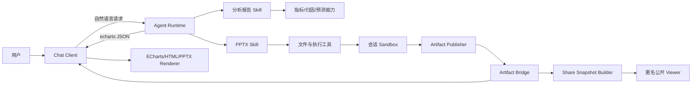
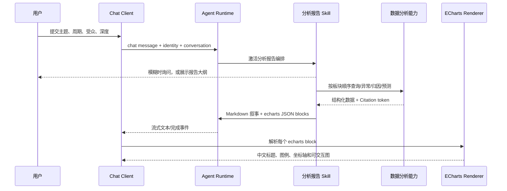
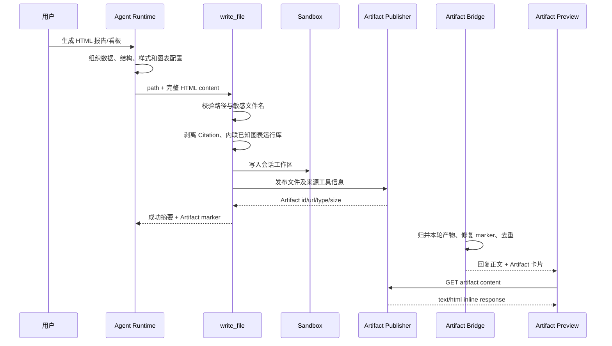
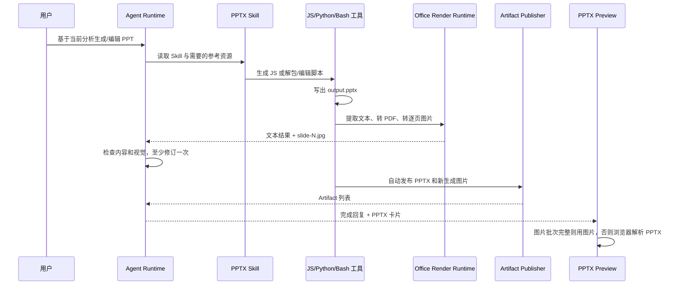
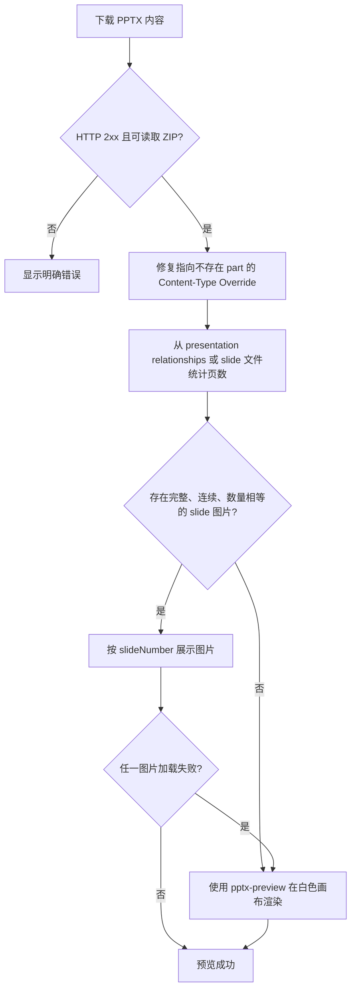
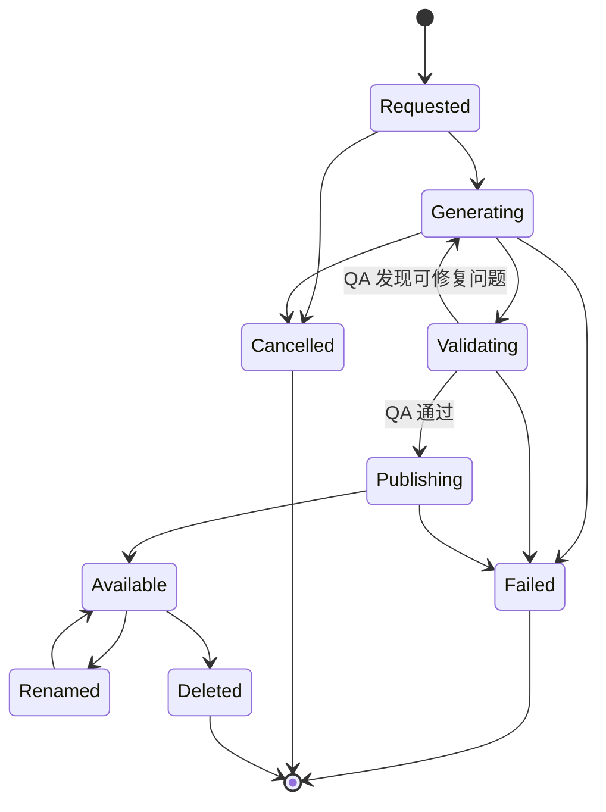

```
# 图表、分析报告和 PPT 生成能力复刻说明

## 1. 结论与边界

### 1.1 业务结论

这项能力把 Agent 已获得的数据和分析结论转换成三种用户可消费的成果：

1. **聊天内图表**：助手回复中嵌入 ECharts 配置，前端将其渲染为可交互图表；用户可切换部分图表类型，并在租户允许下载时导出 PNG 或 CSV。
2. **独立 HTML 报告/看板**：Agent 生成完整 HTML 文件，系统将其发布为 Artifact；用户可在会话或“全部作品”中预览、下载，并从作品回到来源会话。
3. **PPTX 演示文稿**：Agent 根据当前会话中的分析上下文生成或编辑 `.pptx`，发布为 Artifact；前端优先使用配套幻灯片图片预览，条件不满足时在浏览器解析 PPTX，用户可下载原始文件。

分析报告本身是一个**编排型产品能力**：先确定主题、周期、受众和深度，再依次完成指标概览、趋势、异常、归因、维度拆解、目标预测和行动建议。默认交付 Markdown；只有用户明确要求 HTML、PPTX 等文件格式时才生成独立文件。

### 1.2 目标用户与最终效果

| 用户 | 目标 | 最终可见效果 |
|---|---|---|
| 业务分析人员 | 快速理解趋势、对比、占比和异常 | 回复正文中的中文图表和分析说明 |
| 管理者 | 获取适合汇报的结论型材料 | 有封面、数据明细、趋势图、核心结论的 PPTX |
| 数据团队 | 交付可传播、可下载的报告 | 自包含 HTML 报告或看板 Artifact |
| 项目成员 | 复用其他成员的成果 | 按 Artifact 可见性访问、预览、下载和回链 |
| 匿名分享访问者 | 查看被分享的会话结果 | 分享快照中的正文图表及被复制到分享存储的附件 |

### 1.3 输入与输出

**输入**包括：

- 用户自然语言目标，例如“按月分析订单额并生成图表”或“做一份中文 PPT”。
- 已在会话中获得的查询结果、引用标识、分析结论和历史附件。
- 可选的文件名、报告结构、受众、语言、品牌风格、图表类型、模板 PPTX。
- 当前租户、用户、项目、会话、下载开关、工具/Skill 可见性和沙箱环境。

**输出**包括：

- Markdown 回复中的 `echarts` fenced block。
- `.html`、`.pptx` 以及可选的 `slide-N.jpg/png` Artifact。
- Artifact 元数据、内容下载地址、来源会话 ID、项目归属和权限。
- WebSocket 中的工具执行过程、完成或错误终态。

### 1.4 明确不包含

- 指标口径、CAN 查询协议、归因算法和预测算法的内部实现；这里只描述如何把其结果组织成报告和视觉成果。
- Artifact 通用版本、授权、删除和存储机制的全部细节；这里只保留生成能力复刻必须知道的契约。
- 评测报告“准/稳/快/省”的运营评测页面，它是另一种报告，不属于业务分析报告生成。
- 原生在线协同编辑 PPT。当前形态是 Agent 重新生成/修改文件，不是多人幻灯片编辑器。

### 1.5 当前实现、测试期望和缺口

| 结论 | 等级 | 说明 |
|---|---|---|
| 聊天内 `echarts` JSON 由前端直接渲染 | `I` | 当前主路径不要求后端生成图表文件 |
| HTML 和 PPTX 由通用文件/脚本工具生成并发布 | `I` | 典型路径使用会话工作区，但 `write_file` 也允许绝对路径和 `~`；文件生成不是独立的同步 REST 业务接口 |
| 系统内置 `pptx` Skill，包含创建、编辑、渲染和 QA 指引及脚本 | `I` | 首次同步会新建默认 `enabled=true` 的 SYSTEM Skill；若数据库已有同名 SYSTEM 记录，同步会更新内容但保留原 `enabled` 值 |
| `pptx` Skill 本身不会自动开放文件和命令工具 | `I` | frontmatter 没有 `required_tools`；`read_file`、`bash`、`execute_python` 是否可用由正式工具组、Agent policy、mandatory 配置和作用域策略决定 |
| 通用文件生成链路的发布前质量门禁不完整 | `I` | Publisher 允许 0 字节；PPTX 页数无法识别为 `null` 时前端仍尝试通用预览；`bash` 非零退出码仍包装为成功 ToolResult |
| 当前源码没有已注册的 `chart_visualization` 工具 | `I` | 部分提示词、注释和规划测试仍引用该名字，是显式契约漂移 |
| HTML 报告预览必须出现尺寸大于 20px 的 canvas 或 SVG | `A` | 两条 active 黑盒浏览器用例这样验收；本次没有运行 |
| 完整归因报告结构、引用、部分失败、证据上限等用例均为 planned | `P` | 不得视为当前已保证行为 |
| 报告预览图表可能空白 | `K` | 黑盒仓记录 QWGK-330；当前仓未提供已关闭证据 |
| 图表类型矩阵、HTML 内编辑、复杂导出和来源回链有 UI E2E 设计及历史运行记录 | `A` | 当前测试源码为 active Playwright，但本次未运行；HTML 编辑状态只写浏览器 localStorage |
| PPT 失败应显示错误、恢复输入框且不新增 PPTX | `A` | `CHART-PW-04` 在任何生成工具执行前直接模拟 WS `error`，只证明 UI 收敛和该模拟轮次未新增作品；不能证明真实工具失败、零字节、坏 ZIP、超时或部分发布会被清理 |
| PPTX Skill 声明为 Proprietary，但资源包内缺少其声明引用的 `LICENSE.txt` | `I` | 复制、再分发和 clean-room 实现存在授权风险，不能把资源内容直接视为可复用开源资产 |

复刻时应优先保留三种成果形态，但应修正 `chart_visualization` 名称漂移，并把生成作业、产物 Manifest、质量检查和失败终态设计成显式契约。

## 2. 术语与参与方

| 术语/参与方 | 职责 |
|---|---|
| Chat Client | 收集需求、显示流式过程、渲染回复、打开作品面板 |
| Agent Runtime | 选择 Skill/工具、编排数据查询、生成内容、处理取消与错误 |
| 分析报告 Skill | 决定报告结构和板块顺序；不自行实现指标查询或归因算法 |
| PPTX Skill | 提供 PPT 创建、编辑、检查和渲染工作流，以及相关脚本/参考资料 |
| 文件工具 | 写文件、执行 JavaScript/Python/Bash，并发现新产物 |
| Sandbox | 每个身份/会话的隔离工作目录和命令执行环境 |
| Artifact Publisher | 把沙箱文件持久化，赋予 Artifact ID、权限和内容 URL |
| Artifact Bridge | 合并一次 Agent 运行中新产物、修复引用、追加未引用作品卡片 |
| Browser Renderer | 渲染 ECharts、HTML、PPTX，并提供下载或图表操作 |
| Share Snapshot Builder | 把私有 Artifact 复制到分享存储并改写 URL，避免公开页泄露私有地址 |
| Render/Office Runtime | ECharts、PptxGenJS、LibreOffice、Poppler、Pillow、MarkItDown 等外部运行依赖 |



## 3. 产品形态与业务规则

### 3.1 三种交付形态的选择规则

| 用户意图 | 推荐交付 | 当前实现方式 |
|---|---|---|
| 趋势、对比、占比、排名 | 聊天内数值图 | 回复中输出严格 JSON 的 `echarts` 代码块 |
| 流程、时序、类图 | Mermaid | 回复中输出 `mermaid` 代码块 |
| 架构/解释性静态视觉 | SVG | 回复中输出 `svg` 或用结构化视觉工具生成 HTML Artifact |
| 自定义交互、复杂看板、可独立传播报告 | HTML Artifact | 生成完整 HTML，经文件工具发布 |
| 正式汇报、路演、离线演示 | PPTX Artifact | 激活 PPTX Skill，使用 JS/脚本生成或编辑文件 |
| 只要分析报告、未要求文件 | Markdown | 分析板块和图表直接留在对话中 |

### 3.2 分析报告规则

1. 从请求中提取主题、时间范围、受众和深度。
2. 用户只给领域时，可默认上一个完整周期并搜索核心指标；用户完全未给主题或周期时，应先询问。
3. 完整报告的候选板块为：核心指标、趋势、异常、异常归因、维度拆解、目标达成、关键发现与建议。
4. 简报只保留核心指标和建议；没有异常时跳过归因；没有目标时跳过目标预测；日报弱化长趋势。
5. 默认先向用户展示大纲并确认，再逐板块执行。当前这是 Skill 规则，不是后端强制状态机。
6. 板块必须顺序执行，因为后续归因和建议依赖前序结果。
7. 每个板块应同时包含数据与解释，最终建议必须能执行，不能只是重复数字。
8. 默认 Markdown；用户要求 DOCX/PPTX/XLSX 时先形成完整内容，再进行格式转换。
9. 多图报告建议不超过 5 个图，每个图紧随其支撑的结论。

### 3.3 图表规则

1. ECharts fenced block 的内容应是一个 option 对象，而不是 HTML。
2. 生成端应输出可由 `JSON.parse` 解析的 JSON：键和字符串用双引号，禁止函数和箭头函数。
3. 不要提供自定义 `tooltip.formatter`；默认 Tooltip 能稳定展示系列名和值。
4. 不要在 option 顶层指定 `color`；前端依据租户主题和数据语义 Token 注入色板。
5. 业务数字的 Citation 放在图表前后的叙述句中，不能写入图表 JSON 或独立 HTML。
6. 前端兼容 Python 字典的 `True/False/None`、单引号、未加引号键和部分函数式 formatter，但这些是容错，不应成为生成契约。
7. 图表完成后，能安全转换的单一柱、线、面积、散点或饼图允许在浏览器本地切换类型；混合图、多轴图等无法无损转换的图不得强行提供切换。
8. 图表类型切换仅修改当前浏览器内存，不回写会话或服务端。
9. CSV 导出仅在能从配置提取表头和数据行时出现；PNG 由当前 ECharts 实例以 2 倍像素比生成。
10. 空数据、维度和值数量不匹配、无有效 series、超大数据集必须在生产级复刻中被拒绝或明确降级，不能生成“成功但空白”的图。

### 3.4 HTML 报告规则

1. 必须是完整 HTML 文档，声明 UTF-8 和语言。
2. 文件名必须以 `.html` 或 `.htm` 结尾，并由用户请求或生成器确定。
3. 不依赖公共 CDN。使用平台提供的 ECharts/Chart.js 逻辑路径时，写文件阶段将已知脚本替换为内联 vendored runtime。
4. 图表必须在 DOM 就绪后初始化，并在窗口 load/resize 时调用 `resize()`，否则饼图、环图等在预览容器中可能裁切或空白。
5. HTML 内不得出现 Nova 的私有 Citation Token；写文件阶段会再做一次剥离。
6. 当前 HTML 可以自行包含输入框、按钮和 localStorage，实现作品内部交互；这不等于平台原生编辑或服务端版本化。
7. HTML Artifact 预览应在 iframe/隔离上下文中执行。复刻时必须实施 CSP、sandbox 权限和 URL 白名单。
8. 当前实现存在一处必须显式保留的契约冲突：产品提示词禁止用 `execute_python` 生成图表 HTML，理由是该路径“跳过内联”；但 Python 执行器实际会在发布新建或修改的 HTML 前调用统一 Sanitizer，现有单测也覆盖了 Python 生成 HTML 的后处理。两项均为 `I`，不能用其中一项覆盖另一项。复刻时应收敛为一个权威规则：图表 HTML 默认使用 `write_file`，其他执行器即使保留 HTML 发现能力，也必须复用同一安全、内联和发布门禁。

### 3.5 PPTX 规则

1. 已有 PPTX 的纯读取使用文件读取能力；创建或编辑才激活 PPTX Skill。
2. 无模板时使用 PptxGenJS；有模板时先生成缩略图、提取文本、解包，再修改并重新打包。
3. 每张幻灯片应有视觉元素，避免纯文本堆叠；标题 36–44pt、正文 14–16pt、页边距至少 0.5 英寸、内容块间距至少约 0.3 英寸。
4. 生成后必须完成内容 QA 和视觉 QA。内容 QA 检查缺失内容、顺序、错字和模板占位符；视觉 QA 检查溢出、重叠、裁切、低对比度和不一致间距。
5. 当前 Skill 要求至少经历一次“发现问题—修正—重新渲染”循环；这是生成规范，当前平台没有持久化 QA 状态证明。
6. 完整 PPTX 文件和 QA 过程中生成的连续 `slide-1.jpg`、`slide-2.jpg` 等图片可作为同一批产物发布。
7. 同一次运行只有一个 PPTX 且幻灯片图片从 1 连续编号时，系统给它们写入同一批次元数据；否则不建立批次关联。
8. `D` 级质量规则是预览和 Publisher 都不得把零页、损坏 ZIP、缺失关系或零字节文件视为成功；当前实现尚未满足该规则，前端页数识别为 `null` 后仍会尝试通用 PPTX 预览。
9. 激活 Skill 不等于获得执行工具。首次把内置 `pptx` 同步到数据库时会创建 `SYSTEM + enabled=true` 的定义；数据库已有记录则保留既有 enabled 状态。该 Skill 的 frontmatter 没有 `required_tools`，因此不会因为激活而自动开放 `read_file`、`bash` 或 `execute_python`，实际能否执行取决于当前身份的有效工具集合与 Agent policy。
10. 内置资源声明 `license: Proprietary. LICENSE.txt has complete terms`，但当前资源目录未包含 `LICENSE.txt`。这是分发与复刻风险，而不是功能契约。未经权利人确认，不应复制原文、脚本或参考材料到新工程；应只依据本文描述的公开行为和独立需求进行 clean-room 实现。

## 4. 完整执行链路

### 4.1 分析报告到聊天内图表



关键细节：

1. 每次产生可引用数据的工具结果后，Agent 得到 Citation Token。
2. 报告正文在使用某一工具结果的段落、表格标题或图表叙述句中引用该 Token。
3. 图表 block 流式未完成时显示生成占位；已有可解析版本时保持旧预览并显示“正在生成”。
4. 完成后仍无法解析则显示明确的 Chart error，不把原始 JSON 当作成功图表。
5. 渲染器移除不安全/不可执行 formatter，注入主题色、响应式布局并监听容器尺寸。

### 4.2 生成独立 HTML 报告



若模型忘记在最终回复中放入 Artifact marker，Bridge 会把本轮未引用产物追加到回复末尾。相同文件名在同一次运行中出现多次时，当前 Bridge 把它们视为同一交付物的修订，最终卡片指向本轮最新成功持久化版本。

### 4.3 生成或编辑 PPTX



当前通用执行工具的单次默认超时为 60 秒、最大 300 秒；复杂 PPT 通常包含多次命令，因此整轮 UI 测试允许数分钟。一个命令超时不应自动宣告整个会话成功，Agent 应收到工具错误并决定修复或终止。

上述时序的前置条件是当前 Agent 的有效工具集合已经通过正式能力链路包含所需工具。`pptx` Skill 只提供操作知识和资源，不赋予工具权限；若 `read_file`、`bash` 或 `execute_python` 未被工具组、mandatory 配置或 Agent policy 开放，生成链路应以“依赖工具不可用”失败，而不能由 Skill 激活器旁路注入。

### 4.4 PPTX 预览判定



图片批次的优先关联方式是显式 metadata；没有 metadata 时，当前前端按文件名、时间窗口和连续编号猜测。生产复刻不应依赖时间猜测作为主契约。

## 5. 对外契约

### 5.1 用户入口与实时协议

当前没有 `POST /api/reports/generate` 或 `POST /api/presentations/generate` 这样的专用接口。生成通过普通 Chat 入口完成：

- WebSocket：`/ws/chat`
- REST Chat：`/api/chat`

概念请求：

```json
{
  "conversationId": "conv_8fd93a",
  "message": "请基于上面的分析结果生成中文 PPT，至少包含封面、月度明细、趋势图和核心结论",
  "provider": "qwen",
  "lang": "zh"
}
```

`provider` 是用户选择的模型提供方/实例覆盖；省略时按模型角色和租户配置解析默认 Provider。当前 Chat 请求 DTO 没有 `model` 字段。与本能力可能同时出现的可选字段还有 `images`、`files`、`dataThemeId`；客户端身份不应从请求体信任，而由认证会话解析。

与本能力有关的最小事件语义：

```json
{"type":"conversation_id","conversationId":"conv_8fd93a","content":"conv_8fd93a"}
{"type":"llm_call_start","conversationId":"conv_8fd93a","seq":1,"content":""}
{"type":"tool_exec_start","conversationId":"conv_8fd93a","seq":12,"content":"call_42|execute_python|{\"code\":\"...\"}|14"}
{"type":"tool_exec_end","conversationId":"conv_8fd93a","seq":13,"content":"call_42|execute_python|284|true|93214|[Exit Code: 0]\\n..."}
{"type":"complete","conversationId":"conv_8fd93a","seq":18,"content":"..."}
```

工具事件不是把 `toolName`、`success` 等作为外层 JSON 字段发送，而是使用 `content` 中的 pipe 协议：

- `tool_exec_start`：`callId|toolName|truncatedArguments|inputBytes`。参数展示最多 4000 个字符，超出后追加 `...`；`inputBytes` 是未截断原参数的 UTF-8 字节数。
- `tool_exec_end`：`callId|toolName|outputBytes|success|durationMs|truncatedResult`。结果展示最多 8000 个字符，超出后追加 `...`；`outputBytes` 是未截断结果的 UTF-8 字节数；`success` 为 `true/false` 文本。

`callId` 可以为空，此时 `content` 以 `|` 开头，消费端不能把空首段误当成缺帧。参数或结果自身可以包含 `|`：start 应定位前两个分隔符和最后一个分隔符，把中间整体视为 arguments；end 应读取前五个分隔字段，再把剩余片段用 `|` 原样拼回 result。外层 `seq` 用于同一执行流排序，`conversationId` 用于会话归属；展示字段被截断后不能作为完整审计或重放载荷，权威完整结果应从持久化的 processData/工具记录读取。

错误终态示例：

```json
{
  "type": "error",
  "conversationId": "conv_8fd93a",
  "seq": 18,
  "content": "PPT generation failed: LibreOffice conversion timed out"
}
```

UI 在 error 后必须：显示错误、隐藏停止按钮、恢复输入框、停止继续发送同一轮请求，且不能出现该轮新建的空 `.pptx` Artifact。

### 5.2 ECharts 回复契约

````markdown
订单额从三月到四月上升，趋势如下。[^cite:metric_monthly_order]

```echarts
{
  "title": {"text": "杭州市月度订单额趋势"},
  "tooltip": {"trigger": "axis"},
  "legend": {"data": ["订单额"]},
  "xAxis": {"type": "category", "name": "财月", "data": ["FY2025-M03", "FY2025-M04"]},
  "yAxis": {"type": "value", "name": "订单额（万元）"},
  "series": [{"name": "订单额", "type": "line", "data": [123.4, 138.8]}]
}
```
````

实现者应注意：上例外层是 Markdown，内层是 JSON；Citation 只出现在叙述句中。

### 5.3 文件工具契约

用于 HTML 报告的核心 Tool Schema：

```json
{
  "name": "write_file",
  "arguments": {
    "path": "monthly-order-report.html",
    "content": "<!doctype html><html lang=\"zh-CN\">...</html>",
    "append": false
  }
}
```

约束：

- `path`、`content` 必填；`append` 默认 false。
- 当前实现中，相对路径解析到会话沙箱根目录，`../` 等词法逃逸和已存在路径的符号链接逃逸由 Sandbox 拒绝。
- 当前 `write_file` 明确接受绝对路径和 `~`，这两类路径绕过 Sandbox 的相对路径解析，可以写到工作区之外；这是 `I` 级安全风险，不应误写成“所有写入都在会话沙箱内”。
- 显式 `write_file` 产物使用 `EXPLICIT` 来源，会绕过自动发现文件的扩展名 allowlist，任意扩展名都可能被尝试发布。候选路径位于 workspace 内时仍检查硬排除目录；绝对路径若在 workspace 外则不经过这段相对目录检查。当前只额外阻止少量敏感文件名，不能视为完整路径或类型防护。
- HTML 以 UTF-8 写入；写入前剥离 Citation Token，并内联受支持的 ECharts/Chart.js 运行库。
- 显式写出的文件会尝试发布为 Artifact。
- 失败结果以 `Error: <可定位原因>` 形式穿透给 Agent。

生产复刻的 `D` 级默认规则应更严格：默认只允许 Sandbox 根目录内的相对路径；拒绝绝对路径、`~`、控制字符、符号链接逃逸和设备文件。若确有写入外部目录的管理员场景，应使用独立 capability，由管理员配置规范化后的目录 allowlist，并在写入和发布阶段分别校验真实路径、扩展名/MIME、大小、租户和审计，不应复用普通 Agent 的 `write_file` 权限。

成功 ToolResult 中的结构化 Artifact 概念模型：

```json
{
  "success": true,
  "content": "Successfully written to ... (48291 bytes)",
  "artifacts": [
    {
      "kind": "FILE",
      "name": "monthly-order-report.html",
      "mimeType": "text/html",
      "uri": "/api/artifacts/a1b2c3d4/content"
    }
  ]
}
```

兼容旧正文 marker：

```text
[artifact:{"id":"a1b2c3d4","filename":"monthly-order-report.html","url":"/api/artifacts/a1b2c3d4/content","type":"HTML","size":48291}]
```

前端只接受站内 `/api/` URL、非负有限 size 和白名单类型。生产复刻应以结构化 `artifacts` 数组为权威，marker 仅作为展示兼容层。

### 5.4 推荐的生成作业契约

当前实现没有独立生成作业表。生产级复刻建议在 Chat Tool 内部或独立服务提供以下契约，使长耗时 PPT/HTML 生成可恢复：

```http
POST /internal/render-jobs
Idempotency-Key: conv_8fd93a:turn_7:pptx
Content-Type: application/json
```

```json
{
  "tenantId": "tenant_a",
  "userId": "user_9",
  "conversationId": "conv_8fd93a",
  "projectId": "project_3",
  "kind": "PPTX",
  "locale": "zh-CN",
  "requestedFilename": "杭州市月度订单额分析.pptx",
  "source": {
    "title": "杭州市月度订单额分析",
    "sections": [
      {"id":"cover","type":"COVER","title":"杭州市月度订单额分析"},
      {"id":"detail","type":"TABLE","dataRef":"dataset:monthly-orders"},
      {"id":"trend","type":"CHART","chartRef":"chart:monthly-orders"},
      {"id":"conclusion","type":"TEXT","content":"..."}
    ]
  },
  "options": {
    "theme": "formal",
    "renderSlideImages": true,
    "runQualityChecks": true
  }
}
```

响应：

```json
{
  "jobId": "rj_01JX...",
  "status": "QUEUED",
  "submittedAt": "2026-08-07T03:00:00Z"
}
```

查询：

```http
GET /internal/render-jobs/rj_01JX...
```

```json
{
  "jobId": "rj_01JX...",
  "status": "SUCCEEDED",
  "progress": 100,
  "manifestArtifactId": "m0000001",
  "primaryArtifactId": "p0000001",
  "warnings": []
}
```

状态必须使用：`QUEUED -> RUNNING -> VALIDATING -> PUBLISHING -> SUCCEEDED`，任一执行阶段可进入 `FAILED` 或 `CANCELLED`。取消后的晚到成功结果不得重新发布。

### 5.5 Artifact REST 契约

除公开分享快照外，下列 `/api/artifacts/**` 接口都是受保护接口。认证开启时，浏览器通过同源 Cookie 携带会话；Cookie 名由 `nova.auth.cookie-name`（对应认证配置对象的 `cookieName` 字段）决定，默认值为 `CIP_SESSION`。服务端从会话解析 tenant/user，禁止接受请求体中的 `tenantId` 或 `ownerUserId` 作为授权依据。未认证或会话失效返回 401。下列 HTTP 示例均使用默认 Cookie 名；若部署修改了该配置，客户端必须同步使用配置后的名称。

列表和来源会话回链：

```http
GET /api/artifacts?conversationId=conv_8fd93a&keyword=订单额&limit=100
Cookie: CIP_SESSION=<opaque-session>
```

```json
[
  {
    "id": "p0000001",
    "displayName": "杭州市月度订单额分析.pptx",
    "originalFilename": "杭州市月度订单额分析.pptx",
    "type": "DOCUMENT",
    "mimeType": "application/vnd.openxmlformats-officedocument.presentationml.presentation",
    "size": 284731,
    "conversationId": "conv_8fd93a",
    "sourceTool": "execute_python",
    "projectId": null,
    "projectName": null,
    "visibility": "OWNER_ONLY",
    "creator": {"userId":"user_9","displayName":"分析员"},
    "permissions": {"canPreview":true,"canDownload":true,"canManage":true},
    "createdAt": "2026-08-07T11:00:00",
    "contentUrl": "/api/artifacts/p0000001/content"
  }
]
```

响应字段契约：

| 字段 | 类型/可空 | 含义 |
|---|---|---|
| `id` | string，非空 | 不透明 Artifact ID |
| `displayName` | string，非空 | 用户可重命名的展示名 |
| `originalFilename` | string，非空 | 生成/上传时的原文件名，不随重命名改变 |
| `type` | string，非空 | `HTML/IMAGE/DATA/CODE/DOCUMENT` 等展示分类 |
| `mimeType` | string/null | 内容 MIME；缺失时下载按二进制处理 |
| `size` | integer，`>=0` | 当前实现允许为 0，不能据此声称已通过内容质量校验 |
| `conversationId` | string/null | 来源会话；用于回链和会话清理 |
| `sourceTool` | string/null | 创建产物的工具名 |
| `projectId/projectName` | string/null | 项目范围作品的项目信息 |
| `visibility` | enum | `OWNER_ONLY`、`GRANTED` 或 `PROJECT` |
| `creator` | object | `{userId, displayName}`；只返回租户内最小用户投影 |
| `permissions` | object | `{canPreview, canDownload, canManage}`，是当前请求者的服务端权威权限 |
| `createdAt` | local datetime | 创建时间；当前 DTO 不附时区 |
| `contentUrl` | string | 站内内容 URL |

| 方法 | 路径 | 语义 |
|---|---|---|
| GET | `/api/artifacts` | 当前身份可访问的作品；支持 conversation、keyword、project、personalOnly、visibility、cursor、limit |
| GET | `/api/artifacts/{id}` | 获取单个作品元数据 |
| GET | `/api/artifacts/{id}/content` | 浏览器内联预览；不等价于下载授权 |
| GET | `/api/artifacts/{id}/content?download=true` | 下载；受租户下载总开关约束 |
| PATCH | `/api/artifacts/{id}` | Owner 重命名 displayName，1–255 字符 |
| DELETE | `/api/artifacts/{id}` | Owner 删除作品及授权关系 |
| GET | `/api/artifacts/{id}/grants` | Owner 查询已授权用户，返回 `[{userId,displayName}]` |
| PUT | `/api/artifacts/{id}/access` | Owner 设置 `OWNER_ONLY/GRANTED/PROJECT` 和被授权用户 |
| GET | `/api/artifacts/grant-candidates?artifactId={id}&keyword={text}` | Owner 搜索同租户候选用户；最多 100 条，不包含 owner |

重命名请求：

```http
PATCH /api/artifacts/p0000001
Content-Type: application/json
Cookie: CIP_SESSION=<opaque-session>

{"displayName":"杭州市订单额月报（终版）.pptx"}
```

权限替换是原子操作，不是增量追加：

```http
PUT /api/artifacts/p0000001/access
Content-Type: application/json
Cookie: CIP_SESSION=<opaque-session>

{"visibility":"GRANTED","granteeUserIds":["user_17","user_23"]}
```

`GRANTED` 仅接受当前租户内存在的非空用户 ID；其他 visibility 会把 grantee 集合规整为空。`PROJECT` 只允许原本属于项目范围的作品，个人作品不能通过更新 visibility 变成项目作品。

`limit` 必须为 1–500，默认 100；`personalOnly=true` 与 `projectId` 互斥；`visibility` 不区分大小写但只能取三种枚举。`cursor` 是服务端按 `createdAt + artifactId` 编码的“从该条记录之后继续读取更旧数据”位置令牌，客户端必须把响应头 `X-Next-Cursor` 原样传给下一页，不解析、不拼接；只有返回条数等于 limit 时服务端才设置该头。

错误契约：

| HTTP | 触发条件 | 当前响应要点 |
|---:|---|---|
| 400 | limit 越界、projectId 与 personalOnly 同时使用、非法 visibility/cursor、空或超长 displayName、非法 grantee | 业务错误通常为 `{"success":false,"message":"...","errorCode":"ARTIFACT_..."}`；Controller 参数错误可能只有框架生成的 reason，客户端必须按状态码兜底 |
| 401 | 缺少、伪造或已失效的认证 Cookie（名称取当前 `nova.auth.cookie-name` 配置，默认 `CIP_SESSION`），或请求上下文缺少完整用户身份 | `{"success":false,"error":"...","errorCode":"..."}`；不要在日志或 UI 回显 Cookie |
| 403 | 已获 read 权限但非 owner 尝试管理，或租户禁用下载仍请求 `download=true` | Owner 管理错误为 `ARTIFACT_ACCESS_DENIED`；下载禁用可能是框架 reason |
| 404 | Artifact 不存在、跨租户、无 read 权限，或内容存储不可用 | 无权读取按 404 隐藏对象存在性；业务错误码为 `ARTIFACT_NOT_FOUND`，内容缺失可能只有框架 reason |

服务端返回的 permissions 是 UI 是否预览、下载、管理的权威依据；UI 隐藏按钮只是体验优化，所有接口仍必须执行对象级鉴权。

### 5.6 产物 Manifest 契约

当前实现主要靠同一轮创建集合、文件名和 PPTX slide metadata 归并，没有独立 Manifest 文件。生产复刻建议为每个 HTML 报告或 PPTX 生成以下 Manifest，并作为 Artifact metadata 或独立 JSON Artifact 保存：

```json
{
  "schemaVersion": 1,
  "generationId": "gen_01JX...",
  "kind": "PPTX",
  "tenantId": "tenant_a",
  "ownerUserId": "user_9",
  "conversationId": "conv_8fd93a",
  "sourceTurnId": "turn_7",
  "locale": "zh-CN",
  "primary": {
    "artifactId": "p0000001",
    "filename": "杭州市月度订单额分析.pptx",
    "mimeType": "application/vnd.openxmlformats-officedocument.presentationml.presentation",
    "sizeBytes": 284731,
    "sha256": "...",
    "slideCount": 4
  },
  "previews": [
    {"artifactId":"i0000001","role":"slideImage","slideNumber":1,"filename":"slide-1.jpg"},
    {"artifactId":"i0000002","role":"slideImage","slideNumber":2,"filename":"slide-2.jpg"},
    {"artifactId":"i0000003","role":"slideImage","slideNumber":3,"filename":"slide-3.jpg"},
    {"artifactId":"i0000004","role":"slideImage","slideNumber":4,"filename":"slide-4.jpg"}
  ],
  "quality": {
    "contentCheck": "PASSED",
    "visualCheck": "PASSED",
    "fixCycles": 1,
    "warnings": []
  },
  "sourceEvidence": ["ev_metric_monthly_order"],
  "createdAt": "2026-08-07T03:05:00Z"
}
```

Manifest 必须在所有目标文件成功持久化后以事务或可补偿方式发布；不能先发布 manifest 再留下不存在的 primary Artifact。

### 5.7 PPTX slide preview metadata

当前已观察到的 metadata 结构：

```json
{
  "pptxSlidePreview": {
    "schemaVersion": 1,
    "role": "deck",
    "batchId": "pptx-slide-preview:conv_8fd93a:p0000001",
    "artifactId": "p0000001",
    "slideImageCount": 4
  }
}
```

图片：

```json
{
  "pptxSlidePreview": {
    "schemaVersion": 1,
    "role": "slideImage",
    "batchId": "pptx-slide-preview:conv_8fd93a:p0000001",
    "pptxArtifactId": "p0000001",
    "slideNumber": 1
  }
}
```

当前公开 Artifact DTO 没有 metadata 字段，前端通用映射也没有把它带出，因此显式批次关联在这条 API 链上不能稳定消费，只能回退到时间窗口猜测。复刻时必须把预览所需 metadata 纳入受控 DTO，或提供 `/api/artifacts/{id}/previews` 专用接口。

## 6. 数据模型与生命周期

### 6.1 Artifact 表

可复刻的最小 PostgreSQL DDL：

```sql
CREATE TABLE artifact (
    id                bigint GENERATED BY DEFAULT AS IDENTITY PRIMARY KEY,
    artifact_id       varchar(16)  NOT NULL UNIQUE,
    tenant_id         varchar(64)  NOT NULL,
    owner_user_id     varchar(64)  NOT NULL,
    conversation_id   varchar(64),
    project_id        varchar(64),
    visibility        varchar(32)  NOT NULL DEFAULT 'OWNER_ONLY',
    display_name      varchar(255) NOT NULL,
    original_filename varchar(255) NOT NULL,
    file_type         varchar(31)  NOT NULL,
    mime_type         varchar(127),
    size_bytes        bigint       NOT NULL CHECK (size_bytes >= 0),
    storage_type      varchar(31)  NOT NULL,
    storage_ref       varchar(512) NOT NULL,
    content_hash      varchar(64),
    source_tool       varchar(63),
    metadata          text,
    created_at        timestamp(6) NOT NULL
);

CREATE INDEX idx_artifact_owner_created
    ON artifact (tenant_id, owner_user_id, created_at DESC, artifact_id);
CREATE INDEX idx_artifact_conversation_created
    ON artifact (conversation_id, created_at DESC, artifact_id);
CREATE INDEX idx_artifact_project_visibility_created
    ON artifact (tenant_id, project_id, visibility, created_at DESC, artifact_id);
```

内容可存数据库 blob 或本地/对象存储，数据库仅保存 `storage_type + storage_ref`。生产环境还应保存 SHA-256，用于完整性校验、幂等去重和下载审计。

`size_bytes >= 0` 是对当前存储事实的兼容，不是发布质量标准：当前 Publisher 只拒绝超过上限的文件，因此 0 字节可进入存储。生产生成链路应在 commit 前按类型执行更严格校验，HTML 至少含可解析文档，PPTX 必须非零、为合法 ZIP/OOXML 且至少一页。

### 6.2 建议的生成作业表

```sql
CREATE TABLE render_job (
    job_id              varchar(64) PRIMARY KEY,
    tenant_id           varchar(64) NOT NULL,
    owner_user_id       varchar(64) NOT NULL,
    conversation_id     varchar(64) NOT NULL,
    source_turn_id      varchar(64) NOT NULL,
    kind                varchar(16) NOT NULL,
    requested_filename  varchar(255) NOT NULL,
    status              varchar(24) NOT NULL,
    progress            integer NOT NULL DEFAULT 0,
    idempotency_key     varchar(255) NOT NULL,
    primary_artifact_id varchar(16),
    manifest_artifact_id varchar(16),
    error_code          varchar(64),
    error_message       varchar(1000),
    created_at          timestamp NOT NULL,
    updated_at          timestamp NOT NULL,
    UNIQUE (tenant_id, idempotency_key)
);
```

### 6.3 生命周期



当前实现没有 Requested/Generating/Validating 的独立持久化记录，只有会话事件和最终 Artifact。生产复刻应保存作业状态，否则进程重启后无法判断“仍在生成、已经失败、还是发布完成”。

同名文件规则应明确：当前单轮 Bridge 选择本轮最新同名 Artifact 用于最终卡片，但数据库可以保留早期版本。若产品需要正式版本管理，应增加 `logical_artifact_id + version`，避免仅靠文件名推断版本。

### 6.4 来源会话与删除

- 每个生成作品记录 `conversation_id`，全部作品页可显示“来自某会话”并跳回 `/web/chat?conversationId=<id>`。
- 产品侧存在按 conversationId 删除 Artifact 存储的清理能力，可作为 `I` 级实现事实；但这不等于所有 UI E2E 都实际调用了它。
- 当前图表/PPT Playwright spec 使用的自动 fixture 在结束时只记录并保留被跟踪会话用于调试，没有调用其已有的 `cleanup()` 方法，因此不能提供“运行后无会话/Artifact 残留”的 `A` 级保证。这是三仓之间的 `F` 级覆盖缺口，并与 UI E2E 总体清理规范存在冲突。
- 复刻测试应在 case `finally` 中按精确 conversationId 删除，并在 teardown 再按本轮 runMarker 兜底；随后同时确认会话历史和 Artifact 列表都不含这些 ID。清理失败必须使测试失败并输出精确资源 ID。
- 若作品需要脱离会话长期保留，应先把生命周期改为项目/用户资产，不应依赖会话文件目录。
- 分享不是简单公开原 Artifact URL；分享创建时复制字节并改写公开 URL，撤销分享后公开入口应失效。

## 7. 核心实现设计

### 7.1 最小可用实现

最小版本可由以下模块组成：

```text
Chat Orchestrator
├── ReportPlanner
├── EChartsBlockGenerator
├── PptxSkillAdapter
├── SandboxExecutor
├── ArtifactPublisher
└── RenderEvents

Web Client
├── MarkdownRenderer
├── EChartsRenderer
├── HtmlArtifactRenderer
└── PptxRenderer
```

生成路由伪代码：

```java
GenerationResult generate(Request req, Identity id, Conversation conv) {
  requireConversationAccess(id, conv);
  Plan plan = reportPlanner.plan(req.message(), conv.context());

  if (plan.needsClarification()) {
    return GenerationResult.askHuman(plan.questions());
  }

  ReportModel report = executeAnalysisSections(plan, id, conv);

  return switch (plan.outputKind()) {
    case MARKDOWN -> renderMarkdownWithInlineEcharts(report);
    case HTML -> publishHtml(buildSelfContainedHtml(report), id, conv);
    case PPTX -> generateValidateAndPublishPptx(report, id, conv);
  };
}
```

HTML 发布伪代码：

```java
Artifact publishHtml(String html, Identity id, Conversation conv) {
  validateDocument(html);
  html = stripPrivateCitationTokens(html);
  html = inlineApprovedVisualizationRuntimes(html);
  Path file = sandbox.resolve(safeFilename());
  atomicWrite(file, html.getBytes(UTF_8));
  verifyNonZero(file);
  return publisher.publish(file, metadata(id, conv, "write_file"));
}
```

PPTX 生成伪代码：

```java
PptxBundle generateValidateAndPublishPptx(ReportModel report, Identity id, Conversation conv) {
  Path work = sandbox.forConversation(id, conv.id());
  Path pptx = pptxGenerator.create(report, work);
  requireZipSignature(pptx);
  int slideCount = pptxInspector.countSlides(pptx);
  require(slideCount > 0, "EMPTY_PRESENTATION");

  List<String> extracted = pptxInspector.extractText(pptx);
  requireRequiredSections(extracted, report.requiredSections());
  List<Path> images = officeRenderer.renderSlides(pptx, work);
  require(images.size() == slideCount, "INCOMPLETE_SLIDE_PREVIEW");
  qualityGate.inspect(images);

  Artifact deck = publisher.publish(pptx, deckMetadata(id, conv));
  List<Artifact> previews = publishSlides(images, deck, id, conv);
  return new PptxBundle(deck, previews, buildManifest(deck, previews));
}
```

### 7.2 生产级实现

生产版本应增加：

- 有幂等键和持久状态的异步 Render Job。
- 独立的无网络 Render Worker，固定镜像和依赖版本。
- 结构化 Report Model，避免把上游数据直接拼入提示词/HTML。
- ChartSpec JSON Schema、大小上限、数据点上限和降采样策略。
- 显式 Artifact Manifest、preview API 和版本关系。
- PPTX ZIP/OOXML 完整性校验、宏和外链扫描、内容哈希。
- HTML CSP、脚本白名单、DOM/URL Sanitizer 和执行隔离。
- 取消令牌贯穿 Agent、命令执行、Render Worker 和发布事务。
- QA 结果和警告持久化，避免只相信模型自述“已检查”。
- 产物级审计：谁基于哪次会话、哪些数据证据、哪个模板生成了哪个版本。

## 8. 并发与非正常路径

### 8.1 并发和幂等

- 同一会话连续两次请求生成相同文件时，使用 `tenant + conversation + turn + output kind` 组成幂等键。
- 重试必须返回同一成功作业或建立明确新版本，不能默默创建多份同名作品。
- 多个并行生成请求使用独立 workspace 子目录；禁止共享 `output.pptx`、`slide-1.jpg` 等固定文件名。
- Bridge 按同名选最新只能作为展示兼容，不能作为并发一致性机制。
- PPTX 和 slide 图片发布应采用 staging：所有内容写完并校验后再一次性标为 AVAILABLE。

### 8.2 失败矩阵

| 异常 | 当前可观察行为 | 生产复刻要求 |
|---|---|---|
| ECharts JSON 未闭合 | 流式期间占位；完成后 Chart error | 保留原回答文本，提供可重试错误，不能显示空白成功 |
| 空 series/空数据 | 可能得到空画布 | 生成前返回 `EMPTY_DATA`，或显示“无可视化数据” |
| 维度和值数量不匹配 | 前端库可能容错或错位 | Schema 校验返回 `DIMENSION_MISMATCH` |
| 超大图表数据 | 没有专用后端限制契约 | 降采样、Top-N 或返回 `TOO_LARGE`，并说明截断 |
| HTML 引用公共 CDN | 可能因网络/CSP 空白 | 拒绝未知外链；已知 runtime 内联 |
| HTML Sanitizer 失败 | 当前调用方可 fail-soft 继续发布 | 生产建议安全失败；只有纯展示性增强可 fail-soft |
| 命令超过 300 秒 | 单工具有超时分支，但没有 Render Job/staging 的端到端清理保证 | 终止进程树，Job 进入 FAILED/CANCELLED，清理 staging；这是 `P/D` 验收，不是当前保证 |
| `bash` 命令非零退出 | 当前仍返回成功 ToolResult，正文只携带 `[Exit Code: n]` | 非零退出必须转换为失败，且不得把该命令产生的不完整文件提交为 AVAILABLE |
| PPTX 为零字节 | 当前 Publisher 只检查大小上限，0 字节也可持久化 | 发布前检查长度、ZIP 签名和页数；不得建 Artifact；这是 `P/D` 门禁 |
| PPTX 损坏或页数无法识别 | 页数统计返回 `null` 后仍把 buffer 交给通用 `pptx-preview`，可能最后由渲染器报错 | commit 前拒绝坏 ZIP/OOXML/零页；前端回退只兼容已发布的历史文件 |
| PPTX OOXML dangling override | 前端尝试移除不存在 part 的 override | 生成端 clean/validate；前端修复仅兼容历史文件 |
| slide 图片缺页/重复编号 | 不采用图片预览 | 回退到 PPTX 解析并记录 warning |
| 浏览器 PPTX 解析失败 | 显示错误字符串 | 保留下载能力（若文件完整且获授权）并给出可定位错误 |
| WebSocket error | `CHART-PW-04` 在工具执行前注入 error，覆盖错误可见、停止按钮隐藏、输入恢复和无新增 PPTX | 还需分别注入真实工具失败、零字节、坏 ZIP、超时和发布中断；重复发送必须是用户新动作 |
| 发布部分成功 | 当前没有 Artifact Manifest 事务；可能留下部分 Artifact | 补偿删除、标记 ORPHANED 或事务性提交 Manifest；这是 `P/D` 能力 |
| 进程在发布后、回复前重启 | Artifact 已存在但回复可能缺卡片 | 恢复 Job，并由 conversationId+turn 查询产物重新组装回复 |

### 8.3 取消

取消不是只隐藏前端按钮。它必须：

1. 把会话轮次和 Render Job 标为 cancelling。
2. 取消 LLM、工具和子进程；必要时终止整个进程组。
3. 阻止 Publisher 接受取消后的晚到输出。
4. 删除 staging 文件；对已发布文件执行补偿或标为废弃。
5. 只发送一个 `cancelled` 终态，不再发送 `complete`。

## 9. 安全、权限和审计

### 9.1 身份与对象权限

- Artifact 必须绑定 tenant 和 owner；conversation/project 归属单独保存。
- 列表、读取、预览、下载、重命名、删除和授权均做对象级鉴权。
- 普通访问者可通过 owner、显式 grant 或项目权限获得 read；只有 owner 可 manage。
- 跨租户查询应表现为不存在或拒绝，不能泄露文件名、大小、来源工具或 creator。
- 下载还受租户级 `allowDownload` 总开关控制；预览权限不自动等于下载权限。

### 9.2 HTML 安全

- 仅允许相对站内资源或明确 vendored runtime；拒绝 `javascript:`、未知远程脚本和私有网络 URL。
- HTML Artifact 在隔离 origin 或 sandbox iframe 中运行，不授予父页面 DOM、Cookie、存储或导航权限。
- 当前 E2E 的可编辑 HTML 使用 localStorage，因此打开直接 content URL 可保存；如果 iframe 不包含 `allow-same-origin`，相同功能可能不可用。复刻时必须明确选择：作品内部临时状态，还是平台服务端编辑。
- 不把 Citation Token、API Key、Cookie、Tool 原始参数或内部文件路径放入 HTML/PPTX。
- 当前提示词要求图表 HTML 走 `write_file`，而 Python 执行器事实上也会对发现的 HTML 调用相同 Sanitizer。复刻时应消除文案与实现漂移，以 `write_file` 为默认受控入口，并让任何保留的备用入口共享同一强制安全门禁。

### 9.3 PPTX 安全

- 对上传模板和生成结果扫描宏、OLE、外部关系和远程图片；默认拒绝宏文件。
- 命令运行于无特权容器，限制 CPU、内存、磁盘、进程数、执行时长和网络。
- 生产复刻要求文件名经规范化，并禁止 `../`、绝对路径、`~`、符号链接逃逸和控制字符。注意这是一项 `D` 级修复要求：当前 `write_file` 已阻止相对 `../`，但明确允许绝对路径和 `~`。
- PPTX 内的业务数据可能敏感；日志只记录 Artifact ID、大小、页数、状态，不记录全文。

### 9.4 第三方资源许可证边界

- 当前 `pptx` Skill frontmatter 声明 Proprietary，并声称完整条款位于 `LICENSE.txt`，但实际打包资源中没有该文件。
- 在授权范围未确认前，不得直接复制该 Skill 的文本、参考资料或脚本到复刻工程，也不得因为 Nova 仓库其他代码使用 Apache-2.0 许可证就推定该资源同样开放。
- 推荐做法是由未接触原实现细节的团队依据本文的功能契约、OOXML/PptxGenJS 官方公开资料和自行编写的验收用例完成 clean-room 实现；若必须使用原资源，先取得权利人书面授权并补齐可审计的许可证文件、版本和再分发范围。

### 9.5 审计事件

至少记录：

```json
{
  "event": "ARTIFACT_GENERATED",
  "tenantId": "tenant_a",
  "actorUserId": "user_9",
  "conversationId": "conv_8fd93a",
  "renderJobId": "rj_01JX...",
  "artifactId": "p0000001",
  "kind": "PPTX",
  "sizeBytes": 284731,
  "slideCount": 4,
  "durationMs": 93214,
  "outcome": "SUCCEEDED"
}
```

分享应另外记录 snapshot 创建、附件复制、匿名访问和撤销，不向公开页暴露内部 `/api/artifacts/...` URL。

## 10. 外部依赖对端设计

### 10.1 已观察到的依赖

| 依赖 | 用途 | 当前期望 |
|---|---|---|
| ECharts 5.x | 聊天图表和 HTML 报告 | 前端直接渲染；HTML 可内联 vendored bundle |
| Chart.js 4.x | HTML 报告备选 | 写文件阶段识别特定 URL 并内联 bundle |
| PptxGenJS | 从零创建 PPTX | Node 全局模块可用 |
| MarkItDown PPTX | PPTX 文本提取 | Python 模块可用 |
| LibreOffice Impress | PPTX 转 PDF | headless 模式，沙箱兼容 helper |
| Poppler `pdftoppm` | PDF 转逐页图片 | 生成 150 DPI JPEG 供视觉检查/预览 |
| Pillow | 缩略图拼接和图片处理 | 可使用中文字体 |
| `pptx-preview` + JSZip | 浏览器内 PPTX 解析 | HTTP 成功检查、内容类型修复、白色画布渲染 |

容器基线还需要 Noto CJK 字体、Node.js、Python、zip/unzip。缺少任一依赖时，系统必须在启动探针或 Job 前置检查中给出明确原因，而不是等生成到一半才得到零字节文件。

### 10.2 最小兼容 Render Stub

如果复刻工程暂时不具备完整 Office 环境，可实现一个确定性的 Stub，用于端到端开发：

```http
POST /render
Content-Type: application/json
```

```json
{
  "kind": "PPTX",
  "filename": "demo.pptx",
  "sections": [
    {"type":"COVER","title":"演示报告"},
    {"type":"CHART","title":"月度趋势","categories":["M1","M2"],"values":[1,2]}
  ]
}
```

```json
{
  "status": "SUCCEEDED",
  "files": [
    {"role":"primary","filename":"demo.pptx","mimeType":"application/vnd.openxmlformats-officedocument.presentationml.presentation","bytesBase64":"..."},
    {"role":"slideImage","slideNumber":1,"filename":"slide-1.png","mimeType":"image/png","bytesBase64":"..."},
    {"role":"slideImage","slideNumber":2,"filename":"slide-2.png","mimeType":"image/png","bytesBase64":"..."}
  ]
}
```

Stub 必须生成真实、非零、可解包且至少一页的 PPTX；不能返回文本改扩展名。它可以只支持标题、段落、表格、单系列柱/线图，但字段、错误和 Manifest 与生产服务保持一致。

### 10.3 生产级 Render Service

推荐架构：

```mermaid
flowchart LR
    API["Render API"] --> Q["Durable Queue"]
    Q --> W["Ephemeral Render Worker"]
    W --> V["OOXML + Content Validator"]
    V --> O["LibreOffice/Poppler Preview"]
    O --> QA["Deterministic + Visual QA"]
    QA --> S["Object Storage Staging"]
    S --> C["Artifact Committer"]
    C --> DB["Artifact + Manifest DB"]
```



必须具备：固定镜像 digest、无默认外网、资源配额、每 Job 临时目录、幂等写入、杀死进程树、对象存储 staging、内容哈希、病毒/宏扫描、结构化错误、重试分类和孤儿回收。

无法从 Nova 证明的内部细节包括：真实部署是否总是安装全部 Office 依赖、不同环境的具体版本、模型是否每次完成 Skill 要求的 QA 循环，以及已知空白图表缺陷在哪个环境仍存在。这些不能写成现有保证。

## 11. 可观察性

### 11.1 日志

每个 Job 至少使用这些关联键：`tenantId`、`userId`、`conversationId`、`turnId`、`jobId`、`artifactId`、`toolCallId`。记录阶段、耗时、退出码、输出文件数量、大小、页数和错误码；不记录完整 HTML、PPT 文本或凭据。

### 11.2 指标

- `render_jobs_total{kind,status}`
- `render_job_duration_seconds{kind,stage}`
- `artifact_publish_bytes{kind}`
- `chart_render_error_total{reason}`
- `chart_blank_detection_total{renderer}`
- `pptx_slide_count`
- `pptx_preview_fallback_total{reason}`
- `artifact_orphan_total`
- `render_cancel_latency_seconds`

### 11.3 Trace

建议 Trace：

```text
chat.turn
  ├─ report.plan
  ├─ analysis.section(metric-query)
  ├─ render.submit
  ├─ render.generate
  ├─ render.validate
  ├─ render.preview
  ├─ artifact.publish
  └─ chat.finalize
```

### 11.4 用户可定位错误

| code | 用户文案 | 可重试 |
|---|---|---|
| `EMPTY_DATA` | 没有可用于生成图表的数据 | 否，需调整查询 |
| `INVALID_CHART_CONFIG` | 图表配置无法解析，请重新生成 | 是 |
| `DIMENSION_MISMATCH` | 图表维度与数值数量不一致 | 是 |
| `RENDER_DEPENDENCY_MISSING` | 演示文稿渲染环境未就绪 | 否，运维修复 |
| `RENDER_TIMEOUT` | 演示文稿生成超时，可重试或减少内容 | 是 |
| `INVALID_PPTX` | 生成的演示文稿结构无效 | 是 |
| `INCOMPLETE_SLIDE_PREVIEW` | 部分预览页生成失败，已尝试备用预览 | 视主文件而定 |
| `ARTIFACT_TOO_LARGE` | 生成文件超过平台大小限制 | 否，需拆分/压缩 |
| `ARTIFACT_ACCESS_DENIED` | 无权访问该作品 | 否 |
| `DOWNLOAD_DISABLED` | 当前租户禁止下载 | 否 |

## 12. 复刻实施顺序

1. **建立 Artifact 基础设施**：身份、会话归属、内容存储、权限、非零与大小校验；静态验收为同一用户可预览/下载，跨租户不可枚举。
2. **实现聊天内 ECharts**：严格 JSON、流式占位、错误态、主题色、ResizeObserver；验收为柱/线/饼在中英文数据下可见。
3. **实现图表导出**：PNG 和可提取数据的 CSV，受下载总开关控制。
4. **实现自包含 HTML Artifact**：路径安全、脚本内联、Citation 剥离、隔离预览；验收为断网环境仍有可见 canvas/SVG。
5. **实现 Report Planner**：主题/周期/受众/深度、模板裁剪和板块依赖；验收为模糊需求会询问、无异常时不做归因。
6. **实现 PPTX Worker**：PptxGenJS、字体、文本提取、LibreOffice、Poppler；验收为 PPTX 非零、可解包、页数正确、中文可见。
7. **实现 Manifest 和预览批次**：显式 slide metadata，禁止时间猜测作为主关联。
8. **实现失败、取消和恢复**：Render Job、幂等键、staging、补偿；验收为错误后无空 Artifact。
9. **实现来源回链、项目权限和分享快照**：公开页只读取分享存储副本。
10. **补齐三通道验收**：API 校验、WS 终态、浏览器真实像素/元素可见性和下载文件校验。

## 13. 验收标准

### 13.1 正向场景

1. 在同一会话先查询两个月订单额，再要求中文图表；最新回复出现中文标题、中文轴/图例、可见图形，无中断文案。
2. 可切换的单系列柱图切换为折线、面积、散点和饼图时数据点总数和值保持一致；混合图不提供破坏语义的转换。
3. 租户允许下载时，图表 PNG 大于 0 字节，CSV 使用 UTF-8 BOM，中文字段不乱码。
4. 生成含柱、线、饼三种图的 HTML 报告，下载源码包含三类结构标志，预览在断网情况下存在可见 canvas/SVG。
5. HTML 看板至少包含概览、趋势、拆分、明细，预览和下载内容一致。
6. 生成中文 PPTX，至少有封面、月度明细、趋势图和核心结论；预览不是纯英文或纯文本堆叠；下载大于 0 字节。
7. 全部作品可按唯一名称检索，并能回到精确来源 conversationId。
8. 项目可见作品能被项目成员读取，OWNER_ONLY 作品只能被 owner 读取。

### 13.2 反向和恢复场景

1. ECharts 无效 JSON：完成后显示可见错误，不泄露堆栈，不留下空白成功框。
2. 空数据/维度不匹配：返回受控错误且不生成 HTML Artifact。
3. 超大数据集：明确采样/截断或拒绝，页面不冻结。
4. 在任何生成工具开始前注入 WebSocket error：错误可见、停止按钮消失、输入恢复、该轮没有新 `.pptx`；这是当前 `A` 级 UI 收敛标准。
5. 真实生成得到零字节、无 slide 或损坏 ZIP：Publisher 不提交，Job 为 FAILED；这是复刻所需的 `P/D` 级质量门禁，当前 Publisher 尚不保证。
6. 仅缺 slide 图片：PPTX 完整时回退浏览器解析，并记录 warning；不能把缺图等同于主文件失败。
7. 下载禁用：仍可在授权范围内预览，但下载返回 403 且 UI 不显示下载动作。
8. 跨用户无授权：元数据、内容和来源会话均不可见。
9. 取消发生在发布前：无 Artifact；取消发生在部分发布后：补偿清理或标记废弃，无 AVAILABLE Manifest。
10. 进程重启：相同幂等请求恢复原 Job，不创建重复同名作品。
11. E2E 无论业务断言成功或失败，都按精确 conversationId 删除测试会话并确认关联 Artifact 消失；当前图表/PPT fixture 只保留会话，这一项属于 `F` 缺口和 `D` 复刻要求。

### 13.3 当前已知缺陷的防回归标准

QWGK-330 的关闭标准不能只是“报告页面能打开”。至少同时满足：

- 报告标题存在。
- canvas/SVG 的 CSS 和像素尺寸均大于 20px。
- 图表含至少一个可见 series mark，而不是只有空 canvas。
- 图例/轴或饼图区至少一项可见。
- 控制台无 ECharts 初始化错误，外部脚本无网络失败。
- 刷新和容器尺寸变化后图表仍可见。

## 14. 测试矩阵

| 场景 | 通道 | 前置条件 | 操作 | 预期结果 | 当前证据等级 |
|---|---|---|---|---|---|
| 内联中文图表 | UI | 有月度查询结果 | 要求生成中文图表 | 最新回复出现图表或相关结构，无取消/中断 | `A`，本次未运行 |
| HTML 报告可见图 | Browser | 可登录、有模型和数据 | 请求近三月订单额 HTML 报告并打开作品 | 标题命中，canvas+SVG 可见数量 > 0 | `A`，两条 active YAML，本次未运行 |
| 图表 Artifact 创建 | WS | 可稳定路由专用工具 | 调用 ChartVisualizationTool | 工具成功且生成 HTML Artifact | `P`，且当前工具不存在 |
| 柱/线/饼矩阵 | UI | 可生成文件 | 生成带三类结构标记的 HTML | 下载源码含 bar/line/pie 和中文标题 | `A`，本次未运行 |
| 图表编辑 | UI | 可生成自包含 HTML | 修改标题、切换 line、保存并刷新 | localStorage 恢复标题和类型 | `A`；仅作品内部状态 |
| 空数据 | API | 可直调图表验证器 | 提交空数据 | `EMPTY_DATA`，无坏图 | `P` |
| 维度不匹配 | API | 可直调图表验证器 | categories/value 数量不同 | `DIMENSION_MISMATCH` | `P` |
| 超大数据集 | API | 大型固定夹具 | 生成图表 | 采样/截断/TOO_LARGE，不卡死 | `P` |
| 完整报告结构 | WS/Judge | 固定分析数据 | 生成完整诊断报告 | 概览、贡献、下钻、结论齐全 | `P` |
| 报告引用 | WS | 工具返回 Citation | 生成报告 | 每个数字/板块保留正确引用 | `P` |
| 数据不足报告 | WS/Judge | 不足数据夹具 | 生成报告 | 明确不确定性，不强行结论 | `P` |
| 中途工具失败 | WS | 故障注入 | 归因中途失败 | 明确“部分报告”，不伪装完整 | `P` |
| PPT 主流程 | UI | 数据分析已完成、PPT Skill 可用 | 生成、预览、下载 | 中文正式风格、包含要求板块、文件非零 | `A`，本次未运行 |
| PPT UI 错误收敛 | UI+WS Mock | 已有真实轻量会话 | 在工具事件之前给下一轮注入 error | 错误可见、输入恢复、无新 PPTX | `A`，只覆盖 pre-tool error；待目标环境复验 |
| PPT 零字节拒绝 | Publisher/API | 可注入 0 字节文件 | 尝试发布并完成会话 | 拒绝提交，Job FAILED，无 Artifact | `P/D`；当前 Publisher 会接受 0 字节 |
| PPT 坏 ZIP/零页拒绝 | Publisher/API | 损坏或无 slide 的 PPTX | 尝试发布/预览 | 发布前拒绝；历史坏文件预览给出明确错误 | `P/D`；当前页数 `null` 仍进入通用预览 |
| PPT 命令超时 | WS/Worker | 可控慢命令 | 超过工具/作业超时 | 唯一失败终态，杀进程树，清 staging，无 AVAILABLE Artifact | `P/D`；当前无完整 Render Job 验收 |
| PPT 部分发布补偿 | API/Worker | 在 deck 与 preview 提交间故障注入 | 中断发布 | 全部回滚或标 ORPHANED，无 AVAILABLE Manifest | `P/D`；当前无事务 Manifest |
| PPT 图片预览 | UI | PPTX + 完整连续 slide 图片 | 打开 PPTX | 使用图片预览，页数和顺序一致 | `I` 静态路径 |
| PPT 预览回退 | UI | 缺图或图片加载失败 | 打开 PPTX | 使用 pptx-preview，不永久 loading | `I` 静态路径 |
| 来源回链 | UI | HTML 作品有 conversationId | 全部作品搜索并点来源 | URL 的 conversationId 精确匹配 | `A`，本次未运行 |
| 下载禁用 | API/UI | 租户关闭下载 | 预览后尝试下载 | 可预览；下载 403/按钮隐藏 | `I` 静态路径 |
| 分享快照 | API/UI | Owner 创建分享 | 匿名打开含图表/附件的快照 | 不暴露私有 URL；附件来自分享存储 | `I` 静态路径 |
| 图表/PPT 测试数据清理 | API/UI teardown | 用例创建了会话和作品 | 业务断言后或失败时清理 | 历史和 Artifact 列表均不含精确 ID；清理失败使测试失败 | `F/D`；当前 fixture 保留会话，未形成 `A` 保证 |

## 15. 当前能力与建议汇总

### `I` 已实现事实

- 前端支持 ECharts fenced block、流式占位、容错解析、主题色、响应式布局、图表类型切换、PNG/CSV 下载。
- HTML 经通用文件工具生成，并对 Citation 和已知图表脚本做后处理；提示词要求使用 `write_file`，但 `execute_python` 实际也执行统一 Sanitizer，二者存在静态契约冲突。
- PPTX Skill 及其参考资料、编辑/清理/验证/缩略图脚本被打包并同步为 SYSTEM Skill。首次创建默认 enabled，已有数据库记录保留其 enabled 状态；其 frontmatter 没有 required_tools，不自动赋予执行工具权限。
- Docker 基线安装 PptxGenJS、MarkItDown、Pillow、LibreOffice Impress、Poppler 和中文字体。
- PPTX 预览具有 OOXML 历史兼容修复、slide 图片优先和浏览器解析回退。
- Artifact 记录租户、owner、conversation、project、visibility、来源工具和内容信息；预览与下载权限分开。
- 当前 `write_file` 允许绝对路径和 `~`，且显式写入绕过自动发现扩展名 allowlist；Publisher 不拒绝 0 字节，`bash` 非零退出仍返回成功 ToolResult，PPTX 页数为 null 时前端仍尝试通用预览。

### `A` Active 测试契约

- HTML 报告预览需要真实可见的 canvas/SVG。
- 图表/PPT 主流程应覆盖分析、图表、PPT 生成、预览和非零下载。
- HTML 图表作品应支持结构化矩阵、复杂导出和来源会话回链。
- 工具执行前收到模拟 WS error 时，UI 必须恢复到可继续输入状态，且该模拟轮次不新增 PPTX；这不覆盖真实工具或发布失败。

### `K` Known Failure

- QWGK-330：报告预览图表可能空白。复刻工程应把真实可见 series 纳入发布阻断测试。

### `P` Planned Requirement

- 专用图表 Tool 的 WS 生命周期、空数据、非法配置、维度不匹配和超大数据集测试。
- 完整归因报告的结构、引用一致性、数据不足、部分失败、证据上限和多主因表达。
- 真实生成链路对零字节、坏 ZIP/零页、命令超时和部分发布的故障注入验收；严格 commit/补偿方案属于 `D` 级设计。

### `F` 强推断

- 当前报告与 PPT 的生成成功很大程度依赖模型按 Skill 指令调用通用执行工具，而不是一个强类型服务端生成 API。
- slide metadata 原本用于消除预览图片归属歧义，但当前通用 Artifact DTO 未传 metadata，前端因而可能回退到基于时间的匹配。
- `chart_visualization` 曾是产品设计的一部分，但当前代码分支已转向模型直接输出 `echarts`，遗留提示和 planned 用例尚未同步。
- 图表/PPT E2E fixture 拥有清理实现但当前自动 teardown 只保留会话用于调试，因此不能证明测试数据生命周期规范已落地，也不能把“无残留”标成 Active 契约。

### `D` 复刻建议

- 引入强类型 ChartSpec、ReportModel、Render Job 和 Artifact Manifest。
- 让生成、校验、预览图、发布成为一个可恢复的异步状态机。
- 把 slide preview 关系作为正式 API，不依赖文件名和时间窗口。
- HTML 安全后处理失败时安全拒绝，不发布潜在恶意/不可运行作品。
- 用“有真实可见 series mark”而不只是“存在 canvas”关闭空白图表缺陷。
- 把 Citation 数据血缘写入 Manifest；Artifact 内不嵌入私有 Citation Token。
- 默认拒绝 `write_file` 绝对路径和 `~`；确需外部写入时使用管理员目录 allowlist 的独立能力，并同时执行路径、类型和发布校验。
- 为零字节、坏 ZIP/零页、命令超时和部分发布分别建立故障注入门禁；不能用 pre-tool WS error 用例代替。
- 未确认 Proprietary PPTX Skill 的书面授权前采用 clean-room 实现，并补齐第三方资源许可证清单。

## 16. 证据附录

本附录只用于追溯；删除本节不影响正文的实现和验收信息。

### Nova 实现证据

- `nova-app/src/main/java/com/aloudata/nova/config/ProductPromptSegmentProvider.java`
- `nova-app/src/main/java/com/aloudata/nova/model/ChatRequest.java`
- `nova-app/src/main/java/com/aloudata/nova/controller/ChatWebSocketHandler.java`
- `nova-bundled-plugins/nova-ext-can/src/main/resources/skills/analysis-report/SKILL.md`
- `nova-bundled-plugins/nova-ext-core-tools/src/main/resources/skills/pptx/SKILL.md`
- `nova-bundled-plugins/nova-ext-core-tools/src/main/resources/skills/pptx/references/`
- `nova-bundled-plugins/nova-ext-core-tools/src/main/resources/skills/pptx/scripts/`
- `nova-app/src/main/java/com/aloudata/nova/skill/BundledSkillDefinitionSync.java`
- `nova-bundled-plugins/nova-ext-core-tools/src/main/java/com/aloudata/nova/ext/core/tools/fs/WriteFileTool.java`
- `nova-bundled-plugins/nova-ext-core-tools/src/main/java/com/aloudata/nova/ext/core/tools/artifact/ArtifactOutputPolicy.java`
- `nova-bundled-plugins/nova-ext-sandbox-directory/src/main/java/com/aloudata/nova/ext/sandbox/directory/DirectorySandbox.java`
- `nova-bundled-plugins/nova-ext-core-tools/src/main/java/com/aloudata/nova/ext/core/tools/shell/PythonExecutorTool.java`
- `nova-bundled-plugins/nova-ext-core-tools/src/main/java/com/aloudata/nova/ext/core/tools/shell/ShellCommandTool.java`
- `nova-bundled-plugins/nova-ext-core-tools/src/main/java/com/aloudata/nova/ext/core/tools/util/HtmlArtifactSanitizer.java`
- `nova-bundled-plugins/nova-ext-core-tools/src/test/java/com/aloudata/nova/ext/core/tools/shell/PythonExecutorToolTest.java`
- `nova-app/src/main/java/com/aloudata/nova/service/NovaCoreArtifactBridge.java`
- `nova-app/src/main/java/com/aloudata/nova/service/artifact/DefaultArtifactPublisher.java`
- `nova-app/src/main/java/com/aloudata/nova/controller/ArtifactController.java`
- `nova-app/src/main/java/com/aloudata/nova/controller/dto/ArtifactDto.java`
- `nova-app/src/main/java/com/aloudata/nova/controller/dto/ArtifactAccessRequest.java`
- `nova-app/src/main/java/com/aloudata/nova/auth/AuthProperties.java`
- `nova-app/src/main/resources/application.yml.example`
- `nova-core/nova-core-spi/src/main/java/com/aloudata/nova/core/spi/artifact/Artifact.java`
- `web/components/chat/EChartsBlock.tsx`
- `web/components/chat/ChartActionsMenu.tsx`
- `web/lib/chartTypeSwitch.ts`
- `web/components/artifacts/renderers/PptxRenderer.tsx`
- `web/components/artifacts/renderers/pptxSlideImages.ts`
- `web/components/artifacts/renderers/pptxSlideCount.ts`
- `web/lib/api/artifacts.ts`
- `web/lib/artifact.ts`
- `Dockerfile`、`Dockerfile_base`

### nova_auto_test 证据

- `cases/12-files-artifacts/chart/FILE-CHART-001.yaml` 至 `FILE-CHART-006.yaml`
- `cases/04-attribution/ARTIFACT-REPORT-CHART.yaml`
- `cases/04-attribution/report-output/ATTR-REPORT-001.yaml` 至 `ATTR-REPORT-007.yaml`
- `tests/browser.spec.ts` 中 `artifact_chart` runner
- `README.md` 和 `AGENTS.md` 中 QWGK-330 记录

### nova_ui_e2e 证据

- `tests/agent-chart-ppt.spec.ts`：`CHART-PW-01` 至 `CHART-PW-06`
- `tests/fixtures/agent-test.ts`、`src/test-data-cleanup.ts`
- `tests/agent-chart-ppt.midscene.spec.ts`
- `flows/01-chat/chart-ppt.yaml`
- `nova_ui_e2e/docs/agent-gap-playwright-test-design.md`
- `nova_ui_e2e/docs/agent-p1-p2-playwright-migration-test-design.md`
- `nova_ui_e2e/docs/agent-red-box-gap-playwright-test-cases.md`

### 静态分析声明

本文于 2026-08-07 基于三仓当前工作区进行静态分析。没有启动 Nova、没有访问真实 CAN/模型/Office 服务、没有执行 Maven、Playwright 或浏览器测试，因此本文没有使用 `R`（Runtime Verified）等级。测试仓中的历史运行记录只作为测试资产自身的陈述，不作为本次运行验证。

```
