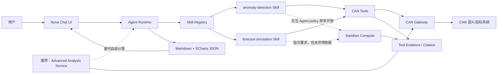
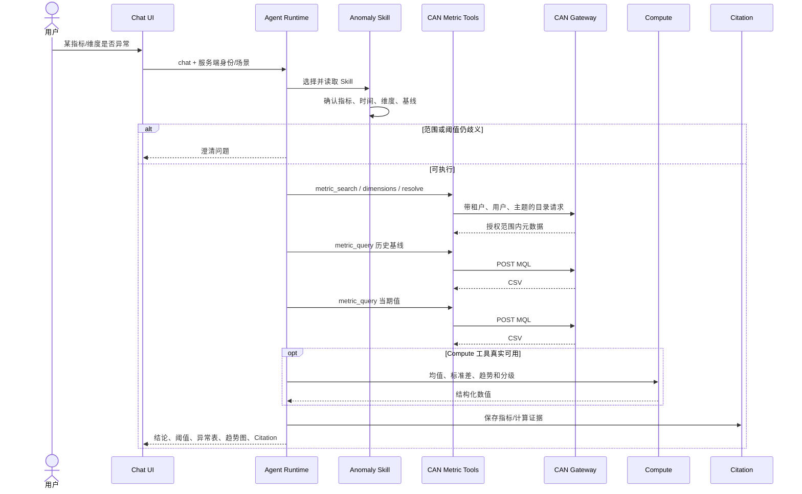
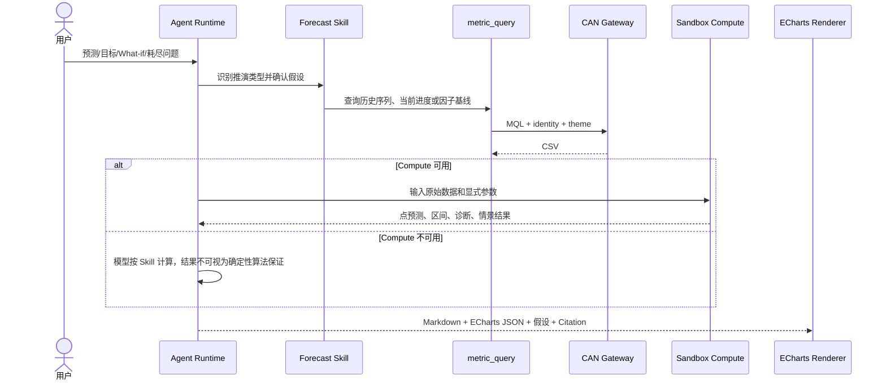
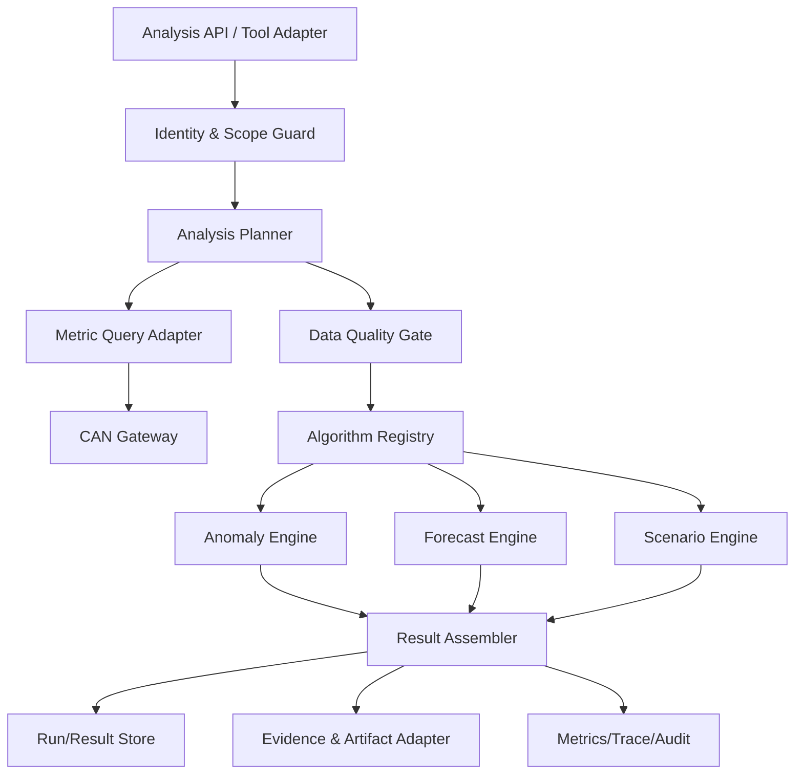
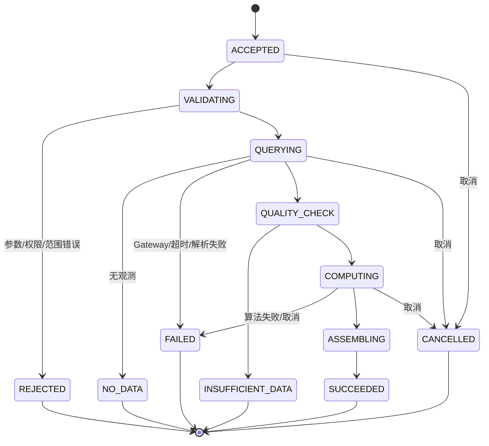

```
# 异常检测、预测推演和高级分析能力复刻说明

> 文档定位：本文描述如何把受治理的指标时间序列转换为异常判断、趋势预测、目标缺口、What-if 模拟和耗尽预测，并明确区分 Nova 当前可静态确认的通用执行能力、由 Skill/Prompt 约定但未被后端强制的分析方法，以及建议在新工程中建设的确定性分析服务。
>
> 证据日期：2026-08-13。分析范围包括 Nova 产品与插件源码、`nova_auto_test` 黑盒契约仓、`nova_ui_e2e` 浏览器测试仓；未连接 CAN 环境，未运行应用、构建或测试。

## 1. 结论与边界

### 1.1 一句话结论

Nova 当前的“异常检测”和“预测推演”不是两个独立的后端算法服务，也没有专用 REST API、持久化模型、预测作业或告警事件表。当前产品形态是：Agent 根据两个内置 Skill 的自然语言工作流调用 CAN 指标工具取得历史数据，再由 LLM 组织计算、异常报告、预测叙事和 ECharts 配置。预测 Skill 明确写出“本地用 Python”拟合趋势；异常 Skill 只写“计算统计特征”，没有明确要求 Python。两者的 `required_tools` 都不含确定性计算 Tool。CAN Gateway 提供受身份和主题约束的指标数据，不提供本文可观察到的异常或预测算法端点。

因此，复刻时可以选择两级实现：

1. **兼容级实现**：复刻 Skill + 指标查询 + 沙箱计算 + Markdown/ECharts 输出，保留当前交互效果；必须接受结果对模型遵循 Prompt 的依赖。
2. **生产级实现**：增加确定性的 Advanced Analysis Service，使用版本化请求/响应、算法注册表、可复现计算、置信区间、数据质量结果和审计记录；Agent 只负责意图解析和解释，不负责心算或自由发明置信度。

### 1.2 解决的业务问题

| 能力 | 用户问题 | 最终效果 |
|---|---|---|
| 异常检测 | “这个指标正常吗”“哪些渠道有异常” | 给出检测范围、基线、偏离程度、正常/关注/严重分级，并可引导归因 |
| 趋势外推 | “月底能到多少”“下个月走势如何” | 历史序列、点预测或区间、方法和前提假设 |
| 目标缺口 | “能否完成目标”“每天还需多少” | 当前进度、剩余缺口、所需日均、与近期日均的压力比较 |
| What-if 模拟 | “如果客单价提高 10% 会怎样” | 显式业务公式、基线值、情景输入、模拟结果及独立性假设 |
| 耗尽/饱和预测 | “库存还能撑几天”“何时达到目标规模” | 当前存量/速率、预计时间点、敏感性场景和风险 |

### 1.3 目标用户、输入和输出

目标用户是有权访问 CAN 指标的普通分析用户、绑定数据主题的 Project 成员，以及在完整经营报告中需要异常/预测板块的管理者。

核心输入：

- 自然语言问题；
- 租户、用户、会话、Project 和数据主题上下文；
- 指标机器名、展示名、可分析维度和自然语言维度值；
- 历史时间序列、当前值、比较期、用户阈值或目标值；
- 可选的业务公式、情景参数、预测跨度和粒度。

核心输出：

- 结论、算法/基线说明、异常列表或预测结果；
- 来源于指标工具和计算工具的 Citation；
- Markdown 表格和 `echarts` fenced block；
- 查询较大时的 CSV Artifact；
- 工具执行过程和聊天终态事件。

### 1.4 明确不包含

- 异常发生原因的深入拆解；该能力应交给归因模块。
- 完整报告/PPT/HTML 的文件生成和 Artifact 生命周期；本文只说明高级分析结果如何成为报告板块。
- CAN 内部语义引擎、数据仓库或业务日历的源码实现。
- 自动巡检调度、持续告警和预测模型训练平台。当前两个 Skill 都是请求时、无状态计算；定时巡检若需要，应由任务模块另行调度。
- 对 Prompt 中示例数值、经验阈值或“置信度 80%”的运行保证。

### 1.5 证据等级和关键结论

| 结论 | 等级 | 说明 |
|---|---|---|
| CAN 插件注册 `anomaly-detection`、`forecast-simulation` 两个 Skill | `I` | 插件启动加载，产品启动又同步到 SYSTEM Skill 表；新建记录默认启用，既有记录保留其 enabled 值 |
| 两个 Skill 的 `required_tools` 只有四个指标工具 | `I` | `metric_search`、`metric_dimensions`、`metric_dimension_resolve`、`metric_query`；两者都缺少确定性计算依赖。只有预测 Skill 明确要求“本地用 Python”，异常 Skill 只要求计算统计特征 |
| 当前不存在专用异常/预测 Tool、Controller、算法服务或持久化结果实体 | `I` | 相关行为由 Skill 文本和通用工具组合完成 |
| 异常算法指令包括环比/同比、均值标准差、绝对阈值和连续趋势 | `I`（指令存在） | 这是内置 Skill 文件的内容，不是 Java 服务端强制算法；不能当成确定性运行事实 |
| 预测算法指令包括线性趋势、移动平均、目标缺口、公式模拟和耗尽计算 | `I`（指令存在） | 同上；没有可验证的模型版本或统一结构化结果 |
| `execute_python` 支持沙箱化 Python/JavaScript 计算、默认 60 秒、最大 300 秒 | `I` | 但是否进入当前 Agent 的有效工具集取决于 Tool policy、能力安装和作用域；当前隔离不等于断网，存在本文 5.2 所述网络风险 |
| `metric_query` 成功结果可形成 Citation 和 CSV Artifact | `I` | 中间数据仍需遵循引用规则；`visibility=internal` 不发布 CSV |
| `nova_auto_test` 没有异常/预测数值正确性的 active YAML 用例 | `I` | 唯一直接相关的模糊异常触发用例 `ATTR-TRIG-007` 为 planned |
| CAN 工具注册清单有 active API 用例 | `A` | `CAN-LIFE-003` 只证明要求的只读 CAN 工具清单，不证明异常/预测路由和算法正确；本次未运行 |
| `nova_ui_e2e` 没有异常或预测专用 UI E2E | `I` | 现有图表/PPT流程只覆盖月度分析、图表和成果生成，不能外推为高级分析验收 |
| 预测区间 `forecast ± 1.5 × std` 可解释为统计置信区间 | `I-risk` | Skill 没定义 std 来自原序列、残差还是累计误差，也没有覆盖率校准；只能称“启发式波动区间”。这是静态实现风险，不是缺陷台账中的 `K` |
| 前端能够渲染 `echarts` JSON | `I` | 这证明展示通道存在，不证明图中数据/置信带正确 |
| 本次运行验证 | `R` | 无 |
| 本文的结构化分析服务和算法改进 | `D` | 面向从零复刻的推荐设计，不代表 Nova 当前实现 |

“`I`（指令存在）”只证明文件和规则存在；规则是否被模型逐条执行不是 `I` 或 `R`。

## 2. 术语、参与方和系统边界

| 术语/参与方 | 定义与职责 |
|---|---|
| Analysis Intent | 异常、预测、目标、模拟或耗尽之一；模型需要从用户问题中识别 |
| Baseline | 用于判断“正常”的参照，可为同期、统计分布、业务阈值或趋势模式 |
| Observation | 一个确定时间、指标、维度切片上的数值及其质量状态 |
| Forecast Horizon | 从最后一个观测点起需要预测的未来步数 |
| Scenario | What-if 中用户改变的一组因子值，以及保持不变的假设 |
| Skill Registry | 存放可见 Skill；产品可按 SYSTEM/TENANT/PROJECT/PERSONAL 和配置决定是否启用或由高优先级同名 Skill 覆盖 |
| Agent Runtime | 选择/读取 Skill，调用工具，管理流式事件、取消、上下文和最终回答 |
| CAN Tools | 搜索指标、查询维度、解析维度值和执行 MQL 的只读工具 |
| CAN Gateway | 外部多租户语义门面；接收用户身份和 MQL，返回目录文本或 CSV |
| Sandbox Compute | 通用 `execute_python`；用于可复现数值计算，不应承担网络访问或画图 |
| Citation Pipeline | 从成功的 `metric_query`、`execute_python` 等工具结果生成证据标识 |
| ECharts Renderer | 把回复中的合法 JSON option 渲染为图表；只负责展示 |
| Advanced Analysis Service | 本文推荐的新确定性服务；当前 Nova 不存在 |

CAN 生态的仓库级职责仅用于建立边界：`semantic` 是 Spring Boot CAN 核心服务，`anymetrics` 是 Spring Boot CAN 业务层，`tse` 是任务调度平台，`any-metrics` 是 Node.js CAN 前端，`jscip` 提供账号和数据源等基础配置。Nova 只显式调用 CAN Gateway；不能仅凭这些职责推断 Gateway 内部的真实调用拓扑。



虚线表示可选或推荐关系。尤其是 `execute_python`：工具在平台中已注册不等于当前 Skill 激活后必然可用。

## 3. 产品入口与业务规则

### 3.1 当前入口

当前没有 `/api/anomalies` 或 `/api/forecasts`。用户通过通用聊天入口发起：

- `POST /api/chat`：同步回答；
- `POST /api/chat/stream`：SSE，主要发送 `token`、`tool_call`、`complete`；
- `WS /ws/chat`：产品主通道，发送聊天消息并接收工具过程和终态；
- 完整报告请求：`analysis-report` Skill 将异常、归因、预测描述为报告板块，但这种“调用另一个 Skill”的编排仍是模型指令，不是后端工作流引擎。

通用请求的业务字段可按下例复刻：

```json
{
  "conversationId": "conv-01",
  "message": "检查上月各渠道销售额是否异常，并预测本月底能到多少",
  "files": [],
  "images": [],
  "provider": null,
  "dataThemeId": "theme-100",
  "projectId": "project-9",
  "lang": "zh"
}
```

身份必须由已认证的服务端会话解析，不能接受 LLM 或请求 body 自报 `tenantId/userId`。`conversationId` 缺失时服务端可以生成；`message` 及附件提示最终都为空时应拒绝。

### 3.2 意图路由边界

| 用户意图 | 应选择的能力 |
|---|---|
| “上月销售额多少” | 指标查询，不做异常判断 |
| “上月销售额正常吗” | 异常检测 |
| “为什么销售额下降” | 归因分析；若“是否异常”尚不明确，可先检测或澄清 |
| “月底预计多少” | 趋势外推 |
| “离目标还差多少” | 目标缺口 |
| “如果转化率提升会怎样” | What-if |
| “库存还能卖多久” | 耗尽预测 |
| “做一份经营月报” | 报告编排；按大纲选择异常、归因、预测板块 |

模糊请求不能由模型擅自选择指标、时间范围或目标。至少确认：度量、时间范围、粒度、实体过滤、分组维度、基线/阈值或预测目标。`nova_auto_test` 的 planned 用例也允许“触发归因或询问缺失上下文”，说明当前测试规划承认语义澄清的重要性，而不是要求无条件执行。

### 3.3 异常检测规则

1. 没有基线不能输出“异常/正常”。
2. 用户给出业务红线时优先使用该阈值，并回显阈值和单位。
3. 未给阈值时，可选择环比、同比、历史统计或趋势基线；选择原因必须可见。
4. 有季节性的指标优先用同比或同星期/同财期；仅用最近均值可能误报。
5. 总体检测和维度检测是两层：总体正常不代表每个渠道/地区正常。
6. 当前 Skill 建议先总体后下钻；维度值很多时只列异常项。
7. 当前 Skill 把绝对 z-score `>2.5` 标为严重，`>1.5` 标为关注，其余正常。这是默认指令，不是配置化服务端规则。
8. Skill 建议异常项不超过检测项的 30%；复刻时只能把它作为“阈值可能过紧”的诊断，不能硬截断真实异常。大面积业务事故本来就可能超过 30%。
9. 发现异常后可以建议归因，但异常模块不能把相关性猜测写成原因。

### 3.4 预测推演规则

1. 预测必须声明历史窗口、粒度、方法、预测跨度和前提假设。
2. 历史窗口应与预测跨度匹配：月底可用近 30 天按日；下月可用近 3–6 月按月；季度/年度至少参考 6–12 月。该矩阵是 Skill 指导，不是统计充分性的保证。
3. 线性外推适合稳定单调趋势；高波动可使用移动平均或加权移动平均。
4. 长期、季节性、大促或政策突变场景必须降低承诺，不得给虚假精度。
5. 目标缺口必须区分目标值、当前累计、剩余日数、近期日均和达标所需日均。
6. What-if 必须显示公式和所有保持不变的因子；没有经过确认的因果公式只能标为假设。
7. 耗尽预测必须处理零/负速率、补货、最小安全库存和时间单位。
8. 当前 Skill 的 `forecast ± 1.5 × std` 只能视为启发式区间；不得称为特定置信水平。

### 3.5 工具可用性边界

两项 Skill 声明的正式依赖只有：

```yaml
required_tools:
  - metric_search
  - metric_dimensions
  - metric_dimension_resolve
  - metric_query
```

Skill 激活后，运行时只能把这些 `required_tools` 合并进 Agent 的工具视图，而且仍受有效 Tool policy 约束。两项 Skill 都没有声明确定性计算 Tool；其中只有预测 Skill 明确指导“在本地用 Python”拟合，异常 Skill 仅描述计算均值、标准差等统计特征。因此以下情况都是合法现状：

- Python 本来就在 Agent policy 中：可以进行确定性本地计算；
- Python 已注册但当前用户不可见：模型只能在上下文内推算，可靠性下降；
- 预测 Skill 指令要求“在本地用 Python”，但运行时并未强制满足：形成指令与能力的实现风险 `I-risk`。
- 异常 Skill 即使不要求 Python，也没有一个确定性算法依赖保证均值、标准差、阈值和分级按固定实现执行：形成可复现性风险 `I-risk`。

生产复刻应把确定性分析 Tool 加入 Skill 依赖，或让专用分析服务直接完成算法，禁止依赖 LLM 心算。

## 4. 当前完整执行链路

### 4.1 异常检测



当前 Skill 对“统计基线”建议用近 30 天历史，不包含当天，再查一次当期值。历史查询通常使用 `visibility="internal"`，最终用户可见查询使用 `visibility="default"`。这只是推荐使用方式：没有一个服务端状态机验证两次查询是否使用同一指标、同一维度切片和无重叠时间窗。

### 4.2 预测、目标和模拟



当前没有 `analysisRunId`、训练/预测版本或独立重试状态。取消行为由通用会话任务处理；取消可能发生在任一指标查询或计算调用之间，已产生的工具事件可能保留，但不应输出伪完整的最终预测。

## 5. 当前对外契约

### 5.1 `metric_query` Tool

当前高级分析真正依赖的核心 Tool 契约如下：

```json
{
  "name": "metric_query",
  "arguments": {
    "query_json": {
      "metrics": ["sales_amount"],
      "dimensions": ["metric_time__day", "channel"],
      "timeConstraint": "DateTrunc(['metric_time'], \"DAY\") >= DATEADD(DateTrunc(NOW(), \"DAY\"), -30, \"DAY\") AND ['metric_time__day'] < DateTrunc(NOW(), \"DAY\")",
      "orders": [{"metric_time__day": "asc"}]
    },
    "purpose": "近30天各渠道销售额",
    "visibility": "internal"
  }
}
```

字段规则：

| 字段 | 类型 | 必填 | 语义 |
|---|---|---:|---|
| `query_json` | object；兼容 JSON string | 是 | 完整 MQL，至少含非空 `metrics`；时间约束存在时必须引用 `['metric_time']` |
| `purpose` | string | 实践中应填 | 用户可读的证据/CSV 标题；不要使用指标机器码充当标题 |
| `visibility` | `internal/default/export` | Tool schema 要求 | internal 不发布 CSV；default 按行数/截断决定；export 强制发布 |

Tool 向 Gateway 发送：

```http
POST /api/metrics/query?themeId=theme-100
Content-Type: application/json
X-Tenant-Id: tenant-001
X-User-Id: user-123
```

body 是最终 MQL，并由执行器控制分页 `limit/offset`；**每一页**都向同一路径重新 POST。`themeId` 不是 Tool 参数，也不接受 LLM 提供：它来自服务端绑定的运行时场景。PERSONAL 场景为 null、空白、`all` 或 `__ALL__` 时省略 query 参数，表示个人授权范围；PROJECT 场景必须有权威 `projectId` 和具体规范化 theme，缺失或 all sentinel 时在发送请求前 fail-closed。当前默认每页 5,000 行、一次查询硬上限 1,000,000 行；默认结果超过 50 行或 Markdown 被截断时，`visibility=default` 发布 CSV。Gateway 成功体是 CSV 文本，例如：

```csv
metric_time__day,channel,sales_amount
2026-07-01,Direct,120000.50
2026-07-01,Partner,83000.00
```

返回给 Agent 的文本大致包含行数、Markdown 预览、截断/上限告警和可计算文件句柄。零行返回成功但含 `(no data)` 提示，不应被改写为 0。

### 5.2 `execute_python` Tool

若当前身份被授权使用，它的兼容契约为：

```json
{
  "name": "execute_python",
  "arguments": {
    "language": "python",
    "code": "import pandas as pd\n...",
    "packages": "",
    "timeout_seconds": 60,
    "purpose": "销售额异常分级"
  }
}
```

- `code` 必填；`language` 默认 Python，也可为 JavaScript。
- 超时默认 60 秒，最大 300 秒；代码运行在会话沙箱。
- 进程继承环境被清空，防止宿主 API Key 泄露。
- 输出最多约 50,000 字符；新文件可自动发布为 Artifact。
- 该工具适合计算，不应使用 matplotlib/plotly 等生成本文的聊天图表；图表由回复中的 ECharts JSON 表达。
- 计算结果可以成为 Citation 证据，但只有最终业务结果应被引用，调试 print 不应成为业务事实。

**当前网络边界是实现风险 `I-risk`，不是已登记缺陷 `K`。** 目录型沙箱的路径 guard 约束文件访问，但没有拦截进程创建 socket；Docker 沙箱默认配置是 bridge/命名网络而非 `network=none`。工具允许在运行时执行 `pip install`，预装包描述还包含 `requests`，因此清空宿主环境并不等于阻止代码访问网络、云元数据地址或内网服务。静态代码可以确认这些条件存在，但本次没有运行攻击验证，也没有缺陷台账将其列为 `K`。

兼容部署必须额外实施：

1. 默认 `network=none`；确需网络的计算任务使用独立 Tool 和目标域名/IP allowlist，不继承通用 Web 权限。
2. 禁止 LLM 任意指定 `packages` 并在线安装；依赖由管理员制作固定镜像或从校验哈希的私有离线仓安装，锁定包名、版本和许可证。
3. 阻断 loopback、RFC1918、链路本地、云元数据和 Unix socket；DNS 解析后再次校验目标地址，防止 DNS rebinding。
4. 对 CPU、内存、进程数、文件数、磁盘、stdout/stderr、执行时长和并发设置硬配额；超限产生结构化错误。
5. 生产级 Advanced Analysis Service 不运行 LLM 生成的任意代码，只调用预注册、版本锁定和经过测试的算法实现。

### 5.3 当前没有的契约

当前不存在以下可调用保证：

- `anomaly_detect(...)` Tool；
- `forecast(...)` Tool；
- `/api/advanced-analysis/runs`；
- `AnomalyResult`/`ForecastResult` 持久化表；
- 模型训练、回测、版本、漂移或告警订阅 API；
- CAN Gateway 的异常/预测端点。

复刻者若只追求当前兼容效果，不应凭空把这些接口描述成现有依赖；若追求生产能力，应采用第 7 节的推荐契约。

## 6. 当前算法语义和缺口

### 6.1 统计异常

给定历史基线 `x1...xn` 和当前值 `x`，Skill 描述的核心为：

```text
mu = mean(history)
sigma = std(history)
z = (x - mu) / sigma

abs(z) > 2.5 -> CRITICAL
abs(z) > 1.5 -> WARNING
otherwise    -> NORMAL
```

必须回显当前值、基线、偏离和阈值。当前指令未定义：

- 使用总体标准差还是样本标准差；
- 缺失值、重复点、异常历史点如何处理；
- `sigma=0` 时如何处理；
- 多指标/多维度同时检测的多重检验；
- 日历、节假日和财期季节性；
- 百分比/比率的边界分布；
- 最小样本量和数据质量门槛。

因此相同数据可能因模型生成的 Python 细节不同而产生不同分级。

### 6.2 环比、同比和绝对阈值

环比/同比可以直接查询带快速计算后缀的指标，例如：

```json
{
  "metrics": ["sales_amount", "sales_amount__sameperiod__mom__growth"],
  "dimensions": ["channel"],
  "timeConstraint": "DateTrunc(['metric_time'], \"MONTH\") = DATEADD(DateTrunc(NOW(), \"MONTH\"), -1, \"MONTH\")"
}
```

增长率的单位和零分母语义由 CAN 对端决定，Nova 当前只透传结果。用户给出“跌幅超过 15%”时必须确认返回值是 `-0.15` 还是 `-15`，否则阈值会差 100 倍。绝对阈值还必须明确方向：`value < minimum`、`value > maximum` 或区间外。

### 6.3 趋势异常

当前指令支持：连续 N 天下滑、连续 N 天低于阈值、K 周均值逐周下降。可实现为：

```text
series = observations sorted by time
continuous_down = all(series[i] < series[i-1] for i=1..N-1)
cumulative_change = (series[-1] - series[0]) / abs(series[0])
```

必须先去重、补齐/标记缺失时间点，并确认“连续”是连续自然日、营业日还是有数据的观测点。当前 Skill 没有定义这些细节。

### 6.4 趋势外推

Skill 给出的线性方法为：

```python
slope, intercept = numpy.polyfit(days, values, 1)
prediction[t] = slope * t + intercept
forecast_total = sum(observed_values) + sum(future_predictions)
```

该方法适用于简单稳定趋势。需要注意：

- “月底累计”只有在 `values` 是互不重叠的日增量时才能求和；若指标本身是累计值，重复求和是错误的。
- 预测可能为负；库存、订单数等应设置领域下界，但不能一律截断所有指标。
- 移动平均窗口和加权权重没有被当前指令固定。
- 若横轴存在缺口，必须用真实时间差而不是简单行号。

### 6.5 目标缺口

当前数学关系：

```text
gap = target - current
completion_rate = current / target
required_daily = max(gap, 0) / remaining_days
pressure_ratio = required_daily / recent_daily_average
```

Skill 中建议：`pressure_ratio < 1.0` 可达，`1.0–1.3` 有压力，`>=1.3` 难度较大。这是经验解释，不是从历史达标率校准的概率。还必须处理：目标为 0、目标已超额、剩余天数为 0、负向目标（如投诉率越低越好）和财期日历。

### 6.6 What-if

当前方法是显式代数公式。例如：

```text
GMV = UV * CVR * AOV
scenario.GMV = scenario.UV * scenario.CVR * scenario.AOV
delta = scenario.GMV - baseline.GMV
```

该结果是机械模拟，不是因果预测。若用户只改变 AOV，输出必须写明“假设 UV 和 CVR 不受影响”。业务公式应来自已治理的指标定义、归因知识或用户确认；禁止模型从名称自行构造。

### 6.7 耗尽/饱和

```text
days_remaining = usable_stock / positive_daily_consumption
depletion_time = as_of_time + days_remaining
```

其中 `usable_stock` 应是当前库存减安全库存并加已确认在途量；若速率为 0，结果是“不按当前速率耗尽”，不是无穷日期；若速率为负，应检查指标方向或转为增长/饱和模型。

### 6.8 区间和“置信度”

当前 Skill 同时出现“`forecast ± 1.5 × std`”和示例“置信度 80%”，但没有统计联系。复刻兼容层应输出：

```text
启发式波动区间：点预测 ± 1.5 × 近期波动标准差
```

不得输出“80% 置信区间”。只有生产算法经过残差假设、回测或 conformal 校准后，才能给出 `coverage=0.80/0.95`。

## 7. 生产级复刻设计：Advanced Analysis Service

### 7.1 设计目标

1. 同一数据、算法版本和参数得到相同结果。
2. 每个结果能追溯输入数据指纹、查询证据、代码/算法版本和租户范围。
3. LLM 只选择算法和解释结果；分级、预测和区间由服务端完成。
4. 失败、数据不足和低置信度是结构化状态，不由 LLM 猜测。
5. 既支持同步小任务，也能扩展为异步长任务和定时巡检。

### 7.2 推荐组件



### 7.3 推荐请求契约

统一创建接口：

```http
POST /api/v1/advanced-analysis/runs
Authorization: session or bearer token
Idempotency-Key: 8c4678d3-...
Content-Type: application/json
```

异常请求：

```json
{
  "type": "ANOMALY",
  "conversationId": "conv-01",
  "projectId": "project-9",
  "dataThemeId": "theme-100",
  "series": {
    "metric": "sales_amount",
    "displayName": "销售额",
    "dimensions": ["channel"],
    "filters": [],
    "grain": "DAY",
    "baselineWindow": {"start": "2026-07-01", "endExclusive": "2026-07-31"},
    "evaluationWindow": {"start": "2026-07-31", "endExclusive": "2026-08-01"},
    "timezone": "Asia/Shanghai"
  },
  "method": {
    "name": "ROBUST_Z_SCORE",
    "version": "1",
    "parameters": {"warning": 2.5, "critical": 3.5, "minSamples": 14}
  },
  "output": {"includeSeries": true, "publishDataset": false}
}
```

预测请求：

```json
{
  "type": "FORECAST",
  "conversationId": "conv-01",
  "projectId": "project-9",
  "dataThemeId": "theme-100",
  "series": {
    "metric": "sales_amount",
    "dimensions": [],
    "grain": "DAY",
    "historyWindow": {"start": "2026-07-01", "endExclusive": "2026-08-01"},
    "timezone": "Asia/Shanghai"
  },
  "method": {
    "name": "LINEAR_TREND",
    "version": "1",
    "parameters": {"horizon": 14, "intervalCoverage": 0.8}
  },
  "target": {"value": 18000000, "deadline": "2026-08-31"},
  "output": {"includeSeries": true, "publishDataset": true}
}
```

规则：`tenantId/userId` 不出现在 body，由认证上下文注入；服务器重新核验 `projectId/dataThemeId`。指标是否可为负、单位、累计/流量/存量类型来自服务端治理元数据或管理员白名单，不能让 LLM 用 `nonNegative` 参数改变领域约束。

#### 创建的同步/异步语义

服务端可以在配置的同步预算（建议 1 秒）内完成小任务，但创建接口的资源语义保持统一：

- 已完成：`201 Created`，返回完整 Run DTO，`Location: /api/v1/advanced-analysis/runs/{runId}`。
- 未完成：`202 Accepted`，返回摘要，含 `runId/status/pollAfterMs`，并设置同一 `Location` 和 `Retry-After: 1`。
- 服务端不得因同一请求偶尔快、偶尔慢而改变响应 DTO 的核心字段；调用方始终按 Run 资源处理。

```json
{
  "runId": "aar_01J...",
  "status": "ACCEPTED",
  "pollAfterMs": 1000,
  "links": {
    "self": "/api/v1/advanced-analysis/runs/aar_01J...",
    "result": "/api/v1/advanced-analysis/runs/aar_01J.../result",
    "cancel": "/api/v1/advanced-analysis/runs/aar_01J.../cancel"
  }
}
```

其余接口：

| 方法与路径 | 语义 | 成功响应 |
|---|---|---|
| `GET /api/v1/advanced-analysis/runs/{runId}` | 查询状态和摘要；对象级校验 tenant/user/project | `200` Run DTO；运行中含 `Retry-After` |
| `GET /api/v1/advanced-analysis/runs/{runId}/result` | 取得终态结构化结果 | `200`；未终态 `409 RUN_NOT_TERMINAL`，可带 `Retry-After` |
| `POST /api/v1/advanced-analysis/runs/{runId}/cancel` | 请求取消；幂等 | `202` 表示正在取消；已取消返回 `200`；已成功/失败返回 `409 TERMINAL_RUN` |
| `GET /api/v1/advanced-analysis/runs?type=&status=&conversationId=&cursor=&limit=` | 当前调用者范围内分页列表 | `200 {items,nextCursor}`；limit 默认 20、最大 100 |

轮询方读取 `Retry-After`（秒）或 body 的 `pollAfterMs`，加入 10% 随机抖动；建议最短 500ms、最长 5s，总等待上限由聊天任务控制。终态为 `SUCCEEDED/REJECTED/NO_DATA/INSUFFICIENT_DATA/FAILED/CANCELLED`。失败统一返回：

```json
{
  "runId": "aar_01J...",
  "status": "FAILED",
  "error": {
    "code": "CAN_GATEWAY_TIMEOUT",
    "message": "Metric query timed out",
    "retryable": true,
    "details": {"stage": "QUERYING"},
    "traceId": "trace-123"
  }
}
```

HTTP 层：请求 schema 错误 `400`，未认证 `401`，对象/主题权限 `403`，run 不存在 `404`，幂等冲突/非法状态 `409`，限流 `429 + Retry-After`，暂时不可用 `503 + Retry-After`。终态业务失败仍可通过 `GET run` 返回 `200 + status=FAILED`；这与“创建请求本身无效”的 4xx 不同。

#### 幂等规则

`Idempotency-Key` 在 `tenantId + userId + analysisType` 内唯一。服务端保存规范化请求的 SHA-256：

- 相同 key、相同 body：重放第一次响应语义，返回同一个 `runId`；已经完成则返回当前 Run DTO，不创建第二个任务。
- 相同 key、不同 body：`409 IDEMPOTENCY_KEY_REUSED`。
- 客户端超时后必须用原 key 重试；不得生成新 key 造成重复计算。
- 幂等记录保留时间应覆盖客户端最大重试窗口，建议至少 24 小时。

#### Agent Tool Adapter

推荐只向 LLM 暴露一个 `advanced_analysis` Tool，隐藏 tenant/user、轮询和内部网络：

```json
{
  "type": "object",
  "additionalProperties": false,
  "required": ["analysis_type", "metric", "grain", "method", "parameters"],
  "properties": {
    "analysis_type": {"type": "string", "enum": ["ANOMALY", "FORECAST", "TARGET_GAP", "WHAT_IF", "DEPLETION"]},
    "metric": {"type": "string", "minLength": 1, "maxLength": 128},
    "dimensions": {"type": "array", "items": {"type": "string"}, "maxItems": 5, "default": []},
    "grain": {"type": "string", "enum": ["DAY", "WEEK", "MONTH", "QUARTER"]},
    "history_start": {"type": "string", "format": "date"},
    "history_end_exclusive": {"type": "string", "format": "date"},
    "evaluation_start": {"type": "string", "format": "date"},
    "evaluation_end_exclusive": {"type": "string", "format": "date"},
    "method": {"type": "string", "enum": ["AUTO", "FIXED_THRESHOLD", "PERIOD_OVER_PERIOD", "Z_SCORE", "ROBUST_Z_SCORE", "RUN_RULE", "NAIVE_LAST", "MOVING_AVERAGE", "WEIGHTED_MOVING_AVERAGE", "LINEAR_TREND", "SEASONAL_NAIVE", "DETERMINISTIC_FORMULA"]},
    "method_version": {"type": "string", "pattern": "^[1-9][0-9]*$", "default": "1"},
    "parameters": {"type": "object"},
    "target": {"type": "number"},
    "target_deadline": {"type": "string", "format": "date"},
    "formula_id": {"type": "string", "maxLength": 128},
    "scenario": {"type": "object", "additionalProperties": {"type": "number"}},
    "fallback_policy": {"type": "string", "enum": ["NONE", "SAFE_BASELINE"], "default": "NONE"},
    "purpose": {"type": "string", "minLength": 1, "maxLength": 80}
  }
}
```

Adapter 从 ToolExecutionContext 注入 conversation/project/theme/identity，创建 Run，按 `Retry-After` 轮询，传播 cancellation，终态返回结构化 JSON 和 Citation/Artifact。它必须在 `analysis_type + method` 之后执行判别式参数 schema，不能因为顶层 `parameters` 是任意对象而放弃校验。

### 7.4 推荐响应 DTO

```json
{
  "runId": "aar_01J...",
  "status": "SUCCEEDED",
  "type": "FORECAST",
  "createdAt": "2026-08-13T10:00:00Z",
  "completedAt": "2026-08-13T10:00:01Z",
  "scope": {
    "tenantId": "tenant-001",
    "userId": "user-123",
    "projectId": "project-9",
    "dataThemeId": "theme-100"
  },
  "input": {
    "metric": "sales_amount",
    "grain": "DAY",
    "historyStart": "2026-07-01",
    "historyEndExclusive": "2026-08-01",
    "observationCount": 31,
    "dataFingerprint": "sha256:..."
  },
  "algorithm": {
    "name": "LINEAR_TREND",
    "version": "1",
    "parameters": {"horizon": 14, "intervalCoverage": 0.8},
    "trainedAt": null
  },
  "quality": {
    "status": "PASS",
    "missingRatio": 0.0,
    "duplicateCount": 0,
    "warnings": []
  },
  "forecast": {
    "point": 15230000,
    "lower": 14800000,
    "upper": 15720000,
    "coverage": 0.8,
    "horizon": 14,
    "series": [
      {"time": "2026-08-01", "point": 480000, "lower": 430000, "upper": 530000}
    ]
  },
  "targetAssessment": {
    "target": 18000000,
    "current": 8500000,
    "gap": 9500000,
    "remainingPeriods": 18,
    "requiredPerPeriod": 527777.78,
    "recentAverage": 410000,
    "pressureRatio": 1.2873,
    "classification": "AT_RISK"
  },
  "evidence": {
    "queryId": "mq_...",
    "citationIds": ["ev_..."],
    "datasetArtifactId": "art_..."
  },
  "assumptions": ["未来保持近期结构性趋势", "未建模大促或政策变化"],
  "limitations": ["线性方法不适合结构突变"]
}
```

异常结果使用：

```json
{
  "anomalies": [
    {
      "time": "2026-07-31",
      "dimensions": {"channel": "Partner"},
      "actual": 83000,
      "expected": 126000,
      "lower": 92000,
      "upper": 160000,
      "score": -3.41,
      "severity": "CRITICAL",
      "direction": "LOW",
      "method": "ROBUST_Z_SCORE",
      "reasonCode": "BELOW_EXPECTED_BAND"
    }
  ],
  "summary": {"tested": 8, "normal": 6, "warning": 1, "critical": 1}
}
```

`score` 不是概率；`coverage` 仅在算法提供校准区间时出现。若没有校准，不应返回伪 coverage。

### 7.5 推荐状态机



`NO_DATA` 与 `INSUFFICIENT_DATA` 不是普通成功，也不是值为 0；UI 和 Agent 应明确展示原因。

## 8. 推荐算法实现

### 8.1 数据质量门禁

计算前统一执行：

1. 按 `time + dimensions` 去重；冲突重复点拒绝或按明确聚合规则处理。
2. 解析数值、单位和缩放因子；禁止混合“元/万元”或 `0.15/15%`。
3. 用业务日历构建期望时间轴，标记缺失，不默认把缺失补 0。
4. 对累计指标、流量指标、存量指标分别建模，禁止统一求和。
5. 校验历史窗不包含评估点，避免数据泄漏。
6. 保存原始查询指纹、排序、时区、财期和数据主题。

### 8.2 异常算法注册表

最低实现：

- `FIXED_THRESHOLD`：业务上下界；
- `PERIOD_OVER_PERIOD`：同比/环比增长阈值；
- `Z_SCORE`：均值/标准差，适合近似稳定分布；
- `ROBUST_Z_SCORE`：中位数和 MAD，抗历史异常；
- `SEASONAL_BAND`：按星期、月份或财期分组的历史分位带；
- `RUN_RULE`：连续上升/下降、连续越界。

每个算法必须有独立 schema，未知字段一律拒绝：

| 算法 | 必填/允许参数 | 范围与交叉校验 |
|---|---|---|
| `FIXED_THRESHOLD` | `lower?`, `upper?`, `warningMargin?` | lower/upper 至少一个；均为有限数；同时存在时 `lower < upper`；margin `[0,1]` |
| `PERIOD_OVER_PERIOD` | `comparison`, `warningAbs`, `criticalAbs` | comparison 为 `PREVIOUS_PERIOD/YEAR_OVER_YEAR`；`0 <= warningAbs < criticalAbs`；增长率单位规范为小数 |
| `Z_SCORE` | `warning`, `critical`, `minSamples`, `ddof` | `0 < warning < critical <= 10`；minSamples `[3,10000]`；ddof 为 `0/1` 且样本数大于 ddof |
| `ROBUST_Z_SCORE` | `warning`, `critical`, `minSamples`, `zeroMadTolerance` | 同上；tolerance 为非负有限数 |
| `RUN_RULE` | `rule`, `runLength`, `minimumCumulativeChange?` | rule 为 `UP/DOWN/ABOVE/BELOW`；runLength `[2,365]` 且不大于窗口观测数 |

窗口统一要求 `start < endExclusive`，baseline 与 evaluation 不重叠，时长不超过管理员上限（建议 5 年），期望观测数与 grain 匹配。服务端从治理元数据校验指标单位和增长率缩放。

Robust z-score 示例：

```text
median = median(history)
mad = median(abs(x_i - median))
robust_sigma = 1.4826 * mad
score = (current - median) / robust_sigma
```

边界：

- `n < minSamples`：`INSUFFICIENT_DATA`；
- `mad=0` 且 current 等于 median：正常；
- `mad=0` 且不同：用配置的绝对/相对容差判断，不返回除零；
- 多切片检测：报告测试数量，并可用 FDR 控制或分位阈值，不能靠“最多 30%”裁剪。

### 8.3 预测算法注册表

MVP 可实现：

- `NAIVE_LAST`；
- `MOVING_AVERAGE(window)`；
- `WEIGHTED_MOVING_AVERAGE(weights)`；
- `LINEAR_TREND`；
- `SEASONAL_NAIVE(period)`。

预测参数 schema：

| 算法 | 必填/允许参数 | 范围与交叉校验 |
|---|---|---|
| `NAIVE_LAST` | `horizon`, `intervalCoverage?` | horizon `[1,366]`；coverage 仅在有回测残差时允许，范围 `[0.5,0.99]` |
| `MOVING_AVERAGE` | `horizon`, `window`, `intervalCoverage?` | window `[2,365]` 且 `window <= observations` |
| `WEIGHTED_MOVING_AVERAGE` | `horizon`, `weights`, `intervalCoverage?` | weights 长度 `[2,365]`，每项有限且非负，总和 > 0；归一化后使用 |
| `LINEAR_TREND` | `horizon`, `intervalCoverage?` | 至少 3 个有效且时间有序观测；horizon 不超过治理策略允许的 grain 对应跨度 |
| `SEASONAL_NAIVE` | `horizon`, `seasonLength`, `intervalCoverage?` | seasonLength `[2,366]`；至少两个完整季节；horizon 可大于一个季节但上限 366 |

`TARGET_GAP` 额外要求 target 为有限数、deadline 晚于 as-of；`DEPLETION` 要求存量和安全水位单位一致、速率窗口至少 2 点；`DETERMINISTIC_FORMULA` 要求已存在并授权的 `formulaId/version`，scenario 每个 key 必须是公式声明的可变因子。

客户端必须传算法主版本。未知 name/version 返回 `400 ALGORITHM_VERSION_UNSUPPORTED`，响应列出允许版本但不静默替换。只有请求 `method.name="AUTO"` 时才允许服务端选算法；选择结果和原因写入响应。计算库、运行镜像和算法代码必须锁定版本及哈希，例如 `numpy/scipy` lockfile + image digest；同一 `algorithmVersion` 不得在不兼容升级后悄然改变数值语义。

降级只能按显式矩阵执行并记录 `degradedFrom/degradedReason`：例如季节样本不足时，在用户允许 `fallbackPolicy="SAFE_BASELINE"` 的前提下降级 `SEASONAL_NAIVE -> NAIVE_LAST`；否则返回 `INSUFFICIENT_DATA`。不得在任意异常后默默切换模型。`nonNegative`、上下界、取整和累计方式来自服务端指标治理元数据或管理员白名单；LLM/客户端不能开启或关闭。

生产可增加 ETS/ARIMA/Prophet 类模型，但必须通过统一接口输出回测指标和区间。算法选择不应只看 LLM 文案，应根据样本量、季节周期、趋势强度和回测误差自动评估候选。

推荐滚动回测：保留最近 `k` 个周期作为验证点，计算 MAE、sMAPE、MASE 和区间覆盖率。样本太短时降级到 naive，并在 `limitations` 中说明。

### 8.4 置信/预测区间

线性模型可以基于回归残差和预测杠杆计算 prediction interval；更通用的方式是用滚动回测绝对残差做 conformal 区间：

```text
residuals = abs(actual_t - forecast_t) on rolling backtests
q = quantile(residuals, desired_coverage corrected for finite sample)
lower = point - q
upper = point + q
```

只有回测样本足够时返回 coverage。否则返回 `intervalType="HEURISTIC"`，不填 coverage。

### 8.5 What-if 引擎

公式应解析为受限 AST：允许数字、已授权指标引用和 `+ - * / min max` 等白名单函数，拒绝任意代码。保存：

- 公式 ID/版本；
- 每个因子的单位和基线值；
- 用户改变的参数；
- 固定参数和联动假设；
- 除零、单位不兼容和缺失因子错误。

机械模拟应标 `simulationType="DETERMINISTIC_FORMULA"`，不可称为因果预测。

## 9. CAN Gateway 对端契约和 Stub

### 9.1 已观察到的对端职责

高级分析只要求 Gateway 提供：

1. 指标搜索和可分析维度；
2. 自然语言维度值候选；
3. 带时间粒度、过滤、排序和临时指标的 MQL 查询；
4. CSV 返回；
5. `X-Tenant-Id`、`X-User-Id` 和主题范围内授权；
6. 可定位的权限、语义、超时和服务错误。

没有证据表明 Gateway 需要实现异常或预测算法。兼容 Stub 也不应把 Prompt 中的阈值内嵌为 Gateway 业务规则。

### 9.2 最小兼容 Stub

Stub 至少实现高级分析 Skill 声明的四类 Tool 对端。所有端点都要求 `X-Tenant-Id`、`X-User-Id`；发现接口和查询成功体都是原始 UTF-8 文本，不套 `{success,data}` 信封。

| Tool | 方法与路径 | 参数 | Stub 成功响应 |
|---|---|---|---|
| `metric_search` | `GET /api/metrics/search` | `keyword` 必填，`pageSize`，`themeId?` | 预格式化指标文本；可用 JSON 文本数组但仍按 raw text 返回 |
| `metric_dimensions` 单指标 | `GET /api/metrics/{urlEncodedMetric}/dimensions` | `keyword?`, `themeId?` | 该指标维度及样例文本 |
| `metric_dimensions` 多指标 | `GET /api/metrics/dimensions` | `metricNames=a,b`, `keyword?`, `themeId?` | 指标共同/兼容维度文本 |
| `metric_dimension_resolve` | `GET /api/metrics/dimensions/resolve` | `metrics`, `value` 必填；`dim?`, `limit?`, `themeId?` | 按匹配度排序的维度和值候选文本；零命中可为空结果 |
| `metric_query` | `POST /api/metrics/query?themeId=...` | body=MQL；每页含服务端覆盖的 `limit/offset` | `text/csv`，每页都带表头 |

兼容搜索 fixture 示例：

```json
[
  {"metricName":"sales_amount","displayName":"销售额","description":"已支付销售金额","unit":"CNY"},
  {"metricName":"order_count","displayName":"订单数","description":"已支付订单数量","unit":"count"}
]
```

维度 fixture：

```json
{
  "metrics":["sales_amount"],
  "dimensions":[
    {"dimName":"channel","displayName":"渠道","samples":["Direct","Partner"]},
    {"dimName":"metric_time__day","displayName":"日期","type":"TIME"}
  ]
}
```

解析 fixture：

```json
{
  "queryValues":["合作渠道"],
  "matches":[
    {"dimName":"channel","value":"Partner","score":0.96,"matchedBy":"ALIAS"}
  ]
}
```

这些 JSON 是 Stub 的稳定测试格式；Nova 当前只把它们视为 raw text，不能据此宣称真实 Gateway 的响应 schema 相同。

伪代码：

```text
handleMetricQuery(request):
  require nonblank tenant and user headers
  authorize user in tenant
  scene = trusted server context, not request body
  if scene.mode == PROJECT:
      require nonblank projectId and concrete canonical themeId
      reject null, blank, "all", "__ALL__"
  else if themeId is null/blank/all sentinel:
      omit theme scope and use the user's authorized PERSONAL catalog
  if themeId is present:
      require theme belongs to tenant and user/project may use it
  validate request.metrics is non-empty
  validate referenced metrics/dimensions belong to requested theme
  validate timeConstraint against supported subset
  rows = fixtureStore.query(tenant, theme, request)
  apply stable ordering, then offset/limit
  return text/csv with header even when rows are empty
```

客户端分页时，每一页都调用 `POST /api/metrics/query?themeId=<server-bound-theme>`，body 中的 `limit/offset` 递增；Stub 必须逐页重新解析并核验同一个 theme，而不是只在第一页授权。服务端忽略或拒绝 body 中伪造的 `themeId/projectId/tenantId/userId`。

Fixture 必须至少覆盖：正常序列、单点突降、全常量序列、缺失日期、零分母增长率、空结果和权限拒绝。身份错误返回 401/403，语法错误返回 400，服务错误返回 503；错误正文前部包含安全的原因和 trace ID。

### 9.3 生产 Gateway 建议

- 在服务端再次执行租户、用户、主题、指标和维度级授权；
- 使用版本化 MQL AST 和严格 schema，拒绝未知字段；
- 返回结构化数值/元数据版本，同时保留 CSV 兼容 codec；
- 给查询返回 `queryId`、数据快照时间、单位、时区和 trace ID；
- 长查询采用异步查询句柄，或保证在 Nova 默认 60 秒请求超时内完成；
- 不依赖 Nova 自动重试；明确返回是否可重试；
- 缓存键必须包含租户、用户/权限版本、主题、MQL 规范化文本和数据版本。

## 10. 数据模型与生命周期

当前兼容实现不需要新增异常/预测表：查询和计算作为会话 Tool 事件保存，最终回答作为消息保存，CSV 可成为 Artifact。但这意味着无法独立比较模型版本、复跑或订阅结果。

生产级推荐表：

```sql
CREATE TABLE advanced_analysis_run (
  run_id              VARCHAR(64) PRIMARY KEY,
  tenant_id           VARCHAR(128) NOT NULL,
  user_id             VARCHAR(128) NOT NULL,
  conversation_id     VARCHAR(128),
  project_id          VARCHAR(128),
  data_theme_id       VARCHAR(128),
  analysis_type       VARCHAR(32) NOT NULL,
  status              VARCHAR(32) NOT NULL,
  idempotency_key     VARCHAR(128),
  request_hash        VARCHAR(96) NOT NULL,
  request_json        TEXT NOT NULL,
  input_fingerprint   VARCHAR(96),
  algorithm_name      VARCHAR(64),
  algorithm_version   VARCHAR(32),
  result_json         TEXT,
  error_code          VARCHAR(64),
  error_message       VARCHAR(1000),
  trace_id            VARCHAR(64),
  created_at          TIMESTAMP NOT NULL,
  started_at          TIMESTAMP,
  completed_at        TIMESTAMP,
  expires_at          TIMESTAMP,
  UNIQUE (tenant_id, user_id, analysis_type, idempotency_key)
);

CREATE INDEX idx_analysis_scope_time
  ON advanced_analysis_run(tenant_id, user_id, created_at);
CREATE INDEX idx_analysis_conversation
  ON advanced_analysis_run(tenant_id, conversation_id, created_at);
```

敏感的原始业务数据不应无期限复制到 `result_json`。可只保留聚合结果和指向权限受控 Artifact/数据快照的引用；过期后物理清理快照，保留最小审计元数据。删除会话时，按产品保留策略级联删除或解除对话引用，不能让跨租户用户通过 `runId` 读取旧结果。

## 11. 并发、取消和非正常路径

| 场景 | 当前兼容行为/风险 | 生产级处理 |
|---|---|---|
| 相同请求重复发送 | 可能重复查询和计算 | Idempotency-Key + 输入 hash 去重 |
| 同一会话并发分析 | 通用会话执行锁/WS任务控制；不是分析级锁 | 不同 run 可并行，但按 runId 隔离数据和取消 |
| 用户取消 | 通用 cancellation signal；可能已产生部分 Tool 事件 | 停止后续查询/计算，状态 `CANCELLED`，不发布完整结果 |
| Gateway 超时 | Tool 返回 `Error:`，无通用自动重试 | 只对明确可重试、幂等查询做有界指数退避；保留 trace |
| 空结果 | 查询成功但 `(no data)` | `NO_DATA`，不能当 0、正常或预测值 |
| 历史样本不足 | Prompt 建议经验阈值兜底 | 返回 `INSUFFICIENT_DATA`；仅用户接受后使用标记为 HEURISTIC 的阈值 |
| 标准差为 0 | 当前未规定 | 用绝对/相对容差，禁止除零 |
| 时间序列缺口 | 当前未规定 | 数据质量门禁；按业务日历标记、插补或拒绝 |
| Python 不可用 | Skill 仍可能被激活 | 使用专用服务；兼容层应明确降级，不能伪装确定性结果 |
| Python 超时/非零退出 | Tool 失败 | 分析 run 失败或降级方法；不得引用部分 stdout 作为最终事实 |
| 权限拒绝 | CAN Tool 视为终态 | 不改写指标名重试，不泄露资源是否存在 |
| 图表 JSON 无效 | 前端显示 chart error | 文字结论仍可展示；生成器做 schema 校验 |
| 预测为负 | 当前未规定 | 依据指标元数据的领域约束截断或拒绝；记录变换 |
| 目标已达成 | 缺口为负 | gap 显示 0 和超额值，不计算负的所需日均 |
| 零消耗 | 除零风险 | 返回 `NO_DEPLETION_AT_CURRENT_RATE` |
| 进程重启 | 当前请求时计算依赖会话运行 | 持久化 run 状态；启动恢复或标记中断 |

## 12. 安全、权限和审计

1. 每次 Gateway 请求都由服务端注入 `X-Tenant-Id` 和 `X-User-Id`；Agent 参数不得覆盖。
2. Project 场景必须有权威 `projectId + concrete dataThemeId`，缺失时失败关闭，不能退化为个人全量。
3. Advanced Analysis Service 必须在执行时重新解析身份和资源范围，不能信任旧请求中的主题快照。
4. 当前 Python 代码在身份/会话沙箱内执行并清空宿主环境，但没有形成可靠断网边界；兼容修复必须使用 `network=none`/allowlist，禁止借代码执行绕过 CAN 访问控制，生产分析服务完全不执行 LLM 任意代码。
5. 业务公式和算法参数要通过 schema，不执行 LLM 提供的任意表达式或反序列化对象。
6. 日志不记录 API Key、完整数据集或用户敏感维度值；错误回显限制长度。
7. 审计至少记录：谁、何时、在哪个租户/Project、查询了哪些资源、算法版本、结果状态、Artifact/Citation ID 和取消者。
8. UI 不得把原始 Tool 参数中的隐藏过滤条件、内部路径或堆栈直接展示给无权限用户。

## 13. 展示、Citation 和可观察性

### 13.1 用户可见结果

异常结果必须先给结论，再给：

- 检测对象、时间和基线；
- 异常项表格：指标、维度、当前、期望/基线、偏离、分级；
- 历史趋势图；
- 阈值和局限；
- 可选的归因建议。

预测结果必须先给点预测或区间，再给：

- 历史/预测分界；
- 方法和历史窗口；
- 预测区间类型及是否校准；
- 目标/情景表；
- 前提和不适用条件。

ECharts block 只输出合法 JSON option，不指定顶层 `color`，不放函数或 `tooltip.formatter`。历史用实线、预测用虚线；可视化不应把未来值伪装成已观测值。

### 13.2 Citation

- 每个来自 `metric_query` 的具体数字都应携带宿主分配的 Citation token。
- 二次计算结果应引用计算工具的证据；计算代码必须读取完整 CSV 句柄，不能把被截断/格式化的 Markdown 预览数字重新手录进代码。
- 图表 JSON 本身不承担 Citation；在图表前后的叙述或表格中引用。
- 没有 Tool 证据时不得为模型推算伪造 Citation。

### 13.3 日志和指标

推荐日志字段：`traceId, runId, tenantHash, userHash, conversationId, projectId, analysisType, metricCount, dimensionCount, algorithm, version, observationCount, durationMs, status, errorCode`。

推荐指标：

- `analysis_runs_total{type,status,algorithm}`；
- `analysis_duration_seconds{stage}`；
- `analysis_input_observations`；
- `analysis_insufficient_data_total{reason}`；
- `analysis_gateway_errors_total{status,retryable}`；
- `analysis_interval_coverage`（离线回测）；
- `analysis_forecast_mae/smape/mase`；
- `analysis_anomaly_rate`，但不得把超过 30% 自动当成系统错误。

## 14. 复刻实施顺序

### 14.1 兼容级

1. 实现用户/租户/Project/主题身份链和通用聊天入口。
2. 实现 Skill 注册、启停和动态激活；安装两个 Skill。
3. 实现 CAN 的指标搜索、维度和 MQL 查询 Tool，以及最小兼容 Stub。
4. 实现会话沙箱和受控计算 Tool；把它加入高级分析 Skill 的正式依赖，修复当前缺口。
5. 实现 Citation、CSV Artifact、Markdown 和 ECharts 渲染。
6. 增加异常/预测黑盒用例，不依赖模型自由措辞断言精确算法。

### 14.2 生产级

1. 定义版本化 `AnalysisRun` 请求、结果和状态机。
2. 实现 Data Quality Gate、算法注册表和确定性计算。
3. 使用滚动回测选择/评估预测方法，校准区间。
4. 实现结果存储、幂等、取消、审计和数据清理。
5. 暴露 `advanced_analysis` Tool；Agent 负责收集参数和解释结构化结果。
6. 将定时巡检接入任务调度，但保持调度和算法职责分离。

## 15. 验收标准和测试矩阵

### 15.1 必须满足的业务验收

1. 没有基线时不判异常，而是询问或明确采用的兜底方法。
2. 同一结构化输入和算法版本重复执行，数值和分级一致。
3. 总体正常但某维度异常时，维度异常仍被展示。
4. 空结果、缺失样本和真实 0 被区分。
5. 预测展示历史/未来分界、方法、区间类型和假设。
6. 目标已完成、剩余日数为 0、零消耗、零标准差不出现除零或 NaN。
7. What-if 显示完整公式、改变项和保持不变项，不宣称因果。
8. 所有业务数字可追溯到查询或计算证据。
9. 无权限用户不能通过换指标名、改主题或直接访问 runId 获取数据。
10. 取消后没有“成功”终态和伪完整结果。

### 15.2 测试矩阵

| 场景 | 通道 | 前置条件 | 操作 | 预期结果 | 当前证据等级 |
|---|---|---|---|---|---|
| CAN 工具清单 | API | 插件启动 | 查询注册工具 | 要求的只读 CAN 工具存在 | `A`；active，未运行 |
| PERSONAL all theme | Tool/Stub | 个人场景 theme 为 null/all | 搜索并分页查询 | 所有请求省略 themeId，只返回用户授权目录/数据 | 当前客户端 `I`；Stub 验收 `D` |
| PROJECT theme | Tool/Stub | 项目绑定具体 theme | 执行超过一页查询 | 每页 URL 都带同一服务端 theme；缺失/all 时请求前 fail-closed | 当前客户端 `I`；Stub 验收 `D` |
| Skill 注册 | 单元/静态 | CAN 插件启动 | 加载 Skill | 两项 Skill 存在且含四项 required_tools | `I` |
| 明确异常请求 | WS | 有 30 天数据和当前值 | “昨日销售额是否异常” | 查询基线和当前值，展示阈值与分级 | `P/D`；三仓无 active 数值契约 |
| 模糊异常请求 | WS | 缺指标/时间 | “数据看着不对” | 澄清，不随机挑指标 | `P`；`ATTR-TRIG-007` planned |
| 单点突降 | API/Tool | 基线稳定 | 执行 deterministic anomaly | 返回 LOW/CRITICAL，分数可复现 | `D` |
| 全常量序列 | API/Tool | sigma=0 | 当前相等/不等各一次 | 不除零，分别正常/按容差异常 | `D` |
| 大面积异常 | API/Tool | 80% 切片越界 | 执行检测 | 全部真实异常可返回，并提示检查共同事件 | `D`；不得硬裁 30% |
| 空数据 | Tool | Gateway 仅返回表头 | 执行分析 | `NO_DATA`，不输出 0 或正常 | `I` 查询语义 + `D` 分析状态 |
| 线性趋势 | API/Tool | 人工序列 | 预测未来 7 天 | 点预测与离线期望一致 | `D` |
| 有季节性 | API/Tool | 周期序列 | 比较 linear 与 seasonal naive | 按回测选择或显式警告 | `D` |
| 目标缺口 | API/WS | 目标/当前/剩余日 | 发起达标分析 | gap、required、pressure 无误 | 指令存在 `I`；确定性实现 `D` |
| 目标已超额 | API | current > target | 发起分析 | 缺口 0，显示超额，不出现负日均 | `D` |
| What-if | API/WS | 已治理公式 | 修改两个因子 | 公式、基线、情景、delta 一致 | 指令存在 `I`；确定性实现 `D` |
| 零消耗 | API | rate=0 | 耗尽预测 | 返回不会按当前速度耗尽 | `D` |
| 权限拒绝 | Tool/WS | 指标不在主题 | 发起查询 | 终态权限错误，不改写参数重试 | `I/D` |
| Gateway 503 | Tool/WS | Stub 注入故障 | 发起分析 | 用户可定位错误；只做有界安全重试 | `I` 错误翻译 + `D` 重试 |
| Python 不可见 | WS | Skill enabled、Tool disabled | 发起预测 | 明确不能做可靠计算或改用服务端 Tool | 当前实现风险 `I-risk`；改进 `D` |
| 计算网络隔离 | Tool | 恶意代码尝试公网、内网、元数据地址和在线 pip | 执行兼容计算 | 默认全部阻断；仅管理员 allowlist 目标可达；超限终止 | 当前风险 `I-risk`；隔离验收 `D` |
| 取消 | WS | 查询/计算进行中 | 发送 cancel | cancelled 终态，无成功结果 | 通用 WS 有 `I/A`，高级分析专用为 `D` |
| 图表展示 | Browser | 有结构化结果 | 渲染 ECharts | 历史实线、预测虚线、失败有错误态 | 渲染能力 `I`；高级分析 E2E 缺口 `P` |
| Citation | WS/UI | 查询和计算成功 | 查看数字/引用 | 每个具体数值可打开对应证据 | 管线 `I`；高级分析端到端缺口 `P` |

### 15.3 三仓覆盖缺口

- `nova_auto_test`：应新增异常/预测目录，区分算法 deterministic API 测试和 LLM 路由 judge；不要只断言回答包含“异常/预测”字样。
- `nova_ui_e2e`：应新增一条可控 fixture 流，验证基线/假设/区间/错误态/Citation；现有月度图表和 PPT 流不能替代。
- Nova：应给两项 Skill 增加内容契约测试，至少检查阈值说明、禁止虚假置信度、空数据和正式计算依赖；当前测试主要只检查 Skill 注册与四项 CAN 工具依赖。

## 16. 当前能力与建议汇总

### `I` 已实现事实

- 两项内置 SYSTEM Skill、CAN 指标工具、通用 Python/JS 沙箱、Citation、CSV Artifact 和 ECharts 展示均存在。
- 两项 Skill 新建时默认 enabled；可受作用域配置、同名覆盖和有效能力策略影响。
- CAN 请求携带租户/用户身份，Gateway URL、连接超时 15 秒、请求超时 60 秒等可配置。
- 当前没有专用异常/预测后端、结构化结果和持久化模型。

### `A` Active 测试契约

- CAN 只读工具清单必须通过 API 可见；本次未运行。
- 通用图表/PPT、聊天稳定性等测试证明外围产品通道有验收目标，但没有直接验证高级分析算法。

### `K` 与静态实现风险

- 本模块没有来自缺陷台账的专用 `K` 项；以下均是静态实现可确认的风险 `I-risk`，不可伪装成已登记缺陷。
- 只有预测 Prompt 明确要求本地 Python，但预测 Skill 未声明 `execute_python`；异常 Skill 没有明确要求 Python，却同样缺确定性计算依赖。
- 统计细节、缺失值、零标准差、样本量和区间定义未固定。
- 启发式 `±1.5 std` 与“置信度”示例混用，存在误导风险。
- 目录 guard 不拦 socket、Docker 默认 bridge、在线 pip/requests 可用，清空环境不等于断网。
- `analysis-report` 所说的“调度其他 Skill”不是确定性工作流引擎。

### `P` 规划或缺失验收

- 模糊异常路由用例是 planned。
- 异常/预测数值正确性、空数据、权限、故障、取消和 UI 展示没有专用 active 三通道覆盖。

### `F` 强推断

- 当前用户体验依赖模型遵守 Skill、正确选择指标和生成计算代码；仅有静态文件无法证明任意模型/配置下都能稳定执行。
- CAN 对端承担语义查询而非异常算法；内部服务拆分无法由 Nova 证明。

### `D` 复刻建议

- 保留自然语言入口，但增加确定性 Advanced Analysis Service/Tool。
- 用数据质量门禁、算法注册表、回测和校准区间替代 Prompt 中未定义的计算细节。
- 为结果建立 runId、状态机、输入指纹、算法版本、审计和过期策略。
- 把异常/预测补入 API、WS、UI 三通道自动化，并用可控数据 fixture 验证数值而非只验证文案。

## 17. 证据附录

以下路径只用于追溯；删除本附录不影响正文的实现信息。

### Nova

- CAN 插件与 Skill 注册：`nova-bundled-plugins/nova-ext-can/src/main/java/com/aloudata/nova/ext/can/CanPlugin.java`
- 异常 Skill：`nova-bundled-plugins/nova-ext-can/src/main/resources/skills/anomaly-detection/SKILL.md`
- 预测 Skill：`nova-bundled-plugins/nova-ext-can/src/main/resources/skills/forecast-simulation/SKILL.md`
- 报告编排：`nova-bundled-plugins/nova-ext-can/src/main/resources/skills/analysis-report/SKILL.md`
- 指标查询 Tool：`nova-bundled-plugins/nova-ext-can/src/main/java/com/aloudata/nova/ext/can/query/MetricQueryExecutor.java`
- CAN HTTP 与身份：`nova-bundled-plugins/nova-ext-can/src/main/java/com/aloudata/nova/ext/can/gateway/CanGatewayClient.java`
- CAN 默认配置：`nova-bundled-plugins/nova-ext-can/src/main/java/com/aloudata/nova/ext/can/gateway/CanSettings.java`
- 沙箱计算 Tool：`nova-bundled-plugins/nova-ext-core-tools/src/main/java/com/aloudata/nova/ext/core/tools/shell/PythonExecutorTool.java`
- 内置 Skill 同步：`nova-app/src/main/java/com/aloudata/nova/skill/BundledSkillDefinitionSync.java`
- 通用聊天入口：`nova-app/src/main/java/com/aloudata/nova/controller/ChatController.java`
- WS 入口：`nova-app/src/main/java/com/aloudata/nova/controller/ChatWebSocketHandler.java`
- Chat 请求装配：`nova-app/src/main/java/com/aloudata/nova/service/ChatService.java`
- 图表渲染：`web/components/chat/EChartsBlock.tsx`

### nova_auto_test

- CAN 工具清单 active 契约：`nova_auto_test/cases/19-can-plugin/plugin-lifecycle/CAN-LIFE-003.yaml`
- 模糊异常 planned 用例：`nova_auto_test/cases/04-attribution/trigger/ATTR-TRIG-007.yaml`
- Skill 触发设计说明：`nova_auto_test/docs/nova-test-cases/05-skills/trigger-accuracy.md`

### nova_ui_e2e

- 月度分析、图表与 PPT 外围流程：`nova_ui_e2e/tests/agent-chart-ppt.spec.ts`
- Midscene 对应流：`nova_ui_e2e/tests/agent-chart-ppt.midscene.spec.ts`

上述 UI 用例不包含异常/预测专用断言，不能作为本模块算法已验证的证据。

```
