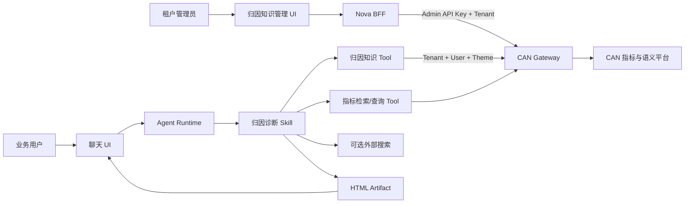
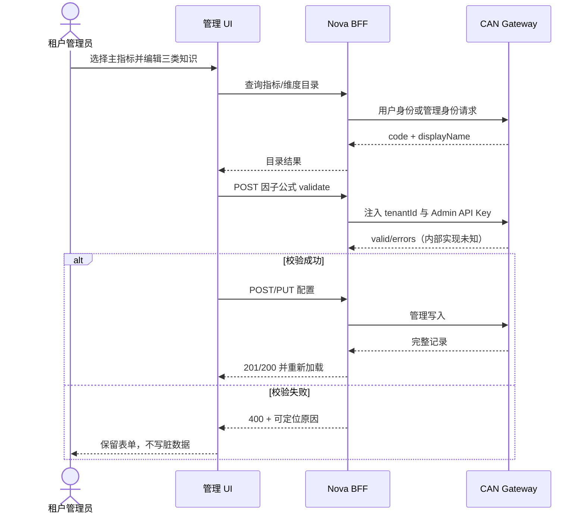
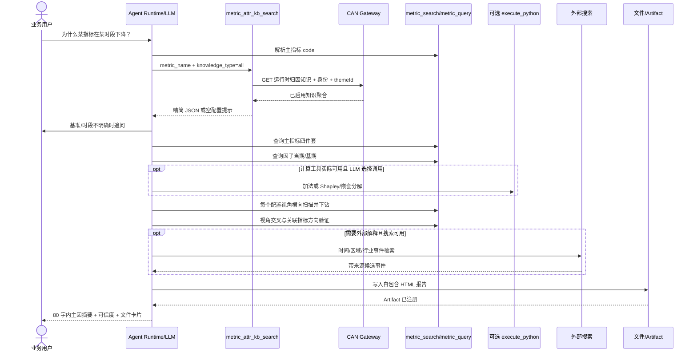
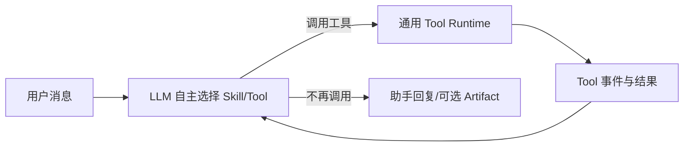
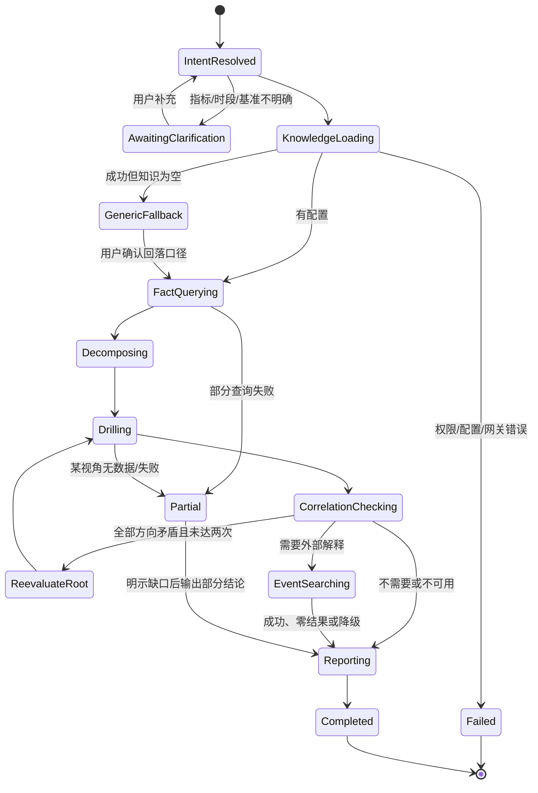
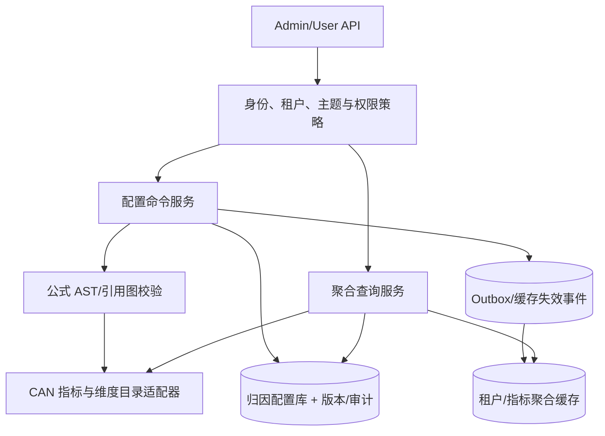

```
# 归因分析及知识辅助：自包含复刻说明

## 1. 结论与边界

本能力回答“指标为什么涨/跌、问题集中在哪里、结论有多可信”，不是一个固定算法接口，而是由两部分协作完成：

1. **租户归因知识管理面**：管理员按主指标维护因子公式树、维度下钻路径、关联指标及方向。Nova 把配置写入外部 CAN Gateway，Agent 产品本身没有这部分业务表。Gateway 是否持久化、使用何种介质以及删除是物理还是逻辑行为，当前均无法证明；只能把“后续请求可按契约再次读取”视为客户端依赖的 `F/REQ`。
2. **Agent 运行时诊断面**：用户在聊天中表达归因意图；Skill 期望 Agent 先读取租户配置，再查询指标数据，完成因子贡献、维度下钻、关联验证、外部事件辅助，最后生成 HTML 报告和短摘要。实际是否完整执行由 LLM 决定。

必须先澄清一个关键现状：当前没有归因专用的确定性 Orchestrator、步骤状态机或 Contribution Engine。实际执行者是通用 LLM Agent；`metric-attribution` Skill 向模型提供一份很长的操作说明，模型自主决定是否读取 Skill、以何种顺序调用工具、是否执行计算和是否完成回退。因而“源码中存在规则文本”只能证明提示内容存在，不能证明每轮都遵循。下文凡涉及固定五步、Shapley、交叉验证、可信度和回退，均明确区分为 `I`（Skill 文本存在）、`P`（大部分行为仍待稳定验收）或 `D`（推荐改造成确定性组件）。

目标用户包括业务分析人员、指标负责人、租户管理员和通过 Tool 调用能力的 Agent。核心输入是主指标、分析时段、比较基准、可选维度/过滤条件与业务上下文；核心输出是波动事实、因子贡献、维度落点、关联证据、外部事件候选、可信度、建议和可预览的报告文件。

明确不包含：

- 本文不把相关关系宣称为统计因果证明。归因结论本质上是“公式分解 + 数据切片 + 配置知识 + 外部上下文”的诊断解释。
- 当前没有“开始归因”的专用 REST 接口；真实分析从通用聊天入口触发，由 Skill 和工具循环编排。
- 当前管理配置只有租户作用域，未观察到系统级/个人级归因知识的继承、覆盖或版本发布机制。
- CAN Gateway、指标计算平台和外部搜索对端源码不在分析范围内；其内部实现只能依据调用契约反推。
- 本轮只做静态分析，没有运行服务或测试，因此不存在 `R`（运行验证）结论。

当前能力状态：

- `I`：管理 REST、三类知识 DTO、CAN Tool、租户/用户 Header、Skill 诊断规则和 UI 已存在。
- `A`：黑盒测试把配置 CRUD、启停过滤、跨租户隔离、运行时真实消费等作为验收目标；本轮未执行。
- `K`：测试台账记录了公式方括号语法不兼容、编辑默认状态丢失、批量删除失败无明确用户错误等缺口。
- `P`：贡献闭合、完整归因报告、外部事件、部分失败等大量语义用例仍是 planned，不能视为当前运行保证。

## 2. 术语与参与方

| 术语/参与方 | 定义与职责 |
|---|---|
| 主指标 | 被解释波动的指标；所有接口和 Tool 都使用稳定 metric code，而非展示名。 |
| 因子知识 | 一棵可递归公式树，描述主指标由哪些子指标通过加、减、乘等关系组成。 |
| 维度知识 | 一条有序下钻路径，例如“区域 → 城市 → 门店”。多个配置表示多个正交观察视角。 |
| 关联知识 | 主指标与另一个指标的预期同向 `POSITIVE` 或反向 `NEGATIVE` 关系及业务说明。 |
| Nova BFF | 提供浏览器管理 REST，解析登录身份、注入租户、转换 DTO，并代理管理请求。 |
| Agent Runtime | 识别 Skill、调用 LLM/Tool、发送实时事件并持久化过程数据。 |
| CAN 插件 | 注册指标查询和归因知识工具，校验项目元数据范围并访问 Gateway。 |
| CAN Gateway | 外部对端；Nova 调用其归因知识 CRUD/校验、指标目录和运行时知识接口。客户端只能确认请求、响应及后续消费契约；对端是否持久化、如何校验公式以及内部数据模型均为 `F`，兼容实现需按本文契约实现为 `REQ`。 |
| 指标语义平台 | Gateway 后面的指标/维度目录和查询系统；根据本地仓库映射，`semantic` 是 CAN 核心服务，`anymetrics` 是业务层，`jscip` 提供账号和数据源等基础配置。具体归因归属无法由本仓证明。 |
| 证据/Artifact 系统 | 保存工具执行证据、报告文件及前端可预览引用。 |



## 3. 业务规则

### 3.1 触发与基准

1. “为什么涨跌、归因、根因、下钻、贡献度、驱动因素、哪个维度导致”等意图应触发归因诊断；单纯问指标值不得过度触发。
2. 必须先把用户口语指标解析成 metric code，再读取归因知识；展示名只能用于 UI 和报告。
3. 比较基准支持环比、同比、目标值和同类实体。用户只说“为什么降了”时，设计规则是先确认基准；若必须默认，则采用环比并提示季节性行业考虑同比。
4. 目标值基准需要用户提供或由目标系统提供。Peer 基准默认均值，分布高度偏态时可用中位数，并建议展示主体排名分位。
5. 时间约束使用相对当前时间的表达式，避免把自然语言“本月/上月”固化成日期。所有因子、维度和关联指标必须使用相同当期与基准期。

### 3.2 配置优先级和回落

1. 租户配置是业务口径权威源，必须在分析前调用归因知识工具。
2. 只有明确返回“未配置归因知识”时才允许使用行业通用公式，并应告知用户并确认。
3. 一个因子配置时直接使用；多个因子配置时默认配置仅作为优先选择，若上下文更匹配非默认方案，可解释后切换。
4. 所有已启用维度配置都是正交视角，运行时忽略维度的 `isDefault`，必须分别扫描；这与管理 UI 的“默认”展示语义存在张力，复刻时应在产品文案中说明。
5. 每个已启用、未缺失的关联指标都必须验证方向；不能只挑支持结论的项。
6. `isMissing=true` 表示目录对象已删除：保留原始 code 供识别，但运行时跳过，必要时重新搜索替代对象并明确披露。
7. Skill 和产品设计要求运行时只消费 `enabled=true`、管理聚合保留停用记录；管理 DTO 与 Tool 输出形态支持这一推断，但最终过滤发生在无源码 Gateway，当前证据为 `F`，运行验收为 `A`。

### 3.3 配置管理规则

1. 任意本租户已认证用户可读；租户管理员才能新增、更新和删除。
2. 因子名称和非空树必填；保存前应执行无副作用的公式校验。
3. 公式校验至少覆盖语法、重复同级项、自引用、跨记录循环、未知指标、表达式与 items 不一致、空节点。
4. 维度名称和至少一个有效层级必填；层级数组有序，顺序就是下钻顺序。
5. 新建关联必须选择非主指标；编辑时 `relatedMetric` 不可改变，只能修改方向、说明和启用状态。
6. 因子/维度列表按默认项优先，再按名称和 ID 稳定排序；关联按 `relatedMetric` 和 ID 排序。
7. 一个指标的全部知识删除是“读取聚合后并发逐项删除”，不是 Gateway 原子事务。部分成功必须暴露失败并重新加载真实残留。
8. 管理配置没有系统/个人继承。运行时 Tool 是否可见则受独立的工具注册、工具组和 Agent 策略控制；配置存在不等于 Agent 已获工具能力。

配置和能力实际分成三条互不替代的链：

- **归因业务知识**：Nova 只观察到按 tenant + metric 读写单一聚合结果的 Gateway 契约，没有个人覆盖或向上回落端点。因无对端源码，不能据此断言 Gateway 内部只保存一份集合或不存在版本/历史；兼容复刻应让该聚合接口返回唯一当前有效视图。`F/REQ`
- **CAN 连接参数**：部署 YAML 提供默认值，身份作用域 ConfigStore 的同名参数可在运行时覆盖；删除覆盖后重新显露 YAML 默认值，类型错误的覆盖会被忽略并回落。复刻时应把具体作用域优先级交给统一配置解析器，而不是在归因 Tool 内硬编码。
- **Tool 可见性**：插件注册只表示系统“拥有”该 Tool；工具组存储配置可替换同名 YAML 工具组，Agent 策略再决定本轮是否暴露。UI 运行时验收会临时把 Tool 直接加入 `core-tools` 并确认 main Agent 绑定该组，证明归因知识存在本身不会绕过能力边界。

### 3.4 贡献与可信度规则

本节是当前 `metric-attribution` Skill 写给 LLM 的**提示规则**（规则文本本身为 `I`），不是后端强制执行的业务状态机。除少量 active 用例只证明出现过指标工具调用外，贡献闭合、完整下钻、关联回退和报告完整性大多是 `P`。

1. 波动事实至少查询主指标当期值、基期值、变化量和变化率四件套。
2. Skill 要求加法公式按分项差值分解、乘法公式用 Shapley 分配交叉项、嵌套树逐层分解并传播到主指标；当前没有强制 Contribution Engine，遵循程度依赖 LLM。
3. Skill 文本要求通过 `execute_python` 计算并禁止 LLM 心算，但 `execute_python` **不在该 Skill 的 `required_tools` 列表中**。因此一个满足 required_tools 的 Agent 仍可能没有计算工具，这是当前能力声明缺口。
4. 贡献度分母使用带符号总变化 `ΔY`，使同层贡献度之和为 `+100%`；负贡献度表示反向抵消实际变化。
5. 叶子对主指标贡献度绝对值 `>=30%` 为主根因，`10%~30%` 为次因；第一名 `<30%` 时标记“无明显数据主因”。阈值是当前 Skill 规则，不是统计显著性。
6. 维度值贡献度为该切片变化量除以总变化量；绝对值 `>=30%` 标主要贡献，`10%~30%` 标次要贡献。
7. 两个以上正交视角都找到主要贡献维值时，必须用交叉过滤区分独立、投影和部分相关。相对差 `<=20%` 可视为近似相等，交叉量占较小值 `<20%` 可视为显著较小。
8. 关联方向全部一致且至少两条为高可信；有一致也有矛盾为中；全矛盾为可能错并回退下一候选根因，最多回退两次；仍矛盾则不强出单一根因。
9. 外部事件按时间、空间、方向、量级各取高/中/低分，平均分 `>=0.5` 才保留，最多两个；无数据主因且事件得分 `>=0.75` 时只能升级为“主根因候选”，始终标记推测性。

外部事件步骤还引用 `WebSearch`，但 WebSearch 同样不在 `required_tools` 中。缺少搜索时，Skill 允许请求用户补充或只报告内部证据；当前没有机制保证模型一定按此降级。复刻时应通过正式能力安装为该 Skill 声明**必需的受限计算服务**，把搜索声明为可选 capability；不得为归因场景绕过工具注册、工具组、Agent 策略或 MCP 可见性而偷偷开放工具。

当前 frontmatter 实际只声明：`metric_search`、`metric_attr_kb_search`、`metric_dimensions`、`metric_dimension_resolve`、`metric_query`、`write_file`。`execute_python` 和 `WebSearch` 缺席，因此“required tools 均可用”仍不足以完成 Skill 正文承诺的所有步骤。

## 4. 完整执行链路

### 4.1 管理配置链路



管理页以“已经至少有一条归因知识的主指标”为列表单位。用户从指标目录选一个尚未配置的指标时，它先是浏览器 pending 项；没有保存任何子项就刷新或移除，不应在 Gateway 留记录。详情聚合一次读取三类知识，停用记录仍展示。只读扩展入口沿用相同数据，但隐藏新增、编辑、删除动作，并禁用开关。

删除整个指标配置时，BFF 先获取聚合详情，再为每个 factor、dimension、correlation 创建并发删除任务。所有任务完成后统计失败；任一失败向上抛异常，不回滚已成功删除的项。UI 应重新读取并展示残留，而不是假定全部删除成功。

### 4.2 Skill 期望的归因链路（规则文本 `I`，完整执行 `P`）



图中顺序表达的是 Skill 期望路径，不是 Runtime 强制流程。当前 LLM 可以跳步、重排或在工具不可用时退化；自然触发和完整链路尚未被稳定证明。

### 4.3 当前真实控制流与推荐状态机

当前真实控制流只有通用 Agent tool loop：



下列归因状态机是为了让其他工程可靠复刻而提出的 `D` 级目标设计，并非 Nova 当前已有实现：



当前代码把可观察过程保存在通用聊天工具事件和助手消息 `processData` 中，没有独立 attribution job 表、步骤 checkpoint 或可恢复诊断工作流。因此不能把上述状态转换当作当前保证；进程重启后的精确步骤恢复属于待补能力。

## 5. 对外契约

### 5.1 浏览器管理 REST

统一前缀：`/api/settings/attribution-knowledge`。认证沿用产品登录态；服务端从可信请求上下文取得 tenantId，忽略并覆盖浏览器伪造的 `tenantId`、`metricName`。GET 为本租户可读，写方法要求租户管理员。

| 方法与路径 | 请求 | 成功响应 | 关键语义 |
|---|---|---|---|
| `GET /metrics` | `keyword?`, `pageNumber?`, `pageSize?` | 分页对象 | page 默认 1，size 默认 20，最大 200；未配管理网关时返回空页。 |
| `GET /metrics/{metricName}` | 无 | 完整聚合 JSON | 含停用记录。 |
| `DELETE /metrics/{metricName}` | 无 | `204` | 空配置幂等；非原子并发 fan-out。 |
| `GET /metrics/{metricName}/factors` | `enabledOnly?` | 因子数组 | `true` 时过滤显式停用项。 |
| `POST /metrics/{metricName}/factors/validate` | `{tree}` | `204` | 无副作用；Gateway `valid=false` 被翻译为 400。 |
| `POST /metrics/{metricName}/factors` | 因子写入体 | `201` + 完整记录 | 服务端注入 tenant/metric。 |
| `PUT .../factors/{id}` | 因子写入体 | `200` + 完整记录 | 整树替换。 |
| `DELETE .../factors/{id}` | 无 | `204` | 按 ID 删除。 |
| `GET/POST/PUT/DELETE .../dimensions[/{id}]` | 维度写入体 | 数组、`201/200` 或 `204` | BFF 把字符串层级转成对象层级。 |
| `GET/POST/PUT/DELETE .../correlations[/{id}]` | 关联写入体 | 数组、`201/200` 或 `204` | 更新时不发送 relatedMetric。 |

完整管理示例：

```http
POST /api/settings/attribution-knowledge/metrics/revenue/factors
Content-Type: application/json

{
  "name": "收入业务公式",
  "isDefault": true,
  "enabled": true,
  "tree": {
    "expression": "visitor_count * conversion_rate * average_order_value",
    "items": [
      {"metricName": "visitor_count", "children": null},
      {"metricName": "conversion_rate", "children": null},
      {"metricName": "average_order_value", "children": null}
    ]
  },
  "remark": "由业务负责人维护"
}
```

```json
{
  "id": "factor-01",
  "name": "收入业务公式",
  "isDefault": true,
  "enabled": true,
  "tree": {
    "expression": "visitor_count * conversion_rate * average_order_value",
    "items": [
      {"metricName": "visitor_count", "metricDisplayName": "访客数", "isMissing": false},
      {"metricName": "conversion_rate", "metricDisplayName": "转化率", "isMissing": false},
      {"metricName": "average_order_value", "metricDisplayName": "客单价", "isMissing": false}
    ]
  },
  "remark": "由业务负责人维护",
  "updatedAt": 1785974400000
}
```

维度请求：

```json
{
  "name": "地域视角",
  "isDefault": false,
  "enabled": true,
  "levels": ["region", "city", "store"],
  "remark": "从区域下钻到门店"
}
```

BFF 发给 Gateway 时转换为：

```json
{
  "tenantId": "tenant-001",
  "metricName": "revenue",
  "name": "地域视角",
  "isDefault": false,
  "enabled": true,
  "levels": [
    {"dimensionName": "region"},
    {"dimensionName": "city"},
    {"dimensionName": "store"}
  ],
  "remark": "从区域下钻到门店"
}
```

关联请求：

```json
{
  "relatedMetric": "refund_rate",
  "direction": "NEGATIVE",
  "description": "退款率上升通常压低净收入",
  "enabled": true
}
```

错误约定：

- Gateway 异常：沿用有效的上游 4xx/5xx；若上游状态小于 400，则 BFF 返回 502。错误体为 `{"error":"...","gatewayStatus":400,"gatewayBody":"..."}`。
- 参数/校验异常：400，`{"error":"..."}`。
- Gateway URL 或 Admin Key 未配置：503，`{"error":"Gateway 未配置：..."}`。
- 鉴权/管理员拒绝由全局权限机制处理；复刻时建议统一 401/403 Problem Details，不返回上游内部堆栈或完整敏感响应。

### 5.2 Agent Tool 契约

Tool 名称为 `metric_attr_kb_search`，分类为 analytics，结果保留策略可压缩。

```json
{
  "type": "object",
  "properties": {
    "metric_name": {
      "type": "string",
      "description": "Raw metric code, not display name"
    },
    "knowledge_type": {
      "type": "string",
      "enum": ["factors", "dimensions", "correlations", "all"]
    }
  },
  "required": ["metric_name"]
}
```

实现会兼容 `metric`、`metricName`、`metricCode`、`metric_code`、`name` 等非规范别名，但正式调用应只用 `metric_name`。Tool Schema 没有声明 JSON Schema `default`；默认行为发生在 Java 参数解析阶段：`knowledge_type` 缺省、空白或未知时都解析为 `all`。调用方不能仅依据 Schema 推断该默认值。

成功结果是给 LLM 的精简 JSON：

```json
{
  "metricName": "revenue",
  "metricDisplayName": "收入",
  "factors": [{
    "name": "收入业务公式",
    "isDefault": true,
    "tree": {
      "expression": "visitor_count * conversion_rate * average_order_value",
      "items": [
        {"metricName": "visitor_count", "metricDisplayName": "访客数"},
        {"metricName": "conversion_rate", "metricDisplayName": "转化率"},
        {"metricName": "average_order_value", "metricDisplayName": "客单价"}
      ]
    },
    "remark": "由业务负责人维护"
  }],
  "dimensions": [{
    "name": "地域视角",
    "isDefault": false,
    "levels": [
      {"dimensionName": "region", "dimensionDisplayName": "区域"},
      {"dimensionName": "city", "dimensionDisplayName": "城市"},
      {"dimensionName": "store", "dimensionDisplayName": "门店"}
    ]
  }],
  "correlations": [{
    "relatedMetric": "refund_rate",
    "relatedMetricDisplayName": "退款率",
    "direction": "NEGATIVE",
    "description": "退款率上升通常压低净收入",
    "isMissing": false
  }],
  "truncated": false
}
```

精简视图剔除 `id/enabled/updatedAt`，`isMissing=false` 通常省略。因子树超过 6 层时删除更深 children 并设置顶层 `truncated=true`。三类数组都空时返回成功文本：

```text
No attribution knowledge configured for this metric; fall back to generic industry formulas.
```

该空结果不是错误，避免 UI 将 Tool 卡片标红。缺 `metric_name` 返回错误 `metric_name is required.`；已知不存在的指标返回 `metric '<code>' not found in metrics platform.`；网络、无身份、权限、JSON 损坏、非预期上游错误返回 `Error: ...` 并附 HTTP 状态和 endpoint（可获得时）。

Tool 请求还会执行输入输出元数据范围校验：输入主指标、返回中的 `metricName/relatedMetric` 和 `dimensionName` 均不得越过当前 Project 授权范围。

### 5.3 配置契约与覆盖

| 配置键 | 用途 | 默认/覆盖语义 |
|---|---|---|
| `nova.metric.gateway-url` | 管理 BFF 使用的 Gateway 基地址，也可作为 V2 CAN 插件兼容来源 | 无安全内置生产地址；必须显式设置。 |
| `nova.metric.admin-api-key` | 管理读写的服务端 Admin Key | 必填于管理能力；只由服务端读取。 |
| `nova.can.gateway-url` / Tool 键 `can.gateway-url` | CAN 插件规范 Gateway 地址 | 优先于 legacy `nova.metric.gateway-url` 桥接值；身份作用域动态配置可再覆盖部署默认。 |
| `can.http.connect-timeout-seconds` | 建连超时 | 默认 15。 |
| `can.http.request-timeout-seconds` | 单请求超时 | 默认 60；ToolExecutionContext 可覆盖且最小为 1。 |
| `can.http.max-error-body-chars` | 暴露给 LLM/UI 的上游错误正文上限 | 默认 500。 |

运行时配置解析伪代码：

```text
gatewayUrl = scopedConfig.resolve("can.gateway-url")
          ?? deployment.nova.can.gatewayUrl
          ?? bridgedLegacyNovaMetricGatewayUrl
          ?? error("gateway-url not configured")

requestTimeout = positiveInt(scopedConfig.resolve("can.http.request-timeout-seconds"))
              ?? deploymentDefault(60)
```

归因 Tool 不允许把 `themeId` 或租户/用户身份作为配置项暴露给模型；这些是每次执行的权威场景上下文。

### 5.4 CAN Gateway 观察到的契约

管理面：

```text
GET    /api/mgmt/attribution/metrics
GET    /api/mgmt/attribution/metrics-page?keyword=&pageNumber=&pageSize=
GET    /api/mgmt/attribution/metrics/{metric}?knowledgeType=&onlyDefault=
POST   /api/mgmt/attribution/metrics/{metric}/factors
POST   /api/mgmt/attribution/metrics/{metric}/factors/validate
PUT    /api/mgmt/attribution/metrics/{metric}/factors/{id}
DELETE /api/mgmt/attribution/metrics/{metric}/factors/{id}
POST/PUT/DELETE 对 dimensions 和 correlations 使用同构路径
```

管理 Header：

```http
X-API-Key: <server-side-admin-key>
X-Tenant-Id: <authenticated-tenant-id>
```

请求体里的 tenantId 只用于一致性校验，真正租户来源必须是可信 Header。Admin Key 只能驻留服务端，不能返回浏览器。

运行时：

```http
GET /api/metrics/{urlEncodedMetricName}/attribution?knowledgeType=all&themeId=<bound-theme>
X-Tenant-Id: <tenant-id>
X-User-Id: <user-id>
```

Nova 客户端在 Personal 场景没有主题时省略 `themeId` 表示全部主题；Project 场景由服务端绑定具体 `dataThemeId`，不允许 LLM 传 themeId，缺失时客户端失败关闭。这是 `I` 级 Nova 请求行为；Gateway 最终是否正确执行主题权限仍为 `F/A`。默认连接超时 15 秒、请求超时 60 秒、错误正文最多返回 500 字符；这些参数可由身份作用域配置覆盖。

Gateway 响应观察为统一 envelope：

```json
{
  "success": true,
  "message": "ok",
  "data": {
    "metricName": "revenue",
    "metricDisplayName": "收入",
    "factors": [],
    "dimensions": [],
    "correlations": []
  }
}
```

工具兼容 `HTTP 200 + success=false`，并将其转成失败。管理客户端则读取 envelope 的 `data`。管理聚合还兼容另一种形式：顶层 `metric:{name,displayName}` 加三类数组，BFF 会规范化为 `metricName/metricDisplayName`。

### 5.5 实时和持久化事件

归因没有专用 WS 消息，沿用通用 Tool 事件。UI 运行时用例要求观察：

```json
{
  "type": "tool_exec_end",
  "toolName": "metric_attr_kb_search",
  "success": true,
  "result": "{...possibly truncated live result...}"
}
```

对话结束后，助手消息的 `processData.events` 应保存权威原始 Tool 结果：

```json
{
  "type": "tool_exec",
  "tool": "metric_attr_kb_search",
  "args": "{\"metric_name\":\"revenue\",\"knowledge_type\":\"all\"}",
  "outputBytes": 1482,
  "result": "{\"metricName\":\"revenue\",...}",
  "success": true
}
```

实时结果可能为展示而截断，运行时验收应以持久化原始结果为权威，不以模型最终文案代替 Tool 证据。

需要限制这两条运行时测试能证明的范围：`ATTR-25/26` 会临时修改 `core-tools`、确认 main Agent 绑定，并用强制提示明确要求调用 `metric_attr_kb_search`，最多换三个新会话重试。它们能证明“工具被正式暴露且被强制调用时，启用/停用配置影响原始结果”，不能证明自然语言归因问题会自动命中 Skill、自然选中该 Tool、按五步顺序完成诊断。

自然链路目前存在以下 planned 缺口。第三列逐项转述 YAML `reason` 中的 **release 历史观察**；这些记录解释了用例为何保持 `P`，不代表本轮 `R`，也不自动等同于 YAML `known_failure` 状态：

| 用例 | 想证明的行为 | 尚不稳定的原因 |
|---|---|---|
| `ATTR-TRIG-002` | 不出现“归因”二字的“为什么跌了”仍先读取归因知识 | release 连续两次完成，但都绕过 `metric_attr_kb_search`，直接回落到 `metric_query`。 |
| `ATTR-TRIG-003` | “哪个维度导致下降”先读取归因知识，再按配置下钻 | release 连续两次同样未调用 `metric_attr_kb_search`，而是直接 `metric_query`。 |
| `ATTR-TRIG-006` | “查询 + 为什么”的复合意图按 `metric_attr_kb_search → metric_query` 编排 | release 先调用 `search_knowledge` 再调用 `metric_query`，始终没有调用归因知识 Tool；精确归因编排尚未实现。 |
| `ATTR-KNOW-005` | 明确要求直接调用归因知识 Tool | release 三次运行均把请求委派给 `call_sub_agent` / `search_knowledge`，所以直接 Tool 契约不稳定。 |
| `ATTR-KNOW-006` | 空 `metric_name` 经直接 Tool 返回失败 | release 在直接 `metric_attr_kb_search` 与 `call_sub_agent` 之间交替，无法稳定观察缺参边界。 |
| `ATTR-KNOW-007` | 不存在的 metric code 经直接 Tool 返回受控失败 | release 同样在直接 `metric_attr_kb_search` 与 `call_sub_agent` 之间交替，无法稳定观察未知指标边界。 |

因此验收不得把“出现任意 metric 工具”当作 `metric_attr_kb_search` 的替代，也不得把强制 prompt 用例当作自然触发证据。允许的替代路径必须事先定义，例如指标含糊时先 `metric_search` 或追问；一旦已解析明确 code 且进入归因流程，仍应观察到归因知识 Tool 或明确的能力不可用错误。

## 6. 数据模型与生命周期

当前归因知识不在 Nova 数据库建表。其逻辑模型如下，复刻时可以由 Gateway 存储实现：

```sql
CREATE TABLE attribution_factor (
  id              VARCHAR(64) PRIMARY KEY,
  tenant_id       VARCHAR(128) NOT NULL,
  metric_name     VARCHAR(256) NOT NULL,
  name            VARCHAR(256) NOT NULL,
  is_default      BOOLEAN NOT NULL DEFAULT FALSE,
  enabled         BOOLEAN NOT NULL DEFAULT TRUE,
  tree_json       JSON NOT NULL,
  remark          TEXT,
  version         BIGINT NOT NULL DEFAULT 0,
  updated_at      TIMESTAMP NOT NULL,
  UNIQUE (tenant_id, metric_name, name)
);

CREATE TABLE attribution_dimension (
  id              VARCHAR(64) PRIMARY KEY,
  tenant_id       VARCHAR(128) NOT NULL,
  metric_name     VARCHAR(256) NOT NULL,
  name            VARCHAR(256) NOT NULL,
  is_default      BOOLEAN NOT NULL DEFAULT FALSE,
  enabled         BOOLEAN NOT NULL DEFAULT TRUE,
  levels_json     JSON NOT NULL,
  remark          TEXT,
  version         BIGINT NOT NULL DEFAULT 0,
  updated_at      TIMESTAMP NOT NULL,
  UNIQUE (tenant_id, metric_name, name)
);

CREATE TABLE attribution_correlation (
  id              VARCHAR(64) PRIMARY KEY,
  tenant_id       VARCHAR(128) NOT NULL,
  metric_name     VARCHAR(256) NOT NULL,
  related_metric  VARCHAR(256) NOT NULL,
  direction       VARCHAR(16) NOT NULL CHECK (direction IN ('POSITIVE','NEGATIVE')),
  description     TEXT,
  enabled         BOOLEAN NOT NULL DEFAULT TRUE,
  version         BIGINT NOT NULL DEFAULT 0,
  updated_at      TIMESTAMP NOT NULL,
  UNIQUE (tenant_id, metric_name, related_metric)
);
```

上述 SQL 是 `D` 推荐模型，不是 Nova 当前数据库事实。生产实现还应有默认项唯一约束，例如每个 `(tenant, metric)` 至多一个启用默认 factor/维度，可用部分唯一索引或事务校验；当前静态代码只显示 UI/API 期望，没有证明 Gateway 的约束方式。

生命周期证据必须逐项限定：

- `I`：Nova BFF 的因子更新发送完整 tree，维度更新发送完整 levels，关联更新主动移除 relatedMetric；这证明客户端的替换式请求形态，不证明 Gateway 内部更新算法。
- `I`：删除接口返回 204；整指标清空由 BFF 先读再并发调用逐项 DELETE，可能部分成功。
- `A`：UI/API 用例期望保存后可重新读取、停用项留在管理聚合、运行时新会话不返回停用测试标记；本轮未运行。
- `K`：`NOVA-BUG-034/ATTR-27` 证明 UI 对 `isMissing=true` 的处理不一致：因子节点和关联显示“已失效”，主指标与维度层级只显示 code，没有明确缺失标记。
- `K`：`NOVA-BUG-035/ATTR-29` 证明 `truncated=true` 被 UI 忽略，已有节点被呈现得像完整树。与之分开，`ATTR-28` 的 30 层 `truncated=false` 树可浏览只是 `A` 级测试契约，不是本轮运行事实。
- `F`：运行时响应似乎过滤停用项，目录删除后对端似乎保留记录并 enrich `isMissing`；这些由 DTO、注释和测试预期共同支持，但没有 Gateway 源码或本轮运行验证，不能写成保证。
- `F`：DELETE 看起来移除记录，但无法证明对端介质是数据库、删除是物理还是软删除、是否存在历史表、缓存或异步审计。
- `D`：创建时生成不可变 ID/版本、乐观锁、软删除/恢复、配置历史、原子批量删除和明确缓存失效，均是生产复刻建议。

## 7. 核心实现设计

### 7.1 当前实现与推荐模块划分

当前 `I` 级实现只有：通用 LLM/Tool Loop、归因 Skill 文本、归因知识 Tool、其他 CAN 指标工具、通用文件/Artifact 能力和管理 BFF。没有下面名为 `AttributionDiagnosticOrchestrator`、`ContributionEngine`、`DimensionDrillEngine` 的服务。

以下模块图整体是 `D` 级目标设计：

```text
AttributionAdminController
  -> AttributionApplicationService
     -> AttributionGatewayPort

AttributionKnowledgeTool
  -> Identity/Theme/MetadataScopePolicy
  -> AttributionGatewayPort.runtimeRead
  -> LeanKnowledgeRenderer

AttributionDiagnosticOrchestrator
  -> IntentAndBaselineResolver
  -> MetricQueryPort
  -> ContributionEngine
  -> DimensionDrillEngine
  -> CorrelationVerifier
  -> ExternalContextPort
  -> ReportRenderer
  -> ArtifactPort
```

推荐管理面和 Tool 面共用稳定领域结构，但分离认证：管理请求使用服务密钥 + 租户，Tool 请求使用最终用户身份 + 服务端绑定主题。这也是目标设计要求，不应倒写成 Gateway 已证明的内部架构。

### 7.2 推荐确定性 Orchestrator 伪代码（`D`）

伪代码把当前 Skill 的提示性固定顺序、阈值和两次回退固化成可测试控制流；Nova 当前由 LLM 自主编排，并不保证执行该顺序。

```text
diagnose(request, identity, scene):
  metric = resolveMetricCode(request.metricText)
  baseline = resolveOrAskBaseline(request)
  scope.assertMetricAllowed(metric, scene)

  knowledge = attributionTool.get(metric, ALL, identity, scene.theme)
  if knowledge.isEmpty:
      formulaMode = askOrDeclareGenericFallback(metric)
  else:
      formulaMode = selectFactor(knowledge.factors, request.context)

  fact = queryFourTuple(metric, request.period, baseline, request.filters)
  if fact.delta == 0:
      return reportNoChange(fact)

  factorEvidence = []
  if formulaMode.exists:
      values = queryAllLeafMetrics(formulaMode.tree, sameWindowAndFilters)
      factorEvidence = contributionEngine.decompose(formulaMode.tree, values)
  roots = selectRoots(factorEvidence, threshold=0.30)
  targetMetrics = roots.nonEmpty ? roots : [metric]

  dimensionEvidence = []
  for each targetMetric:
      views = knowledge.dimensions.nonEmpty
          ? allEnabledNonMissingViews(knowledge)
          : selectFallbackViews(metric)
      for each view:
          top = queryContributionBy(view.levels[0])
          drill = drillTopOneOrTwo(top, view.levels, threshold=0.30)
          dimensionEvidence.add(drill)
      dimensionEvidence.correlateTerminalPoints()

  correlationEvidence = verifyEveryConfiguredCorrelation(
      knowledge.correlations, fact.direction, sameWindowAndFilters)
  confidence, nextRoot = scoreAndMaybeFallback(correlationEvidence)
  repeat at most twice if nextRoot exists

  externalEvidence = optionalSearchAndScore(request, fact, dimensionEvidence)
  report = renderSelfContainedHtml(fact, factorEvidence, dimensionEvidence,
                                   correlationEvidence, externalEvidence, confidence)
  artifact = artifactPort.write(report)
  return shortSummary(fact, roots, confidence) + artifact
```

### 7.3 确定性贡献引擎

本节全部是 `D` 级实现建议。当前 Skill 内嵌了类似 Python helper 文本，但计算工具未列为 required tool，相关闭合用例大多为 `P`。乘法单层可用以下 Shapley 贡献实现：

```python
from itertools import combinations
from math import factorial

def shapley_product(base, current):
    names = list(base)
    n = len(names)
    out = {}
    for x in names:
        value = 0.0
        others = [name for name in names if name != x]
        for k in range(n):
            for subset in combinations(others, k):
                selected = set(subset)
                with_x = without_x = 1.0
                for name in names:
                    if name == x:
                        with_x *= current[name]
                        without_x *= base[name]
                    elif name in selected:
                        with_x *= current[name]
                        without_x *= current[name]
                    else:
                        with_x *= base[name]
                        without_x *= base[name]
                weight = factorial(k) * factorial(n-k-1) / factorial(n)
                value += weight * (with_x - without_x)
        out[x] = value
    return out
```

上述示例对每个目标因子、每个子集都重新遍历全部 `n` 个因子，实际时间复杂度是 `O(n²·2^n)`；只有预计算子集乘积、增量维护乘积或采用等价优化后，才可接近 `O(n·2^n)`。生产实现不能无限制运行，至少增加：

1. **规模限制**：默认精确计算最多 10 个同层因子；11～20 个使用带固定随机种子、可配置样本数和误差估计的 permutation sampling；超过 20 个拒绝并要求业务重构因子层级。阈值可配置，但必须有硬上限。
2. **超时与取消**：每层和整棵树都有 deadline，传播 cancellation token；超时返回 `CALCULATION_TIMEOUT` 和未完成节点，不伪造部分贡献为闭合结果。
3. **输入检查**：任何 base/current 为 null、非数、NaN 或 Infinity 立即拒绝，并返回具体 metric/period。禁止静默转 0。
4. **单位检查**：加法项必须同单位；乘法树为每个节点声明单位并验证父单位可由子项推导。百分比、百分点、金额和计数不得混算。
5. **负值和零值**：负数在会计型加法可合法，在乘法业务公式中需由公式元数据明确允许；未知时拒绝。`delta=0` 时不得计算贡献百分比，应输出“主指标无净变化”，同时保留各因子的正负绝对贡献作为相消证据。
6. **嵌套零分母**：父节点 `delta=0` 时不能沿 `child/parentDelta` 传播；标记该父节点为 `OFFSETTING_EFFECTS`，展示其子项变化，但不声称对主指标贡献度。
7. **闭合容差**：使用 `abs(error) <= max(absTol, relTol * max(1, abs(delta)))`，例如 `absTol=1e-9`、`relTol=1e-8`；货币还应在最小币种单位舍入后复核。采样 Shapley 同时报告置信区间，不使用精确等式措辞。
8. **证据输出**：保存输入快照、公式版本、算法、样本/种子、运行时长、容差、闭合误差和异常节点，报告中的每个贡献数字必须能追溯到该结果。

精确场景验证不变量为 `sum(contribution) ≈ currentProduct - baseProduct`。嵌套树逐层执行：加法层子项贡献等于自身 delta，乘法层用 Shapley；只有父 delta 非零且单位合法时，才可用 `parentContribToMain * childContribToParent / parentDelta` 传播到主指标。

### 7.4 最小版与生产版

| 能力 | 最小兼容版 | 生产级版 |
|---|---|---|
| 配置 | 三张表/JSON 树、CRUD、启停、租户隔离 | 版本、审计、审批发布、冲突检测、回滚 |
| 公式 | 加法和扁平乘法 | AST、单位/类型检查、嵌套 Shapley、复杂度上限 |
| 维度 | 一条视角、逐层 Top-1 | 多正交视角、交叉验证、高基数治理 |
| 关联 | 方向一致性 | 时滞、置信区间、历史稳定性和漂移检测 |
| 运行 | 同步 Tool loop | 可恢复工作流、步骤 checkpoint、取消/重跑 |
| 报告 | JSON + Markdown 摘要 | 自包含 HTML、图表、血缘、可访问性、导出 |
| 外部事件 | 人工输入 | 受控搜索、来源评级、去重、时空对齐 |

## 8. 并发与非正常路径

| 情况 | 当前行为/风险 | 复刻要求 |
|---|---|---|
| 同一配置并发编辑 | 未观察到版本字段或 ETag；后写可能覆盖先写。 | `D` 使用版本号或 `If-Match`，409 返回最新快照。 |
| 重复创建 | Gateway 唯一性语义未被源码证明。 | `(tenant, owner metric, name/related metric)` 唯一，重复请求支持幂等键。 |
| 批量清空部分失败 | 已成功删除不回滚，BFF 抛首个异常并记录全部失败。 | 返回 207/operation result 或建立原子批量端点；UI 强制重新加载。 |
| Tool 超时 | 单请求默认 60 秒，抛可定位 `Error:`。 | 不应把超时当知识为空；停止基于缺失知识继续推理。 |
| 外部检索失败 | Skill 设计允许只凭内部证据并披露缺外部佐证。 | 保持 fail-soft，禁止杜撰事件。 |
| 某维度无数据 | 规划期望是跳过该视角并继续。 | 报告标“无数据”，其余视角继续，可信度下调。 |
| 高基数维度 | 规划要求收敛 Top-N，当前运行保证不足。 | 限制返回量、保留 Others、确保分项与总量闭合。 |
| 因子树过深 | Tool 发送给 LLM 时截断到 6 层并标记。 | 保存端也应限制节点数/深度；截断不得伪装完整。 |
| 指标删除 | `isMissing` 行为来自 DTO/测试推断；真实删除未验证，且 UI 有 NOVA-BUG-034。 | 管理 UI 一致显示 code 与失效标识，并提供重新绑定流程。 |
| 网络断线/页面刷新 | 通用会话会保存 Tool 过程；归因无独立 checkpoint。 | 生产版把每步输入、输出、状态持久化，按幂等 step key 恢复。 |
| 用户取消 | 由通用 Agent 取消链路处理，未观察到归因专属补偿。 | 传播 cancellation token 到查询、计算、搜索和报告；已完成只读步骤无需回滚。 |
| 重复查询 | Skill 明确同一会话中相同 metrics/dimensions/filters/timeConstraint 只查一次。 | 以规范化查询指纹做会话内去重缓存。 |

部分结果和完整失败必须区分：知识读取失败、身份/权限失败属于终止错误；知识为空属于正常回落；某个维度/外部搜索失败可生成“部分归因”报告，但必须列出缺口，不能伪装完整。

## 9. 安全、权限和审计

1. tenantId、userId、projectId、dataThemeId 必须由可信服务端上下文绑定，不能作为 LLM 可写参数。
2. 管理写操作必须要求租户管理员；只读扩展页不能只靠隐藏按钮，服务端仍需拒绝写请求。
3. 管理 Admin API Key 仅服务端保存，日志、错误体、浏览器网络响应和测试附件都不得出现明文。
4. Tool 输入和输出均做对象级元数据范围校验，防止 Agent 通过关联配置把未授权 metric/dimension 带入上下文。
5. Gateway 的 401/403 和“HTTP 200 success=false 的无权限文案”都应归类为终止性权限错误，不做盲目重试或换写法绕过。
6. `description`、remark、displayName 和外部搜索结果都是不可信文本。进入 LLM 时应作为数据引用而非指令，防止提示注入。
7. 审计事件至少记录：配置增删改/启停/设默认、公式校验、批量清空、Tool 调用、越权拒绝、外部搜索、报告生成。记录 ID、租户、用户、对象、版本和结果，不记录密钥与完整敏感数据。
8. HTML 报告应清洗脚本与 URL；若允许 ECharts 脚本，只允许平台内置固定资源并在落盘时内联。禁止将模型生成的任意远程脚本直接执行。

## 10. 外部依赖对端设计

### 10.1 已观察到的 CAN 对端语义

Gateway 同时提供管理写读和运行时聚合读取，但对端结论必须逐项分级：

| 对端语义 | 等级 | 能证明到哪里 |
|---|---|---|
| 管理请求携带 `X-API-Key + X-Tenant-Id`；运行时请求携带 `X-Tenant-Id + X-User-Id` | `I` | 证明 Nova 发出的 Header，不证明 Gateway 最终如何鉴权。 |
| BFF 从可信请求上下文取 tenant，写入 body 并传 Header | `I` | 证明 Nova 侧不信任浏览器 tenant；最终隔离仍依赖对端正确执行。 |
| 跨租户用例要求不可见 | `A` | 是 active 黑盒契约，本轮未运行，不能升级为对端保证。 |
| 管理响应 DTO 带 enabled，运行时 renderer 会剥掉 enabled | `I` | 证明 Nova 结构和渲染；不单独证明 Gateway 已过滤停用项。 |
| 启用/停用配置影响运行时 Tool 原始结果 | `A` | `ATTR-25/26` 强制 prompt + 临时工具安装场景；本轮未运行。 |
| 运行时对端只返回 enabled=true | `F` | 由注释、UI 设计和测试意图共同支持，无对端源码/运行验证。 |
| 管理公式校验解析 `{valid,errors}`，`valid=false` 可来自 HTTP 200 | `I` | 证明客户端兼容此响应；实际 parser/校验覆盖范围未知。 |
| 管理列表请求支持 keyword/page 并读取 `metricName/displayName/isMissing` | `I` | 证明调用与解析契约；排序、完整性和实际目录补全算法未知。 |
| `isMissing` 由对端目录 enrich 且悬挂记录会保留 | `F` | DTO/UI 用例支持该推断；真实目录删除未测试，且 UI 现有 `K`。 |
| 关联更新不发送 relatedMetric | `I` | 证明 Nova 客户端约束；不证明对端唯一键或不可变约束。 |
| `(tenant, ownerMetric, relatedMetric)` 唯一 | `F` | DTO 注释和测试清理逻辑支持，未见 Gateway 存储/约束源码。生产唯一约束属于 `D`。 |
| DELETE 返回成功后记录物理消失 | `F` | 客户端只观察接口结果；无法证明物理删除、软删除、墓碑或历史表。 |
| `themeId` 作为 query 传给运行时端点 | `I` | 证明请求字段；最终主题权限校验是 `F`/验收要求。 |
| Gateway 存储介质、事务、缓存、版本和内部服务拆分 | 未知 | 不得推断为数据库或任何具体中间件；本文 SQL/缓存/outbox 都是 `D`。 |
| 原子批量删除、结构化错误码、审计历史 | `D` | 生产级推荐，当前交互没有证明。 |

还无法证明 Gateway 是否执行统计归因计算。Nova 交互只显示它提供知识与 CAN 查询能力；Shapley 和交叉规则存在于 Skill 文本，当前也没有强制的本地确定性计算服务。

### 10.2 最小兼容 Stub

```text
route GET /api/metrics/:metric/attribution:
  require X-Tenant-Id and X-User-Id
  authorize user can read metric under optional themeId
  if metric not in catalog: return 400 "unknown metric: <metric>"
  rows = store.find(tenant, metric, enabled=true)
  enrich every metric/dimension reference from catalog
  return {success:true,message:"ok",data:aggregate(rows)}

route POST /api/mgmt/attribution/metrics/:metric/factors/validate:
  require valid X-API-Key and X-Tenant-Id
  verify metric exists
  errors = validateTree(body.tree, ownerMetric=metric)
  return {success:true,data:{valid:errors.empty,errors}}

route POST/PUT management records:
  require admin key + tenant
  ensure body.tenantId absent or equals header tenant
  validate all references and uniqueness
  save and return enriched record
```

Stub 可用内存 Map，键必须包含 tenant；目录至少提供主指标、因子指标、维度、displayName 和权限集合。错误响应要能模拟空知识、未知指标、无权限、超时、非法 JSON 和 success=false。

### 10.3 生产级 Gateway 参考架构



推荐使用 AST 而不是仅保存表达式字符串：节点引用 metric code，运算符使用白名单；在保存事务中校验语法、单位、未知对象、自引用、重复同级节点和全局依赖环 DAG。管理聚合可缓存，但缓存键必须含 tenant、metric、knowledgeType、onlyDefault 和配置版本。写事务通过 outbox 使缓存失效。批量清空应在 Gateway 内提供单事务端点，避免 BFF fan-out 的部分成功。

生产端还应提供 OpenAPI、错误码而非字符串匹配、审计查询、限流、请求 ID、幂等键、乐观锁和历史版本。CAN 的 `semantic/anymetrics/jscip` 各自职责只作为服务定位线索，不能在没有对端源码时硬编码具体调用链。

## 11. 可观察性

建议日志字段：`requestId, conversationId, toolCallId, tenantIdHash, userIdHash, projectId, themeId, metricName, knowledgeType, gatewayEndpoint, httpStatus, latencyMs, responseBytes, configVersion, resultKind(empty|success|error|truncated)`。

指标：

- 管理 CRUD/validate 成功率、P95 延迟、400 分类、批量删除部分失败数。
- Tool 调用成功、空知识、未知指标、权限拒绝、超时、响应截断率。
- 每轮指标查询数、去重命中率、因子/维度/关联覆盖率。
- 贡献闭合误差、零分母次数、无明显主因率、关联矛盾率。
- 报告生成成功率、耗时、文件大小、图表初始化失败率。

Trace 应串联聊天轮次、每次 Tool、Gateway 请求、指标查询、计算和 Artifact 写入。用户错误须显示“哪一层、哪个 metric、是否可重试”，但不能暴露 Admin Key、原始堆栈、SQL、完整上游响应或其他租户对象。

## 12. 复刻实施顺序

1. 定义归因领域 JSON Schema 和错误码，建立租户/用户/主题身份模型。
2. 实现最小 Gateway Stub、目录夹具和三类知识 CRUD；静态检查 Header 与 tenant 覆盖规则。
3. 实现管理 BFF 与读写权限，完成分页、排序、enabledOnly、DTO 转换和错误翻译。
4. 实现管理 UI 的 pending 指标、三类编辑器、公式预校验、缺失/截断展示和只读入口。
5. 注册 `metric_attr_kb_search`，实现精简 JSON、空配置成功、深度截断、输入输出 scope 校验。
6. 实现指标四件套查询、统一时间/过滤规范化和查询指纹去重。
7. 实现加法、Shapley 和嵌套贡献引擎，先用确定性夹具验证闭合。
8. 实现多维度扫描、下钻、视角交叉和关联方向可信度规则。
9. 接入可选外部搜索，并严格区分数据事实与推测。
10. 实现 HTML 报告、短摘要、Artifact 注册、实时事件和持久化 Tool 证据。
11. 最后补乐观锁、原子批量删除、审计、缓存失效、可恢复工作流和故障注入。

## 13. 验收标准

### 13.1 正向

- 管理员可为动态目录中的主指标创建因子、维度和正/负关联；保存后离开页面、返回、刷新及聚合 GET 均一致。
- 已启用三类知识进入一个新会话后，WS 和持久化过程数据都出现成功的 `metric_attr_kb_search`，原始结果包含三类配置。
- 停用相同配置后，新会话仍可调用 Tool，但结果不再包含停用项。
- 因子贡献在加法、乘法、嵌套场景逐层闭合；下降场景贡献百分比之和仍为 `+100%`。
- 每个配置维度均独立扫描，找到两个以上根因维值时完成交叉关系判断。
- 每个有效关联指标都给出一致/矛盾证据，报告可信度与规则一致。
- 报告包含波动、因子、维度、关联、外部事件（存在时）、结论和建议，并生成可预览 HTML Artifact；聊天只返回短摘要。

### 13.2 反向与恢复

- 非管理员写操作 403，其他租户看不到记录 ID、名称或错误细节。
- 空名称、空因子树、空维度层级、自引用、循环、未知指标不写入脏数据。
- Gateway 未配置、权限拒绝、超时、success=false、非法 JSON 都产生受控可定位错误，不被误判为空知识。
- 全部知识为空时走正常回落提示，不显示红色工具失败。
- 某维度无数据或外部搜索失败时，其他步骤继续，报告明确为部分归因。
- 批量清空部分失败时不显示成功，重新加载可见真实残留并能继续清理。
- 30 层完整树 UI 不递归崩溃；`truncated=true` 时明确提示且保留已有节点。
- 取消或断线不产生重复报告；生产级恢复从最后成功 checkpoint 继续。

## 14. 测试矩阵

| 场景 | 通道 | 前置条件 | 操作 | 预期结果 | 当前证据等级 |
|---|---|---|---|---|---|
| 管理分页/搜索 | API/UI | 有归因指标 | keyword、分页查询 | code/displayName 可查，分页无重复遗漏 | `A` active，未运行 |
| 因子 CRUD | API | 管理员、稳定目录 | validate/create/update/delete | 校验成功、ID 稳定、删除后不存在 | `A` active，未运行 |
| 维度/关联 CRUD | API | 管理员、目录充分 | 创建更新删除 | 层级顺序、方向和停用状态持久化 | `A` active，未运行 |
| enabledOnly | API | 同类启用/停用各一 | 分别查询 | true 只返启用，false/省略保留管理项 | `A` active，未运行 |
| 跨租户隔离 | API | 两个不同租户 | A 创建、B 查询 | B 不见 A 的记录或受控拒绝 | `A` active，未运行 |
| 非法公式 | API/UI | 管理员 | validate 非法树 | 400/明确错误，不产生配置 | `A` active；方括号兼容有 `K` |
| 归因知识工具运行时 | WS/UI | Tool 已通过正式工具组暴露 | 新会话强制调用 | 实时和持久化 Tool 成功，返回三类配置 | UI E2E `A`，未运行 |
| 停用运行时过滤 | WS/UI | 已创建三类配置 | 全部停用后新会话 | Tool 成功但原始结果无停用标记 | UI E2E `A`，未运行 |
| 普通指标查询不误触发 | WS | 指标数据可用 | 只问数值 | 不走归因流程 | `A` active，未运行 |
| 隐式为什么/维度原因/复合意图 | WS/eval | 稳定 Skill 与参数证据 | 自然表达“为什么跌/哪个维度/查询并解释” | 正确触发、下钻和 Tool 顺序；测试仓历史观察为 002/003 直接 `metric_query`，006 走 `search_knowledge → metric_query` | `P` ATTR-TRIG-002/003/006 |
| 自然调用归因知识 Tool | WS | 明确 metric code 且 Tool 已授权 | 非强制归因提问 | 观察精确 `metric_attr_kb_search`；历史三次委派到 `call_sub_agent/search_knowledge` | `P` ATTR-KNOW-005 |
| Tool 缺参/未知指标 | Tool/API | 稳定认证直调入口 | 缺 metric_name / 传不存在 code | 精确受控错误；历史在直接 Tool 与 `call_sub_agent` 间交替 | `P` ATTR-KNOW-006/007 |
| 归因因子/下钻工具链 | WS | guest-analysis 数据集 | 归因问题 | 观察到指标 Tool 链 | `A` active，仅证明工具行为而非数值正确 |
| 加法/乘法/嵌套闭合 | WS/eval | 确定性夹具 | 执行完整分解 | 各层贡献和等于总变化 | `P` planned |
| 分散与正负抵消 | WS/eval | 专门夹具 | 归因 | 不强行单因，方向和净变化一致 | `P` planned |
| 外部事件相关性 | WS/eval | 受控搜索夹具 | 内部归因后检索 | 来源可引、无关事件不强挂 | `P` planned |
| 完整报告与引用 | WS/browser | 全链路数据 | 生成报告 | 结构完整、结论一致、图表可见 | 大部分 `P`；图表可见有 active browser 契约 |
| 缺失引用 | UI 路由夹具 | 四类对象 `isMissing=true` | 打开详情 | 全部保留 code 且一致显示“已失效” | `K` NOVA-BUG-034 / ATTR-27：主指标、维度缺提示 |
| 30 层完整树 | UI 路由夹具 | `truncated=false` | 查看根/中/叶并切页 | 可访问且无递归崩溃 | `A` ATTR-28，未运行 |
| 截断树 | UI 路由夹具 | 部分树 + `truncated=true` | 首次加载并刷新 | 明示部分数据且保留节点 | `K` NOVA-BUG-035 / ATTR-29：当前无截断提示 |
| 批量删除部分失败 | UI/API | 三类各一、注入 5xx | 清空 | 不误报成功，重载显示残留 | `A`，且当前 UX 有 `K` |

## 15. 当前能力与建议汇总

### `I` 已实现事实

- 存在租户归因知识管理 BFF、因子/维度/关联 DTO、分页与 enabledOnly 处理。
- 写请求由服务端注入租户和主指标；管理和运行时使用不同认证方式。
- `metric_attr_kb_search` 已在 CAN 插件注册，并被归因 Skill 声明为必需工具。
- Tool 支持空知识正常回落、未知指标/权限/网络错误区分、主题与元数据范围校验、精简 JSON 和六层截断。
- 归因 Skill 定义了完整五步诊断、贡献算法、维度交叉、可信度与报告格式。

### `A` Active 测试契约

- 自动测试 active 覆盖管理列表、CRUD、启停过滤、跨租户、非法公式、工具链不误触发和浏览器报告图表。
- UI E2E 设计并实现了管理页多项确定性回归及“启用/停用配置被真实 Tool 消费”的两条运行时链路。
- `ATTR-25/26` 依赖临时安装工具、确认 Agent 策略、强制 Tool prompt 和最多三次新会话；只覆盖受控 Tool 消费，不覆盖自然触发。
- 本轮没有执行这些用例，不能声称通过。

### `K` 已知缺陷/冲突

- 页面曾生成带方括号的公式表达式，而 Gateway parser 对 `[` 报语法错误；另一路运行时夹具使用裸 code。复刻时必须先冻结唯一 wire grammar。
- 编辑因子时测试观察到 `isDefault=true` 可能被保存为 false，说明部分更新/表单状态保留存在风险。
- 批量删除出现 5xx 时确认弹窗缺少明确错误内容，用户难以判断失败。
- 旧 citation/prompt 代码仍出现历史工具名 `attribution_knowledge_search`，当前插件规范名是 `metric_attr_kb_search`；复刻时应提供迁移别名或统一消费者。
- `NOVA-BUG-034/ATTR-27`：`isMissing=true` 时因子与关联有“已失效”，主指标和维度层级只有原始 code，无一致缺失提示。
- `NOVA-BUG-035/ATTR-29`：详情 `truncated=true` 时 UI 无任何部分/截断提示，用户会把已有节点误认为完整树。

### `P` 规划能力

- 数值贡献闭合、高基数收敛、外部事件因果防误判、完整报告、数据不足、部分失败和多主因语义测试大多仍 planned。
- 删除被引用知识的引用完整性策略尚未形成 active 契约。
- `ATTR-TRIG-002/003/006` 与 `ATTR-KNOW-005/006/007` 仍 planned，自然 Skill 触发、正确下钻参数、复合 Tool 顺序和 Tool 边界错误没有稳定黑盒证明。

### `F` 强推断

- CAN Gateway 是归因知识的权威存储，并依赖 CAN 目录为引用补全展示名和缺失状态。
- 归因计算看起来不是 Gateway 返回的预计算结果，而是期望 Agent 查询数据后遵照 Skill 规则完成；实际是否调用计算工具、是否闭合没有统一保证，对端也可能有 Nova 未观察到的能力。
- 运行时新会话用于重新获取能力和配置快照，旧会话不应作为配置立即生效的唯一验收载体。

### `D` 复刻建议

- 将自然语言 Skill 规则沉淀成显式、可测试的诊断状态机和确定性贡献引擎，LLM 只负责意图、解释和报告措辞。
- 通过正式能力安装把受限计算服务设为归因 Skill 必需依赖，把 WebSearch 设为可选依赖；缺依赖时明确降级，禁止旁路开放工具。
- Gateway 增加版本、幂等、原子批量清空、结构化错误码和配置审计。
- 对每个报告结论保存机器可读证据图：事实、公式、查询指纹、贡献、维度切片、关联验证和外部来源分层存储。
- 明确“默认因子”和“默认维度”的产品语义；若维度默认在运行时无效，应从模型移除或改名为 UI 首选展示。

## 16. 证据附录

### Nova 实现证据

- `nova-app/src/main/java/com/aloudata/nova/controller/AttributionKnowledgeController.java`
- `nova-app/src/main/java/com/aloudata/nova/attribution/AttributionKnowledgeService.java`
- `nova-app/src/main/java/com/aloudata/nova/attribution/gateway/AttributionKnowledgeGatewayClient.java`
- `nova-app/src/main/java/com/aloudata/nova/attribution/gateway/HttpAttributionKnowledgeGatewayClient.java`
- `nova-app/src/main/java/com/aloudata/nova/attribution/dto/`
- `nova-app/src/main/java/com/aloudata/nova/attribution/render/AttributionKnowledgeLlmRenderer.java`
- `nova-bundled-plugins/nova-ext-can/src/main/java/com/aloudata/nova/ext/can/tools/AttributionKnowledgeSearchTool.java`
- `nova-bundled-plugins/nova-ext-can/src/main/java/com/aloudata/nova/ext/can/gateway/CanGatewayClient.java`
- `nova-bundled-plugins/nova-ext-can/src/main/java/com/aloudata/nova/ext/can/gateway/CanSettings.java`
- `nova-bundled-plugins/nova-ext-can/src/main/java/com/aloudata/nova/ext/can/util/ThemeUtil.java`
- `nova-bundled-plugins/nova-ext-can/src/main/resources/skills/metric-attribution/SKILL.md`
- `web/lib/attributionKnowledgeApi.ts`
- `web/components/settings/attribution-knowledge/`

### nova_auto_test 证据

- `nova_auto_test/src/features/attribution/client.ts`
- `nova_auto_test/src/features/attribution/runner.ts`
- `nova_auto_test/cases/04-attribution/`
- `nova_auto_test/docs/nova-test-cases/04-attribution/`

Active 管理契约主要包括 `ATTR-KNOW-001/002/003/004/009/010`；Active WS 行为包括 `ATTR-DRILL-003`、`ATTR-FACTOR-003`、`ATTR-TRIG-004/005`。其余归因语义用例多为 planned。

### nova_ui_e2e 证据

- `nova_ui_e2e/src/system-settings-attribution.ts`
- `nova_ui_e2e/tests/settings-attribution.spec.ts`
- `nova_ui_e2e/tests/settings-attribution-runtime.spec.ts`
- `nova_ui_e2e/docs/system-settings-attribution-ui-regression-test-design.md`

UI 设计基线列出 `ATTR-01` 至 `ATTR-29`，其中 `ATTR-25/26` 专门验证新会话内 Tool 的实时与持久化原始结果；文档同时登记了公式格式、默认状态和批量删除错误展示缺口。

### CAN 本地上下文证据

- 本地仓库映射：`semantic` 为 CAN 核心服务，`anymetrics` 为 CAN 业务层，`tse` 为调度平台，`any-metrics` 为前端仓，`jscip` 提供账号和数据源等基础配置。本轮未读取这些外部仓库源码，也未访问任何环境或在线配置。

```
