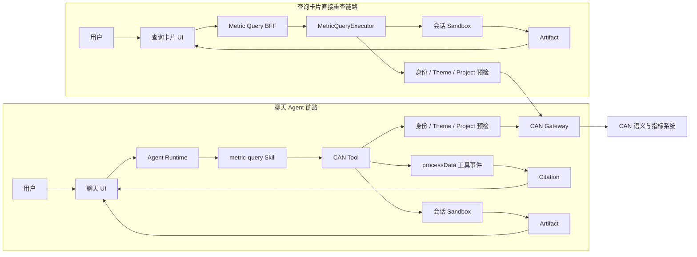
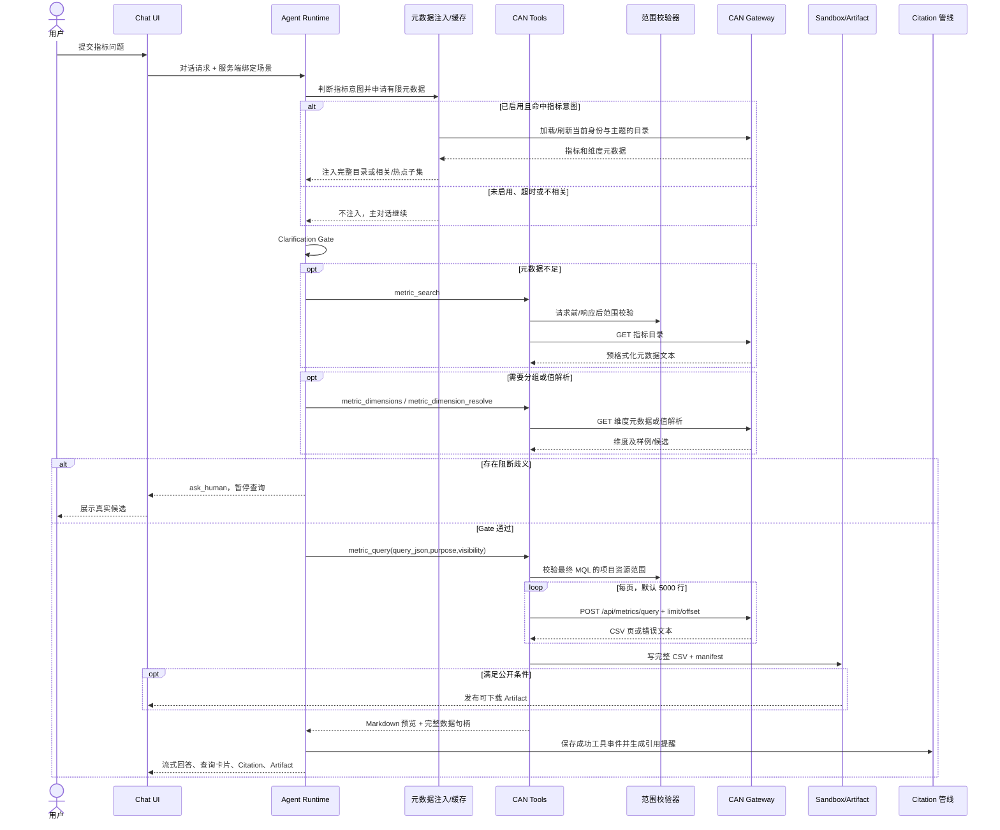
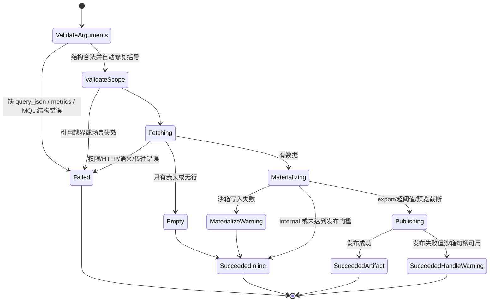
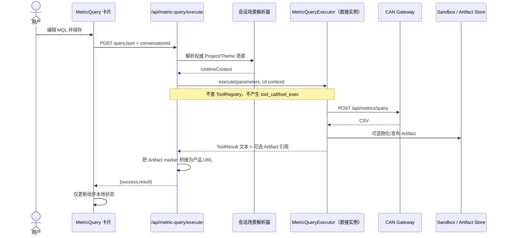

```
# 指标发现、维度解析与指标查询复刻文档

## 1. 结论与边界

本模块把用户的自然语言数据问题转换为一个受身份、数据主题和项目范围约束的指标查询，并把结果以可阅读表格、可计算 CSV、可下载 Artifact 和可追溯 Citation 的形式返回。它解决的不是“让模型凭常识回答一个数字”，而是以下五段连续能力：

1. 发现当前授权范围内可用的指标。
2. 找到一个或多个指标共同支持的分析维度。
3. 把用户说出的城市、商品、人群等自然语言值解析为带排序和置信信息的维度候选，并经唯一性、兼容性门槛确认后使用。
4. 执行 MQL 指标查询，支持筛选、排序、时间约束、临时指标和全量分页。
5. 查看指标的分解或血缘树，解释一个指标由哪些指标组成。

目标用户包括在个人对话中查询租户数据的普通用户、在 Project 对话中查询项目限定数据的成员，以及在指标查询结果卡片中调整条件并重新查询的用户。核心输入是用户问题、租户/用户身份、对话场景、项目或数据主题范围、指标元数据和 MQL；核心输出是指标定义候选、维度候选、维度值映射、查询数据、CSV/Artifact 和引用证据。

本文包含五个 Agent Tool：`metric_search`、`metric_dimensions`、`metric_dimension_resolve`、`metric_query`、`metric_breakdown`，以及对话页“浏览全部数据”和查询结果卡片直接重查两种非 LLM 入口。本文不展开指标管理写操作、数据主题 CRUD、归因分析、异常检测和底层语义引擎的具体计算实现。

结论分级：

- `I`：五个工具及 CAN 插件注册、用户身份头、主题传递、Project 元数据响应的失败关闭、MQL 的尽力资源提取与弱结构校验、分页、CSV 物化和查询卡片重查均可由当前代码静态确认。MQL 提取为空时可能绕过 Project 预检，不能概括为完整范围授权。
- `A`：黑盒测试把工具注册、搜索、维度查询、值解析、查询可见性、CSV 产出、临时指标和错误穿透作为当前验收契约；本次未运行这些测试。
- `K`：反向时间范围目前会被查询卡片 BFF 接受并返回成功，已登记为已知缺陷。
- `P`：同比/环比数值正确性、分母为零、闰月/跨季度、拆解树完整性及可控 Gateway 故障等仍只有 planned 用例，不可当作当前保证。
- `R`：无。本次未连接运行环境、未调用 CAN Gateway、未运行测试。
- `F`：CAN Gateway 对元数据和拆解接口返回的是面向模型的预格式化文本；从客户端和测试可确认 Nova 透传该文本，但无法证明对端内部检索、排序和语义计算算法。
- `D`：复刻时应为 Gateway 定义结构化版本化协议、服务端范围授权和查询校验；同时保留本文观察到的文本/CSV 兼容接口。

## 2. 术语与参与方

| 术语/参与方 | 定义与职责 |
|---|---|
| 指标 | 有稳定 `metricName`、展示名、口径说明和可分析维度的业务度量。指标名是 MQL 的机器标识。 |
| 维度 | 对指标进行分组或筛选的字段；使用 `dimName` 进入 MQL。 |
| 维度值解析 | 给定指标和自然语言值，返回可能所属维度和值的有序候选；候选必须经过唯一性、兼容性和置信门槛，不能当作天然确定映射。 |
| MQL | CAN 指标平台的表达式式查询协议，不等于 SQL，也不是通用 JSON 日期范围协议。 |
| 数据主题 | 一组指标、维度和数据集的授权/业务集合；请求以服务端绑定的 `themeId` 约束。 |
| Project 场景 | 对话绑定一个持久化 Project；只能访问 Project 数据主题中配置的资源。 |
| Nova Agent Runtime | 选择 Skill、调用 Tool、保存工具事件并组织最终回答。 |
| CAN 插件 | 注册本文五个分析 Tool（插件另有其他资源工具）、指标查询 Skill、元数据缓存和上下文注入器。 |
| CAN Gateway | Nova 的外部 HTTP 对端；Nova 依赖其提供目录检索、维度解析、MQL 执行、权限过滤和指标分解结果。当前只静态确认客户端请求与响应契约，无法证明真实对端内部算法或授权执行；兼容复刻必须在对端完成最终授权。`F/REQ` |
| Artifact Publisher | 把查询生成的 CSV 从会话沙箱登记为产品 Artifact。 |
| Citation 管线 | 把成功的 `metric_query` 工具事件转成可验证的引用证据。发现类工具不是数字证据。 |



两条链路只在执行器/Gateway/Sandbox 能力上复用。卡片链路没有连接 `processData` 和 Citation，这是业务边界而非图示省略。

CAN 相关仓库身份只用于理解系统边界：`semantic` 是 CAN 核心服务，`anymetrics` 是业务层，`any-metrics` 是 CAN 前端，`jscip` 提供账号和数据源等基础配置，`tse` 是任务调度平台。Nova 只显式依赖 CAN Gateway 契约，无法仅由本仓证明这些服务在 Gateway 内部的调用拓扑。

## 3. 业务规则

### 3.1 证据和工具选择规则

1. 指标元数据只说明“有什么、是什么意思、能按什么分析”，不能作为业务数字证据。
2. `metric_search`、`metric_dimensions`、`metric_dimension_resolve` 和 `metric_breakdown` 的结果不得被当作数值来源；确定数值必须来自成功的 `metric_query` 或另一个已授权数据源。
3. 用户只说分组维度时，使用 `metric_dimensions`；用户说出具体城市、商品、人群等级等值且上下文没有已确认样例时，优先使用一次 `metric_dimension_resolve` 获取候选，不得靠多轮 `metric_dimensions` 猜值。
4. 多指标查询的维度必须取所有指标可分析维度的交集。
5. 如果搜索结果中有两个及以上可能口径，或时间、分母、排序度量、比较基准不明确，必须暂停查询并向用户澄清，不能选择 Top 1 后仅附加免责声明。
6. 当前 `metric-query` Skill 的正式工具集合包含搜索、维度、值解析、查询、知识读取和人工澄清，不包含 `metric_breakdown`；拆解工具虽已注册，但对话能否自动选用还取决于工具组/能力安装和路由。黑盒用例已把“明确要求拆解却只调用搜索”记录为 planned 原因，因此不能宣称拆解路由稳定可用。

工具“存在”必须按四层判定：

| 层级 | 含义 | 本模块可证结论 |
|---|---|---|
| registered | 注册表存在 ToolDefinition，可在设置/清单中找到 | 五个 CAN Tool 已注册。CAN-LIFE-003 仅断言清单找到五个名字，并由测试 runner 汇总为 `readOnly:true`。 |
| visible | 当前租户、用户、scope、能力安装、mandatory/tool-group/MCP 可见性规则允许 Agent 看到 | 取决于运行配置，不能由“已注册”推出。 |
| selectable | 当前激活 Skill 的 `required_tools` 和 tool policy 允许模型选择 | `metric-query` Skill 包含前四个查询链工具，不包含 `metric_breakdown`。 |
| routable | 真实意图下模型实际选择 Tool，运行时发出调用 | 必须用 WS 生命周期或运行验证证明；本次无 `R`。METRIC-BRK-002 是 planned，恰好说明拆解路由尚无稳定保证。 |

`readOnly:true` 是自动测试对发现结果的汇总，不是插件对所有 CAN 工具语义的安全证明；CAN 插件还注册了资源写操作类工具。复刻验收必须分别验证四层，不能用注册清单替代真实路由测试。

### 3.2 Clarification Gate

执行查询前，应把问题拆为以下槽位；阻断槽位不是 `CONFIRMED` 或 `UNIQUE_WITH_COVERAGE` 时不得调用 `metric_query`。

| 槽位 | 要确认的问题 |
|---|---|
| measure | 业务度量及口径是否唯一？ |
| time_scope | 查询时间范围和时间粒度是否明确？ |
| entity_filter | 用户提到的实体值是否已有通过唯一性、兼容性和置信门槛的维度/值候选？ |
| grouping_dimension | 按什么维度分组？多指标是否都支持？ |
| population | 数据总体/分母是否明确？ |
| calculation_semantics | 同比、环比、排名、占比、Top-N、日均等算法语义是否明确？ |
| comparison_scope | 基准期、排序范围或占比分母范围是否明确？ |
| compatibility | 指标、维度、时间粒度是否兼容且在当前授权范围？ |

允许状态为 `CONFIRMED`、`UNIQUE_WITH_COVERAGE`、`AMBIGUOUS`、`MISSING`、`NOT_FOUND`、`INCOMPATIBLE`。后四种状态均需要澄清、换用明确候选、降级到授权的明细查询，或明确告知无法可靠完成。

### 3.3 MQL：Skill 构造策略、Nova 校验事实与 Gateway 语义边界

必须把三层责任分开。第一层是给模型的 **Skill 构造策略**，用于减少错误 MQL，但不是安全边界；第二层是 **Nova 当前实际校验**，其覆盖面较弱；第三层是 **Gateway DSL 解析和执行语义**，Nova 只把对象序列化后交给对端，不能由本仓证明其完整行为。

#### A. Skill 构造策略（模型应遵守，但 Nova 不一定强制）

一个基本查询对象如下：

```json
{
  "metrics": ["sales_amount"],
  "dimensions": ["metric_time__month", "channel"],
  "filters": ["[region]= \"East\""],
  "resultFilters": ["[sales_amount] > 1000"],
  "timeConstraint": "DateTrunc(['metric_time'], \"MONTH\") = DATEADD(DateTrunc(NOW(), \"MONTH\"), -1, \"MONTH\")",
  "orders": [{"sales_amount": "desc"}],
  "limit": 10
}
```

Skill 要求模型遵守：

- `metrics` 是非空字符串数组。
- `dimensions` 可省略；日期粒度后缀必须为小写，例如 `__day`、`__month`。
- 时间字段只能放进 `timeConstraint`，不要放进普通 `filters`。
- `filters` 类似 SQL `WHERE`，会改变分母和排名范围；`resultFilters` 类似 `HAVING`，只过滤计算后的展示行。
- 占比或排名后只展示某个维度值时，应用 `resultFilters`；若用 `filters`，占比会恒为 100%、排名会恒为 1。
- `orders` 的列必须出现在 `metrics` 或 `dimensions` 中。
- 相对时间使用 `NOW()`；仅用户给出明确绝对日期时写日期字面量。
- 用户未要求 Top-N/预览时不主动加 `limit`；执行器会分页取全量。硬上限默认 1,000,000 行。
- 一个指标只应用一次快速计算后缀；需要“先环比、再排名”等多步计算时使用 `metricDefinitions` 分步。
- `metricDefinitions` 的每个 key，包括中间辅助指标，都必须同时出现在 `metrics` 中。
- 跨指标条件筛选 `MetricMatches` 只能放在 `metricDefinitions.<name>.filters`，不能放在顶层 `filters`。
- 本周/本月/本季/本年尚未结束时，同环比必须对齐两期的实际跨度，不能用“未完成本期”对比“完整同期”。

临时比率指标示例：

```json
{
  "metrics": ["retained", "population", "retention_rate"],
  "metricDefinitions": {
    "retained": {"refMetric": "retained_guest"},
    "population": {"refMetric": "eligible_guest"},
    "retention_rate": {"expr": "[retained] / [population]"}
  },
  "dimensions": ["guest_segment"],
  "timeConstraint": "DateTrunc(['metric_time'], \"MONTH\") = DATEADD(DateTrunc(NOW(), \"MONTH\"), -1, \"MONTH\")",
  "orders": [{"retention_rate": "desc"}]
}
```

高级 DSL 在 Skill 中还出现以下结构；这是对 Gateway 契约的观察，不表示 Nova 已验证字段类型或对端数值边界：

```json
{
  "metrics": ["month_val", "daily_avg", "filtered_cnt", "global_avg"],
  "metricDefinitions": {
    "month_val": {
      "refMetric": "metric_A",
      "period": "relative_date -1 month of 0 month"
    },
    "daily_avg": {
      "refMetric": "metric_A",
      "period": "to_date -29 day of 0 day",
      "preAggs": [{"granularity": "DAY", "calculateType": "AVG"}]
    },
    "filtered_cnt": {
      "refMetric": "metric_B",
      "filters": ["MetricMatches([dim_X], [metric_A] >= 10000)"]
    },
    "global_avg": {
      "refMetric": "metric_A",
      "indirections": ["multi_level_agg__avg,dim_X"],
      "specifyDimension": {"type": "EXCLUDE", "dimensions": "dim_X"}
    }
  },
  "dimensions": ["dim_X"],
  "timeConstraint": "['metric_time__day']= DATEADD(DateTrunc(NOW(), \"DAY\"), -1, \"DAY\")",
  "resultFilters": ["[filtered_cnt] > 0"],
  "orders": [{"daily_avg": "desc"}],
  "limit": 100,
  "offset": 0
}
```

这里的 `period` 使用 Skill 明示的 `relative_date ... of ...` / `to_date ... of ...` DSL；`preAggs.calculateType` 有证据的取值只有 `AVG`、`MAX`、`MIN`。`MetricMatches` 形态为 `MetricMatches([维度], [指标] 运算符 值)`；`specifyDimension` 的已证形态为 `{"type":"EXCLUDE","dimensions":"dim_X"}`。快速计算通过指标名的 `__...` 后缀表达；Skill 还描述了同比/环比、占比、排名和多级聚合等后缀。对端支持哪些后缀、大小写、财年和零分母语义必须由 Gateway 自己的版本化 DSL 规范与契约测试确认。

#### B. Nova 当前实际校验（`I`）

执行器只做以下检查，不能把它描述为完整 MQL Schema 校验：

1. 参数映射为空，或仅含内部 `_conversation_id` 时拒绝；`query_json` 缺失时拒绝。
2. `query_json` 可直接是对象，也可为 JSON 字符串。字符串空白、等于 `{}`、不以 `{` 开始或解析失败时拒绝；解析结果必须是非空对象。
3. 对象必须存在 `metrics` 字段；只有当它实际是 List 时才检查非空。字符串、数字等错误类型可能通过这一层。
4. `timeConstraint` 可省略；存在时必须是字符串且包含字面子串 `['metric_time']`。出现 `DATE(` 且全文既没有 `DATEADD(` 也没有 `DateTrunc(` 时才拒绝，因此这只是启发式检查，不是表达式解析。
5. 仅当 `metricDefinitions` 是 Map 且 `metrics` 是 List 时，检查每个字符串 key 是否也出现在字符串指标列表中；其他错误形态可能通过。
6. `limit` 能转换为整数时必须大于 0 且不得超过配置硬上限；不能转换时会被当作未提供。
7. 然后执行方括号自动修复和 Project 资源范围检查，再交给 Gateway。

Nova 当前**没有**完整验证：未知字段、各字段严格类型、维度交集、`orders` 目标列、反向时间、表达式语法/函数白名单、依赖环、零分母、时间粒度兼容性或查询成本。因此前面的 Skill 规则不能当作既有安全保证。

#### C. Gateway DSL 责任（`F`/`D`）

当前 Gateway 接收最终 JSON，负责语义解析、指标/维度兼容、快速计算、临时指标、筛选、分组、排序和实际计算；Nova 仓无法证明其解析器和计算实现。生产复刻应在 Gateway 使用严格、版本化 AST：拒绝未知节点和错误类型，解析所有资源引用，校验依赖图、时间区间、函数白名单、维度兼容、对象级权限和成本；Nova 的 Skill 与轻量预检只用于改善交互。

### 3.4 范围与身份规则

1. 所有五个 Tool 请求都必须携带非空租户和用户身份；模型不得传入或覆盖身份。
2. 个人场景未选主题时表示租户授权范围内“全部主题”，HTTP 请求省略 `themeId`。
3. Project 场景必须同时有权威 `projectId` 和具体 `dataThemeId`，主题缺失时失败关闭，不能降级为租户全量。
4. Project 查询前，Nova 再次从数据库读取 ACTIVE Project，核对持久化主题绑定和配置版本，拒绝过期场景快照。
5. Project 查询会尝试提取指标、维度和数据集并与主题成员比较；每类成员累计超过 5,000 项时报错。**当前 MQL 检查不是失败关闭**：顶层 `metricDefinitions` 的 key 只形成 `localDefinitions`，用于识别临时指标并把它们从外部授权集合排除，本身不会作为外部指标送去主题成员校验。外部指标主要来自顶层 `metrics` 中排除 localDefinitions 后的基础名、任意层级 `refMetric`，以及 `expr`/`expression` 方括号中排除 localDefinitions 后的引用。提取器还识别任意层级 `dimensions`、`orders`、`filters`/`resultFilters`/`metricMatches` 中的方括号字段、`indirections`、`dataset(s)`/`datasetName(s)`，处理快速计算基础指标、rank/proportion/multi-level indirection 维度，并排除 `metric_time`。未知字段、未知 AST 节点或没有方括号的表达式可能提取为空集合，随后因“无待校验资源”而通过。它是纵深防御，不是可靠授权边界。
6. Project 模式禁止通过 `metric_search(action="categories")` 浏览租户级类目；搜索和列表响应也必须经过返回资源范围校验。
7. 对话页目录浏览是普通登录用户只读入口；带 `themeId` 时后端先校验主题对当前租户可见。管理面目录另走管理员接口。

与 MQL 不同，发现类 Tool 的**响应后校验是失败关闭**：Project 场景若无法从 Gateway 文本/JSON 中识别资源名，且响应又不是可明确识别的空目录（空白、`[]`、`none`、`no results/metrics/dimensions/datasets`、`未找到`、`无可用`，或 JSON 的空 `items`/`found`），则拒绝把原始响应返回模型。复刻时应进一步做到：Nova 用严格 MQL AST 提取器拒绝未知结构，同时 Gateway 在最终执行计划上再次做租户、用户、主题和对象级授权。

## 4. 完整执行链路

### 4.1 自然语言查询主链路



元数据上下文注入默认关闭。启用后，它只在最新用户消息被识别为指标意图时工作；完整小目录可整体注入，大目录只注入相关和热点子集。默认最多约 1,800 token，且不得把已有上下文推过模型窗口的 75%；加载超时默认 1 秒。注入失败或没有合适结果时 fail-soft，不阻断主对话。缓存按 Gateway、身份、个人/项目、Project 和主题隔离；授权失败会使当前范围缓存失效。

### 4.2 `metric_query` 内部状态流转



执行器先验证并可能修复 MQL 中缺少的方括号，再做 Project 范围检查。随后覆盖调用者的页级 `limit/offset`：每页默认 5,000 行，`offset` 从 0 开始递增，直到达到用户总量上限、硬上限、空页或不足一页。用户 `limit` 是总量上限，而不是 Gateway 页大小。

只要有行且会话沙箱可用，完整 CSV 都会被物化，即使 `visibility=internal` 或没有发布下载 Artifact。每个 CSV 同时写一个 manifest，包含版本、句柄、来源工具、行数、截断标志、SHA-256、创建时间和推断列类型。文件名由安全化的 `purpose` 加 UTC 时间戳组成；同秒同名通过数字后缀避免覆盖。

### 4.3 查询结果卡片直接重查

用户可在已有 `metric_query` 结果卡片中编辑指标、维度、时间、筛选、结果筛选、排序和 limit。它是**临时 UI 重算**，不是一次 Agent Tool 调用：BFF 直接持有并调用 `MetricQueryExecutor`，明确不经过 ToolRegistry、LLM、Tool 生命周期事件、助手消息、`processData` 或 Citation 管线。它仅复用查询执行、Project 范围校验、分页、沙箱 CSV 和 Artifact 发布能力。



1. 前端从原始工具参数解析可编辑 MQL，保留不认识的高级字段。
2. 保存前做表单级校验和差异检测。
3. BFF 要求 `queryJson` 和 `conversationId`；拒绝客户端自带 `dataThemeId`，防止用户改写数据范围。
4. 服务端根据 conversation 重新解析权威场景，获得 Project 和主题绑定。
5. 以当前登录身份获取会话沙箱并执行查询。
6. 新结果只写入前端组件的 `currentQueryJson`、`editedResult`、`editedSuccess` 等本地状态；若产生 Artifact，BFF 桥接成 `/api/artifacts/{id}/content` URL。
7. 编辑重查产生新 CSV 后，前端不再显示原查询的旧 Artifact，避免本次页面内使用陈旧全量数据。
8. 此路径不会新增或修改助手消息、不会持久化新的 `processData`、不会注入 Citation system-reminder，也不会生成 Citation 证据。刷新页面后，卡片重新来自原持久化工具事件，编辑后的查询和结果丢失。

Artifact 与 Citation 必须严格区分：Artifact 是可下载文件及其产品存储记录；Citation 是某条助手消息内由成功、可引用 Tool 事件产生的证据关系。卡片重查可能创建 Artifact，但不会因此自动成为 Citation，也不会追溯修改原消息的 Citation。

### 4.4 对话页目录浏览

对话输入区的“浏览”入口打开只读目录面板，提供指标、维度和数据集三个 Tab、数量、280ms 防抖搜索、每页 50 条的上一页/下一页、空结果和重试状态。个人对话调用租户目录 BFF；Project 对话不暴露底层主题 ID，而是从 Project API 读取已绑定资源名称并在前端分页。相同请求有 30 秒客户端缓存，并支持多消费者共享请求和 Abort。

目录行显示“展示名 + code”，复制到提问时插入 `展示名（code）`，不自动编造完整问题。Hover 卡通过批量详情 BFF 展示口径、计算逻辑或字段信息；详情失败时回退原始名称。

## 5. 对外契约

### 5.1 Tool 契约总表

| Tool | 必填参数 | 返回 | 结果保留 |
|---|---|---|---|
| `metric_search` | `action=search` 时 `keyword`；`action=category` 时 `category_id` | Gateway 预格式化文本 | 成功为普通结果；失败可压缩 |
| `metric_dimensions` | `metrics` | Gateway 预格式化维度文本，批量时表示交集 | 发现元数据，不可作为数字 Citation |
| `metric_dimension_resolve` | `metrics`, `value` | Gateway 预格式化候选文本；零命中可为空成功 | 发现元数据，不可作为数字 Citation |
| `metric_query` | Schema 声明要求 `query_json`, `visibility` | Markdown 表、提示、数据句柄及可选 Artifact | 有物化句柄时 durable，否则 condensable |
| `metric_breakdown` | `metric` | Gateway 预格式化分解/血缘文本 | 成功普通结果；失败可压缩 |

参数解析对模型常见错误有兼容别名，但新实现和文档应只发送规范名。

### 5.2 `metric_search`

```json
{
  "action": "search",
  "keyword": "销售额,净销售额",
  "page_size": 20,
  "page": 1,
  "category_id": "finance"
}
```

| 字段 | 类型 | 必填/默认 | 规则 |
|---|---|---|---|
| action | string enum | 默认 `search` | `search`, `list`, `categories`, `category`。当前实现中未知 action 会兼容地落到 search。 |
| keyword | string | search 必填 | 支持逗号分隔；兼容别名 `query`。空白失败且不发 HTTP。 |
| page_size | integer | 默认 50 | 1 至配置上限，默认上限 50；兼容常见 limit 别名。 |
| page | integer | 默认 1 | 1-based；小于 1 调整为 1；兼容 `pageNumber`, `page_number`。仅 list/category 使用。 |
| category_id | string | category 必填 | 应先用 categories 获取真实 ID。 |

Gateway 映射：

| action | HTTP |
|---|---|
| search | `GET /api/metrics/search?keyword=...&pageSize=...&themeId=...` |
| list | `GET /api/metrics/list?pageNumber=...&pageSize=...&themeId=...` |
| categories | `GET /api/metrics/categories?themeId=...` |
| category | `GET /api/metrics/categories/{categoryId}?pageNumber=...&pageSize=...&themeId=...` |

示例兼容返回：

```text
- sales_amount | 销售金额 | 含税销售口径 (2 dims)
```

Nova 对返回正文不做业务重写，但会在 Project 模式解析其中的指标名并进行响应后授权校验。零命中是业务空结果，保持 `success=true`。

### 5.3 `metric_dimensions`

```json
{
  "metrics": "sales_amount,refund_amount",
  "keyword": "渠道,地区"
}
```

| 字段 | 类型 | 必填 | 规则 |
|---|---|---|---|
| metrics | string | 是 | 单指标返回全部维度；逗号分隔多指标返回共同维度。兼容别名 `metric`。 |
| keyword | string | 否 | 按维度名称或样例值过滤，可逗号分隔。 |

Gateway 映射：

- 单指标：`GET /api/metrics/{metric}/dimensions?keyword=...&themeId=...`
- 多指标：`GET /api/metrics/dimensions?metricNames=a,b&keyword=...&themeId=...`

建议兼容文本：

```text
## 销售金额 (sales_amount), 2 dim(s):
- channel(渠道): 门店, 电商
- region(区域): East, West
## COMMON dimensions (intersection), 1 dim(s):
- channel(渠道): 门店, 电商
```

维度名进入 MQL；样例值必须按大小写、空格和标点原样复制。Gateway 404 正文含 `not in theme` 时，Nova 转译为“指标不在当前数据主题”，提示加入主题或切换到全部主题，而不是误报“没有维度”。

### 5.4 `metric_dimension_resolve`

```json
{
  "metrics": "sales_amount",
  "value": "宁波,半身裙",
  "dim": "shop_city",
  "limit": 10
}
```

| 字段 | 类型 | 必填/默认 | 规则 |
|---|---|---|---|
| metrics | string | 是 | 可逗号分隔；兼容 `metric`, `metric_name`。 |
| value | string | 是 | ASCII/全角逗号分割，默认每项最长 50 字，最多 10 项；兼容 `keyword`, `query`。 |
| dim | string | 否 | 已知维度时缩小范围；兼容 `dimension`。 |
| limit | integer | Gateway 默认 | 仅调用者显式传入时发送；1 至默认最大 50。 |

HTTP：`GET /api/metrics/dimensions/resolve?metrics=...&value=...&dim=...&limit=...&themeId=...`。

返回语义应理解为“按匹配分数排序的候选集合”，不是权威唯一映射。多指标时，一个候选还必须与全部目标指标兼容；当前文本契约没有证明 Gateway 是简单求交集还是使用其他兼容算法。第一名与第二名同分、分数接近、候选跨多个维度，或无法证明多指标兼容时，Clarification Gate 必须进入 `AMBIGUOUS` 并展示候选让用户选择，不能静默取 Top 1。

零命中或 HTTP 200 空正文是成功，不应伪装成异常。当前实现的失败恢复提示存在一个明确缺陷：它把参数常量名直接拼成字面量 `contains([dim], "用户值")`，并没有代入已解析的真实维度；同时用户值也未做 DSL 字符串转义。照抄可能查询错误字段或形成表达式注入风险。

生产复刻应返回结构化候选，例如：

```json
{
  "inputValue": "宁波",
  "candidates": [
    {"dimensionName":"shop_city","exactValue":"宁波市","score":0.93,"compatibleMetrics":["sales_amount"]}
  ],
  "ambiguous": false
}
```

只有 `dimensionName` 已由授权元数据独立确认、候选不歧义但 exact value 确实不存在时，才可生成 `contains([shop_city], "宁波")`；生成器必须对白名单维度名做 AST 绑定，并转义引号、反斜杠和控制字符。否则应询问用户或明确无法可靠映射，不能使用字面 `[dim]` 降级。

### 5.5 `metric_query`

Tool 请求：

```json
{
  "query_json": {
    "metrics": ["sales_amount"],
    "dimensions": ["metric_time__month", "channel"],
    "timeConstraint": "DateTrunc(['metric_time'], \"MONTH\") >= DATEADD(DateTrunc(NOW(), \"MONTH\"), -12, \"MONTH\")",
    "orders": [{"metric_time__month": "asc"}]
  },
  "purpose": "近12月各渠道销售额",
  "visibility": "default"
}
```

| 字段 | 类型 | 必填/默认 | 语义 |
|---|---|---|---|
| query_json | object，兼容 JSON 字符串 | 是 | 完整 MQL。字符串必须以 `{` 开始并能解析。 |
| purpose | string | 实践必填；缺失时推导 | Citation 卡标题及 CSV 文件名前缀；应使用展示名、简短名词短语。兼容 description/label/name/title 等别名。 |
| visibility | enum | Schema 必填；运行时缺失/非法回退 `default` | `internal`, `default`, `export`。 |

这里存在明确实现/规范冲突：Skill 文本声称“不带 visibility 会报必填错误”，但当前执行器实际对缺失或非法值记录警告并回退 `default`，Active 黑盒用例也以回退为验收目标。复刻“当前业务效果”应实现回退；若改为严格拒绝，应升级协议并同步测试和提示词。

Gateway 请求：

```http
POST /api/metrics/query?themeId=theme-42
Content-Type: application/json
X-Tenant-Id: tenant-1
X-User-Id: user-1

{"metrics":["sales_amount"],"dimensions":["channel"],"timeConstraint":"...","limit":5000,"offset":0}
```

兼容成功响应是 CSV 文本：

```csv
channel,sales_amount
门店,125000.50
电商,98700.00
```

Tool 成功输出示例：

```text
[Query result: 2 row(s)]

| channel | sales_amount |
|---|---|
| 门店 | 125000.50 |
| 电商 | 98700.00 |
[Computable dataset] 近12月各渠道销售额-20260806-103000.csv — ...
```

可见性规则：

| visibility | Artifact 规则 |
|---|---|
| internal | 永不发布下载 Artifact；仍物化完整 CSV，仍需 Citation。过长证据压缩到约 4,000 字。 |
| default | 行数大于默认 50，或 Markdown 因默认 8,000 字上限被截断时发布；小结果只内联。 |
| export | 有数据时总是发布；适用于明确下载/导出或无 limit 的枚举请求。 |

无行时输出 `(no data)` 和检查时间、维度值、MetricMatches 阈值的提示，不发布 CSV。达到硬上限时成功返回已取得的数据并明确截断警告。用户 limit 达到时说明“user limit reached”。

### 5.6 `metric_breakdown`

```json
{"metric": "sales_amount,AOV"}
```

`metric` 是逗号分隔指标名，兼容 `metrics` 和 `metric_name`；空白失败。HTTP 为 `GET /api/metrics/breakdown?metric=sales_amount%2CAOV&themeId=...`。返回是 Gateway 预格式化文本，例如：

```text
sales_amount = unit_price * quantity
```

Nova 会从请求和响应中提取所有指标名做 Project 范围校验。HTTP 200 空正文当前视为成功空结果。生产复刻建议改为结构化树并明确 `hasBreakdown=false`，但兼容层应保留文本。

### 5.7 查询卡片 REST BFF

```http
POST /api/metric-query/execute
Content-Type: application/json

{
  "queryJson": {"metrics":["sales_amount"],"timeConstraint":"['metric_time__day'] = \"2026-08-05\""},
  "purpose": "昨日销售额",
  "visibility": "default",
  "conversationId": "conv-123"
}
```

字段：

- `queryJson`：必填非空对象。
- `purpose`：缺失默认“卡片重查”。
- `visibility`：缺失默认 `default`。
- `conversationId`：必填；缺失时兼容从 Referer 的 `/web/chat/{id}` 或 `/chat/{id}` 提取。
- `dataThemeId`：禁止传入；传入非空值产生 `DATA_THEME_SELECTION_DISABLED`。

业务响应使用 HTTP 200 表达查询成败：

```json
{"success":true,"result":"[Query result: 1 row(s)]\n\n| ... |"}
```

`result` 以 `Error:` 开头时 `success=false`。请求体缺失或 conversation 缺失为 HTTP 400。认证身份由请求的沙箱上下文取得，不信任请求字段。

### 5.8 普通用户目录 REST

所有接口要求已登录身份，租户从服务端请求上下文获得：

```text
GET /api/data-themes/browse/metric-categories
GET /api/data-themes/browse/dimension-categories
GET /api/data-themes/browse/metrics?categoryId=&keyword=&pageNumber=1&pageSize=50&themeId=
GET /api/data-themes/browse/dimensions?categoryId=&keyword=&pageNumber=1&pageSize=50&themeId=
GET /api/data-themes/browse/datasets?keyword=&pageNumber=1&pageSize=50&themeId=
GET /api/data-themes/browse/catalog/counts?themeId=
GET /api/data-themes/browse/themes/{themeId}/{metrics|dimensions|datasets}?keyword=&pageNumber=1&pageSize=50
```

分页响应：

```json
{
  "items": [
    {
      "name": "sales_amount",
      "displayName": "销售金额",
      "alreadyInTheme": true,
      "selection": {"state": "DIRECT_SELECTED"}
    }
  ],
  "total": 1,
  "pageNumber": 1,
  "pageSize": 50,
  "hasNext": false,
  "selectedCategory": null
}
```

Gateway 故障映射为 HTTP 502 或保留原 4xx/5xx，并返回：

```json
{"error":"actionable gateway message","gatewayStatus":502}
```

### 5.9 WebSocket/持久化事件

五个能力不定义专属 WebSocket 方法，而是复用统一聊天通道。当前真实 wire 不是结构化 `tool`/`arguments` JSON；顶层统一为：

```json
{"type":"<event-type>","content":"<string>","seq":42,"conversationId":"conv-123","messageId":12345}
```

`conversationId` 和 `messageId` 都是条件字段；统一发送器只有拿到相应值时才写入。普通工具生命周期 frame 通常带 conversationId 而不带 messageId，不能要求每帧都有这两个字段。

工具相关 `content` 契约如下；竖线是未转义分隔符。start 应取前两段和最后一段、把中间部分拼回 args；end 应取前五段、把第六段起拼回 result：

| type | content |
|---|---|
| `tool_call` | `<toolName>`；不含 callId 和参数，仅表示模型检测到调用。 |
| `tool_exec_start` | `<callId>|<toolName>|<truncatedArgs>|<inputBytes>` |
| `tool_exec_end` | `<callId>|<toolName>|<outputBytes>|<success>|<durationMs>|<truncatedResult>` |
| `tool_call_result` | `<toolName>|<success>|<resultBytes>`；不含 callId。 |

示例：

```json
{"type":"tool_call","content":"metric_query","seq":41,"conversationId":"conv-123"}
{"type":"tool_exec_start","content":"call-7|metric_query|{\"query_json\":{...}}|128","seq":42,"conversationId":"conv-123"}
{"type":"tool_exec_end","content":"call-7|metric_query|742|true|420|[Query result: ...]","seq":44,"conversationId":"conv-123"}
{"type":"tool_call_result","content":"metric_query|true|742","seq":45,"conversationId":"conv-123"}
```

`seq` 是单个运行任务共用的递增序号，覆盖 token、工具和其他事件；持久化事件记录也会消耗同一计数器，因此客户端只应要求单调递增，不应要求连续。start/end 必须以首段 `callId` 关联，不能用 toolName 关联，因为同名工具可并发或重复调用。WebSocket 参数最多展示 4,000 字符，结果最多 8,000 字符，超出时截取后加 `...`；`inputBytes`/`outputBytes` 是未截断 UTF-8 内容的字节数。当前 pipe wire 没有转义协议，是兼容债务；生产复刻建议新增版本化结构字段并保留旧 `content`。

助手消息持久化的 `processData.events` 不是上述 frame 的原样拷贝，而是单独的结构化事件：

```json
{
  "type": "tool_exec",
  "tool": "metric_query",
  "toolCallId": "call-7",
  "evidenceToken": "<仅成功且可引用工具时存在>",
  "args": "{\"query_json\":{...}}",
  "inputBytes": 128,
  "outputBytes": 742,
  "result": "[Query result: ...]",
  "success": true,
  "durationMs": 420,
  "timestamp": 1785983400000,
  "toolOrdinal": 3,
  "artifacts": [
    {"id":"a-1","filename":"result.csv","url":"/api/artifacts/a-1/content","type":"FILE","size":742}
  ]
}
```

子代理内的工具事件类型为 `sub_tool_exec`，另有 `agentLabel`。`toolCallId`、`evidenceToken`、`toolOrdinal`、`artifacts` 均为条件字段：`evidenceToken` 只给成功且被 Citation 白名单认可的工具；`toolOrdinal` 保存 LLM 派发序，可在并行完成顺序不同于派发顺序时恢复逻辑顺序。持久化 args 和 result 各最多 4,000 字符，后缀为 `...(truncated)`；字节数仍反映原内容。事件数组保存完成时记录的顺序和时间戳，但不保存 WS 顶层 `seq`，两者不能按数值一一对齐。

`nova_auto_test` 会同时读取实时 frame 和助手消息 `processData.events`，并按 callId 检查 start/end 生命周期；因此 Agent Tool 路径不能只展示临时卡。注意查询卡片 BFF 不属于此路径，不会产生这些事件。

## 6. 数据模型与生命周期

本模块不在 Nova 数据库复制 CAN 指标事实数据。数据归属如下：

| 数据 | 权威归属 | Nova 生命周期 |
|---|---|---|
| 指标、维度、样例、分解树 | CAN 平台 | 内存元数据缓存；按 Gateway/身份/场景/Project/主题隔离，TTL 到期或授权失败失效。 |
| Project 与主题绑定 | Nova 数据库 + CAN 主题成员 | 每次 Project 查询重新核对 ACTIVE 状态、主题 ID 和配置版本。 |
| MQL 参数与工具结果 | Agent Tool 路径的对话消息 `processData` | 随助手消息持久化，用于刷新、Citation 和重放展示；查询卡片 BFF 的编辑重查不写入。 |
| 完整查询 CSV | 会话沙箱 | 每次成功有行时创建唯一文件；不覆盖旧查询。会话/沙箱清理由宿主管理。 |
| CSV Artifact | Artifact Store | 仅达到可见性发布条件时登记；归属租户、用户和 conversation。 |
| CSV manifest | 会话沙箱 | 与 CSV 同名加 `.manifest.json`；校验完整性和后续无损数值计算。 |

推荐 manifest 契约：

```json
{
  "manifestVersion": 1,
  "handle": "昨日销售额-20260806-103000.csv",
  "sourceTool": "metric_query",
  "rowCount": 2,
  "truncated": false,
  "checksum": "sha256:<64 hex>",
  "createdAt": "2026-08-06T02:30:00Z",
  "columns": [
    {"name":"channel","type":"string"},
    {"name":"sales_amount","type":"number"}
  ]
}
```

列类型仅做粗粒度推断：所有非空单元格都能解析为十进制数时为 `number`，否则为 `string`；`NaN`、`Infinity` 等不是普通十进制数。

### 6.1 配置、默认值与覆盖优先级

CAN Tool 主配置如下。`can.*` 是 ToolExecutionContext 中使用的 canonical key；部署 YAML 位于 `nova.can.*`。

| key | Java 默认 | 读取时机/注意事项 |
|---|---:|---|
| `can.gateway-url` | 空 | 每次请求可动态解析；空值返回可操作的未配置错误。 |
| `can.http.connect-timeout-seconds` | 15 | 创建 HTTP client 时固定，运行中按身份覆盖不会重建 client。 |
| `can.http.request-timeout-seconds` | 60 | 每次请求动态解析。 |
| `can.http.max-error-body-chars` | 500 | 每次错误格式化时动态解析。 |
| `can.metric-search.default-page-size` | 50 | 每次 Tool 调用动态解析。 |
| `can.metric-search.max-page-size` | 50 | 每次 Tool 调用动态解析。 |
| `can.dimension-resolve.default-limit` | 10 | 作为公开配置/描述默认值存在，但当前客户端在调用者省略 limit 时**不发送**该参数，实际结果数由 Gateway 默认决定。 |
| `can.dimension-resolve.max-limit` | 50 | 显式 limit 被动态钳制到 1..max。 |
| `can.dimension-resolve.max-values` | 10 | 每次 Tool 调用动态解析。 |
| `can.dimension-resolve.max-value-length` | 50 | 每次 Tool 调用动态解析。 |
| `can.metric-query.max-result-chars` | 8,000 | Markdown 返回上限，每次调用动态解析。 |
| `can.metric-query.page-size` | 5,000 | 执行器私有配置，不在 CAN operator configParams 清单中；每次查询动态解析并至少为 1。 |
| `can.metric-query.max-total-rows` | 1,000,000 | 同上；用户 limit 超过它时拒绝。 |
| `can.metric-query.csv-publish-threshold` | 50 | 同上；控制 default 模式是否额外发布下载 Artifact，不控制沙箱物化。 |

元数据注入是部署级插件配置 `nova.can.metadata-context.*`，不走上述身份级 configParams：

| key | 默认 |
|---|---:|
| `enabled` | false |
| `max-tokens` / `max-prompt-ratio` | 1800 / 0.75 |
| `small-catalog-max-metrics` | 40 |
| `relevant-metric-limit` / `hot-metric-limit` / `total-metric-limit` | 4 / 12 / 16 |
| `dimension-metric-limit` / `dimension-limit-per-metric` | 2 / 8 |
| `description-max-chars` / `load-timeout-ms` | 96 / 1000 |
| `catalog-soft-ttl-seconds` / `catalog-hard-ttl-seconds` | 300 / 1800 |
| `search-soft-ttl-seconds` / `search-hard-ttl-seconds` | 120 / 600 |
| `dimension-soft-ttl-seconds` / `dimension-hard-ttl-seconds` | 600 / 1800 |
| `failure-ttl-seconds` / `cache-maximum-weight` | 15 / 1,000,000 |

覆盖顺序必须按调用面说明：

1. 插件启动时从 `nova.can.*` 构造 `CanSettings`，缺项使用 Java 默认。启动桥接会在 canonical `nova.can.gateway-url` 缺失时把旧 `nova.metric.gateway-url` 复制过去；两者都有时 canonical 值优先。
2. Agent Tool 每次调用通过身份级 `ctx.resolveConfig(key)` 覆盖相应 `CanSettings` 默认；哪些 scope 可覆盖由宿主 ConfigStore 规则决定。connect timeout 是例外，因为 HTTP client 已在构造时创建。
3. 查询卡片 BFF 的 UI context 先查身份级 ConfigStore，再查 Spring Environment 的 `nova.<key>`；仅 `can.gateway-url` 额外回退旧 `nova.metric.gateway-url`。因此卡片直接构造的默认 client 仍能在每次请求拿到 Gateway URL 和动态 request timeout，但 connect timeout保持 15 秒默认。
4. Browse BFF 使用产品侧 `nova.metric.gateway-url` 和服务端 `nova.metric.admin-api-key`，不走 CAN Tool 的用户级配置链。

复刻时应在启动日志输出“配置来源类别”但隐藏值；尤其不要把 admin API key 或完整 Gateway URL 查询参数写入工具结果。

## 7. 核心实现设计

### 7.1 最小可用复刻

最小版本需要以下组件：

```text
MetricIntentPolicy
  - parseQuestion() -> QueryIntent
  - clarificationGate(intent, catalogEvidence) -> PASS | Question

MetricCatalogClient
  - search(action, keyword, page, pageSize, scope)
  - dimensions(metrics, keyword, scope)
  - resolve(metrics, values, dimension, limit, scope)
  - breakdown(metrics, scope)

MetricQueryClient
  - executePage(mql, offset, limit, scope) -> CsvPage

MetricScopePolicy
  - authorizeIdentity(tenantId, userId)
  - authorizeMetadata(resourceNames, projectSnapshot)
  - authorizeMql(resources, projectSnapshot)

MetricResultAssembler
  - paginate()
  - renderMarkdown()
  - materializeCsvAndManifest()
  - publishArtifact()

MetricEvidenceAdapter
  - persistToolEvent()
  - createCitationEvidence()
```

核心伪代码：

```text
intent = parse(userQuestion)
metadata = injectedMetadataIfCompleteAndAuthorized()
if metadata insufficient:
    metrics = catalog.search(extractMeasureKeywords(intent))
gate = clarificationGate(intent, metrics)
if gate.blocked: return askHuman(gate.realCandidates)
if intent.hasConcreteValues:
    mapping = catalog.resolve(metrics, intent.values)
dimensions = catalog.dimensions(metrics)
mql = buildMql(intent, metrics, mapping, intersection(dimensions))
scopePolicy.authorizeMql(mql, authoritativeConversationScene)
outcome = paginateUntilShortPageOrCap(mql, pageSize=5000, maxRows=1_000_000)
result = assembler.assemble(outcome, purpose, visibility)
persistToolEvent(result)
return attachCitationReminder(result)
```

最小 CAN Gateway Stub 必须实现本文 10.3 列出的五 Tool 共八个 GET 和一个 POST，并另实现 Browse 管理面 GET 映射；分别验证用户头与管理员头，支持 `themeId`，查询返回 CSV，发现/拆解接口返回 UTF-8 文本，管理面返回标准 envelope。Stub 必须能配置 200 空结果、400 MQL 错误、401 身份错误、403 权限错误、404 not-in-theme、5xx 和超时，以便复刻验收。

### 7.2 生产级设计

生产版本建议把兼容文本协议包在稳定的版本化结构协议之后：

```json
{
  "requestId": "req-...",
  "success": true,
  "data": {
    "items": [],
    "page": {"number":1,"size":50,"total":0,"hasNext":false}
  },
  "error": null
}
```

推荐对端分层：

1. Gateway Auth 层验证用户身份或管理员 API Key，解析租户并产生审计上下文。
2. Catalog 服务提供指标、维度、类目、样例和值反查，搜索必须租户化并支持主题交集。
3. Query Planner 校验 MQL Schema、时间范围、指标依赖图、维度兼容性和表达式安全性。
4. Authorization 层在执行计划上做指标/维度/数据集对象级授权，而不是只相信 `themeId`。
5. Semantic Engine 把 MQL 编译成引擎查询，处理同比、占比、排名、period、preAggs 和 MetricMatches。
6. Result 服务使用带 schema 的流式页协议；兼容适配器再渲染为 Nova 当前需要的 CSV。
7. Observability 层贯穿 requestId、tenantId、userId、themeId、MQL 指纹、行数、耗时和错误类别，不记录明文敏感筛选值。

生产版还应增加：查询幂等/去重键、服务端取消、最大执行时长、查询成本估算、反向时间校验、定点 decimal 类型、游标分页、Schema 版本、限流、熔断、缓存失效事件和下载对象存储。Nova 当前同步 HTTP 客户端不发送取消信号；`isCancelled()` 只在卡片执行上下文暴露线程中断状态，查询循环没有显式检查，因此“用户取消后立刻停止 Gateway 计算”不是当前保证。

## 8. 并发与非正常路径

| 场景 | 当前行为 | 复刻要求/建议 |
|---|---|---|
| 同秒同 purpose 并发查询 | CSV 使用 `CREATE_NEW`，最多尝试 50 个数字后缀，不覆盖旧文件。 | 保留唯一写入；生产可使用 query execution ID。 |
| 目录组件快速切 Tab/搜索 | 取消旧请求；共享请求仅在最后消费者释放时 Abort。 | 必须防止旧响应覆盖新关键字结果。 |
| Gateway 超时/断连 | connect 默认 15s，请求默认 60s；返回 `Error: <tool> failed — ...`。 | 设置分层超时、熔断和可定位 requestId。 |
| 401 | 映射为身份注册/传递错误。 | 不泄露 Header 和凭据。 |
| 403 或权限正文 | 映射为 permission denied；`metric_query` 明确停止重搜重写。 | 权限失败是终态，不做语义重试。 |
| 404 | 空正文为资源不存在；正文保留；维度 `not in theme` 特殊转译。 | 区分不存在和范围外。 |
| 400 | `Bad CAN request`；权限关键词优先分类为权限失败。 | 保留稳定错误 code，而非依赖文案关键词。 |
| 500/502/503/504 | 通常为服务不可用；正文含语法标记时改判 MQL 语义错误。 | 明确 client/server 错误 taxonomy。 |
| HTTP 200 错误正文 | `Error:` 或单行 error/exception/failed 且无逗号时判失败。 | 兼容保留；新协议禁止 200 表达失败。 |
| 空 CSV | 成功，返回 no-data 提示，不重试相同参数。 | 区分无数据、空目录和失败。 |
| 超硬上限 | 无用户 limit 时返回前 100 万行并警告；用户 limit 超上限直接失败。 | 更推荐执行前成本拒绝或异步导出。 |
| CSV 写失败 | 查询仍成功，返回警告，无可计算句柄。 | 告警并保留查询 requestId 以便重建。 |
| Artifact 发布失败 | 查询仍成功，沙箱句柄可用并返回警告。 | UI 不得声称已下载成功。 |
| 元数据缓存失效 | 授权错误使当前身份/主题缓存失效；过滤维度查询不污染完整缓存。 | cache key 必须含租户、用户、场景、Project、主题和 Gateway。 |
| 反向时间 | 当前 BFF 可能成功，是 `K` 缺陷。 | Planner 必须拒绝 start > end。 |

工具结果的错误必须以 `Error:` 开头穿透给 LLM 和 UI。错误正文按配置默认最多保留 500 字，超出截断；日志记录异常对象，但用户响应不得包含 Java stack trace、API Key、Cookie 或内部类名。

## 9. 安全、权限和审计

### 9.1 身份和授权

- 正常产品链路必须由已认证的应用/沙箱上下文创建强类型 `TenantIdentity`，再由 Agent Runtime 或查询卡片 BFF 传入 ToolExecutionContext；Gateway 请求使用其中的 `X-Tenant-Id` 和 `X-User-Id`。这才是产品身份架构。
- 底层 CAN HTTP 客户端另有防御性兼容顺序：先取强类型身份（当前代码只显式检查 tenant 非空，未单独检查 user 非空），再取 runtime context 的 `tenantId`+`userId`，再解析 `t/{tenant}/u/{user}` 的通用 identity key，最后失败。后两级是低层兼容，不应成为普通产品认证入口；误用会弱化身份来源保证。生产复刻应要求强类型身份中的 tenant 和 user 都非空，兼容 fallback 只允许在受信内部适配器中启用并记录审计。
- Tool 不接受身份、Project、主题作为模型参数。
- 查询卡片 BFF 从认证沙箱上下文获得身份，并从 conversation 重新解析场景；客户端 `dataThemeId` 被拒绝。
- 目录管理/浏览 BFF 调用 Gateway 管理接口时使用服务端 `X-API-Key + X-Tenant-Id`。管理员 Key 只能存在服务端配置，不进入浏览器、Tool 参数、Trace 或文档示例。
- Gateway 必须重新做数据级授权；Nova 的 Project Scope 校验是纵深防御，不能取代对端授权。

### 9.2 注入和数据泄露防护

- 指标名、展示名、描述、样例值都是外部数据，注入 LLM 时需 XML/结构转义和 token 上限。
- 目录响应在受限 Project 场景中无法可靠解析资源名时失败关闭，不能把原文直接泄露给模型。
- MQL 由受限 DSL 执行，禁止把它当 SQL 直传数据库；表达式、函数、资源和执行成本均需白名单校验。
- CSV 文件名移除路径分隔符和保留字符；沙箱 resolve 必须防目录穿越。
- 日志建议记录 MQL 规范化哈希，不记录敏感维度值原文。审计至少记录 actor、tenant、conversation、project、theme、引用资源、Gateway requestId、结果行数、Artifact ID 和终态。

## 10. 外部依赖对端设计

### 10.1 已观察兼容契约

必须区分三种调用面：

| 调用面 | 浏览器/Nova 入口 | Nova→Gateway 鉴权 | 响应协议 | 是否产生 Agent 事件 |
|---|---|---|---|---|
| Agent 五 Tool | `/ws/chat` 中由 Runtime 调用 | `X-Tenant-Id` + `X-User-Id`；可选 `themeId` query | 元数据/拆解为原始 UTF-8 文本，查询为 CSV | 是 |
| 查询卡片 BFF | `POST /api/metric-query/execute` | 与 Agent 查询相同的用户头和 `/api/metrics/query` | BFF 包装 `{success,result}` | 否 |
| Browse BFF | `/api/data-themes/browse/**` | 服务端 `X-API-Key` + `X-Tenant-Id` + `Accept: application/json`；浏览器永远不见 API Key | Gateway 标准 envelope，Nova 解包 `data` 后转 DTO | 否 |

Agent/卡片查询客户端使用无代理 HTTP/1.1 并允许正常重定向，Gateway URL 去掉一个末尾 `/` 后与路径拼接。查询参数 UTF-8 URL 编码，支持重复 key 的底层能力。主题是可选 query parameter，但 Project 场景必为具体值。Browse 管理面成功 envelope 的兼容形态为 `{"success":true,"data":...}`；若 2xx body 中 `success:false`，或 HTTP 非 2xx，则作为 Gateway 错误。错误消息优先取顶层 `message`，缺失时使用状态/截断正文。空 body 解包为 null。

查询服务必须尊重 `limit` 和 `offset`，每个 CSV 页都重复表头。若一页少于请求 limit，Nova 认为已到末尾。兼容层必须保证稳定列顺序和 RFC 4180 风格引号，否则 Nova 的逐行 CSV 解析可能产生错列。当前解析器支持双引号转义和逗号，但按文本行拆分，因此包含单元格内换行的合法 CSV 并不安全；生产对端应避免嵌入换行，或 Nova 改用完整 CSV parser。

### 10.2 无法由 Nova 证明的细节

- 搜索相关性、拼写纠错、类目排序和“热点”定义。
- 维度值解析的召回算法、分数阈值和冲突决策。
- MQL 到具体 SQL/引擎计划的编译方式。
- 指标权限究竟由 semantic、anymetrics、jscip 或其他服务计算。
- 同环比、财年、MetricMatches、preAggs 的对端数值精度和边界实现。
- 指标分解树的数据来源与循环检测。

### 10.3 最小 Stub 行为

最小 Stub 必须覆盖五个 Tool 的 **8 个 GET + 1 个 POST**，不能只实现“七个 GET”。完整路由如下：

| # | 方法与路径 | 必要 query/body | 正常响应 |
|---:|---|---|---|
| 1 | `GET /api/metrics/search` | `keyword,pageSize,themeId?` | 指标搜索文本 |
| 2 | `GET /api/metrics/list` | `pageNumber,pageSize,themeId?` | 指标分页文本 |
| 3 | `GET /api/metrics/categories` | `themeId?` | 类目文本 |
| 4 | `GET /api/metrics/categories/{encodedCategoryId}` | `pageNumber,pageSize,themeId?` | 类目内指标文本 |
| 5 | `GET /api/metrics/{encodedMetric}/dimensions` | `keyword?,themeId?` | 单指标维度文本 |
| 6 | `GET /api/metrics/dimensions` | `metricNames,keyword?,themeId?` | 多指标兼容/共同维度文本 |
| 7 | `GET /api/metrics/dimensions/resolve` | `metrics,value,dim?,limit?,themeId?` | 按值分组的有序候选文本 |
| 8 | `GET /api/metrics/breakdown` | `metric,themeId?` | 分解文本 |
| 9 | `POST /api/metrics/query` | MQL JSON；`themeId?` | 每页重复表头的 CSV |

这九条都必须检查非空 `X-Tenant-Id`、`X-User-Id`；POST 还要求 `Content-Type: application/json`。Stub 必须断言 Tool 参数中的 tenant/user/theme 不会覆盖服务端 context，路径段和 query 均为 UTF-8 percent-encoding。

Browse 是另一组管理面 GET，至少覆盖前端可达映射：

| Nova BFF | Gateway 管理面 |
|---|---|
| `/metric-categories` | `/api/mgmt/catalog/metric-categories` |
| `/dimension-categories` | `/api/mgmt/catalog/dimension-categories` |
| `/metrics` | `/api/mgmt/catalog/metrics` |
| `/dimensions` | `/api/mgmt/catalog/dimensions` |
| `/datasets` | `/api/mgmt/catalog/datasets` |
| `/catalog/counts` | `/api/mgmt/catalog/counts` |
| `/themes/{themeId}/{type}` | `/api/mgmt/themes/{themeId}/members/{metrics|dimensions|datasets}` |

管理面 Stub 必须检查 `X-API-Key` 和 `X-Tenant-Id`，拒绝客户端覆盖这些 Header，并返回 `{"success":true,"data":...}`。分页 data 至少含 `items,total,pageNumber,pageSize,hasNext`；目录项至少含 `name,displayName`，可带 `alreadyInTheme` 和 `selection`。

内存数据模型：

```text
Catalog = Map<Tenant, Map<Theme, Metrics>>
Metric = {name, displayName, description, dimensions, breakdown}
Dimension = {name, displayName, sampleValues}
FactRows = list of dimension keys + metric decimals + metric_time
```

处理步骤：验证 Header → 解析 theme → 求授权目录 → 搜索或反向匹配 → 校验 MQL 引用 → 对 fixture 行筛选/分组/排序 → 按 offset/limit 输出 CSV。Stub 不需要实现所有高级 MQL，但对未支持表达式必须返回明确 400，不能产生伪造数字。

最低 fixture 集合：

1. 搜索/list/category 的非空、零命中、分页边界、中文及 `+ % / ? #` 特殊字符。
2. 单指标维度、多指标有共同候选、多指标无共同候选、keyword 过滤和 `404 not in theme`。
3. resolve 的唯一候选、同分歧义、零命中、多个输入值分组、显式 limit 钳制；候选必须带可验证的排序分数或顺序。
4. breakdown 的树/表达式、`has no breakdown` 等明确空语义、HTTP 200 空正文。
5. query 的单页、多页、只有表头、CSV 引号/逗号、用户 limit、硬上限、400 DSL 错误、401、403、404、500、超时，以及 HTTP 200 但正文为错误文本。
6. Browse 的每个 route 有 envelope success、`success:false`、非 2xx、空 page、theme 不可见；验证 outer browser session 身份与 inner admin key 完全分离。

### 10.4 生产 Gateway 参考接口

建议新增 `/api/v2/metrics/...` JSON 接口和 `/api/v2/query-jobs` 异步查询接口，同时保留 `/api/metrics/...` 兼容层。大查询返回 job ID，Nova 订阅进度或轮询，取消时调用 DELETE；结果以 Arrow/Parquet/CSV 对象存储交付，预览单独分页。所有错误采用：

```json
{
  "success": false,
  "requestId": "req-123",
  "error": {
    "code": "METRIC_PERMISSION_DENIED",
    "message": "No permission for one or more requested metrics",
    "retryable": false,
    "details": {"resourceType":"METRIC"}
  }
}
```

## 11. 可观察性

最少日志字段：`toolName`、`conversationId`、`tenantHash`、`userHash`、scene mode、projectId、themeId、Gateway endpoint、HTTP status、requestId、durationMs、pageCount、rowCount、visibility、materialized、artifactPublished、errorCode。不要输出 API Key、Cookie、完整身份 Header、完整 MQL 敏感筛选值或完整 CSV。

建议指标：

- 五工具调用量、成功率、P50/P95/P99 延迟。
- Gateway 4xx/5xx/timeout/permission 分类计数。
- 搜索零命中率、值解析零命中率、Clarification 触发率。
- 查询页数、返回行数、硬上限截断次数。
- CSV 物化失败、Artifact 发布失败、Citation 缺失次数。
- 元数据缓存命中率、刷新失败率、注入 token 数和注入超时。
- Project Scope 拒绝次数及“无法解析资源”失败关闭次数。

UI 可观察结果应区分：加载中、业务空结果、加载失败并重试、无权限、查询语义错误、服务不可用、结果被截断、CSV 已生成、仅有沙箱句柄、Artifact 发布失败。不能统一显示“查询失败”。

## 12. 复刻实施顺序

1. 定义身份、Scene、Project Snapshot 和数据主题范围对象；静态验收是任何外部请求都不接受客户端身份/主题覆盖。
2. 实现 CAN Gateway 最小 Stub 和错误 fixture；静态验收是本文列出的路径、Header、query 和 CSV 兼容。
3. 实现五个 Tool 的参数 schema、别名容错；发现类实现请求前和失败关闭的响应后范围校验，查询类实现严格 AST 预检并仍由 Gateway 最终授权。
4. 实现 MQL 基本模型、Clarification Gate 和指标查询 Skill；先支持基础指标、维度、筛选、时间、排序。
5. 实现分页、硬上限、CSV parser、Markdown 预览、visibility 状态机和 no-data/error 分类。
6. 接入会话沙箱、manifest、Artifact Publisher 和唯一文件名。
7. 接入统一工具事件持久化和 Citation 提醒，确保只有成功的查询数据可作数字证据。
8. 实现查询卡片 BFF，强制通过 conversation 解析场景；加入编辑后 Artifact 替换规则。
9. 实现对话页目录浏览、搜索防抖、分页、缓存、取消、空态和错误重试。
10. 扩展高级 MQL，并补反向时间、零分母、财年、闰月、跨期、取消和异步大查询。

## 13. 验收标准

### 13.1 正向场景

- 搜索真实指标，返回指标名、展示名和描述；零命中仍为成功空结果。
- 单指标返回全部维度，多指标返回交集；按 keyword 过滤不污染完整维度缓存。
- 输入一个或多个自然语言值能一次解析为候选维度和值；显式 limit 被限制在 1 至 50。
- 基础 MQL 查询返回非空 Markdown；全量 CSV 和 manifest 存在且 checksum 匹配。
- default 小结果不发布 Artifact，大于阈值或预览截断发布；export 总是发布；internal 不发布但仍可引用。
- 查询卡片编辑后使用 conversation 的权威 Project 范围重查；本页内不再展示旧 Artifact，但刷新会恢复原消息中的原查询与原结果，因为编辑态不持久化。
- Browse 面板能切换指标/维度/数据集、搜索、打开详情；无结果后输入有效词能恢复。
- 注册清单能找到五个必需工具；`readOnly:true` 仅作为自动测试 runner 的清单汇总结论，不替代逐工具语义审计、可见性或路由验证。

### 13.2 反向与边界场景

- 缺 keyword、metrics、value、metric、query_json、conversationId 时在外部调用前失败。
- 51 字维度值、超过 10 个值、超过 100 万 limit 返回可定位错误。
- Project 无主题、Project ID 缺失、配置版本过期、已提取资源越界时拒绝；发现类非空响应无法识别资源时失败关闭；另用未知 MQL 节点验证当前实现会绕过预检，并把严格拒绝列为生产复刻必测项。
- 401/403/权限正文是终态，最终回答提示用户申请权限，不自动重搜或改写 MQL。
- HTTP 200 错误正文不会被解析为单行 CSV 成功。
- 空 CSV、空解析候选和空拆解正文按各自兼容契约返回，不产生虚构结果。
- CSV 物化或 Artifact 发布失败不抹掉已经成功的查询，但显示与实际终态一致的警告。
- 两个同 purpose 同秒查询不能覆盖彼此文件。
- 反向时间必须作为生产复刻防回归项；若严格复刻当前版本，应标记预期失败而不是假装已修复。

## 14. 测试矩阵

| 场景 | 通道 | 前置条件 | 操作 | 预期结果 | 当前证据等级 |
|---|---|---|---|---|---|
| 五工具注册 | API | 已登录且 CAN 插件启用 | 读取工具容器及详情 | 断言 `requiredToolsRegistered=true`、runner 汇总 `readOnly=true`；不执行工具，不证明 visible/selectable/routable，也不证明插件全部 Tool 都只读 | `A` CAN-LIFE-003 |
| 指标名定向搜索 | WS | guest-analysis fixture | `metric_search(keyword=Segment_Guest)` | 工具成功，无错误和后端泄露 | `A` METRIC-SEARCH-001 |
| 搜索分页 | WS | 同上 | list, page_size=2, page=2 | 参数原样进入工具事件并成功 | `A` METRIC-SEARCH-002 |
| 空搜索词 | WS | 同上 | search + 空 keyword | 工具失败，包含 keyword required，不重试 | `A` METRIC-SEARCH-004 |
| 搜索零命中 | WS | 同上 | 不存在的 marker | 工具成功空业务结果 | `A` METRIC-SEARCH-007 |
| 特殊字符编码 | WS | 同上 | 参数逐字为 `Segment_Guest + % / ? # 中文` | Active 断言参数逐字不变、调用一次、结果成功；并不观察实际 URL。URL percent-encoding 仅由客户端实现静态确认 | `A` METRIC-SEARCH-009；`I` URL 编码 |
| 单指标维度 | WS | Segment_Guest 可用 | 查询 dimensions | 返回 `guest_segment` 和样例 | `A` METRIC-DIM-001 |
| 值解析后查询 | WS | Explorer 可用 | resolve 后 query | 顺序为 resolve→query，query filters 非空 | `A` METRIC-DIM-004 |
| 值过长 | WS | 默认最大 50 | 发送 51 字 | 返回 too long，不调用 Gateway | `A` METRIC-DIM-007 |
| 值零命中 | WS | 不存在 marker | resolve | success=true，无 Error | `A` METRIC-DIM-010 |
| resolve limit=500 | WS | Explorer 可用 | 参数原样传 500 | Active 只断言工具参数仍为 500、成功且回复含 Explorer；钳制和实际候选数由实现/外部 release validation 负责，不是此用例断言 | `A` METRIC-DIM-009；`I` 客户端钳制 |
| 标准查询 | API runner | guest-analysis fixture | runner 创建 conversation 后调用卡片 BFF | HTTP 200、success=true、result 非空、conversation 清理。`conversationId/createConversationStatus/executeStatus/conversationDeleted` 是 runner 聚合响应，不是产品 BFF 本体字段 | `A` METRIC-QUERY-001 |
| default 大结果 | API | 高基数 fixture | default 查询 | 创建 CSV Artifact，result 有 `/api/artifacts/` | `A` METRIC-QUERY-002 |
| export | API | 基础 fixture | export 查询 | 总是创建 CSV Artifact | `A` METRIC-QUERY-003 |
| internal | API | 基础 fixture | internal 查询 | Active 只断言成功、result 非空且没有 `/api/artifacts/`；不检查 Citation，也不可能由卡片 BFF 路径证明可引用 | `A` METRIC-QUERY-004 |
| purpose 缺失 | API | 基础 fixture | 不传 purpose | Active 只断言成功和清理，不检查采用了哪个标签；具体推导规则来自实现 | `A` METRIC-QUERY-006；`I` 标签推导 |
| visibility 非法 | API | 基础 fixture | 非法 visibility | Active 只断言成功和清理，不观察最终模式；回退 default 来自实现 | `A` METRIC-QUERY-007；`I` 回退逻辑 |
| 超过硬上限 | API | 基础 fixture | limit=2,000,000 | HTTP 200, success=false，含 1,000,000 cap | `A` METRIC-QUERY-008 |
| 括号自动修复 | API | 缺方括号 fixture | 执行查询 | 断言成功、result 非空、包含 `[Auto-fix]` 和 `bracket issue` | `A` METRIC-QUERY-010 |
| 空结果和单值 | API | 两个 fixture | 分别查询 | 都成功，不产生 Artifact URL | `A` METRIC-QUERY-012 |
| 临时指标缺基础指标 | API | missing fixture | execute | success=false，无后端泄露 | `A` METRIC-TMP-004 |
| 临时表达式非法 | API | invalid expression | execute | success=false，无后端泄露 | `A` METRIC-TMP-005 |
| 反向时间 | API | reversed range fixture | execute | 应 success=false；当前实际可能 success=true | `K` METRIC-CALC-008 |
| 拆解路由 | WS | 指标可拆解 | 明确要求 metric_breakdown | 应调用拆解工具；目前缺稳定路由 fixture | `P` METRIC-BRK-002 |
| Browse 指标详情 | Browser | 登录、目录有订单类指标 | Browse→指标→搜索→详情 | 展示名称、口径/计算/说明且无页面错误 | `A` UI DATA-PW-04 |
| Browse 空态恢复 | Browser | 登录 | 不存在 marker 后搜索 guest | 先空态，后恢复真实列表 | `A` UI DATA-PW-05 |
| YoY/MoM/排名数值正确性 | API | 可控算术 fixture | 执行相应 MQL | 计算结果和排序符合 fixture 预期 | `P` METRIC-CALC-001/002/004 |
| 零分母 | API | 可控零值 fixture | 比率查询 | 返回 N/A，不崩溃 | `P` METRIC-CALC-010、METRIC-TMP-006 |

## 15. 当前能力与建议汇总

### `I` 已实现事实

- CAN 插件注册五个本文 Tool 和多项 CAN Skill；元数据注入器作为系统服务注册。注册本身不证明当前 Agent 可见、Skill 可选或意图可路由。
- 五工具均向 Gateway 传租户/用户身份并由宿主绑定主题；Project 发现类请求前/响应后有资源校验，无法识别的非空元数据响应失败关闭。最终 MQL 仅做尽力资源提取，未知结构可能绕过 Nova 预检，必须由 Gateway 最终授权兜底。
- `metric_query` 支持结构校验、括号修复、分页、100 万行硬上限、Markdown、CSV、manifest、Artifact 和三态 visibility。
- 查询卡片绕过 LLM 与 ToolRegistry 直接重查并复用查询执行器；其结果只保存在页面组件状态，不新增消息、processData 或 Citation。
- 普通用户只读 Browse 面板与管理面 API 分离。

### `A` Active 测试契约

- 三仓共同要求工具发现、维度和值解析、查询工具顺序、结果可见性、CSV Artifact、错误穿透、临时指标和 UI Browse 行为。
- 测试本次未运行，不能声称目标环境已通过。

### `K` 已知缺陷

- 反向时间区间缺少服务端拒绝，查询卡片可能返回 `success=true`。

### `P` 规划能力

- 高级同比/环比/排名的数值正确性、闰月/跨年边界、零分母、拆解树完整性、可控 Gateway 故障和近 Citation 上限场景尚未形成 Active 强断言契约。

### `F` 强推断

- Gateway 是 CAN 多服务能力的统一边界，但 Nova 无法证明 semantic、anymetrics、jscip 等内部调用顺序。
- 预格式化文本中的匹配分数、排序和样例语义由 Gateway 决定；Nova 只透传和做范围检查。

### `D` 复刻建议

- 保留当前路径的兼容 Stub，同时新增结构化、版本化、带 error code/requestId 的 Gateway API。
- 把反向时间、表达式依赖图、维度交集和查询成本放到服务端 Planner 验证。
- 对大查询采用异步 Job、服务端取消和对象存储，不继续扩大同步 HTTP 硬上限。
- 用成熟 CSV/Arrow parser 代替逐行 CSV 解析，定义 decimal、date 和 null 的正式类型契约。

## 16. 证据附录

以下路径只用于追溯；正文不依赖读者访问这些文件。

### Nova 实现证据

- `nova-bundled-plugins/nova-ext-can/src/main/java/com/aloudata/nova/ext/can/CanPlugin.java`
- `nova-bundled-plugins/nova-ext-can/src/main/java/com/aloudata/nova/ext/can/tools/MetricSearchTool.java`
- `nova-bundled-plugins/nova-ext-can/src/main/java/com/aloudata/nova/ext/can/tools/MetricDimensionsTool.java`
- `nova-bundled-plugins/nova-ext-can/src/main/java/com/aloudata/nova/ext/can/tools/MetricDimensionResolveTool.java`
- `nova-bundled-plugins/nova-ext-can/src/main/java/com/aloudata/nova/ext/can/tools/MetricBreakdownTool.java`
- `nova-bundled-plugins/nova-ext-can/src/main/java/com/aloudata/nova/ext/can/query/MetricQueryExecutor.java`
- `nova-bundled-plugins/nova-ext-can/src/main/java/com/aloudata/nova/ext/can/gateway/CanGatewayClient.java`
- `nova-bundled-plugins/nova-ext-can/src/main/java/com/aloudata/nova/ext/can/gateway/CanSettings.java`
- `nova-bundled-plugins/nova-ext-can/src/main/java/com/aloudata/nova/ext/can/metadata/MetricMetadataContextInjector.java`
- `nova-bundled-plugins/nova-ext-can/src/main/java/com/aloudata/nova/ext/can/metadata/MetricMetadataSettings.java`
- `nova-bundled-plugins/nova-ext-can/src/main/java/com/aloudata/nova/ext/can/scope/MetadataScopeValidator.java`
- `nova-bundled-plugins/nova-ext-can/src/main/java/com/aloudata/nova/ext/can/scope/MetadataResourceExtractor.java`
- `nova-bundled-plugins/nova-ext-can/src/main/resources/skills/metric-query/SKILL.md`
- `nova-app/src/main/java/com/aloudata/nova/project/service/ProjectQueryScopeValidator.java`
- `nova-app/src/main/java/com/aloudata/nova/project/service/QueryResourceExtractor.java`
- `nova-app/src/main/java/com/aloudata/nova/controller/MetricQueryExecutionController.java`
- `nova-app/src/main/java/com/aloudata/nova/service/MetricQueryExecutionService.java`
- `nova-app/src/main/java/com/aloudata/nova/controller/ChatWebSocketHandler.java`
- `nova-app/src/main/java/com/aloudata/nova/agent/ProcessDataCollector.java`
- `nova-app/src/main/java/com/aloudata/nova/config/NovaCoreConfig.java`
- `nova-app/src/main/resources/application.yml.example`
- `nova-app/src/main/java/com/aloudata/nova/controller/DataThemeBrowseController.java`
- `nova-app/src/main/java/com/aloudata/nova/datatheme/gateway/HttpDataThemeGatewayClient.java`
- `nova-app/src/main/java/com/aloudata/nova/gateway/CanGatewayHttpClient.java`
- `web/lib/api/catalogBrowse.ts`
- `web/components/catalog/CatalogBrowserContent.tsx`
- `web/components/catalog/CatalogList.tsx`
- `web/components/chat/tools/MetricQueryRenderer.tsx`

### Nova 单元测试证据

- `nova-bundled-plugins/nova-ext-can/src/test/java/com/aloudata/nova/ext/can/tools/MetricSearchToolTest.java`
- `nova-bundled-plugins/nova-ext-can/src/test/java/com/aloudata/nova/ext/can/tools/MetricDimensionsToolTest.java`
- `nova-bundled-plugins/nova-ext-can/src/test/java/com/aloudata/nova/ext/can/tools/MetricDimensionResolveToolTest.java`
- `nova-bundled-plugins/nova-ext-can/src/test/java/com/aloudata/nova/ext/can/tools/MetricQueryToolTest.java`
- `nova-bundled-plugins/nova-ext-can/src/test/java/com/aloudata/nova/ext/can/tools/MetricBreakdownToolTest.java`
- `nova-bundled-plugins/nova-ext-can/src/test/java/com/aloudata/nova/ext/can/tools/MetricMetadataToolCacheTest.java`
- `nova-bundled-plugins/nova-ext-can/src/test/java/com/aloudata/nova/ext/can/tools/MetricQueryScopeValidationTest.java`

### `nova_auto_test` 黑盒契约证据

- `nova_auto_test/cases/03-metric-query/metric-search/*.yaml`
- `nova_auto_test/cases/03-metric-query/dimensions/*.yaml`
- `nova_auto_test/cases/03-metric-query/metric-query/*.yaml`
- `nova_auto_test/cases/03-metric-query/breakdown/*.yaml`
- `nova_auto_test/cases/03-metric-query/quick-calc/*.yaml`
- `nova_auto_test/cases/03-metric-query/temp-metric/*.yaml`
- `nova_auto_test/cases/19-can-plugin/plugin-lifecycle/CAN-LIFE-003.yaml`
- `nova_auto_test/src/features/metrics/client.ts`
- `nova_auto_test/src/features/metrics/fixture.ts`
- `nova_auto_test/src/features/metrics/queryRunner.ts`
- `nova_auto_test/src/features/can/runner.ts`
- `nova_auto_test/src/core/assertions.ts`

### `nova_ui_e2e` 用户体验证据

- `nova_ui_e2e/tests/agent-data-preview.spec.ts`
- `nova_ui_e2e/tests/agent-data-preview.midscene.spec.ts`
- `nova_ui_e2e/flows/01-chat/data-preview/*.yaml`
- `nova_ui_e2e/src/agent-data-preview-page.ts`
- `nova_ui_e2e/tests/agent-semantic-management.spec.ts`

```
