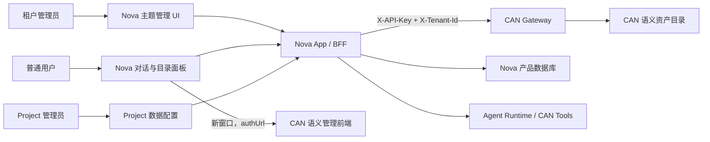
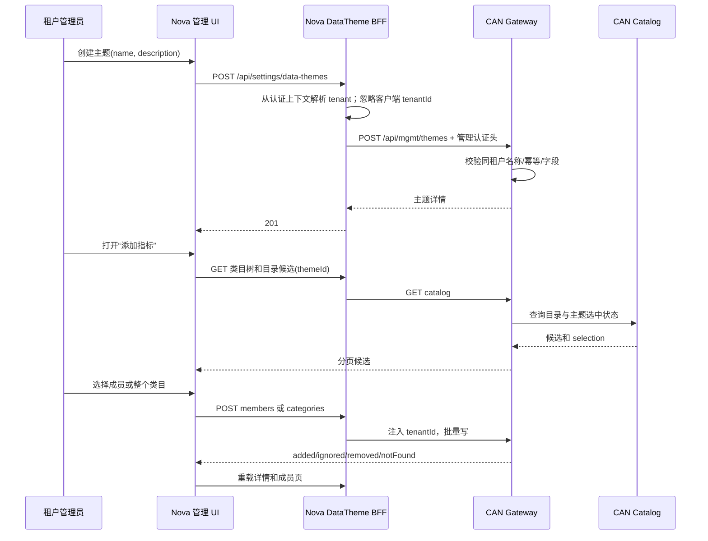
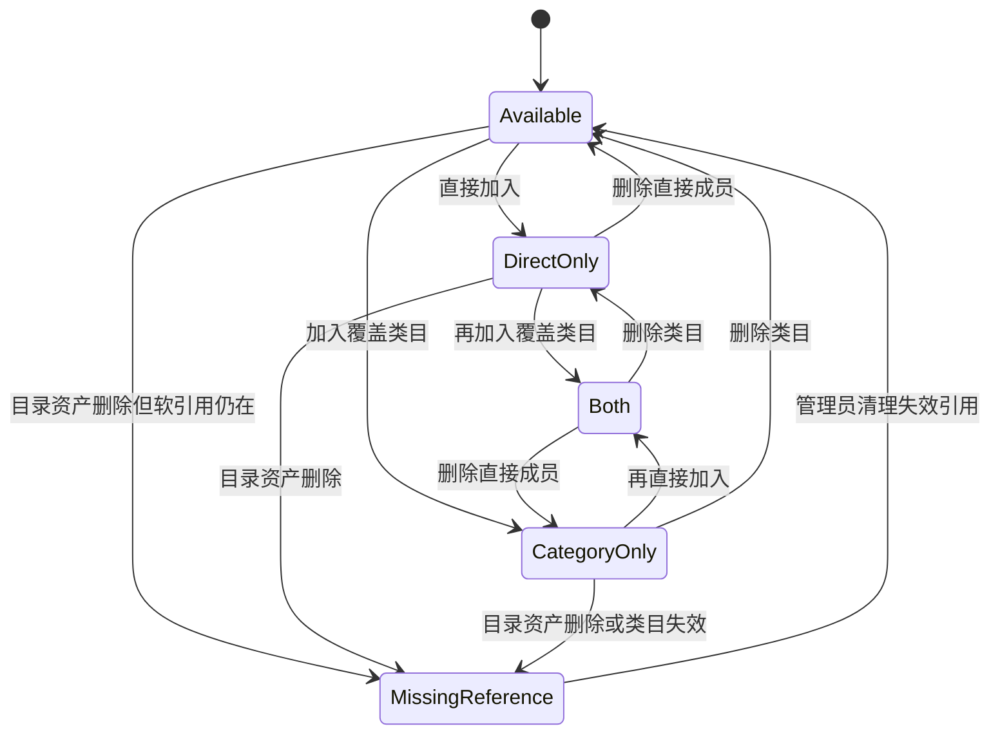
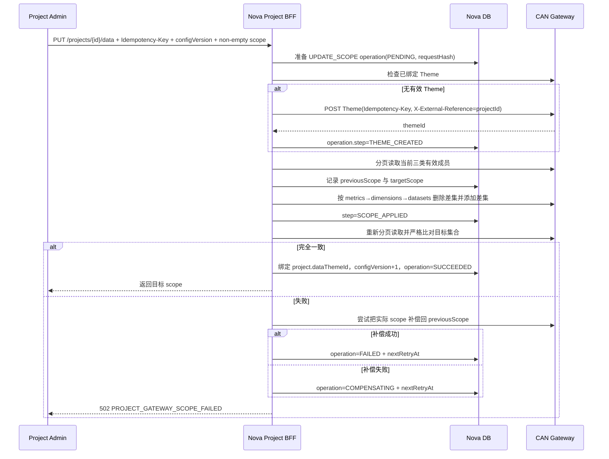
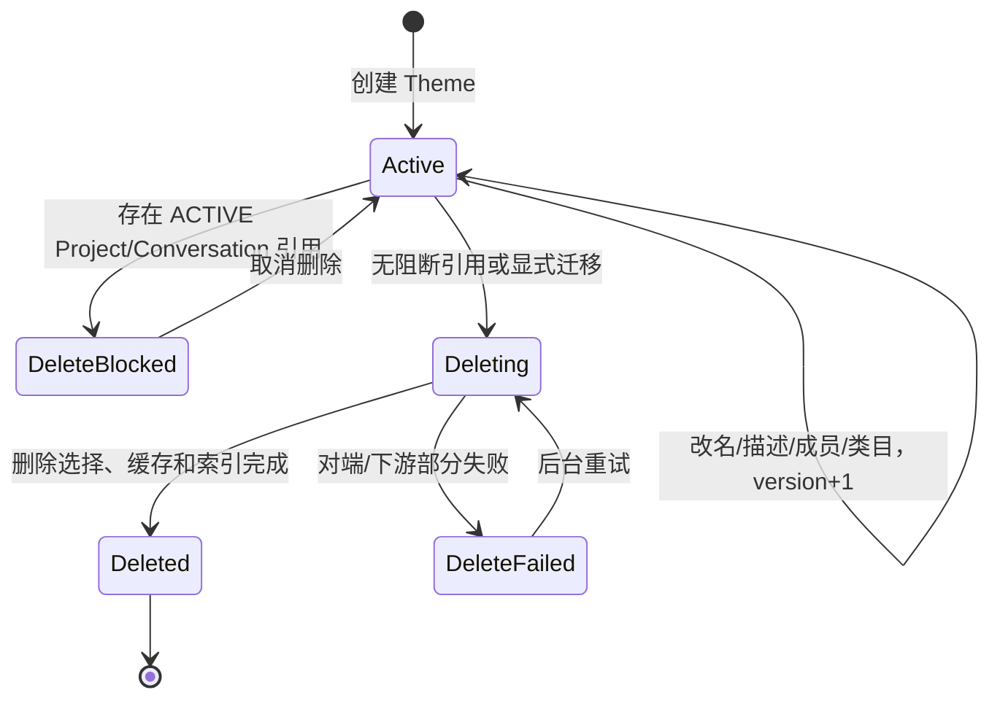
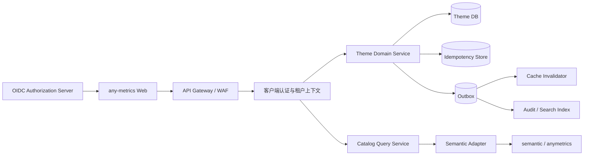

# 数据主题、指标目录和语义管理入口复刻文档

## 1\. 结论与边界

本模块把租户级语义资产目录组织成可用于对话、项目和管理配置的“数据主题（Data Theme）”。一个主题不是数据副本，而是对指标、维度、数据集的逻辑选集：管理员可以直接加入单个成员，也可以加入一个指标/维度类目，使类目覆盖的成员随目录演进自动进入主题。普通用户随后在个人对话中选择“所有数据”或一个具体主题；Project 则在服务端绑定一个专属主题，作为项目对话的权威数据范围。

本模块解决五个业务问题：
1. 租户管理员如何创建、编辑、删除主题并维护成员。
2. 普通用户如何只读浏览指标、维度、数据集目录，并把条目插入问题。
3. 对话和 Project 如何把数据范围传入指标工具，而不是让 LLM 自行决定授权范围。
4. 如何从 Nova 跳转到外部 CAN 语义管理站点和指标/维度详情页。
5. Nova 没有 CAN Gateway 源码时，Gateway 至少应提供哪些兼容契约，以及生产实现应如何补齐一致性、安全和审计。

### 1.1 目标用户、输入和输出

| 角色 | 输入 | 最终效果 |
|------|------|------------|
| 租户管理员 | 主题名称、描述、类目、成员名称 | 创建租户主题；维护其指标/维度/数据集有效范围 |
| 普通租户用户 | 当前对话、主题选择、目录关键词 | 浏览可见目录；把对话限制到具体主题，或选择所有数据 |
| Project 管理员 | Project、配置版本、指标/维度/数据集逻辑名称集合 | 通过 Saga 创建或复用专属外部主题，并把 Project 绑定到该主题 |
| Agent Runtime | 权威租户、用户、场景和 `dataThemeId` | 所有 CAN 查询附带正确 scope，Project 场景不能退化为租户全量 |
| 外部 CAN 站点用户 | Nova 提供的外部入口或详情链接 | 在新窗口打开语义首页或具体指标/维度详情 |

### 1.2 包含与不包含

本文包含主题 CRUD、三类成员和两类类目选择、目录浏览与详情、租户权限、缓存、对话主题选择、Project 绑定 Saga、外部语义跳转、Gateway 兼容 Stub、推荐生产设计和验收标准。

本文不展开 MQL 语法和实际指标计算、数据源连接管理、指标/维度/数据集的完整创建发布流程、归因知识、推荐问题编辑器和 Project 的工具/Skill/知识挂载。本文仍会给出它们与主题 scope 的边界契约，使实现者不需要其他文档才能正确集成本模块。

### 1.3 当前结论的证据等级
- `I`：Nova 当前存在管理面与用户面 REST、Gateway 客户端、主题 DTO、Project Saga、对话选择器、目录面板、详情 BFF 和外部语义链接。
- `A`：UI E2E 有一个外部语义站点活动用例；推荐问题 API 的 `SET-RECQ-001/003/005` 也是 Active 自动化契约。它们本次均未运行。
- `K`：`SET-RECQ-004` 已登记为 Known Failure：第二租户当前可以读取第一租户主题的推荐问题，期望应为 403/404。静态实现还存在本文列出的 scope、缓存和生命周期缺口。
- `P`：另有 13 条独立的数据主题浏览/配置候选场景（`DATA-BROWSE-001..008`、`DATA-CONF-001..005`），但尚未登记为 YAML；不能与上述推荐问题自动化混为一谈。
- `R`：无。本次没有启动 Nova、没有连接 CAN、没有运行测试。
- `F`：Gateway 的主题持久化、类目展开、资产授权和 SSO 内部实现只能由客户端、DTO 和 UI 反推。
- `D`：本文提供的版本控制、引用保护、缓存主动失效、OIDC handoff、生产表结构和删除 Saga 是复刻建议，不代表当前 Nova 已实现。

## 2\. 术语与参与方

| 术语 | 定义 |
|------|------|
| 数据主题 | 一个租户内命名的语义资产选集，包含指标、维度、数据集三种 bucket。 |
| 所有数据 | 前端合成范围，固定 UI 哨兵为 `&#95;&#95;all&#95;data&#95;&#95;`，不是 Gateway Theme 实体；对 Agent 来说通常归一成没有具体 `themeId`。旧工具辅助器还把字符串 `all` 当作全量哨兵。 |
| 直接成员 | 管理员按资产名称显式加入主题的成员。 |
| 类目覆盖成员 | 管理员加入一个指标/维度类目后，由该类目动态覆盖的成员。数据集当前没有类目选择。 |
| 有效成员集 | `directMembers ∪ categoryGroups.members` 去重后的结果，用于查询 scope 和成员列表。 |
| 软引用失效成员 | 主题还保留名称，但语义目录已找不到对应资产；以 `isMissing=true` 展示。 |
| 目录候选 | 全租户目录中的条目；传 `themeId` 时附带它是否已被该主题直接或按类目覆盖的信息。 |
| Project 主题 | 一个 Project 在 Gateway 上拥有的专属主题；Nova 仅保存其 `dataThemeId` 绑定。 |
| `authUrl` | 浏览器访问的 CAN 登录/语义站点 base URL；语义外跳使用它。 |
| `gatewayUrl` | Nova 服务端调用 CAN Gateway 的 API base URL；不能代替 `authUrl` 生成浏览器外链。 |



已知 CAN 仓库职责只用于边界判断：`semantic` 是 CAN 核心服务，`anymetrics` 是业务层，`any-metrics` 是 Node.js 前端，`jscip` 提供账号和数据源等基础平台配置，`tse` 是调度平台。Nova 只直接依赖 Gateway HTTP 契约和外部前端 URL；Gateway 内部如何路由到这些服务，本次无法证明。

## 3\. 领域模型与业务规则

### 3.1 主题聚合

主题详情的规范 JSON 为：
```json
{
  "id": "theme-retail",
  "tenantId": "tenant-001",
  "name": "零售经营",
  "description": "门店经营分析范围",
  "metricCount": 12,
  "dimensionCount": 8,
  "datasetCount": 3,
  "updatedAt": 1786089600000,
  "selections": {
    "metrics": {
      "categoryGroups": [
        {
          "categoryId": "cat-sales",
          "categoryName": "销售指标",
          "memberCount": 10,
          "members": [
            {"name": "revenue", "displayName": "销售额", "isMissing": false}
          ]
        }
      ],
      "directMembers": [
        {"name": "gross_margin", "displayName": "毛利率", "isMissing": false}
      ]
    },
    "dimensions": {

      "categoryGroups": [],

      "directMembers": [
        {"name": "shop", "displayName": "门店", "isMissing": false}
      ]
    },
    "datasets": {

      "categoryGroups": [],

      "directMembers": [
        {"name": "fact_sales", "displayName": "销售事实表", "isMissing": false}
      ]
    }
  }
}

```

核心规则分为“Nova 可观察结构”和“对端兼容目标”。前四项是 Nova DTO/调用代码可以确认的结构 `I`；第 5～9 项是客户端字段、注释和 UI 行为所要求的兼容语义，但没有 Gateway 源码或本次运行证据，只能标为 `F`，不能宣称真实对端已保证：
1. `id` 是 Gateway 生成的主题标识；所有查改删必须同时绑定当前租户。
2. `updatedAt` 当前契约为 epoch milliseconds，而不是 ISO-8601 字符串。
3. `selections` 有 `metrics`、`dimensions`、`datasets` 三个 bucket；每个 bucket 有 `categoryGroups` 和 `directMembers`。
4. 指标和维度支持按类目加入；数据集当前只支持直接成员。
5. 兼容目标：有效成员是直接成员与类目覆盖成员的去重并集；同一资产可同时拥有两种来源 `F`。
6. 兼容目标：删除直接来源后，如果类目来源仍在，资产仍属于有效集合 `F`。
7. 兼容目标：删除类目只删除类目来源，重叠的直接来源继续保留 `F`。Nova 会解析 `coveredDirectRemovedCount`，但该字段的精确对端算法未验证。
8. 兼容目标：资产下线后可保留软引用并以 `isMissing=true` 暴露，不得悄悄映射到另一个同名资产 `F`。
9. 兼容目标：`metricCount/dimensionCount/datasetCount` 表示有效去重成员数，并与同一目录版本的分页一致 `F`。

### 3.2 目录选择状态

全量目录候选可返回：
```json
{
  "name": "revenue",
  "displayName": "销售额",
  "alreadyInTheme": true,
  "selection": {
    "state": "COVERED_BY_CATEGORY",
    "category": {"id": "cat-sales", "name": "销售指标"}
  }
}

```

已观察状态：

| 状态 | 语义 | UI 行为 |
|------|------|---------|
| `AVAILABLE` 或缺省 | 尚未进入主题 | 可勾选加入 |
| `DIRECT&#95;SELECTED` | 已直接加入 | 置灰，防重复加入 |
| `COVERED&#95;BY&#95;CATEGORY` | 已被一个已选类目覆盖 | 置灰，并可显示覆盖类目名 |

如果 `selection` 缺失，Nova 兼容读取旧字段 `alreadyInTheme`。若 `selection` 存在，则 `DIRECT_SELECTED` 和 `COVERED_BY_CATEGORY` 均归一成 `alreadyInTheme=true`。

### 3.3 权限与作用域
1. `/api/settings/data-themes/**` 只允许租户管理员；普通用户不能获得写入口。
2. `/api/data-themes/available` 和 `/api/data-themes/browse/**` 对已登录用户开放，但只读。
3. 当前可用主题列表是“租户可见”，同一租户内所有用户看到同一主题集合；不存在用户级主题授权模型 `I`。
4. 带 `themeId` 的普通用户目录请求会先验证该 ID 是否在当前租户主题集合中；失败为 403，且不应调用具体目录接口。
5. 不带 `themeId` 表示浏览租户全量目录，不执行主题校验。
6. 管理 Gateway 调用使用服务端 `X-API-Key + X-Tenant-Id`；浏览器不能看到 API Key，也不能通过 body 提交 `tenantId` 覆盖服务端身份。
7. Project 数据配置要求 Project ADMIN；预创建目录 `/api/project-catalog/**` 还要求租户管理员。
8. Project 对话的目录和 Agent scope 必须来自会话绑定的权威 Project，不接受浏览器提供另一个 `themeId` 覆盖。

生产复刻必须在 Gateway 再执行 `(tenant, user/client, theme, asset)` 授权交集。Nova 当前的租户级预检不能替代对端对象级、行级或列级权限。

### 3.4 分页、搜索和限制
- Nova 后端页码从 1 开始；缺失或小于 1 归一为 1。
- 默认 `pageSize=20`，小于等于 0 回退 20，最大截断为 200。
- 主题管理列表 UI 每页 50；主题成员 UI 每页 30；对话目录 UI 通常每页 50。
- 搜索由 Gateway 执行，Nova 不再拉多页后本地模糊匹配。
- 指标和维度可按 `categoryId` 与 `keyword` 浏览；数据集只有 `keyword`。
- 类目接口返回扁平节点，前端按 `parentId` 建树；节点字段为 `id,name,parentId,frontId,categoryType`。

### 3.5 缓存规则与当前限制

当前存在三类缓存：

| 缓存 | Key | TTL/行为 |
|------|---|----------|
| 租户可见主题 ID | `tenantId` | 服务端 Caffeine，30 秒，最多 1024 租户；Gateway 失败不缓存空集并按不可见处理 |
| 对话目录页 | `type + projectId + raw keyword + pageNumber + pageSize` | 浏览器 30 秒；共享进行中的请求；所有消费者取消后 Abort 并驱逐 |
| 指标/维度详情 | 排序后的去重名称集合 | 浏览器 Promise 缓存；失败时删缓存，下次 hover 重试 |

当前主题创建、更新、删除和成员变更没有显式失效“租户可见主题 ID”缓存。因此新主题可能最多 30 秒不能通过可见性校验，已删除主题也可能短暂被认为可见 `K/I`。生产复刻应在成功写操作后发布 `ThemeChanged(tenantId,themeId,version)`，主动失效主题、目录、详情和 Agent 元数据缓存；TTL 只作为兜底。

## 4\. 完整执行链路

### 4.1 管理员创建主题并加入成员



管理 UI 的“所有数据”是固定合成项：它不能编辑或删除，三个 Tab 只读显示租户全量目录；它可以有以特殊 ID 保存的推荐问题，但不是 Gateway Theme。

### 4.2 直接成员、类目和删除



Nova 客户端被写成可消费 `added/ignored/removed/notFound`，相关注释还描述了“未知或已存在的添加项进入 `ignored`、不存在的删除项进入 `notFound`” `I`；但这不是本次已验证的对端保证 `F`。兼容 Stub 应先实现该目标以支持重复请求，生产接口则应把 `already_exists` 与 `unknown_asset` 分开，否则 UI 无法判断是安全重放还是拼写错误。

### 4.3 个人对话选择主题
1. 前端加载 `/api/data-themes/available`。Gateway 未配置或短暂失败时，当前服务返回空数组以保证聊天页可加载。
2. 用户选择具体主题；浏览器同时保存“最后偏好”到本地持久状态。
3. 已有会话立即 `PUT /api/conversations/{id}/data-theme`；服务端验证主题属于当前租户后，把 ID 写入会话产品元数据。
4. 新会话尚无 ID，首条消息把当前 `dataThemeId` 放入 chat/WS payload，创建会话时保存。
5. 打开历史会话时，应以会话持久化 scope 为准，而不是无条件覆盖成浏览器最后偏好。
6. 可用主题刷新后，如果当前选择已消失且不是嵌入锁定模式，前端降级为“所有数据”并清除偏好。
7. 嵌入模式可锁定一个主题或“所有数据”哨兵；锁定后用户手动选择变为 no-op，退出嵌入页后恢复原偏好。

当前 transport 存在不一致：
- 更新已有会话时，非法主题得到 400。
- WebSocket 收到不可见主题时会记录告警并**静默丢弃**，等价于所有数据。
- REST `/api/chat` 和 `/api/chat/stream` 的入口只把非空请求值挂入上下文，本入口自身未调用主题可见性校验。

这是安全和语义风险：一个无效的限制条件不应静默扩大为租户全量。生产复刻统一规则应为：具体主题不存在或不可见时返回 403 `DATA_THEME_NOT_VISIBLE`；Project 缺少绑定时返回 409 `PROJECT_DATA_SCOPE_NOT_READY`；只有客户端明确传 `null`/“所有数据”才能使用租户全量。

### 4.4 对话目录入口的两种模式

个人对话：目录面板调用用户只读 `/api/data-themes/browse/{metrics|dimensions|datasets}`，显示租户全量目录。主题下拉限制 Agent 查询，但当前个人对话的统一目录浏览函数没有把选中 `themeId` 加入目录请求，因此“目录面板展示全量、Agent 按主题查询”可能同时发生 `I`。如果产品预期目录也随主题过滤，复刻时必须显式传主题并调用 `/themes/{themeId}/{type}`，不能假设当前实现已做到。

Project 对话：前端先由 `conversationId` 获取权威 `projectId`，再读取 `/api/projects/{projectId}/data`；前端在返回的三个数组上做关键词过滤和分页。字段历史命名为 `metricIds/dimensionIds/datasetIds`，但当前元素实际是 Gateway 资产逻辑名称（例如 `revenue`、`shop`），不是目录数据库的 opaque ID `I`。底层 Theme ID 不暴露给浏览器。若 Project 尚未绑定 Theme，目录为空，不能回退到个人全量目录。

当前 `DataView.themeExists` 的名字容易误解：没有本地 `dataThemeId` 时它为 `false`；有本地绑定且外部 Theme 正常时为 `true`；但有本地绑定而 Gateway 返回 404 时，当前代码仍返回 `themeExists=true` 和空 scope。因此该字段实际上更接近“本地存在过 Theme 绑定”，不能作为对端资源健康证明 `I/K`。生产复刻应拆为 `bindingExists`、`remoteThemeStatus=ACTIVE|MISSING|UNAVAILABLE` 和 `dataScope`，MISSING 时禁止继续执行 Project Agent。

### 4.5 Project 绑定 Theme 的 Saga

Project 创建当前只落 Nova 本地数据库：创建请求必须携带空 `dataScope`，结果 `dataThemeId=null`。只有后续数据范围替换才创建或复用 Gateway Theme。



Saga 规则：
- `Idempotency-Key` 必填，最长 128；同租户同 key、同操作类型、同 request hash 返回已有 operation；同 key 异 body 返回 409。
- `configVersion` 是本地乐观锁。不是同一已开始 operation 的恢复时，版本变化返回 409 `PROJECT_VERSION_CONFLICT`。
- 范围会去空白、去重并排序；三类总数上限 5000；替换请求当前必须至少包含一个成员，不能清空到空集合。
- 读取 Gateway 每页 200；重复读取超过 5000 条失败。
- 状态为 `PENDING|SUCCEEDED|FAILED|COMPENSATING`；步骤包括 `INIT,THEME_CREATED,PROJECT_BOUND,SCOPE_APPLIED,VERIFIED,LOCAL_COMMITTED,COMPENSATED`。
- 失败重试指数退避，最多约一小时；后台 reconcile 可认领过期 PENDING 或失败 operation。
- 创建外部 Theme 的名称由 Project 名称加稳定的 Project ID 前 8 位构成，以避免名称冲突并保证重试稳定。

Project 删除当前只是本地软删除，保留 `dataThemeId`，不会删除或停用 Gateway Theme；恢复后状态为 DISABLED。普通主题删除也只是透传 Gateway，没有在 Nova 侧检查会话/Project 引用。因此外部主题可能成为孤儿，或者活跃 Project 持有已删除引用 `K/I`。生产设计见第 8 节。

### 4.6 指标/维度详情与外部语义站点
1. Nova 在 `/api/user/env` 返回用户环境，并用服务端配置补充 `authUrl` 和 `gatewayUrl`。
2. 侧边栏只有在 `authUrl` 非空时显示“语义管理”，点击 `<a target="_blank" rel="noopener noreferrer">` 打开 `authUrl` 根路径。
3. 指标 hover 一次最多按名称批量取详情；维度 Gateway 只有单条接口，因此 BFF 并行 fan-out 后聚合为 map。
4. 指标详情链接为 `{authUrl}/metric/content/{code}`；维度为 `{authUrl}/dimension/content/{dimCode}`，code 缺失时 UI 可能回退到资产 name。
5. 数据集没有详情 BFF，hover 只持有目录 `name`；当前渲染代码仍会用该 name 构造 `{authUrl}/dataset/content/{name}` 外链。源码注释却声明“数据集不展示跳转链接”，两者冲突 `K`，且没有 E2E 证明对端存在该路由。因此兼容测试应记录当前实际生成链接的行为，产品验收前必须与 CAN 明确数据集详情路径；不能把这条链接宣称为已验证能力。
6. `authUrl` 缺失时不回退 `gatewayUrl`；只展示文本，不生成链接。
7. 当前 helper 只去除一个尾部 `/`，没有对 code 做 path-segment URL encoding。
8. Nova 不在外链 URL 添加 token。外部站点依赖已有登录态或共享认证态；UI E2E 期望跳转后不是登录页/502 页，但本次未运行。

## 5\. 对外 REST 与 Gateway 契约

### 5.1 Nova 管理面 REST（租户管理员）

| 方法 | 路径 | 请求/查询 | 成功响应 |
|------|------|-------------|------------|
| GET | `/api/settings/data-themes` | `keyword? pageNumber? pageSize?` | `Page&lt;DataTheme&gt;` |
| GET | `/api/settings/data-themes/{themeId}` | - | `DataTheme` |
| POST | `/api/settings/data-themes` | `{name,description?}` | 201 `DataTheme` |
| PUT | `/api/settings/data-themes/{themeId}` | `{name?,description?}` | `DataTheme` |
| DELETE | `/api/settings/data-themes/{themeId}` | - | 204 |
| GET | `/api/settings/data-themes/{themeId}/{type}` | `keyword? pageNumber? pageSize?` | `Page&lt;ThemeItem&gt;` |
| POST/DELETE | 同上 | `{names:&#91;...]}` | `ThemeItemBatchResult` |
| POST/DELETE | \`/api/settings/data-themes/\{themeId\}/\{metrics | dimensions\}/categories\` | `{categories:&#91;{categoryId,categoryName?}]}` |
| GET | `/api/settings/data-themes/browse/metric-categories` | - | `CategoryNode&#91;]` |
| GET | `/api/settings/data-themes/browse/dimension-categories` | - | `CategoryNode&#91;]` |
| GET | `/api/settings/data-themes/browse/metrics` | `categoryId? keyword? pageNumber? pageSize? themeId?` | `Page&lt;CatalogItem&gt;` |
| GET | `/api/settings/data-themes/browse/dimensions` | 同上 | `Page&lt;CatalogItem&gt;` |
| GET | `/api/settings/data-themes/browse/datasets` | `keyword? pageNumber? pageSize? themeId?` | `Page&lt;CatalogItem&gt;` |

`type` 只允许 `metrics|dimensions|datasets`。成员 `names` 或类目 `categories` 缺失/空数组时返回 400。类目操作只允许 `metrics|dimensions`。

分页响应：
```json
{

  "items": [],

  "total": 0,
  "pageNumber": 1,
  "pageSize": 20,
  "hasNext": false,
  "selectedCategory": {"id": "cat-sales", "name": "销售指标"}
}

```

### 5.2 Nova 普通用户 REST

| 方法 | 路径 | 语义 |
|------|------|------|
| GET | `/api/data-themes/available` | 只返回 `id,name,description`；Gateway 故障降级 `&#91;]` |
| GET | `/api/data-themes/browse/metric-categories` | 用户只读类目 |
| GET | `/api/data-themes/browse/dimension-categories` | 用户只读类目 |
| GET | \`/api/data-themes/browse/\{metrics | dimensions |
| GET | `/api/data-themes/browse/catalog/counts` | `{metrics,dimensions,datasets}` |
| GET | `/api/data-themes/browse/themes/{themeId}/{type}` | 具体主题有效成员列表 |
| PUT | `/api/conversations/{conversationId}/data-theme` | \`\{dataThemeId:string |
| GET | `/api/metric-catalog/metrics/batch-details?names=a,b` | 名称到指标详情的 map |
| GET | `/api/metric-catalog/dimensions/batch-details?names=a,b` | 名称到维度详情的 map |
| GET | `/api/user/env` | 用户/租户环境加 `authUrl,gatewayUrl` |

带不可见 `themeId` 的用户目录请求返回 403。Gateway 异常返回原 4xx/5xx 或 502；用户目录错误体只包含安全的 `error,gatewayStatus`，管理接口当前还可能包含 `gatewayBody`，生产实现应统一脱敏。

推荐问题编辑器虽不在本文展开范围，但它以 Theme ID 为本地存储键，直接暴露同一安全边界：管理员读写 `/api/settings/recommended-questions/{themeId}`，普通用户读取 `/api/data-themes/{themeId}/recommended-questions`。Active 自动化契约要求有序 Unicode 内容可保存并恢复（`SET-RECQ-001`）、同租户读取有效（`003`）、输入会 trim/去重/截断为最多 10 条且每条最多 200 字符、空列表可接受并恢复（`005`）`A`；本次未运行，不能写成已通过。`SET-RECQ-004` 则明确记录第二租户读取所有者主题返回 200 的 Known Failure；期望读写均为 403/404，且所有者内容不变 `K`。因此复刻时不能只按 `(tenant_id,theme_id)` 写入，读写入口都必须先验证主题归属；外来读失败后测试不会继续尝试写，不能把 `foreignWriteRejected` 误宣称为当前已验证。

### 5.3 Project REST
```http
GET /api/projects/{projectId}/data
PUT /api/projects/{projectId}/data
Idempotency-Key: pscope-20260813-001
Content-Type: application/json

{
  "configVersion": 3,
  "dataScope": {
    "metricIds": ["revenue", "gross_margin"],
    "dimensionIds": ["shop", "day"],
    "datasetIds": ["fact_sales"]
  }
}

```

成功：
```json
{
  "metricIds": ["gross_margin", "revenue"],
  "dimensionIds": ["day", "shop"],
  "datasetIds": ["fact_sales"]
}

```

读取返回：
```json
{
  "themeExists": true,
  "dataScope": {
    "metricIds": ["gross_margin", "revenue"],
    "dimensionIds": ["day", "shop"],
    "datasetIds": ["fact_sales"]
  }
}

```

预创建或配置选择器还使用 `/api/project-catalog/{metrics|dimensions|datasets}` 和两个 category 端点；已有 Project 的候选使用 `/api/projects/{projectId}/data/catalog/**`。这些候选接口用于“选择范围”，不是 Project 对话的最终只读目录；最终目录必须来自已保存的 `DataScope`。

`DataScope` 的 `*Ids` 是历史误名：当前实现从主题成员的 `name` 读取，再把这些字符串原样用于 Gateway 增删成员，因此兼容实现必须传资产逻辑名称/编码，不能擅自改传目录行主键。新系统应改成 `AssetRef {stableId,name}`，内部引用稳定 ID，兼容 adapter 在边界解析成旧 Gateway 所需的 name；在无法取得稳定 ID 的旧系统中，至少把字段改名为 `metricNames/dimensionNames/datasetNames`，避免调用方误用。

### 5.4 Nova → Gateway 管理契约

所有请求使用：
```http
X-API-Key: <server-side-secret>
X-Tenant-Id: tenant-001

```

Project 创建 Theme 额外发送：
```http
Idempotency-Key: <stable-operation-key>
X-External-Reference: <stable-project-id>

```

Gateway 路由：
```text
GET    /api/mgmt/themes
GET    /api/mgmt/themes/page?keyword=&pageNumber=1&pageSize=20
GET    /api/mgmt/themes/{id}
POST   /api/mgmt/themes
PUT    /api/mgmt/themes/{id}
DELETE /api/mgmt/themes/{id}

GET    /api/mgmt/themes/{id}/members/{metrics|dimensions|datasets}
POST   /api/mgmt/themes/{id}/{metrics|dimensions|datasets}
DELETE /api/mgmt/themes/{id}/{metrics|dimensions|datasets}  # 带 JSON body
POST   /api/mgmt/themes/{id}/{metric-categories|dimension-categories}
DELETE /api/mgmt/themes/{id}/{metric-categories|dimension-categories} # 带 body

GET /api/mgmt/catalog/metric-categories
GET /api/mgmt/catalog/dimension-categories
GET /api/mgmt/catalog/metrics
GET /api/mgmt/catalog/dimensions
GET /api/mgmt/catalog/datasets
GET /api/mgmt/catalog/counts

```

Gateway 标准成功信封应为：
```json
{"success":true,"message":"ok","data":{}}

```

当前 Nova 管理解码器在 `success=false` 时失败；如果缺失 `success` 仍尝试读取 `data`；2xx 非 JSON 为协议错误。Gateway 应始终输出稳定 JSON 和 trace ID，不应依赖这种宽松兼容。

成员写 body 的字段依类型变化：
```json
{"tenantId":"tenant-001","metricNames":["revenue"]}
{"tenantId":"tenant-001","dimNames":["shop"]}
{"tenantId":"tenant-001","datasetNames":["fact_sales"]}

```

类目 body：
```json
{
  "tenantId": "tenant-001",
  "categories": [{"categoryId":"cat-sales","categoryName":"销售指标"}]
}

```

### 5.5 指标和维度详情契约

这两条是用户态透传接口，不属于管理面。Nova BFF 从当前请求上下文发送 `X-Tenant-Id + X-User-Id`，不发送管理 API Key；Gateway 必须按该用户过滤详情。管理主题与用户详情的鉴权 profile 不可混用。

Nova BFF 对 Gateway 调用：
```http
GET /api/can/metrics/batch-detail?metricNames=revenue,gross_margin
GET /api/can/dimension/detail?dimName=shop
X-Tenant-Id: tenant-001
X-User-Id: user-007

```

Gateway 原始成功响应使用 `{success,message,data}` 信封。指标 `data` 是数组；负责人实际位于 `basicAttributes.owner`：
```json
{
  "success": true,
  "message": "ok",
  "data": [{
    "code": "mc-123",
    "metricName": "revenue",
    "metricDisplayName": "销售额",
    "businessCaliber": "含税成交金额",
    "description": "门店成交收入",
    "type": "ATOMIC",
    "dataType": "DECIMAL",
    "basicAttributes": {"owner": "finance"}
  }]
}

```

维度 `data` 是对象。用于外链的稳定平台标识是顶层 `name`；Nova 归一时必须让它覆盖经 DTO 映射得到的 `dimCode`，只有 `name` 缺失时才回退原始 `dimCode`。负责人同样优先取 `basicAttributes.owner`：
```json
{
  "success": true,
  "message": "ok",
  "data": {
    "name": "dm-123",
    "dimName": "shop",
    "dimCode": "",
    "dimDisplayName": "门店",
    "dimDescription": "交易所属门店",
    "originDataType": "VARCHAR",
    "basicAttributes": {"owner": "retail_ops"}
  }
}

```

Nova 返回给浏览器的是去掉外层信封后的归一 DTO：把 nested owner 提升为顶层 `owner`，并把维度顶层 `name` 映射为归一后的 `dimCode`。指标批量详情缺失名称时从 map 省略；维度单条 404/null 也从聚合 map 省略。任一维度 fan-out 抛 Gateway 异常时当前整个 BFF 请求失败，生产实现建议使用有界并发和逐项错误，避免一个坏维度拖垮全部 hover。

### 5.6 配置与连接行为
```yaml
nova:
  auth:
    enabled: true
    auth-url: https://can.example.com       # api-url/login-url 的历史兜底
    api-url: https://can-internal.example.com
    login-url: https://can.example.com      # 浏览器语义入口和详情链接使用
    timeout-seconds: 10
    cookie-name: CIP_SESSION
  metric:
    gateway-url: https://gateway.can.example.com
    admin-api-key: ${CAN_GATEWAY_ADMIN_API_KEY}

```

`gateway-url` 和 `admin-api-key` 都存在时主题管理才算已配置；只有 URL 而没有管理密钥也不能执行主题 API。当前共享 Gateway HTTP 客户端固定连接超时 15 秒、请求超时 60 秒、HTTP/1.1、正常重定向且显式不走系统代理。复刻时应把目录读和管理写拆成更短、可配置的预算，例如目录 5~10 秒、写操作 15~20 秒；只有幂等 GET 和携带幂等键的写才能有限重试。

`login-url` 优先于 `auth-url` 返回浏览器；`api-url` 优先于 `auth-url` 用于服务端 CAN 认证调用。不得把内网 `api-url` 或带管理能力的 `gateway-url` 暴露成外部语义链接。配置示例只能使用占位符，真实密钥由环境变量或 secret manager 注入。

### 5.7 当前登录回跳链与语义外跳边界

Nova 页面请求未认证时（API、WebSocket 或 JSON 请求仍返回 401），当前过滤器按以下链路重定向 `I`：
```text
returnPath = requestPath + non-RSC query
encodedPath = urlEncode(urlEncode(returnPath))
agentRedirect = {loginUrl}/agent_redirect?path={encodedPath}
refer = urlEncode(agentRedirect)
302 -> {loginUrl}/login?refer={refer}
CAN 登录完成 -> /agent_redirect 解码 path，并以 ?tn=<base64-cookie-string> 回到 Nova
Nova 解码 tn -> 取 CIP_SESSION -> 在 Nova 域重新写 Cookie -> 去掉 tn 再重定向

```

`path` 必须双重编码，因为 `/login` 和 `/agent_redirect` 各消费一层；外层 `refer` 还要单独 URL encode。回跳前会去除 Next.js RSC 的 `.txt` 路径标记和 `_rsc` 查询参数。Cookie 名默认 `CIP_SESSION`，可配置；`tn` 内容是 Base64 编码的 Cookie 字符串，不应出现在日志、审计或长期 URL 中。

这条链只适用于“用户访问 Nova 但未认证”。侧边栏语义入口和指标/维度详情链接当前直接打开 `authUrl`/内容 URL，不附加 token，也不走上述 handoff `I`。UI E2E 只要求远程已登录环境打开后不是登录/502 页，因而“Nova 与 CAN 存在可复用同域/统一 SSO 登录态”只能标为 `F`，不是协议保证。复刻生产系统应使用标准 OIDC Authorization Code \+ PKCE；如果必须跨域回传，改成短时、一次性、绑定 state/nonce/redirect allowlist 的 signed handoff，不能照搬可重放的 `tn` 到新设计 `D`。

## 6\. 数据模型与生命周期

### 6.1 Nova 当前持久化边界

主题本体和成员不在 Nova 数据库，权威数据在 Gateway。Nova 只持久化引用：
- `conversation.data_theme_id`：个人会话选择；索引 `(tenant_id,user_id,data_theme_id)`。
- `project.data_theme_id`：Project 到外部 Theme 的一对一绑定；同租户下唯一。
- `project_gateway_operation`：跨 Nova/Gateway 的 Saga 状态、幂等和补偿数据。
- `theme_recommended_questions`：按 `(tenant_id,data_theme_id)` 保存的推荐问题 JSON；它不是主题本体。

下列 PostgreSQL DDL 合并了基础 migration 及“Project 可先无 Theme”“新增 `PROJECT_BOUND` step”两次后续变更，是当前字段、约束和索引的完整等价表示；不是省略审计列的示意：
```sql
alter table conversation add column data_theme_id varchar(255);
create index idx_conversation_data_theme
  on conversation(tenant_id, user_id, data_theme_id);

create table theme_recommended_questions (
  id bigint generated by default as identity not null primary key,
  tenant_id varchar(255),
  user_id varchar(255),
  data_theme_id varchar(255) not null,
  questions_json text,
  created_at timestamp(6) not null,
  updated_at timestamp(6),
  constraint uk_theme_rec_q_tenant_theme unique(tenant_id,data_theme_id)
);

create table project (
  id bigint generated by default as identity not null primary key,
  project_id varchar(64) not null,
  tenant_id varchar(255) not null,
  data_theme_id varchar(255),
  name varchar(128) not null,
  description varchar(1000),
  project_prompt text,
  status varchar(16) not null,
  access_mode varchar(16) not null,
  config_version bigint not null default 1,
  created_by varchar(255) not null,
  created_at timestamp(6) not null,
  updated_by varchar(255) not null,
  updated_at timestamp(6) not null,
  deleted_by varchar(255),
  deleted_at timestamp(6),
  deletion_reason varchar(500),
  constraint uk_project_project_id unique(project_id),
  constraint uk_project_tenant_theme unique(tenant_id, data_theme_id),
  constraint ck_project_status check(status in ('ACTIVE','DISABLED','DELETED')),
  constraint ck_project_access_mode check(access_mode in ('ALL_TENANT','RESTRICTED'))
);
create index idx_project_tenant_status_updated on project(tenant_id,status,updated_at);
create index idx_project_tenant_name on project(tenant_id,name);

create table project_gateway_operation (
  id bigint generated by default as identity not null primary key,
  operation_id varchar(64) not null,
  tenant_id varchar(255) not null,
  project_id varchar(64) not null,
  operation_type varchar(16) not null,
  state varchar(16) not null,
  step varchar(32) not null,
  idempotency_key varchar(128) not null,
  request_hash varchar(64) not null,
  data_theme_id varchar(255),
  request_json text not null,
  previous_scope_json text,
  target_scope_json text,
  retry_count integer not null default 0,
  last_error_code varchar(64),
  last_error_message varchar(2000),
  next_retry_at timestamp(6),
  created_by varchar(255) not null,
  created_at timestamp(6) not null,
  updated_at timestamp(6) not null,
  constraint uk_project_operation_id unique(operation_id),
  constraint uk_project_operation_idempotency unique(tenant_id,idempotency_key),
  constraint ck_project_operation_type check(operation_type in ('CREATE','UPDATE_SCOPE','RECONCILE')),
  constraint ck_project_operation_state check(state in ('PENDING','SUCCEEDED','FAILED','COMPENSATING')),
  constraint ck_project_operation_step check(step in
    ('INIT','THEME_CREATED','PROJECT_BOUND','SCOPE_APPLIED','VERIFIED','LOCAL_COMMITTED','COMPENSATED'))
);
create index idx_project_operation_state_retry
  on project_gateway_operation(state,next_retry_at);
create index idx_project_operation_project_created
  on project_gateway_operation(tenant_id,project_id,created_at);

```

推荐问题表当前允许 `tenant_id` 为 null，且没有到外部 Theme 的外键；这解释了为什么单靠唯一键无法证明 Theme 归属，但不等价于跨租户读取缺陷的唯一根因。复刻时应把 `tenant_id` 设为 NOT NULL，并在应用层或本地 Theme mirror 中验证 `(tenant_id,data_theme_id)`，因为真实 Theme 在外部 Gateway，数据库无法直接建立跨系统外键。

### 6.2 推荐 Gateway 存储模型 
```sql
create table data_theme (
  tenant_id varchar(128) not null,
  theme_id varchar(128) not null,
  name varchar(256) not null,
  description text,
  external_reference varchar(256),
  version bigint not null default 1,
  deleted_at timestamp,
  created_at timestamp not null,
  updated_at timestamp not null,
  primary key (tenant_id, theme_id),
  unique (tenant_id, name),
  unique (tenant_id, external_reference)
);

create table data_theme_selection (
  selection_id bigint generated by default as identity primary key,
  tenant_id varchar(128) not null,
  theme_id varchar(128) not null,
  asset_type varchar(16) not null check (asset_type in ('METRIC','DIMENSION','DATASET')),
  selection_type varchar(16) not null check (selection_type in ('DIRECT','CATEGORY')),
  asset_name varchar(256),
  category_id varchar(128),
  category_name_snapshot varchar(256),
  created_by varchar(256) not null,
  created_at timestamp not null,
  constraint ck_theme_selection_target check (
    (selection_type = 'DIRECT' and asset_name is not null and category_id is null)
    or
    (selection_type = 'CATEGORY' and asset_name is null and category_id is not null
      and asset_type in ('METRIC','DIMENSION'))
  ),
  foreign key (tenant_id, theme_id) references data_theme(tenant_id, theme_id)
);
create unique index uk_theme_selection_direct
  on data_theme_selection(tenant_id,theme_id,asset_type,asset_name)
  where selection_type = 'DIRECT';
create unique index uk_theme_selection_category
  on data_theme_selection(tenant_id,theme_id,asset_type,category_id)
  where selection_type = 'CATEGORY';

create table theme_effective_member (
  tenant_id varchar(128) not null,
  theme_id varchar(128) not null,
  asset_type varchar(16) not null,
  asset_name varchar(256) not null,
  source_mask integer not null,
  catalog_version bigint not null,
  missing boolean not null default false,
  refreshed_at timestamp not null,
  primary key (tenant_id, theme_id, asset_type, asset_name)
);

create table theme_reference (
  tenant_id varchar(128) not null,
  theme_id varchar(128) not null,
  ref_type varchar(32) not null,
  ref_id varchar(128) not null,
  lifecycle_state varchar(32) not null,
  primary key (tenant_id, theme_id, ref_type, ref_id)
);

```

selection 使用 surrogate key、互斥 CHECK 和两个 partial unique index，避免把 nullable 的 `asset_name/category_id` 放进复合主键——PostgreSQL 主键会把两列都隐式设为 NOT NULL，反而无法表达 DIRECT 与 CATEGORY 的互斥形态。`source_mask` 可用 bit 1 表示直接选择、bit 2 表示类目覆盖；这样删除一条来源时不会误删另一来源。`theme_effective_member` 可以物化，也可以查询时计算；大目录建议按 catalog event 增量刷新并携带 `catalog_version`，保证计数和分页一致。

### 6.3 生命周期



当前 Nova 没有这套引用保护。生产复刻应把会话引用视为可清除/迁移引用，把 ACTIVE/DISABLED Project 引用视为阻断引用。删除前返回引用清单；若管理员选择迁移，必须先原子更新引用或执行可恢复 Saga，再删除 Theme。

## 7\. 核心实现设计

### 7.1 模块划分
```text
theme-domain/
  ThemeAggregate
  ThemeSelectionService
  EffectiveMemberResolver
  ThemeReferencePolicy
catalog/
  CatalogQueryService
  CategoryTreeService
  CatalogDetailService
gateway-compat/
  LegacyMgmtController
  LegacyEnvelopeCodec
  IdentityHeaderFilter
nova-bff/
  AdminThemeController
  UserCatalogController
  ConversationScopeService
project-saga/
  ProjectScopeOrchestrator
  OperationRepository
  ReconcileWorker
external-navigation/
  UserEnvironmentController
  SignedHandoffService

```

### 7.2 有效成员算法
```text
resolveEffectiveMembers(tenant, theme, type, catalogVersion):
  direct = loadDirectSelections(tenant, theme, type)
  categories = loadCategorySelections(tenant, theme, type)
  covered = empty multimap<assetName, category>
  for category in categories:
      assert category.tenant == tenant and category.type == type
      for asset in catalog.listPublishedMembers(category, catalogVersion):
          covered[asset.name].add(category)

  names = union(direct.assetNames, covered.keys)
  return sorted(names).map(name -> {
      sources = bit(DIRECT if name in direct) | bit(CATEGORY if covered[name] not empty)
      catalogAsset = catalog.findByName(tenant, type, name, catalogVersion)
      return EffectiveMember(name, sources, missing = catalogAsset == null)
  })

```

所有查询必须固定一个目录快照版本；否则第一页和第二页可能跨版本，`total` 与 items 不一致。

### 7.3 最小兼容 Stub

无真实 CAN 时，Stub 至少提供：
- 两个租户，每个租户至少两个主题，证明隔离。
- 三类资产；指标/维度各有两层类目；一个资产同时直接选择和类目覆盖。
- 一个失效软引用。
- 所有 `/api/mgmt/themes/**`、`/api/mgmt/catalog/**` 和 `/api/can/metrics/batch-detail`、`/api/can/dimension/detail`。
- 所有成功响应都使用标准 `{success,message,data}` 信封；指标详情的 `data` 为数组，维度详情的 `data` 为对象。
- 两套严格分离的鉴权：`/api/mgmt/**` 要求固定测试 `X-API-Key + X-Tenant-Id`；`/api/can/**` 要求 `X-Tenant-Id + X-User-Id`，并按用户授权过滤，不能接受管理 key 代替用户。
- 详情夹具把 owner 放在 `basicAttributes.owner`；维度同时给出顶层稳定 `name` 和可为空的 `dimCode`，以验证 Nova 的覆盖归一规则。
- 项目 Theme 创建的幂等记录和 `X-External-Reference` 唯一约束。
- 故障注入：超时、401、403、404、409、502、`success:false`、非 JSON、部分批量结果。

兼容路由伪代码：
```text
POST /api/mgmt/themes/{themeId}/{type}:
  auth = requireAdminHeaders()
  body.tenantId must equal auth.tenantId else 403
  field = metrics ? metricNames : dimensions ? dimNames : datasetNames
  for name in distinct(body[field]):
      if !catalog.exists(auth.tenantId, type, name): ignored += {name, reason:"unknown_asset"}
      else if directSelection.exists(...): ignored += {name, reason:"already_exists"}
      else insert DIRECT selection; added += name
  recomputeEffectiveMembers(themeId, type)

  return envelope({added, ignored, removed:[], notFound:[]})


```

上面 `ignored/notFound` 是 Stub 的兼容目标 `F`，用来锁定 Nova 所期待的响应形状；不是对真实 Gateway 运行行为的断言。若必须逐字兼容旧数组，可在 HTTP adapter 抹去 `reason`，内部领域结果仍应保留原因。

### 7.4 生产级设计
1. Gateway 使用 OAuth2 client credentials 或 mTLS；旧 `X-API-Key` 仅保留在兼容门面。
2. 每个主题写操作支持 `Idempotency-Key`，更新/删除使用 `If-Match` 或 body version。
3. 同 key 同 hash返回同一响应快照；同 key 异 hash 返回 409。
4. 主题写、selection 写、effective member 更新和 outbox 事件在同一事务提交。
5. Project Saga 只调用幂等接口；每个 step 可重放；补偿也使用独立幂等键。
6. `ThemeChanged` 事件驱动缓存、Agent 元数据、搜索索引和权限快照失效。
7. 外部站点使用 OIDC Authorization Code \+ PKCE，或短时一次性 signed handoff；资源 code 必须 URL encode。
8. Gateway 对目录查询执行用户/角色权限，不把管理 API Key 等价成无限数据访问。

## 8\. 并发、删除和异常路径

### 8.1 并发与幂等
- 两个管理员同时编辑同一主题：当前主题 REST 没有版本字段或 `If-Match`，存在丢失更新风险。生产实现以 `version` 做 CAS，失败 409。
- 重复添加/删除成员：兼容层用 `ignored/notFound` 返回业务幂等；生产层仍应记录 request ID。
- 类目成员在选择期间变化：用 `catalogVersion` 固定一次操作的解析结果，并在提交后发布新主题版本。
- Project 同 key 并发：数据库唯一 `(tenant_id,idempotency_key)`，竞争方读取同 operation；异请求拒绝。
- 目录浏览多组件共享请求：每个消费者独立取消；只有最后一个消费者离开才中止底层 fetch。

### 8.2 删除策略

| 目标 | 当前行为 | 风险 | 生产建议 |
|------|------------|------|------------|
| 主题 | Nova 直接 DELETE Gateway | 未检查会话/Project 引用；缓存最多 30 秒陈旧 | 先查引用；Project 引用阻断或迁移；会话清 scope；事件失效缓存 |
| Project | Nova 本地软删除 | 外部 Theme 保留；可能成为永久孤儿 | 保留期间冻结 Theme；超过恢复窗口后后台清理；清理 operation 可重试 |
| 类目选择 | 删除覆盖关系 | 与直接成员重叠语义依赖对端 | source-mask/双来源建模，删除后重新计算有效集合 |
| 失效成员 | 管理员按成员名清理 | 同名新资产可能被误当旧资产 | 生产选择使用稳定 asset ID；name 只作展示和兼容键 |

### 8.3 失败映射

| 场景 | 兼容行为 | 推荐错误码 |
|------|------------|---------------|
| Gateway 未配置，管理写 | 503 | `GATEWAY&#95;NOT&#95;CONFIGURED` |
| Gateway 未配置，可用主题列表 | `&#91;]` | UI 展示“语义服务未配置”，不要伪装成真实空租户 |
| 非管理员访问管理面 | 403 | `TENANT&#95;ADMIN&#95;REQUIRED` |
| themeId 跨租户/不可见 | 用户浏览 403；WS 当前降级 | 统一 403 `DATA&#95;THEME&#95;NOT&#95;VISIBLE` |
| 非法 type | 400 | `DATA&#95;THEME&#95;TYPE&#95;INVALID` |
| 空成员数组 | 400 | `DATA&#95;THEME&#95;MEMBERS&#95;EMPTY` |
| 同名主题/版本冲突 | 由 Gateway 决定 | 409 `THEME&#95;CONFLICT` / `THEME&#95;VERSION&#95;CONFLICT` |
| Project scope 为空 | 当前 400 | `PROJECT&#95;REQUEST&#95;INVALID` |
| Project Gateway 部分失败 | 补偿，502 | `PROJECT&#95;GATEWAY&#95;SCOPE&#95;FAILED` |
| 补偿失败 | operation=COMPENSATING | 202/502 \+ operationId，后台告警 |
| 详情辅助失败 | hover 回退 raw name | 记录聚合指标，不阻断主目录 |
| 外部站点未登录 | 当前会落到登录页 | OIDC handoff；返回可理解登录/授权流程 |

## 9\. 安全、权限和审计
1. tenant/user 只能来自认证上下文；忽略或拒绝 body/query 里的身份覆盖。
2. 管理密钥只存在服务端 secret store；日志、响应、截图、trace 禁止出现。
3. 管理写审计包含 actor、tenant、theme、操作前后版本、成员/类目 ID、结果和 trace ID；大列表只存 hash 与数量。
4. 普通目录查询需防资产枚举，返回条目必须先经过用户权限过滤，`total` 也不能泄露未授权数量。
5. Project 主题不能仅凭知道 `themeId` 访问；Gateway 要校验 Project/成员或接受 Nova 签名的 scope token。
6. 外部详情页必须重新鉴权；知道 metric code 不代表有读取权限。
7. 外链使用 `noopener noreferrer`，code 做 path segment encoding，`authUrl` 必须来自可信配置且限制为 HTTPS allowlist。
8. 类目树要防循环和跨租户 parent；类别删除时禁止级联越过租户。
9. 主题名称、描述、展示名在 UI 输出时 HTML escape，避免目录元数据触发 XSS。

建议审计事件：`THEME_CREATED`、`THEME_UPDATED`、`THEME_DELETE_REQUESTED`、`THEME_DELETED`、`THEME_MEMBER_ADDED/REMOVED`、`THEME_CATEGORY_ADDED/REMOVED`、`CONVERSATION_SCOPE_CHANGED`、`PROJECT_THEME_BOUND`、`PROJECT_SCOPE_COMPENSATED`、`SEMANTIC_EXTERNAL_NAVIGATION`。

## 10\. 外部依赖对端设计

### 10.1 已观察契约

Nova 被实现为以 CAN Gateway 作为主题和目录权威对端，并按第 5.4 节发送路径、认证头和 DTO `I`。因此兼容替代物必须维持这些请求形状；但有效成员去重、删除后保留其他来源、计数口径以及 `ignored/notFound/coveredDirectRemovedCount` 的真实对端语义仍是 `F`，必须用 Stub 目标和真实 CAN 契约测试分别验证。外部 CAN 前端的 `authUrl` 根入口与指标/维度内容路径也是 Nova 当前构造方式 `I`，不是本次已访问验证的对端路由。

### 10.2 无法由 Nova 证明的内部行为
- Gateway 主题表和成员表的真实 schema。
- 类目覆盖是查询时动态展开还是写入时物化。
- 目录对象的用户级、行级、列级权限算法。
- `coveredDirectRemovedCount` 的全部边界语义。
- 主题删除时 Gateway 是否拒绝 Project 引用。
- `Idempotency-Key` 和 `X-External-Reference` 是否已在对端可靠落库。
- 外部站点究竟使用共享 Cookie、统一域 SSO 还是其他认证。
- Gateway 到 semantic、anymetrics、jscip、tse 的真实调用拓扑。

### 10.3 对端生产参考架构



兼容门面与核心领域应分离：旧 camelCase DTO、宽松信封和带 body 的 DELETE 留在 adapter；内部使用稳定 ID、版本号、typed enum 和事务性领域接口。

## 11\. 可观察性

### 11.1 日志

结构化字段至少包括：`traceId,tenantId,actorType,actorId,route,themeId,projectId,operationId,idempotencyKeyHash,themeVersion,catalogVersion,itemType,itemCount,outcome,durationMs`。禁止记录 API Key、Cookie、完整 Project prompt、全量成员清单和用户数据值。

### 11.2 指标
- `theme_api_requests_total{route,status}`
- `theme_write_conflicts_total{type}`
- `theme_effective_member_count{tenant_hash,type}`
- `theme_cache_hit_ratio{cache}`
- `theme_visibility_fail_closed_total{reason}`
- `project_scope_operation_total{state,step}`
- `project_scope_compensation_total{outcome}`
- `catalog_query_duration_seconds{type}`
- `semantic_external_navigation_total{target,outcome}`
- `orphan_theme_count` 与 `stale_theme_reference_count`

### 11.3 告警
- `COMPENSATING` operation 超过恢复 SLA。
- Project 指向 Gateway 404 Theme。
- 主题有效计数与分页扫描不一致。
- 401/403 或跨租户拒绝率突增。
- 外部语义入口登录页/502 比例突增。
- 主题删除后仍有活跃引用或缓存命中。

## 12\. 复刻实施顺序
1. 定义 tenant/user/client 身份模型、主题 DTO、稳定错误码和 API 版本。
2. 实现 Gateway Stub：主题 CRUD、三 bucket、直接/类目选择、目录分页和详情。
3. 实现 Nova BFF 管理面与用户只读面，先完成严格租户隔离。
4. 实现主题管理 UI、所有数据合成项、成员清理和目录选择状态。
5. 实现个人会话 scope 持久化；统一 REST/WS 对非法主题的 fail-closed 语义。
6. 实现 Project operation 表、幂等、差量写、校验、补偿和 reconcile。
7. 实现目录浏览器缓存、取消、多消费者共享和详情降级。
8. 接入外部语义前端，完成 OIDC/PKCE、可信 `authUrl` 和安全资源外链。
9. 增加引用保护、主题删除/Project 保留期清理 Saga 和孤儿扫描。
10. 用第 13、14 节的 API/UI/故障测试验收；上线前以真实 CAN 做契约测试。

## 13\. 验收标准

### 13.1 正向场景
1. 管理员创建主题后，列表、详情和 `/available` 在缓存失效后都出现同一 ID、名称和描述。
2. 直接加入指标、维度、数据集后，三 bucket、成员分页、计数和目录 `selection` 一致。
3. 加入指标类目后，该类目成员显示 `COVERED_BY_CATEGORY`；再直接加入同一成员不会重复计数。
4. 删除直接来源但保留类目来源时，成员仍有效；删除类目后直接来源仍有效。
5. 普通用户选择主题并新建对话；首条消息和后续工具调用使用同一主题；刷新后会话 scope 不丢失。
6. Project 首次替换非空 scope 创建一个外部 Theme，应用三类范围、校验后绑定；重放相同幂等请求不创建第二个 Theme。
7. 个人目录显示租户全量；Project 目录只显示 Project 保存范围且不暴露 Theme ID。
8. hover 详情成功显示口径/描述和负责人；缺详情时只回退原始名称，不影响目录。
9. 语义管理入口在新窗口打开受权的 CAN 首页；指标/维度详情外链进入正确资源。

### 13.2 权限和异常场景
1. 普通用户调用任一管理写 API 返回 403，Gateway 无请求。
2. tenant-A 传 tenant-B 的 themeId，目录、对话和 Project 均拒绝，不降级为全量。
3. Gateway 未配置：聊天页可加载；管理写明确 503；UI 不把配置缺失误显示成真实“空目录”。
4. Gateway 502：目录显示“加载失败 \+ 重试”；失败请求不进浏览器缓存。
5. 主题成员不存在：软引用显示失效；清理只删除指定稳定 ID/名称，不影响其他租户。
6. 相同 Project 幂等键配不同 scope 返回 409；同 key 同 body 返回原结果。
7. Gateway 在第二类成员写入时失败：Nova 恢复 previous scope；恢复失败进入 COMPENSATING 并可由后台重试。
8. 删除被 ACTIVE Project 引用的 Theme：生产实现返回 409 和引用清单；当前兼容实现若允许删除，必须由缺陷测试暴露悬空引用。
9. `authUrl` 缺失时不显示外部入口、不回退 gateway URL；code 含空格、中文、`/` 时生产实现正确编码。

### 13.3 数据生命周期场景
- 主题改名不改变 ID 和引用；版本递增、缓存失效。
- 会话切回所有数据后数据库 `data_theme_id` 为 null。
- 删除主题后会话偏好刷新为所有数据；服务端引用按迁移策略清理。
- Project 软删除期间 Theme 不被其他 Project 复用；恢复后 scope 可读。
- 超过恢复窗口的 Project Theme 被后台安全回收，operation 和审计仍保留。

## 14\. 测试矩阵

| 场景 | 通道 | 前置条件 | 操作 | 预期结果 | 当前证据等级 |
|------|------|------------|------|------------|------------------|
| 管理员创建/改名/删除主题 | API\+UI | 管理员、Gateway 可用 | CRUD | 正确状态、分页、错误回滚 | `I`；三仓未有运行结果 |
| 三 bucket 直接成员 | API | 主题存在 | 批量增删 | Nova 可解析 added/ignored/removed/notFound；真实对端语义需契约测试 | `I/F` |
| 类目覆盖与直接重叠 | API\+UI | 类目有成员 | 加类目、加同一直接成员、分别删除 | 兼容目标为有效集合不重复且来源独立 | `F/D` |
| 用户可用主题 | API | 同租户两用户 | GET available | 当前实现两用户集合相同 | `I` |
| 跨租户主题浏览 | API | 两租户主题 | tenant-A 请求 B 的 ID | 403，不调具体目录 | `I`; Auto 候选未登记 |
| WS 非法主题 | WS | 不可见 ID | 发送 chat payload | 当前静默降级；复刻应 403/终止 | `I/K/D` |
| REST 非法主题 | REST | 不可见 ID | POST chat | 当前入口未统一校验；复刻应拒绝 | `I/K/D` |
| 可见性缓存写后失效 | API | 主题刚创建/删除 | 立即校验 | 当前最多 30 秒陈旧；复刻应主动失效 | `I/K/D` |
| Project 首次绑定 | API | 本地 Project 无 theme | replaceData | 创建 Theme、核验、绑定 | `I` |
| Project 幂等冲突 | API | 已使用 key | 同 key 异 body | 409 | `I` |
| Project 部分失败补偿 | API\+故障注入 | previous scope | 中途 502 | 恢复 previous 或 COMPENSATING | `I` 静态；未运行 |
| Project 删除 | API | 已绑定 Theme | soft delete/restore | 当前 Theme 保留；生产按保留期回收 | `I/D` |
| 目录缓存与取消 | 浏览器单测 | 同 key 多消费者 | 一方取消/全部取消 | 共享请求；最后消费者取消才 Abort | `I` |
| 指标详情批量 | API | 两个名称含重复空白 | GET batch | trim、去重、缺失省略 | `I` |
| 维度详情局部失败 | API | 一个 Gateway 503 | GET batch | 当前整批失败；生产逐项降级 | `I/D` |
| 外部语义首页 | Browser | 远程 authUrl/登录态 | 点击语义管理 | CAN 首页，非登录/502 | `A`，本次未运行 |
| 资源详情 URL | Unit\+Browser | authUrl/code | 构造并打开 | metric/dimension 正确；无 gateway fallback | `I` |
| 推荐问题保存/读取/归一 | API | 稳定租户主题 | SET-RECQ-001/003/005 | 有序保存恢复、可读、10×200 上限与归一 | `A`：已登记 active，本次未运行 |
| 推荐问题跨租户读 | API | 两租户、第二账号 | SET-RECQ-004 | 期望 403/404；当前 foreign read=200 | `K`：known\_failure |
| 数据主题 CRUD/浏览黑盒覆盖 | API | 稳定租户夹具 | DATA-BROWSE-001..008、DATA-CONF-001..005 | 13 个候选场景落地 | `P`：当前未登记 YAML，与 SET-RECQ 分开 |

## 15\. 当前能力与建议汇总

###  已实现事实
- 租户管理员主题 CRUD、成员/类目批量操作、目录候选和分页。
- 普通用户可用主题、只读目录、计数和主题内成员读取。
- 三 bucket selections、直接成员、类目组、失效成员和目录 selection 归一。
- 会话 `dataThemeId` 持久化、浏览器偏好、嵌入锁定。
- Project 的本地创建、后续 Theme 绑定 Saga、幂等、补偿和恢复任务。
- 指标/维度详情 BFF、外部语义入口与详情链接。

###  Active 契约
- UI E2E 要求远程语义入口打开 CAN 首页，主机属于预期 CAN 域，页面不是登录失败或 502。该用例本次未运行。
- `SET-RECQ-001/003/005` 已登记为 Active API 自动化：覆盖推荐问题保存恢复、同租户读取和输入归一；本次未运行。

###  当前风险/缺陷
- REST、WS 和已有会话更新对非法主题的处理不一致，WS 会扩大为所有数据。
- 主题写后未主动失效租户可见性缓存。
- 主题删除没有 Nova 侧引用保护；Project 删除留下外部 Theme。
- 主题更新无版本控制，可能丢失并发修改。
- Gateway 未配置时 `/available=[]` 会把“依赖缺失”和“真实无主题”混为一谈。
- 个人对话目录默认展示全租户目录，不一定跟随当前主题选择。
- `SET-RECQ-004` 记录第二租户可读取第一租户主题推荐问题；这是已登记 Known Failure，跨租户写因读阶段先失败而没有继续执行。

###  规划/未落地测试
- 13 条主题 CRUD/浏览黑盒场景（`DATA-BROWSE-001..008`、`DATA-CONF-001..005`）规划了可用主题、类目、三类目录、计数、非法 type、跨租户、空主题、大分页和配置生效，但没有 YAML case。
- UI E2E 规范明确指出当前没有数据主题 CRUD 自动化；未来必须使用 `e2e_ + runMarker`、精确 ID 清理和远程租户写授权。

###  强推断
- Gateway 是主题/目录权威存储；有效成员去重、来源保留、计数和删除精确语义是兼容目标，具体表结构和展开算法未知。
- 外部语义站点依赖已有 CAN 登录态、共享同域 Cookie 或统一 SSO；Nova 的语义外链没有传 token，这一机制未验证。

###  复刻建议
- 统一具体主题的 fail-closed 语义，禁止非法 scope 自动扩大为所有数据。
- 使用稳定资产 ID、主题 version、事务 outbox、主动缓存失效和引用保护。
- Project/Theme 删除采用可恢复 Saga 与孤儿扫描。
- 外部导航采用 OIDC Code \+ PKCE 或一次性 signed handoff。
- 把兼容 HTTP DTO 与内部领域模型隔离，并为 Gateway 建立独立契约测试套件。

## 16\. 证据附录

以下仅用于追溯，不承担正文解释：
- Nova 管理/用户入口：`nova-app/src/main/java/com/aloudata/nova/controller/DataThemeSettingsController.java`、`DataThemeBrowseController.java`、`DataThemeController.java`
- 主题业务与 Gateway：`nova-app/src/main/java/com/aloudata/nova/datatheme/`、`datatheme/gateway/`
- 目录详情：`nova-app/src/main/java/com/aloudata/nova/controller/MetricCatalogController.java`、`attribution/dto/Can*DetailDto.java`
- 对话 scope：`ChatController.java`、`ChatWebSocketHandler.java`、`ChatService.java`、`ConversationProductMetadataRepository.java`
- Project Saga：`project/controller/ProjectDataController.java`、`ProjectGatewayOrchestrator.java`、`ProjectOperationService.java`、`ProjectGatewayOperationEntity.java`
- PostgreSQL/H2 migrations：`V202606021032__add_theme_recommended_questions.sql`、`V202607151630__add_project_foundation.sql`、`V202607161030__add_project_bound_operation_step.sql`、`V202608021430__allow_project_without_data_theme.sql`、`V202607071530__add_conversation_data_theme_id.sql`
- Web 管理 UI：`web/components/settings/data-themes/`
- Web 对话目录和主题状态：`web/components/chat/DataThemeSelector.tsx`、`web/lib/api/catalogBrowse.ts`、`web/stores/dataThemeStore.ts`
- 外部语义 URL：`web/components/layout/NavItems.tsx`、`web/lib/semanticDetailUrl.ts`、`web/components/catalog/CatalogRowHover.tsx`
- 登录回跳：`nova-app/src/main/java/com/aloudata/nova/auth/AuthFilter.java`、`AuthProperties.java`
- Nova 单元测试：`DataTheme*Test.java`、`HttpDataThemeGatewayClientTest.java`、`MetricCatalogControllerTest.java`、`ProjectGatewayOrchestratorTest.java`
- 黑盒测试规划：`nova_auto_test/docs/nova-test-cases/11-datasource-theme/`
- 推荐问题自动化：`nova_auto_test/cases/15-settings/recommended-question/SET-RECQ-001.yaml`、`SET-RECQ-003.yaml`、`SET-RECQ-004.yaml`、`SET-RECQ-005.yaml`
- UI E2E：`nova_ui_e2e/tests/agent-semantic-management.spec.ts`、`nova_ui_e2e/AGENTS.md`
```
# 数据主题、指标目录和语义管理入口复刻文档

## 1. 结论与边界

本模块把租户级语义资产目录组织成可用于对话、项目和管理配置的“数据主题（Data Theme）”。一个主题不是数据副本，而是对指标、维度、数据集的逻辑选集：管理员可以直接加入单个成员，也可以加入一个指标/维度类目，使类目覆盖的成员随目录演进自动进入主题。普通用户随后在个人对话中选择“所有数据”或一个具体主题；Project 则在服务端绑定一个专属主题，作为项目对话的权威数据范围。

本模块解决五个业务问题：

1. 租户管理员如何创建、编辑、删除主题并维护成员。
2. 普通用户如何只读浏览指标、维度、数据集目录，并把条目插入问题。
3. 对话和 Project 如何把数据范围传入指标工具，而不是让 LLM 自行决定授权范围。
4. 如何从 Nova 跳转到外部 CAN 语义管理站点和指标/维度详情页。
5. Nova 没有 CAN Gateway 源码时，Gateway 至少应提供哪些兼容契约，以及生产实现应如何补齐一致性、安全和审计。

### 1.1 目标用户、输入和输出

| 角色 | 输入 | 最终效果 |
|---|---|---|
| 租户管理员 | 主题名称、描述、类目、成员名称 | 创建租户主题；维护其指标/维度/数据集有效范围 |
| 普通租户用户 | 当前对话、主题选择、目录关键词 | 浏览可见目录；把对话限制到具体主题，或选择所有数据 |
| Project 管理员 | Project、配置版本、指标/维度/数据集逻辑名称集合 | 通过 Saga 创建或复用专属外部主题，并把 Project 绑定到该主题 |
| Agent Runtime | 权威租户、用户、场景和 `dataThemeId` | 所有 CAN 查询附带正确 scope，Project 场景不能退化为租户全量 |
| 外部 CAN 站点用户 | Nova 提供的外部入口或详情链接 | 在新窗口打开语义首页或具体指标/维度详情 |

### 1.2 包含与不包含

本文包含主题 CRUD、三类成员和两类类目选择、目录浏览与详情、租户权限、缓存、对话主题选择、Project 绑定 Saga、外部语义跳转、Gateway 兼容 Stub、推荐生产设计和验收标准。

本文不展开 MQL 语法和实际指标计算、数据源连接管理、指标/维度/数据集的完整创建发布流程、归因知识、推荐问题编辑器和 Project 的工具/Skill/知识挂载。本文仍会给出它们与主题 scope 的边界契约，使实现者不需要其他文档才能正确集成本模块。

### 1.3 当前结论的证据等级

- `I`：Nova 当前存在管理面与用户面 REST、Gateway 客户端、主题 DTO、Project Saga、对话选择器、目录面板、详情 BFF 和外部语义链接。
- `A`：UI E2E 有一个外部语义站点活动用例；推荐问题 API 的 `SET-RECQ-001/003/005` 也是 Active 自动化契约。它们本次均未运行。
- `K`：`SET-RECQ-004` 已登记为 Known Failure：第二租户当前可以读取第一租户主题的推荐问题，期望应为 403/404。静态实现还存在本文列出的 scope、缓存和生命周期缺口。
- `P`：另有 13 条独立的数据主题浏览/配置候选场景（`DATA-BROWSE-001..008`、`DATA-CONF-001..005`），但尚未登记为 YAML；不能与上述推荐问题自动化混为一谈。
- `R`：无。本次没有启动 Nova、没有连接 CAN、没有运行测试。
- `F`：Gateway 的主题持久化、类目展开、资产授权和 SSO 内部实现只能由客户端、DTO 和 UI 反推。
- `D`：本文提供的版本控制、引用保护、缓存主动失效、OIDC handoff、生产表结构和删除 Saga 是复刻建议，不代表当前 Nova 已实现。

## 2. 术语与参与方

| 术语 | 定义 |
|---|---|
| 数据主题 | 一个租户内命名的语义资产选集，包含指标、维度、数据集三种 bucket。 |
| 所有数据 | 前端合成范围，固定 UI 哨兵为 `__all_data__`，不是 Gateway Theme 实体；对 Agent 来说通常归一成没有具体 `themeId`。旧工具辅助器还把字符串 `all` 当作全量哨兵。 |
| 直接成员 | 管理员按资产名称显式加入主题的成员。 |
| 类目覆盖成员 | 管理员加入一个指标/维度类目后，由该类目动态覆盖的成员。数据集当前没有类目选择。 |
| 有效成员集 | `directMembers ∪ categoryGroups.members` 去重后的结果，用于查询 scope 和成员列表。 |
| 软引用失效成员 | 主题还保留名称，但语义目录已找不到对应资产；以 `isMissing=true` 展示。 |
| 目录候选 | 全租户目录中的条目；传 `themeId` 时附带它是否已被该主题直接或按类目覆盖的信息。 |
| Project 主题 | 一个 Project 在 Gateway 上拥有的专属主题；Nova 仅保存其 `dataThemeId` 绑定。 |
| `authUrl` | 浏览器访问的 CAN 登录/语义站点 base URL；语义外跳使用它。 |
| `gatewayUrl` | Nova 服务端调用 CAN Gateway 的 API base URL；不能代替 `authUrl` 生成浏览器外链。 |


已知 CAN 仓库职责只用于边界判断：`semantic` 是 CAN 核心服务，`anymetrics` 是业务层，`any-metrics` 是 Node.js 前端，`jscip` 提供账号和数据源等基础平台配置，`tse` 是调度平台。Nova 只直接依赖 Gateway HTTP 契约和外部前端 URL；Gateway 内部如何路由到这些服务，本次无法证明。

## 3. 领域模型与业务规则

### 3.1 主题聚合

主题详情的规范 JSON 为：

```json
{
  "id": "theme-retail",
  "tenantId": "tenant-001",
  "name": "零售经营",
  "description": "门店经营分析范围",
  "metricCount": 12,
  "dimensionCount": 8,
  "datasetCount": 3,
  "updatedAt": 1786089600000,
  "selections": {
    "metrics": {
      "categoryGroups": [
        {
          "categoryId": "cat-sales",
          "categoryName": "销售指标",
          "memberCount": 10,
          "members": [
            {"name": "revenue", "displayName": "销售额", "isMissing": false}
          ]
        }
      ],
      "directMembers": [
        {"name": "gross_margin", "displayName": "毛利率", "isMissing": false}
      ]
    },
    "dimensions": {
      "categoryGroups": [],
      "directMembers": [
        {"name": "shop", "displayName": "门店", "isMissing": false}
      ]
    },
    "datasets": {
      "categoryGroups": [],
      "directMembers": [
        {"name": "fact_sales", "displayName": "销售事实表", "isMissing": false}
      ]
    }
  }
}
```

核心规则分为“Nova 可观察结构”和“对端兼容目标”。前四项是 Nova DTO/调用代码可以确认的结构 `I`；第 5～9 项是客户端字段、注释和 UI 行为所要求的兼容语义，但没有 Gateway 源码或本次运行证据，只能标为 `F`，不能宣称真实对端已保证：

1. `id` 是 Gateway 生成的主题标识；所有查改删必须同时绑定当前租户。
2. `updatedAt` 当前契约为 epoch milliseconds，而不是 ISO-8601 字符串。
3. `selections` 有 `metrics`、`dimensions`、`datasets` 三个 bucket；每个 bucket 有 `categoryGroups` 和 `directMembers`。
4. 指标和维度支持按类目加入；数据集当前只支持直接成员。
5. 兼容目标：有效成员是直接成员与类目覆盖成员的去重并集；同一资产可同时拥有两种来源 `F`。
6. 兼容目标：删除直接来源后，如果类目来源仍在，资产仍属于有效集合 `F`。
7. 兼容目标：删除类目只删除类目来源，重叠的直接来源继续保留 `F`。Nova 会解析 `coveredDirectRemovedCount`，但该字段的精确对端算法未验证。
8. 兼容目标：资产下线后可保留软引用并以 `isMissing=true` 暴露，不得悄悄映射到另一个同名资产 `F`。
9. 兼容目标：`metricCount/dimensionCount/datasetCount` 表示有效去重成员数，并与同一目录版本的分页一致 `F`。

### 3.2 目录选择状态

全量目录候选可返回：

```json
{
  "name": "revenue",
  "displayName": "销售额",
  "alreadyInTheme": true,
  "selection": {
    "state": "COVERED_BY_CATEGORY",
    "category": {"id": "cat-sales", "name": "销售指标"}
  }
}
```

已观察状态：

| 状态 | 语义 | UI 行为 |
|---|---|---|
| `AVAILABLE` 或缺省 | 尚未进入主题 | 可勾选加入 |
| `DIRECT_SELECTED` | 已直接加入 | 置灰，防重复加入 |
| `COVERED_BY_CATEGORY` | 已被一个已选类目覆盖 | 置灰，并可显示覆盖类目名 |

如果 `selection` 缺失，Nova 兼容读取旧字段 `alreadyInTheme`。若 `selection` 存在，则 `DIRECT_SELECTED` 和 `COVERED_BY_CATEGORY` 均归一成 `alreadyInTheme=true`。

### 3.3 权限与作用域

1. `/api/settings/data-themes/**` 只允许租户管理员；普通用户不能获得写入口。
2. `/api/data-themes/available` 和 `/api/data-themes/browse/**` 对已登录用户开放，但只读。
3. 当前可用主题列表是“租户可见”，同一租户内所有用户看到同一主题集合；不存在用户级主题授权模型 `I`。
4. 带 `themeId` 的普通用户目录请求会先验证该 ID 是否在当前租户主题集合中；失败为 403，且不应调用具体目录接口。
5. 不带 `themeId` 表示浏览租户全量目录，不执行主题校验。
6. 管理 Gateway 调用使用服务端 `X-API-Key + X-Tenant-Id`；浏览器不能看到 API Key，也不能通过 body 提交 `tenantId` 覆盖服务端身份。
7. Project 数据配置要求 Project ADMIN；预创建目录 `/api/project-catalog/**` 还要求租户管理员。
8. Project 对话的目录和 Agent scope 必须来自会话绑定的权威 Project，不接受浏览器提供另一个 `themeId` 覆盖。

生产复刻必须在 Gateway 再执行 `(tenant, user/client, theme, asset)` 授权交集。Nova 当前的租户级预检不能替代对端对象级、行级或列级权限。

### 3.4 分页、搜索和限制

- Nova 后端页码从 1 开始；缺失或小于 1 归一为 1。
- 默认 `pageSize=20`，小于等于 0 回退 20，最大截断为 200。
- 主题管理列表 UI 每页 50；主题成员 UI 每页 30；对话目录 UI 通常每页 50。
- 搜索由 Gateway 执行，Nova 不再拉多页后本地模糊匹配。
- 指标和维度可按 `categoryId` 与 `keyword` 浏览；数据集只有 `keyword`。
- 类目接口返回扁平节点，前端按 `parentId` 建树；节点字段为 `id,name,parentId,frontId,categoryType`。

### 3.5 缓存规则与当前限制

当前存在三类缓存：

| 缓存 | Key | TTL/行为 |
|---|---|---|
| 租户可见主题 ID | `tenantId` | 服务端 Caffeine，30 秒，最多 1024 租户；Gateway 失败不缓存空集并按不可见处理 |
| 对话目录页 | `type + projectId + raw keyword + pageNumber + pageSize` | 浏览器 30 秒；共享进行中的请求；所有消费者取消后 Abort 并驱逐 |
| 指标/维度详情 | 排序后的去重名称集合 | 浏览器 Promise 缓存；失败时删缓存，下次 hover 重试 |

当前主题创建、更新、删除和成员变更没有显式失效“租户可见主题 ID”缓存。因此新主题可能最多 30 秒不能通过可见性校验，已删除主题也可能短暂被认为可见 `K/I`。生产复刻应在成功写操作后发布 `ThemeChanged(tenantId,themeId,version)`，主动失效主题、目录、详情和 Agent 元数据缓存；TTL 只作为兜底。

## 4. 完整执行链路

### 4.1 管理员创建主题并加入成员


管理 UI 的“所有数据”是固定合成项：它不能编辑或删除，三个 Tab 只读显示租户全量目录；它可以有以特殊 ID 保存的推荐问题，但不是 Gateway Theme。

### 4.2 直接成员、类目和删除


Nova 客户端被写成可消费 `added/ignored/removed/notFound`，相关注释还描述了“未知或已存在的添加项进入 `ignored`、不存在的删除项进入 `notFound`” `I`；但这不是本次已验证的对端保证 `F`。兼容 Stub 应先实现该目标以支持重复请求，生产接口则应把 `already_exists` 与 `unknown_asset` 分开，否则 UI 无法判断是安全重放还是拼写错误。

### 4.3 个人对话选择主题

1. 前端加载 `/api/data-themes/available`。Gateway 未配置或短暂失败时，当前服务返回空数组以保证聊天页可加载。
2. 用户选择具体主题；浏览器同时保存“最后偏好”到本地持久状态。
3. 已有会话立即 `PUT /api/conversations/{id}/data-theme`；服务端验证主题属于当前租户后，把 ID 写入会话产品元数据。
4. 新会话尚无 ID，首条消息把当前 `dataThemeId` 放入 chat/WS payload，创建会话时保存。
5. 打开历史会话时，应以会话持久化 scope 为准，而不是无条件覆盖成浏览器最后偏好。
6. 可用主题刷新后，如果当前选择已消失且不是嵌入锁定模式，前端降级为“所有数据”并清除偏好。
7. 嵌入模式可锁定一个主题或“所有数据”哨兵；锁定后用户手动选择变为 no-op，退出嵌入页后恢复原偏好。

当前 transport 存在不一致：

- 更新已有会话时，非法主题得到 400。
- WebSocket 收到不可见主题时会记录告警并**静默丢弃**，等价于所有数据。
- REST `/api/chat` 和 `/api/chat/stream` 的入口只把非空请求值挂入上下文，本入口自身未调用主题可见性校验。

这是安全和语义风险：一个无效的限制条件不应静默扩大为租户全量。生产复刻统一规则应为：具体主题不存在或不可见时返回 403 `DATA_THEME_NOT_VISIBLE`；Project 缺少绑定时返回 409 `PROJECT_DATA_SCOPE_NOT_READY`；只有客户端明确传 `null`/“所有数据”才能使用租户全量。

### 4.4 对话目录入口的两种模式

个人对话：目录面板调用用户只读 `/api/data-themes/browse/{metrics|dimensions|datasets}`，显示租户全量目录。主题下拉限制 Agent 查询，但当前个人对话的统一目录浏览函数没有把选中 `themeId` 加入目录请求，因此“目录面板展示全量、Agent 按主题查询”可能同时发生 `I`。如果产品预期目录也随主题过滤，复刻时必须显式传主题并调用 `/themes/{themeId}/{type}`，不能假设当前实现已做到。

Project 对话：前端先由 `conversationId` 获取权威 `projectId`，再读取 `/api/projects/{projectId}/data`；前端在返回的三个数组上做关键词过滤和分页。字段历史命名为 `metricIds/dimensionIds/datasetIds`，但当前元素实际是 Gateway 资产逻辑名称（例如 `revenue`、`shop`），不是目录数据库的 opaque ID `I`。底层 Theme ID 不暴露给浏览器。若 Project 尚未绑定 Theme，目录为空，不能回退到个人全量目录。

当前 `DataView.themeExists` 的名字容易误解：没有本地 `dataThemeId` 时它为 `false`；有本地绑定且外部 Theme 正常时为 `true`；但有本地绑定而 Gateway 返回 404 时，当前代码仍返回 `themeExists=true` 和空 scope。因此该字段实际上更接近“本地存在过 Theme 绑定”，不能作为对端资源健康证明 `I/K`。生产复刻应拆为 `bindingExists`、`remoteThemeStatus=ACTIVE|MISSING|UNAVAILABLE` 和 `dataScope`，MISSING 时禁止继续执行 Project Agent。

### 4.5 Project 绑定 Theme 的 Saga

Project 创建当前只落 Nova 本地数据库：创建请求必须携带空 `dataScope`，结果 `dataThemeId=null`。只有后续数据范围替换才创建或复用 Gateway Theme。


Saga 规则：

- `Idempotency-Key` 必填，最长 128；同租户同 key、同操作类型、同 request hash 返回已有 operation；同 key 异 body 返回 409。
- `configVersion` 是本地乐观锁。不是同一已开始 operation 的恢复时，版本变化返回 409 `PROJECT_VERSION_CONFLICT`。
- 范围会去空白、去重并排序；三类总数上限 5000；替换请求当前必须至少包含一个成员，不能清空到空集合。
- 读取 Gateway 每页 200；重复读取超过 5000 条失败。
- 状态为 `PENDING|SUCCEEDED|FAILED|COMPENSATING`；步骤包括 `INIT,THEME_CREATED,PROJECT_BOUND,SCOPE_APPLIED,VERIFIED,LOCAL_COMMITTED,COMPENSATED`。
- 失败重试指数退避，最多约一小时；后台 reconcile 可认领过期 PENDING 或失败 operation。
- 创建外部 Theme 的名称由 Project 名称加稳定的 Project ID 前 8 位构成，以避免名称冲突并保证重试稳定。

Project 删除当前只是本地软删除，保留 `dataThemeId`，不会删除或停用 Gateway Theme；恢复后状态为 DISABLED。普通主题删除也只是透传 Gateway，没有在 Nova 侧检查会话/Project 引用。因此外部主题可能成为孤儿，或者活跃 Project 持有已删除引用 `K/I`。生产设计见第 8 节。

### 4.6 指标/维度详情与外部语义站点

1. Nova 在 `/api/user/env` 返回用户环境，并用服务端配置补充 `authUrl` 和 `gatewayUrl`。
2. 侧边栏只有在 `authUrl` 非空时显示“语义管理”，点击 `<a target="_blank" rel="noopener noreferrer">` 打开 `authUrl` 根路径。
3. 指标 hover 一次最多按名称批量取详情；维度 Gateway 只有单条接口，因此 BFF 并行 fan-out 后聚合为 map。
4. 指标详情链接为 `{authUrl}/metric/content/{code}`；维度为 `{authUrl}/dimension/content/{dimCode}`，code 缺失时 UI 可能回退到资产 name。
5. 数据集没有详情 BFF，hover 只持有目录 `name`；当前渲染代码仍会用该 name 构造 `{authUrl}/dataset/content/{name}` 外链。源码注释却声明“数据集不展示跳转链接”，两者冲突 `K`，且没有 E2E 证明对端存在该路由。因此兼容测试应记录当前实际生成链接的行为，产品验收前必须与 CAN 明确数据集详情路径；不能把这条链接宣称为已验证能力。
6. `authUrl` 缺失时不回退 `gatewayUrl`；只展示文本，不生成链接。
7. 当前 helper 只去除一个尾部 `/`，没有对 code 做 path-segment URL encoding。
8. Nova 不在外链 URL 添加 token。外部站点依赖已有登录态或共享认证态；UI E2E 期望跳转后不是登录页/502 页，但本次未运行。

## 5. 对外 REST 与 Gateway 契约

### 5.1 Nova 管理面 REST（租户管理员）

| 方法 | 路径 | 请求/查询 | 成功响应 |
|---|---|---|---|
| GET | `/api/settings/data-themes` | `keyword? pageNumber? pageSize?` | `Page<DataTheme>` |
| GET | `/api/settings/data-themes/{themeId}` | - | `DataTheme` |
| POST | `/api/settings/data-themes` | `{name,description?}` | 201 `DataTheme` |
| PUT | `/api/settings/data-themes/{themeId}` | `{name?,description?}` | `DataTheme` |
| DELETE | `/api/settings/data-themes/{themeId}` | - | 204 |
| GET | `/api/settings/data-themes/{themeId}/{type}` | `keyword? pageNumber? pageSize?` | `Page<ThemeItem>` |
| POST/DELETE | 同上 | `{names:[...]}` | `ThemeItemBatchResult` |
| POST/DELETE | `/api/settings/data-themes/{themeId}/{metrics|dimensions}/categories` | `{categories:[{categoryId,categoryName?}]}` | `ThemeItemBatchResult` |
| GET | `/api/settings/data-themes/browse/metric-categories` | - | `CategoryNode[]` |
| GET | `/api/settings/data-themes/browse/dimension-categories` | - | `CategoryNode[]` |
| GET | `/api/settings/data-themes/browse/metrics` | `categoryId? keyword? pageNumber? pageSize? themeId?` | `Page<CatalogItem>` |
| GET | `/api/settings/data-themes/browse/dimensions` | 同上 | `Page<CatalogItem>` |
| GET | `/api/settings/data-themes/browse/datasets` | `keyword? pageNumber? pageSize? themeId?` | `Page<CatalogItem>` |

`type` 只允许 `metrics|dimensions|datasets`。成员 `names` 或类目 `categories` 缺失/空数组时返回 400。类目操作只允许 `metrics|dimensions`。

分页响应：

```json
{
  "items": [],
  "total": 0,
  "pageNumber": 1,
  "pageSize": 20,
  "hasNext": false,
  "selectedCategory": {"id": "cat-sales", "name": "销售指标"}
}
```

### 5.2 Nova 普通用户 REST

| 方法 | 路径 | 语义 |
|---|---|---|
| GET | `/api/data-themes/available` | 只返回 `id,name,description`；Gateway 故障降级 `[]` |
| GET | `/api/data-themes/browse/metric-categories` | 用户只读类目 |
| GET | `/api/data-themes/browse/dimension-categories` | 用户只读类目 |
| GET | `/api/data-themes/browse/{metrics|dimensions|datasets}` | 全量目录候选；`themeId?` 主要附带 selection/alreadyInTheme |
| GET | `/api/data-themes/browse/catalog/counts` | `{metrics,dimensions,datasets}` |
| GET | `/api/data-themes/browse/themes/{themeId}/{type}` | 具体主题有效成员列表 |
| PUT | `/api/conversations/{conversationId}/data-theme` | `{dataThemeId:string|null}`；null 清除为所有数据 |
| GET | `/api/metric-catalog/metrics/batch-details?names=a,b` | 名称到指标详情的 map |
| GET | `/api/metric-catalog/dimensions/batch-details?names=a,b` | 名称到维度详情的 map |
| GET | `/api/user/env` | 用户/租户环境加 `authUrl,gatewayUrl` |

带不可见 `themeId` 的用户目录请求返回 403。Gateway 异常返回原 4xx/5xx 或 502；用户目录错误体只包含安全的 `error,gatewayStatus`，管理接口当前还可能包含 `gatewayBody`，生产实现应统一脱敏。

推荐问题编辑器虽不在本文展开范围，但它以 Theme ID 为本地存储键，直接暴露同一安全边界：管理员读写 `/api/settings/recommended-questions/{themeId}`，普通用户读取 `/api/data-themes/{themeId}/recommended-questions`。Active 自动化契约要求有序 Unicode 内容可保存并恢复（`SET-RECQ-001`）、同租户读取有效（`003`）、输入会 trim/去重/截断为最多 10 条且每条最多 200 字符、空列表可接受并恢复（`005`）`A`；本次未运行，不能写成已通过。`SET-RECQ-004` 则明确记录第二租户读取所有者主题返回 200 的 Known Failure；期望读写均为 403/404，且所有者内容不变 `K`。因此复刻时不能只按 `(tenant_id,theme_id)` 写入，读写入口都必须先验证主题归属；外来读失败后测试不会继续尝试写，不能把 `foreignWriteRejected` 误宣称为当前已验证。

### 5.3 Project REST

```http
GET /api/projects/{projectId}/data
PUT /api/projects/{projectId}/data
Idempotency-Key: pscope-20260813-001
Content-Type: application/json

{
  "configVersion": 3,
  "dataScope": {
    "metricIds": ["revenue", "gross_margin"],
    "dimensionIds": ["shop", "day"],
    "datasetIds": ["fact_sales"]
  }
}
```

成功：

```json
{
  "metricIds": ["gross_margin", "revenue"],
  "dimensionIds": ["day", "shop"],
  "datasetIds": ["fact_sales"]
}
```

读取返回：

```json
{
  "themeExists": true,
  "dataScope": {
    "metricIds": ["gross_margin", "revenue"],
    "dimensionIds": ["day", "shop"],
    "datasetIds": ["fact_sales"]
  }
}
```

预创建或配置选择器还使用 `/api/project-catalog/{metrics|dimensions|datasets}` 和两个 category 端点；已有 Project 的候选使用 `/api/projects/{projectId}/data/catalog/**`。这些候选接口用于“选择范围”，不是 Project 对话的最终只读目录；最终目录必须来自已保存的 `DataScope`。

`DataScope` 的 `*Ids` 是历史误名：当前实现从主题成员的 `name` 读取，再把这些字符串原样用于 Gateway 增删成员，因此兼容实现必须传资产逻辑名称/编码，不能擅自改传目录行主键。新系统应改成 `AssetRef {stableId,name}`，内部引用稳定 ID，兼容 adapter 在边界解析成旧 Gateway 所需的 name；在无法取得稳定 ID 的旧系统中，至少把字段改名为 `metricNames/dimensionNames/datasetNames`，避免调用方误用。

### 5.4 Nova → Gateway 管理契约

所有请求使用：

```http
X-API-Key: <server-side-secret>
X-Tenant-Id: tenant-001
```

Project 创建 Theme 额外发送：

```http
Idempotency-Key: <stable-operation-key>
X-External-Reference: <stable-project-id>
```

Gateway 路由：

```text
GET    /api/mgmt/themes
GET    /api/mgmt/themes/page?keyword=&pageNumber=1&pageSize=20
GET    /api/mgmt/themes/{id}
POST   /api/mgmt/themes
PUT    /api/mgmt/themes/{id}
DELETE /api/mgmt/themes/{id}

GET    /api/mgmt/themes/{id}/members/{metrics|dimensions|datasets}
POST   /api/mgmt/themes/{id}/{metrics|dimensions|datasets}
DELETE /api/mgmt/themes/{id}/{metrics|dimensions|datasets}  # 带 JSON body
POST   /api/mgmt/themes/{id}/{metric-categories|dimension-categories}
DELETE /api/mgmt/themes/{id}/{metric-categories|dimension-categories} # 带 body

GET /api/mgmt/catalog/metric-categories
GET /api/mgmt/catalog/dimension-categories
GET /api/mgmt/catalog/metrics
GET /api/mgmt/catalog/dimensions
GET /api/mgmt/catalog/datasets
GET /api/mgmt/catalog/counts
```

Gateway 标准成功信封应为：

```json
{"success":true,"message":"ok","data":{}}
```

当前 Nova 管理解码器在 `success=false` 时失败；如果缺失 `success` 仍尝试读取 `data`；2xx 非 JSON 为协议错误。Gateway 应始终输出稳定 JSON 和 trace ID，不应依赖这种宽松兼容。

成员写 body 的字段依类型变化：

```json
{"tenantId":"tenant-001","metricNames":["revenue"]}
{"tenantId":"tenant-001","dimNames":["shop"]}
{"tenantId":"tenant-001","datasetNames":["fact_sales"]}
```

类目 body：

```json
{
  "tenantId": "tenant-001",
  "categories": [{"categoryId":"cat-sales","categoryName":"销售指标"}]
}
```

### 5.5 指标和维度详情契约

这两条是用户态透传接口，不属于管理面。Nova BFF 从当前请求上下文发送 `X-Tenant-Id + X-User-Id`，不发送管理 API Key；Gateway 必须按该用户过滤详情。管理主题与用户详情的鉴权 profile 不可混用。

Nova BFF 对 Gateway 调用：

```http
GET /api/can/metrics/batch-detail?metricNames=revenue,gross_margin
GET /api/can/dimension/detail?dimName=shop
X-Tenant-Id: tenant-001
X-User-Id: user-007
```

Gateway 原始成功响应使用 `{success,message,data}` 信封。指标 `data` 是数组；负责人实际位于 `basicAttributes.owner`：

```json
{
  "success": true,
  "message": "ok",
  "data": [{
    "code": "mc-123",
    "metricName": "revenue",
    "metricDisplayName": "销售额",
    "businessCaliber": "含税成交金额",
    "description": "门店成交收入",
    "type": "ATOMIC",
    "dataType": "DECIMAL",
    "basicAttributes": {"owner": "finance"}
  }]
}
```

维度 `data` 是对象。用于外链的稳定平台标识是顶层 `name`；Nova 归一时必须让它覆盖经 DTO 映射得到的 `dimCode`，只有 `name` 缺失时才回退原始 `dimCode`。负责人同样优先取 `basicAttributes.owner`：

```json
{
  "success": true,
  "message": "ok",
  "data": {
    "name": "dm-123",
    "dimName": "shop",
    "dimCode": "",
    "dimDisplayName": "门店",
    "dimDescription": "交易所属门店",
    "originDataType": "VARCHAR",
    "basicAttributes": {"owner": "retail_ops"}
  }
}
```

Nova 返回给浏览器的是去掉外层信封后的归一 DTO：把 nested owner 提升为顶层 `owner`，并把维度顶层 `name` 映射为归一后的 `dimCode`。指标批量详情缺失名称时从 map 省略；维度单条 404/null 也从聚合 map 省略。任一维度 fan-out 抛 Gateway 异常时当前整个 BFF 请求失败，生产实现建议使用有界并发和逐项错误，避免一个坏维度拖垮全部 hover。

### 5.6 配置与连接行为

```yaml
nova:
  auth:
    enabled: true
    auth-url: https://can.example.com       # api-url/login-url 的历史兜底
    api-url: https://can-internal.example.com
    login-url: https://can.example.com      # 浏览器语义入口和详情链接使用
    timeout-seconds: 10
    cookie-name: CIP_SESSION
  metric:
    gateway-url: https://gateway.can.example.com
    admin-api-key: ${CAN_GATEWAY_ADMIN_API_KEY}
```

`gateway-url` 和 `admin-api-key` 都存在时主题管理才算已配置；只有 URL 而没有管理密钥也不能执行主题 API。当前共享 Gateway HTTP 客户端固定连接超时 15 秒、请求超时 60 秒、HTTP/1.1、正常重定向且显式不走系统代理。复刻时应把目录读和管理写拆成更短、可配置的预算，例如目录 5~10 秒、写操作 15~20 秒；只有幂等 GET 和携带幂等键的写才能有限重试。

`login-url` 优先于 `auth-url` 返回浏览器；`api-url` 优先于 `auth-url` 用于服务端 CAN 认证调用。不得把内网 `api-url` 或带管理能力的 `gateway-url` 暴露成外部语义链接。配置示例只能使用占位符，真实密钥由环境变量或 secret manager 注入。

### 5.7 当前登录回跳链与语义外跳边界

Nova 页面请求未认证时（API、WebSocket 或 JSON 请求仍返回 401），当前过滤器按以下链路重定向 `I`：

```text
returnPath = requestPath + non-RSC query
encodedPath = urlEncode(urlEncode(returnPath))
agentRedirect = {loginUrl}/agent_redirect?path={encodedPath}
refer = urlEncode(agentRedirect)
302 -> {loginUrl}/login?refer={refer}
CAN 登录完成 -> /agent_redirect 解码 path，并以 ?tn=<base64-cookie-string> 回到 Nova
Nova 解码 tn -> 取 CIP_SESSION -> 在 Nova 域重新写 Cookie -> 去掉 tn 再重定向
```

`path` 必须双重编码，因为 `/login` 和 `/agent_redirect` 各消费一层；外层 `refer` 还要单独 URL encode。回跳前会去除 Next.js RSC 的 `.txt` 路径标记和 `_rsc` 查询参数。Cookie 名默认 `CIP_SESSION`，可配置；`tn` 内容是 Base64 编码的 Cookie 字符串，不应出现在日志、审计或长期 URL 中。

这条链只适用于“用户访问 Nova 但未认证”。侧边栏语义入口和指标/维度详情链接当前直接打开 `authUrl`/内容 URL，不附加 token，也不走上述 handoff `I`。UI E2E 只要求远程已登录环境打开后不是登录/502 页，因而“Nova 与 CAN 存在可复用同域/统一 SSO 登录态”只能标为 `F`，不是协议保证。复刻生产系统应使用标准 OIDC Authorization Code + PKCE；如果必须跨域回传，改成短时、一次性、绑定 state/nonce/redirect allowlist 的 signed handoff，不能照搬可重放的 `tn` 到新设计 `D`。

## 6. 数据模型与生命周期

### 6.1 Nova 当前持久化边界

主题本体和成员不在 Nova 数据库；从 Nova 客户端视角，Gateway 响应是主题和成员的权威读取结果。当前没有 Gateway 源码，不能证明对端使用何种存储、是否保留历史或如何实现一致性。Nova 只持久化引用：`I/F`

- `conversation.data_theme_id`：个人会话选择；索引 `(tenant_id,user_id,data_theme_id)`。
- `project.data_theme_id`：Project 到外部 Theme 的一对一绑定；同租户下唯一。
- `project_gateway_operation`：跨 Nova/Gateway 的 Saga 状态、幂等和补偿数据。
- `theme_recommended_questions`：按 `(tenant_id,data_theme_id)` 保存的推荐问题 JSON；它不是主题本体。

下列 PostgreSQL DDL 合并了基础 migration 及“Project 可先无 Theme”“新增 `PROJECT_BOUND` step”两次后续变更，是当前字段、约束和索引的完整等价表示；不是省略审计列的示意：

```sql
alter table conversation add column data_theme_id varchar(255);
create index idx_conversation_data_theme
  on conversation(tenant_id, user_id, data_theme_id);

create table theme_recommended_questions (
  id bigint generated by default as identity not null primary key,
  tenant_id varchar(255),
  user_id varchar(255),
  data_theme_id varchar(255) not null,
  questions_json text,
  created_at timestamp(6) not null,
  updated_at timestamp(6),
  constraint uk_theme_rec_q_tenant_theme unique(tenant_id,data_theme_id)
);

create table project (
  id bigint generated by default as identity not null primary key,
  project_id varchar(64) not null,
  tenant_id varchar(255) not null,
  data_theme_id varchar(255),
  name varchar(128) not null,
  description varchar(1000),
  project_prompt text,
  status varchar(16) not null,
  access_mode varchar(16) not null,
  config_version bigint not null default 1,
  created_by varchar(255) not null,
  created_at timestamp(6) not null,
  updated_by varchar(255) not null,
  updated_at timestamp(6) not null,
  deleted_by varchar(255),
  deleted_at timestamp(6),
  deletion_reason varchar(500),
  constraint uk_project_project_id unique(project_id),
  constraint uk_project_tenant_theme unique(tenant_id, data_theme_id),
  constraint ck_project_status check(status in ('ACTIVE','DISABLED','DELETED')),
  constraint ck_project_access_mode check(access_mode in ('ALL_TENANT','RESTRICTED'))
);
create index idx_project_tenant_status_updated on project(tenant_id,status,updated_at);
create index idx_project_tenant_name on project(tenant_id,name);

create table project_gateway_operation (
  id bigint generated by default as identity not null primary key,
  operation_id varchar(64) not null,
  tenant_id varchar(255) not null,
  project_id varchar(64) not null,
  operation_type varchar(16) not null,
  state varchar(16) not null,
  step varchar(32) not null,
  idempotency_key varchar(128) not null,
  request_hash varchar(64) not null,
  data_theme_id varchar(255),
  request_json text not null,
  previous_scope_json text,
  target_scope_json text,
  retry_count integer not null default 0,
  last_error_code varchar(64),
  last_error_message varchar(2000),
  next_retry_at timestamp(6),
  created_by varchar(255) not null,
  created_at timestamp(6) not null,
  updated_at timestamp(6) not null,
  constraint uk_project_operation_id unique(operation_id),
  constraint uk_project_operation_idempotency unique(tenant_id,idempotency_key),
  constraint ck_project_operation_type check(operation_type in ('CREATE','UPDATE_SCOPE','RECONCILE')),
  constraint ck_project_operation_state check(state in ('PENDING','SUCCEEDED','FAILED','COMPENSATING')),
  constraint ck_project_operation_step check(step in
    ('INIT','THEME_CREATED','PROJECT_BOUND','SCOPE_APPLIED','VERIFIED','LOCAL_COMMITTED','COMPENSATED'))
);
create index idx_project_operation_state_retry
  on project_gateway_operation(state,next_retry_at);
create index idx_project_operation_project_created
  on project_gateway_operation(tenant_id,project_id,created_at);
```

推荐问题表当前允许 `tenant_id` 为 null，且没有到外部 Theme 的外键；这解释了为什么单靠唯一键无法证明 Theme 归属，但不等价于跨租户读取缺陷的唯一根因。复刻时应把 `tenant_id` 设为 NOT NULL，并在应用层或本地 Theme mirror 中验证 `(tenant_id,data_theme_id)`，因为真实 Theme 在外部 Gateway，数据库无法直接建立跨系统外键。

### 6.2 推荐 Gateway 存储模型 `D`

```sql
create table data_theme (
  tenant_id varchar(128) not null,
  theme_id varchar(128) not null,
  name varchar(256) not null,
  description text,
  external_reference varchar(256),
  version bigint not null default 1,
  deleted_at timestamp,
  created_at timestamp not null,
  updated_at timestamp not null,
  primary key (tenant_id, theme_id),
  unique (tenant_id, name),
  unique (tenant_id, external_reference)
);

create table data_theme_selection (
  selection_id bigint generated by default as identity primary key,
  tenant_id varchar(128) not null,
  theme_id varchar(128) not null,
  asset_type varchar(16) not null check (asset_type in ('METRIC','DIMENSION','DATASET')),
  selection_type varchar(16) not null check (selection_type in ('DIRECT','CATEGORY')),
  asset_name varchar(256),
  category_id varchar(128),
  category_name_snapshot varchar(256),
  created_by varchar(256) not null,
  created_at timestamp not null,
  constraint ck_theme_selection_target check (
    (selection_type = 'DIRECT' and asset_name is not null and category_id is null)
    or
    (selection_type = 'CATEGORY' and asset_name is null and category_id is not null
      and asset_type in ('METRIC','DIMENSION'))
  ),
  foreign key (tenant_id, theme_id) references data_theme(tenant_id, theme_id)
);
create unique index uk_theme_selection_direct
  on data_theme_selection(tenant_id,theme_id,asset_type,asset_name)
  where selection_type = 'DIRECT';
create unique index uk_theme_selection_category
  on data_theme_selection(tenant_id,theme_id,asset_type,category_id)
  where selection_type = 'CATEGORY';

create table theme_effective_member (
  tenant_id varchar(128) not null,
  theme_id varchar(128) not null,
  asset_type varchar(16) not null,
  asset_name varchar(256) not null,
  source_mask integer not null,
  catalog_version bigint not null,
  missing boolean not null default false,
  refreshed_at timestamp not null,
  primary key (tenant_id, theme_id, asset_type, asset_name)
);

create table theme_reference (
  tenant_id varchar(128) not null,
  theme_id varchar(128) not null,
  ref_type varchar(32) not null,
  ref_id varchar(128) not null,
  lifecycle_state varchar(32) not null,
  primary key (tenant_id, theme_id, ref_type, ref_id)
);
```

selection 使用 surrogate key、互斥 CHECK 和两个 partial unique index，避免把 nullable 的 `asset_name/category_id` 放进复合主键——PostgreSQL 主键会把两列都隐式设为 NOT NULL，反而无法表达 DIRECT 与 CATEGORY 的互斥形态。`source_mask` 可用 bit 1 表示直接选择、bit 2 表示类目覆盖；这样删除一条来源时不会误删另一来源。`theme_effective_member` 可以物化，也可以查询时计算；大目录建议按 catalog event 增量刷新并携带 `catalog_version`，保证计数和分页一致。

### 6.3 生命周期


当前 Nova 没有这套引用保护。生产复刻应把会话引用视为可清除/迁移引用，把 ACTIVE/DISABLED Project 引用视为阻断引用。删除前返回引用清单；若管理员选择迁移，必须先原子更新引用或执行可恢复 Saga，再删除 Theme。

## 7. 核心实现设计

### 7.1 模块划分

```text
theme-domain/
  ThemeAggregate
  ThemeSelectionService
  EffectiveMemberResolver
  ThemeReferencePolicy
catalog/
  CatalogQueryService
  CategoryTreeService
  CatalogDetailService
gateway-compat/
  LegacyMgmtController
  LegacyEnvelopeCodec
  IdentityHeaderFilter
nova-bff/
  AdminThemeController
  UserCatalogController
  ConversationScopeService
project-saga/
  ProjectScopeOrchestrator
  OperationRepository
  ReconcileWorker
external-navigation/
  UserEnvironmentController
  SignedHandoffService
```

### 7.2 有效成员算法

```text
resolveEffectiveMembers(tenant, theme, type, catalogVersion):
  direct = loadDirectSelections(tenant, theme, type)
  categories = loadCategorySelections(tenant, theme, type)
  covered = empty multimap<assetName, category>
  for category in categories:
      assert category.tenant == tenant and category.type == type
      for asset in catalog.listPublishedMembers(category, catalogVersion):
          covered[asset.name].add(category)

  names = union(direct.assetNames, covered.keys)
  return sorted(names).map(name -> {
      sources = bit(DIRECT if name in direct) | bit(CATEGORY if covered[name] not empty)
      catalogAsset = catalog.findByName(tenant, type, name, catalogVersion)
      return EffectiveMember(name, sources, missing = catalogAsset == null)
  })
```

所有查询必须固定一个目录快照版本；否则第一页和第二页可能跨版本，`total` 与 items 不一致。

### 7.3 最小兼容 Stub

无真实 CAN 时，Stub 至少提供：

- 两个租户，每个租户至少两个主题，证明隔离。
- 三类资产；指标/维度各有两层类目；一个资产同时直接选择和类目覆盖。
- 一个失效软引用。
- 所有 `/api/mgmt/themes/**`、`/api/mgmt/catalog/**` 和 `/api/can/metrics/batch-detail`、`/api/can/dimension/detail`。
- 所有成功响应都使用标准 `{success,message,data}` 信封；指标详情的 `data` 为数组，维度详情的 `data` 为对象。
- 两套严格分离的鉴权：`/api/mgmt/**` 要求固定测试 `X-API-Key + X-Tenant-Id`；`/api/can/**` 要求 `X-Tenant-Id + X-User-Id`，并按用户授权过滤，不能接受管理 key 代替用户。
- 详情夹具把 owner 放在 `basicAttributes.owner`；维度同时给出顶层稳定 `name` 和可为空的 `dimCode`，以验证 Nova 的覆盖归一规则。
- 项目 Theme 创建的幂等记录和 `X-External-Reference` 唯一约束。
- 故障注入：超时、401、403、404、409、502、`success:false`、非 JSON、部分批量结果。

兼容路由伪代码：

```text
POST /api/mgmt/themes/{themeId}/{type}:
  auth = requireAdminHeaders()
  body.tenantId must equal auth.tenantId else 403
  field = metrics ? metricNames : dimensions ? dimNames : datasetNames
  for name in distinct(body[field]):
      if !catalog.exists(auth.tenantId, type, name): ignored += {name, reason:"unknown_asset"}
      else if directSelection.exists(...): ignored += {name, reason:"already_exists"}
      else insert DIRECT selection; added += name
  recomputeEffectiveMembers(themeId, type)
  return envelope({added, ignored, removed:[], notFound:[]})
```

上面 `ignored/notFound` 是 Stub 的兼容目标 `F`，用来锁定 Nova 所期待的响应形状；不是对真实 Gateway 运行行为的断言。若必须逐字兼容旧数组，可在 HTTP adapter 抹去 `reason`，内部领域结果仍应保留原因。

### 7.4 生产级设计

1. Gateway 使用 OAuth2 client credentials 或 mTLS；旧 `X-API-Key` 仅保留在兼容门面。
2. 每个主题写操作支持 `Idempotency-Key`，更新/删除使用 `If-Match` 或 body version。
3. 同 key 同 hash返回同一响应快照；同 key 异 hash 返回 409。
4. 主题写、selection 写、effective member 更新和 outbox 事件在同一事务提交。
5. Project Saga 只调用幂等接口；每个 step 可重放；补偿也使用独立幂等键。
6. `ThemeChanged` 事件驱动缓存、Agent 元数据、搜索索引和权限快照失效。
7. 外部站点使用 OIDC Authorization Code + PKCE，或短时一次性 signed handoff；资源 code 必须 URL encode。
8. Gateway 对目录查询执行用户/角色权限，不把管理 API Key 等价成无限数据访问。

## 8. 并发、删除和异常路径

### 8.1 并发与幂等

- 两个管理员同时编辑同一主题：当前主题 REST 没有版本字段或 `If-Match`，存在丢失更新风险。生产实现以 `version` 做 CAS，失败 409。
- 重复添加/删除成员：兼容层用 `ignored/notFound` 返回业务幂等；生产层仍应记录 request ID。
- 类目成员在选择期间变化：用 `catalogVersion` 固定一次操作的解析结果，并在提交后发布新主题版本。
- Project 同 key 并发：数据库唯一 `(tenant_id,idempotency_key)`，竞争方读取同 operation；异请求拒绝。
- 目录浏览多组件共享请求：每个消费者独立取消；只有最后一个消费者离开才中止底层 fetch。

### 8.2 删除策略

| 目标 | 当前行为 | 风险 | 生产建议 |
|---|---|---|---|
| 主题 | Nova 直接 DELETE Gateway | 未检查会话/Project 引用；缓存最多 30 秒陈旧 | 先查引用；Project 引用阻断或迁移；会话清 scope；事件失效缓存 |
| Project | Nova 本地软删除 | 外部 Theme 保留；可能成为永久孤儿 | 保留期间冻结 Theme；超过恢复窗口后后台清理；清理 operation 可重试 |
| 类目选择 | 删除覆盖关系 | 与直接成员重叠语义依赖对端 | source-mask/双来源建模，删除后重新计算有效集合 |
| 失效成员 | 管理员按成员名清理 | 同名新资产可能被误当旧资产 | 生产选择使用稳定 asset ID；name 只作展示和兼容键 |

### 8.3 失败映射

| 场景 | 兼容行为 | 推荐错误码 |
|---|---|---|
| Gateway 未配置，管理写 | 503 | `GATEWAY_NOT_CONFIGURED` |
| Gateway 未配置，可用主题列表 | `[]` | UI 展示“语义服务未配置”，不要伪装成真实空租户 |
| 非管理员访问管理面 | 403 | `TENANT_ADMIN_REQUIRED` |
| themeId 跨租户/不可见 | 用户浏览 403；WS 当前降级 | 统一 403 `DATA_THEME_NOT_VISIBLE` |
| 非法 type | 400 | `DATA_THEME_TYPE_INVALID` |
| 空成员数组 | 400 | `DATA_THEME_MEMBERS_EMPTY` |
| 同名主题/版本冲突 | 由 Gateway 决定 | 409 `THEME_CONFLICT` / `THEME_VERSION_CONFLICT` |
| Project scope 为空 | 当前 400 | `PROJECT_REQUEST_INVALID` |
| Project Gateway 部分失败 | 补偿，502 | `PROJECT_GATEWAY_SCOPE_FAILED` |
| 补偿失败 | operation=COMPENSATING | 202/502 + operationId，后台告警 |
| 详情辅助失败 | hover 回退 raw name | 记录聚合指标，不阻断主目录 |
| 外部站点未登录 | 当前会落到登录页 | OIDC handoff；返回可理解登录/授权流程 |

## 9. 安全、权限和审计

1. tenant/user 只能来自认证上下文；忽略或拒绝 body/query 里的身份覆盖。
2. 管理密钥只存在服务端 secret store；日志、响应、截图、trace 禁止出现。
3. 管理写审计包含 actor、tenant、theme、操作前后版本、成员/类目 ID、结果和 trace ID；大列表只存 hash 与数量。
4. 普通目录查询需防资产枚举，返回条目必须先经过用户权限过滤，`total` 也不能泄露未授权数量。
5. Project 主题不能仅凭知道 `themeId` 访问；Gateway 要校验 Project/成员或接受 Nova 签名的 scope token。
6. 外部详情页必须重新鉴权；知道 metric code 不代表有读取权限。
7. 外链使用 `noopener noreferrer`，code 做 path segment encoding，`authUrl` 必须来自可信配置且限制为 HTTPS allowlist。
8. 类目树要防循环和跨租户 parent；类别删除时禁止级联越过租户。
9. 主题名称、描述、展示名在 UI 输出时 HTML escape，避免目录元数据触发 XSS。

建议审计事件：`THEME_CREATED`、`THEME_UPDATED`、`THEME_DELETE_REQUESTED`、`THEME_DELETED`、`THEME_MEMBER_ADDED/REMOVED`、`THEME_CATEGORY_ADDED/REMOVED`、`CONVERSATION_SCOPE_CHANGED`、`PROJECT_THEME_BOUND`、`PROJECT_SCOPE_COMPENSATED`、`SEMANTIC_EXTERNAL_NAVIGATION`。

## 10. 外部依赖对端设计

### 10.1 已观察契约

Nova 被实现为以 CAN Gateway 作为主题和目录权威对端，并按第 5.4 节发送路径、认证头和 DTO `I`。因此兼容替代物必须维持这些请求形状；但有效成员去重、删除后保留其他来源、计数口径以及 `ignored/notFound/coveredDirectRemovedCount` 的真实对端语义仍是 `F`，必须用 Stub 目标和真实 CAN 契约测试分别验证。外部 CAN 前端的 `authUrl` 根入口与指标/维度内容路径也是 Nova 当前构造方式 `I`，不是本次已访问验证的对端路由。

### 10.2 无法由 Nova 证明的内部行为

- Gateway 主题表和成员表的真实 schema。
- 类目覆盖是查询时动态展开还是写入时物化。
- 目录对象的用户级、行级、列级权限算法。
- `coveredDirectRemovedCount` 的全部边界语义。
- 主题删除时 Gateway 是否拒绝 Project 引用。
- `Idempotency-Key` 和 `X-External-Reference` 是否已在对端可靠落库。
- 外部站点究竟使用共享 Cookie、统一域 SSO 还是其他认证。
- Gateway 到 semantic、anymetrics、jscip、tse 的真实调用拓扑。

### 10.3 对端生产参考架构


兼容门面与核心领域应分离：旧 camelCase DTO、宽松信封和带 body 的 DELETE 留在 adapter；内部使用稳定 ID、版本号、typed enum 和事务性领域接口。

## 11. 可观察性

### 11.1 日志

结构化字段至少包括：`traceId,tenantId,actorType,actorId,route,themeId,projectId,operationId,idempotencyKeyHash,themeVersion,catalogVersion,itemType,itemCount,outcome,durationMs`。禁止记录 API Key、Cookie、完整 Project prompt、全量成员清单和用户数据值。

### 11.2 指标

- `theme_api_requests_total{route,status}`
- `theme_write_conflicts_total{type}`
- `theme_effective_member_count{tenant_hash,type}`
- `theme_cache_hit_ratio{cache}`
- `theme_visibility_fail_closed_total{reason}`
- `project_scope_operation_total{state,step}`
- `project_scope_compensation_total{outcome}`
- `catalog_query_duration_seconds{type}`
- `semantic_external_navigation_total{target,outcome}`
- `orphan_theme_count` 与 `stale_theme_reference_count`

### 11.3 告警

- `COMPENSATING` operation 超过恢复 SLA。
- Project 指向 Gateway 404 Theme。
- 主题有效计数与分页扫描不一致。
- 401/403 或跨租户拒绝率突增。
- 外部语义入口登录页/502 比例突增。
- 主题删除后仍有活跃引用或缓存命中。

## 12. 复刻实施顺序

1. 定义 tenant/user/client 身份模型、主题 DTO、稳定错误码和 API 版本。
2. 实现 Gateway Stub：主题 CRUD、三 bucket、直接/类目选择、目录分页和详情。
3. 实现 Nova BFF 管理面与用户只读面，先完成严格租户隔离。
4. 实现主题管理 UI、所有数据合成项、成员清理和目录选择状态。
5. 实现个人会话 scope 持久化；统一 REST/WS 对非法主题的 fail-closed 语义。
6. 实现 Project operation 表、幂等、差量写、校验、补偿和 reconcile。
7. 实现目录浏览器缓存、取消、多消费者共享和详情降级。
8. 接入外部语义前端，完成 OIDC/PKCE、可信 `authUrl` 和安全资源外链。
9. 增加引用保护、主题删除/Project 保留期清理 Saga 和孤儿扫描。
10. 用第 13、14 节的 API/UI/故障测试验收；上线前以真实 CAN 做契约测试。

## 13. 验收标准

### 13.1 正向场景

1. 管理员创建主题后，列表、详情和 `/available` 在缓存失效后都出现同一 ID、名称和描述。
2. 直接加入指标、维度、数据集后，三 bucket、成员分页、计数和目录 `selection` 一致。
3. 加入指标类目后，该类目成员显示 `COVERED_BY_CATEGORY`；再直接加入同一成员不会重复计数。
4. 删除直接来源但保留类目来源时，成员仍有效；删除类目后直接来源仍有效。
5. 普通用户选择主题并新建对话；首条消息和后续工具调用使用同一主题；刷新后会话 scope 不丢失。
6. Project 首次替换非空 scope 创建一个外部 Theme，应用三类范围、校验后绑定；重放相同幂等请求不创建第二个 Theme。
7. 个人目录显示租户全量；Project 目录只显示 Project 保存范围且不暴露 Theme ID。
8. hover 详情成功显示口径/描述和负责人；缺详情时只回退原始名称，不影响目录。
9. 语义管理入口在新窗口打开受权的 CAN 首页；指标/维度详情外链进入正确资源。

### 13.2 权限和异常场景

1. 普通用户调用任一管理写 API 返回 403，Gateway 无请求。
2. tenant-A 传 tenant-B 的 themeId，目录、对话和 Project 均拒绝，不降级为全量。
3. Gateway 未配置：聊天页可加载；管理写明确 503；UI 不把配置缺失误显示成真实“空目录”。
4. Gateway 502：目录显示“加载失败 + 重试”；失败请求不进浏览器缓存。
5. 主题成员不存在：软引用显示失效；清理只删除指定稳定 ID/名称，不影响其他租户。
6. 相同 Project 幂等键配不同 scope 返回 409；同 key 同 body 返回原结果。
7. Gateway 在第二类成员写入时失败：Nova 恢复 previous scope；恢复失败进入 COMPENSATING 并可由后台重试。
8. 删除被 ACTIVE Project 引用的 Theme：生产实现返回 409 和引用清单；当前兼容实现若允许删除，必须由缺陷测试暴露悬空引用。
9. `authUrl` 缺失时不显示外部入口、不回退 gateway URL；code 含空格、中文、`/` 时生产实现正确编码。

### 13.3 数据生命周期场景

- 主题改名不改变 ID 和引用；版本递增、缓存失效。
- 会话切回所有数据后数据库 `data_theme_id` 为 null。
- 删除主题后会话偏好刷新为所有数据；服务端引用按迁移策略清理。
- Project 软删除期间 Theme 不被其他 Project 复用；恢复后 scope 可读。
- 超过恢复窗口的 Project Theme 被后台安全回收，operation 和审计仍保留。

## 14. 测试矩阵

| 场景 | 通道 | 前置条件 | 操作 | 预期结果 | 当前证据等级 |
|---|---|---|---|---|---|
| 管理员创建/改名/删除主题 | API+UI | 管理员、Gateway 可用 | CRUD | 正确状态、分页、错误回滚 | `I`；三仓未有运行结果 |
| 三 bucket 直接成员 | API | 主题存在 | 批量增删 | Nova 可解析 added/ignored/removed/notFound；真实对端语义需契约测试 | `I/F` |
| 类目覆盖与直接重叠 | API+UI | 类目有成员 | 加类目、加同一直接成员、分别删除 | 兼容目标为有效集合不重复且来源独立 | `F/D` |
| 用户可用主题 | API | 同租户两用户 | GET available | 当前实现两用户集合相同 | `I` |
| 跨租户主题浏览 | API | 两租户主题 | tenant-A 请求 B 的 ID | 403，不调具体目录 | `I`; Auto 候选未登记 |
| WS 非法主题 | WS | 不可见 ID | 发送 chat payload | 当前静默降级；复刻应 403/终止 | `I/K/D` |
| REST 非法主题 | REST | 不可见 ID | POST chat | 当前入口未统一校验；复刻应拒绝 | `I/K/D` |
| 可见性缓存写后失效 | API | 主题刚创建/删除 | 立即校验 | 当前最多 30 秒陈旧；复刻应主动失效 | `I/K/D` |
| Project 首次绑定 | API | 本地 Project 无 theme | replaceData | 创建 Theme、核验、绑定 | `I` |
| Project 幂等冲突 | API | 已使用 key | 同 key 异 body | 409 | `I` |
| Project 部分失败补偿 | API+故障注入 | previous scope | 中途 502 | 恢复 previous 或 COMPENSATING | `I` 静态；未运行 |
| Project 删除 | API | 已绑定 Theme | soft delete/restore | 当前 Theme 保留；生产按保留期回收 | `I/D` |
| 目录缓存与取消 | 浏览器单测 | 同 key 多消费者 | 一方取消/全部取消 | 共享请求；最后消费者取消才 Abort | `I` |
| 指标详情批量 | API | 两个名称含重复空白 | GET batch | trim、去重、缺失省略 | `I` |
| 维度详情局部失败 | API | 一个 Gateway 503 | GET batch | 当前整批失败；生产逐项降级 | `I/D` |
| 外部语义首页 | Browser | 远程 authUrl/登录态 | 点击语义管理 | CAN 首页，非登录/502 | `A`，本次未运行 |
| 资源详情 URL | Unit+Browser | authUrl/code | 构造并打开 | metric/dimension 正确；无 gateway fallback | `I` |
| 推荐问题保存/读取/归一 | API | 稳定租户主题 | SET-RECQ-001/003/005 | 有序保存恢复、可读、10×200 上限与归一 | `A`：已登记 active，本次未运行 |
| 推荐问题跨租户读 | API | 两租户、第二账号 | SET-RECQ-004 | 期望 403/404；当前 foreign read=200 | `K`：known_failure |
| 数据主题 CRUD/浏览黑盒覆盖 | API | 稳定租户夹具 | DATA-BROWSE-001..008、DATA-CONF-001..005 | 13 个候选场景落地 | `P`：当前未登记 YAML，与 SET-RECQ 分开 |

## 15. 当前能力与建议汇总

### `I` 已实现事实

- 租户管理员主题 CRUD、成员/类目批量操作、目录候选和分页。
- 普通用户可用主题、只读目录、计数和主题内成员读取。
- 三 bucket selections、直接成员、类目组、失效成员和目录 selection 归一。
- 会话 `dataThemeId` 持久化、浏览器偏好、嵌入锁定。
- Project 的本地创建、后续 Theme 绑定 Saga、幂等、补偿和恢复任务。
- 指标/维度详情 BFF、外部语义入口与详情链接。

### `A` Active 契约

- UI E2E 要求远程语义入口打开 CAN 首页，主机属于预期 CAN 域，页面不是登录失败或 502。该用例本次未运行。
- `SET-RECQ-001/003/005` 已登记为 Active API 自动化：覆盖推荐问题保存恢复、同租户读取和输入归一；本次未运行。

### `K` 当前风险/缺陷

- REST、WS 和已有会话更新对非法主题的处理不一致，WS 会扩大为所有数据。
- 主题写后未主动失效租户可见性缓存。
- 主题删除没有 Nova 侧引用保护；Project 删除留下外部 Theme。
- 主题更新无版本控制，可能丢失并发修改。
- Gateway 未配置时 `/available=[]` 会把“依赖缺失”和“真实无主题”混为一谈。
- 个人对话目录默认展示全租户目录，不一定跟随当前主题选择。
- `SET-RECQ-004` 记录第二租户可读取第一租户主题推荐问题；这是已登记 Known Failure，跨租户写因读阶段先失败而没有继续执行。

### `P` 规划/未落地测试

- 13 条主题 CRUD/浏览黑盒场景（`DATA-BROWSE-001..008`、`DATA-CONF-001..005`）规划了可用主题、类目、三类目录、计数、非法 type、跨租户、空主题、大分页和配置生效，但没有 YAML case。
- UI E2E 规范明确指出当前没有数据主题 CRUD 自动化；未来必须使用 `e2e_ + runMarker`、精确 ID 清理和远程租户写授权。

### `F` 强推断

- Gateway 是主题/目录权威存储；有效成员去重、来源保留、计数和删除精确语义是兼容目标，具体表结构和展开算法未知。
- 外部语义站点依赖已有 CAN 登录态、共享同域 Cookie 或统一 SSO；Nova 的语义外链没有传 token，这一机制未验证。

### `D` 复刻建议

- 统一具体主题的 fail-closed 语义，禁止非法 scope 自动扩大为所有数据。
- 使用稳定资产 ID、主题 version、事务 outbox、主动缓存失效和引用保护。
- Project/Theme 删除采用可恢复 Saga 与孤儿扫描。
- 外部导航采用 OIDC Code + PKCE 或一次性 signed handoff。
- 把兼容 HTTP DTO 与内部领域模型隔离，并为 Gateway 建立独立契约测试套件。

## 16. 证据附录

以下仅用于追溯，不承担正文解释：

- Nova 管理/用户入口：`nova-app/src/main/java/com/aloudata/nova/controller/DataThemeSettingsController.java`、`DataThemeBrowseController.java`、`DataThemeController.java`
- 主题业务与 Gateway：`nova-app/src/main/java/com/aloudata/nova/datatheme/`、`datatheme/gateway/`
- 目录详情：`nova-app/src/main/java/com/aloudata/nova/controller/MetricCatalogController.java`、`attribution/dto/Can*DetailDto.java`
- 对话 scope：`ChatController.java`、`ChatWebSocketHandler.java`、`ChatService.java`、`ConversationProductMetadataRepository.java`
- Project Saga：`project/controller/ProjectDataController.java`、`ProjectGatewayOrchestrator.java`、`ProjectOperationService.java`、`ProjectGatewayOperationEntity.java`
- PostgreSQL/H2 migrations：`V202606021032__add_theme_recommended_questions.sql`、`V202607151630__add_project_foundation.sql`、`V202607161030__add_project_bound_operation_step.sql`、`V202608021430__allow_project_without_data_theme.sql`、`V202607071530__add_conversation_data_theme_id.sql`
- Web 管理 UI：`web/components/settings/data-themes/`
- Web 对话目录和主题状态：`web/components/chat/DataThemeSelector.tsx`、`web/lib/api/catalogBrowse.ts`、`web/stores/dataThemeStore.ts`
- 外部语义 URL：`web/components/layout/NavItems.tsx`、`web/lib/semanticDetailUrl.ts`、`web/components/catalog/CatalogRowHover.tsx`
- 登录回跳：`nova-app/src/main/java/com/aloudata/nova/auth/AuthFilter.java`、`AuthProperties.java`
- Nova 单元测试：`DataTheme*Test.java`、`HttpDataThemeGatewayClientTest.java`、`MetricCatalogControllerTest.java`、`ProjectGatewayOrchestratorTest.java`
- 黑盒测试规划：`nova_auto_test/docs/nova-test-cases/11-datasource-theme/`
- 推荐问题自动化：`nova_auto_test/cases/15-settings/recommended-question/SET-RECQ-001.yaml`、`SET-RECQ-003.yaml`、`SET-RECQ-004.yaml`、`SET-RECQ-005.yaml`
- UI E2E：`nova_ui_e2e/tests/agent-semantic-management.spec.ts`、`nova_ui_e2e/AGENTS.md`

```
