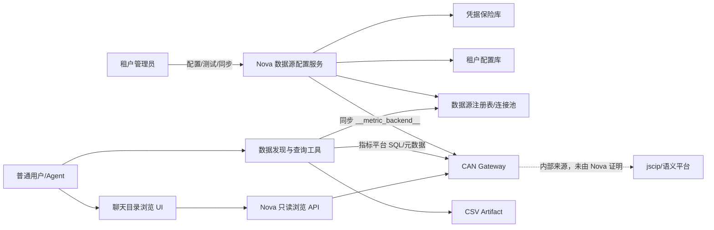
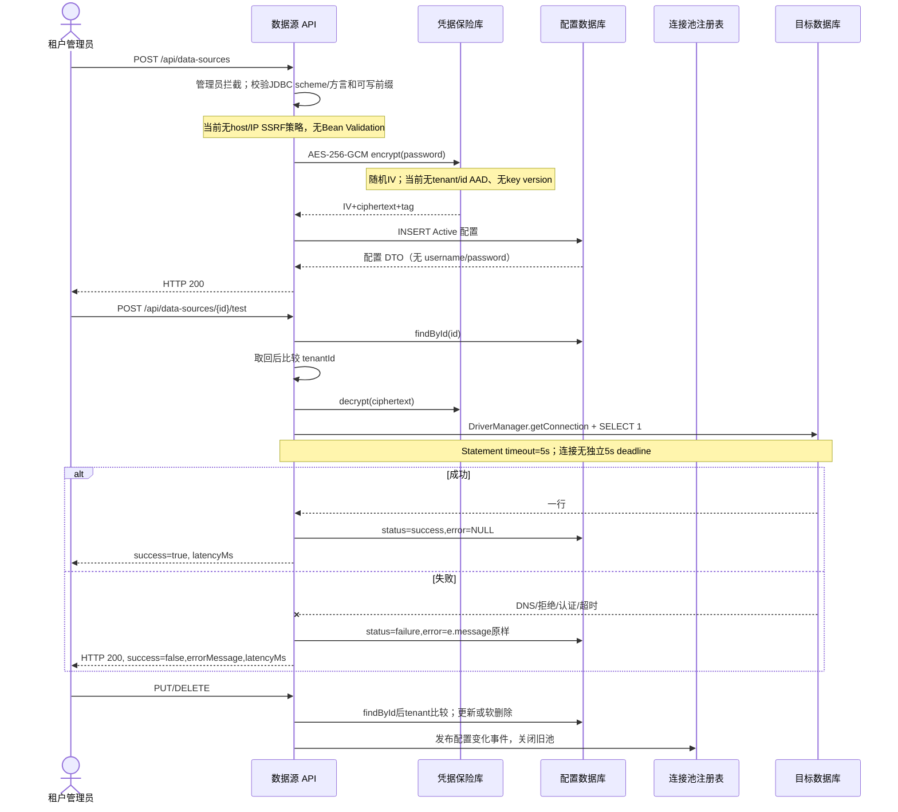
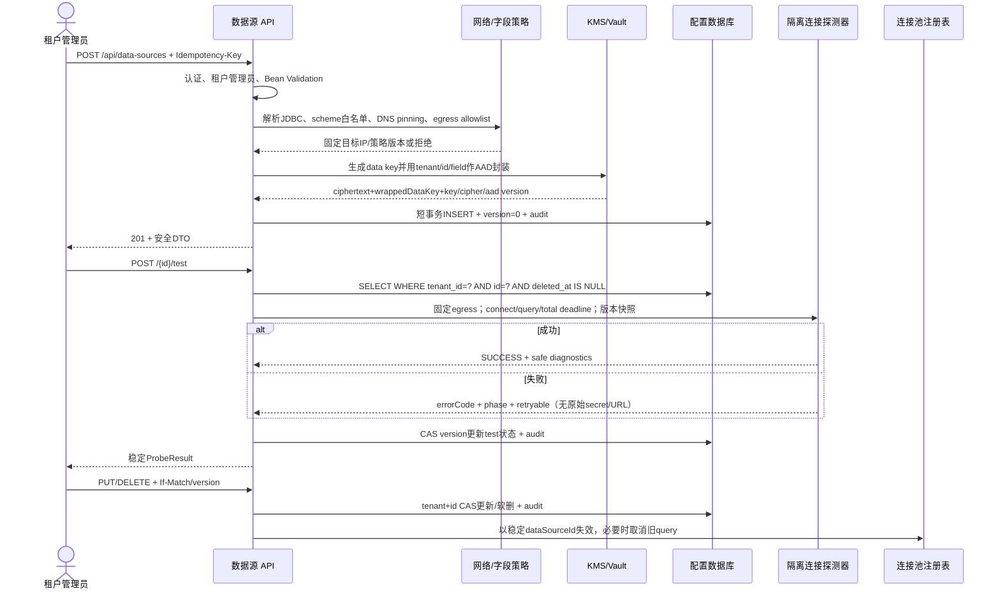
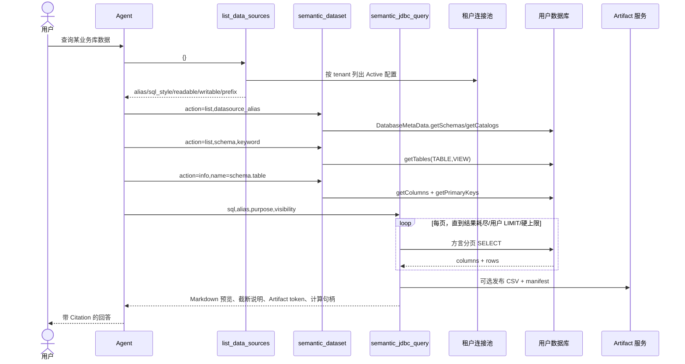

```
# 数据源设置、连接校验与数据预览复刻规范

## 1. 结论与边界

本能力解决三个相邻但不能混淆的问题：

1. 租户管理员如何登记、更新、测试和停用数据库连接。
2. Agent 如何发现可用数据源、浏览 Schema/Table/Column 元数据，并安全读取少量或大批数据。
3. 普通用户如何在聊天页浏览 CAN 指标、维度、数据集目录，并把业务对象复制到提问框。

当前产品有两类数据源：

- `USER_MANAGED`：租户管理员提供 JDBC URL、用户名和密码，Nova 本地加密保存并按租户建立连接池。
- `SYSTEM_MANAGED`：固定别名 `__metric_backend__`，连接元数据由 CAN Gateway 返回。Gateway 拥有连接参数，租户管理员只拥有本地读写策略。

最终用户可见效果如下：

- 设置页显示数据源卡片、方言、说明、读写标记和最近连接测试状态；管理员可以同步系统数据源、编辑策略和测试连接。
- Agent 可通过工具获得精确 alias、SQL 风格、Schema、表和列，再执行 SQL；大结果可发布为 CSV Artifact。
- 聊天页“浏览”抽屉按指标、维度、数据集分类搜索 CAN 语义目录。该抽屉展示的是**目录元数据**，不是数据库行样本。

### 1.1 当前实现与复刻目标的差异

| 主题 | 当前静态事实 | 复刻目标 |
|---|---|---|
| 用户自建数据源 | REST CRUD 存在，黑盒 API 用例为 Active；但前端新增按钮被常量关闭 | 明确选择开放或关闭；开放时必须完成 SSRF、权限、密钥和连接预算治理 |
| 连接测试 | 保存后按 ID 测试，成功或失败都以 HTTP 200 返回业务结果 | 保留受控结果，同时增加错误码、分阶段超时和脱敏 |
| 查询只读 | 工具说明宣称只支持 SELECT，但用户数据源分支未做可靠 SQL 只读解析，也未设置 JDBC 只读连接 | 应同时使用 SQL AST、只读数据库账号、事务只读和语句超时 |
| `readable` | 会显示在列表与工具输出中，但 JDBC 元数据和查询路径未强制检查 | 所有元数据/查询入口统一授权，`readable=false` 必须拒绝 |
| 跨租户访问 | ID 查找后比较 tenant；黑盒用例记录更新会变成 HTTP 500 | 先以 `(tenant_id,id)` 查询，统一返回 404 或 403，不泄露对象存在性 |
| 数据预览 | 当前有语义目录预览、JDBC 元数据浏览、SQL 结果预览三种形态 | API 与 UI 命名明确区分 `catalog browse`、`metadata inspect`、`row preview` |
| UI 目录详情 | 当前源码采用 hover 卡片；数据集只有名称/code，无详情接口 | 点击固定详情面板作为无障碍主路径，hover 仅作增强 |
| 取消 | Agent 可取消上层执行，但当前 JDBC statement 没有与取消信号绑定 | 保存 Statement 句柄，收到取消后调用 `cancel()` 并关闭连接 |

除非另有注明，本文结论来自三仓静态分析；本次没有运行 Nova、数据库、CAN Gateway 或任何自动化测试，因此没有 `R` 级结论。

## 2. 术语与参与方

| 术语/参与方 | 定义与职责 |
|---|---|
| 租户管理员 | 创建和维护租户级数据源；普通用户只能消费已授权能力 |
| 数据源配置服务 | 保存连接配置、软删除、连接测试状态和策略字段 |
| 凭据保险库 | 使用主密钥加密数据库密码，解密只发生在服务端连接建立阶段 |
| 数据源注册表 | 按 `(tenantId, alias)` 延迟创建连接池，配置变化时失效旧池 |
| SQL 方言适配器 | 提供 Driver、JDBC URL 前缀、Ping SQL、分页包装和 LLM SQL 风格提示 |
| Agent 工具层 | 提供数据源发现、JDBC 元数据检查和只读查询工具 |
| Artifact 服务 | 将完整查询结果发布为有 ACL 的 CSV，并返回用户可见 token |
| CAN Gateway | 对 Nova 提供系统数据源元数据、指标平台 SQL、语义目录代理及身份/租户校验 |
| jscip | CAN 的基础平台配置服务，职责包括账号与数据源信息；Nova 不直接调用它，当前只能推断 Gateway 从此类服务聚合连接信息 |
| 语义目录浏览 | 搜索指标、维度、数据集定义；不等价于读取物理表数据 |
| 行预览 | 执行受限 SELECT 返回有限行；可能同时生成完整 CSV Artifact |



## 3. 业务规则

### 3.1 配置归属

1. 数据源配置归属租户，不归属单个用户或会话。创建人只用于审计。
2. 当前实体没有 `project_id` 或 `user_id` 作用域字段；项目模式通过运行时校验限制数据源，而不是复制项目级配置。
3. Active 配置由 `deleted_at IS NULL` 定义；删除是软删除。
4. 同一租户的 Active alias 必须唯一。生产级实现应使用数据库约束并统一 PostgreSQL/H2 语义。
5. `USER_MANAGED` 可软删除；`SYSTEM_MANAGED` 不可删除。
6. `SYSTEM_MANAGED` 的 alias、dialect、URL、username、password 归 Gateway；description、readable、writable、writable schema prefix 归 Nova 管理员。
7. `writable=true` 时 `writableSchemaPrefix` 必须非空；写表 Schema 必须以此前缀开头。
8. 默认值按来源区分：用户新建 `USER_MANAGED` 时 `readable=true`、`writable=false`、prefix 为空；首次同步 `SYSTEM_MANAGED` 时固定 `readable=true`、`writable=true`、`writableSchemaPrefix="nova_user_"`。系统源后续同步保留管理员已修改的本地策略，不把它们重置为首次默认值。

### 3.2 方言与 URL

| Nova dialect | Gateway engineType 别名 | Driver/协议 | 接受的 URL 前缀 | SQL 表路径 |
|---|---|---|---|---|
| `mysql` | `MYSQL`,`MARIADB`,`ADB` | MariaDB Connector/J | `jdbc:mariadb://`,`jdbc:mysql://` | `schema.table` |
| `postgresql` | `POSTGRESQL`,`HOLOGRES`,`GAUSS`,`HUAWEI_DWS` | PostgreSQL | `jdbc:postgresql://` | `schema.table` |
| `starrocks` | `STARROCKS` | MariaDB Connector/J | `jdbc:mariadb://`,`jdbc:mysql://` | `schema.table` |
| `doris` | `DORIS` | MariaDB Connector/J | `jdbc:mariadb://`,`jdbc:mysql://` | `schema.table` |
| `presto` | `PRESTO` | Trino JDBC | `jdbc:trino://` | `catalog.schema.table` |
| `spark` | `SPARK` | Kyuubi/Hive JDBC | `jdbc:kyuubi://`,`jdbc:hive2://` | `schema.table` |
| `databricks` | `DATABRICKS` | Databricks JDBC | `jdbc:databricks://` | `catalog.schema.table` |

MariaDB Driver 3.x 默认不接受 `jdbc:mysql://`。当前实现对 MySQL 协议族自动增加 `permitMysqlScheme`：无 query string 时加 `?permitMysqlScheme`，已有 query string 时加 `&permitMysqlScheme`。

### 3.3 连接测试

1. 测试只能由租户管理员触发。
2. 当前代码先按全局 ID `findById` 取对象，再比较 tenant；这是事实而非推荐设计。生产实现应直接以 `(tenant_id,id)` 查询。
3. 使用方言的 `pingSql`，当前所有方言均为 `SELECT 1`。
4. Ping Statement 查询超时为 5 秒；当前连接建立本身没有独立、可靠的 5 秒约束。
5. 成功返回 `success=true`；失败仍返回 HTTP 200、`success=false` 和错误摘要。
6. 成功/失败均更新 `last_test_at`、`last_test_status`、`last_test_error`。当前表不保存 latency。
7. 当前失败响应和日志直接使用底层异常的 `e.getMessage()`，没有稳定 errorCode，也没有完整脱敏保证；“密码不得出现”是 Active 测试要求和生产复刻约束，不是当前实现可静态保证的所有路径性质。

### 3.4 数据发现与查询

1. Agent 不得猜 alias；用户未明确给出时先调用数据源列表工具。
2. 用户数据源发现顺序：数据源列表 → Schema 列表 → 表列表 → 列详情 → SQL 查询。
3. `__metric_backend__` 的工具描述声称逻辑数据集会在服务端做物理映射与行级授权，但 Nova 只发送 SQL 和身份 Header，无法从当前仓库证明 Gateway 确实完成这些动作；该能力是 `F` 级对端语义和必须补负测的安全契约。
4. 项目模式只允许项目范围内的指标平台数据集，禁止使用用户管理的外部数据源。
5. 目录元数据不作为业务数字 Citation；SQL 查询结果中的事实必须绑定查询 Citation。
6. SQL 行数默认最多 1,000,000，每页 5,000；用户显式 LIMIT 不能超过硬上限。
7. `visibility=internal` 不发布 Artifact；`default` 在行数超过阈值或 Markdown 截断时发布；`export` 对非空结果强制发布。
8. 当前 Markdown 与 CSV 都把 SQL `NULL` 渲染为空字符串，无法与真实空字符串区分。这是复刻时应修复的数据语义缺陷。

## 4. 完整执行链路

### 4.1 创建、更新、删除与连接测试

#### 4.1.1 当前静态实现链路（`I`）



当前实现只校验 JDBC scheme/方言一致性，没有 SSRF、固定 egress、DNS pinning、稳定 errorCode 或异常脱敏；不要把下文生产设计倒写为现状。创建并不测试连接，“保存配置”和“验证可用”是两个动作。

#### 4.1.2 生产复刻链路（`D`）



推荐仍分离保存与探测；若提供 `validateBeforeSave=true`，探测必须在写事务之外执行并携带幂等键，慢连接不能长期占用配置事务。

### 4.2 系统数据源同步

1. 管理员调用同步端点，Nova 用服务端 Admin API Key 和当前 tenant header 请求 Gateway。
2. Gateway 返回 tenant、engine type、JDBC URL、username、password、credential scope。
3. Nova 强制 `credentialScope == nova-restricted`，把 engine type 映射为方言并校验 URL 前缀。
4. 首次创建固定 alias `__metric_backend__`，并设置 `readable=true`、`writable=true`、`writableSchemaPrefix="nova_user_"`；后续同步只覆盖连接参数和 `updated_at`，保留行 ID、创建审计以及管理员本地策略。
5. 密码加密后入库，发布配置变化事件并关闭旧连接池。
6. Gateway 失败时当前接口抛出带配置提示的服务端错误；生产设计应映射为稳定 502/401/403 错误码。

系统数据源也会在 Agent 首次请求它时懒加载；数据源列表工具尝试懒加载失败时只记录警告并继续返回其他数据源。

### 4.3 用户数据源元数据发现与行查询



当前 JDBC 元数据实现存在两处边界：表详情实际上只接受 `schema.table`，虽然 Presto/Databricks 的 SQL 风格需要 `catalog.schema.table`；`getTables` 的 catalog 参数固定为 null。生产复刻必须按方言解析二段或三段路径。

当前分页每页可新取连接，且 SQL 没有强制稳定 `ORDER BY`。数据并发变化时可能重复或漏行。需要精确导出的生产方案应使用一致性快照或 keyset pagination。

用户 JDBC 分支从 `ResultSet.getObject(i)` 取 Driver 对象，之后 Markdown、CSV 与类型推断普遍依赖 `toString()`。因此不同 Driver 对 `BigDecimal`、日期时间、时区、binary、JSON/JSONB、数组和厂商对象的字符串表现不稳定；SQL `NULL` 与真实空字符串都会输出为空单元格。当前 manifest 只推断 `number|string`，不是稳定的 typed dataset 契约。

### 4.4 指标平台行查询

当 alias 为 `__metric_backend__` 时，Nova 不直接使用本地 JDBC 池执行用户 SQL，而是调用 Gateway：

1. 请求携带 `X-Tenant-Id`、`X-User-Id`。
2. Body 包含 SQL、`resultFormat=ROWS`，存在具体数据主题时加入数值型 `dataThemeId`。
3. Nova 期望 Gateway 按 tenant/user/dataTheme 完成逻辑表映射、身份鉴权和行级权限；当前仓库只能证明 Header 与 body 被发送，不能证明对端实现，故为 `F` 而非 `I`。
4. 返回 columns、字符串或 null cells、rows、maxRows；Nova 校验每行长度与列数一致。
5. Nova 复用相同 Markdown/CSV/Artifact 输出管线。

必须增加对端负测：缺失/伪造 `X-Tenant-Id`、跨租户 user、越权 dataTheme、主题外数据集、物理表绕过、无权限列以及行策略过滤都应被拒绝；不得仅以“返回了 rows”证明授权正确。

### 4.5 聊天侧语义目录浏览

1. 用户打开“浏览”抽屉，默认展示指标 Tab；抽屉与 Artifact 抽屉互斥。
2. 个人对话调用租户全量只读浏览 API；项目对话先读项目已绑定数据范围，再在前端分页/搜索名称。
3. 类型切换或关键词变化时回到第 1 页；每页 50。
4. 同一参数请求缓存 30 秒，并合并并发消费者；全部消费者取消时中止底层请求并清缓存。
5. 列表支持空态、错误和重试；滚动时临时关闭 hover 卡，避免浮层跳动。
6. 指标/维度首次 hover 时懒加载详情；数据集当前无详情端点，只展示 displayName 和 code。
7. “复制到提问”只追加 `展示名（code）`，由输入框单次消费，避免重渲染重复插入。

UI E2E 要求“点击结果后出现详情/预览”，而当前前端源码明确采用 hover 且列表行不负责点击导航；该冲突本次未运行验证，复刻时应以可点击、可键盘操作的固定详情面板作为主契约。

## 5. 对外契约

### 5.1 数据源设置 REST

所有路径要求登录身份和服务端解析出的租户上下文。除列表外，当前变更与测试端点要求租户管理员。

| 方法 | 路径 | 当前成功响应 | 语义 |
|---|---|---|---|
| GET | `/api/data-sources` | `200 DataSourceListItem[]` | 当前租户 Active 配置，alias 升序 |
| POST | `/api/data-sources` | `200 DataSourceListItem` | 创建 `USER_MANAGED` |
| PUT | `/api/data-sources/{id}` | `200 DataSourceListItem` | 部分更新；password=null 表示保留 |
| DELETE | `/api/data-sources/{id}` | `204` | 软删除；系统源拒绝 |
| POST | `/api/data-sources/{id}/test` | `200 DataSourceTestResult` | 执行 Ping 并记录状态 |
| POST | `/api/data-sources/system/provision` | `200 DataSourceListItem` | 从 Gateway 创建或刷新系统源 |

创建请求：

```json
{
  "alias": "crm_ro",
  "dialect": "postgresql",
  "url": "jdbc:postgresql://db.internal:5432/crm",
  "username": "nova_reader",
  "password": "<secret>",
  "description": "CRM 只读副本",
  "readable": true,
  "writable": false,
  "writableSchemaPrefix": null
}
```

当前代码未使用 Bean Validation，实际 null/blank 行为不够稳定。复刻契约应明确：alias、dialect、url、username、password 必填且 trim 后非空；alias 建议 `^[A-Za-z][A-Za-z0-9_-]{0,63}$`；description 最多 2,000 字符；URL 最多 2,048 字符。

部分更新请求：

```json
{
  "description": "CRM 只读副本（新）",
  "readable": true,
  "writable": false,
  "password": null
}
```

列表项：

```json
{
  "id": "8d35d2e4-313a-4bd5-9e6f-76c8e319223a",
  "alias": "crm_ro",
  "dialect": "postgresql",
  "description": "CRM 只读副本",
  "readable": true,
  "writable": false,
  "writableSchemaPrefix": null,
  "source": "USER_MANAGED",
  "urlMasked": "jdbc:postgresql://***:5432/crm",
  "lastTestStatus": "failure",
  "lastTestAt": "2026-08-13T08:30:00Z"
}
```

username、password、ciphertext、最后错误全文都不得返回。当前管理员会收到原始 URL；若 URL authority/query 内含凭据，可能泄露，生产契约应对管理员也返回结构化 host/port/database 与统一脱敏 URL。

连接测试响应：

```json
{
  "success": false,
  "errorMessage": "Connection refused",
  "latencyMs": 37
}
```

推荐错误契约：

```json
{
  "success": false,
  "errorCode": "DATASOURCE_CONNECT_REFUSED",
  "message": "无法连接到数据源",
  "requestId": "req_01...",
  "details": { "phase": "CONNECT", "retryable": true }
}
```

| 条件 | 当前表现 | 推荐 HTTP |
|---|---|---|
| 未登录 | 认证链拒绝 | 401 |
| 非管理员变更 | Interceptor 拒绝 | 403 |
| 跨租户/不存在 ID | 未统一，跨租户可能 500 | 404（防对象枚举） |
| 字段/方言/URL 不合法 | 未统一，可能 500 | 400 |
| Active alias 冲突 | DB 异常 | 409 |
| Gateway 同步失败 | 未统一，通常 500 | 502；Gateway 401/403 可映射为可操作错误 |
| 连接失败 | HTTP 200 + success=false | 可保留 200 业务探测结果，或使用 `422`；必须全局一致 |

### 5.2 `list_data_sources` Tool

```json
{
  "name": "list_data_sources",
  "arguments": {}
}
```

成功文本至少包含 alias、`sql_style`、readable、writable、writable schema prefix 和 description。工具结果为 EPHEMERAL，不应长期占用 Agent 上下文。项目模式只返回 `__metric_backend__`。

### 5.3 `semantic_dataset` Tool

```json
{
  "action": "list",
  "datasource_alias": "crm_ro",
  "schema": "public",
  "keyword": "order",
  "page_size": 20,
  "page": 1
}
```

| 字段 | 类型 | 默认 | 规则 |
|---|---|---|---|
| action | `list\|info` | list | 未识别 action 当前会落入 list；推荐显式拒绝 |
| datasource_alias | string | `__metric_backend__` | 用户数据源必须是工具或用户给出的精确 alias |
| schema | string | null | JDBC list 无 schema 时列 Schema，有值时列 Table |
| keyword | string | null | 表/数据集名称过滤 |
| name | string | null | info 必填；当前 JDBC 只接受 `schema.table` |
| page_size | int | 20 | clamp 到 1..200 |
| page | int | 1 | 指标平台 list 使用，最小 1 |

JDBC info 返回列名、类型、nullable、remarks、主键和下一步 SQL 风格；该结果是元数据，不产生 Citation。

### 5.4 `semantic_jdbc_query` Tool

```json
{
  "sql": "SELECT order_id, amount FROM public.orders ORDER BY order_id LIMIT 100",
  "datasource_alias": "crm_ro",
  "purpose": "订单金额明细",
  "visibility": "default"
}
```

| 字段 | 必填 | 当前兼容行为 |
|---|---|---|
| sql | 是 | 缺失或空白返回 `Error:` |
| datasource_alias | 否 | 缺省为 `__metric_backend__` |
| purpose | Schema 中建议 | 缺失时从首个 FROM 表名派生，最长 40 字符 |
| visibility | Schema 中必填 | 缺失/非法实际降级为 `default` |

典型输出：

```text
[查询结果: 2 行]

| order_id | amount |
|---|---|
| O-1 | 12.50 |
| O-2 | 19.00 |
[artifact:csv:...]
[Computable dataset] 订单金额明细-20260813-163000.csv — ...
```

完整 CSV 即使不发布给用户也会写到工作区或兜底目录；旁边生成 manifest：

```json
{
  "manifestVersion": 1,
  "handle": "订单金额明细-20260813-163000.csv",
  "sourceTool": "jdbc-query",
  "rowCount": 2,
  "truncated": false,
  "checksum": "sha256:<hex>",
  "createdAt": "2026-08-13T08:30:00Z",
  "columns": [
    { "name": "order_id", "type": "string" },
    { "name": "amount", "type": "number" }
  ]
}
```

当前 manifest 只推断 `number|string`，且空列默认为 string；生产实现应保存 JDBC type、精度、scale、时区和 nullable，并用显式 null bitmap 保留 NULL。

### 5.5 语义目录浏览 REST

普通已登录用户可读：

- `GET /api/data-themes/browse/metric-categories`
- `GET /api/data-themes/browse/dimension-categories`
- `GET /api/data-themes/browse/metrics?categoryId=&keyword=&pageNumber=&pageSize=&themeId=`
- `GET /api/data-themes/browse/dimensions?...`
- `GET /api/data-themes/browse/datasets?keyword=&pageNumber=&pageSize=&themeId=`
- `GET /api/data-themes/browse/catalog/counts?themeId=`
- `GET /api/data-themes/browse/themes/{themeId}/{metrics|dimensions|datasets}`

`pageNumber` 默认 1；`pageSize` 默认 20，最大 200。带 themeId 时必须验证其属于当前租户；不可见返回 403。Gateway 异常映射为携带 `error`、`gatewayStatus` 的响应，最小 HTTP 为 502。

分页响应：

```json
{
  "items": [
    {
      "name": "order_amount",
      "displayName": "订单金额",
      "alreadyInTheme": true,
      "selection": {
        "state": "DIRECT_SELECTED",
        "category": null
      }
    }
  ],
  "total": 1,
  "pageNumber": 1,
  "pageSize": 50,
  "hasNext": false,
  "selectedCategory": null
}
```

### 5.6 运行配置契约

等价实现至少需要以下配置；示例中的 Secret 只能来自环境变量或 Secret Manager：

```yaml
nova:
  metric:
    gateway-url: ${NOVA_METRIC_GATEWAY_URL:}
    admin-api-key: ${NOVA_METRIC_ADMIN_API_KEY:}
  security:
    credential-master-key: ${NOVA_SECURITY_CREDENTIAL_MASTER_KEY:}
  data-source-registry:
    refresh-interval-seconds: 60
    connection-pool:
      maximum-pool-size: 10
      minimum-idle: 2
      connection-timeout-ms: 30000
      idle-timeout-ms: 600000
      max-lifetime-ms: 1800000
  data-query:
    max-total-rows: 1000000
    page-size: 5000
    preview:
      markdown-max-chars: 8000
      csv-export-threshold: 50
      csv-publish-threshold: 50
```

`gateway-url` 控制系统 metadata、指标 SQL 和语义目录；`admin-api-key` 只用于管理/内部路径，不能下发浏览器。`credential-master-key` 当前要求解码后正好 32 字节，缺失时启动失败。生产实现还应增加 connect/query/deadline、最大结果字节、最大 cell 字节、租户并发、egress policy 和 secret key version；每项都应有安全默认值并进入示例配置。

## 6. 数据模型与生命周期

### 6.1 当前等价 DDL

```sql
CREATE TABLE data_source_config (
    id                     VARCHAR(36) PRIMARY KEY,
    tenant_id              VARCHAR(64) NOT NULL,
    alias                  VARCHAR(64) NOT NULL,
    dialect                VARCHAR(32) NOT NULL,
    url                    VARCHAR(2048) NOT NULL,
    username               VARCHAR(255) NOT NULL,
    password_encrypted     BYTEA NOT NULL,
    description            TEXT,
    readable               BOOLEAN NOT NULL DEFAULT TRUE,
    writable               BOOLEAN NOT NULL DEFAULT FALSE,
    writable_schema_prefix VARCHAR(128),
    source                 VARCHAR(32) NOT NULL,
    created_by             VARCHAR(64) NOT NULL,
    created_at             TIMESTAMPTZ NOT NULL,
    updated_at             TIMESTAMPTZ NOT NULL,
    last_test_at           TIMESTAMPTZ,
    last_test_status       VARCHAR(32),
    last_test_error        TEXT,
    deleted_at             TIMESTAMPTZ
);

CREATE UNIQUE INDEX uk_data_source_tenant_alias_active
    ON data_source_config(tenant_id, alias)
    WHERE deleted_at IS NULL;
CREATE INDEX idx_data_source_tenant
    ON data_source_config(tenant_id);
```

历史 migration 先创建 `engine_type`，随后删除；最终模型只保存 Nova dialect。H2 不支持相同 partial index，当前 H2 唯一索引会让已软删除 alias 无法复用，与 PostgreSQL 不同。复刻应使用 generated active key、单独 active 表或应用层一致约束解决差异。

### 6.2 推荐生产 DDL 增强

不能只给概念字段；复刻应同时追加 PostgreSQL 与 H2 migration，并让两种数据库的 Active alias 语义一致。推荐引入显式 `active_alias`：Active 行等于 alias，软删除行必须为 null；`UNIQUE(tenant_id,active_alias)` 在两库都允许多个 null，从而允许删除后复用 alias。

PostgreSQL migration：

```sql
ALTER TABLE data_source_config
  ADD COLUMN version BIGINT NOT NULL DEFAULT 0,
  ADD COLUMN active_alias VARCHAR(64),
  ADD COLUMN secret_key_version VARCHAR(32),
  ADD COLUMN wrapped_data_key BYTEA,
  ADD COLUMN cipher_version VARCHAR(32),
  ADD COLUMN cipher_algorithm VARCHAR(32),
  ADD COLUMN aad_version VARCHAR(32),
  ADD COLUMN last_test_error_code VARCHAR(64),
  ADD COLUMN last_test_latency_ms BIGINT,
  ADD COLUMN last_test_request_id VARCHAR(64),
  ADD COLUMN network_policy_id VARCHAR(64),
  ADD COLUMN connection_options_json JSONB NOT NULL DEFAULT '{}'::jsonb;

UPDATE data_source_config
   SET active_alias = CASE WHEN deleted_at IS NULL THEN alias ELSE NULL END;

ALTER TABLE data_source_config
  ADD CONSTRAINT ck_ds_source
    CHECK (source IN ('USER_MANAGED','SYSTEM_MANAGED')),
  ADD CONSTRAINT ck_ds_writable_prefix
    CHECK (NOT writable OR (writable_schema_prefix IS NOT NULL
                            AND length(trim(writable_schema_prefix)) > 0)),
  ADD CONSTRAINT ck_ds_active_alias
    CHECK ((deleted_at IS NULL AND active_alias = alias)
        OR (deleted_at IS NOT NULL AND active_alias IS NULL)),
  ADD CONSTRAINT ck_ds_test_status
    CHECK (last_test_status IS NULL OR last_test_status IN ('success','failure','stale')),
  ADD CONSTRAINT ck_ds_test_latency
    CHECK (last_test_latency_ms IS NULL OR last_test_latency_ms >= 0),
  ADD CONSTRAINT ck_ds_secret_envelope
    CHECK ((cipher_version IS NULL AND cipher_algorithm IS NULL
            AND aad_version IS NULL AND wrapped_data_key IS NULL)
        OR (cipher_version IS NOT NULL AND cipher_algorithm IS NOT NULL
            AND aad_version IS NOT NULL AND wrapped_data_key IS NOT NULL
            AND secret_key_version IS NOT NULL));

DROP INDEX IF EXISTS uk_data_source_tenant_alias_active;
CREATE UNIQUE INDEX uk_ds_tenant_active_alias
  ON data_source_config(tenant_id, active_alias);
CREATE INDEX idx_ds_tenant_test_status
  ON data_source_config(tenant_id, last_test_status, last_test_at)
  WHERE deleted_at IS NULL;

CREATE TABLE data_source_audit (
  id VARCHAR(36) PRIMARY KEY,
  tenant_id VARCHAR(64) NOT NULL,
  data_source_id VARCHAR(36) NOT NULL,
  alias VARCHAR(64) NOT NULL,
  actor_user_id VARCHAR(64),
  action VARCHAR(64) NOT NULL,
  result VARCHAR(32) NOT NULL,
  config_version BIGINT NOT NULL,
  request_id VARCHAR(64),
  query_id VARCHAR(64),
  error_code VARCHAR(64),
  latency_ms BIGINT,
  row_count BIGINT,
  byte_count BIGINT,
  details_json JSONB NOT NULL DEFAULT '{}'::jsonb,
  created_at TIMESTAMPTZ NOT NULL,
  CONSTRAINT ck_ds_audit_result CHECK (result IN ('SUCCESS','FAILURE','REJECTED','CANCELLED')),
  CONSTRAINT ck_ds_audit_counts CHECK (
    (latency_ms IS NULL OR latency_ms >= 0) AND
    (row_count IS NULL OR row_count >= 0) AND
    (byte_count IS NULL OR byte_count >= 0))
);
CREATE INDEX idx_ds_audit_tenant_ds_time
  ON data_source_audit(tenant_id, data_source_id, created_at DESC);
```

H2 migration 使用等价但兼容的类型：

```sql
ALTER TABLE data_source_config ADD COLUMN version BIGINT DEFAULT 0 NOT NULL;
ALTER TABLE data_source_config ADD COLUMN active_alias VARCHAR(64);
ALTER TABLE data_source_config ADD COLUMN secret_key_version VARCHAR(32);
ALTER TABLE data_source_config ADD COLUMN wrapped_data_key VARBINARY(4096);
ALTER TABLE data_source_config ADD COLUMN cipher_version VARCHAR(32);
ALTER TABLE data_source_config ADD COLUMN cipher_algorithm VARCHAR(32);
ALTER TABLE data_source_config ADD COLUMN aad_version VARCHAR(32);
ALTER TABLE data_source_config ADD COLUMN last_test_error_code VARCHAR(64);
ALTER TABLE data_source_config ADD COLUMN last_test_latency_ms BIGINT;
ALTER TABLE data_source_config ADD COLUMN last_test_request_id VARCHAR(64);
ALTER TABLE data_source_config ADD COLUMN network_policy_id VARCHAR(64);
ALTER TABLE data_source_config ADD COLUMN connection_options_json CLOB DEFAULT '{}' NOT NULL;

UPDATE data_source_config
   SET active_alias = CASE WHEN deleted_at IS NULL THEN alias ELSE NULL END;

ALTER TABLE data_source_config ADD CONSTRAINT ck_ds_source
  CHECK (source IN ('USER_MANAGED','SYSTEM_MANAGED'));
ALTER TABLE data_source_config ADD CONSTRAINT ck_ds_writable_prefix
  CHECK (NOT writable OR (writable_schema_prefix IS NOT NULL
                          AND CHAR_LENGTH(TRIM(writable_schema_prefix)) > 0));
ALTER TABLE data_source_config ADD CONSTRAINT ck_ds_active_alias
  CHECK ((deleted_at IS NULL AND active_alias = alias)
      OR (deleted_at IS NOT NULL AND active_alias IS NULL));
ALTER TABLE data_source_config ADD CONSTRAINT ck_ds_test_status
  CHECK (last_test_status IS NULL OR last_test_status IN ('success','failure','stale'));
ALTER TABLE data_source_config ADD CONSTRAINT ck_ds_test_latency
  CHECK (last_test_latency_ms IS NULL OR last_test_latency_ms >= 0);
ALTER TABLE data_source_config ADD CONSTRAINT ck_ds_secret_envelope
  CHECK ((cipher_version IS NULL AND cipher_algorithm IS NULL
          AND aad_version IS NULL AND wrapped_data_key IS NULL)
      OR (cipher_version IS NOT NULL AND cipher_algorithm IS NOT NULL
          AND aad_version IS NOT NULL AND wrapped_data_key IS NOT NULL
          AND secret_key_version IS NOT NULL));

DROP INDEX IF EXISTS uk_data_source_tenant_alias_active;
CREATE UNIQUE INDEX uk_ds_tenant_active_alias
  ON data_source_config(tenant_id, active_alias);
CREATE INDEX idx_ds_tenant_test_status
  ON data_source_config(tenant_id, last_test_status, last_test_at);

CREATE TABLE data_source_audit (
  id VARCHAR(36) PRIMARY KEY,
  tenant_id VARCHAR(64) NOT NULL,
  data_source_id VARCHAR(36) NOT NULL,
  alias VARCHAR(64) NOT NULL,
  actor_user_id VARCHAR(64),
  action VARCHAR(64) NOT NULL,
  result VARCHAR(32) NOT NULL,
  config_version BIGINT NOT NULL,
  request_id VARCHAR(64),
  query_id VARCHAR(64),
  error_code VARCHAR(64),
  latency_ms BIGINT,
  row_count BIGINT,
  byte_count BIGINT,
  details_json CLOB DEFAULT '{}' NOT NULL,
  created_at TIMESTAMP(6) NOT NULL,
  CONSTRAINT ck_ds_audit_result CHECK (result IN ('SUCCESS','FAILURE','REJECTED','CANCELLED')),
  CONSTRAINT ck_ds_audit_counts CHECK (
    (latency_ms IS NULL OR latency_ms >= 0) AND
    (row_count IS NULL OR row_count >= 0) AND
    (byte_count IS NULL OR byte_count >= 0))
);
CREATE INDEX idx_ds_audit_tenant_ds_time
  ON data_source_audit(tenant_id, data_source_id, created_at);
```

应用必须在创建/恢复时同时设置 `active_alias=alias`，软删时置 null，改 alias 时同步修改；CHECK 负责阻止遗漏。所有 update/delete/test-status 写入使用 `WHERE tenant_id=? AND id=? AND version=?` 并原子 `version=version+1`。迁移期允许旧行四个 envelope 字段全空；新写和完成重加密后的行必须四项完整，最终可再增加 NOT NULL 门禁。

修改 alias、密钥、网络策略或连接地址时写审计事件。`data_source_audit` 是追加写外部契约，业务 API 不允许更新/删除；保留期、归档和法务删除应由独立治理任务处理。连接测试只保存结构化安全摘要，不保存原始 `e.message`。审计生产者应写入如下稳定事件，不允许消费者反查业务表才能理解：

```json
{
  "eventVersion": 1,
  "eventId": "aud_01...",
  "occurredAt": "2026-08-13T08:30:00Z",
  "tenantId": "tenant-123",
  "dataSourceId": "ds_01...",
  "alias": "crm_ro",
  "actorUserId": "user-456",
  "action": "CONNECTION_TESTED",
  "result": "FAILURE",
  "configVersion": 4,
  "requestId": "req_01...",
  "queryId": null,
  "errorCode": "DATASOURCE_CONNECT_TIMEOUT",
  "latencyMs": 5000,
  "rowCount": null,
  "byteCount": null,
  "details": {"phase":"CONNECT","retryable":true}
}
```

### 6.3 凭据格式

当前密码加密格式为：

```text
[12-byte random IV][AES-256-GCM ciphertext][16-byte GCM tag]
```

主密钥是 32 字节 Base64，通过 `NOVA_SECURITY_CREDENTIAL_MASTER_KEY` 或对应配置注入；缺失、非 Base64 或长度不符会在应用启动时失败。当前没有 key version 和轮转机制，且未使用 tenant/id 作为 AAD。

生产设计应使用 KMS/Vault envelope encryption。字段语义必须固定：`password_encrypted` 保存 data key 加密后的 ciphertext（含 nonce/tag 或由 `cipher_version` 定义的封装格式）；`wrapped_data_key` 保存 KMS master key 包裹的数据密钥；`secret_key_version` 是 KMS key version；`cipher_algorithm` 例如 `AES-256-GCM`；`cipher_version` 定义二进制 envelope；`aad_version` 定义 AAD 拼接格式。AAD v1 可规范为长度前缀编码的 `tenantId|dataSourceId|field=password|source`，不能简单字符串拼接产生歧义。提供双读单写轮转：先支持旧新版本读取，新写全部使用新版本，后台 CAS 重加密，确认完成后撤销旧 key。

### 6.4 连接池生命周期

连接池缓存键是 `(tenantId, alias)`。首次查询创建 Hikari 池；配置变化事件立即移除并关闭该键，定时任务每 60 秒比较 `updated_at` 兜底。默认：最大连接 10、最小空闲 2、连接超时 30 秒、空闲超时 10 分钟、最大生命周期 30 分钟。

alias 更新时当前事件只携带新 alias，旧 alias 池要等定时刷新发现旧记录消失后关闭，窗口最长约 60 秒。复刻事件应同时携带 oldAlias/newAlias 或按稳定 `dataSourceId` 缓存。

## 7. 核心实现设计

### 7.1 最小可用实现

```text
DataSourceApi
  -> DataSourceApplicationService
      -> TenantScopedDataSourceRepository
      -> CredentialVault
      -> DialectRegistry
      -> NetworkTargetValidator
      -> ConnectionProbe
      -> PoolRegistry

AgentDataTools
  -> DataSourceDiscovery
  -> JdbcMetadataInspector
  -> ReadOnlyQueryExecutor
  -> ResultPreviewFormatter
  -> ArtifactPublisher

CatalogBrowseApi
  -> SemanticCatalogGateway
```

关键接口：

```java
interface TenantScopedDataSourceRepository {
  Optional<DataSourceConfig> findActive(String tenantId, String id);
  Optional<DataSourceConfig> findActiveByAlias(String tenantId, String alias);
  List<DataSourceConfig> listActive(String tenantId);
  DataSourceConfig save(DataSourceConfig config, long expectedVersion);
  void softDelete(String tenantId, String id, long expectedVersion);
}

interface ConnectionProbe {
  ProbeResult probe(ConnectionSpec spec, Duration connectTimeout,
                    Duration queryTimeout, CancellationToken token);
}

interface ReadOnlyQueryExecutor {
  QueryHandle start(TenantIdentity identity, String alias, ReadOnlySql sql,
                    QueryBudget budget, CancellationToken token);
}
```

连接测试与查询必须在写数据库事务之外执行。推荐流程是先读取版本和密文、解密并探测，再用短事务 CAS 更新测试状态；配置在探测中途被更新时，旧测试结果不得覆盖新版本。

### 7.2 生产级安全与可靠性

1. 出站网络：loopback、link-local、unspecified、multicast 和云 metadata 地址永远拒绝，不能被租户 allowlist 放开；RFC1918/ULA 私网默认拒绝，只有目标同时命中租户 network allowlist、固定 egress route 和管理员审批时才允许。首次解析后固定全部目标 IP，连接层必须使用已批准 IP 并校验证书主机名；TTL 内重解析结果变化要重新审批，防 DNS rebinding。
2. SQL：先用方言 AST 验证单条只读查询，拒绝分号多语句、DDL、DML、COPY/UNLOAD、外部函数及危险系统表；数据库账号本身只授予 SELECT。
3. JDBC：`connection.setReadOnly(true)`，设置只读事务、query timeout、fetch size、max rows；取消时 `Statement.cancel()`。
4. 预算：租户/用户/数据源并发上限、每页字节数、总字节数、最大列数、单 cell 大小和总耗时必须同时控制，不能只限行数。
5. 分页：预览使用强制小 LIMIT；完整导出使用服务端 cursor/一致性快照或 keyset，不用不稳定 OFFSET 扫描热表。
6. 类型：不要依赖 Driver 对象 `toString()` 作为 API 契约。先按 JDBC type 转成 typed cell；NULL 必须与空串区分；CSV 防公式注入，对以 `=,+,-,@` 开头的文本进行安全策略处理。
7. Artifact：文件与 manifest 原子落盘，ACL 绑定 tenant/user/conversation；失败时不把部分数据交给 LLM。
8. 观测：错误仅返回分类摘要和 requestId；原始异常进受控日志并移除密码、URL query、SQL literal。

### 7.3 推荐行预览专用 API

当前 UI 没有管理员直接点表看行的独立 REST。若复刻产品需要真正的数据行预览，建议新增：

```http
POST /api/data-sources/{id}/preview
Content-Type: application/json

{
  "catalog": null,
  "schema": "public",
  "table": "orders",
  "columns": ["order_id", "amount"],
  "limit": 50,
  "cursor": null
}
```

服务端只能从经过标识符校验的结构化字段生成 SQL，不接受 UI 任意 SQL。`limit` 默认 50、最大 200；返回 typed cells、nextCursor、truncated、queryId。任意 SQL 仍只走 Agent Tool 并受更严格策略。

推荐 typed-cell JSON：

```json
{
  "queryId": "qry_01...",
  "columns": [
    {"name":"amount","jdbcType":"DECIMAL","logicalType":"decimal","precision":18,"scale":2,"nullable":true},
    {"name":"created_at","jdbcType":"TIMESTAMP_WITH_TIMEZONE","logicalType":"timestamp_tz","timezone":"UTC","nullable":false},
    {"name":"payload","jdbcType":"JSONB","logicalType":"json","nullable":true}
  ],
  "rows": [
    [
      {"type":"decimal","value":"12.50"},
      {"type":"timestamp_tz","value":"2026-08-13T08:30:00.123456Z"},
      {"type":"json","value":{"status":"ok"}}
    ],
    [
      {"type":"null","value":null},
      {"type":"timestamp_tz","value":"2026-08-13T08:31:00Z"},
      {"type":"string","value":""}
    ]
  ],
  "nextCursor": null,
  "truncated": false
}
```

序列化规则：integer 用无损十进制字符串或在安全整数范围内用 JSON number；decimal 必须用保留 scale 的字符串；date 为 `YYYY-MM-DD`；time/timestamp 使用 ISO-8601 并显式 offset/zone，无法确认时区的本地 timestamp 标为 `timestamp_local`；binary 用 Base64 并附 byteLength；JSON 解析为 JSON value，解析失败则标 `string` 并记录 safe warning；array 使用 typed array；SQL NULL 固定 `{type:"null",value:null}`，真实空串固定 `{type:"string",value:""}`。CSV 中 NULL 应使用 manifest 的 null bitmap 或显式可配置 sentinel，不能与空字段静默合并。

## 8. 并发与非正常路径

| 场景 | 当前表现 | 复刻处理 |
|---|---|---|
| 两个管理员同时创建同 alias | 依赖 DB 唯一约束，一方异常 | 409 + `DATASOURCE_ALIAS_CONFLICT` |
| 更新与查询并发 | 事件使新 alias 池失效，已借出连接继续执行 | 配置版本绑定 query；密钥撤销时主动取消旧 query |
| 更新 alias | 旧池最长 60 秒后关闭 | 缓存按稳定 ID，事件带旧新 alias |
| 删除与查询并发 | 已借出连接可能继续 | 根据安全等级选择 drain 或立即 cancel；审计最终状态 |
| 测试与更新并发 | 测试状态可能写到已更新配置 | CAS version，过期结果标 `STALE` 不覆盖 |
| DNS/连接超时 | Driver 行为决定，Ping 5 秒不覆盖 connect | connect/read/query 三段超时，统一 deadline |
| 取消查询 | 当前 JDBC Statement 未接取消 | queryId→Statement 注册表，cancel + close，幂等终态 |
| 大结果 | 按 5,000 分页到 1,000,000 行，可能占磁盘/时间 | 同时限制行、字节、时间、并发；流式写 Artifact |
| Artifact 发布失败 | 返回 `Error:`，不返回业务数据 | 保留；清理孤儿文件并提供重试 requestId |
| Gateway 空/畸形响应 | 返回格式无效错误 | Schema 校验、契约版本、熔断和告警 |
| Gateway 密钥轮转 | 手动同步或后续懒加载 | webhook/定时刷新 + grace period + key version |
| 数据目录搜索快速切换 | 取消旧请求、30 秒缓存 | 保留 AbortController；响应按 request key 防乱序覆盖 |

## 9. 安全、权限和审计

### 9.1 权限矩阵

| 操作 | 普通租户用户 | 租户管理员 | 项目对话 |
|---|---:|---:|---:|
| 列出数据源安全摘要 | 允许 | 允许 | 仅系统指标源 |
| 创建/更新/删除/测试 | 拒绝 | 允许 | 不适用 |
| 同步系统源 | 拒绝 | 允许 | 不适用 |
| 浏览租户语义目录 | 允许 | 允许 | 仅项目绑定范围 |
| 浏览用户 JDBC 元数据 | 取决于工具授权和 readable | 同左 | 当前拒绝外部源 |
| 执行 JDBC 查询 | 取决于工具授权和 readable | 同左 | 当前只允许项目内指标平台 |

对象访问必须采用 `(tenant_id,id)` 或 `(tenant_id,alias)` 查询，不能先按全局 ID 获取再用异常区分；推荐对外统一 404。

### 9.2 SSRF 与数据库侧风险

当前创建接口仅校验 JDBC scheme，没有限制 host，因此管理员可配置 `127.0.0.1`、云 metadata、内部控制面或任意私网目标；连接测试会主动访问它。即使只有管理员，这仍是服务器侧请求伪造和横向移动面。

生产设计必须：

- 禁止 JDBC URL 携带密码；拆成结构化 host/port/database/options。
- 允许的 options 使用方言白名单，拒绝 driver/plugin/classpath 等危险参数。
- 解析并固定目标 IP，通过 egress policy 连接；loopback、link-local、unspecified、multicast、云 metadata 永远拒绝；RFC1918/ULA 默认拒绝，仅在租户 network allowlist、固定 egress 和审批三者同时满足时放行；禁止重定向和 DNS rebinding。
- 数据库账号使用最小权限、独立 Schema、查询资源组和审计标签。
- 防 SQL 注入之外还要防 CSV/公式注入、错误信息泄露和高成本查询 DoS。

### 9.3 审计事件

至少记录：`DATASOURCE_CREATED`、`UPDATED`、`DELETED`、`SECRET_ROTATED`、`CONNECTION_TESTED`、`SYSTEM_SYNCED`、`QUERY_STARTED`、`QUERY_CANCELLED`、`QUERY_COMPLETED`、`QUERY_REJECTED`、`ARTIFACT_PUBLISHED`。

审计字段包括 tenantId、actorUserId、dataSourceId、alias、配置版本、动作、结果、errorCode、requestId、queryId、耗时和行/字节数；不得记录密码、完整 URL、SQL literal 或业务数据行。

## 10. 外部依赖对端设计

### 10.1 已观察到的 CAN Gateway 系统数据源契约

```http
GET {gatewayBaseUrl}/api/metadata/can_datasource
X-API-Key: <admin-api-key>
X-Tenant-Id: tenant-123
Accept: application/json
```

当前客户端按**裸 JSON**解析，不解包通用 `data` envelope：

```json
{
  "tenantId": "tenant-123",
  "engineType": "STARROCKS",
  "url": "jdbc:mariadb://sr.internal:9030/analytics",
  "username": "nova_restricted_tenant_123",
  "password": "<secret>",
  "credentialScope": "nova-restricted"
}
```

必须保持：

- 非 2xx 为调用失败；Nova 会读取最多有限长度的错误体。
- `credentialScope` 必须严格为 `nova-restricted`，否则 Nova 拒绝使用。
- engineType 必须命中本文方言映射。
- URL scheme 必须与方言一致。
- 未知字段可忽略。

当前 Nova 没有校验响应 `tenantId` 等于请求 tenant，生产复刻必须补上。方法虽接收 userId，但此管理端调用不发送 `X-User-Id`。

### 10.2 已观察到的 Gateway JDBC 查询契约

```http
POST {gatewayBaseUrl}/api/jdbc/query
X-Tenant-Id: tenant-123
X-User-Id: user-456
Content-Type: application/json

{
  "sql": "SELECT order_amount FROM logical_orders",
  "resultFormat": "ROWS",
  "dataThemeId": 42
}
```

`dataThemeId` 在“所有数据”、空值时不发送，非空时必须能转为 Long。

成功裸 JSON：

```json
{
  "columns": ["order_amount"],
  "rows": [["12.50"], [null]],
  "maxRows": 10000
}
```

每个非 null cell 当前必须是 JSON string；row 长度必须等于 columns 长度；`maxRows>0`。HTTP 请求连接超时 15 秒、总请求超时 60 秒，并显式绕过本机 HTTP Proxy。

当前 HTTP 边界必须精确区分：

- `/api/jdbc/query` 收到非 2xx 后，Nova HTTP client 把状态码和对端 error body 映射成以 `Error:` 开头的字符串，查询工具再把它识别为失败；它不是成功 JSON。
- 收到 2xx 时 Nova 原样返回 body，随后 JDBC 查询解析器要求成功 JSON。为兼容历史行为，若 2xx raw body 本身以 `Error:` 开头也会被识别为失败，但这不是推荐对端契约。
- metadata 的 Admin GET 不走上述字符串映射：非 2xx 直接抛 IOException，包含状态码和截断错误体。
- 生产 Stub 和正式 Gateway 不应以 HTTP 200 返回 `Error:`；错误必须使用非 2xx 和结构化 error body。

### 10.3 最小兼容 Gateway Stub

```pseudo
GET /api/metadata/can_datasource:
  authenticate X-API-Key
  require X-Tenant-Id
  cfg = fixtures.byTenant[tenant]
  if missing: return 404 {"error":"datasource not configured"}
  return 200 {
    tenantId: tenant,
    engineType: cfg.engineType,
    url: cfg.url,
    username: cfg.restrictedUsername,
    password: cfg.restrictedPassword,
    credentialScope: "nova-restricted"
  }

POST /api/jdbc/query:
  require X-Tenant-Id and X-User-Id
  authorize user belongs to tenant
  validate exactly one read-only SELECT
  resolve logical tables under optional dataThemeId
  enforce row policy and max rows
  rows = executeAsRestrictedIdentity()
  return 200 {columns, rows: stringifyNonNullCells(rows), maxRows}
```

Stub 错误响应必须模拟 Nova 的真实映射输入，不能返回 `200 Error: ...`：

```http
HTTP/1.1 401 Unauthorized
Content-Type: application/json
{"error":"unknown user for tenant"}

HTTP/1.1 400 Bad Request
Content-Type: application/json
{"error":"syntax error near FROM"}

HTTP/1.1 403 Forbidden
Content-Type: application/json
{"error":"dataset is outside the authorized theme"}

HTTP/1.1 503 Service Unavailable
Content-Type: application/json
{"error":"query backend unavailable","traceId":"tr_01..."}
```

对 legacy `/api/jdbc/query`，当前 Nova 从 `error` 字段或 raw body 取文本并按 400/401/403/5xx 映射成用户可见 `Error:`。Stub 不能返回真实生产凭据；测试应使用隔离容器数据库和短生命周期账号，并覆盖缺 Header、错 tenant/user、主题越权、逻辑表绕过、非 SELECT、超限、超时与畸形成功体。

### 10.4 生产级 Gateway/jscip 参考设计

以下是 `D` 级设计，不是 Nova 已证明的 CAN 内部实现。

#### 10.4.1 Connection token

jscip 保存租户数据源逻辑配置与 Vault Secret 引用。Gateway 以服务身份请求 jscip 并签发一次用途受限的 opaque token，而非把永久数据库密码交给 Nova：

```http
POST /api/nova/v1/connections:issue
X-API-Key: <nova-service-key>
X-Tenant-Id: tenant-123
Idempotency-Key: idem-01

{"purpose":"QUERY","requestedTtlSeconds":300}
```

```json
{
  "apiVersion":"nova.can/v1",
  "connectionToken":"ct_opaque_...",
  "expiresAt":"2026-08-13T08:35:00Z",
  "engineType":"STARROCKS",
  "credentialScope":"nova-restricted",
  "capabilities":["SEMANTIC_QUERY"],
  "tenantId":"tenant-123"
}
```

TTL 默认 300 秒、最大 900 秒；token 绑定 tenant、purpose、engine、调用服务和允许动作，不可用于直接登录数据库。相同 Idempotency-Key、tenant、规范化 body 在 TTL 内返回同一 token；同 key 不同 body 返回 409。

#### 10.4.2 异步查询、幂等与取消

```http
POST /api/nova/v1/queries
Authorization: Bearer ct_opaque_...
X-Tenant-Id: tenant-123
X-User-Id: user-456
Idempotency-Key: idem-query-01

{
  "apiVersion":"nova.can/v1",
  "sql":"SELECT ... FROM logical_dataset",
  "dataThemeId":"42",
  "resultFormat":"TYPED_ROWS",
  "budget":{"maxRows":10000,"maxBytes":10485760,"timeoutMs":60000}
}
```

返回 `202`：

```json
{
  "apiVersion":"nova.can/v1",
  "queryId":"qry_01...",
  "state":"QUEUED",
  "submittedAt":"2026-08-13T08:30:00Z",
  "requestId":"req_01..."
}
```

状态机为 `QUEUED -> RUNNING -> SUCCEEDED|FAILED|CANCELLED|TIMED_OUT`，终态不可逆。读取 `GET /api/nova/v1/queries/{queryId}`，结果使用 cursor 分页；取消使用：

```http
POST /api/nova/v1/queries/{queryId}:cancel
X-Tenant-Id: tenant-123
X-User-Id: user-456
Idempotency-Key: idem-cancel-01
```

首次可取消返回 `202 state=CANCELLING`；已经 `CANCELLED` 重复取消返回 `200 state=CANCELLED`；已成功/失败/超时返回 `409 QUERY_TERMINAL`；未知或跨租户 query 统一 404。服务重启后 queryId、幂等记录和状态仍可恢复。

#### 10.4.3 版本、认证、错误与审计

所有响应含 `apiVersion`；破坏性变更发布 `/v2`，v1 新增可选字段保持兼容。Admin 服务认证和用户身份不可互换：发 token 需要服务 API key/mTLS；执行查询还必须验证 token tenant、`X-Tenant-Id`、`X-User-Id` 三者一致及 user 属于 tenant。缺认证 401、已认证但无权限 403、跨租户对象统一 404。服务端必须验证 dataTheme、逻辑数据集、列和行策略，拒绝直接物理表绕过。

统一错误 envelope：

```json
{
  "apiVersion":"nova.can/v1",
  "error":{
    "code":"QUERY_POLICY_DENIED",
    "message":"query is outside the authorized data scope",
    "retryable":false,
    "details":{"phase":"AUTHORIZE"}
  },
  "requestId":"req_01...",
  "traceId":"tr_01..."
}
```

错误类至少含 `AUTH_INVALID`、`AUTH_FORBIDDEN`、`TENANT_MISMATCH`、`QUERY_SYNTAX_INVALID`、`QUERY_POLICY_DENIED`、`QUERY_TIMEOUT`、`RESOURCE_LIMIT`、`UPSTREAM_UNAVAILABLE`；不得返回密码、内网地址、SQL literal 或底层 stack。

Gateway 审计事件至少包含 `occurredAt`、tenantId、userId、servicePrincipal、connectionTokenIdHash、queryId、idempotencyKeyHash、dataThemeId、logicalDatasets、policyVersion、action、state/result、errorCode、rows、bytes、latencyMs、requestId、traceId。数据源变更事件通知 Nova 失效缓存，Nova 保留周期刷新兜底。

### 10.5 语义目录 Gateway 对端

聊天浏览 API 最终代理 Gateway 管理目录端点，使用 `X-API-Key + X-Tenant-Id`。主要路径为：

- `/api/mgmt/catalog/metric-categories`
- `/api/mgmt/catalog/dimension-categories`
- `/api/mgmt/catalog/metrics`
- `/api/mgmt/catalog/dimensions`
- `/api/mgmt/catalog/datasets`
- `/api/mgmt/catalog/counts`

Gateway 通用 envelope 应为 `{success,message,data}`，Nova 读取 `data`；分页 data 与 5.5 的结构一致。Gateway 历史字段名不统一：指标可能是 `metricName`/`metricCode`，维度可能是 `dimName`，数据集可能是 `datasetName`；Nova 归一为 `name`。复刻对端应直接输出版本化统一字段，保留旧字段兼容窗口。

## 11. 可观察性

### 11.1 日志

推荐结构化字段：`request_id`、`query_id`、`tenant_id_hash`、`datasource_id`、`alias`、`dialect`、`phase`、`latency_ms`、`rows`、`bytes`、`termination_reason`、`artifact_status`、`error_code`。

禁止记录完整 JDBC URL、用户名、密码、Gateway Admin API Key、完整 SQL、数据行和原始 Gateway 错误体。当前部分日志会记录底层 `e.getMessage()`，复刻时必须先脱敏。

### 11.2 指标与告警

- 配置 CRUD 成功/失败计数。
- 连接测试成功率与 connect/query latency 分布。
- 活跃连接池、租户池数、借用等待、超时和泄漏。
- Query 成功率、取消率、硬上限截断率、行/字节分布。
- Artifact 发布失败率和孤儿文件数。
- Gateway metadata/query/catalog 的状态码、延迟、熔断状态。
- 跨租户拒绝、SSRF 拒绝和只读策略拒绝计数。

同一数据源连续探测失败、Gateway credential scope 异常、跨租户尝试突增、Artifact 失败或连接池耗尽应告警。

## 12. 复刻实施顺序

1. 先定义租户身份、管理员权限、稳定错误 envelope 和审计字段。
2. 实现最终 DDL、Active alias 唯一约束、乐观锁和迁移。
3. 接入 KMS/Vault 凭据保险库与轮转，不把密钥写入仓库。
4. 实现方言注册表、结构化连接配置和 SSRF/egress 校验。
5. 实现租户范围 CRUD；静态验证响应绝不含敏感字段。
6. 实现分阶段 ConnectionProbe、状态 CAS 和错误脱敏。
7. 实现稳定 ID 连接池注册表、配置事件和周期刷新。
8. 实现 `list_data_sources` 与 `semantic_dataset`，统一执行 readable/project scope 校验。
9. 实现 SQL AST 只读验证、查询预算、取消、typed result 和一致性分页。
10. 实现 CSV/manifest/Artifact 原子发布及 Citation 绑定。
11. 实现 Gateway metadata/query Stub，完成兼容契约测试后再接生产 CAN/jscip。
12. 实现语义目录浏览、项目范围、缓存取消、固定详情面板和复制到提问。
13. 最后开放用户数据源创建 UI；在 SSRF 和密钥治理完成前保持关闭。

## 13. 验收标准

### 13.1 正向场景

1. 管理员创建只读 PostgreSQL 数据源，列表只返回安全摘要，数据库保存密文而非明文。
2. 可达数据源连接测试成功，状态和 latency 更新；修改密码后旧池关闭，新连接使用新密钥。
3. 不可达数据源在 deadline 内返回受控失败，不暴露密码或完整内网地址。
4. 系统数据源首次同步创建、再次同步保留 ID 和本地策略但刷新连接参数。
5. Agent 精确完成 alias→Schema→Table→Column→SELECT 链路。
6. 小查询 inline 展示，大查询发布 CSV，manifest 行数/checksum/type 与文件一致。
7. 聊天浏览支持三类目录、关键词、分页、空态、重试和复制到提问。

### 13.2 反向与安全场景

1. 普通用户不能创建、更新、删除、测试或同步数据源。
2. 第二租户用第一租户 ID 执行 update/test/delete 均为 404/403，原配置不变。
3. loopback、metadata IP、DNS rebinding、未授权私网目标在保存或探测前被拒绝。
4. DDL、DML、多语句、危险函数和写 CTE 不能通过查询工具执行。
5. `readable=false` 的配置不能用于元数据或 SQL；`writable=false` 不能用于写回。
6. 项目对话不能查询外部用户数据源，也不能引用项目范围外数据集。
7. URL、错误、日志、Trace、Artifact 元数据均不出现密码/API Key。
8. Gateway 缺 tenant/user、user 不属于 tenant、dataTheme 越权、主题外数据集、物理表绕过、无权限列和行策略绕过均返回结构化 401/403/404，且查询后端零执行。
9. connection token 过期、purpose 不匹配或 tenant 不匹配均被拒绝；相同幂等键不同 body 返回 409。

### 13.3 并发与恢复场景

1. 并发创建相同 alias 只有一个成功，另一个为 409。
2. 测试期间更新配置，旧测试结果不能覆盖新版本。
3. 查询期间旋转密钥或删除配置，策略定义的 cancel/drain 行为可观察且终态唯一。
4. 用户取消查询后 Statement 被取消、连接归还、临时文件清理，重复取消幂等。
5. Gateway 超时/502 后错误可定位；熔断恢复后无需重启 Nova。
6. Catalog 搜索快速切换时旧响应不能覆盖新关键词结果。

## 14. 测试矩阵

| 场景 | 通道 | 前置条件 | 操作 | 预期结果 | 当前证据等级 |
|---|---|---|---|---|---|
| 数据源 CRUD 闭环 | API | 管理员、唯一 alias | create/list/update/delete | 字段更新、软删不可见、清理完成 | `A` SET-DS-001，未运行 |
| 不可达连接 | API | `127.0.0.1:1` 夹具 | test | HTTP 200、success=false、错误/耗时可见、密码不回显 | `A` SET-DS-002，未运行 |
| 跨租户 update/test/delete | API | 第二账号 | 用外租户 ID 操作 | 403/404、owner 不变 | `K` SET-DS-003：更新当前返回 500 |
| 凭据字段与 URL 脱敏 | API | 任意租户 | list | 无敏感 key、URL 无明文 secret | `A` SET-DS-004，未运行 |
| Browse 三类 Tab | UI | 已登录、CAN 可用 | 打开浏览面板 | 指标/维度/数据集与搜索框可见 | `A` DATA-PW-01，未运行 |
| 数据集搜索详情 | UI | 固定目录数据 | 搜索、点击结果 | 详情可见、无页面错误 | `A` DATA-PW-02；与当前 hover 源码冲突 |
| 维度搜索详情 | UI | 固定目录数据 | 搜索、打开结果 | 字段/所属数据集等可见 | `A` DATA-PW-03，未运行 |
| 指标搜索详情 | UI | 固定目录数据 | 搜索、打开结果 | 口径/计算/说明可见 | `A` DATA-PW-04，未运行 |
| 无结果后恢复 | UI | 唯一不存在关键词 | 搜索不存在项，再搜有效项 | 空态后列表恢复 | `A` DATA-PW-05，未运行 |
| JDBC SELECT/分页/CSV | Tool | 用户源可读 | 执行多页查询 | 预览、Artifact、cap 正确 | `P` 测试设计存在但无 YAML Active case |
| 非 SELECT 拒绝 | Tool | 用户源可达 | 执行 DDL/DML | 不产生副作用 | `P`；当前实现无可靠强校验 |
| NULL 与空串区分 | Tool/Artifact | 含两种值 | 查询并下载 | UI/CSV/manifest 可区分 | `D`；当前不满足 |
| 取消 JDBC | WS/Tool | 长查询 | cancel | Statement 取消、唯一终态 | `D`；当前未证明 |
| SSRF 拒绝 | API | 管理员 | 保存/测试危险目标 | 400/403 且零出站连接 | `D`；当前未实现 |
| Gateway 缺失身份 Header | Gateway contract | 无 tenant 或 user | 提交 SQL | 401，零后端执行，结构化 error | `D/F`；当前仓仅能证明发送 Header |
| Gateway 跨租户 user | Gateway contract | user 属于租户 B | 用租户 A 查询 | 403/404，零数据行 | `D/F`；必须新增负测 |
| Gateway dataTheme 越权 | Gateway contract | 主题不属于 tenant/user | 查询带 themeId | 403，不能降级为所有数据 | `D/F`；必须新增负测 |
| Gateway 物理表/列/行策略绕过 | Gateway contract | 受限用户 | 直接物理表或越权列/条件 | policy deny 或只返回授权行列 | `D/F`；必须新增负测 |
| Gateway token TTL/绑定 | Gateway contract | 过期或错误 purpose/tenant token | 查询 | 401/403，queryId 不创建 | `D` |
| Query 幂等与取消 | Gateway contract | 相同幂等键、长查询 | 重复 submit/cancel | 单一 queryId；状态机终态不可逆 | `D` |

## 15. 当前能力与建议汇总

### `I` 已实现事实

- 租户级数据源实体、软删除、Active alias、USER/SYSTEM 两类来源、凭据 AES-GCM 加密和设置 REST 已存在。
- 管理员变更权限、方言 URL 校验、MariaDB scheme 修正、可写 Schema 前缀规则和连接测试状态已存在。
- 按租户 alias 的 Hikari 连接池、变化事件和 60 秒刷新兜底已存在。
- Agent 具备数据源列表、JDBC DatabaseMetaData 浏览和 SQL 查询/CSV Artifact 管线。
- 指标平台数据源通过 Gateway metadata 同步，指标 SQL 通过 Gateway 用户身份执行。
- 聊天目录浏览具备三类搜索、分页、缓存、取消、空态和重试代码。

### `A` Active 测试契约

- SET-DS-001/002/004 要求 CRUD、受控连接失败和凭据保护。
- DATA-PW-01..05 要求聊天目录打开、三类搜索详情和无结果恢复。
- 本次没有运行这些测试，不能声称通过。

### `K` Known Failure

- SET-DS-003 明确记录：外租户更新返回 HTTP 500，而期望受控 403/404。

### `P` 规划能力

- JDBC 标准 SELECT、visibility/CSV、非法 alias、SQL 错误、大结果和非 SELECT 拒绝有测试设计文档，但没有对应 Active YAML case。

### `F` 强推断与冲突

- jscip 负责 CAN 账号与数据源基础配置，但 Nova 只接触 Gateway，无法证明 Gateway 内部具体如何调用 jscip、如何存储凭据。
- Gateway 的逻辑表物理映射、tenant/user/dataTheme 鉴权、列权限和行级策略只是 Nova 工具描述与调用形态所要求的对端语义，当前仓库不能证明其实际执行。
- UI E2E 期待点击后详情；当前前端采用 hover，数据集没有详情 API，存在版本或契约冲突。
- 系统 metadata 响应的 tenant 应与请求一致，但当前 Nova 未校验。

### `D` 复刻建议

- 实施 SSRF/egress、SQL AST、数据库只读账号、typed NULL、字节/时间预算、稳定分页和 JDBC cancel。
- 凭据改为 KMS envelope encryption + AAD + key version。
- 数据源缓存按稳定 ID，跨租户查询在 repository 层完成。
- 将语义目录详情改为可点击/键盘访问的固定面板，hover 仅增强。
- 在这些门禁完成前，不开放用户自建数据源 UI。
- 生产 SSRF 策略会永远拒绝 loopback，因此当前 SET-DS-002 使用的 `127.0.0.1:1` 夹具不能原样用于生产安全实现；复刻测试应改用测试网络中被显式 allowlist 的不可达地址或注入不出网的 ConnectionProbe fake，绝不能为兼容测试而放开 loopback。

## 16. 证据附录

本附录仅用于追溯；删除后正文仍足以实现和验收。

### Nova 实现

- `nova-app/src/main/java/com/aloudata/nova/controller/DataSourceController.java`
- `nova-app/src/main/java/com/aloudata/nova/controller/dto/DataSourceCreateRequest.java`
- `nova-app/src/main/java/com/aloudata/nova/controller/dto/DataSourceUpdateRequest.java`
- `nova-app/src/main/java/com/aloudata/nova/controller/dto/DataSourceListItemDto.java`
- `nova-app/src/main/java/com/aloudata/nova/controller/dto/DataSourceTestResult.java`
- `nova-app/src/main/java/com/aloudata/nova/datasource/DataSourceConfigEntity.java`
- `nova-app/src/main/java/com/aloudata/nova/datasource/DataSourceRegistry.java`
- `nova-app/src/main/java/com/aloudata/nova/datasource/MetricBackendBootstrap.java`
- `nova-app/src/main/java/com/aloudata/nova/security/CredentialEncryptionService.java`
- `nova-app/src/main/java/com/aloudata/nova/gateway/GatewayMetadataClient.java`
- `nova-app/src/main/java/com/aloudata/nova/gateway/BackendMetadata.java`
- `nova-app/src/main/java/com/aloudata/nova/gateway/CanGatewayHttpClient.java`
- `nova-app/src/main/java/com/aloudata/nova/tools/novacore/ListDataSourcesTool.java`
- `nova-app/src/main/java/com/aloudata/nova/tools/novacore/DatasetTool.java`
- `nova-app/src/main/java/com/aloudata/nova/tools/builtin/JdbcQueryTool.java`
- `nova-app/src/main/java/com/aloudata/nova/project/service/ProjectQueryScopeValidator.java`
- `nova-app/src/main/java/com/aloudata/nova/tools/shared/RowDataResultFormatter.java`
- `nova-app/src/main/java/com/aloudata/nova/config/DataSourceRegistryProperties.java`
- `nova-app/src/main/java/com/aloudata/nova/config/DataQueryProperties.java`
- `nova-app/src/main/resources/db/product-migration/postgresql/V202605181030__add_data_source_config.sql`
- `nova-app/src/main/resources/db/product-migration/postgresql/V202605192047__drop_engine_type_column.sql`
- `nova-app/src/main/resources/application.yml.example`
- `nova-app/src/main/java/com/aloudata/nova/controller/DataThemeBrowseController.java`
- `nova-app/src/main/java/com/aloudata/nova/datatheme/DataThemeService.java`
- `nova-app/src/main/java/com/aloudata/nova/datatheme/gateway/HttpDataThemeGatewayClient.java`
- `web/components/settings/DataSourceSettings.tsx`
- `web/lib/api/dataSourceSettings.ts`
- `web/lib/api/catalogBrowse.ts`
- `web/components/catalog/CatalogList.tsx`
- `web/components/catalog/CatalogRow.tsx`
- `web/components/catalog/CatalogRowHover.tsx`
- `web/stores/catalogBrowserStore.ts`

### Nova 单元测试

- `nova-app/src/test/java/com/aloudata/nova/controller/DataSourceControllerTest.java`
- `nova-app/src/test/java/com/aloudata/nova/datasource/DataSourceRegistryTest.java`
- `nova-app/src/test/java/com/aloudata/nova/datasource/MetricBackendBootstrapTest.java`
- `nova-app/src/test/java/com/aloudata/nova/security/CredentialEncryptionServiceTest.java`
- `nova-app/src/test/java/com/aloudata/nova/tools/novacore/ListDataSourcesToolTest.java`
- `nova-app/src/test/java/com/aloudata/nova/tools/novacore/V2JdbcQueryToolTest.java`
- `nova-app/src/test/java/com/aloudata/nova/tools/builtin/JdbcQueryToolTest.java`
- `nova-app/src/test/java/com/aloudata/nova/tools/builtin/JdbcQueryToolFetchAllIntegrationTest.java`

### nova_auto_test

- `nova_auto_test/cases/15-settings/datasource-settings/SET-DS-001.yaml`
- `nova_auto_test/cases/15-settings/datasource-settings/SET-DS-002.yaml`
- `nova_auto_test/cases/15-settings/datasource-settings/SET-DS-003.yaml`
- `nova_auto_test/cases/15-settings/datasource-settings/SET-DS-004.yaml`
- `nova_auto_test/src/features/settings/dataSourceSettingsClient.ts`
- `nova_auto_test/src/features/settings/dataSourceSettingsRunner.ts`
- `nova_auto_test/docs/nova-test-cases/11-datasource-theme/datasource-crud.md`
- `nova_auto_test/docs/nova-test-cases/11-datasource-theme/jdbc-query.md`

### nova_ui_e2e

- `nova_ui_e2e/src/agent-data-preview-page.ts`
- `nova_ui_e2e/tests/agent-data-preview.spec.ts`
- `nova_ui_e2e/tests/agent-data-preview.midscene.spec.ts`
- `nova_ui_e2e/flows/01-chat/data-preview/*.yaml`
- `nova_ui_e2e/tests/agent-semantic-management.spec.ts`

### CAN 职责边界

- `can-dev-context/references/repositories.md`：semantic 为 CAN 核心服务、anymetrics 为 CAN 业务层、tse 为调度平台、any-metrics 为前端、jscip 提供账号与数据源等基础平台配置。本次未读取这些仓库源码，也未访问任何 CAN 环境。

```
